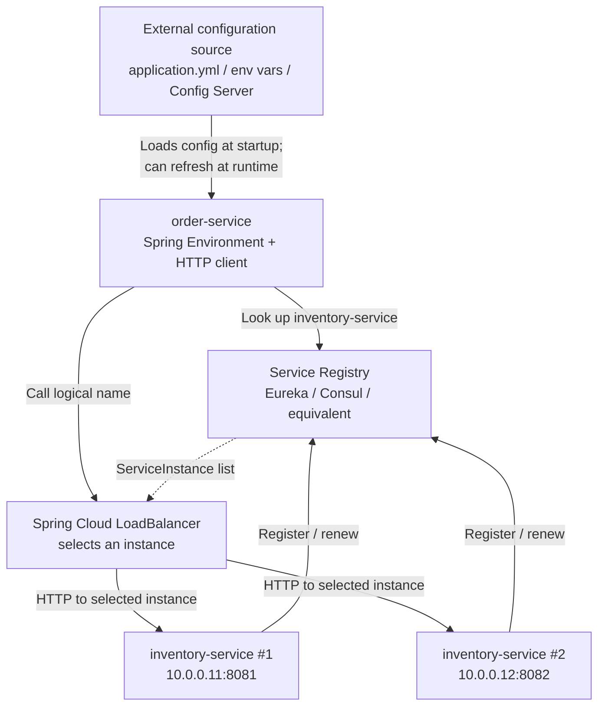
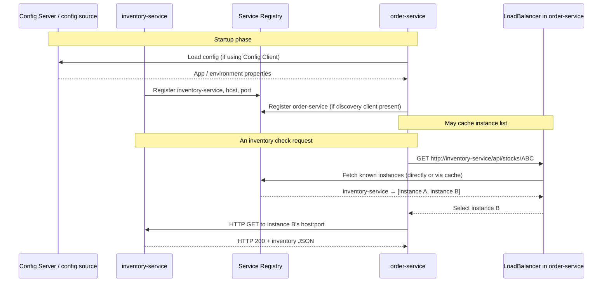

# Relationship Between Configuration, Service Discovery, and Service Invocation in Spring Cloud

## 1. Three Questions Behind Every Call in a Distributed System

Suppose an e-commerce system has two Spring Boot applications:

- `order-service` receives order creation requests and needs to know how much stock is left for a product.
- `inventory-service` exposes an inventory check API and may run concurrently on multiple machines or containers.

In a monolithic application, order-processing code can call another Java object directly. Once split into two services, `order-service` needs to answer three questions:

1. **Configuration:** Which service should I call, at which path, with what timeout and connection policy? Where do I get these values from?
2. **Service discovery:** Which concrete network addresses currently correspond to the logical name `inventory-service`?
3. **Service invocation:** Which instance do I pick, how do I send the HTTP request, and how do I handle network or instance failures?

The three activities are related but distinct. **Configuration describes how an application operates; service discovery supplies the list of available instances; service invocation uses that information to execute the request.** Spring Cloud provides abstractions so these activities can work together without coupling the application to hardcoded IP addresses or a single infrastructure product.

After completing this lesson, you will be able to trace a request from application startup to response, distinguish the roles of Config Server, Service Registry, and LoadBalancer, and identify the right layer to inspect when a request fails.

## 2. Overall Structure and Layer Responsibilities



The diagram separates the roles for clarity. In a Spring application, **Spring Cloud LoadBalancer typically runs inside the client process**, not as a network server sitting between two services. Depending on the discovery implementation, instance information may come from a cache refreshed periodically; not every HTTP request queries the registry over the network. Nor does a registry normally **forward HTTP request bodies**.

| Concept | Question solved | Representative abstractions / components |
| --- | --- | --- |
| **Externalized Configuration** | Which properties apply in the current environment? | Spring `Environment`, `application.yml`, environment variables, Config Data |
| **Spring Cloud Config** | How are configurations centralized and distributed across multiple apps? | Config Server, Config Client, `spring.config.import` |
| **Spring Cloud Context** | How are beans affected when configuration is refreshed? | `@RefreshScope`, application context refresh mechanism |
| **Service Registry** | Which instances are registered and still known? | Eureka, Consul, or equivalent registration mechanism |
| **DiscoveryClient** | Given a service ID, which `ServiceInstance` objects are found? | `DiscoveryClient#getInstances(String)` |
| **ServiceRegistry** | Register or deregister instances via a common API where supported | `ServiceRegistry` in Spring Cloud Commons |
| **Client-side Load Balancing** | Select one instance from the known set of instances | Spring Cloud LoadBalancer and `@LoadBalanced` clients |
| **HTTP Client / Service Invocation** | Execute requests, read responses, handle timeouts/errors | `RestClient`, `WebClient`, `RestTemplate`, OpenFeign |

Important point: adding a discovery library alone does not make every HTTP client automatically understand service-ID URLs. To call `http://inventory-service` as a logical name, the HTTP client must be properly integrated with a load balancer or an equivalent routing layer.

### 2.1. Configuration is input, not an instance map

A service can receive configuration from many sources: internal files, external files, environment variables, runtime arguments, and centralized configuration systems. Spring Boot aggregates these sources into `Environment` using its property precedence rules.

Example:

```yaml
spring:
  application:
    name: order-service
inventory:
  client:
    stock-path: /api/stocks
```

`spring.application.name` is the logical identity of the application; `inventory.client.stock-path` is an API convention the client will use. These values **do not indicate** which IP address `inventory-service` is running on. Answering that question belongs to discovery or another address-resolution mechanism, such as Kubernetes DNS.

### 2.2. Discovery is an instance list, not an HTTP request

A `ServiceInstance` typically provides information such as service ID, host, port, URI, and metadata. Multiple instances can share the same service ID. As the cluster scales out or in, this list changes over time.

```java
// Used to inspect discovery info; no need to call manually
// on every request if using a @LoadBalanced client.
List<ServiceInstance> instances =
    discoveryClient.getInstances("inventory-service");

instances.forEach(instance ->
    System.out.println(instance.getHost() + ":" + instance.getPort()));
```

`DiscoveryClient` is the lookup interface; `ServiceRegistry` is the interface for registration/deregistration operations on implementations that support it. Self-registration, heartbeat renewal, health checks, and deregistration depend on the discovery library and deployment platform. The two interfaces are related but do not replace each other.

### 2.3. Load balancing is the bridge between discovery and the HTTP client

With two instances of `inventory-service`, the load balancer can choose instance A for one request and instance B for another. Algorithms, caching, health checks, sticky sessions, retries, and instance filters depend on the actual configuration and installed components.

Selecting an instance **does not guarantee** the call will succeed: the registry may not have evicted a failed instance yet, the network may drop after selection, or the target application may return a business error. Therefore, timeouts, controlled retries, resource protection, and system observability must work together.

## 3. Sequence from Startup to Response



In practice, startup events can occur in parallel or in a different order. The diagram depicts **logical dependencies**, not a requirement that Config Server, the registry, and applications start strictly in that sequence.

1. **Load configuration:** Spring Boot creates `Environment` and reads configuration sources. If Spring Cloud Config Client is present, Config Data can be loaded from Config Server via `spring.config.import`.
2. **Initialize beans:** The application creates HTTP clients, load balancers, and beans using configuration. `@Value` or `@ConfigurationProperties` pull values from `Environment`.
3. **Register/discover:** The discovery implementation supplies instance information; the application can register itself while looking up other services.
4. **Handle request:** Business code calls a URL containing a service ID. The load balancer obtains the available instances it sees and picks one entry.
5. **Send request and receive response:** The HTTP client connects to the instance address; network errors, HTTP errors, timeouts, and returned payloads must be handled at the service-invocation/business layer.
6. **At runtime:** Configuration and instance lists can change through two separate mechanisms. Refreshing configuration does not mean immediately refreshing all discovery data; registry changes also do not automatically update all application beans.

## 4. Example: `order-service` Calling `inventory-service` via Eureka

The following example uses Spring Boot with `RestClient` support (Spring Framework 6.1+), Spring Cloud Commons, Spring Cloud LoadBalancer, Eureka Discovery Client, and **optionally** Spring Cloud Config Client. The goal is to illustrate the call path; Eureka/Config servers and build configuration must be prepared accordingly.

**Required dependencies, per application:**

| Application | Key dependency | Purpose |
| --- | --- | --- |
| Both services | `spring-boot-starter-web` | Run HTTP APIs and use `RestClient` |
| Both services | `spring-cloud-starter-netflix-eureka-client` | Register/discover instances via Eureka |
| `order-service` | `spring-cloud-starter-loadbalancer` | Provide client-side load balancing |
| Apps using Config Server | `spring-cloud-starter-config` | Load centralized configuration |
| Optional | `spring-boot-starter-actuator` | Health, metrics, and operational endpoints |

When using Maven, import the `spring-cloud-dependencies` BOM compatible with the project's Spring Boot version to manage Spring Cloud starter versions. Do not arbitrarily pair a Spring Boot version with a Spring Cloud release train; version selection is covered in Section 8.

### 4.1. Declaring `inventory-service`

```yaml
# inventory-service/src/main/resources/application.yml
server:
  port: 8081

spring:
  application:
    name: inventory-service

eureka:
  client:
    serviceUrl:
      defaultZone: http://localhost:8761/eureka/
```

`inventory-service` can expose an illustrative API:

```java
import org.springframework.web.bind.annotation.GetMapping;
import org.springframework.web.bind.annotation.PathVariable;
import org.springframework.web.bind.annotation.RequestMapping;
import org.springframework.web.bind.annotation.RestController;

@RestController
@RequestMapping("/api/stocks")
class StockController {
    @GetMapping("/{sku}")
    StockResponse getStock(@PathVariable String sku) {
        // Fixed value for illustration. In practice reads from a data store.
        return new StockResponse(sku, 12);
    }

    record StockResponse(String sku, int available) {}
}
```

Run a second instance of the same application with `--server.port=8082`. Both instances share `spring.application.name` but bind to different ports, so the registry can return two addresses under the same service ID.

### 4.2. Declaring `order-service`

```yaml
# order-service/src/main/resources/application.yml
server:
  port: 8080

spring:
  application:
    name: order-service
  config:
    import: "optional:configserver:http://localhost:8888"

eureka:
  client:
    serviceUrl:
      defaultZone: http://localhost:8761/eureka/

inventory:
  client:
    stock-path: /api/stocks
```

Meaning of the properties:

- `spring.application.name`: logical name of `order-service` itself, also commonly used by Config Client to locate the matching configuration set.
- `spring.config.import`: instructs reading configuration from Config Server. The `optional:` prefix lets the application continue starting if this source cannot be loaded; if centralized configuration is mandatory, use a proper fail-fast policy instead of allowing missing configuration.
- `eureka.client.serviceUrl.defaultZone`: address of **Eureka Server**, not the address of `inventory-service`. `defaultZone` is a Eureka key with specific casing.
- `inventory.client.stock-path`: API path managed by the application. Can be placed in local config or an external source per environment.

**Note:** The example assumes a Config Server on port 8888 if the Config Client dependency is included, a Eureka Server on port 8761, and that services can reach those addresses. If you are not running Config Server, omit the Config Client dependency and the `spring.config.import` line; discovery/load balancing still works when Eureka is available.

### 4.3. Creating a `RestClient` capable of calling by service ID

```java
import org.springframework.cloud.client.loadbalancer.LoadBalanced;
import org.springframework.context.annotation.Bean;
import org.springframework.context.annotation.Configuration;
import org.springframework.web.client.RestClient;

@Configuration
class HttpClientConfig {
    @Bean
    @LoadBalanced
    RestClient.Builder loadBalancedRestClientBuilder() {
        return RestClient.builder();
    }
}
```

`@LoadBalanced` attaches service ID resolution and instance selection capabilities to a Spring-managed `RestClient.Builder` when an appropriate Spring Cloud LoadBalancer integration is present. Service-calling code:

```java
import org.springframework.beans.factory.annotation.Value;
import org.springframework.cloud.client.loadbalancer.LoadBalanced;
import org.springframework.cloud.context.config.annotation.RefreshScope;
import org.springframework.stereotype.Service;
import org.springframework.web.client.RestClient;

@Service
@RefreshScope
public class InventoryGateway {
    private final RestClient client;
    private final String stockPath;

    public InventoryGateway(
            @LoadBalanced RestClient.Builder builder,
            @Value("${inventory.client.stock-path:/api/stocks}") String stockPath) {
        this.client = builder.build();
        this.stockPath = stockPath;
    }

    public StockResponse findStock(String sku) {
        return client.get()
                .uri("http://inventory-service" + stockPath + "/{sku}", sku)
                .retrieve()
                .body(StockResponse.class);
    }

    public record StockResponse(String sku, int available) {}
}
```

Here:

- `inventory-service` in the URL is a **service ID**, not a DNS hostname hardcoded to a single container.
- The load balancer looks up instances matching this ID and uses the host/port of the chosen instance.
- `stockPath` comes from configuration; changing the API path does not force changing the service ID.
- `@RefreshScope` allows the bean to be recreated with updated properties **after an actual refresh event occurs**. Editing a file on Config Server alone does not mean the bean updates immediately.
- `retrieve()` handles HTTP responses; real-world calls must add timeouts, error handling, JSON compatibility guarantees, and an appropriate retry policy.

A controller in `order-service` can use the gateway:

```java
import org.springframework.web.bind.annotation.GetMapping;
import org.springframework.web.bind.annotation.PathVariable;
import org.springframework.web.bind.annotation.RequestMapping;
import org.springframework.web.bind.annotation.RestController;

@RestController
@RequestMapping("/api/orders")
class OrderController {
    private final InventoryGateway inventoryGateway;

    OrderController(InventoryGateway inventoryGateway) {
        this.inventoryGateway = inventoryGateway;
    }

    @GetMapping("/inventory/{sku}")
    InventoryGateway.StockResponse stock(@PathVariable String sku) {
        return inventoryGateway.findStock(sku);
    }
}
```

With infrastructure and applications running, `GET http://localhost:8080/api/orders/inventory/ABC` flows through controller → gateway → `@LoadBalanced RestClient` → an `inventory-service` instance → JSON `{"sku":"ABC","available":12}`.

This is an architectural illustration: fixed stock values, no database, authentication, domain error handling, or production resilience policies yet. Java sources in each application must reside in that application's proper package.

### 4.4. When not using Eureka or not using RestClient

**Service discovery is an abstraction.** You can choose Eureka, Consul, or another discovery implementation. With Kubernetes, applications can also call the `inventory-service` DNS provided by a Kubernetes Service and let infrastructure handle load balancing; in that case Eureka or Spring Cloud DiscoveryClient is not strictly required. Do not assume DNS and use `@LoadBalanced` simultaneously without clearly deciding the desired resolution mechanism.

Similarly, a project can use `@LoadBalanced WebClient.Builder` for WebFlux, `RestTemplate` in legacy code, or Spring Cloud OpenFeign with `@FeignClient(name = "inventory-service")`. Exact integration, timeouts, error handling, and support depend on the starters and versions in use. The general meaning remains: **the client calls a logical name; the resolution and instance-selection layer turns that name into a real network destination**.

## 5. When Things Change: How Configuration and Instances Affect Each Other

Two important change streams must be distinguished.

### 5.1. Configuration changes

Suppose the development team changes `inventory.client.stock-path` from `/api/stocks` to `/api/v2/stocks` in the centralized configuration source. Config Server may serve the new value, yet a running `order-service` can still hold the previous value in `Environment` or inside beans until a refresh mechanism is properly triggered.

With Spring Cloud Context, beans using `@RefreshScope` can be recreated on refresh to read updated configuration. In some architectures, refresh can be triggered proactively via management mechanisms or event distribution such as Spring Cloud Bus. **Refresh is not a mechanism that automatically synchronizes every property or every singleton bean.** Some settings require a restart for changes to take effect safely. Management endpoints such as `/actuator/refresh` (when enabled and supported) must be protected and never exposed to the public Internet.

If `spring.application.name` or discovery settings change, that change can affect **service identity, registration behavior, or lookup targets**; do not assume bean refresh alone is enough. For infrastructure-level changes of this kind, redeploying/restarting and verifying registry state are typically required.

### 5.2. Instance list changes

Suppose `inventory-service` scales from two to three instances. The new instance registers in the registry, and `order-service`'s discovery client/load balancer gradually observes the updated address set. `inventory.client.stock-path` itself does not need to change—that is the benefit of using a logical name rather than fixed IPs.

Conversely, when an instance stops abruptly, it may not be removed from the list immediately. This inconsistency window depends on heartbeats/leases, health checks, caching, and synchronization mechanisms. A few requests may still hit the dead instance; configure timeouts, bounded retries, and suitable API designs.

| Scenario | What changes | Primary affected layer | What to verify |
| --- | --- | --- | --- |
| API path changes per environment | `inventory.client.stock-path` | Configuration + client bean | Has the new property been loaded/refreshed; does the new API exist? |
| Scaling out instances | `ServiceInstance` list | Registry + Discovery + LoadBalancer | Has the new instance registered and become visible to the client? |
| An instance fails | Health, network connection, lease | Discovery + HTTP | Does the client time out and evict/skip the failing instance per policy? |
| Changing Eureka address | `eureka.client.serviceUrl.defaultZone` | Discovery infrastructure | Has the client reconnected to the registry and reinitialized properly? |
| Config Server unavailable | Centralized configuration source | Config bootstrap | Does the service fail fast or is it allowed to use other configuration? |
| Changing service ID | `spring.application.name` or client service name | Config + registration + lookup | Do caller and provider agree on the naming convention? |

**There is no one-to-one relationship between “refreshing configuration” and “refreshing discovery.”** They operate on different lifecycles. Configuration determining the target service name is merely one intersection between those two lifecycles.

## 6. Fault Tolerance and Misleading Assumptions

### 6.1. Service discovery does not replace timeouts

Discovery returns target information based on a point-in-time view. Afterward, a request can still fail due to socket timeouts, DNS, TLS, connection refused, an overloaded instance, or 5xx API responses. In practice you need to:

- Set finite **connection timeouts** and **response/read timeouts** aligned with the business flow's SLA.
- Distinguish network errors from HTTP 4xx/5xx errors when deciding whether to retry.
- Cap retry counts, apply backoff/jitter where appropriate, and avoid load amplification during outages.
- Retry safely only for idempotent operations or where idempotency is guaranteed (e.g., an idempotency key for order creation).
- Consider circuit breakers, bulkheads, or concurrency limits in a dedicated layer when high resilience is required; these mechanisms do not appear automatically just by adding a discovery starter.

### 6.2. One URL has two different interpretations

```text
http://inventory-service/api/stocks/ABC
```

- With a plain `RestClient`, `inventory-service` may be treated as a **hostname** and require DNS resolution.
- With a `@LoadBalanced RestClient`, `inventory-service` is treated as a **service ID** and looked up by LoadBalancer via the configured discovery implementation.

The text in the URL looks identical, yet the network path can be completely different. This is a common cause when an application “finds the service in Eureka” but the HTTP client still reports a hostname resolution failure.

### 6.3. A registry is not necessarily a separate component

Eureka/Consul provide centralized or clustered registries. In Kubernetes, DNS and Services/EndpointSlices can supply target addresses; a system can also apply `SimpleDiscoveryClient` with a property-defined instance list for small environments or tests. **Spring Cloud Commons defines the contract**, while who owns the endpoint list and keeps it updated depends on the environment.

### 6.4. Config Server is not a prerequisite for service discovery

An application can:

- Read all configuration from `application.yml` and environment variables while still using Eureka + LoadBalancer.
- Use Config Server to distribute properties while calling fixed URLs or DNS without a separate registry.
- Combine Config Server, a registry, and a load balancer when centralized config management and multiple dynamic instances are needed.

Choose the model based on existing infrastructure. Not every Spring Cloud project has to deploy all of those products.

## 7. Testing the Configuration → Discovery → Invocation Flow

Test each responsibility separately, then test the integrated flow. Below is a suggested list of test scenarios; you do not need to spin up a full production system to test everything in a single suite.

| Testing level | Action | Expected result |
| --- | --- | --- |
| Configuration | Run `order-service` with different `inventory.client.stock-path` values per profile | Gateway builds the matching paths; missing required config is caught |
| Discovery | Start `inventory-service` and inspect instances via Eureka or `DiscoveryClient` | Valid service ID and host/port appear |
| Client integration | Have at least one real or stub `inventory-service` returning contract-compliant JSON | `order-service` returns valid data without depending on hardcoded IPs |
| Scaling | Start a second instance on another port | Instance list updates; requests can be observed reaching available instances |
| Failure | Stop one instance, inject latency, or break connections | Timeouts/error handling behave as designed; no infinite hangs |
| Refresh | Change a refresh-supported property and trigger refresh in a controlled way | `@RefreshScope` bean reads the new value and calls reflect the change |
| API contract | Change `inventory-service` JSON/status codes | Client detects incompatible changes before deployment |

When writing unit tests for business logic, `InventoryGateway` can be mocked. When testing service ID resolution and instance selection, write integration tests with a load balancer and a controlled instance source; a unit test mocking the gateway does not prove discovery works.

A minimal manual walkthrough:

1. Start Eureka Server at `localhost:8761`. If using Config Client, also start Config Server at `localhost:8888` with valid configuration; otherwise omit the import as in Section 4.2.
2. Run `inventory-service` on 8081, then start another instance on 8082; verify both appear under the same name in the registry.
3. Run `order-service` on 8080 and send `GET /api/orders/inventory/ABC`; confirm the returned JSON.
4. Stop one instance, observe discovery update latency and HTTP behavior; inspect timeout logs, instance selection, and HTTP errors if any.
5. Try updating `stock-path` and triggering the configured refresh mechanism; compare the active runtime value with the change in the configuration source.

## 8. Spring Boot – Spring Cloud Version Compatibility

Shared mechanisms live inside the Spring Boot/Spring Cloud ecosystem, yet **support and auto-configuration change across versions**. This is part of correctness, not merely a library upgrade chore.

- Spring Cloud is published in **release trains**. Select a release train compatible with your Spring Boot version according to the official compatibility matrix, then import the `spring-cloud-dependencies` BOM.
- Use starters matched to each responsibility: Config Client for Config Server, a discovery starter for the registry, Spring Cloud LoadBalancer for client-side load balancing, and the corresponding HTTP client.
- `RestClient` belongs to Spring Framework 6.1 and later; on older version stacks, consider `RestTemplate` or `WebClient` and the matching load balancer integration.
- Identically named dependencies do not guarantee identical auto-configuration across generations. After upgrading versions, re-verify `@LoadBalanced` beans, `spring.config.import` handling, management endpoints, and discovery starters.
- Do not pick the latest release train just because it is newest. The version **compatible with your project's Spring Boot and JDK** is the right choice.

Verification resources for real projects: [Spring Cloud](https://spring.io/projects/spring-cloud) (release trains and compatibility), [Spring Cloud Commons](https://docs.spring.io/spring-cloud-commons/reference/) (DiscoveryClient, ServiceRegistry, LoadBalancer, RefreshScope), [Spring Cloud Config](https://docs.spring.io/spring-cloud-config/reference/) (Config Client/Server), and documentation for the chosen discovery implementation.

## 9. Observability and Troubleshooting at the Right Layer

When a request fails to travel from `order-service` to `inventory-service`, trace in the order **configuration → registry/discovery → instance selection → HTTP connection → target API**. This approach avoids mistaking a network-layer error for a Config Server bug, or vice versa.

| Symptom | Likely causes to check | Where to check first |
| --- | --- | --- |
| App fails immediately on startup | Config source unreachable, missing required property, incompatible dependency versions | Config Data / bean creation logs; config sources and precedence |
| Eureka does not show `inventory-service` | Wrong `defaultZone`, not registered yet, network/health/lease issue | Eureka Client config, registration logs, instance host/port |
| Registry has instances, but client reports no servers | Service ID mismatch, stale discovery cache, missing LoadBalancer integration | `DiscoveryClient#getInstances`; `@LoadBalanced` bean; cache and service ID |
| Hostname resolution error for `inventory-service` | Plain HTTP client is using DNS instead of discovery | Inspect injected client and URL resolution mechanism |
| Some requests time out or get connection refused | Dead instance, unroutable address, stale cache | Selected instance, route, timeout, per-instance logs |
| HTTP 404 despite successful discovery | Wrong path or API version | `stock-path` property, controller mapping, API contract |
| Config Server changed, but old behavior persists | Not refreshed yet, bean does not support refresh, or property overridden | `Environment` values, refresh trigger, bean lifecycle |
| Breaks only after upgrading dependencies | Incompatible Spring Boot and Spring Cloud, changed auto-configuration | Compatibility matrix, dependency tree, startup condition evaluation report |

In operations, maintain **logs carrying correlation/trace IDs**, response latencies, error rates, timeouts, and metrics per service/endpoint/instance. If using Actuator and Micrometer, pick appropriate health/metrics endpoints, secure management endpoints, and avoid logging secrets. A request traced across services pinpoints whether failure occurred while loading configuration, selecting an instance, connecting over the network, or executing the API.

## 10. Design Principles to Uphold

1. **Separate logical names from physical addresses.** Configuration and business code should use stable service IDs; host/port lists belong to discovery or routing infrastructure.
2. **Configuration reflects deployment environments.** Timeouts, endpoints, and infrastructure connections can vary by profile/external source. Never put secrets directly into source code; manage secrets and config source permissions properly.
3. **Service registration does not mean readiness to serve requests.** Pair health/readiness probes, timeouts, and error policies with registry update latency.
4. **Load balancing does not mean retry or circuit breaking.** Each capability requires explicit libraries, configuration, and verification.
5. **Configuration refresh has boundaries.** Refresh-scoped beans can receive updated configuration after a refresh event; changing service names, ports, registration mechanics, or foundational connections may require a restart.
6. **Maintain Boot–Cloud compatibility.** Spring Cloud Commons provides consistent abstractions, yet specific starters and APIs are only safe on supported, tested version combinations.

With the `order-service` and `inventory-service` example, the entire journey of a call reads as a simple chain: **read configuration to know how to call → find instances of the service name → select an instance → send HTTP and handle the outcome**. During scaling, failover, or configuration updates, each link has its own lifecycle and limits; understanding those boundaries is foundational to designing and operating microservices with Spring Cloud.
