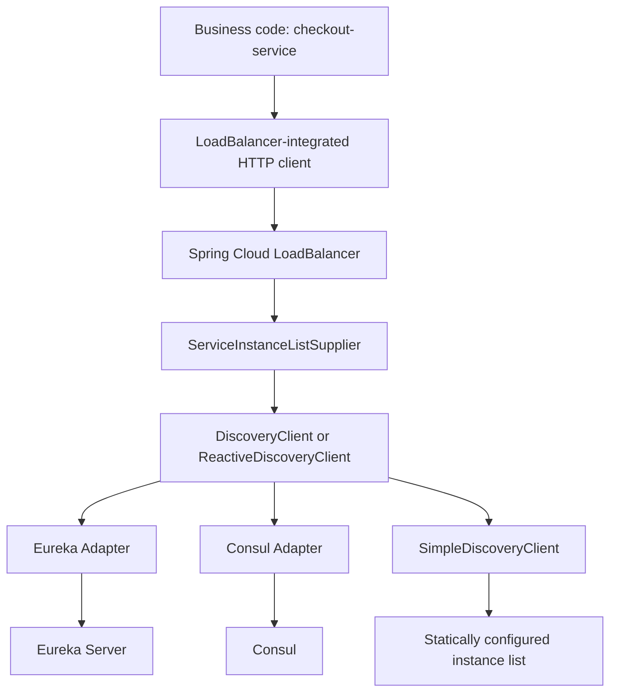

# Shared Abstractions and Provider-Specific Implementations

In a distributed system, a service often needs to locate another service, pick a healthy address, register itself in a service discovery system, retrieve external configuration, and react when configuration changes. If business code directly calls the APIs of systems such as Eureka, Consul, or ZooKeeper, every infrastructure change forces application code changes. Spring Cloud addresses part of this problem with **common abstractions** and **provider-specific implementations**.

This lesson belongs to the **Overview** chapter of **SPRING_CLOUD_CORE**: focusing on Spring Cloud Commons, Spring Cloud Context, discovery, service registry, client-side load balancing, externalized configuration, and compatibility boundaries with Spring Boot. The goal is to identify accurately *which contracts remain stable*, *which libraries implement those contracts*, and *which differences still must be handled when switching providers*.

## 1. Learning Objectives

After this lesson, you will be able to:

- Distinguish abstract APIs, implementations, starters, and Spring Boot/Spring Cloud auto-configuration mechanisms.
- Explain the roles of `DiscoveryClient`, `ReactiveDiscoveryClient`, `ServiceInstance`, `ServiceRegistry`, and `Registration`.
- Describe how Spring Cloud LoadBalancer leverages discovery data without forcing business code to depend directly on Eureka or Consul.
- Identify which parts belong to Spring Cloud Commons, Spring Cloud Context, and which parts are optional integrations.
- Migrate a static discovery example to a real provider while stating the conditions for a safe transition.
- Design tests and a diagnostic workflow when service registration, instance lookup, address selection, or configuration refresh fails.

## 2. Why Is an Abstraction Layer Needed?

Suppose `checkout-service` needs to call `inventory-service`. In development, inventory might run at `localhost:8082`; in production, the service runs multiple instances that are frequently recreated and change addresses and ports. The problem consists of three independent steps:

1. **Logical naming:** the application knows the name `inventory-service` without hardcoding individual machine addresses.
2. **Discovery:** find the instances matching the logical name at the time of use.
3. **Select and call:** decide which instance receives the request, then execute HTTP/gRPC or another protocol.

The system also has a reverse flow: each instance must **register** itself or be registered by the platform into the data source used by discovery.

If all of this logic lived in the business layer, source code would have to understand each provider's specific registration API, return objects, health rules, and selection logic. An abstraction layer allows business code to express needs at a level such as “find instances of service X,” while an integration adapter handles talking to the concrete infrastructure.

> **Principle:** abstract *the contract the application consumes*; do not automatically assume *all operational behaviors of providers are identical*.

### 2.1. Four common layers

| Layer | Role | Examples |
| --- | --- | --- |
| Application code | Expresses business requirements, such as checking stock | `InventoryClient`, `CheckoutService` |
| Common contracts | Describes how to locate services or represent an instance | `DiscoveryClient`, `ServiceInstance` in Spring Cloud Commons |
| Integrations and supporting mechanisms | Provides beans, instance selection, and translation between HTTP clients and service names | Spring Cloud LoadBalancer, auto-configuration, discovery adapters |
| Provider infrastructure | Manages registration records, instance status, configuration, and proprietary APIs | Eureka Server, Consul Agent/Server, ZooKeeper, Kubernetes API |

A **starter** is a convenient dependency bundle to activate an integration; **auto-configuration** registers beans when classpath and configuration conditions are met. A starter is not the API contract itself, and having a starter on the classpath does not guarantee the corresponding infrastructure server is running.

### 2.2. Dependency flow diagram



The diagram shows **conceptual relationships**. In a concrete application, auto-configuration, sync/async client type, supplier chain, caching, and enabled providers determine which actual beans participate. The **service registration** flow runs in a different direction from the **discovery query** flow.

## 3. Spring Cloud Commons: Shared Contracts

Spring Cloud Commons provides interfaces and data types shared across many Spring Cloud projects. Distinguish **APIs in Commons** from **libraries implementing those APIs**: Commons does not turn an application into a Eureka Server or Consul Agent by itself.

### 3.1. `ServiceInstance`: representing a destination

`org.springframework.cloud.client.ServiceInstance` represents one instance of a service, typically providing:

| Property / Method | Meaning |
| --- | --- |
| `getServiceId()` | Logical name of the service, e.g., `inventory-service` |
| `getHost()`, `getPort()` | Published host address and port |
| `isSecure()` | Indicator of whether a secure connection is used |
| `getUri()` | URI to access the instance |
| `getMetadata()` | Key–value metadata of the instance |

This is an **information exchange model**. It does not guarantee that all metadata carries the same semantics across providers, or that a returned instance is definitely reachable at the moment of invocation. For instance, deployment zones, weights, tags, versions, or health states can be modeled differently; such attributes require system-level conventions.

### 3.2. `DiscoveryClient`: synchronous service lookup

The `org.springframework.cloud.client.discovery.DiscoveryClient` interface provides two core operations:

```java
public interface DiscoveryClient {
    String description();
    List<ServiceInstance> getInstances(String serviceId);
    List<String> getServices();
}
```

`getServices()` returns the service names known to the client; `getInstances(serviceId)` returns instances matching that name. The list may be empty if the service has not registered, the registry is unavailable, data has expired, or filters excluded all instances.

An application can have **multiple** discovery clients. `CompositeDiscoveryClient` is Spring Cloud Commons' ordered aggregation mechanism; do not assume results from every source are always merged into one unified set or share the same freshness.

Example reading instance information for diagnostics:

```java
import java.net.URI;
import java.util.List;
import org.springframework.cloud.client.ServiceInstance;
import org.springframework.cloud.client.discovery.DiscoveryClient;
import org.springframework.stereotype.Service;

@Service
public class InventoryDirectory {
    private final DiscoveryClient discoveryClient;

    public InventoryDirectory(DiscoveryClient discoveryClient) {
        this.discoveryClient = discoveryClient;
    }

    public List<URI> knownInventoryEndpoints() {
        return discoveryClient.getInstances("inventory-service").stream()
                .map(ServiceInstance::getUri)
                .toList();
    }
}
```

The snippet above **only lists addresses**. Do not pick the first item in the list and treat it as a load-balancing algorithm; doing so ignores instance-selection strategies, caching, error handling, and changes to the instance set over time.

### 3.3. `ReactiveDiscoveryClient`: the asynchronous variant

`ReactiveDiscoveryClient` provides reactive access to discovery data, with corresponding methods returning `Flux<ServiceInstance>` and `Flux<String>`. This is the appropriate API when the application layer operates in a reactive pipeline.

The difference is not in the registry name: a provider may support synchronous discovery, reactive discovery, or both depending on the module and version. When designing an architecture, check the bean types and integration style of the chosen provider. Introducing a blocking synchronous API inside a reactive pipeline must be reviewed carefully.

### 3.4. `Registration` and `ServiceRegistry`: registration lifecycle

`Registration` extends the `ServiceInstance` concept to represent an instance used when **registering itself**. `ServiceRegistry<R extends Registration>` defines operations such as `register`, `deregister`, `setStatus`, `getStatus`, and `close`.

Key points:

- **Discovery** answers “which instances currently exist?”; **registration** answers “how does my instance appear in the registry?”.
- Not every provider uses the same active self-registration model. For example, in Kubernetes, endpoints may be derived from platform resources rather than the application directly registering through a traditional registry API.
- How leases, heartbeats, health checks, `UP`/`DOWN` status, and shutdown deregistration are maintained is **provider-specific behavior**.
- Spring Cloud provides auto-registration in supported integrations. Typical business code does not need to call `ServiceRegistry.register(...)` manually.

For example, if an instance registers successfully but fails health checks, the registry may exclude it from the ready-instances list. Conversely, stale cached data can also cause a client to temporarily continue seeing a stopped instance.

### 3.5. Load-balancing: a separate instance-selection layer

Spring Cloud Commons defines several load-balancing integration interfaces; **Spring Cloud LoadBalancer** is the modern implementation commonly used for client-side instance selection. Notable concepts:

- `ServiceInstanceListSupplier` supplies the instance list and can be composed with filtering, caching, or request-aware steps.
- `ReactorServiceInstanceLoadBalancer` is the instance-selection contract in Spring Cloud LoadBalancer's reactive mechanism.
- `@LoadBalanced` marks HTTP client builders/templates configured to resolve a service name to an appropriate instance.
- `LoadBalancerClientFactory` manages load-balancer configuration components per service name.

Note: selection algorithms, caching, retries, health checks, and extra rules **are not automatically identical** across all configurations. Discovery and load-balancing have distinct responsibilities: discovery supplies *candidates*, while the load balancer chooses the *call target*.

## 4. Provider-Specific Implementations

When a provider's dependency is added and connection settings are configured properly, Spring Boot/Spring Cloud normally creates the required integration beans via auto-configuration. Code using `DiscoveryClient` still calls the same interface, yet underlying behaviors still depend on the infrastructure.

| Option | Instance list source | Characteristics to note |
| --- | --- | --- |
| `SimpleDiscoveryClient` | URI list configured inside the application | Helpful for development/testing; provides no health checks, registration, or distributed registry sync |
| Spring Cloud Netflix Eureka | Eureka Server | Registration and lease/heartbeat model, data refresh intervals, and its own status mechanism |
| Spring Cloud Consul Discovery | Consul | Registry, health checks, tags, and metadata per Consul; requires connection to Consul Agent/Server |
| Spring Cloud Zookeeper Discovery | ZooKeeper | Node/session mechanics and connection state affect discovery data |
| Spring Cloud Kubernetes Discovery | Kubernetes API and related resources | Depends on API permissions, namespaces, Services/EndpointSlices, and deployment style; not identical to Eureka-style active registration |

The table describes **integration directions**; it does not mean every starter shares the same beans, properties, registration capability, or version compatibility. Choose a provider by checking the official documentation for your exact Spring Cloud release train and deployment platform.

### 4.1. What can change while business code stays the same?

When only the discovery source changes, code querying `DiscoveryClient#getInstances("inventory-service")` can remain unchanged. An HTTP client configured to call by logical name can also remain unchanged when instance data moves from a static list to Consul or Eureka.

What usually **must change** includes dependencies, connection settings, access permissions, registration mechanics, health check configuration, metadata conventions, and registry operations. Therefore, swapping providers at the API level is a design advantage, though it does not mean migrating infrastructure is always a one-line config change.

### 4.2. Distinguishing core support from additional integrations

| Need | Shared part | Integration or add-on part |
| --- | --- | --- |
| Find instances by name | `DiscoveryClient`, `ReactiveDiscoveryClient`, `ServiceInstance` | Eureka/Consul/ZooKeeper/Kubernetes Discovery or static source |
| Register instances | `Registration`, `ServiceRegistry`, and corresponding auto-registration | Provider's registration, lease, heartbeat, and health check mechanics |
| Select an instance for a call | Load-balancer contracts and `ServiceInstance` model | Spring Cloud LoadBalancer, `WebClient`/`RestTemplate`/`RestClient` integration by version |
| Application configuration | Spring Boot `Environment`, `PropertySource`, `@ConfigurationProperties` | Spring Cloud Config Client, Consul Config, platform mechanisms |
| Refresh beans when configuration changes | Spring Cloud Context with `@RefreshScope` and refresh infrastructure | Change detection source, endpoint/event, Spring Cloud Bus, or custom mechanism |
| Declarative HTTP client | HTTP client/framework API | Spring Cloud OpenFeign and load-balancing adapters if used |

**Spring Cloud OpenFeign**, **Spring Cloud Config**, or **Spring Cloud Bus** are related projects/capabilities and should not be assumed to reside entirely inside Spring Cloud Commons. Similarly, `Environment` and `@ConfigurationProperties` belong to the Spring/Spring Boot foundation; Spring Cloud adds ways to load, update, and propagate configuration.

## 5. Complete Example: Calling a Service by Logical Name

Consider a `checkout-service` that needs to read data from `inventory-service`. We build a version using static discovery to see the exact API boundaries, then swap in a real provider.

### 5.1. Declaring libraries

The following Gradle example assumes the project **already configured dependency management/BOM for a Spring Cloud release train compatible with the installed Spring Boot version**:

```groovy
dependencies {
    implementation 'org.springframework.boot:spring-boot-starter-webflux'
    implementation 'org.springframework.cloud:spring-cloud-starter-loadbalancer'
}
```

`spring-boot-starter-webflux` provides `WebClient`; `spring-cloud-starter-loadbalancer` supports service-name resolution and instance selection. Do not assign disparate versions manually to individual Spring Cloud starters when using a BOM: choose a Boot/Cloud version pair from the **official compatibility matrix** of the release train in use.

### 5.2. Static discovery configuration

In `checkout-service`'s `application.yml`:

```yaml
spring:
  application:
    name: checkout-service
  cloud:
    discovery:
      client:
        simple:
          instances:
            inventory-service:
              - uri: http://localhost:8082
              - uri: http://localhost:8083
```

The URIs are examples; two `inventory-service` instances must actually run on those ports for calls to succeed. Simple discovery suits exercises or fixed environments; it does not automatically probe whether declared addresses are alive or dead.

### 5.3. Registering a load-balanced builder

```java
import org.springframework.cloud.client.loadbalancer.LoadBalanced;
import org.springframework.context.annotation.Bean;
import org.springframework.context.annotation.Configuration;
import org.springframework.web.reactive.function.client.WebClient;

@Configuration
public class ClientConfiguration {

    @Bean
    @LoadBalanced
    public WebClient.Builder loadBalancedWebClientBuilder() {
        return WebClient.builder();
    }
}
```

`@LoadBalanced` is the integration point: requests going through a properly configured builder can use a service name in the URI. It requires the right load-balancer dependency/configuration and a suitable instance source. Putting `http://inventory-service` on a plain HTTP client **does not** activate Spring Cloud discovery automatically.

### 5.4. Business code that only knows the service name

```java
import org.springframework.cloud.client.loadbalancer.LoadBalanced;
import org.springframework.stereotype.Service;
import org.springframework.web.reactive.function.client.WebClient;
import reactor.core.publisher.Mono;

record StockView(String sku, int available) {}

@Service
public class InventoryClient {
    private final WebClient webClient;

    public InventoryClient(@LoadBalanced WebClient.Builder builder) {
        this.webClient = builder
                .baseUrl("http://inventory-service")
                .build();
    }

    public Mono<StockView> getStock(String sku) {
        return webClient.get()
                .uri("/api/stocks/{sku}", sku)
                .retrieve()
                .bodyToMono(StockView.class);
    }
}
```

Here `inventory-service` is a **service ID**, not a hardcoded physical hostname. In a typical call path:

1. `InventoryClient` issues a request carrying service ID `inventory-service`.
2. Spring Cloud LoadBalancer integration recognizes the logical name.
3. The supplier retrieves `ServiceInstance` entries from discovery, potentially through caches and filtering steps.
4. The load balancer picks an instance per the configured policy.
5. The HTTP client executes the request against the selected instance's host, port, and scheme.

The example omits timeouts, retries, circuit breakers, service-to-service authentication, and failure handling. Those capabilities must be designed explicitly for production; load balancing **does not replace** them automatically.

### 5.5. Switching to Consul Discovery

Keep `InventoryClient` and the builder above unchanged. Replace the static discovery configuration with an appropriate Consul integration:

```groovy
dependencies {
    implementation 'org.springframework.boot:spring-boot-starter-webflux'
    implementation 'org.springframework.cloud:spring-cloud-starter-loadbalancer'
    implementation 'org.springframework.cloud:spring-cloud-starter-consul-discovery'
}
```

```yaml
spring:
  application:
    name: checkout-service
  cloud:
    consul:
      host: localhost
      port: 8500
      discovery:
        service-name: checkout-service
```

This example assumes Consul is running at `localhost:8500`, and `inventory-service` instances are registered with the proper service ID and health checks. Beyond the lines above, a real system needs reachable addresses, service registration, ACL/tokens when secured, health-check intervals, and matching network settings. Do not leave illustrative `simple.instances` configuration mixed into a migration test environment if it could pollute the discovery data source.

Switching to Eureka uses the corresponding Eureka dependency and properties; the contract with `InventoryClient` remains the same. Exact configuration details also depend on the Spring Cloud version and each environment's setup.

## 6. Spring Cloud Context and Externalized Configuration

Discovery/registry handles **service locations**; externalized configuration handles **values controlling application behavior**. Both needs appear in distributed systems but belong to different layers.

Spring Boot builds `Environment` from multiple `PropertySource` entries according to precedence rules. Spring Cloud Context adds capabilities such as `@RefreshScope`, refresh support, and configuration integration hooks. An external source can be Spring Cloud Config Server, Consul Config, or a platform mechanism; each source has different connection, security, and update semantics.

### 6.1. Three operations easily confused

| Operation | Means | Does not automatically mean |
| --- | --- | --- |
| **Loading configuration** | Brings values from external sources into `Environment` | Values will update automatically after the app has started |
| **Detecting / receiving changes** | An event, query, or action informs the app of new config | All beans automatically rebuild and apply values immediately |
| **Refresh / rebind** | Certain beans or objects are recreated/rebound by a supported mechanism | The entire app restarts or all runtime state changes safely |

Example Spring Cloud Config Client using the Config Data mechanism in supported Spring Boot/Spring Cloud lines:

```yaml
spring:
  application:
    name: checkout-service
  config:
    import: optional:configserver:http://localhost:8888
```

To use the configuration above, the project also needs a compatible Spring Cloud Config Client dependency and an available Config Server. The `optional:` prefix defines how unavailable sources are handled at load time under that mechanism; it does not mean the application will automatically sync every future change.

### 6.2. How does `@RefreshScope` work?

```java
import org.springframework.beans.factory.annotation.Value;
import org.springframework.cloud.context.config.annotation.RefreshScope;
import org.springframework.stereotype.Component;

@Component
@RefreshScope
public class CheckoutPolicy {
    @Value("${checkout.maximum-items:20}")
    private int maximumItems;

    public int maximumItems() {
        return maximumItems;
    }
}
```

A bean in refresh scope is accessed through a proxy. When an appropriate refresh operation occurs, the necessary scoped objects are invalidated and recreated on the next access to read updated values. Changing the configuration source alone **is not enough** if the application has not detected and executed the proper update mechanism.

Practical limitations:

- Beans outside a refresh/rebind-capable mechanism may keep their old values.
- Immutable objects, open resources, connection pools, and state held outside beans may need other update strategies.
- Configuration refresh does not replace rollout coordination across multiple replicas; for a time, instances may run different configuration versions.
- Management endpoints such as `/actuator/refresh` only exist and remain accessible when the Actuator module, refresh mechanism, and exposure/security settings allow them. Never expose sensitive endpoints to the public Internet.

**Important boundary:** `@RefreshScope` belongs to Spring Cloud Context; Eureka/Consul is neither the only nor a required way for this mechanism to work. Conversely, using Consul for discovery does not automatically turn every property into dynamic configuration.

## 7. Swapping Providers: What Is Guaranteed vs. What Is Not

A system can use the same `DiscoveryClient` across multiple providers and still encounter major differences at deployment time. Below are commonly overlooked risks.

### 7.1. Service IDs and naming conventions

Application A may call `inventory-service` while the registry publishes `inventory`, `INVENTORY-SERVICE`, or a namespaced name. Name resolution and normalization rules can vary. Lock down logical service names and how they are verified in every environment.

### 7.2. Health and freshness of the instance list

Providers may use heartbeats, leases, HTTP health checks, connection sessions, or platform-supplied endpoint records. Additionally, clients often maintain caches, so the visible list may not reflect each instance's state at the exact current millisecond.

Consequence: a request can still fail after the load balancer picks an instance. You need timeouts, bounded retries, and retry conditions aligned with request idempotency; use a circuit breaker if business requirements demand it.

### 7.3. Metadata has no universal semantic contract

`getMetadata()` shares a common data type, yet it does not enforce identical naming or definitions for zone, version, weight, or tags. If a routing policy depends on `zone=ap-southeast-1a`, verify the exact metadata and filters of the new provider.

### 7.4. Registration, deregistration, and scaling

In Eureka/Consul, service registration can be tied to the application or an agent. In Kubernetes, Service resources and endpoint sets are usually managed by the platform. Auto-registration, shutdown hooks, and traffic draining states are not necessarily equivalent. During scale-out or rolling updates, verify when an instance begins or stops receiving traffic.

### 7.5. Multiple discovery providers present together

When multiple discovery starters appear on the classpath, the application may have multiple client beans or a composite mechanism. Do not rely on the assumption that “every client returns the same set of instances.” Determine precedence order, active sources, and behavior when one source returns an empty list or fails.

### 7.6. Version compatibility

**Spring Boot**, the **Spring Cloud release train**, the Java version, and provider starters must be compatible. Use a Spring Cloud BOM matching Boot, check the compatibility verifier, and consult the documentation for the active release train. Do not mix starters from different release trains just because they compile together.

A startup error caused by version mismatch can surface as a missing bean, missing class, changed API method, or compatibility warning. That is a dependency/runtime issue and will not be fixed by tweaking registry settings.

## 8. Testing Along Abstraction Boundaries

An architecture built on shared contracts supports multi-layered testing, with each layer answering a different question.

| Test layer | Approach | Question to confirm |
| --- | --- | --- |
| Business unit tests | Mock the HTTP gateway or mock `DiscoveryClient` if a class reads the list | Does logic behave properly when zero, one, or many instances exist? |
| Integration tests with static discovery | Configure `SimpleDiscoveryClient`, run stub endpoints on expected ports | Does the HTTP client resolve the service ID and call the right instance? |
| Provider integration tests | Use a real registry in a controlled test environment | Do registration, discovery, health checks, and metadata work accurately? |
| Resilience tests | Stop an instance, inject timeouts, temporarily wipe registry entries | How does the app handle disappearing instances, stale data, and downstream errors? |
| Configuration tests | Change a property at the source and trigger refresh via a supported mechanism | Do expected beans get the new value while other beans remain safe? |

For the `InventoryClient` example, the key check is not whether a method calls an internal Consul API. What matters is verifying that requests sent to `http://inventory-service` actually resolve to the supplied endpoint, return the right result, and handle an empty instance list with a clear error policy.

### 8.1. Diagnostic steps when a request fails to arrive

1. **Check the name:** Does `inventory-service` match the published service ID?
2. **Check the source:** Is the app using `SimpleDiscoveryClient`, Eureka, Consul, or a composite? Which beans were auto-configured?
3. **Check the registry:** Does the registry see the instance? Is the instance passing health checks?
4. **Check URI/metadata:** Are host, port, scheme, namespace, zone, and network permissions valid?
5. **Check HTTP integration:** Do the builder/template have `@LoadBalanced` and the right load-balancer starter?
6. **Check timing:** Is there stale cache data, a recently stopped instance, or an in-progress rolling deployment changing the list?
7. **Check downstream error details:** Do logs, timeouts, HTTP status codes, and direct connectivity tests point to DNS, TLS, auth, or target application failures?

When no suitable instance is available, HTTP load-balancing integration may return an unavailability error (often 503); exact behavior depends on the client and configuration. Do not assume a 503 always comes from the registry: it can also originate from downstream or a gateway layer.

## 9. Design Rules for Distributed Systems

### 9.1. Depend on the right level of abstraction

- **Business code** should call semantically meaningful gateways/clients such as `InventoryClient`, rather than querying the registry and picking instances directly.
- **Communication infrastructure** should handle discovery, load balancing, timeouts, and retry rules.
- **Provider-specific integrations** should live in configuration, dependencies, and dedicated adapters, avoiding leaking Consul/Eureka objects across the domain.
- If a feature only provider A offers is needed, model it as a **provider-specific capability** and test its preconditions; do not assume Commons guarantees it.

### 9.2. Do not equate discovery with reliability

Discovery returns address information, while call availability depends on network links, instance health, current load, timeout policies, and error handling. A properly working discovery mechanism can still return an instance that just disconnected because synchronization lag is normal in distributed systems.

### 9.3. Keep operational configuration observable

In real environments, provide safe, controlled visibility into registered instance names, current endpoint lists, required metadata, health states, discovery latency, and instance selection errors. Metrics and logs tagged with service IDs help separate registry issues from target application issues. Avoid logging sensitive details or provider tokens.

## 10. Applied Scenario: Migrating from Eureka to Consul

A team currently uses Eureka, while new operational requirements favor Consul. Both can supply discovery data through Spring Cloud integrations. A sound engineering plan:

1. **Inventory dependencies:** identify which classes use only `DiscoveryClient`/service-name clients and which directly use Eureka types or APIs.
2. **Standardize service IDs:** define the names, ports, and metadata conventions to preserve; create a mapping table if the new registry represents them differently.
3. **Configure Consul in a test environment:** add the compatible starter, connections, registration, health checks, and ACLs; keep it isolated from Eureka settings.
4. **Verify the lifecycle:** service starts → is discovered → receives requests → loses health → is removed from traffic → shuts down and deregisters per the applicable mechanism.
5. **Test communication and failures:** reuse the service-name client; test multiple instances, caching, timeouts, rolling updates, and fallbacks if needed.
6. **Cut over in a controlled manner:** monitor instance lists and error rates during transition; keep a rollback path to the old configuration if the new infrastructure does not meet expectations.

If the `InventoryClient` class in Section 5 uses no Eureka-specific data types, that class can stay untouched. Even so, configuration, operations, and Consul testing still must change. That is both the **practical value and the boundary** of common abstractions.

## 11. Common Misconceptions

| Statement | Correct understanding |
| --- | --- |
| “Adding `spring-cloud-commons` gives you a registry automatically.” | Commons primarily defines contracts and support; you still need provider configuration/deployment. |
| “`DiscoveryClient` is the load balancer itself.” | Discovery supplies instances; the load balancer is responsible for choosing the target. |
| “Putting a service ID in a URL lets any HTTP client resolve it.” | Load-balancer integration or an active DNS/routing mechanism is required. |
| “Switching from Eureka to Consul needs no testing.” | Common APIs may stay stable, while health, leases, metadata, naming, and operations differ. |
| “With `@RefreshScope`, updating Config Server automatically updates all beans.” | Updated configuration must be loaded and a proper refresh mechanism triggered; bean coverage has limits. |
| “Any version of Spring Cloud starters can be mixed together.” | Align versions with the Spring Boot/Spring Cloud release train compatibility matrix and Java version. |
| “Registry returning an instance guarantees the call succeeds.” | Lists have lag and do not replace timeouts, network error handling, retries, or monitoring. |

## 12. Knowledge Summary

Spring Cloud Core separates common distributed system concerns from each provider's implementation:

- **Spring Cloud Commons** provides contracts for discovery, service instances, registration, and shared integration interfaces.
- **Spring Cloud LoadBalancer** uses instance information to select a call target in coordination with configured HTTP clients.
- **Provider integrations** such as Eureka, Consul, ZooKeeper, or Kubernetes supply instance data and platform-appropriate operational behavior.
- **Spring Cloud Context** supports refreshing certain beans when external configuration changes; this capability is separate in responsibility from registry/discovery.
- **Spring Boot and Spring Cloud versions must be compatible**; swapping providers at the interface level does not erase differences in health checks, metadata, caching, security, and deployment.

When designing a service, start from **the contract the application actually needs**. Use provider-specific APIs only when specifically required and isolate that dependency behind a clear boundary. This keeps most business code stable while letting you test operational differences that cannot be abstracted away completely.
