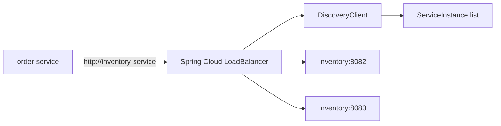

# When Spring Cloud Is Needed and Its Additional Costs

Spring Boot makes it easy to build and run a standalone Java application. When a system comprises multiple independently deployed applications, new questions emerge: how does one service locate another, how is configuration managed, and what happens when an instance is replaced or a network call fails? **Spring Cloud** provides abstractions and Spring Boot integrations to address those distributed system patterns. However, adding Spring Cloud also introduces library, infrastructure, testing, and operational costs.

This lesson belongs to the **Overview** chapter of **SPRING_CLOUD_CORE**, focusing on **deciding when Spring Cloud is warranted and evaluating the additional costs**. Foundational concepts covered include Spring Cloud Commons, Spring Cloud Context, externalized configuration, refresh scope, discovery, service registry, inter-service communication, and Spring Boot compatibility.

## 1. Learning Objectives

After this lesson, you will be able to:

- Distinguish problems already solved by Spring Boot from problems arising when multiple services communicate over the network.
- Recognize signs that justify using Spring Cloud, while knowing when built-in deployment platform features suffice.
- Explain the roles of **Spring Cloud Commons** and **Spring Cloud Context** before choosing a component like Config Client, LoadBalancer, or Discovery Client.
- Estimate the engineering, infrastructure, and operational costs introduced by a distributed mechanism.
- Propose incremental adoption, failure-scenario testing, and selecting a release train compatible with Spring Boot.

## 2. When Is Spring Boot Already Enough?

A Spring Boot application can serve HTTP, execute business logic, access a database, read `application.yml`, environment variables, and external configuration, and expose management endpoints with Actuator. Packaging an application as a container or running multiple replicas **does not automatically** require Spring Cloud.

For example, an inventory management system with a single Spring Boot API and a database running behind an infrastructure load balancer usually has no clear reason to add a service registry or Config Server. Adding Eureka, Config Server, and Gateway simply because the application is called a “microservice” can introduce extra points of failure without improving business outcomes.

Differences typically begin when **multiple independent deployment units must find one another, coordinate with one another, or change configuration consistently**.

| Problem | Already available | When to consider Spring Cloud |
| --- | --- | --- |
| Running APIs, business logic, startup-time configuration | Spring Boot | Not enough reason on its own |
| Calling a fixed, rarely changing URL | `RestClient`, `WebClient`, or standard HTTP clients | When calling by **service name** across dynamic instances |
| Load balancing at the system edge | Platform load balancer / ingress | When **internal clients** need instance selection via discovery |
| Reading env vars, config files, secrets from the platform | Spring Boot and deployment system | When centralized, versioned configuration with explicit distribution is needed |
| Running multiple replicas in Kubernetes | Kubernetes Service DNS, Service/Ingress, and controllers | When uniform Spring abstractions across environments or specific extras are needed |
| Handling failures of an HTTP call | Timeouts, exception handling, suitable retries in libraries | When coordinated policies across multiple clients/services with clear observability and bounds are needed |

**Principle:** identify an existing problem, pick the smallest abstraction or component that solves it, and measure the effect. Spring Cloud is a collection of projects; you do not need to install every component.

## 3. Which Classes of Problems Does Spring Cloud Core Solve?

### 3.1. Commons: shared contracts for distributed services

**Spring Cloud Commons** provides shared interfaces, annotations, and integrations so business code depends less on a concrete infrastructure solution:

- `DiscoveryClient` and `ReactiveDiscoveryClient`: look up instances by **service ID**; they are read mechanisms for discovery data.
- `ServiceInstance`: details of an instance, such as host, port, URI, and metadata.
- `ServiceRegistry` and `Registration`: abstractions for registration/deregistration, implemented by the adapter corresponding to the registry.
- `@LoadBalanced` with Spring Cloud LoadBalancer: enables clients to use logical URIs like `http://inventory-service/...` and pick an actual instance.
- Circuit breaker abstractions for integrating a suitable resilience implementation; **Commons does not automatically provide complete fault tolerance for every call**.

For example, the same `DiscoveryClient` can fetch instance lists from integrations like Eureka or Consul; the application relies on the abstraction within its supported scope instead of writing registry-specific API calls. When switching registry technology, you still need to update dependencies, configuration, tests, and evaluate differences in metadata or health checks.

### 3.2. Context: changing configuration environments and bean lifecycles

**Spring Cloud Context** extends how an application handles `Environment`, configuration sources, and bean refreshing. Two mechanisms to distinguish:

1. `EnvironmentChangeEvent` can trigger **rebinding** of certain `@ConfigurationProperties` beans and update logging levels once `Environment` has received new values.
2. `@RefreshScope` places a bean in a proxied, cached scope; when the scope is refreshed, the cached instance is evicted and recreated on the next access.

Editing a configuration file on a server **does not automatically** make every JVM pick up the new configuration. There must be a mechanism to update the config source, deliver the refresh signal to the right instances, and verify that beans/flows actually use the new values. `@RefreshScope` also does not guarantee all dependent beans are recreated; not every bean type supports refresh, and context refresh is not supported for native images/AOT under current documentation.

### 3.3. Components used as needs arise

| Need | Possible component | Decision to weigh |
| --- | --- | --- |
| Centralized config management across environments | Spring Cloud Config Client/Server | Do we need to operate a Config Server when the platform already provides config and secrets? |
| Finding instances when IPs/ports change | Discovery Client with Eureka, Consul, or equivalent | Does the platform already provide adequate DNS/service discovery? |
| Distributing internal calls across multiple instances | Spring Cloud LoadBalancer | Does client-side load balancing bring benefits over infrastructure load balancing? |
| Routing and policies at the system entry point | Spring Cloud Gateway | Does the system already have an API gateway/ingress meeting requirements? |
| Circuit breakers, timeouts, retries, and fallbacks | Spring Cloud CircuitBreaker integration with a supported implementation, plus client config | Are error policies, deadlines, and idempotency designed properly? |
| Broadcasting config changes to multiple instances | Spring Cloud Bus or another event mechanism | Is bulk refresh needed and are we ready to operate a message broker? |

The project names in the table are **conditional choices**, not a mandatory dependency list for a Spring Cloud application.

## 4. Cases Where Spring Cloud Delivers Clear Value

### Case A: Many instances are created and destroyed frequently

An e-commerce platform has `order-service` calling `inventory-service`. During peak hours, inventory scales from two to six instances; failing instances are replaced with new addresses. If `order-service` hardcodes individual IPs, every change requires a configuration update or redeployment.

With discovery, clients can query a service ID and select an instance from the current list. Spring Cloud Commons defines how to query; Spring Cloud LoadBalancer supports client-side instance selection. For this to work well, **the registry/discovery must reflect instance status accurately enough**, and client policies must handle empty lists, failing instances, or temporarily stale data.

If `order-service` and `inventory-service` both run in Kubernetes, `http://inventory-service` may already resolve via Kubernetes Service DNS and be routed by infrastructure. In that case, installing an extra registry solely to locate instances is **not strictly necessary**.

### Case B: Multiple services share configuration with change governance

An organization has multiple services sharing timeouts, limits, and feature flags across `dev`, `staging`, and `prod`. Configuration is edited frequently and needs history, approvals, and rollback capability. Spring Cloud Config can provide a centralized config source; Context provides mechanisms to update certain beans when signaled to refresh.

The real value lies in the **configuration management workflow**: defining who can edit, which settings refresh at runtime, which require restarts, and how to recover when a new value causes errors. Running Config Server without change controls or without a plan for Config Server downtime still leaves a fragile system.

### Case C: Inter-service communication with resilience requirements

`checkout-service` sequentially calls `pricing-service` and `inventory-service` within one request. One slow service stretches latency across the entire flow; uncontrolled retries can cause a request storm when downstream is overloaded.

Integrating load balancing, timeouts, circuit breakers, concurrency limits, and per-client observability helps here. Even so, Spring Cloud cannot decide on its own **which operations are safe to retry**. For example, sending a payment request a second time can double-charge if downstream lacks idempotency. Error policies must derive from business contracts.

### Case D: Systems running across multiple environments or infrastructures

One team runs services on internal VMs, another on a container platform. They want to keep `DiscoveryClient` APIs or configuration conventions relatively consistent while each environment uses its own registration/lookup mechanism. Spring Cloud abstractions can reduce code tied directly to an infrastructure vendor, though integration configuration and cross-environment testing remain real engineering work.

## 5. Cases Where Adding Spring Cloud Is Premature

- **A monolith already meets requirements well:** there are no multiple independently deployed services and no clear discovery or distributed configuration problems.
- **Small systems with stable endpoints:** a plain HTTP client and static config suffice; adding a registry increases the number of components to maintain.
- **Kubernetes already solves the entire need:** Service DNS, ConfigMap, Secret, ingress, and built-in observability can meet the goals. Add Spring Cloud features only after identifying a specific gap.
- **The team is not yet ready to operate distributed systems:** prioritize timeouts, health checks, logs/metrics/tracing, and stable deployment pipelines before building a Config Server or registry.
- **The only benefit is “following microservices architecture”:** an architectural label is not a measurable functional or quality requirement.

A project may use only **Spring Cloud LoadBalancer**, only **Config Client**, or no Spring Cloud at all. An option with fewer moving parts is usually easier to verify and easier to reverse when needs change.

## 6. Additional Costs: From Design to Operations

Costs are often underestimated because a starter takes just a few lines of dependency configuration, whereas operating the system happens every day.

| Cost category | What arises | Question before accepting |
| --- | --- | --- |
| **Version compatibility** | Must align Spring Boot, Spring Cloud release train, and starters; control transitive dependencies | Is there a plan for upgrades and compatibility checks per release? |
| **Infrastructure and availability** | Registry, Config Server, gateway, or broker may require redundancy, backups, and monitoring | If this component stops working, can services still start and serve? |
| **Latency and failure points** | Additional network hops, lookups, timeouts, retries, circuit breakers, and partial failures | How much increase can P95/P99 and error budgets tolerate? |
| **Observability and diagnostics** | Need logs with correlation IDs, per-service metrics, distributed tracing, and alerts | Can we pinpoint which hop failed within an acceptable time? |
| **Security** | Protecting config/secrets, service-to-service auth, registry and Actuator admin permissions | Who is authorized to read/edit config and trigger refreshes? |
| **Testing** | Must test stale discovery, registry disconnection, rollouts, timeouts, retries, config refresh | Can integration tests simulate flaky downstream services? |
| **Deployment and processes** | Must manage startup ordering, rollbacks, schema/API compatibility, and config changes | Can a single service roll back independently without cascading failures? |
| **People and documentation** | Requires on-call operations, runbooks, and distributed debugging skills | Who owns shared components and who handles after-hours incidents? |

### 6.1. Direct costs and hidden costs

Direct costs include CPU/RAM, storage, networking, redundant infrastructure, and engineering setup time. Hidden costs include version-skew bugs, configuration regressions, time spent tracing requests across many services, or lost revenue when a shared dependency fails.

An estimation framework for an operational cycle:

```text
Total Cost of Ownership (TCO)
  = Build and integration costs
  + Resource/infrastructure costs
  + Operations, observability, and security costs
  + Upgrade and testing costs
  + Expected disruption losses
```

This is a **cost-inventory framework**, not an exact forecasting formula. When comparing options, include the cost of alternatives—for instance, operating a dedicated registry versus using existing Kubernetes Service DNS.

### 6.2. Three commonly overlooked consequences

**Widespread startup failures:** if every new instance must fetch configuration from Config Server, a Config Server outage can prevent services from scaling or starting even while old instances remain healthy. Choose fail-fast, retry, and fallback behaviors per requirements, and test startup behavior when Config Server is unavailable.

**Amplified retry load:** suppose each of three network call layers retries up to three times; in the worst case, calls at the deepest layer can grow exponentially. Illustratively, three layers with up to 3 attempts each generate up to `3 × 3 × 3 = 27` attempts at the bottom layer for a single original request. Enforce overall deadlines, backoff/jitter, retry caps, and idempotency.

**Non-instantaneous heterogeneous refresh:** two instances can run different configurations if they have not received the event together, or beans currently processing requests still hold old state. For correctness-critical changes, use versioned rollouts or controlled restarts instead of assuming refresh is a cluster-wide atomic transaction.

## 7. Minimal Implementation Example: Calling a Service by Logical Name

Suppose `order-service` needs stock counts from `inventory-service` running at `localhost:8082` and `localhost:8083`. We try Spring Cloud Commons and LoadBalancer **before introducing a real registry into the system**.



The arrow to `DiscoveryClient` represents fetching the instance list; the actual request is sent to one selected instance. The diagram intentionally omits timeouts, security, and network failures to focus on discovery/load balancing.

### 7.1. Choosing dependencies and versions

With Maven, use a Spring Cloud BOM **compatible with your project's Spring Boot version**; do not pick independent versions for individual Spring Cloud starters. The snippet below only illustrates structure; replace `${spring-cloud.version}` with a release train confirmed compatible by official documentation:

```xml
<dependencyManagement>
    <dependencies>
        <dependency>
            <groupId>org.springframework.cloud</groupId>
            <artifactId>spring-cloud-dependencies</artifactId>
            <version>${spring-cloud.version}</version>
            <type>pom</type>
            <scope>import</scope>
        </dependency>
    </dependencies>
</dependencyManagement>

<dependencies>
    <dependency>
        <groupId>org.springframework.cloud</groupId>
        <artifactId>spring-cloud-starter-loadbalancer</artifactId>
    </dependency>
</dependencies>
```

This is a `dependencyManagement` and dependency block to place **inside** an existing Spring Boot `pom.xml`; the snippet is not a complete POM. A Spring Cloud version incompatible with Spring Boot may be blocked by the compatibility verifier at application startup. Do not disable the check to hide version issues.

### 7.2. Declaring two test instances

Before adding an external registry client, Spring Cloud can use `SimpleDiscoveryClient` to read instances from properties. In `order-service`'s `application.properties`:

```properties
spring.application.name=order-service
spring.cloud.discovery.client.simple.instances.inventory-service[0].uri=http://localhost:8082
spring.cloud.discovery.client.simple.instances.inventory-service[1].uri=http://localhost:8083
```

This declaration suits learning or fixed environments. For autoscaling systems, you need a dynamic discovery source or platform-managed service endpoints/DNS; `SimpleDiscoveryClient` does not automatically track newly appearing instances.

### 7.3. Using `RestClient` with a service ID

The Java example below uses Spring Boot with `RestClient` and Spring Cloud LoadBalancer. Appropriate web dependencies must already be present in the application.

```java
import org.springframework.cloud.client.loadbalancer.LoadBalanced;
import org.springframework.context.annotation.Bean;
import org.springframework.context.annotation.Configuration;
import org.springframework.stereotype.Service;
import org.springframework.web.client.RestClient;

@Configuration
class ClientConfiguration {
    @Bean
    @LoadBalanced
    RestClient.Builder inventoryRestClientBuilder() {
        return RestClient.builder();
    }
}

@Service
class InventoryGateway {
    private final RestClient client;

    InventoryGateway(@LoadBalanced RestClient.Builder builder) {
        this.client = builder.build();
    }

    String findStock(String sku) {
        return client.get()
                .uri("http://inventory-service/api/inventory/{sku}", sku)
                .retrieve()
                .body(String.class);
    }
}
```

In the URL, `inventory-service` is a **service ID**, not a physical DNS host. LoadBalancer fetches the instance list from discovery and picks an actual URI. In a real application, configure timeouts, HTTP status handling, retry limits, and explicit response types. This code focuses on demonstrating instance selection, not a complete production HTTP client.

To observe both the benefit and the cost, stop one instance. Some requests may fail if the client still picks that instance; using LoadBalancer **does not guarantee requests always succeed**. You must combine health signals, instance selection policies, and business-acceptable error handling.

## 8. Centralized Configuration and Refresh Example

When Spring Cloud Config Client is genuinely needed, a Spring Boot application can import configuration from Config Server via Config Data:

```yaml
spring:
  application:
    name: order-service
  config:
    import: "configserver:http://config-server:8888"
```

This example assumes `order-service` has the `spring-cloud-starter-config` dependency and Config Server is running at that address. Omitting the `optional:` prefix means the application may **fail to start** if it cannot fetch configuration. Use `optional:configserver:...` only when valid fallback configuration exists and system policy permits continuing.

Suppose only a small business policy needs to reload a shipping threshold. With Spring Cloud Context on the classpath:

```java
import org.springframework.beans.factory.annotation.Value;
import org.springframework.cloud.context.config.annotation.RefreshScope;
import org.springframework.stereotype.Component;

@Component
@RefreshScope
class ShippingPolicy {
    @Value("${shipping.free-threshold:500000}")
    private long freeThreshold;

    boolean isFreeShipping(long orderTotal) {
        return orderTotal >= freeThreshold;
    }
}
```

When the config source has a new value and the application executes the proper refresh flow, the object in refresh scope is recreated on next use and can pick up the new threshold. Keep in mind:

- Updating a value on Config Server **does not automatically** signal all client instances.
- The `/actuator/refresh` endpoint exists only when the feature/Actuator is configured and access is permitted; if enabled, protect permissions, log audits, and never expose it to the public Internet.
- Do not blindly apply refresh to `DataSource`, complex stateful beans, or settings requiring rebuilding the entire dependency graph. Check specific bean types and limits stated in documentation.
- With native images/AOT, the context refresh flow is not supported according to current Spring Cloud Context guidance; another update strategy is needed.

This example illustrates why one chooses Context while also highlighting the accompanying costs: defining event emission, administrative permissions, in-flight state, and cross-instance behavior during changes.

## 9. Testing and Operations Before Going to Production

| Scenario to verify | What to observe | Expected behavior |
| --- | --- | --- |
| No instances found for `inventory-service` | HTTP status, logs, metrics, and error latency | Does not hang indefinitely; meaningful error or defined fallback |
| Registry/discovery temporarily unavailable | Startup, instance-list cache, health signals | Follows chosen policy; never assumes registry is always reachable |
| One inventory instance dies mid-flight | Error rate, P95/P99, retries, amplified request count | Bounded duration and call counts; never retries unsafe operations |
| Config Server unreachable at startup | Startup success/failure and effective config values | Fail-fast or compliant fallback with alerts |
| Refresh while requests are active | Old/new values per instance, bean creation errors, health metrics | Controlled change with a rollback plan |
| Upgrading Spring Boot or Spring Cloud | Dependency tree, startup, integration tests, runtime behavior | Compatible release train; no regressions in clients or configuration |

Operations teams should have dashboards by `service ID`, instance, call outcomes, latency, discovery errors, and config source status. Logs need trace/correlation IDs to follow a request across services. Health checks should avoid heavy registry operations unnecessarily, since health probes themselves can generate significant load.

A realistic test plan should include **unit tests** for isolated business logic, **integration tests** for chosen adapters/configuration, and **fault-injection tests** in a production-like environment. If tests use only `SimpleDiscoveryClient`, recognize that they have not verified behavior with a real registry or changing leases/health.

## 10. Decision Framework Before Adding Dependencies

Instead of starting with product names, answer these questions in order:

1. **What is the problem?** E.g., service addresses change constantly, configuration must be edited in many places, or internal requests fail frequently.
2. **Is there evidence?** Data from incidents, latency, deployment frequency, configuration time, and manual edits.
3. **How much do Spring Boot or the current platform already solve?** Check Service DNS, ingress, environment variables, ConfigMap/Secret, gateways, secret managers, and observability tooling.
4. **Which Spring abstraction is needed?** Commons/Context, LoadBalancer, Config Client, or a specific Cloud project; avoid pulling in an entire ecosystem when only one mechanism is needed.
5. **Which new failure points are added?** Registry, Config Server, broker, gateway, client-side timeout, or refresh event; define behavior when they lose connectivity.
6. **Who operates it?** Access controls, backups, alerting, on-call, upgrade procedures, and rollbacks.
7. **How is success measured?** E.g., fewer manual IP updates, fewer configuration incidents, faster recovery times, or lower service-call error rates.

A concise decision table can be built per capability:

| Situation | Reasonable initial choice | Condition to revisit the decision |
| --- | --- | --- |
| Single Spring Boot application | Keep Spring Boot and existing infrastructure | A concrete distributed problem emerges |
| Multiple services in Kubernetes calling via Service DNS | Try DNS/Service first | Client-side routing or an extra abstraction shows measured benefit |
| Dynamic services on VMs with an organizational registry | Integrate suitable DiscoveryClient; consider LoadBalancer | Evaluate registry accuracy and stale-instance scenarios |
| Multiple services needing centralized config with audit | Compare existing platform config with Config Client/Server | Choose when workflow benefits outweigh operational cost and startup coupling |
| Internal calls frequently time out or fail in cascades | Design deadlines, timeouts, observability, idempotency first | Add bounded circuit breakers/retries when error data proves the need |

### Composite Decision Example

A team runs eight Spring Boot services on Kubernetes, currently communicating reliably via Service DNS. They want to add Eureka and Config Server to “standardize microservices.” After checking actual needs:

- Service addresses are already handled by DNS/Service, so a dedicated registry brings **no clear benefit yet**.
- Configuration changes infrequently and rolls out cleanly via cluster tooling, so Config Server is **not needed yet**.
- Some requests show high latency when inventory is overloaded. The first step is setting deadlines, timeouts, metrics, and load-shedding policies. Only if measurements later show a need for client-side instance selection or shared resilience policies should the team evaluate the corresponding Spring Cloud component.

Conversely, if those eight services ran on VMs with dynamic addresses and no unified service lookup, using a Spring Cloud discovery integration could eliminate hardcoded config and shorten instance replacement times. Those gains must still be weighed against maintaining the registry and handling registry outages.

## 11. Misconceptions to Avoid

**“Using microservices requires using Spring Cloud.”** False. Microservices are an architectural choice; discovery, routing, and config mechanisms can be provided by the deployment platform.

**“Having `@LoadBalanced` makes every call fault-tolerant.”** False. Load balancing only picks a destination; timeouts, retries, idempotency, fallbacks, and resilience are separate decisions.

**“Having `@RefreshScope` means editing config updates every instance immediately.”** False. You need an updated config source, a refresh trigger, and verification of supported bean types. During transitions, multiple values can coexist.

**“Adding a starter is lightweight, so total cost is low.”** Not necessarily. A single dependency can entail entire infrastructure clusters, dashboards, security, and operational procedures.

**“Spring Boot updates independently of Spring Cloud.”** False. Spring Cloud follows **release trains** with a compatibility matrix against Spring Boot lines. Check compatibility before upgrading and use the BOM to manage Cloud artifacts.

## 12. Conclusion

Spring Cloud is valuable when solving **an identified distributed problem**: dynamic service lookup, internal load balancing, multi-app configuration management, or integrating reliable communication policies. Spring Cloud Commons provides the shared abstraction layer, while Spring Cloud Context supports runtime configuration environment changes and bean lifecycles. These mechanisms reduce repetitive integration code, yet they do not erase the inherently unreliable nature of networks and distributed systems.

Sound decisions start from measurement and comparison against the capabilities already available in Spring Boot and the runtime platform. Choose only the components needed, enforce version compatibility, and account fully for **development, infrastructure, security, testing, observability, operational, and incident costs**.

## References

- [Spring Cloud — Project and Spring Boot Compatibility Matrix](https://spring.io/projects/spring-cloud/).
- [Spring Cloud Commons — Common Abstractions](https://docs.spring.io/spring-cloud-commons/reference/spring-cloud-commons/common-abstractions.html): `DiscoveryClient`, `ServiceRegistry`, `SimpleDiscoveryClient`, LoadBalancer-enabled HTTP clients.
- [Spring Cloud Commons — Spring Cloud LoadBalancer](https://docs.spring.io/spring-cloud-commons/reference/spring-cloud-commons/loadbalancer.html): instance selection and load-balancing options.
- [Spring Cloud Context — Application Context Services](https://docs.spring.io/spring-cloud-commons/reference/spring-cloud-commons/application-context-services.html): `EnvironmentChangeEvent`, `@RefreshScope`, limitations, and refresh endpoint.
- [Spring Cloud Config — Config Client](https://docs.spring.io/spring-cloud-config/reference/client.html): `spring.config.import`, required/optional settings, and startup behavior.

The URLs above point to official documentation. When practicing, select the exact **documentation branch for the release train** in use, as APIs, configuration defaults, and supported version lists can change.
