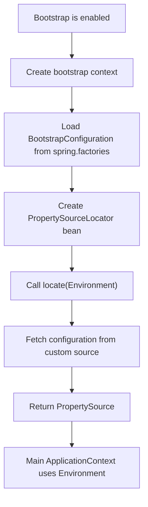
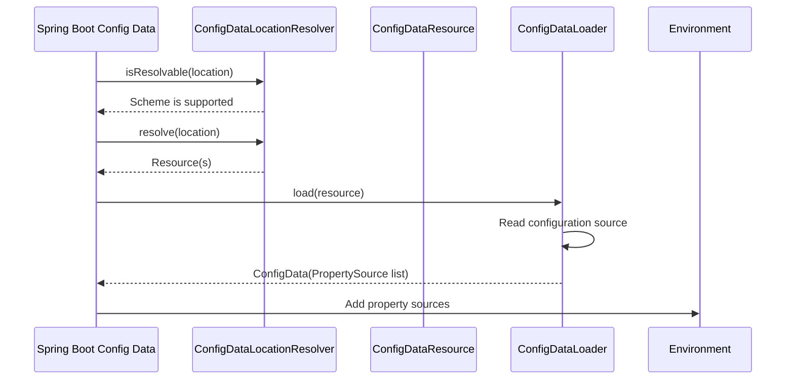

# When Do You Need PropertySourceLocator or a Config Data Extension

## 1. The Problem: Bringing a Custom Configuration Source into the Environment

Spring Boot supports many common configuration sources: `application.yml`, profile-specific files, environment variables, command-line arguments, Config Server, and other locations. Spring aggregates them into the `Environment`; beans read values via `@Value`, `@ConfigurationProperties`, or the Environment API.

Some systems need to retrieve configuration from a custom source: a tenant management service, a regional parameter store, an internal configuration API, a configuration database, or a secrets system with a proprietary protocol. In such cases, the development team can write an integration to load the data and add keys to the Environment.

Spring Cloud and Spring Boot provide two extension points that are commonly considered:

- **`PropertySourceLocator`**: a Spring Cloud mechanism tied to the traditional bootstrap lifecycle, used to locate and return a `PropertySource` from an external source.
- **Config Data extension**: a Spring Boot mechanism combining `ConfigDataLocationResolver` and `ConfigDataLoader`, allowing an application to import a location with a custom scheme via `spring.config.import`.

Both approaches can contribute property sources, but they differ in lifecycle, declaration syntax, profile handling, and level of integration with Spring Boot. Choosing the wrong extension point can cause code not to run at the expected time or not be invoked at all in an application where bootstrap is not enabled.

This lesson belongs to the **Custom Configuration Sources** chapter of the **SPRING_CLOUD_CORE** module. Learners need to understand Spring Cloud Commons, Context, externalized configuration, and Spring Boot compatibility; this lesson focuses on the design decision when you need to extend the configuration loading mechanism.

After completing this lesson, learners will be able to:

- Identify when a configuration source needs `PropertySourceLocator`.
- Identify when to implement a Config Data resolver/loader.
- Distinguish the bootstrap context from Config Data processing.
- Design locations, resources, property sources, and extension registration.
- Handle profiles, optional locations, precedence, network errors, and security.
- Write integration tests to prove the custom source is loaded at the right time.

## 2. Choosing an Extension Point by Lifecycle

| Criterion | `PropertySourceLocator` | Config Data extension |
| --- | --- | --- |
| API owner | Spring Cloud | Spring Boot |
| Key components | `PropertySourceLocator` | `ConfigDataLocationResolver` and `ConfigDataLoader` |
| Phase | Bootstrap / legacy property-source integration | Config Data processing when Boot prepares the `Environment` |
| Source declaration | Bootstrap configuration | `spring.config.import` with a custom scheme |
| Output | A `PropertySource<?>` or `null` | A `ConfigData` containing one or more `PropertySource<?>` |
| Profiles | Reads profiles from `Environment`; invocation behavior depends on the release train | Resolver provides the `resolveProfileSpecific(...)` hook after profiles are determined |
| Optional / location errors | Follows bootstrap integration and locator behavior | `optional:` together with Config Data exceptions |
| Required context | Tied to legacy bootstrap | Does not require the Spring Cloud bootstrap context |
| When to use | Maintaining an existing bootstrap-based integration or needing to add a source to the bootstrap context | Building a new integration on Config Data with a custom location scheme and Boot integration |

**Quick selection rule:** if a new application needs to import a configuration source using syntax like `spring.config.import=tenantcfg:orders`, consider a Config Data extension first. If an application already maintains legacy bootstrap and needs to add a property source into the bootstrap context itself, `PropertySourceLocator` is the right extension point.

Before writing a custom extension, check whether Boot or an existing library already supports that location. If you only need to read standard files, environment variables, Config Server, or config trees, using built-in mechanisms reduces code, dependencies, and operational overhead.

## 3. PropertySourceLocator: Extending Spring Cloud Bootstrap

### 3.1. How It Works

In the traditional bootstrap model, Spring Cloud builds a bootstrap context before the main application context. Configuration classes listed in `META-INF/spring.factories` under the `org.springframework.cloud.bootstrap.BootstrapConfiguration` key are used to create this context.

A bean implementing `PropertySourceLocator` is invoked with the `Environment` of the application context about to be created. It can use already available information such as `spring.application.name`, profiles, or region to query the configuration source and return a `PropertySource`. Spring Cloud adds that property source to the Environment according to the rules of the bootstrap integration.



### 3.2. Locator Example

Suppose an organization has an internal configuration service that returns a property map by application name. `RemoteSettingsClient` below is an adapter implemented by the application to call that API:

```java
import java.util.Map;
import org.springframework.cloud.bootstrap.config.PropertySourceLocator;
import org.springframework.core.env.Environment;
import org.springframework.core.env.MapPropertySource;
import org.springframework.core.env.PropertySource;

public final class TenantPropertySourceLocator implements PropertySourceLocator {

    private final RemoteSettingsClient client;

    public TenantPropertySourceLocator(RemoteSettingsClient client) {
        this.client = client;
    }

    @Override
    public PropertySource<?> locate(Environment environment) {
        String application = environment.getProperty(
                "spring.application.name", "application");
        String region = environment.getProperty("app.region", "default");
        Map<String, Object> properties =
                client.loadProperties(application, region);

        if (properties == null || properties.isEmpty()) {
            return null;
        }
        return new MapPropertySource("tenant-settings", properties);
    }
}
```

`RemoteSettingsClient` represents the adapter connecting to the HTTP endpoint, database, or SDK of the configuration system. The locator should not contain all retry, authentication, caching, and parsing logic itself; separate those into the adapter so they can be tested independently.

### 3.3. Registering in the Bootstrap Context

Create a dedicated configuration class:

```java
import org.springframework.context.annotation.Bean;
import org.springframework.context.annotation.Configuration;
import org.springframework.cloud.bootstrap.config.PropertySourceLocator;

@Configuration
public class TenantBootstrapConfiguration {

    @Bean
    RemoteSettingsClient remoteSettingsClient() {
        return new HttpRemoteSettingsClient();
    }

    @Bean
    PropertySourceLocator tenantPropertySourceLocator(
            RemoteSettingsClient client) {
        return new TenantPropertySourceLocator(client);
    }
}
```

In the `src/main/resources/META-INF` directory, declare the `spring.factories` file:

```properties
org.springframework.cloud.bootstrap.BootstrapConfiguration=\
com.example.config.TenantBootstrapConfiguration
```

The package and class names in the example must be replaced with the library's actual package. Bootstrap must be enabled according to the version and deployment; merely having a `spring.factories` file does not mean bootstrap runs automatically.

**Important note:** place the bootstrap configuration in a separate package, outside the main application's component scan area. If the configuration class is unintentionally scanned into the main context, bootstrap beans may be created again in the wrong lifecycle or twice. Avoid depending on business beans that only exist in the main context because the locator runs before those beans are ready.

### 3.4. Locator Behavior Changes Across Release Trains

Do not assume the locator always runs only once in the same context:

- Prior to Spring Cloud 2022.0.3, the Spring Cloud documentation noted that `PropertySourceLocators` (including the Config Client's locator) ran in the main application context rather than the bootstrap context. You could request running them in the bootstrap context by setting `spring.cloud.config.initialize-on-context-refresh=true` in the bootstrap configuration.
- Since Spring Cloud 2022.0.3, locators are invoked twice: first without profiles to fetch property sources that may activate `spring.profiles.active`; after the main context starts, the locator is invoked again with the active profiles to load the corresponding property sources.

Therefore, the locator must be **safe for repeated invocations**. Avoid writing data, creating resources, or performing operations with non-repeatable side effects. Caching can be useful, but the cache key must include the factors that affect the result, such as application name, region, profile, and label.

### 3.5. When Not to Use It?

- The application does not enable legacy bootstrap and has no integration that activates locators.
- A new project only needs to import a configuration source via `spring.config.import`.
- The source needs to handle profile-specific resources following the standard Config Data lifecycle.
- The locator would have to depend on main context beans to do its work.
- A Boot location resolver/loader can express the requirement more cleanly.

## 4. Config Data Extension: Creating a Custom Location Scheme

### 4.1. Three Core Concepts

The Config Data API was introduced by Spring Boot in **2.4**. An extension typically consists of three parts:

1. **`ConfigDataLocationResolver`** receives the location declared by the user, determines whether the location belongs to its scheme, and converts it into one or more resources.
2. **`ConfigDataResource`** represents the concrete resource to be loaded, such as a tenant, URI, region, or configuration version.
3. **`ConfigDataLoader`** reads the resource and returns a `ConfigData`, containing the `PropertySource` instances contributed to the Environment.

The resolver focuses on *determining what needs to be loaded*; the loader focuses on *reading that resource*. Separating these two responsibilities makes handling profiles, locations, and errors clearer.

Extensions run before the main application context finishes initializing, so do not assume they can arbitrarily autowire application business beans. Boot supports specific constructor parameters dedicated to extensions: a resolver can accept `Binder`, `ResourceLoader`, `DeferredLogFactory`, and `ConfigurableBootstrapContext`; a loader can accept `DeferredLogFactory` and `ConfigurableBootstrapContext`. If you need to share an expensive-to-initialize client across phases, use the bootstrap registry per Boot's contract rather than depending on main context beans.

### 4.2. Processing Flow



If the source needs to load profile-specific data, the resolver can implement `resolveProfileSpecific(...)`. Boot calls this hook after profiles are determined from the data loaded in the preceding step.

### 4.3. Custom Location Example

Suppose the library needs to support:

```yaml
spring:
  config:
    import: "optional:tenantcfg:orders"
```

Where `tenantcfg:` is the scheme defined by the library and `orders` is the tenant or configuration group. The `optional:` prefix allows the location to have no data while the application continues according to Config Data rules.

#### Resolver

```java
import java.util.Collections;
import java.util.List;
import org.springframework.boot.context.config.ConfigDataLocation;
import org.springframework.boot.context.config.ConfigDataLocationResolver;
import org.springframework.boot.context.config.ConfigDataLocationResolverContext;

public final class TenantConfigDataLocationResolver
        implements ConfigDataLocationResolver<TenantConfigDataResource> {

    @Override
    public boolean isResolvable(
            ConfigDataLocationResolverContext context,
            ConfigDataLocation location) {
        return location.hasPrefix("tenantcfg:");
    }

    @Override
    public List<TenantConfigDataResource> resolve(
            ConfigDataLocationResolverContext context,
            ConfigDataLocation location) {
        String tenant = location.getNonPrefixedValue("tenantcfg:");
        return Collections.singletonList(
                new TenantConfigDataResource(tenant, location.isOptional()));
    }
}
```

#### Resource

```java
import java.util.Objects;
import org.springframework.boot.context.config.ConfigDataResource;

public final class TenantConfigDataResource extends ConfigDataResource {

    private final String tenant;

    public TenantConfigDataResource(String tenant, boolean optional) {
        super(optional);
        this.tenant = tenant;
    }

    public String getTenant() {
        return tenant;
    }

    @Override
    public boolean equals(Object other) {
        if (this == other) return true;
        if (!(other instanceof TenantConfigDataResource)) return false;
        TenantConfigDataResource that = (TenantConfigDataResource) other;
        return Objects.equals(tenant, that.tenant);
    }

    @Override
    public int hashCode() {
        return Objects.hash(tenant);
    }

    @Override
    public String toString() {
        return "TenantConfigDataResource{tenant='" + tenant + "'}";
    }
}
```

`ConfigDataResource` requires implementations to have valid `equals`, `hashCode`, and `toString` methods. The constructor accepting the optional flag was added to the Config Data API starting in Spring Boot 2.4.6; if supporting an older baseline, check the API of that exact version and handle optionality as supported by that version.

#### Loader

```java
import java.io.IOException;
import java.util.Collections;
import java.util.Map;
import org.springframework.boot.context.config.ConfigData;
import org.springframework.boot.context.config.ConfigDataLoader;
import org.springframework.boot.context.config.ConfigDataLoaderContext;
import org.springframework.core.env.MapPropertySource;
import org.springframework.core.env.PropertySource;

public final class TenantConfigDataLoader
        implements ConfigDataLoader<TenantConfigDataResource> {

    @Override
    public ConfigData load(
            ConfigDataLoaderContext context,
            TenantConfigDataResource resource) throws IOException {

        Map<String, Object> values =
                fetchFromConfigurationService(resource.getTenant());

        if (values == null || values.isEmpty()) {
            return ConfigData.EMPTY;
        }

        PropertySource<?> source = new MapPropertySource(
                "tenantcfg:" + resource.getTenant(), values);
        return new ConfigData(Collections.singletonList(source));
    }

    private Map<String, Object> fetchFromConfigurationService(String tenant)
            throws IOException {
        // Call the library's HTTP/SDK adapter and return a property map.
        // Example is abbreviated; do not hard-code configuration data here.
        throw new UnsupportedOperationException("Implement configuration transport");
    }
}
```

This is a skeleton illustrating the resolver/resource/loader contract; `fetchFromConfigurationService` is the adapter part that needs to be implemented according to the real protocol. In a production implementation, handle missing resources according to the optional flag: a required location must throw an appropriate Config Data exception, while an optional location can be skipped per the API contract. Do not turn every network or authentication error into `ConfigData.EMPTY`, as that hides configuration source failures.

### 4.4. Registering Resolver and Loader

The Config Data resolver and loader are registered via the library's `META-INF/spring.factories`:

```properties
org.springframework.boot.context.config.ConfigDataLocationResolver=\
com.example.config.TenantConfigDataLocationResolver

org.springframework.boot.context.config.ConfigDataLoader=\
com.example.config.TenantConfigDataLoader
```

Applications using the library only need the dependency containing the extension and to declare the location:

```yaml
spring:
  config:
    import: "optional:tenantcfg:orders"
```

`spring-cloud-starter-bootstrap` is not needed for this mechanism. The resolver/loader is a Spring Boot Config Data extension point, not a `PropertySourceLocator`.

## 5. Profiles, Optionality, and Precedence

### 5.1. Profile-Specific Configuration

With `PropertySourceLocator`, the locator receives `Environment` and decides for itself which application name, profile, region, or label to use when querying. How the locator is called with respect to profiles depends on the release train; since Spring Cloud 2022.0.3, the locator is called twice as described above.

With Config Data, the resolver has the `resolveProfileSpecific(context, location, profiles)` hook. Use this hook when a location needs to produce profile-specific resources, for example `tenantcfg:orders` needing to additionally load the `orders-prod` resource once the `prod` profile has been determined. Do not manually read profiles from global variables or other configuration files when Boot already provides profiles through the context.

### 5.2. Optionality and Errors

Config Data distinguishes required and optional locations with the `optional:` prefix. The resolver can check `location.isOptional()` and pass this state to the resource. When a resource does not exist, the implementation must follow Boot's exception contract so that required locations fail and optional locations are handled properly.

With `PropertySourceLocator`, returning `null` can signify that no property source exists. However, connection errors, authentication errors, or invalid responses should not be arbitrarily converted into `null`. Whether to fail-fast or fall back must be an explicit policy of the application.

| Scenario | Config Data | PropertySourceLocator |
| --- | --- | --- |
| Location does not exist and is optional | Can be ignored according to optional semantics | Behavior must be defined in the locator/adapter |
| Required location does not exist | Throw the appropriate Config Data exception | Throw an error so startup fails according to policy |
| Remote API returns 401/403 | Should not silently treat as no configuration | Should not return `null` to hide permission errors |
| Timeout or server unavailable | Bounded timeout/retry; fail or fall back per optional policy | Bounded timeout/retry; do not create fake property sources |
| Valid empty response | Can return `ConfigData.EMPTY` | Can return `null` or an empty property source by design |

### 5.3. Property Source Precedence

Each extension returns a property source with its own name and must understand its position in the precedence rules:

- A Config Data loader returns a list of `PropertySource` instances in ascending order of precedence; a later source can override an earlier source when keys collide.
- `PropertySourceLocator` participates in the bootstrap/Cloud lifecycle; property sources are added in the order defined by the bootstrap context and release train.
- Higher-precedence sources such as command-line arguments, system properties, or environment variables can still affect the final result according to Boot's rules.

Do not arbitrarily give a property source the same name as another source because duplicate names can affect how Spring merges the hierarchy. Choose a stable, extension-namespaced name, such as `tenantcfg:orders` or `tenant-settings:orders`.

### 5.4. Sensitive Configuration

Do not log tokens, passwords, or private keys; do not include the entire configuration map in exception messages. If the source contains secrets, consider integrating with a dedicated secret manager, enforcing access control, encrypting data in transit, rotating credentials, and limiting cache lifetimes.

## 6. When Do You Need a Custom Extension and When Do You Not?

| Need | Option to consider first |
| --- | --- |
| Read YAML/Properties from classpath or external files | Built-in Config Data locations (`classpath:`, `file:`) |
| Read from Config Server | Spring Cloud Config Client with `spring.config.import=configserver:` |
| Read config trees mounted by the platform | Spring Boot config tree support |
| Load configuration from an internal protocol or API using custom import syntax | Config Data resolver + loader |
| Add a source to an application still relying on legacy bootstrap | `PropertySourceLocator` |
| Only need to map a few values from an already bound bean | `@ConfigurationProperties` or bean configuration |
| Need to transform business data after startup | Regular service/adapter, not a config loading extension |

A custom extension is worthwhile when it is a **reusable integration** across multiple applications, has a clear location contract, manages errors/profiles/precedence, and has independent tests. If only one application needs to add a few keys, a simple adapter or standard configuration is usually easier to maintain.

## 7. Testing the Extension

### 7.1. Testing PropertySourceLocator

- Unit test the locator with `MockEnvironment`, verifying that application name, profile, and region are read correctly.
- Test cases where the remote source returns a valid map, an empty map, authentication errors, and timeouts.
- Integration test with bootstrap enabled, confirming the locator is registered from `spring.factories` and properties appear in the Environment.
- For Spring Cloud 2022.0.3 and later, verify the locator can be called twice without causing side effects.
- Confirm the package of `BootstrapConfiguration` is not component-scanned into the main context.

### 7.2. Testing Config Data Resolver/Loader

- Test that `isResolvable` only accepts the scheme owned by the extension; it must not accept standard Boot locations.
- Test that `resolve` parses the location into a resource with the correct tenant/region and preserves the optional flag.
- Test `resolveProfileSpecific` if the source has profile-specific data.
- Test that the loader returns `ConfigData` containing a property source with the expected name and values.
- Test a missing required location and a missing optional location.
- Test IO errors, timeouts, error responses, and authentication failures; verify errors are not swallowed.
- Integration test booting Spring Boot with `spring.config.import=tenantcfg:...`, then verify beans read the expected values.

### 7.3. Testing Precedence and Profiles

Place the same key in a local file, the remote source, an environment variable, and the command line. Verify the final value matches the design. Run at least one test with the default profile and one test with the `prod` profile or a representative profile to ensure the resolver/locator fetches the right configuration set.

Do not call the real configuration service in unit tests. Use a fake client or mock server; only a separate layer of integration tests should verify the network contract.

## 8. Operations and Diagnostics

| Symptom | Common cause | How to check |
| --- | --- | --- |
| `PropertySourceLocator` does not run | Bootstrap is not enabled or configuration class is not registered | Check starter/bootstrap flags and the `BootstrapConfiguration` key |
| Locator runs but no properties appear | Wrong application name/profile/region or empty remote response | Log non-sensitive metadata; inspect request and response |
| Locator is invoked multiple times | Release train behavior, especially since 2022.0.3 | Check release notes and make the locator idempotent |
| Config Data location is not recognized | Resolver not registered or wrong scheme in `isResolvable` | Check `spring.factories`, dependencies, and location string |
| Loader is not invoked | Resolver does not produce the right resource type or no loader accepts the resource | Check generic types and `ConfigDataResource` |
| Optional location still fails startup | Exception does not follow optional semantics or error is misclassified | Check resource optionality and exception contract |
| Property gets overridden | Precedence, import order, or source name | Inspect sanitized property sources and write key-collision tests |
| Slow startup | Long synchronous API calls, infinite retries, or repeated loads | Set timeouts, bounded retries, appropriate caching, and load-duration metrics |

A custom configuration source running during startup can prevent the application from starting if the external system is slow or unavailable. Configure connect/read timeouts, bounded retries, and a clear fail-fast/fallback policy. Never perform infinite retry loops inside a resolver/loader/locator.

When there are multiple instances, each instance may load configuration at different times. Config Data and `PropertySourceLocator` are configuration loading mechanisms; they do not automatically provide polling or runtime change broadcasting. If updates are needed while the application is running, Environment/bean refresh and change distribution across instances must be designed separately.

## 9. Design Decision Examples

**Scenario A — a new application needs to fetch per-tenant policies.** Each application declares `spring.config.import=tenantcfg:orders`; the library uses a resolver to parse the tenant, a loader to fetch policies, and returns `ConfigData`. This approach integrates directly with Config Data, supports optional locations, and can be extended with profile-specific resources.

**Scenario B — a legacy system already has bootstrap enabled.** Multiple services currently use `bootstrap.yml`, have a separate bootstrap context, and need to supplement properties from an internal API before the main context. A `PropertySourceLocator` registered via `BootstrapConfiguration` is the lower-churn choice. Check the release train, locator invocation count, and avoid bringing bootstrap config into component scan.

**Scenario C — an application only needs to read a configuration file.** Use `file:` or `configtree:` if suitable for the format and Boot version. Writing a custom resolver/loader for this case adds extra code without commensurate value.

**Scenario D — secrets need to be loaded.** Choose a supported secret manager or integration. If a custom extension is truly needed, restrict read permissions by service/tenant, never log contents, manage caching, and rotate credentials. Do not use `PropertySourceLocator` or a Config Data loader as a homemade secret store.

## 10. Summary and Self-Check Questions

`PropertySourceLocator` belongs to the Spring Cloud ecosystem and is tied to the bootstrap/legacy property-source lifecycle. It fits when you need to extend an application that already uses the bootstrap context. A Config Data extension belongs to Spring Boot; `ConfigDataLocationResolver` converts a location into resources, and `ConfigDataLoader` loads the resource and returns `ConfigData` so Boot can add property sources to the Environment. This is the more natural choice for new integrations wanting to use `spring.config.import`.

Before choosing, identify the Spring Boot/Spring Cloud versions, the lifecycle you need to participate in, how profiles are handled, optional/fail-fast behavior, property precedence, and operational requirements. An extension is only complete when it has tests for startup, remote source failures, profiles, precedence, and security.

Self-check questions:

1. Why is `PropertySourceLocator` not the default choice for an application that only uses Config Data?
2. Under which key in `spring.factories` is `PropertySourceLocator` registered into the bootstrap context?
3. Why must bootstrap configuration sit outside the main application's component scan area?
4. Distinguish the responsibilities of `ConfigDataLocationResolver`, `ConfigDataResource`, and `ConfigDataLoader`.
5. What problem does `resolveProfileSpecific(...)` solve?
6. How does a custom Config Data location support `optional:` according to the contract?
7. Why does a locator need to be idempotent with release trains that invoke it multiple times?
8. When should you use a Config Data extension, `PropertySourceLocator`, or Spring Boot's built-in location mechanisms?

## 11. Official References

- [Spring Cloud Commons — Customizing the Bootstrap Property Sources](https://docs.spring.io/spring-cloud-commons/reference/spring-cloud-commons/application-context-services.html)
- [Spring Boot 3.5 API — ConfigDataLocationResolver](https://docs.spring.io/spring-boot/3.5/api/java/org/springframework/boot/context/config/ConfigDataLocationResolver.html)
- [Spring Boot 3.5 API — ConfigDataLoader](https://docs.spring.io/spring-boot/3.5/api/java/org/springframework/boot/context/config/ConfigDataLoader.html)
- [Spring Boot — Externalized Configuration](https://docs.spring.io/spring-boot/reference/features/external-config.html)

API signatures and registration mechanisms must be verified against the library's exact Spring Boot/Spring Cloud versions. The Config Data API has existed since Spring Boot 2.4, though certain constructors and optional-resource details were added in subsequent minor releases.
