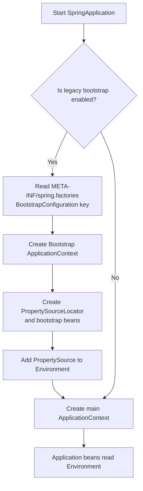

# Registering BootstrapConfiguration via META-INF/spring.factories

## 1. Purpose of Bootstrap Configuration

A Spring Boot application typically loads configuration from YAML, environment variables, JVM arguments, and external sources. In some Spring Cloud systems, the application also needs to initialize components **before the main application context is created**, for example reading connection settings for a config server, fetching properties from an organization's private store, registering a PropertySourceLocator, or providing an ApplicationContextInitializer.

Spring Cloud provides a bootstrap context mechanism for this phase. Configuration classes are registered under the **org.springframework.cloud.bootstrap.BootstrapConfiguration** key in **META-INF/spring.factories**. This mechanism belongs to the **legacy bootstrap** model; bootstrap must be enabled for registered configurations to be loaded.

In this lesson, we create a custom configuration source for `order-service`. That source provides a property keyed by application name, and code in the main application context can then read the property through Environment.

## 2. The Bootstrap Context in the Application Lifecycle

The bootstrap context is a Spring ApplicationContext created as the **parent context** of the main application context. It prepares configuration and components needed for the startup process. Eligible beans created in the parent context can be seen by the child context according to Spring's context hierarchy rules.



If legacy bootstrap is not enabled, Spring Cloud does not create a bootstrap context along this flow; entries in spring.factories are therefore not used to register bootstrap configurations. This is why a spring.factories file can look completely valid while the application still does not see the PropertySourceLocator.

The bootstrap context and the main application context have a parent-child relationship. Some bootstrap beans, especially beans of type ApplicationContextInitializer, are also applied to the main SpringApplication before the application begins its normal startup phase.

## 3. The BootstrapConfiguration Key in spring.factories

This is the key Spring Cloud uses to find bootstrap configuration classes:

```properties
org.springframework.cloud.bootstrap.BootstrapConfiguration=\
com.example.bootstrap.InventoryBootstrapConfiguration
```

The value is a list of fully qualified class names of `@Configuration` classes used to build the bootstrap context. If there are multiple classes, separate them with commas:

```properties
org.springframework.cloud.bootstrap.BootstrapConfiguration=\
com.example.bootstrap.InventoryBootstrapConfiguration,\
com.example.bootstrap.SecurityBootstrapConfiguration
```

The file must reside in the exact resource location:

```text
src/main/resources/
└── META-INF/
    └── spring.factories
```

When building a shared library, this file must be packaged inside the JAR alongside the listed configuration classes. Applications consuming the library need that JAR on the runtime classpath. If the bootstrap configuration lives directly inside the application, the file still goes in the application's `src/main/resources/META-INF/spring.factories`.

`spring.factories` is a Java properties file. Do not add quotation marks around keys or class names. A backslash at the end of a line allows continuing the value onto the next line. Entries with the same key from multiple libraries on the classpath are collected by Spring's factories loader; if packaging into a shaded/uber JAR, configure the packaging tool to merge this resource instead of dropping one library's entries.

If multiple bootstrap configurations or initializers need a deterministic initialization order, `@Order` can be used to express ordering. Spring Cloud documentation specifies the default order for bootstrap configurations as last; only set explicit ordering when components truly have dependency relationships, and never rely on arbitrary JAR order on the classpath.

### 3.1. Distinguishing the Bootstrap Key from Spring Boot Auto-Configuration

| Mechanism | Key or metadata | Purpose |
| --- | --- | --- |
| Spring Cloud Bootstrap Configuration | org.springframework.cloud.bootstrap.BootstrapConfiguration in META-INF/spring.factories | Create a bootstrap context before the main application context in legacy bootstrap |
| Modern Spring Boot auto-configuration | META-INF/spring/org.springframework.boot.autoconfigure.AutoConfiguration.imports | Register auto-configurations for Boot's application context |
| Spring factories for other extension points | Dedicated keys in META-INF/spring.factories | Load extension types supported by the corresponding framework |

Spring Boot 3 moved auto-configuration registration lists to `AutoConfiguration.imports`. That **does not turn the Spring Cloud BootstrapConfiguration key into a Boot auto-configuration key**. When using legacy bootstrap, you must still follow Spring Cloud's exact contract and activation conditions. Do not replace the `BootstrapConfiguration` key with `EnableAutoConfiguration` or with the `AutoConfiguration.imports` filename.

## 4. Creating the BootstrapConfiguration Class

The example below defines a simple `PropertySourceLocator`. It reads `spring.application.name` from Environment and contributes two properties in a source named `customInventoryProperties`.

```java
package com.example.bootstrap;

import java.util.LinkedHashMap;
import java.util.Map;

import org.springframework.cloud.bootstrap.config.PropertySourceLocator;
import org.springframework.context.annotation.Configuration;
import org.springframework.core.env.Environment;
import org.springframework.core.env.MapPropertySource;
import org.springframework.core.env.PropertySource;

@Configuration
public class InventoryBootstrapConfiguration implements PropertySourceLocator {

    @Override
    public PropertySource<?> locate(Environment environment) {
        String applicationName = environment.getProperty(
                "spring.application.name",
                "unknown-application"
        );

        Map<String, Object> properties = new LinkedHashMap<>();
        properties.put("custom.bootstrap.application", applicationName);
        properties.put("custom.bootstrap.inventory-enabled", true);

        return new MapPropertySource(
                "customInventoryProperties",
                properties
        );
    }
}
```

Key takeaways in the example:

- `@Configuration` marks the configuration class to be loaded by the bootstrap context.
- `PropertySourceLocator` is Spring Cloud's contract for obtaining an additional `PropertySource`.
- `locate(Environment)` receives the Environment of the application context being prepared. It already contains standard Spring Boot property sources, so it can read `spring.application.name` or another identifying property.
- `MapPropertySource` is an in-memory illustrative data source. A real implementation can fetch data from a configuration service, database, or secret store.
- The name `customInventoryProperties` should be distinct enough to avoid colliding with other source names.

This class is listed in `spring.factories`; there is no need to add `@Component` for component scanning to find it. The bootstrap mechanism locates the class via the registered key.

### 4.1. Registering the Configuration Class

Create `src/main/resources/META-INF/spring.factories`:

```properties
org.springframework.cloud.bootstrap.BootstrapConfiguration=\
com.example.bootstrap.InventoryBootstrapConfiguration
```

The class name in the file must match the actual package and class. If you rename the package or class, you must update the corresponding entry.

One directory layout for a dedicated bootstrap library:

```text
custom-bootstrap-source/
├── src/main/java/
│   └── com/example/bootstrap/
│       └── InventoryBootstrapConfiguration.java
└── src/main/resources/
    └── META-INF/
        └── spring.factories
```

## 5. Enabling Legacy Bootstrap

Having an entry in `spring.factories` is not enough on its own. In modern Spring Cloud generations, legacy bootstrap is not enabled by default in all applications. There are two common ways to activate it.

### 5.1. Adding the Bootstrap Starter

With Maven, add the starter and let the Spring Cloud BOM manage the version:

```xml
<dependency>
    <groupId>org.springframework.cloud</groupId>
    <artifactId>spring-cloud-starter-bootstrap</artifactId>
</dependency>
```

Do not pin an arbitrary starter version if the project already imports `spring-cloud-dependencies`. Choose a release train compatible with your project's Spring Boot version.

### 5.2. Enabling via System Property or Environment Variable

You can set the property before the Spring Boot process starts:

```bash
java -Dspring.cloud.bootstrap.enabled=true -jar order-service.jar
```

Or use an environment variable:

```bash
SPRING_CLOUD_BOOTSTRAP_ENABLED=true
```

The property enabling bootstrap must be available before the bootstrap phase runs. Do not place it solely in the main application context's `application.yml` and expect it to trigger the phase that already happened earlier.

### 5.3. Configuring Config Server in the Legacy Model

If an application uses Spring Cloud Config Client in the traditional bootstrap manner, the Config Server address is typically placed in `bootstrap.yml` or an environment variable available when the process starts:

```yaml
spring:
  application:
    name: order-service
  cloud:
    config:
      uri: http://localhost:8888
```

This example is for **Config First Bootstrap**. If the application only uses the custom `PropertySourceLocator` from the earlier example and does not connect to Config Server, there is no need to add the Config Client dependency or `spring.cloud.config.uri`.

## 6. Distinguishing Legacy Bootstrap from the Config Data API

Spring Boot 2.4 introduced the Config Data API through `spring.config.import`. This is the modern default way for Spring Cloud Config Client to fetch configuration from Config Server. With this approach, no `bootstrap.yml` file is needed:

```yaml
spring:
  application:
    name: order-service
  config:
    import: "optional:configserver:http://localhost:8888"
```

The two models have different purposes and lifecycles:

| Criterion | Legacy bootstrap | Config Data |
| --- | --- | --- |
| Activation mechanism | spring-cloud-starter-bootstrap or spring.cloud.bootstrap.enabled=true from system property/environment | spring.config.import |
| Separate config file | Can use bootstrap.yml/bootstrap.properties | No bootstrap file needed for Config Data import |
| Extension points | BootstrapConfiguration, PropertySourceLocator, initializer | Config Data loader/resolver and Boot's import mechanism |
| Lifecycle | Bootstrap context is created before the main context | Boot loads Config Data while preparing the Environment |
| Use case | Legacy applications or integrations still relying on the bootstrap context | Preferred Config Server loading mechanism for new applications |

If you are writing a new configuration source for a modern Spring Boot application, consider Config Data API extension points. Do not register `BootstrapConfiguration` and expect it to run automatically when the application only uses `spring.config.import`. Also do not mix both mechanisms to load the same configuration source unless the integration's documentation supports that combination.

## 7. PropertySourceLocator Lifecycle and Property Precedence

### 7.1. How Is PropertySource Added to the Environment?

The bootstrap context looks up beans of type `PropertySourceLocator`, invokes them with the Environment of the context being prepared, and collects the sources returned by the locators. Those sources are added during Environment preparation of the main application context.

`PropertySourceLocator` is not an HTTP client or Config Server. It only defines an extension point to fetch a property source. If it needs to read from an external service, the implementation must handle communication, timeouts, authentication, network errors, and fallback policies itself.

### 7.2. Locators Can Be Called Multiple Times

According to Spring Cloud Commons documentation, since Spring Cloud 2022.0.3, `PropertySourceLocators` are invoked twice in the profile-support workflow:

1. The first call fetches property sources before profiles are activated, giving returned values an opportunity to activate profiles.
2. After the main application context starts, the locator is called again with active profiles to fetch additional profile-specific property sources.

Therefore, do not write a locator assuming `locate()` runs strictly once. If the locator accesses an external system, use bounded timeouts, avoid operations with non-repeatable side effects, and consider caching by application name/profile when appropriate.

### 7.3. Precedence Order

Property sources added by bootstrap locators are typically aggregated under the bootstrap source and hold significant priority in the Environment. However, final override rules depend on how the source is added, the property source name, locator ordering, and each integration's policy.

With Spring Cloud Config, permission to override remote sources is controlled by properties such as `spring.cloud.config.allowOverride` and related options. This is a policy provided by the remote source; do not set a local property and assume it will always alter override permissions.

When value conflicts occur, inspect `Environment.getPropertySources()` at runtime and determine which source wins. Do not guess that everything in `bootstrap.yml` always has the highest priority; the bootstrap file and property sources added by locators are distinct sources.

## 8. Preventing Duplicate Component Scanning of Bootstrap Configurations

Classes registered via `BootstrapConfiguration` are loaded in the bootstrap context. If their package also falls under `@ComponentScan` or the root package of `@SpringBootApplication`, they can be scanned again into the main application context.

This can create duplicate beans, cause an integration to initialize twice, or trigger injection failures due to multiple beans of the same type. Place bootstrap configurations in a separate package outside the application's component scan scope.

Example:

```text
com.example.order
├── OrderApplication.java
├── controller/
└── service/

com.example.bootstrap
└── InventoryBootstrapConfiguration.java
```

If `OrderApplication` is placed in `com.example.order`, default component scanning does not scan the sibling package `com.example.bootstrap`. If the main class is placed in the root package `com.example`, configure scan scope carefully or extract a separate bootstrap module to avoid accidental scanning.

## 9. Testing and Verifying Registration

Test both the content returned by the locator and that the metadata is packaged properly.

### 9.1. Unit Testing PropertySourceLocator

`MockEnvironment` helps test the locator without spinning up a Config Server:

```java
import static org.assertj.core.api.Assertions.assertThat;

import org.junit.jupiter.api.Test;
import org.springframework.mock.env.MockEnvironment;
import org.springframework.core.env.PropertySource;

class InventoryBootstrapConfigurationTests {

    @Test
    void locatesPropertiesForApplication() {
        MockEnvironment environment = new MockEnvironment()
                .withProperty("spring.application.name", "order-service");

        InventoryBootstrapConfiguration locator =
                new InventoryBootstrapConfiguration();

        PropertySource<?> source = locator.locate(environment);

        assertThat(source.getName()).isEqualTo("customInventoryProperties");
        assertThat(source.getProperty("custom.bootstrap.application"))
                .isEqualTo("order-service");
        assertThat(source.getProperty("custom.bootstrap.inventory-enabled"))
                .isEqualTo(true);
    }
}
```

This test only verifies the `PropertySource` creation logic. It does not prove Spring read `spring.factories` or that the bootstrap context was enabled.

### 9.2. Inspecting Resources in the JAR

After building the library, verify the JAR contains both the configuration class and the factories file:

```bash
jar tf custom-bootstrap-source.jar
```

The output should show paths similar to:

```text
com/example/bootstrap/InventoryBootstrapConfiguration.class
META-INF/spring.factories
```

Next, read the contents of `META-INF/spring.factories` inside the JAR and verify the key and class name are correct. For shaded/uber JARs, also check that resources from dependencies were merged properly.

### 9.3. Integration Testing with Bootstrap Enabled

An application-level smoke test can:

1. Enable legacy bootstrap via starter or system property/environment variable.
2. Put the JAR containing the custom bootstrap configuration on the runtime classpath.
3. Start the main application context.
4. Inject `Environment` and assert `custom.bootstrap.application` has the expected value.
5. Verify bootstrap beans are not duplicated by component scanning.

If the test runs but the property does not appear, check in order: is bootstrap enabled → is the JAR on the runtime classpath → does the factories resource have the right key → is the class name right → is the class annotated with `@Configuration` → does the locator return a `PropertySource`.

## 10. Common Mistakes

| Symptom | Possible cause | How to check |
| --- | --- | --- |
| PropertySourceLocator is not called | Legacy bootstrap is not enabled | Check starter or system property/environment variable |
| Configuration class not found | Wrong FQCN or class missing from JAR | Check `jar tf`, package, and class name in factories |
| Entry is right in source but does not work | spring.factories not packaged in the right place | Check META-INF/spring.factories inside the artifact |
| Works locally but published library fails | Resource omitted from JAR or overwritten during shading | Inspect final artifact and resource merge rules |
| Properties do not appear in application context | Locator returns empty source, bootstrap did not run, or source was not added | Check return value, bootstrap lifecycle, and property sources |
| Beans created twice | Bootstrap package lies inside main component scan | Separate packages or restrict component scan |
| Value overridden by another source | Property source order differs from expectations | Inspect Environment.getPropertySources() and override policy |
| Locator called multiple times causes repeated external loads | Assumed locator runs only once | Make logic safe for repeated calls, add timeouts, and cache appropriately |
| Using spring.config.import while expecting bootstrap factories to run | Using Config Data instead of legacy bootstrap | Choose the right extension point and lifecycle |
| Upgrading Boot/Spring Cloud breaks bootstrap | Compatibility or dependency changes | Check release train, starter, and version-specific migration docs |

## 11. Principles When Building a Custom Bootstrap Module

1. Register the exact key `org.springframework.cloud.bootstrap.BootstrapConfiguration` in `META-INF/spring.factories`.
2. The key value is a list of fully qualified configuration class names, not bean names or filenames.
3. Package `spring.factories` and the configuration classes into the same artifact, then verify the final JAR.
4. Enable legacy bootstrap before the bootstrap context creation phase.
5. Place bootstrap classes outside the main application context's component scan scope.
6. Use `PropertySourceLocator` when the goal is adding property sources; use `ApplicationContextInitializer` when you need to prepare the main context.
7. Design locators to be safe for repeated invocations, with bounded timeouts and clear error handling.
8. Verify property source order and avoid unintentionally overriding critical configuration.
9. Choose matching Spring Boot/Spring Cloud versions; do not confuse bootstrap metadata with auto-configuration metadata.
10. For new applications, consider the Config Data API and its extension points before choosing legacy bootstrap.

## 12. References

- [Spring Cloud Commons — Application Context Services](https://docs.spring.io/spring-cloud-commons/reference/spring-cloud-commons/application-context-services.html): bootstrap context, BootstrapConfiguration, PropertySourceLocator, ordering, and property source lifecycle.
- [Spring Cloud Config Client](https://docs.spring.io/spring-cloud-config/reference/client.html): enabling legacy bootstrap, Config First Bootstrap, and Config Data import.
- [Spring Cloud Reference](https://docs.spring.io/spring-cloud/docs/current/reference/htmlsingle/): context hierarchy and ecosystem-level bootstrap mechanisms.

The core takeaway is that `META-INF/spring.factories` does not create a configuration source by itself. It registers configuration classes for Spring Cloud to load inside the bootstrap context. It is the beans provided by those classes — such as `PropertySourceLocator` — that actually create and add properties into the Environment. Once registration, bootstrap activation, and locator execution are clearly separated, building custom configuration sources becomes straightforward to test and operate.
