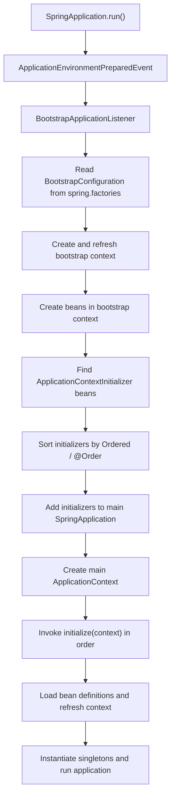

# Ordering BootstrapConfiguration and ApplicationContextInitializer

When a Spring Cloud application needs to supplement configuration before business beans are created, two extension points are commonly used in the traditional bootstrap mechanism: **`BootstrapConfiguration`** and **`ApplicationContextInitializer`**. They are directly related to each other yet handle two distinct jobs.

`BootstrapConfiguration` declares the configuration classes loaded into the bootstrap context. These classes can create beans serving bootstrap, including beans implementing `ApplicationContextInitializer`. Spring Cloud collects those initializers, sorts them by order, and adds them to the main `SpringApplication`. After the main `ApplicationContext` is created, Spring Boot invokes each initializer before refreshing the context.

For **SPRING_CLOUD_CORE**, understanding this order accurately helps place configuration sources at the right moment, avoiding reading properties too early or initializing beans before configuration is ready. This lesson belongs to the **Custom Configuration Sources** chapter and focuses on registering, ordering, and testing both mechanisms.

## 1. Learning Objectives

After this lesson, you will be able to:

- Distinguish `BootstrapConfiguration` from `ApplicationContextInitializer`.
- Describe the creation order of the bootstrap context and main application context in legacy bootstrap.
- Explain why an initializer is declared as a bean in the bootstrap context yet applied to the main context.
- Order initializers using `Ordered` or `@Order`.
- Understand the meaning of smaller/larger order values and the default behavior when no order is declared.
- Register bootstrap configuration via `META-INF/spring.factories`.
- Organize packages so bootstrap configuration is not accidentally picked up by the main application's component scan.
- Choose the right extension point among `EnvironmentPostProcessor`, `ApplicationContextInitializer`, and `BeanFactoryPostProcessor`.
- Test initialization order and diagnose errors when configuration is added too late.

## 2. Two Extension Points Solving Two Layers of Work

### 2.1. `BootstrapConfiguration`: Declaring the Contents of the Bootstrap Context

`org.springframework.cloud.bootstrap.BootstrapConfiguration` is a **registration key name** in `META-INF/spring.factories`. The value of the key is a list of `@Configuration` classes that Spring Cloud uses to build the bootstrap context.

Example:

```properties
org.springframework.cloud.bootstrap.BootstrapConfiguration=\
com.example.bootstrap.PlatformBootstrapConfiguration
```

A listed configuration class can declare:

- Beans used to access remote configuration sources.
- `PropertySourceLocator` if the application uses the bootstrap-style property source lookup mechanism.
- `ApplicationContextInitializer` beans to customize the main context before refresh.
- Other supporting components needed inside the bootstrap context.

In other words, `BootstrapConfiguration` answers the question: **which configurations and beans must exist during the bootstrap phase?**

### 2.2. `ApplicationContextInitializer`: Customizing a Context Before Refresh

`org.springframework.context.ApplicationContextInitializer<C extends ConfigurableApplicationContext>` is a callback invoked on a `ConfigurableApplicationContext` after the context is created and before it is refreshed.

```java
public interface ApplicationContextInitializer<C extends ConfigurableApplicationContext> {
    void initialize(C applicationContext);
}
```

An initializer can:

- Add, replace, or reorder a `PropertySource` in `Environment`.
- Activate appropriate profiles.
- Set a parent context or customize certain context attributes.
- Register bean definitions before the refresh process handles them.

An initializer is not the right place to retrieve an already-initialized business bean from the main context, because the main context has not finished refreshing. Calling `getBean()` too early can trigger bean instantiation prematurely and cause dependency errors.

An initializer answers the question: **how must the main context be adjusted before the container begins refreshing?**

### 2.3. Comparison Table

| Criterion | `BootstrapConfiguration` | `ApplicationContextInitializer` |
| --- | --- | --- |
| Nature | Configuration class used to build the bootstrap context | Callback receiving a context to customize |
| Registration in legacy bootstrap | Key `org.springframework.cloud.bootstrap.BootstrapConfiguration` in `spring.factories` | Typically declared as a bean inside a bootstrap configuration |
| Context used to create/run | Bootstrap context | Typically the main application context when supplied from bootstrap |
| Timing | While Spring Cloud builds the bootstrap context | After the target context is created, before refresh |
| Typical work | Declare beans serving bootstrap | Add property sources, profiles, bean definitions, or customize the context |
| Order control | The configuration class list defines what to load; declaration order should not be relied upon to control callbacks | `Ordered` or `@Order` controls initializer order in the sorting mechanism |

**Common misconception:** a `BootstrapConfiguration` class is not automatically an `ApplicationContextInitializer`. It is a configuration class loaded into the bootstrap context; that class can declare one or more initializer beans.

## 3. Startup Sequence in Legacy Bootstrap

When the traditional bootstrap mechanism is enabled, the high-level sequence is as follows:



The diagram focuses on the relationship between the two extension points. Other internal listeners, initializers, and events of Spring Boot/Spring Cloud may appear between steps. The important point is that initializers are collected from the bootstrap context before the main `SpringApplication` finishes initializing its context.

### 3.1. Step 1 — SpringApplication Prepares the Environment

When calling:

```java
SpringApplication.run(CheckoutApplication.class, args);
```

Spring Boot prepares the `Environment` and publishes `ApplicationEnvironmentPreparedEvent`. Previously registered listeners can react at this stage, i.e., before the main application context is created.

In legacy bootstrap, `BootstrapApplicationListener` listens to this event. If bootstrap is enabled, the listener begins creating the bootstrap context.

### 3.2. Step 2 — Loading BootstrapConfiguration

Spring Cloud looks up classes registered under the key:

```text
org.springframework.cloud.bootstrap.BootstrapConfiguration
```

These classes are used as configuration sources for the bootstrap context. That context is initialized independently of the main context and can contain beans for fetching remote configuration or preparing the main context.

If multiple libraries contribute `BootstrapConfiguration`, their classes can be loaded together. Therefore, each library should use its own package and declare only necessary beans.

### 3.3. Step 3 — Creating Initializer Beans in the Bootstrap Context

The bootstrap context is refreshed to register and instantiate the required beans. Spring Cloud looks up beans of type `ApplicationContextInitializer`.

Example:

```java
@Configuration(proxyBeanMethods = false)
public class PlatformBootstrapConfiguration {

    @Bean
    TenantDefaultsInitializer tenantDefaultsInitializer() {
        return new TenantDefaultsInitializer();
    }
}
```

The `TenantDefaultsInitializer` bean is created in the bootstrap context. When bootstrap completes, Spring Cloud retrieves this instance and adds it to the initializer list of the main `SpringApplication`.

### 3.4. Step 4 — Sorting and Transferring Initializers to the Main SpringApplication

Spring Cloud collects the initializer beans, sorts them using `AnnotationAwareOrderComparator`, and then adds them to the main `SpringApplication`.

This means:

- `BootstrapConfiguration` determines which configuration classes are loaded into the bootstrap context.
- Initializer beans are created inside that context.
- `Ordered` or `@Order` on an initializer determines execution order in the sorted list.
- Listing configuration classes in `spring.factories` is not a reliable way to express initializer execution order.

### 3.5. Step 5 — Initializers Run Before the Main Context Refreshes

Spring Boot creates the main context, then invokes the registered initializers. `initialize(context)` executes before `refresh()`.

This is the appropriate time to add a property source that beans will read when instantiated, or to validate a mandatory configuration setting before the application proceeds.

Once initializers finish, Spring Boot continues loading bean definitions, running processors, and refreshing the context. Business beans are initialized according to their dependency graph and scope.

## 4. Ordering Initializers with Ordered and @Order

Spring supports controlling the order of many extension objects with `Ordered`, `PriorityOrdered`, and `@Order`. In the bootstrap mechanism, Spring Cloud uses `AnnotationAwareOrderComparator` to sort collected `ApplicationContextInitializer` beans.

### 4.1. Order Number Rules

| Value | Meaning |
| --- | --- |
| Smaller number | Called earlier |
| Larger number | Called later |
| `Ordered.HIGHEST_PRECEDENCE` | Lowest order value, earliest priority |
| `Ordered.LOWEST_PRECEDENCE` | Highest order value, latest priority |
| No order declared | Defaults to last according to Spring Cloud bootstrap documentation |

Example:

```java
@Order(10)
public class AddDefaultsInitializer
        implements ApplicationContextInitializer<ConfigurableApplicationContext> {
    // ...
}

@Order(20)
public class ValidateConfigurationInitializer
        implements ApplicationContextInitializer<ConfigurableApplicationContext> {
    // ...
}
```

`AddDefaultsInitializer` runs before `ValidateConfigurationInitializer`. This is useful when the first initializer supplies default values and the second validates the final values.

If two initializers share the same order, do not rely on accidental classpath order or file order. Use distinct order values when order matters, and verify with an integration test.

### 4.2. Implementing Ordered

Instead of an annotation, you can implement `Ordered`:

```java
public class AddDefaultsInitializer
        implements ApplicationContextInitializer<ConfigurableApplicationContext>, Ordered {

    @Override
    public int getOrder() {
        return 10;
    }

    @Override
    public void initialize(ConfigurableApplicationContext context) {
        // Customize context before refresh.
    }
}
```

This approach fits when the order is decided dynamically by logic or class configuration. `@Order` is usually more concise when the order is a constant.

### 4.3. PriorityOrdered

`PriorityOrdered` is a specialization of `Ordered` that allows a high-priority group to be sorted ahead of regular `Ordered` entries when the comparator supports it. Use it only when strict precedence separation is genuinely needed; most applications can use `@Order` with clear values.

### 4.4. @Order Is Not the Creation Order for Every Bean

`@Order` in this context controls the sorting of initializers. It is not a blanket guarantee that all singleton beans in Spring will be initialized in order-number sequence.

Do not use the following mechanisms as substitutes for initializer ordering:

- `@Primary`: selects a preferred bean when multiple candidates exist for dependency injection.
- `@DependsOn`: declares initialization dependencies between beans.
- `@Bean` method order in source code.
- Order of `BootstrapConfiguration` lines listed in `spring.factories`.

If the goal is for initializer A to run before initializer B, place the order on the initializers themselves and test the callback order.

## 5. Complete Example: Defaults First, Validation Second

An application needs to add some default values for a tenant before validating configuration. We declare two initializers:

1. `TenantDefaultsInitializer` adds a low-priority property source.
2. `ValidateTenantInitializer` checks whether `tenant.id` has been configured.

### 5.1. Bootstrap Configuration

```java
package com.example.bootstrap;

import org.springframework.context.annotation.Bean;
import org.springframework.context.annotation.Configuration;

@Configuration(proxyBeanMethods = false)
public class PlatformBootstrapConfiguration {

    @Bean
    TenantDefaultsInitializer tenantDefaultsInitializer() {
        return new TenantDefaultsInitializer();
    }

    @Bean
    ValidateTenantInitializer validateTenantInitializer() {
        return new ValidateTenantInitializer();
    }
}
```

### 5.2. First Initializer: Adding Defaults

```java
package com.example.bootstrap;

import java.util.Map;

import org.springframework.context.ApplicationContextInitializer;
import org.springframework.context.ConfigurableApplicationContext;
import org.springframework.core.annotation.Order;
import org.springframework.core.env.MapPropertySource;

@Order(10)
public class TenantDefaultsInitializer
        implements ApplicationContextInitializer<ConfigurableApplicationContext> {

    @Override
    public void initialize(ConfigurableApplicationContext context) {
        Map<String, Object> defaults = Map.of(
                "tenant.region", "local",
                "tenant.max-connections", 10);

        context.getEnvironment()
                .getPropertySources()
                .addLast(new MapPropertySource("tenantDefaults", defaults));
    }
}
```

`addLast` places the source at the end of the list, so higher-priority property sources can still override the default values.

### 5.3. Second Initializer: Validating Configuration

```java
package com.example.bootstrap;

import org.springframework.context.ApplicationContextInitializer;
import org.springframework.context.ConfigurableApplicationContext;
import org.springframework.core.annotation.Order;
import org.springframework.util.StringUtils;

@Order(20)
public class ValidateTenantInitializer
        implements ApplicationContextInitializer<ConfigurableApplicationContext> {

    @Override
    public void initialize(ConfigurableApplicationContext context) {
        String tenantId = context.getEnvironment().getProperty("tenant.id");

        if (!StringUtils.hasText(tenantId)) {
            throw new IllegalStateException(
                    "Required property 'tenant.id' is missing");
        }
    }
}
```

The validation initializer runs after the defaults source has been added. If `tenant.id` is absent from all configuration sources, the application stops early with a clear message.

### 5.4. Registering BootstrapConfiguration

Create the file:

`src/main/resources/META-INF/spring.factories`

```properties
org.springframework.cloud.bootstrap.BootstrapConfiguration=\
com.example.bootstrap.PlatformBootstrapConfiguration
```

For legacy bootstrap to operate, the application must enable the bootstrap mechanism in a way matching the release train, such as adding `spring-cloud-starter-bootstrap` or enabling `spring.cloud.bootstrap.enabled=true` from an early enough source.

### 5.5. Main Application Configuration

In `application.yaml`:

```yaml
tenant:
  id: checkout-prod
  region: ap-southeast-1
```

The `tenant.region` value in the application file overrides the default `local` because the initializer used `addLast`. `tenant.id` is read from the Environment by the validation initializer before the context refreshes.

### 5.6. Expected Result

```text
1. PlatformBootstrapConfiguration is loaded into the bootstrap context.
2. TenantDefaultsInitializer and ValidateTenantInitializer are created.
3. Spring Cloud sorts initializers by order 10 and 20.
4. Main ApplicationContext is created.
5. TenantDefaultsInitializer adds tenantDefaults.
6. ValidateTenantInitializer checks tenant.id.
7. Main ApplicationContext refreshes and creates application beans.
```

The sequence above is the callback order, not the initialization order of every bean in the main context.

## 6. How Is BootstrapConfiguration Registered?

### 6.1. Registering One Class

```properties
org.springframework.cloud.bootstrap.BootstrapConfiguration=\
com.example.bootstrap.PlatformBootstrapConfiguration
```

### 6.2. Registering Multiple Classes

```properties
org.springframework.cloud.bootstrap.BootstrapConfiguration=\
com.example.bootstrap.PlatformBootstrapConfiguration,\
com.example.security.bootstrap.SecurityBootstrapConfiguration,\
com.example.tenant.bootstrap.TenantBootstrapConfiguration
```

Each class is loaded into the bootstrap context. They can declare shared beans or individual initializer beans. Do not rely on comma-separated order to determine initializer execution order; use `@Order` or `Ordered` on the initializers.

### 6.3. Placing the Bootstrap Package Separately

Spring Cloud warns against letting `BootstrapConfiguration` classes be accidentally component-scanned into the main application context. If they are scanned in both places, beans may be registered twice or initialized in the wrong context.

A clean package structure:

```text
src/main/java/
├── com/example/checkout/
│   ├── CheckoutApplication.java
│   └── service/
└── com/example/bootstrap/
    ├── PlatformBootstrapConfiguration.java
    ├── TenantDefaultsInitializer.java
    └── ValidateTenantInitializer.java
```

If `@SpringBootApplication` resides in `com.example.checkout`, the `com.example.bootstrap` package sits outside its default component scan area. If the application places its main class in a broader parent package, configure scanning explicitly or move the bootstrap package outside that scope.

## 7. ApplicationContextInitializer Independent of Bootstrap

`ApplicationContextInitializer` is a Spring Framework and Spring Boot extension point, not something exclusive to Spring Cloud bootstrap.

It can be registered directly via `SpringApplication`:

```java
public static void main(String[] args) {
    SpringApplication application =
            new SpringApplication(CheckoutApplication.class);

    application.addInitializers(new ValidateTenantInitializer());
    application.run(args);
}
```

In this case:

- `BootstrapConfiguration` is not needed solely to register an initializer.
- No bootstrap context is needed if the application does not use legacy bootstrap.
- Spring Boot still invokes the initializer on the main context before refresh.

Spring Boot also supports registering initializers through appropriate auto-configuration mechanisms or shared libraries. When mixing initializers registered via multiple paths, verify the actual order in `SpringApplication`; do not rely on the order they appear across config files.

## 8. Distinguishing from Other Extension Points

Not every requirement to "run before beans are created" needs an `ApplicationContextInitializer`.

| Extension point | Timing | Suitable when |
| --- | --- | --- |
| `EnvironmentPostProcessor` | During Environment preparation, before the context is created | Need to add property sources or alter Environment very early |
| `BootstrapConfiguration` | When Spring Cloud builds the bootstrap context in legacy bootstrap | Need to declare dedicated beans and components for bootstrap |
| `ApplicationContextInitializer` | After the target context is created, before refresh | Need to customize Environment/context before beans are created |
| `BeanFactoryPostProcessor` | During refresh, after bean definitions are loaded and before regular beans are instantiated | Need to modify metadata/bean definitions |
| `BeanPostProcessor` | When each bean instance is created | Need to intercept an instance before/after initialization, e.g., creating proxies |

### 8.1. When to Use EnvironmentPostProcessor?

If you need to add a property source while the Environment is being prepared, before Spring Boot creates the ApplicationContext, `EnvironmentPostProcessor` may be more appropriate.

Example use cases:

- Reading a special bootstrap file to determine Config Data locations.
- Adding a property source needed to decide active profiles or startup conditions.
- Preparing values that early startup listeners need to read.

`ApplicationContextInitializer` runs later because the context has already been created. If a value is needed to drive context creation itself or Config Data loading, do not wait until an initializer.

### 8.2. When to Use BeanFactoryPostProcessor?

If you need to modify already registered bean definitions, such as altering a bean's metadata or registering extra definitions after configuration sources have been read, `BeanFactoryPostProcessor` may fit.

Do not use `BeanFactoryPostProcessor` to replace an initializer that only needs to activate a profile or add a property source before refresh. Each extension point has its own timing and scope of impact.

## 9. Legacy Bootstrap and Modern Config Data

Spring Boot 2.4 introduced the Config Data API, and Spring Cloud Config Client now supports configuring remote sources with:

```yaml
spring:
  config:
    import: optional:configserver:http://config-server:8888
```

With this approach, the application loads configuration via Config Data during Environment preparation. There is no need to create a bootstrap context solely to connect to Config Server.

### 9.1. When Using Legacy Bootstrap

Legacy bootstrap is typically activated via `spring-cloud-starter-bootstrap` or `spring.cloud.bootstrap.enabled=true` provided early enough. In that mode:

- `BootstrapConfiguration` is discovered from `spring.factories`.
- The bootstrap context is created.
- `ApplicationContextInitializer` beans can be collected and added to the main `SpringApplication`.
- `bootstrap.yml` can supply configuration dedicated to the bootstrap phase.

### 9.2. When Using Config Data

With `spring.config.import`, Spring Boot processes configuration sources according to the Config Data API. If you want to write a custom Config Data location type, the appropriate extension points are `ConfigDataLocationResolver` and `ConfigDataLoader`.

`ApplicationContextInitializer` can still be used as a hook to customize the main context in modern Boot applications, but it does not replace a Config Data resolver/loader when the data source needs to participate directly in the Config Data loading phase.

### 9.3. Do Not Mix Both Mechanisms Unintentionally

| Need | Approach |
| --- | --- |
| Legacy application needs bootstrap context | Legacy bootstrap with `BootstrapConfiguration` |
| Need a custom initializer in legacy bootstrap | Declare an `ApplicationContextInitializer` bean in bootstrap config |
| Modern Boot application needs Config Server | `spring.config.import=configserver:...` |
| Create a custom Config Data source | `ConfigDataLocationResolver` + `ConfigDataLoader` |
| Customize main context before refresh | `ApplicationContextInitializer` |
| Customize Environment before context creation | `EnvironmentPostProcessor` |

If enabling legacy bootstrap while simultaneously importing the same source with Config Data, clearly establish which mechanism is responsible and verify that data is not loaded twice.

## 10. Testing Initializer Order

Ordering must be tested at the callback level, rather than inferred from class order in source code.

### 10.1. Unit Test for an Initializer

```java
class TenantDefaultsInitializerTest {

    @Test
    void addsDefaultsToEnvironment() {
        GenericApplicationContext context = new GenericApplicationContext();
        try {
            new TenantDefaultsInitializer().initialize(context);
            context.refresh();

            assertThat(context.getEnvironment().getProperty("tenant.region"))
                    .isEqualTo("local");
        }
        finally {
            context.close();
        }
    }
}
```

This unit test verifies the initializer's behavior when invoked. It does not prove Spring Cloud registered the initializer from `spring.factories` or sorted it properly.

### 10.2. Testing Order via Trace

You can create two initializers that record their names into a shared list during tests:

```java
final class InitializerTrace {
    static final List<String> EVENTS = new CopyOnWriteArrayList<>();

    static void reset() {
        EVENTS.clear();
    }
}

@Order(10)
class FirstInitializer
        implements ApplicationContextInitializer<ConfigurableApplicationContext> {

    @Override
    public void initialize(ConfigurableApplicationContext context) {
        InitializerTrace.EVENTS.add("first");
    }
}

@Order(20)
class SecondInitializer
        implements ApplicationContextInitializer<ConfigurableApplicationContext> {

    @Override
    public void initialize(ConfigurableApplicationContext context) {
        InitializerTrace.EVENTS.add("second");
    }
}
```

After starting the context with the corresponding registration mechanism, verify:

```java
assertThat(InitializerTrace.EVENTS)
        .containsExactly("first", "second");
```

The trace list is strictly a testing tool; never use static mutable state as a production configuration coordination mechanism.

### 10.3. Integration Test for BootstrapConfiguration

An integration test should verify:

1. `spring-cloud-starter-bootstrap` or the bootstrap flag is enabled.
2. `META-INF/spring.factories` has the correct key and class name.
3. The bootstrap context creates the initializer beans.
4. The initializers are added to the main `SpringApplication`.
5. The initializers run in order before the main context refreshes.
6. Business beans subsequently read the property source added by the initializer.
7. Configuration is not duplicated in the main component scan.

### 10.4. Inspecting Spring Boot Events

Spring Boot provides events to observe progress:

| Event | Relative position |
| --- | --- |
| `ApplicationEnvironmentPreparedEvent` | Environment has been prepared, context not yet created |
| `ApplicationContextInitializedEvent` | Context has been prepared and initializers invoked, before bean definitions are loaded |
| `ApplicationPreparedEvent` | Bean definitions have been loaded, right before refresh |
| `ApplicationStartedEvent` | Context has finished refreshing |

You can register a listener to record event milestones and cross-check against the initializer trace. Avoid logging secrets or the entire Environment.

## 11. Common Mistakes

| Symptom | Possible cause | How to resolve |
| --- | --- | --- |
| BootstrapConfiguration is not loaded | Legacy bootstrap not enabled or wrong key in `spring.factories` | Check starter/bootstrap flag and exact key |
| Initializer is not invoked | Bean not created in bootstrap context or not collected | Check `@Bean`, return type, and registering context |
| Initializer runs in wrong order | No order declared or multiple initializers share the same order | Use explicit `@Order`/`Ordered` and test with a trace |
| Order in spring.factories has no effect | Confusing config list order with callback order | Put order on the initializer implementation |
| Property value missing in bean | Initializer added source too late or bean was created earlier | Move operation to an earlier hook |
| Bootstrap bean appears twice | Bootstrap config was component-scanned into main context | Separate bootstrap package from component scan |
| Initializer retrieves a bean but app fails startup | Called `getBean()` too early, triggering premature bean creation | Only modify Environment/context; let container create beans on refresh |
| Config Data does not use initializer | Using `spring.config.import` without enabling legacy bootstrap | Use Config Data extension points or target initializer properly |
| Environment changed but `@Value` does not update | Bean captured the value at initialization time | Use supported refresh/rebind or controlled bean recreation |
| Flaky tests across machines | Relying on classpath order or same-order initializers | Assign distinct order values and never rely on arbitrary order |

## 12. Design Principles

- Use `BootstrapConfiguration` to declare beans meant for the bootstrap context in legacy mode.
- Declare initializers as beans with concrete types inside bootstrap configuration.
- Place `@Order` on classes implementing `ApplicationContextInitializer` or implement `Ordered`.
- Use distinct order numbers if callback order matters.
- Do not use the listing order in `spring.factories` as a contract for initializer execution order.
- Keep the bootstrap package outside the main application's component scan area.
- Only modify Environment/context inside an initializer; do not proactively create business beans before refresh.
- If you need to intervene before the context is created, consider `EnvironmentPostProcessor`.
- If using modern Config Data, choose `ConfigDataLocationResolver`/`ConfigDataLoader` for custom sources.
- Test both callback order and resulting configuration in the main context.

## 13. Summary

`BootstrapConfiguration` and `ApplicationContextInitializer` are two sequential pieces in legacy bootstrap. Spring Cloud uses `BootstrapConfiguration` classes to build the bootstrap context. `ApplicationContextInitializer` beans declared there are collected, sorted by `Ordered` or `@Order`, and transferred to the main `SpringApplication`.

When the main `ApplicationContext` is created, Spring Boot runs the initializers before refreshing. This is the right moment to add property sources, profiles, or bean definitions before the container instantiates business beans. Smaller order values run first; initializers without a declared order default to last under the bootstrap rules described in Spring Cloud documentation.

Distinguish the loading order of bootstrap configuration classes from the invocation order of initializers. When exact order is required, declare order on the initializers and verify with integration tests. For applications using modern Config Data, pick the appropriate Config Data extension point instead of enabling legacy bootstrap just to reuse an older mechanism.

## 14. References

- [Spring Cloud Commons — Customizing the Bootstrap Configuration](https://docs.spring.io/spring-cloud-commons/reference/spring-cloud-commons/application-context-services.html#customizing-the-bootstrap-configuration)
- [Spring Cloud Commons — Application Context Services](https://docs.spring.io/spring-cloud-commons/reference/spring-cloud-commons/application-context-services.html)
- [Spring Cloud Commons — BootstrapApplicationListener source](https://github.com/spring-cloud/spring-cloud-commons/blob/main/spring-cloud-context/src/main/java/org/springframework/cloud/bootstrap/BootstrapApplicationListener.java)
- [Spring Boot — Customize the Environment or ApplicationContext Before It Starts](https://docs.spring.io/spring-boot/how-to/application.html#howto.application.customize-the-environment-or-application-context-before-it-starts)
- [Spring Boot API — SpringApplication](https://docs.spring.io/spring-boot/api/java/org/springframework/boot/SpringApplication.html)
- [Spring Framework API — ApplicationContextInitializer](https://docs.spring.io/spring-framework/docs/current/javadoc-api/org/springframework/context/ApplicationContextInitializer.html)
