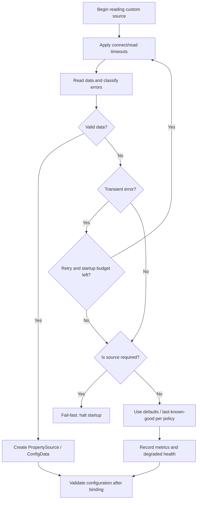

# Timeouts, Source Read Errors, and Choosing Fail-Fast or Fallback

## 1. The Problem When an Application Reads Configuration from a Custom Source

A Spring Cloud application can load configuration from Config Server, a tenant management service, an internal API, a database, or an organization's private configuration store. When that source responds slowly, loses connectivity, returns invalid data, or lacks configuration for the application, the startup process must have a clear policy.

There are two main approaches:

- **Fail fast:** halt startup when a required configuration source cannot be read. The application does not enter service with missing or untrusted configuration.
- **Fallback:** allow startup using default configuration or a backup source when the custom source is unavailable and the data is genuinely optional.

Neither choice is universally right for every system. If a source supplies encryption keys, credentials, or mandatory payment endpoints, using defaults can compromise security. If a source only provides banners, UI limits, or a secondary feature, bringing down the entire service may be unnecessary.

This lesson belongs to the **Custom Configuration Sources** chapter of the **SPRING_CLOUD_CORE** module. The module focuses on Spring Cloud Commons, Spring Cloud Context, externalized configuration, refresh scope, discovery, service registry, Spring Boot compatibility, and testing/operating shared abstractions. After this lesson, learners will be able to:

- Identify where a custom source is loaded in the startup lifecycle.
- Distinguish connection timeout, read timeout, and overall deadline.
- Design bounded retries and classify retryable errors vs. configuration errors.
- Choose fail-fast or fallback according to configuration criticality.
- Understand how Spring Cloud Config Client handles optional imports, fail-fast, and retries.
- Test slow sources, failing sources, malformed data, and missing sources.
- Observe when the application is running on default configuration or stale data.

## 2. Where Is a Custom Configuration Source Integrated?

Spring provides several ways to add property sources to the Environment. Pick the right extension point before designing timeouts and error handling.

### 2.1. PropertySourceLocator in Legacy Bootstrap

Spring Cloud Commons allows adding configuration sources to the bootstrap context through a bean of type `PropertySourceLocator`. The locator receives the `Environment` of the application context about to be created and returns a `PropertySource` containing the properties to supplement.

Skeleton implementation example:

```java
@Configuration(proxyBeanMethods = false)
class TenantBootstrapConfiguration {

    @Bean
    PropertySourceLocator tenantPropertySourceLocator(
            TenantSettingsClient client) {

        return environment -> {
            String application =
                    environment.getProperty("spring.application.name");

            Map<String, Object> values = client.load(application);

            return new MapPropertySource("tenant-settings", values);
        };
    }
}
```

Bootstrap configuration can be registered in the library's `META-INF/spring.factories` file:

```properties
org.springframework.cloud.bootstrap.BootstrapConfiguration=\
com.example.config.TenantBootstrapConfiguration
```

The bootstrap class must sit in a dedicated package so it is not unintentionally discovered by the main application context's component scan. This mechanism belongs to **legacy bootstrap**; bootstrap must be enabled as appropriate for your Spring Cloud version.

Starting with Spring Cloud 2022.0.3, `PropertySourceLocator` instances can be invoked twice: first without profiles to fetch configuration capable of activating profiles; then again after the main application context starts to fetch additional configuration for the active profiles. Therefore, do not assume the locator calls the external API only once. Design reads to be idempotent, use reasonable caching, and account for both passes in the startup budget.

### 2.2. ConfigDataLocationResolver and ConfigDataLoader

With Spring Boot 2.4 and later, Config Data is the modern mechanism for loading configuration via `spring.config.import`. When building a custom location such as `tenantconfig:...`, the appropriate extension points are:

- `ConfigDataLocationResolver`: recognizes and resolves a location into resources.
- `ConfigDataLoader`: reads a resource and produces `ConfigData` containing property sources.

These two SPIs are registered via Spring Boot's `spring.factories` mechanism. `ConfigDataLoader.load(...)` can return `null` when a location should be skipped; for a missing required resource, the loader can throw `ConfigDataResourceNotFoundException` so Config Data handles it according to the location's optionality.

Do not assume `PropertySourceLocator` runs automatically simply because the application uses `spring.config.import`. Pick the exact model: legacy bootstrap locator or Config Data resolver/loader. Error handling and optional behavior of the custom implementation must align with that extension point.

### 2.3. Distinguishing Custom Sources from Spring Cloud Config Client

Spring Cloud Config Client provides built-in properties for requests to Config Server, such as:

- `spring.cloud.config.request-connect-timeout`: limits connection wait time.
- `spring.cloud.config.request-read-timeout`: limits response read wait time.
- `spring.cloud.config.fail-fast`: controls whether a Config Server connection error halts startup in the corresponding model.
- `spring.cloud.config.retry.*`: configures retries when retry support is on the classpath.

These properties apply to **Config Client**. They do not automatically configure timeouts for a custom-written `PropertySourceLocator`, a database client, or a proprietary SDK. A custom source must configure timeouts on the HTTP client, JDBC driver, SDK, or API it uses.

## 3. Timeouts: Bounding Time at Every Stage

A remote source read can take time across multiple stages. Setting only one generic timeout without knowing where it applies can still leave the application hanging longer than expected.

| Timeout type | What does it bound? | Example failures |
| --- | --- | --- |
| **Connection timeout** | Time to establish a TCP/TLS connection or connect to the service | Slow DNS, server port closed, broken network route |
| **Read/response timeout** | Time waiting for response data after connecting successfully | Server accepts request but processes slowly, upstream hangs |
| **Pool-acquire timeout** | Time waiting to obtain a connection from a connection pool | Pool exhausted or connections held too long |
| **Overall deadline** | Total time for the entire operation, including retries and backoff | Startup drags out even though each individual request has a timeout |
| **Database query timeout** | Time allowed for a query to execute | Long-running locks or overloaded database |

For example, an HTTP client has a 2-second connect timeout and a 3-second read timeout. That does not guarantee total startup takes at most 5 seconds: DNS, TLS, pool acquisition, retries, backoff, and extra profile-loading passes can push total duration higher.

The **overall deadline** must be managed at the orchestration layer. The total budget must account for the number of attempts, per-attempt duration, backoff intervals, and multiple framework calls to the locator.

### 3.1. Configuring Timeouts for Spring Cloud Config Client

Spring Cloud Config Client documentation provides two connect and read properties. Example:

```yaml
spring:
  cloud:
    config:
      request-connect-timeout: 2000
      request-read-timeout: 3000
```

The example values are in milliseconds per Config Client property definitions. Current metadata records the default value as `0`, meaning no explicit timeout threshold is set on these properties; do not rely on that default for a critical startup dependency.

When using Config Server via `spring.config.import`, these timeouts still belong to Config Client configuration. When using another custom HTTP client, configure timeouts directly on that client.

### 3.2. Timeout Example for a Custom HTTP Client

A custom locator using `RestTemplate` can configure its request factory with explicit timeouts:

```java
@Bean
RestTemplate tenantConfigRestTemplate() {
    SimpleClientHttpRequestFactory factory =
            new SimpleClientHttpRequestFactory();

    factory.setConnectTimeout(2_000);
    factory.setReadTimeout(3_000);

    return new RestTemplate(factory);
}
```

These two thresholds bound connecting and reading responses for requests using this factory. When integrating with proxies, TLS, connection pools, or other clients, check the corresponding timeout at each layer. An HTTP client timeout does not replace a database query timeout or the overall configuration loading deadline.

### 3.3. Choosing Timeouts from the Startup Budget

Do not pick timeouts by intuition or set them excessively high to mask problems. Start from the service's startup time requirement.

For example, a service needs to be ready within 15 seconds:

- Allocate at most 2 seconds to connect to the source.
- Allocate at most 3 seconds to read the response per call.
- Allow a bounded number of retries with short backoff.
- Reserve the remaining budget for other initialization steps.
- When the deadline is exceeded, apply the chosen fail-fast or fallback policy.

This is only a budgeting example. When a source is invoked twice under the profile lifecycle or when multiple configuration sources exist, calculate the total time across all passes, not just a single request.

## 4. Source Read Errors: Classify Before Deciding

Not every error should be retried. Classifying errors prevents repeating a request guaranteed to fail and stops fallback from hiding configuration mistakes.

| Error category | Examples | Typically appropriate handling |
| --- | --- | --- |
| Transient network error | Connection reset, connect timeout, read timeout | Bounded retry if startup budget remains |
| Service temporarily overloaded | HTTP 502/503/504 | Can retry with backoff; respect `Retry-After` if supported by client |
| Authentication/authorization error | HTTP 401/403, expired token | Usually fail-fast or report config error; blind retries cannot fix credentials |
| Invalid request | HTTP 400, invalid application/profile/label | Fail-fast and fix the request or metadata |
| Configuration not found | HTTP 404 or missing resource | Determine whether resource is required or optional; do not assume every 404 is safe for fallback |
| Invalid data | Broken YAML/JSON, wrong schema, missing required keys | Fail-fast; data arrived but cannot be used |
| Programming error | Unexpected null, mapping failure, bug in locator | Never retry indefinitely; surface clear exception and halt per policy |

An HTTP status code does not always tell the full story. For example, Config Server might return 404 in certain cases where the backing repository cannot be read. Cross-check server logs, application name, profile, label, and root cause instead of treating every 404 as "no configuration exists so use defaults".

### 4.1. Retry Only Recoverable Errors

Retries suit transient errors such as network resets or timeouts while an upstream service is starting up. Retries usually do not suit:

- Wrong username/password or token.
- Missing access permissions.
- Request configured with wrong application name, profile, or label.
- Payload violating schema.
- Missing required keys.
- Deterministic programming bugs.

Retrying an authentication error six times only slows down startup and adds load. Classify exceptions before feeding them into a retry policy.

### 4.2. Backoff and Jitter

If multiple instances start simultaneously after a deployment, immediate retries can trigger a synchronized thundering herd against Config Server. Exponential backoff increases the wait interval after each failure; jitter adds randomness so instances do not retry in lockstep.

An illustrative policy:

```text
attempt 1: call immediately
attempt 2: wait ~250 ms
attempt 3: wait ~500 ms
attempt 4: wait ~1000 ms
then: stop when attempts or startup deadline are exhausted
```

These intervals are only examples for a custom source. Bound both the retry count and total duration. Do not nest retries across multiple layers (SDK, HTTP client, locator, and framework) without calculating total calls; nested layers multiply request counts rapidly.

## 5. Spring Cloud Config Client: Fail-Fast, Optional, and Retry

Spring Cloud Config Client already provides policies for connecting to Config Server. Distinguish the two configuration loading approaches.

### 5.1. Config Data Import: Optional or Required

With the modern approach:

```yaml
spring:
  application:
    name: order-service
  config:
    import: optional:configserver:http://config-server:8888
```

The `optional:` prefix lets the application continue if Config Server is unavailable or does not supply the resource under the corresponding Config Data rules. The application then continues with remaining configuration sources, such as local files and environment variables.

If `optional:` is omitted:

```yaml
spring:
  config:
    import: configserver:http://config-server:8888
```

Config Client will fail startup if it cannot connect or load the required configuration. This is the Config Data import equivalent of fail-fast.

Optional does not mean the application automatically invents a safe set of defaults. It only permits skipping the imported source when allowed; required properties must still exist in another source and be validated.

### 5.2. Legacy Config-First Bootstrap

In the legacy bootstrap model, fail-fast can be enabled with:

```yaml
spring:
  cloud:
    config:
      fail-fast: true
```

When Config Client cannot retrieve configuration from Config Server, startup halts with an exception. Current metadata records `spring.cloud.config.fail-fast` as `false` by default; set it explicitly to `true` if the remote source is mandatory. If startup should proceed in certain scenarios, understand the bootstrap configuration and client policy; do not merely flip fail-fast to false without verifying which local source will supply required keys.

Do not mix bootstrap assumptions with Config Data import. Config Data is the modern default since Spring Boot 2.4; a `bootstrap.yml` file is not needed for this import style.

### 5.3. Config Client Retries

Spring Cloud Config documentation describes retries when fail-fast is enabled and both `spring-retry` and `spring-boot-starter-aop` are on the classpath. Current defaults documented include:

| Property | Default value |
| --- | ---: |
| `spring.cloud.config.retry.max-attempts` | 6 |
| `spring.cloud.config.retry.initial-interval` | 1000 ms |
| `spring.cloud.config.retry.multiplier` | 1.1 |
| `spring.cloud.config.retry.max-interval` | 2000 ms |

These can be reconfigured via `spring.cloud.config.retry.*`. When a Config Data import is placed in a profile-specific file, retry settings may need to be passed as query parameters on the import URL per Config Client documentation.

These built-in retries belong to **Config Client**. A custom-written `PropertySourceLocator` is not automatically wrapped in Spring Retry; if retries are needed, configure them separately in the client or service called by the locator.

If the `spring.config.import` statement lives inside a profile-specific file, Config Client documentation instructs passing retry options directly as query parameters on the import URL. Check the syntax for your release train; do not copy a legacy bootstrap configuration verbatim into Config Data import.

## 6. Fail-Fast or Fallback: Choosing by Criticality

The decision should rest on the consequences if the application continues with default values.

| Configuration category | Examples | Typically appropriate policy |
| --- | --- | --- |
| Mandatory security | Encryption key, signing key, credentials, truststore | Fail-fast if a valid value cannot be retrieved |
| Essential infrastructure links | Database endpoint, broker, registry endpoint required for business logic | Fail-fast if no verified backup source exists |
| Transaction policies | Payment limits, currency, risk rules, data-protection features | Fail-fast or use a validated, still-valid cached copy |
| Secondary features | Banners, UI descriptions, colors, help text | Can fall back to safe defaults |
| Non-critical tuning | Cache TTL, reasonably bounded batch sizes | Can use tested defaults and log a warning |
| Per-tenant configuration | Pricing rules or tenant-specific access permissions | Never use a shared default if cross-tenant misconfiguration is possible |

### 6.1. When to Fail-Fast

Choose fail-fast when:

- Missing configuration could cause incorrect data processing or policy violations.
- Default values cannot guarantee safety.
- The remote source is the sole owner of the configuration.
- Data is retrieved but fails validation.
- The exact tenant, profile, or configuration version cannot be determined.

Fail-fast surfaces errors immediately at startup instead of letting the application run with half-baked configuration. However, log the source, application, profile, revision, and cause clearly; never log credentials or sensitive payloads.

### 6.2. When Fallback Is Acceptable

Fallback fits when:

- The configuration source only serves non-essential features.
- Local defaults are explicitly defined, validated, and tested.
- The service operates accurately and safely using defaults.
- The system has visibility into when fallback is active.

Fallback should be treated as an observable operational state, not a swallowed exception. Record which source failed, timestamp, error category, default version, and how long fallback has been active.

### 6.3. Conditional Last-Known-Good Usage

Another option is using the most recent valid saved configuration (last-known-good). This can help during temporary source outages, provided strict conditions hold:

- Store alongside revision, fetch timestamp, and corresponding profile/tenant.
- Verify integrity and access permissions of stored data.
- Enforce a maximum age for stale configuration; fail-fast once TTL expires.
- Never apply configuration from another tenant or environment.
- Maintain separate policies for secrets, certificates, and encryption keys.
- Emit warnings whenever running on stale data.

Do not automatically use cached data indefinitely simply because the fresh source is unreachable.

## 7. Implementing Policy in a Custom PropertySourceLocator

A custom locator should separate three responsibilities:

1. **Source client:** manages HTTP/DB/SDK transport, timeouts, and returns raw data.
2. **Validator:** checks schema, required keys, version, and tenant/profile scope.
3. **Policy:** decides whether to fail-fast or skip an optional source on error.

The example below illustrates this structure. `TenantSettingsClient` is implemented by the application and owns protocol-specific timeouts and retries:

```java
import org.slf4j.Logger;
import org.slf4j.LoggerFactory;

@Configuration(proxyBeanMethods = false)
class TenantSourceBootstrapConfiguration {

    private static final Logger log =
            LoggerFactory.getLogger(TenantSourceBootstrapConfiguration.class);

    @Bean
    PropertySourceLocator tenantSourceLocator(
            TenantSettingsClient client,
            TenantSettingsValidator validator,
            TenantSourcePolicy policy) {

        return environment -> {
            String application =
                    environment.getProperty("spring.application.name");

            try {
                Map<String, Object> values = client.load(application);
                validator.validate(values);

                return new MapPropertySource("tenant-settings", values);
            }
            catch (TransientSourceException ex) {
                if (policy.isRequired()) {
                    throw new IllegalStateException(
                            "Required tenant configuration is unavailable",
                            ex
                    );
                }

                // Do not insert dummy values into a high-priority source.
                // Safe defaults are declared in application.yml.
                log.warn("Tenant configuration source unavailable; using local defaults. application={}, errorType={}",
                        application, ex.getClass().getSimpleName());
                return new MapPropertySource(
                        "tenant-settings-unavailable",
                        Collections.emptyMap()
                );
            }
        };
    }
}
```

The example illustrates only the transient error branch. In real code, handle authentication errors, malformed schemas, and programming errors separately; do not lump every `RuntimeException` into the same fallback branch. For invalid configuration or missing required keys, the validator should fail startup according to policy.

When falling back via an empty source, defaults must live in another configuration source and be thoroughly verified. Never return a Map containing unvetted default values from a locator if that source is positioned at high priority where it might override environment settings.

## 8. Defining Defaults and Validating Correctness

Example local file holding defaults for non-critical features:

```yaml
feature:
  help-banner:
    enabled: true
    text: "Welcome"
  cache:
    ttl: 30s
```

Remote configuration can override these values when loaded successfully. When the custom source is unavailable and policy permits fallback, the application keeps the local defaults.

For mandatory configuration, validate explicitly:

```java
@ConfigurationProperties(prefix = "payments")
@Validated
public record PaymentProperties(
        @NotBlank String endpoint,
        @NotBlank String signingKey
) {
}
```

If `endpoint` or `signingKey` lacks a valid value, the application must not proceed simply because the custom source returned an empty `PropertySource`. Validation turns missing configuration into a diagnosable startup error.

Do not share one common default across all environments or tenants when values carry distinct security or business semantics.

## 9. Configuring and Measuring Source Status

A well-instrumented configuration source should answer:

- When was the last successful fetch?
- Is the app currently using remote configuration, local defaults, or last-known-good?
- Which revision/profile/tenant is applied?
- How many timeouts and retries occurred?
- Did total source load time exceed the startup budget?
- Are there recurring authentication or schema errors?

Metrics to consider:

| Metric | Meaning |
| --- | --- |
| `config_source_fetch_total` | Total source fetches broken down by outcome |
| `config_source_fetch_duration` | Time spent fetching the source |
| `config_source_retry_total` | Total retry attempts |
| `config_source_timeout_total` | Number of timeouts |
| `config_source_fallback_total` | Number of times fallback was used |
| `config_source_last_success_timestamp` | Timestamp of the most recent successful fetch |

Logs should include source name, application name, profile/tenant, revision, error category, and correlation ID. Never log secret values or full configuration payloads. When using an Actuator health indicator, report a degraded state if fallback persists or last-known-good is stale; avoid reporting `UP` as if a mandatory source were healthy.

## 10. Testing Timeouts, Errors, and Fallback

Do not test only the happy path where the source returns valid data. Simulate scenarios that trigger policy decisions.

| Scenario | How to simulate | Expectation |
| --- | --- | --- |
| Connection refused | Mock server not listening or wrong port | Connect failure occurs without hanging forever |
| Slow connection | Delay handshake or block port | Connect timeout triggers within limit |
| Slow response | Server accepts request but delays body | Read timeout triggers within limit |
| Transient HTTP 503 | Return 503 on first few attempts, then 200 | Retries expected count with backoff |
| HTTP 401/403 | Return authentication failure | No blind retries; reports credential/permission error |
| Malformed payload | Return invalid JSON/YAML | Validation/parsing fails per policy |
| Missing required key | Return syntactically valid payload missing fields | Startup fails if key is required |
| Optional source absent | Return resource-not-found per contract | Falls back only when permitted |
| Startup deadline exceeded | Keep source unresponsive across all attempts | Halts or falls back per policy; never hangs indefinitely |
| Locator called twice | Activate profiles and observe bootstrap lifecycle | Does not make excessive requests beyond budget or yield inconsistent data |

### 10.1. Unit Tests for Policy

Use a mock client to verify behavior:

- When the client returns valid data, the locator builds a property source with the expected name and keys.
- On transient error with a required source, the locator throws an exception so startup fails.
- On transient error with an optional source, the locator inserts no fake values; local defaults remain active.
- When payload lacks a required key, the validator fails the test.
- Once retry limit is reached, no further calls are made.

### 10.2. Integration Tests with a Mock Server

Use a mock HTTP server or test container to control:

- Connection and response latency.
- HTTP status codes.
- Headers, body, and payload format.
- Recovery after a few retries.
- Total elapsed time from application start until startup succeeds or fails.

Measure elapsed time with bounded clocks/awaits; avoid tests with long sleeps or tight timing tolerances that cause flakiness.

### 10.3. Verifying Both Results and Operational State

Fallback tests should check more than "application starts successfully". Verify:

- Expected default values are actually bound.
- Fallback metrics increment.
- Health/readiness indicates degraded state if policy requires it.
- Logs include source name and error category without secrets.
- When the source recovers, the next restart or refresh picks up the new revision.

## 11. Common Design Mistakes

| Mistake | Consequence | Fix |
| --- | --- | --- |
| Missing connect/read timeouts | Startup can hang indefinitely when upstream stops responding | Set timeouts per protocol |
| Infinite retries | No startup deadline; rollouts stall | Cap attempts, backoff, and overall deadline |
| Retrying every exception | Wastes time on credential, schema, or request errors | Classify transient vs. permanent errors |
| Catching exceptions and returning empty Map silently | App runs with incomplete config; hard to troubleshoot | Log fallback and degraded state |
| Falling back on secrets or security keys | May start with insecure configuration | Fail-fast or use a protected secret cache with explicit TTL |
| Using last-known-good indefinitely | Stale configuration may no longer be valid | Enforce max age, revision, and integrity checks |
| Assuming Config Client timeouts apply to custom locator | Custom HTTP/DB client still lacks timeouts | Configure timeouts on the exact client used by the locator |
| Ignoring that locator can run twice | Startup generates more requests than budgeted | Design idempotent reads, caching, and total budget |
| Treating every 404 as missing config | Can mask repository read failures or wrong endpoints | Verify provider's 404 semantics |
| Using optional import for required keys | App starts, then business logic fails later | Validate mandatory properties and fail-fast |

## 12. Decision Workflow



Application sequence:

1. Identify which keys are mandatory and who owns each configuration source.
2. Pick the right extension point: `PropertySourceLocator` for bootstrap or Config Data SPI for modern custom locations.
3. Configure timeouts at the HTTP, database, or SDK layer.
4. Classify errors and retry only recoverable errors.
5. Cap retry attempts and the overall startup deadline.
6. Choose fail-fast, local defaults, or last-known-good based on criticality.
7. Validate configuration before the application serves traffic.
8. Instrument and test both happy paths and failure paths.

## 13. Official References

- [Spring Cloud Commons — Customizing the Bootstrap Property Sources](https://docs.spring.io/spring-cloud-commons/reference/spring-cloud-commons/application-context-services.html): registering `PropertySourceLocator`, bootstrap context, and locator call counts by version.
- [Spring Cloud Config Client](https://docs.spring.io/spring-cloud-config/reference/client.html): Config Data import, fail-fast, retry, connect timeout, and read timeout.
- [Spring Boot — Externalized Configuration](https://docs.spring.io/spring-boot/reference/features/external-config.html): optional locations and Config Data loading mechanism.
- [Spring Boot — ConfigDataLocationResolver API](https://docs.spring.io/spring-boot/api/java/org/springframework/boot/context/config/ConfigDataLocationResolver.html): resolving custom config locations.
- [Spring Boot — ConfigDataLoader API](https://docs.spring.io/spring-boot/api/java/org/springframework/boot/context/config/ConfigDataLoader.html): loading resources and creating `ConfigData`.

**Takeaway:** Timeouts bound waiting; retries handle recoverable failures; fail-fast protects the application from running with missing mandatory configuration; fallback is appropriate only when defaults are genuinely safe and observable. For a custom source, the implementation itself must manage its timeouts, retries, validation, and policy.
