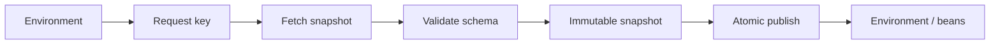
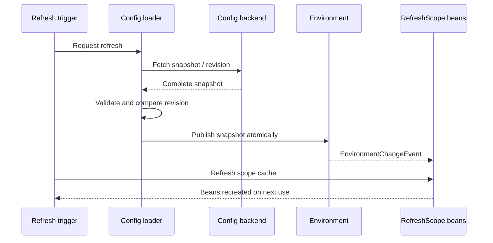

# Designing Idempotent Load Operations Safe During Refresh

A custom configuration source can be invoked multiple times across an application's lifecycle: during bootstrap, once profiles are activated, or when the environment is refreshed. If every invocation adds a new property source or mutates individual keys in place, the application can accumulate duplicate sources and expose half-updated configuration.

This lesson belongs to the **Custom Configuration Sources** chapter of the **SPRING_CLOUD_CORE** module. The focus is on designing fetch and snapshot publication operations so repeated invocations, retries, or concurrent executions still produce a stable state.

## 1. Learning Objectives

- Explain idempotency in configuration loading operations.
- Recognize the lifecycle moments when Spring Cloud re-invokes `PropertySourceLocator`.
- Separate fetch, validation, and publish into distinct steps.
- Use stable source names, immutable snapshots, and atomic replacement.
- Guard against stale revisions, concurrent refreshes, and mid-flight failures.
- Test repeated calls, profile changes, empty snapshots, and last-known-good handling.

## 2. What Does Idempotent Mean?

An idempotent operation is one where executing it multiple times with the same inputs produces the exact same final state as executing it once.

For example, the backend returns snapshot revision 42 with two properties `catalog.base-url` and `catalog.timeout`. The locator might be called three times, yet the end state remains a single configuration source holding those two values. It does not create three property sources, bump the revision, or write side-effect state back to the backend.

Idempotent differs from exactly-once. A network request may time out after the server already processed it; the client does not know and may retry. Practical designs must tolerate at-least-once invocation: requests may repeat, yet applying the same snapshot causes no extra side effects.

| Concept | Meaning |
| --- | --- |
| Repeatable | Can be invoked multiple times |
| Idempotent | Re-invoking with the same inputs causes no additional state changes |
| Atomic publish | Readers observe either the old snapshot or the complete new snapshot |
| Exactly-once | Assumes the task runs strictly once; never rely on this across network requests |

## 3. Why Can a Locator Be Called Multiple Times?

Spring Cloud allows adding bootstrap configuration sources via a bean implementing `PropertySourceLocator`. The locator receives the `Environment` of the application about to be created and returns a `PropertySource`.

Starting with Spring Cloud 2022.0.3, locators are invoked in two passes: the first pass fetches profile-independent configuration that may activate profiles; the second pass fetches configuration for active profiles. With legacy bootstrap, some setups can also re-invoke locators when building a refreshed environment. Multiple instances also start up and refresh independently.

In earlier releases, locators could run inside the main application context instead of the bootstrap context. Some versions allowed adjusting this timing via `spring.cloud.config.initialize-on-context-refresh` in `bootstrap.yml`. That is a version-specific bootstrap lifecycle setting, not a periodic polling scheduler.

Therefore, the locator must treat every invocation as an independent read. Never use invocation count to decide data, and never assume the locator runs only once.

## 4. Refreshing the Environment and Refreshing Beans

`ContextRefresher.refresh()` in Spring Cloud Context updates `Environment`, identifies changed keys, publishes `EnvironmentChangeEvent`, and refreshes the `RefreshScope` cache. Beans in refresh scope are recreated on their next access.

`@RefreshScope` does not call the backend on its own and does not detect changed configuration files automatically. A custom source must participate in the right environment reload path. With legacy bootstrap, a custom locator can be re-invoked when the environment is rebuilt. With Config Data import, reloading is handled by Config Data refreshers. Test against the exact mode and version in use.

## 5. Separating Fetch, Validate, and Publish



- The reader only reads data and returns a snapshot; it never mutates `Environment`.
- The validator checks the entire snapshot.
- The publisher replaces the active snapshot in a single atomic step.

Do not mix HTTP calls, shared-map mutations, and event publishing into one method. If refresh fails midway, that style easily leaves a half-old, half-new state.

Replacing a property source with an immutable snapshot is an atomic publish at the source level. However, a bean reading multiple individual keys right during a refresh could still start reading before the replacement and finish after it. When multiple keys must stay strictly consistent with one another, bind them into a single configuration object and coordinate recreating that object around one revision; do not let multiple consumers read disconnected keys mid-publish.


## 6. Building a Stable Identifying Key for Each Load

A request key must uniquely identify the requested configuration set. Depending on the system, the key may include:

| Component | Example | Reason |
| --- | --- | --- |
| Application | `billing-service` | Isolates configuration between services |
| Tenant | `tenant-a` | Separates per-customer data if applicable |
| Profiles | `prod`, `region-eu` | Selects environment-specific configuration set |
| Label/revision | `release-42` | Selects configuration version |
| Namespace | `payment` | Partitions data if supported by backend |

Example request key:

```text
application=billing-service
tenant=tenant-a
profiles=[prod, region-eu]
label=release-42
```

Components must come from `Environment` or already-available bootstrap sources. Do not derive profiles from a value that can only be fetched after connecting to the backend if that creates a circular dependency.

Preserve profile order if order is meaningful to the system. If the backend treats profiles as an unordered set, normalize them consistently before building the cache key. The normalization rule must be identical across all invocations.

## 7. Writing a Pure-Read Locator That Returns a Snapshot

The example below illustrates a locator reading configuration from a custom service. `RemoteConfigReader` performs read-only requests; `ConfigSnapshotValidator` checks data before returning the property source.

### 7.1. Snapshot Contract

```java
import java.util.Map;

public record RemoteConfigSnapshot(
        long revision,
        Map<String, Object> properties
) {
}
```

Revision is a monotonically increasing number within the configuration scope managed by the backend. If the backend only provides an ETag or a non-comparable string revision, do not compare lexicographically; use equality/conditional requests or serialize reads and publication.

### 7.2. Read and Validation Contracts

```java
import java.util.List;

public interface RemoteConfigReader {

    RemoteConfigSnapshot fetch(
        String applicationName,
        List<String> profiles
    );
}
```

```java
import java.util.Map;

public interface ConfigSnapshotValidator {

    Map<String, Object> validate(
        Map<String, Object> properties
    );
}
```

The reader should perform side-effect-free read operations, such as HTTP GET or SQL SELECT. A read must never mark configuration as consumed, delete data on the backend, or increment a revision just because the client queried again.

The validator should verify:

- Key names fall within allowed namespaces.
- Values have valid types and formats.
- Required keys are present.
- Timeouts, pool sizes, and numeric limits lie within valid bounds.
- Secrets do not appear in logs or error messages.
- Interdependent keys satisfy consistency constraints.

### 7.3. Locator Returning a Stable Property Source Name

```java
import java.util.Arrays;
import java.util.List;
import java.util.Map;

import org.springframework.cloud.bootstrap.config.PropertySourceLocator;
import org.springframework.core.env.Environment;
import org.springframework.core.env.MapPropertySource;
import org.springframework.core.env.PropertySource;

public final class BillingConfigLocator implements PropertySourceLocator {

    private static final String SOURCE_NAME = "custom-billing-config";

    private final RemoteConfigReader reader;
    private final ConfigSnapshotValidator validator;

    public BillingConfigLocator(
            RemoteConfigReader reader,
            ConfigSnapshotValidator validator) {
        this.reader = reader;
        this.validator = validator;
    }

    @Override
    public PropertySource<?> locate(Environment environment) {
        String applicationName = environment.getProperty(
            "spring.application.name", "application");

        List<String> profiles =
            Arrays.asList(environment.getActiveProfiles());

        RemoteConfigSnapshot snapshot =
            reader.fetch(applicationName, profiles);

        Map<String, Object> validated =
            validator.validate(snapshot.properties());

        Map<String, Object> immutableValues = Map.copyOf(validated);

        return new MapPropertySource(SOURCE_NAME, immutableValues);
    }
}
```

Key characteristics:

- The name `custom-billing-config` stays stable across invocations.
- The same application/profile/revision yields the same property set.
- The map is validated and copied into an immutable map.
- The locator does not mutate `Environment` directly and does not publish refresh events.
- Read or validation errors propagate to the orchestration layer to apply the fail-fast/last-known-good policy.

The example uses `Map.copyOf`, which forbids `null` keys or values. The validator should strip or reject null values per schema. If you need to represent key deletion, use a new snapshot without that key and replace the entire source; never use null as an ad-hoc tombstone because the property resolver may fall through to lower-priority sources.

> This is an example for a bootstrap `PropertySourceLocator`. If the application uses Config Data import, integrate the custom source via `ConfigDataLocationResolver` and `ConfigDataLoader` appropriate for your version. The principles of pure reads, immutable snapshots, and safe publication still apply.

## 8. Do Not Accumulate Property Sources Across Refreshes

A common mistake is generating a new time-based name:

```java
// Avoid: every call creates a differently named source.
String sourceName = "custom-config-" + System.nanoTime();
environment.getPropertySources().addFirst(
    new MapPropertySource(sourceName, values)
);
```

After several refreshes, `Environment` accumulates stale sources. The source at the front continues winning, while older sources underneath make it hard for operators to see which values are active. Memory usage and lookup times can also grow with every refresh.

Use one stable name per logical source. When managing publication into `MutablePropertySources` directly, replace the source by name:

```java
import java.util.Map;

import org.springframework.core.env.ConfigurableEnvironment;
import org.springframework.core.env.MapPropertySource;
import org.springframework.core.env.MutablePropertySources;
import org.springframework.core.env.PropertySource;

public final class PropertySourcePublisher {

    private final String sourceName;

    public PropertySourcePublisher(String sourceName) {
        this.sourceName = sourceName;
    }

    public void replace(
            ConfigurableEnvironment environment,
            Map<String, Object> values) {

        Map<String, Object> immutable = Map.copyOf(values);
        PropertySource<?> next =
            new MapPropertySource(sourceName, immutable);

        MutablePropertySources sources = environment.getPropertySources();

        synchronized (sources) {
            if (sources.contains(sourceName)) {
                sources.replace(sourceName, next);
            }
            else {
                sources.addFirst(next);
            }
        }
    }
}
```

This publisher builds a new property source from the validated snapshot and replaces the identically named source. When the new snapshot drops an old key, that key disappears from the new source instead of lingering in the old map.

Only use a direct publisher when the application genuinely manages its own publication path. With a `PropertySourceLocator` invoked by Spring Cloud during bootstrap, return the source to the framework and let the bootstrap/refresher mechanism manage inserting it. Avoid both returning a source from the locator and manually inserting a copy into `Environment`.

### 8.1. An Empty Snapshot Must Be an Intentional Valid Outcome

There are three distinct cases:

1. The backend returns a valid snapshot containing zero properties.
2. The backend reports no configuration found for the application/profile.
3. The backend is unreachable or returns an invalid response.

Do not collapse all three cases into `Map.of()`. An empty snapshot may mean deleting all keys owned by that source; a network error means the new configuration is unknown. If an error gets converted into an empty map and published, the application can accidentally wipe out active configuration.

With a self-managed publisher, a valid empty snapshot can replace the old source with an empty source. With a Spring Cloud-managed locator, verify how your version handles a locator returning null or an empty property source; do not assume the old source is always removed when no new source is returned. If exact key-deletion semantics are required, design a publication mechanism with explicit replacement and test the empty case.


## 9. Atomic Snapshot Publication

Suppose the new configuration has three keys:

```yaml
billing:
  payment:
    base-url: https://payment-v2.internal
    connect-timeout: 2s
    read-timeout: 5s
```

Never update keys one by one inside a map currently being read by beans:

```java
// Avoid: other threads can observe half-updated configuration.
shared.put("billing.payment.base-url", newBaseUrl);
shared.put("billing.payment.connect-timeout", newConnectTimeout);
shared.put("billing.payment.read-timeout", newReadTimeout);
```

During refresh, a request might read the new endpoint alongside the old timeout. When keys are interdependent, intermediate states can cause connection failures or policy violations.

Instead:

1. Load all data into a local variable.
2. Validate the entire snapshot.
3. Build a new immutable map.
4. Replace the property source or snapshot reference in a single publish step.
5. After publishing succeeds, let Spring fire events/rebind/refresh per the configured mechanism.

When a snapshot has multiple related keys, publish only after all checks pass. Never let part of the new keys appear ahead of the rest.

## 10. Controlling Concurrent Refreshes and Out-of-Order Responses

An application can receive two refresh requests close together:

- Refresh A starts first, reads revision `41`, but the backend responds slowly.
- Refresh B starts later, reads revision `42`, and finishes first.
- If A publishes after B, revision `41` can overwrite revision `42`.

This is a **stale response** bug. Using a stable property source name alone is not enough; you must enforce version checks or serialize publication.

### 10.1. Serializing Within One Instance

If the backend provides a monotonically increasing numeric revision, the publisher can reject older revisions:

```java
import java.util.Map;

import org.springframework.core.env.ConfigurableEnvironment;

public final class VersionedConfigPublisher {

    private final ConfigurableEnvironment environment;
    private final PropertySourcePublisher publisher;
    private long lastAppliedRevision = -1;

    public VersionedConfigPublisher(
            ConfigurableEnvironment environment,
            PropertySourcePublisher publisher) {
        this.environment = environment;
        this.publisher = publisher;
    }

    public synchronized boolean publish(
            long revision,
            Map<String, Object> values) {

        if (revision <= lastAppliedRevision) {
            return false;
        }

        publisher.replace(environment, values);
        lastAppliedRevision = revision;
        return true;
    }
}
```

`synchronized` ensures only one thread within the same publisher executes the check-and-publish block at a time. Older or duplicate revisions are skipped. This is an intra-JVM lock only; it does not coordinate across other replicas.

In a real application, `lastAppliedRevision` must be initialized from the currently active revision when the publisher is created. Revisions need a clear comparison scope, such as per application + tenant + profile + label; never compare revisions across two different request keys.

If the backend uses an opaque revision like an ETag, never compare strings lexicographically. Serialize fetch/publish, use conditional requests, or use a system-managed generation token.

### 10.2. Coalescing Concurrent Refresh Requests

If multiple refresh signals arrive while a load is in flight, you can use **single-flight**: callers coalesce onto a single fetch for the same request key instead of issuing duplicate requests.

Implementation rules:

- Only coalesce requests with the exact same application, tenant, profile, and label.
- Requests for different profiles or tenants must never share a snapshot.
- Once the in-flight fetch finishes, if a newer signal arrived during flight, schedule one more fetch.
- Do not hold a lock across network waits if that lock blocks unrelated operations.
- Bound waits with timeouts and caller wait limits.

`ContextRefresher.refresh()` synchronizes calls on the same instance in its current implementation, but that does not guard requests triggered by custom schedulers, custom endpoints, or other replicas. The loader design itself must remain concurrency-safe.

### 10.3. Multiple Instances Do Not Share Memory

In Kubernetes or multi-replica environments, each JVM maintains its own `Environment`. An `AtomicReference`, `synchronized`, or in-process cache in one instance does not protect other instances.

Useful approaches include:

- Immutable revisions so every instance loads the exact same snapshot.
- ETag/conditional GET to reduce backend load.
- Jitter or staged rollouts to avoid all instances fetching simultaneously.
- Event/bus notifications announcing a new revision, followed by each instance fetching that exact revision.
- Metrics reporting the active revision per instance.

Do not use a distributed lock just to guarantee "only one instance reads configuration" when every instance still needs to update its own Environment. What matters is that each instance safely applies the same snapshot.

## 11. Handling Errors and Preserving Last-Known-Good

Refresh can fail due to network timeouts, backend unavailability, authentication failures, invalid schemas, or deleted revisions. Policy must distinguish **failed to load** from **successfully loaded a new snapshot that is empty**.

### 11.1. Never Publish Partial Data

Wrong workflow:

1. Read a subset of keys.
2. Write already-read keys immediately into `Environment`.
3. Continue reading and hit an error.
4. Leave half new configuration and half old configuration.

The right workflow loads a complete snapshot, validates it, and then publishes it. If one required key has the wrong type, reject the entire snapshot. Never patch data ad-hoc just to force a refresh to succeed.

### 11.2. Policy by Lifecycle Point

| Scenario | Behavior to consider |
| --- | --- |
| Initial startup, required source unreachable | Fail fast; do not start with incomplete configuration |
| Initial startup, optional source with safe defaults | Can use validated defaults and record degraded status |
| Refresh with existing valid snapshot, transient backend failure | Keep last-known-good; never publish an empty snapshot |
| Backend returns new snapshot but validation fails | Reject the entire new snapshot; keep the old snapshot |
| Backend returns a contract-valid empty snapshot | Apply explicit deletion policy; do not treat as network failure |
| Incoming revision is older than running revision | Reject publish to prevent unintended rollback |

Last-known-good is data that was previously loaded and validated successfully. Do not retain it indefinitely if security policy mandates configuration expiration; enforce an explicit TTL or expiration timestamp, after which readiness can transition to degraded or DOWN based on criticality.

### 11.3. Bounded Retries

Retries fit transient errors like timeouts or HTTP 503. Use backoff and jitter to avoid synchronized traffic spikes. Never retry 401/403, invalid schemas, or missing revisions endlessly; fix credentials or data instead.

Retries must preserve the exact request key and target revision. If a retry accidentally switches to another profile/label, the result may be syntactically valid yet belong to the wrong environment.

## 12. Caching, ETags, and Efficiency on Repeated Fetches

Idempotency does not force hitting the backend every single time. Load can be reduced with an explicitly keyed cache:

```text
cache key =
  application + tenant + ordered profiles + label
```

Optimization techniques:

- Use `ETag`/`If-None-Match` or revisions so the server returns `304 Not Modified` when configuration has not changed.
- Cache immutable snapshots by request key and revision.
- Use a sensible TTL; TTL must not exceed the allowed staleness window for old configuration.
- Use single-flight so concurrent requests await one fetch.
- Bound entry count and evict stale cache entries when an application/profile is no longer active.
- Never share caches across tenants or workloads with different access permissions.

If the server returns `304`, the client retains the current snapshot and avoids redundant republication. On cache miss or ETag change, fetch and validate the new snapshot before publishing.

Never rely on cache as the sole source of truth. In-process caches vanish on process restart; on restart, the client must fetch or recover the snapshot per the designed policy.


## 13. Separating Configuration Source Refresh from Bean Refresh

Three activities must be distinguished:

1. **Fetch:** read the new snapshot from the backend.
2. **Publish:** update the property source in `Environment`.
3. **Rebind/recreate:** let beans receive the new configuration.

`PropertySourceLocator` is responsible for returning property sources in the bootstrap flow. `ContextRefresher` coordinates updating `Environment`, publishing `EnvironmentChangeEvent`, and refreshing the refresh scope. Do not call `ContextRefresher.refresh()` from inside a locator; that can cause refresh loops or nested invocations.

A clean flow:



In Spring Cloud Context, `ContextRefresher.refresh()` already coordinates updating Environment and refreshing refresh scope in order. If building a custom refresh coordinator, clearly define which component fires events and which calls refresh scope; avoid firing duplicate events or refreshing twice for the same snapshot.

## 14. Designing a Small Refresh Coordinator

When a configuration source sits outside standard bootstrap locators or needs custom orchestration, you can separate a service responsible for reading and publishing. The example below illustrates the principle, not a drop-in replacement for every Config Data refresher:

```java
import java.util.List;
import java.util.Map;

import org.springframework.core.env.Environment;
import org.springframework.stereotype.Service;

@Service
public class CustomConfigRefreshService {

    private final RemoteConfigReader reader;
    private final ConfigSnapshotValidator validator;
    private final VersionedConfigPublisher publisher;
    private final Environment environment;

    public CustomConfigRefreshService(
            RemoteConfigReader reader,
            ConfigSnapshotValidator validator,
            VersionedConfigPublisher publisher,
            Environment environment) {
        this.reader = reader;
        this.validator = validator;
        this.publisher = publisher;
        this.environment = environment;
    }

    public synchronized boolean reload() {
        String applicationName = environment.getProperty(
            "spring.application.name", "application");
        List<String> profiles =
            List.of(environment.getActiveProfiles());

        RemoteConfigSnapshot snapshot =
            reader.fetch(applicationName, profiles);

        Map<String, Object> validated =
            validator.validate(snapshot.properties());

        return publisher.publish(snapshot.revision(), validated);
    }
}
```

In a real application, this service also needs error policies, timeouts, metrics, and post-publish event firing. When using standard `ContextRefresher`, let the refresher own the update/rebind lifecycle rather than creating a parallel refresh path. Never call `ContextRefresher.refresh()` from inside `PropertySourceLocator`.

## 15. Testing Safe Repeatability

Tests must verify both state after repeated calls and behavior under failure. Simply asserting a non-null return is insufficient.

### 15.1. Repeated Calls with the Same Revision

Suppose the locator receives the same snapshot twice. Verify:

- Same property source name.
- Same key set and values.
- Property source count in `Environment` does not grow.
- No extra write operations occur on the backend.
- No new revision is created simply because the client read again.

Example test for the publisher:

```java
import java.util.Map;
import java.util.stream.StreamSupport;

import org.junit.jupiter.api.Test;
import org.springframework.core.env.ConfigurableEnvironment;
import org.springframework.core.env.StandardEnvironment;

import static org.assertj.core.api.Assertions.assertThat;

class PropertySourcePublisherTest {

    @Test
    void replacesTheSameSourceInsteadOfAppendingDuplicates() {
        ConfigurableEnvironment environment = new StandardEnvironment();
        PropertySourcePublisher publisher =
            new PropertySourcePublisher("custom-config");

        publisher.replace(environment, Map.of("feature.a", true));
        publisher.replace(environment, Map.of("feature.a", true));

        long count = StreamSupport.stream(
                environment.getPropertySources().spliterator(), false)
            .filter(source -> source.getName().equals("custom-config"))
            .count();

        assertThat(count).isEqualTo(1);
        assertThat(environment.getProperty("feature.a")).isEqualTo(true);
    }
}
```

### 15.2. New Snapshot Removes an Old Key

Publish with two keys first, then with one key:

```java
publisher.replace(environment, Map.of(
    "feature.a", true,
    "feature.b", false
));

publisher.replace(environment, Map.of(
    "feature.a", true
));

assertThat(environment.containsProperty("feature.b")).isFalse();
```

This test confirms the source is replaced atomically and does not retain keys removed in the new snapshot.

### 15.3. Concurrent Calls

Use multiple threads calling refresh with the same revision. Verify:

- The backend receives no unnecessary writes.
- The publisher maintains only one logical source.
- The active revision never regresses.
- No concurrent map modification exceptions occur.
- All callers receive consistent results per contract.

If using single-flight, verify that multiple callers with the same request key trigger only one fetch within the active window.

### 15.4. Mid-Flight Errors Do Not Corrupt Active Configuration

Set up a valid prior snapshot, then simulate a backend timeout or validator rejection of the new snapshot. After the failed refresh, verify:

- The old snapshot remains active.
- No empty source was mistakenly published.
- No partial subset of new keys appeared.
- The error is recorded via metrics/logs without secrets.
- Readiness/health accurately reflects configuration source policy.

### 15.5. Profile Changes and Multiple Bootstrap Passes

For Spring Cloud versions invoking locators in a default-profile pass followed by an active-profiles pass, test two requests with the same application but different profiles. Verify the locator:

- Does not reuse a cache key missing profiles.
- Does not accumulate duplicate property sources.
- Does not mutate backend state.
- Returns the right configuration for each pass.

### 15.6. Stale Revision Arriving After Newer Revision

Simulate request A reading revision 41 and request B reading revision 42. Let B finish before A. After both publish, the active revision must still be 42. This test catches stale responses overwriting newer data.

## 16. Observability and Operations

A repeatable load operation needs telemetry to determine which refresh succeeded and which snapshot is active.

Record:

- Application, profile, and label/request key.
- Active revision or ETag.
- Fetch, validate, and publish durations.
- Refresh count and skipped count due to unchanged revision.
- Counts of timeouts, authentication errors, schema validation errors, and stale revisions.
- Last successful timestamp and age of the last-known-good snapshot.
- Number of instances running the new revision.

Never log the entire property map. Log only source name, revision, key count, and non-sensitive metadata. Never put secrets, tokens, passwords, or sensitive configuration values into logs or metric labels.

### 16.1. Alerts Should Focus on Actual State

Several useful signals:

| Signal | Meaning |
| --- | --- |
| Continuous fetch failures | Backend or network is experiencing issues |
| Last successful revision too old | Instance has not received recent configuration |
| Revision skew across replicas | Rollout/refresh is out of sync |
| Increasing validation failures | New configuration violates schema |
| Increasing refresh duration | Slow backend or excessive retries |
| Property source count growing across refreshes | Risk of appending sources instead of replacing |

Do not alert only on whether the refresh endpoint returns HTTP 200. Verify that the revision was published and target beans received the updated configuration.

## 17. Design Anti-Patterns to Avoid

| Practice | Consequence | Better design |
| --- | --- | --- |
| Generating timestamped source names | Property sources accumulate across refreshes | Stable source name |
| Mutating a shared map key-by-key | Requests can observe half-old, half-new snapshots | Validate new map and replace atomically |
| Locator writes to database on each run | Repeated calls cause side effects | Locator performs read-only backend calls |
| Converting every exception into an empty map | Transient errors wipe valid configuration | Distinguish empty snapshots from fetch failures |
| Cache key containing only application | Profiles/tenants can read wrong configuration | Cache key includes all identifying dimensions |
| Skipping revision checks | Stale responses can overwrite newer responses | Monotonic revision or conditional publish |
| Calling refresh inside locator | Can cause loops or nested refreshes | Separate loader from refresh coordinator |
| Assuming `@RefreshScope` calls backend automatically | Beans may be recreated with stale configuration | Configure explicit fetch/publish path |
| Testing startup only once | Misses repeat and concurrency bugs | Test repeats, concurrency, failures, and stale responses |

## 18. Practice Exercise

A custom configuration source provides `order-service` with three properties:

```yaml
order:
  payment:
    endpoint: https://payment.internal
    connect-timeout: 2s
    read-timeout: 5s
```

The backend returns monotonically increasing numeric revisions. During refresh:

- An instance receives two refresh requests close together.
- The first fetch returns revision 41 slowly.
- The second fetch returns revision 42 faster.
- Revision 42 removes the `order.payment.read-timeout` key.
- Afterward, another request times out reading the backend.

Design and verify:

1. Which fields besides application name must the request key include?
2. When the locator is called twice as profiles are activated, what side effects must be avoided?
3. How do you prevent revision 41 from overwriting revision 42?
4. How do you publish snapshot 42 so the old `read-timeout` key genuinely disappears?
5. When the subsequent request times out, why must you not publish an empty map?
6. If using `PropertySourceLocator`, which refresh mechanism re-invokes the locator in your project version?
7. Write tests for two calls with the same revision, two concurrent calls, key deletion, and retaining last-known-good when fetch fails.
8. Propose a metric to detect one replica still running revision 41 while other replicas have moved to revision 42.

**Completion criteria:** the same request can rerun without accumulating property sources; snapshots are validated before publication; older revisions never overwrite newer ones; fetch errors do not erase valid configuration; bootstrap/refresh behavior is tested against the project's actual mechanism.

## 19. Key Takeaways

- Spring Cloud can invoke custom property source locators multiple times; in supporting versions, locators also run in multiple passes for profile resolution.
- Idempotent means re-invoking with the same inputs causes no unintended side effects or extra state mutations.
- Reading configuration, validating, and publishing should be three distinct steps.
- Use complete request keys, revisions/ETags, and stable property source names.
- Build immutable snapshots, validate completely, and replace atomically.
- Control concurrent refreshes and reject stale responses; an intra-JVM lock does not protect other replicas.
- Distinguish valid empty snapshots from fetch failures; on refresh error, retain last-known-good per policy.
- `ContextRefresher` updates `Environment` and refresh scope, while custom sources must participate in the proper reload path.
- Test repeated calls, multiple profiles, multiple threads, stale responses, key deletions, and mid-flight errors.

## 20. References

- [Spring Cloud Context — Application Context Services](https://docs.spring.io/spring-cloud-commons/reference/spring-cloud-commons/application-context-services.html): bootstrap property sources, `PropertySourceLocator`, multiple locator passes, and refresh scope.
- [ContextRefresher.java](https://github.com/spring-cloud/spring-cloud-commons/blob/main/spring-cloud-context/src/main/java/org/springframework/cloud/context/refresh/ContextRefresher.java): order of updating Environment, firing `EnvironmentChangeEvent`, and refresh scope.
- [PropertySourceBootstrapConfiguration.java](https://github.com/spring-cloud/spring-cloud-commons/blob/main/spring-cloud-context/src/main/java/org/springframework/cloud/bootstrap/config/PropertySourceBootstrapConfiguration.java): how Spring Cloud invokes locators and inserts property sources during bootstrap.


