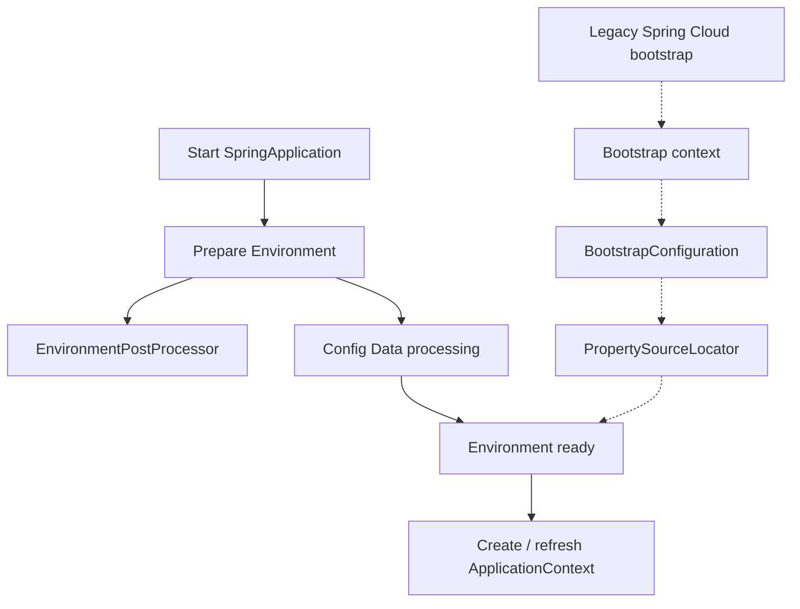

# Distinguishing Bootstrap Extensions from Spring Boot EnvironmentPostProcessor

When an application needs to supplement a configuration source, Spring offers multiple extension points that look similar because they can all add a `PropertySource` to `Environment`. Two mechanisms commonly mentioned in the Spring Cloud ecosystem are **legacy bootstrap extensions** and **Spring Boot's `EnvironmentPostProcessor`**. Choosing the wrong mechanism can cause configuration to load too late, appear in the wrong context, get unexpectedly overridden, or fail to run when switching Spring Boot/Spring Cloud versions.

This lesson belongs to the **Custom Configuration Sources** chapter of the `SPRING_CLOUD_CORE` module. The focus is on distinguishing the role of `BootstrapConfiguration`/`PropertySourceLocator` in the bootstrap context from `EnvironmentPostProcessor` during Spring Boot's `Environment` preparation; understanding execution timing, registration, dependency access, and how to pick the right extension. The lesson also situates both mechanisms within the modern Config Data API context to avoid extending legacy bootstrap when no longer needed.

## 1. Why Are There Multiple Extension Points for Supplementing Configuration?

A Spring Boot application can read configuration from YAML, properties, environment variables, command-line arguments, Config Server, or an organization's custom-built source. Ultimately, everything must be represented as property sources so `Environment` and Binder can read them.

However, **timing** for adding configuration sources matters greatly:

- If `Environment` must be modified before creating the `ApplicationContext`, the extension must run during the environment preparation phase.
- If a separate bootstrap context must be created to access remote configuration sources before the main context, legacy Spring Cloud bootstrap provides a dedicated mechanism.
- If location syntax such as `spring.config.import=custom:...` needs to be supported, the Config Data API provides resolvers/loaders for extending configuration sources.

Do not spot an API that can return a `PropertySource` and pick it by intuition. Identify **who owns the lifecycle**, when the extension is called, what dependencies it needs, and which bootstrap model the application uses.



The diagram is a high-level view. `ConfigDataEnvironmentPostProcessor` also participates in the `EnvironmentPostProcessor` system, and execution order is controlled by ordering. Legacy bootstrap has its own lifecycle depending on activation and Spring Cloud version. Therefore, the boxes above cannot be treated as a fixed sequence applying identically across all versions.

## 2. Legacy Spring Cloud Bootstrap Extensions

### 2.1. What Is the Role of the Bootstrap Context?

In the traditional mechanism, Spring Cloud creates a **bootstrap context** ahead of the main `ApplicationContext`. The bootstrap context acts as a parent context in the hierarchy, preparing foundational configuration and components needed to load remote configuration. Afterward, the main application context is created with the `Environment` supplemented by the bootstrap mechanism.

Bootstrap extensions suit integrations designed around this lifecycle, such as a custom `PropertySourceLocator` that needs to query a remote configuration source before business beans are initialized.

Legacy bootstrap is not default behavior required in every modern Spring Cloud application. In many newer release lines, applications must explicitly enable this mechanism, usually via `spring-cloud-starter-bootstrap` or a corresponding setting supported by the version's documentation. Do not add the starter just to supplement a `PropertySource` when Spring Boot already has a more suitable extension.

### 2.2. BootstrapConfiguration

A bootstrap configuration class is typically registered via the `org.springframework.cloud.bootstrap.BootstrapConfiguration` key in `META-INF/spring.factories`:

```java
package com.example.legacyconfig;

import org.springframework.context.annotation.Bean;
import org.springframework.context.annotation.Configuration;
import org.springframework.cloud.bootstrap.config.PropertySourceLocator;

@Configuration(proxyBeanMethods = false)
public class LegacyRemoteConfiguration {
    @Bean
    PropertySourceLocator tenantPropertySourceLocator() {
        return new TenantPropertySourceLocator();
    }
}
```

File `src/main/resources/META-INF/spring.factories`:

```properties
org.springframework.cloud.bootstrap.BootstrapConfiguration=\
com.example.legacyconfig.LegacyRemoteConfiguration
```

This registration requires the application to have legacy bootstrap enabled and the corresponding Spring Cloud dependencies present. Merely adding an entry to `spring.factories` does not create a bootstrap context if the bootstrap mechanism has not been activated.

**Note on package scanning:** place `BootstrapConfiguration` classes in a package outside the main application's normal component scan scope. If this class is component-scanned like a regular configuration class, it may also be loaded into the main context unintentionally, causing duplicate beans or divergent behavior between the bootstrap and application contexts.

### 2.3. PropertySourceLocator

`PropertySourceLocator` is the Spring Cloud bootstrap extension point for locating and returning a `PropertySource` based on `Environment`:

```java
package com.example.legacyconfig;

import java.util.LinkedHashMap;
import java.util.Map;

import org.springframework.core.env.Environment;
import org.springframework.core.env.MapPropertySource;
import org.springframework.core.env.PropertySource;
import org.springframework.cloud.bootstrap.config.PropertySourceLocator;

public class TenantPropertySourceLocator implements PropertySourceLocator {
    @Override
    public PropertySource<?> locate(Environment environment) {
        String tenant = environment.getProperty("deployment.tenant", "default");

        Map<String, Object> values = new LinkedHashMap<>();
        values.put("catalog.tenant", tenant);
        values.put("catalog.feature.enabled", Boolean.TRUE);

        return new MapPropertySource("tenantRemoteProperties", values);
    }
}
```

The example builds a `MapPropertySource` to illustrate the API; in a real system, the locator can call an external configuration source or internal adapter. When performing I/O, apply timeouts, error handling, authentication, TLS, and appropriate retry policies. Never log secrets or include them in exceptions.

The passed-in `Environment` lets the locator read already-available bootstrap details such as tenant, application name, or profiles. The returned configuration source can then supply additional properties to the application context. When the locator is called and how property sources attach to the environment can vary across Spring Cloud release lines; check the documentation for your exact release train, especially when using options related to running locators during main context refresh.

### 2.4. Bootstrap Extensions Are Not Main Context Beans

Classes inside `BootstrapConfiguration` are created in the bootstrap context. They should not assume they can inject arbitrary business beans declared in the main application context, because the main context has not been created yet when bootstrap runs. Restrict dependencies to components necessary for locating configuration.

If a locator needs an HTTP client, credential provider, or specialized library, declare the corresponding dependencies in the bootstrap configuration or design an adapter that initializes independently. Never use `@Autowired` to reference a bean that only exists in the child context.

## 3. Spring Boot EnvironmentPostProcessor

### 3.1. Position in the Lifecycle

`EnvironmentPostProcessor` is a Spring Boot extension point invoked while `SpringApplication` prepares the `Environment`, before the `ApplicationContext` is created and refreshed. It receives:

- `ConfigurableEnvironment`: the environment that can be mutated by adding, removing, or reordering `PropertySource` entries, activating profiles, and related operations.
- `SpringApplication`: the application object being launched.

This is the right mechanism when `Environment` needs early additions or adjustments from a Spring Boot component without spinning up a separate Spring Cloud bootstrap context.

Example:

```java
package com.example.config;

import java.util.LinkedHashMap;
import java.util.Map;

import org.springframework.boot.SpringApplication;
import org.springframework.boot.env.EnvironmentPostProcessor;
import org.springframework.core.Ordered;
import org.springframework.core.env.ConfigurableEnvironment;
import org.springframework.core.env.MapPropertySource;

public class CatalogDefaultsEnvironmentPostProcessor
        implements EnvironmentPostProcessor, Ordered {

    @Override
    public void postProcessEnvironment(
            ConfigurableEnvironment environment,
            SpringApplication application) {

        Map<String, Object> defaults = new LinkedHashMap<>();
        defaults.put("catalog.region", "local");
        defaults.put("catalog.client.enabled", Boolean.FALSE);

        environment.getPropertySources().addLast(
                new MapPropertySource("catalogLocalDefaults", defaults));
    }

    @Override
    public int getOrder() {
        return Ordered.LOWEST_PRECEDENCE;
    }
}
```

This is an example of **low-priority default values**: `addLast` puts the property source at the end of the list, so higher-priority sources can override it. If the goal is to forcibly override other sources, choose position and order deliberately; do not switch to `addFirst` just to make a test pass.

### 3.2. Registering EnvironmentPostProcessor

Register the extension in `src/main/resources/META-INF/spring.factories` under Spring Boot's key:

```properties
org.springframework.boot.env.EnvironmentPostProcessor=\
com.example.config.CatalogDefaultsEnvironmentPostProcessor
```

This is a dedicated registration key for `EnvironmentPostProcessor`. It differs from legacy Spring Cloud bootstrap's `org.springframework.cloud.bootstrap.BootstrapConfiguration` key, even though both are commonly declared inside `META-INF/spring.factories`.

`EnvironmentPostProcessor` is loaded by Spring Boot via the factories mechanism. The class must have an appropriate constructor so the framework can instantiate it; do not assume it is a component-scanned bean. Therefore, do not use field injection or constructor injection from the application context as with regular `@Component` classes.

### 3.3. Execution Order and Property Source Precedence

Two types of ordering must be distinguished:

1. **`EnvironmentPostProcessor` order:** determines which processor runs before/after other processors. `Ordered` or `@Order` can be used per Spring Boot's contract.
2. **`PropertySource` order:** determines which source wins when multiple sources contain a key. `addFirst` gives high priority, `addLast` gives low priority; `addBefore`/`addAfter` allow placement relative to a known source.

Processor order does not automatically determine property source precedence. A processor running later can still add a source at the end of the list, and a processor running earlier can add a source at the front. Inspect both when analyzing effective values.

Other Spring Boot processors, especially `ConfigDataEnvironmentPostProcessor`, also participate in configuration preparation. If a custom processor depends on Config Data already being loaded or needs to influence Config Data, pick the matching order and extension point. Do not hard-code an arbitrary order number without checking the constants and docs for your Boot version.

### 3.4. Limitations of EnvironmentPostProcessor

`EnvironmentPostProcessor` runs before the main context is created. Therefore:

- It cannot directly inject `@Service`, repository, or business beans from the main context.
- It should not spin up long-lived executors, listeners, schedulers, or connection pools here.
- Avoid non-repeatable side effects; the processor may be called across separate launches/contexts.
- Handle idempotency if logic can execute multiple times within an extended bootstrap flow.
- Only modify `Environment`/property sources and necessary startup metadata.

If a component needs Spring dependency injection, lifecycle management, retries, and shutdown handling, create it as a bean in the appropriate context after `Environment` is ready.

## 4. Direct Comparison of the Two Extension Points

| Criterion | Legacy BootstrapConfiguration / PropertySourceLocator | Spring Boot EnvironmentPostProcessor |
| --- | --- | --- |
| Owning framework | Spring Cloud | Spring Boot |
| Primary purpose | Load configuration in a separate bootstrap lifecycle, often for remote sources | Adjust `Environment` during `SpringApplication` preparation |
| Associated context | Bootstrap context, parent to the application context in the legacy model | Runs before the application context is created; not a bean inside the context |
| Registration key | `org.springframework.cloud.bootstrap.BootstrapConfiguration` | `org.springframework.boot.env.EnvironmentPostProcessor` |
| Typical API | `PropertySourceLocator.locate(Environment)` | `postProcessEnvironment(ConfigurableEnvironment, SpringApplication)` |
| Dependency injection | Can declare beans in the bootstrap context; cannot inject main context beans that do not exist yet | Not an application bean; cannot autowire from the main context |
| Activation | Requires legacy bootstrap to be enabled per version/configuration | Invoked by Spring Boot via factories when registered |
| Use cases | Legacy integrations or locators depending on the bootstrap context | Adding defaults, early configuration detection, simple property source additions |
| Limitations | Tied to legacy lifecycle, introduces extra context and complexity | No access to application beans, does not fully replace Config Data import/resolvers |

**Both can add a `PropertySource`, but they do not share the same lifecycle and are not interchangeable in every scenario.** Choose an extension based on when data needs to be loaded and which dependencies the extension requires.

## 5. Modern Config Data API: When to Use Resolver/Loader?

Spring Boot's Config Data API is the standard mechanism for loading configuration sources in modern applications. For custom sources declared by location, such as:

```properties
spring.config.import=secretsvault:team-a/catalog-service
```

the appropriate extensions are usually:

- `ConfigDataLocationResolver`: parses locations, produces concrete resources/locations, and handles profile activation per the Config Data contract.
- `ConfigDataLoader`: reads data from a resource identified by the resolver and returns `ConfigData` containing property sources.

These two extensions allow custom sources to participate in the Config Data workflow instead of inventing a bespoke loader inside `EnvironmentPostProcessor`. When a source needs import syntax, profile-specific documents, optional locations, and import ordering, the Config Data API is typically the more natural choice.

Conceptual declaration example:

```properties
spring.config.import=customvault:catalog/production
```

To support the `customvault:` prefix, the project must implement a resolver/loader matching the exact Spring Boot version's API and register it via the mechanism required by that version. Do not just create an `EnvironmentPostProcessor` and expect Spring Boot to understand a new location scheme automatically.

Modern Spring Cloud Config Client is itself an example of the Config Data approach: the client uses the `configserver:` location in `spring.config.import`. For new applications fetching configuration from Spring Cloud Config Server, prefer the mechanism recommended by your current release train's docs rather than adding legacy bootstrap just to get `PropertySourceLocator`.

## 6. Which Extension Fits Which Requirement?

| Requirement | Commonly suitable choice | Reason |
| --- | --- | --- |
| Add simple default values to Environment before context creation | `EnvironmentPostProcessor` | No separate bootstrap context needed |
| Read an environment parameter and add a synthesized property source | `EnvironmentPostProcessor` | Early, lightweight logic needing no business beans |
| Continue supporting custom locators already written for legacy bootstrap | `BootstrapConfiguration` + `PropertySourceLocator` | Preserves legacy lifecycle compatibility before migration |
| Integrate remote configuration sources via legacy bootstrap context | Bootstrap extension if required/supported by release train | Locator can use bootstrap beans and remote property sources |
| Provide a new location usable in `spring.config.import` | `ConfigDataLocationResolver` + `ConfigDataLoader` | Integrates directly into the Config Data lifecycle |
| Use Spring Cloud Config Server in a modern application | Config Client with `configserver:` | Built-in integration already exists |
| Need application beans, retries, health indicators, and graceful shutdown | Beans in the appropriate context | EPP/bootstrap locators should not manage long-lived business lifecycles |

A practical rule of thumb: **if the requirement is phrased as "load location X via `spring.config.import`", start with the Config Data API**. If the requirement is "add some default properties before the context is created", EPP may suffice. If maintaining a legacy application with an existing bootstrap context and locator, keep that extension until a tested migration plan is ready.

## 7. Design Mistakes and How to Fix Them

### 7.1. BootstrapConfiguration Is Component-Scanned into the Application Context

**Symptom:** locator beans or bootstrap configurations are created twice, property sources appear unexpectedly, or the context contains duplicate beans.

**Cause:** the bootstrap class's package lies inside `@SpringBootApplication`'s scan scope.

**Resolution:** move bootstrap configuration classes outside the main application context's scan package or adjust component scanning; keep registration through the dedicated bootstrap key.

### 7.2. EPP Attempts to Inject Application Services

**Symptom:** unable to inject beans or initialization fails because the context does not exist yet.

**Cause:** `EnvironmentPostProcessor` is called before Spring creates the application context.

**Resolution:** use the API and parameters passed to the processor; move bean-dependent logic to the bean lifecycle after context creation. If the configuration source requires complex dependencies, look at Config Data resolver/loader or a dedicated integration.

### 7.3. EnvironmentPostProcessor Adds PropertySource in the Wrong Position

**Symptom:** the new property exists in the source, yet another value still wins.

**Cause:** the source was added with `addLast` when override behavior was desired, or the processor ran at an inappropriate order.

**Resolution:** inspect `MutablePropertySources` order, processor order, and other sources; use `addFirst`/`addBefore` only when the new source genuinely needs higher priority.

### 7.4. Legacy Bootstrap Does Not Run

**Symptom:** `BootstrapConfiguration` is not loaded or `PropertySourceLocator` is not called.

**Cause:** legacy bootstrap is not enabled, missing the proper starter, wrong registration key, or using the modern Config Data model.

**Resolution:** verify Spring Boot/Spring Cloud versions, bootstrap dependencies, activation flags, and startup logs. If the application uses Config Data, migrate the locator to a mechanism supported by the release train instead of expecting a bootstrap context to appear automatically.

### 7.5. Configuration Source Loaded Twice

**Symptom:** requests to the configuration source repeat, duplicate source names occur, or final values are hard to explain.

**Cause:** the same source is loaded simultaneously by legacy bootstrap, a custom EPP, and Config Data import without coordination.

**Resolution:** pick one primary loading path, remove duplicate extensions after testing, or establish explicit source naming and precedence rules if maintaining multiple sources intentionally.

### 7.6. Using EPP for Uncontrolled I/O

**Symptom:** slow startup, unpredictable timeouts, or application fails to start when an external server has a brief outage.

**Cause:** EPP makes direct HTTP/database calls without timeouts, retries, optionality policies, or error observability.

**Resolution:** if it is a Config Data source, implement a resolver/loader with proper semantics; if it is standard remote config, use Spring Cloud Config Client. Define fail-fast/optionality, timeouts, and authentication per operational requirements.

## 8. Testing and Observing Extensions

Because extensions run before the application context is complete, tests must initialize `SpringApplication` or a startup environment close enough to real runtime. Testing only a helper method does not prove registration and ordering work.

| Target | How to test | What to confirm |
| --- | --- | --- |
| EPP is registered | Launch a test application with processor in `spring.factories` | Processor is invoked during Environment preparation |
| Default values | Provide no properties in other sources | Values from custom source are read |
| Precedence | Supply same key via YAML and environment variable | Higher-precedence source wins as expected |
| Processor order | Add two test processors with distinct orders | Call sequence matches design |
| Bootstrap extension | Enable legacy bootstrap in integration test | `BootstrapConfiguration` and locator are loaded |
| PropertySourceLocator | Mock the remote source | Locator returns a source with expected keys/values |
| Profiles | Run with different profiles | Locator/processor uses the exact profile info available at runtime |
| Config Data extension | Import custom location in test | Resolver/loader is invoked and property source is loaded |
| External source errors | Timeout, 401/403, DNS failure, or missing source | Startup fails or stays optional per policy |
| No duplicate loading | Inspect property source names and invocation counts | Each source is loaded as designed |

### Suggestions for Testing EnvironmentPostProcessor

You can create a `SpringApplication` for testing, register the processor via factories just like in production, run with test configuration sources, and retrieve `Environment` from the context after startup. Then assert:

1. The processor added the property source with the expected name.
2. Default properties take effect when no override is present.
3. Environment variables or command-line arguments override according to expected source position.
4. Profiles and bootstrap properties remain accurate.

For tests verifying real registration, avoid calling `postProcessEnvironment()` directly, because that bypasses factory discovery and ordering relative to other processors.

### Observing in Runtime Environments

Logs should record the extension name, property source name, load duration, and success/failure outcome. Never log secret values or the entire `Environment`. Actuator `env` can be used when the endpoint is properly secured and masked, keeping in mind that this endpoint can still reveal internal configuration structure.

## 9. Practice: Replacing a Custom Default with the Right Extension

Suppose `catalog-service` needs a default value `catalog.region=local`, while deployments can override it via `CATALOG_REGION` or Config Server.

**Using EnvironmentPostProcessor:**

1. Create `CatalogDefaultsEnvironmentPostProcessor`.
2. Add a `MapPropertySource` using `addLast` to supply low-priority defaults.
3. Register the class under `org.springframework.boot.env.EnvironmentPostProcessor` in `META-INF/spring.factories`.
4. Start the application without overrides and confirm region is `local`.
5. Restart with `CATALOG_REGION=ap-southeast` and confirm the environment variable beats the default.

**When requirements evolve into a remote source with a custom location:**

For instance, wanting to declare:

```properties
spring.config.import=tenantconfig:catalog-service
```

Evaluate a Config Data resolver/loader to handle locations, profiles, optionality, and load errors. Do not stretch EPP into a homemade Config Data loader if you want to follow Spring Boot's standard semantics.

**When maintaining a legacy locator:**

1. Verify whether the application actually has the bootstrap context enabled.
2. Confirm `BootstrapConfiguration` is registered under the exact key and sits outside main component scanning.
3. Check that the locator receives the expected application/profile/label and returns the intended property source.
4. Document property source order and override behavior.
5. Plan migration to Config Data if your release train and system requirements permit.

### Self-Check Questions

1. Why cannot `PropertySourceLocator` and `EnvironmentPostProcessor` be treated as the same extension point?
2. Under which key in `spring.factories` is `BootstrapConfiguration` registered?
3. Why should bootstrap configuration sit outside the application context's component scan package?
4. Is `EnvironmentPostProcessor` called before or after the application context is created?
5. Why should EPP not use `@Autowired` to retrieve an application service?
6. How do `addLast` and `addFirst` affect property precedence?
7. When a new location is needed in `spring.config.import`, which extension point fits?
8. If an application already uses legacy bootstrap, what must be verified before removing the bootstrap starter?

**Answer hints:** (1) Different owning frameworks and lifecycles; (2) `org.springframework.cloud.bootstrap.BootstrapConfiguration`; (3) To prevent bootstrap configuration from being mistakenly loaded into the main context; (4) Before the context is created/refreshed; (5) Because application beans do not exist yet; (6) `addFirst` gives high priority, `addLast` gives low priority; (7) `ConfigDataLocationResolver` and `ConfigDataLoader`; (8) Which dependencies/extensions still rely on bootstrap, Config Server behavior, profiles, precedence, and migration tests.

## 10. Key Principles to Remember

- Legacy Spring Cloud bootstrap creates a dedicated lifecycle/context for early configuration loading; `BootstrapConfiguration` and `PropertySourceLocator` belong to that model.
- `EnvironmentPostProcessor` is a Spring Boot extension running during `Environment` preparation before the application context is created.
- Both extensions can add a `PropertySource`, but their registration keys, contexts, dependencies, and lifecycles differ.
- Processor order and property source order are two separate concepts; inspect both when debugging precedence.
- Never inject application beans into EPP or a bootstrap locator; these extensions run before the main context is ready.
- For custom locations needing `spring.config.import`, prefer Config Data resolver/loader; for modern Config Server, use Config Client and `configserver:`.
- Maintain legacy bootstrap only when clear compatibility requirements exist; verify Spring Boot/Spring Cloud versions before enabling or migrating.
- Test registration, ordering, precedence, profiles, remote source failures, and absence of duplicate loading.

Clearly distinguishing bootstrap extensions from `EnvironmentPostProcessor` helps a Spring Cloud application load configuration at the right phase, control sources and precedence, and reduce reliance on legacy lifecycles when building custom configuration sources.
