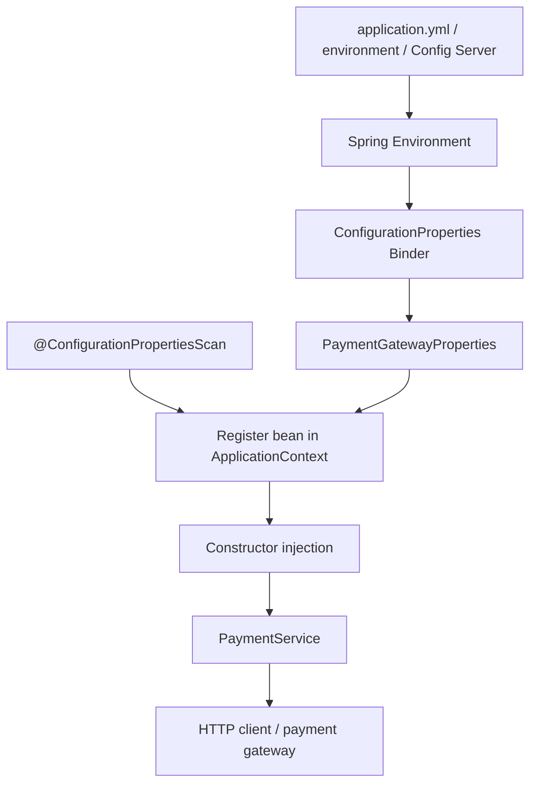

# Declaring Property Groups and Registering Configuration Beans

A Spring Boot application typically has many properties related to the same feature: external service addresses, timeouts, retry counts, connection limits, feature flags, and endpoint lists. Reading each value individually with `@Value` scatters configuration across classes and makes validation difficult. Spring Boot provides `@ConfigurationProperties` to group properties sharing a common prefix into a strongly typed object.

For this object to be usable in the application, it must be **registered as a bean in the ApplicationContext**. These two steps are related but distinct: the annotation describes how binding works, while the scanning or enabling mechanism determines whether the bean is created and managed.

In the **SPRING_CLOUD_CORE** module, this organization helps applications manage structured externalized configuration, integrate with Spring Cloud Config/Context, and validate configuration at startup.

## 1. Why Group Properties into a Typed Group?

Suppose `order-service` calls a payment system. The related properties might look like:

```yaml
payment:
  gateway:
    base-url: https://payments.example.internal
    connect-timeout: 2s
    read-timeout: 5s
    max-attempts: 3
    enabled: true
```

If each class reads a few keys on its own, property names can be duplicated, defaults get scattered, and configuration errors only appear when execution reaches that code path. A typed configuration group helps:

- Group properties with the same responsibility in one place.
- Convert configuration strings into `Duration`, numbers, booleans, lists, maps, or nested objects.
- Define default values in one location.
- Validate data with Bean Validation.
- Inject a configuration bean into services that need it.
- Write configuration tests without checking separate `@Value` fields one by one.

`@ConfigurationProperties` suits structured configuration groups. `@Value` remains useful for a single value or a short placeholder, but it is not the most convenient choice for a large configuration object. Configuration properties use the Binder mechanism and relaxed binding rather than evaluating SpEL expressions like `@Value`; if you need SpEL expressions, that difference matters when choosing how to inject configuration.

## 2. Declaring a Class with @ConfigurationProperties

A JavaBean class can use `@ConfigurationProperties(prefix = "payment.gateway")` to map properties starting with that prefix.

The example below uses Spring Boot 3 and Jakarta Bean Validation:

```java
package com.example.order.config;

import jakarta.validation.constraints.Max;
import jakarta.validation.constraints.Min;
import jakarta.validation.constraints.NotBlank;
import jakarta.validation.constraints.NotNull;

import java.time.Duration;

import org.springframework.boot.context.properties.ConfigurationProperties;
import org.springframework.validation.annotation.Validated;

@Validated
@ConfigurationProperties(prefix = "payment.gateway")
public class PaymentGatewayProperties {

    @NotBlank
    private String baseUrl;

    @NotNull
    private Duration connectTimeout = Duration.ofSeconds(2);

    @NotNull
    private Duration readTimeout = Duration.ofSeconds(5);

    @Min(1)
    @Max(10)
    private int maxAttempts = 3;

    private boolean enabled = true;

    public String getBaseUrl() {
        return baseUrl;
    }

    public void setBaseUrl(String baseUrl) {
        this.baseUrl = baseUrl;
    }

    public Duration getConnectTimeout() {
        return connectTimeout;
    }

    public void setConnectTimeout(Duration connectTimeout) {
        this.connectTimeout = connectTimeout;
    }

    public Duration getReadTimeout() {
        return readTimeout;
    }

    public void setReadTimeout(Duration readTimeout) {
        this.readTimeout = readTimeout;
    }

    public int getMaxAttempts() {
        return maxAttempts;
    }

    public void setMaxAttempts(int maxAttempts) {
        this.maxAttempts = maxAttempts;
    }

    public boolean isEnabled() {
        return enabled;
    }

    public void setEnabled(boolean enabled) {
        this.enabled = enabled;
    }
}
```

Key points to note:

- `prefix` is `payment.gateway`; fields correspond to `base-url`, `connect-timeout`, `read-timeout`, `max-attempts`, and `enabled`.
- Fields with initializers use those values if the corresponding property is not supplied.
- `Duration` expresses time intervals using suffixes such as `ms`, `s`, `m`; for example `500ms`, `2s`, `1m`.
- `@Validated` activates validation for the property group when the bean is bound.
- `@NotBlank`, `@NotNull`, `@Min`, and `@Max` define the constraints data must satisfy.

Spring Boot supports **relaxed binding**, so YAML keys typically use kebab-case while Java field names use camelCase. For example, `max-attempts` binds to `maxAttempts`; an environment variable following Spring Boot's mapping rules can be written as `PAYMENT_GATEWAY_MAXATTEMPTS` (dots become underscores, hyphens are removed, then converted to uppercase). Using kebab-case in configuration files keeps property names consistent and readable.

By default, `@ConfigurationProperties` ignores unrecognized properties under the prefix. If you want to catch typos like `max-attemts`, set `ignoreUnknownFields = false` on the annotation. Enable strict mode only when the configuration group has clear boundaries and is not intentionally accepting extension keys from another integration.

With Spring Boot 3, validation imports use the `jakarta.validation` namespace. Spring Boot 2 projects typically use `javax.validation`; use the namespace matching your version and add an appropriate Bean Validation implementation, usually `spring-boot-starter-validation`.

## 3. Registering Beans with @ConfigurationPropertiesScan

After declaring the class, the application must discover and register it. A common approach is placing `@ConfigurationPropertiesScan` on the main application class:

```java
package com.example.order;

import org.springframework.boot.SpringApplication;
import org.springframework.boot.autoconfigure.SpringBootApplication;
import org.springframework.boot.context.properties.ConfigurationPropertiesScan;

@SpringBootApplication
@ConfigurationPropertiesScan
public class OrderApplication {
    public static void main(String[] args) {
        SpringApplication.run(OrderApplication.class, args);
    }
}
```

By default, scanning starts from the package of the class annotated with `@ConfigurationPropertiesScan` and descends into subpackages. If configuration classes live in another package, specify the package explicitly:

```java
@ConfigurationPropertiesScan(
        basePackages = "com.example.order.config"
)
```

When scanning discovers a class annotated with `@ConfigurationProperties`, Spring Boot registers it as a configuration bean and binds it against the Environment.

Example package layout:

```text
com.example.order
  ├── OrderApplication.java
  ├── config
  │    └── PaymentGatewayProperties.java
  └── service
       └── PaymentService.java
```

With this structure, `@ConfigurationPropertiesScan` on `OrderApplication` finds classes in the `config` package.

### 3.1. Scanning Is Not Component Scanning

`@ConfigurationPropertiesScan` specifically looks for configuration classes annotated with `@ConfigurationProperties`. It does not replace `@ComponentScan`, which is used for services, controllers, repositories, and other stereotype beans.

Classes annotated with `@Component` are excluded from `@ConfigurationPropertiesScan` registration. Therefore, for dedicated configuration classes, use scanning or `@EnableConfigurationProperties` instead of also adding `@Component`. Choose one clear registration approach to avoid duplicate beans or confusion about where a bean comes from.

## 4. Explicit Registration with @EnableConfigurationProperties

If you want to enable specific configuration classes explicitly, use `@EnableConfigurationProperties` on a `@Configuration` class or the main application class:

```java
import com.example.order.config.PaymentGatewayProperties;
import org.springframework.boot.autoconfigure.SpringBootApplication;
import org.springframework.boot.context.properties.EnableConfigurationProperties;

@SpringBootApplication
@EnableConfigurationProperties(PaymentGatewayProperties.class)
public class OrderApplication {
    // main method
}
```

This approach works well when:
- A module only needs a few well-defined configuration groups.
- An auto-configuration wants to explicitly advertise the properties it supports.
- The application prefers controlling the exact list of registered classes rather than scanning an entire package.

You can enable multiple classes at once:

```java
@EnableConfigurationProperties({
        PaymentGatewayProperties.class,
        MessagingProperties.class,
        StorageProperties.class
})
```

**Pick one primary mechanism per class:** scanning or explicit enabling. There is no need to both scan and explicitly enable the same class without a specific reason.

## 5. Injecting Configuration Beans into Services

Once registered, other components can inject the bean via constructor injection like any Spring bean:

```java
package com.example.order.service;

import com.example.order.config.PaymentGatewayProperties;
import org.springframework.stereotype.Service;

@Service
public class PaymentService {

    private final PaymentGatewayProperties properties;

    public PaymentService(PaymentGatewayProperties properties) {
        this.properties = properties;
    }

    public void processPayment() {
        if (!properties.isEnabled()) {
            throw new IllegalStateException("Payment gateway is disabled");
        }

        String endpoint = properties.getBaseUrl();
        // Build request using endpoint and timeout from properties.
    }
}
```

The service does not have to look up key names or parse strings manually. It depends on a strongly typed object. This also makes testing easier: unit tests can instantiate a properties object with desired values and pass it into the constructor.

Avoid injecting `Environment` into every service just to read scattered keys when they actually form a stable configuration group. Place that group in its own configuration class and inject the corresponding bean.

## 6. Organizing Nested Configuration

When a property group has subgroups, nested classes can keep the structure aligned with YAML.

Example:

```yaml
app:
  client:
    base-url: https://api.example.internal
    timeout: 3s
    retry:
      max-attempts: 4
      backoff: 500ms
    security:
      enabled: true
      scopes:
        - orders.read
        - orders.write
```

Configuration class:

```java
import java.time.Duration;
import java.util.ArrayList;
import java.util.List;

import org.springframework.boot.context.properties.ConfigurationProperties;

@ConfigurationProperties(prefix = "app.client")
public class ClientProperties {

    private String baseUrl;
    private Duration timeout = Duration.ofSeconds(2);
    private Retry retry = new Retry();
    private Security security = new Security();

    public static class Retry {
        private int maxAttempts = 3;
        private Duration backoff = Duration.ofMillis(200);

        public int getMaxAttempts() {
            return maxAttempts;
        }

        public void setMaxAttempts(int maxAttempts) {
            this.maxAttempts = maxAttempts;
        }

        public Duration getBackoff() {
            return backoff;
        }

        public void setBackoff(Duration backoff) {
            this.backoff = backoff;
        }
    }

    public static class Security {
        private boolean enabled;
        private List<String> scopes = new ArrayList<>();

        public boolean isEnabled() {
            return enabled;
        }

        public void setEnabled(boolean enabled) {
            this.enabled = enabled;
        }

        public List<String> getScopes() {
            return scopes;
        }

        public void setScopes(List<String> scopes) {
            this.scopes = scopes;
        }
    }

    public String getBaseUrl() {
        return baseUrl;
    }

    public void setBaseUrl(String baseUrl) {
        this.baseUrl = baseUrl;
    }

    public Duration getTimeout() {
        return timeout;
    }

    public void setTimeout(Duration timeout) {
        this.timeout = timeout;
    }

    public Retry getRetry() {
        return retry;
    }

    public void setRetry(Retry retry) {
        this.retry = retry;
    }

    public Security getSecurity() {
        return security;
    }

    public void setSecurity(Security security) {
        this.security = security;
    }
}
```

Here:
- `app.client.base-url` maps to `baseUrl`.
- `app.client.retry.max-attempts` maps to `retry.maxAttempts`.
- `app.client.security.scopes` maps to the `scopes` list.
- Nested objects are pre-initialized so the binder can populate the mutable structure.

This example class needs to be registered with `@ConfigurationPropertiesScan` or `@EnableConfigurationProperties(ClientProperties.class)`, as in the previous section. If using validation on nested fields, enable cascading validation with `@Valid` on the child object field and place constraints inside the child class.

## 7. Lists, Maps, and Specialized Data Types

The Configuration Binder supports richer structures beyond simple strings.

### 7.1. List

```yaml
app:
  routing:
    trusted-hosts:
      - api.internal
      - payments.internal
      - inventory.internal
```

Can bind to `List<String>`. Lists fit ordered values such as hosts, topics, or scopes.

### 7.2. Map

```yaml
app:
  routing:
    endpoints:
      inventory: https://inventory.internal
      payment: https://payment.internal
```

Can bind to `Map<String, String>`, where the key is a logical name and the value is the endpoint. When using a Map, clearly define which keys are allowed, whether URL validation is needed, and how missing entries should behave.

### 7.3. Duration and DataSize

Specialized types avoid manual string parsing:

```yaml
app:
  client:
    timeout: 1500ms
    idle-timeout: 2m
    buffer-size: 10MB
```

These bind to `Duration` and `DataSize`. This makes configuration-consuming code clearer and reduces unit mistakes. For numeric values without units, annotations like `@DurationUnit` or `@DataSizeUnit` can specify an appropriate default unit.

## 8. Constructor Binding and Immutable Configuration

Mutable JavaBeans with getters and setters are straightforward and suitable when setter-based binding is desired. In new applications, immutable objects can prevent accidental configuration changes after startup.

Record example with Spring Boot 3:

```java
import java.time.Duration;
import java.util.List;

import org.springframework.boot.context.properties.ConfigurationProperties;

@ConfigurationProperties(prefix = "app.messaging")
public record MessagingProperties(
        String broker,
        Duration timeout,
        List<String> topics
) {}
```

A record has a single canonical constructor, so Spring Boot 3 uses constructor binding without requiring `@ConstructorBinding` on the type. For classes with multiple constructors or more complex constructor-binding scenarios, apply annotations according to the rules of your Spring Boot version.

Some version differences:
- Spring Boot 2.2 introduced constructor binding; older projects may require `@ConstructorBinding` according to that version's package and placement rules.
- Spring Boot 3 updated several rules and annotation packages; records with a single canonical constructor generally do not need separate annotation.
- Constructor-bound properties must be registered via configuration properties scanning or `@EnableConfigurationProperties`; do not treat them like arbitrary JavaBean instances populated via setters.

On Java 8 or older Boot versions where records are unavailable, use an immutable class with a constructor and getters per your version's guidelines.

## 9. Binding @ConfigurationProperties to Third-Party Beans

Sometimes you need to bind properties to a class not owned by the application, such as a library client or options class. You cannot add annotations directly to a third-party class. Instead, declare a `@Bean` method and annotate the method with `@ConfigurationProperties`:

```java
import com.example.vendor.ClientOptions;
import org.springframework.boot.context.properties.ConfigurationProperties;
import org.springframework.context.annotation.Bean;
import org.springframework.context.annotation.Configuration;

@Configuration(proxyBeanMethods = false)
public class VendorClientConfiguration {

    @Bean
    @ConfigurationProperties(prefix = "vendor.client")
    ClientOptions clientOptions() {
        return new ClientOptions();
    }
}
```

Spring Boot binds properties with the `vendor.client` prefix onto the bean returned by the method. This is handy for classes with JavaBean setters and avoids writing manual Environment reads and setter calls.

If the third-party class is incompatible with JavaBean binding or needs complex initialization, create an application-owned `@ConfigurationProperties` class and explicitly pass values to the builder/client in code.

## 10. Validation: Catching Misconfiguration at Startup

Binding transfers data from property sources into an object. Validation checks whether that object satisfies required constraints. The two steps complement each other.

Examples:
- `@NotBlank`: URL or name must not be blank.
- `@Min` / `@Max`: bound retry counts.
- `@NotNull`: value must be present.
- `@Valid`: cascade validation into child objects.
- Custom constraints: enforce more complex business rules.

Validation requires a compatible dependency:

```xml
<dependency>
    <groupId>org.springframework.boot</groupId>
    <artifactId>spring-boot-starter-validation</artifactId>
</dependency>
```

If `max-attempts` is `0` while the class declares `@Min(1)`, the context must not start up with an invalid configuration bean. Failing fast catches deployment mistakes before the application handles requests.

### 10.1. Validating Nested Groups

Example:

```java
import jakarta.validation.Valid;
import jakarta.validation.constraints.NotBlank;
import jakarta.validation.constraints.NotNull;

@ConfigurationProperties(prefix = "app.client")
@Validated
public class ClientConfigurationProperties {

    @Valid
    @NotNull
    private Security security = new Security();

    public static class Security {
        @NotBlank
        private String issuer;

        // getters and setters
    }

    public Security getSecurity() {
        return security;
    }

    public void setSecurity(Security security) {
        this.security = security;
    }
}
```

`@Valid` tells Bean Validation to continue validating the child object. Without it, constraints on child classes may not cascade as expected. Ensure a validator provider is present on the classpath.

## 11. Complete Example Configuration

`application.yml`:

```yaml
spring:
  application:
    name: order-service

server:
  port: 8080

payment:
  gateway:
    base-url: https://payments.example.internal
    connect-timeout: 2s
    read-timeout: 5s
    max-attempts: 3
    enabled: true
```

Application setup:
- Register `PaymentGatewayProperties` with `@ConfigurationPropertiesScan`.
- Inject the bean into `PaymentService`.
- Use `Duration` directly when configuring the HTTP client.
- Use validation to check the URL and retry limits.

Diagram:



The diagram shows each responsibility: configuration sources supply properties, the Binder maps them to an object, the registration mechanism turns the object into a bean, and the service consumes the bean via dependency injection. Config Server is just one possible source; applications can also load properties from files, environment variables, or other sources.

## 12. Testing Configuration Beans

Test both properly typed binding and validation failures. Spring Boot provides `ApplicationContextRunner` to spin up a lightweight context with controlled input properties.

Binding test example:

```java
import static org.assertj.core.api.Assertions.assertThat;

import java.time.Duration;

import org.junit.jupiter.api.Test;
import org.springframework.boot.context.properties.EnableConfigurationProperties;
import org.springframework.boot.test.context.runner.ApplicationContextRunner;
import org.springframework.context.annotation.Configuration;

class PaymentGatewayPropertiesTest {

    private final ApplicationContextRunner contextRunner =
            new ApplicationContextRunner()
                    .withUserConfiguration(TestConfiguration.class);

    @Test
    void bindsPropertiesToTypedBean() {
        contextRunner
                .withPropertyValues(
                        "payment.gateway.base-url=https://payments.test",
                        "payment.gateway.connect-timeout=1500ms",
                        "payment.gateway.max-attempts=4"
                )
                .run(context -> {
                    assertThat(context).hasSingleBean(PaymentGatewayProperties.class);

                    PaymentGatewayProperties properties =
                            context.getBean(PaymentGatewayProperties.class);

                    assertThat(properties.getBaseUrl())
                            .isEqualTo("https://payments.test");
                    assertThat(properties.getConnectTimeout())
                            .isEqualTo(Duration.ofMillis(1500));
                    assertThat(properties.getMaxAttempts()).isEqualTo(4);
                });
    }

    @Configuration(proxyBeanMethods = false)
    @EnableConfigurationProperties(PaymentGatewayProperties.class)
    static class TestConfiguration {
    }
}
```

To test validation, pass an out-of-bounds value such as `payment.gateway.max-attempts=0` and assert that the context fails on startup. Tests should verify the failure cause type or violated constraint rather than relying strictly on exact error message text.

Cases worth covering:
- Valid values bind to the expected types.
- Omitted properties fall back to defined defaults.
- Missing required properties fail validation.
- Values outside min/max bounds prevent context startup.
- Nested objects, lists, and maps bind with the expected structure.
- The bean is registered exactly once in the context.

## 13. Metadata and Developer Experience

Spring Boot can generate metadata for `@ConfigurationProperties` classes so IDEs can offer autocomplete, property descriptions, and type hints. Add the configuration processor to the build as an annotation processor:

Maven:

```xml
<dependency>
    <groupId>org.springframework.boot</groupId>
    <artifactId>spring-boot-configuration-processor</artifactId>
    <optional>true</optional>
</dependency>
```

Gradle:

```groovy
dependencies {
    annotationProcessor "org.springframework.boot:spring-boot-configuration-processor"
}
```

The processor generates metadata during the build; it is not a runtime library required for the Binder to work. If a configuration class has complex properties or custom types, additional descriptive metadata can help IDEs understand them better.

## 14. Common Issues

| Symptom | Possible Cause | Resolution |
| --- | --- | --- |
| Injecting `PaymentGatewayProperties` reports no bean found | Class has annotation but was not scanned/enabled | Add `@ConfigurationPropertiesScan` or `@EnableConfigurationProperties` |
| Duplicate bean created | Registered via multiple mechanisms or unnecessary component registration added | Choose one clear registration method |
| Property not bound | Wrong prefix/key, profile inactive, or source not loaded | Inspect Environment and canonical property name |
| Wrong numeric/Duration value | Invalid unit or unconvertible type | Use explicit suffixes like `ms`, `s`, `m` |
| Nested object not validated | Missing `@Valid` on parent field | Add cascading validation |
| Constraints do not run | Missing `@Validated` or validator implementation | Check annotations and validation dependency |
| Record/constructor binding does not work | Rules differ from Boot version or class registered improperly | Check constructor binding guide for your version |
| New property not reflected in running bean | Bean was created before Environment changed | Design appropriate refresh/rebind; do not assume automatic bean updates |
| IDE does not suggest properties | Configuration processor missing or build has not generated metadata | Configure annotation processor and rebuild |

## 15. Design Principles for Configuration Groups

- Each class should represent one configuration group with a clear responsibility, such as payment gateway, messaging, or discovery.
- Prefixes should be stable, namespaced, and written in kebab-case.
- Use concrete types like `Duration`, `DataSize`, enums, lists, and maps instead of keeping everything as Strings.
- Set defaults only when a safe, well-understood default value exists.
- Validate essential properties; avoid letting an application serve traffic with invalid configuration.
- Register beans consistently within a module using either scanning or explicit enabling.
- Keep configuration classes independent of business logic and inject them via constructors.
- Never log secrets or entire configuration dumps in production.
- Check Java, Spring Boot, and Spring Cloud release train compatibility before selecting binding styles or annotations.

## Key Takeaways

`@ConfigurationProperties` groups properties sharing a prefix into a strongly typed object, but the annotation alone still needs a bean registration mechanism for Spring to manage and inject it. Use `@ConfigurationPropertiesScan` to automatically discover configuration groups in packages; use `@EnableConfigurationProperties` to explicitly declare the list of classes. Combine binding, defaults, nested objects, and validation to catch errors early. When configuration comes from Spring Cloud Config or a changing Environment, design property loading, bean creation, and bean refresh separately so the application uses the right values.
