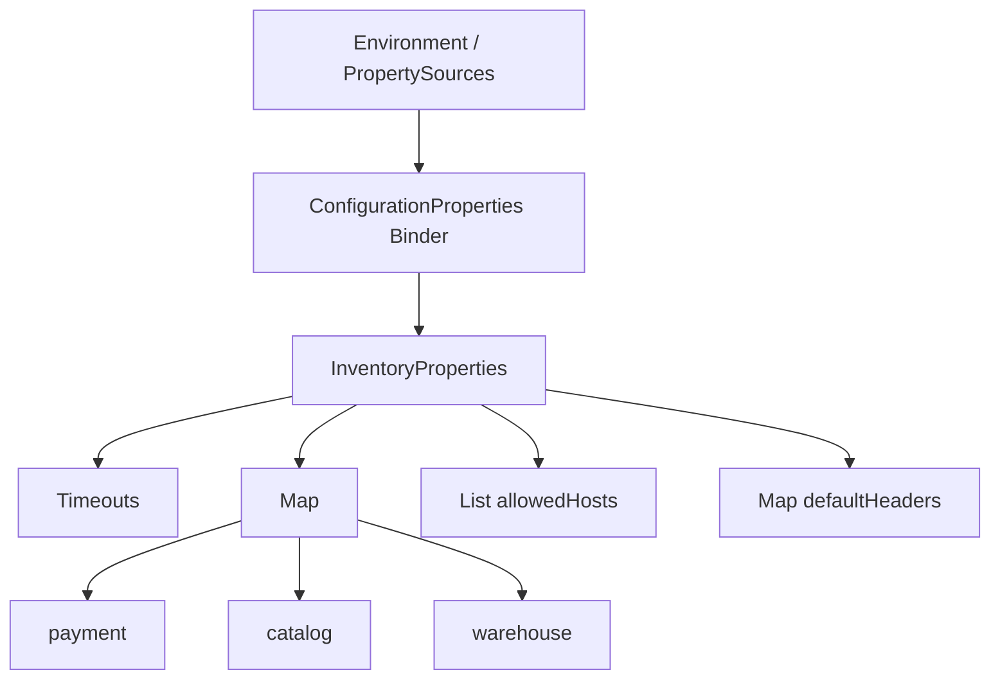

# Binding Nested Objects, Lists, and Maps

When an application only has a few properties like host, port, or timeout, reading each value with `@Value` may suffice. However, a real-world service typically has grouped configuration: endpoints for multiple services, retry policies, route lists, allowed regions, custom headers, and per-environment metadata. Keeping everything as scattered strings makes code hard to verify, hard to extend, and prone to property-name mistakes.

Spring Boot provides **`@ConfigurationProperties`** and the Binder to turn a group of properties in `Environment` into a strongly typed Java object. The object structure can contain nested objects, `List`, `Set`, `Map`, and types such as `Duration`, `DataSize`, `URI`, or enums. This mechanism lets configuration mirror your application's model and be verified with validation.

This lesson belongs to the **Typed Configuration** chapter of **SPRING_CLOUD_CORE**. It focuses on binding nested objects, lists, and maps; representing the same structure in YAML, properties, and environment variables; handling dynamic keys, default values, and precedence across configuration sources; and testing bound data in Spring Boot/Spring Cloud applications.

## 1. Learning Objectives

After this lesson, you will be able to:

1. Explain how the Binder converts properties into strongly typed objects.
2. Design classes or records containing nested objects and collections.
3. Bind lists of objects, maps of scalar values, and maps containing objects.
4. Represent the same structure using YAML, properties files, and environment variables.
5. Understand relaxed binding, canonical property names, and bracket notation for map keys.
6. Distinguish map merging from list replacement across multiple property sources.
7. Choose JavaBean binding or constructor binding appropriate for the configuration lifecycle.
8. Apply validation, default values, and configuration tests.
9. Diagnose missing elements, type mismatches, invalid keys, and unexpected configuration overrides.

## 2. Why Is Structured Binding Needed?

Suppose an inventory application calls several services and needs: separate endpoints for payment, catalog, and warehouse; distinct connect and read timeouts; a list of enabled routes; default headers; allowed hosts; and per-endpoint retry policies.

If each value is injected individually, configuration quickly scatters:

```java
@Value("${app.inventory.payment-url}")
String paymentUrl;

@Value("${app.inventory.catalog-url}")
String catalogUrl;

@Value("${app.inventory.warehouse-url}")
String warehouseUrl;

@Value("${app.inventory.connect-timeout}")
Duration connectTimeout;
```

As the number of endpoints grows, the configuration bean gets longer and properties do not clearly express how they relate to one another. Binding into an object groups data under a single namespace:

```yaml
app:
  inventory:
    timeouts:
      connect: 500ms
      read: 2s
    endpoints:
      payment:
        base-url: https://payments.internal
      catalog:
        base-url: https://catalog.internal
      warehouse:
        base-url: https://warehouse.internal
    allowed-hosts:
      - inventory.internal
      - catalog.internal
    default-headers:
      X-Client: inventory-service
      X-Region: ap-southeast-1
```

The structure above can be represented by a root `InventoryProperties` object, a nested `Timeouts` object, an `endpoints` map, an `allowedHosts` list, and a `defaultHeaders` map.



The Binder does not require all values to live in a single file. Properties can come from config files, profiles, environment variables, command-line arguments, or Config Server, and are combined according to Spring Boot precedence rules.

## 3. Fundamentals: @ConfigurationProperties and the Binder

### 3.1. Declaring a Property Group

`@ConfigurationProperties` associates an object with a prefix:

```java
@ConfigurationProperties(prefix = "app.inventory")
public class InventoryProperties {
    // Properties under app.inventory.*
}
```

A property with key `app.inventory.timeouts.connect` binds to the corresponding field inside the `timeouts` object. Prefixes separate configuration namespaces and reduce naming collisions across modules.

Property names should use canonical kebab-case such as `app.inventory.allowed-hosts` and `app.inventory.base-url`. The Binder supports relaxed binding so camelCase Java names like `allowedHosts` map cleanly to these canonical names.

### 3.2. Registering Configuration Properties Beans

There are two common approaches.

**Scanning configuration classes:**

```java
@SpringBootApplication
@ConfigurationPropertiesScan
public class InventoryApplication {
    public static void main(String[] args) {
        SpringApplication.run(InventoryApplication.class, args);
    }
}
```

`@ConfigurationPropertiesScan` discovers classes annotated with `@ConfigurationProperties` within the configured scan scope. If no packages are specified, the default scope is based on the package of the class declaring the scan.

**Explicit registration:**

```java
@SpringBootApplication
@EnableConfigurationProperties(InventoryProperties.class)
public class InventoryApplication {
}
```

This fits well when an application has only a few properties classes or when an auto-configuration explicitly registers the configuration classes it provides.

There is no need to use both approaches for the same class if doing so would register duplicate beans. `@ConfigurationProperties` describes binding; scanning or enabling registers the class with the application's bean lifecycle.

### 3.3. Binding Is Not Regular Component Scanning

A `@ConfigurationProperties` class does not need `@Component` just for the Binder to recognize it. Registering via `@ConfigurationPropertiesScan` or `@EnableConfigurationProperties` lets Spring Boot manage its lifecycle properly.

With **constructor binding**, the class must be registered through configuration properties scanning or the corresponding enable mechanism; do not register it as a regular component just to invoke its constructor. Constructor binding does not use setter injection, and the chosen constructor must follow the rules of the running Spring Boot version.

### 3.4. Commonly Supported Data Types

Spring Boot's Binder and conversion service can convert properties into many common types:

| Java Type | Example Property | Value After Binding |
| --- | --- | --- |
| `String` | `app.name=inventory` | `"inventory"` |
| `boolean` / `Boolean` | `app.enabled=true` | `true` |
| `int`, `long`, `BigDecimal` | `app.pool-size=20` | Corresponding number |
| `Duration` | `app.timeout=750ms` | 750 milliseconds |
| `DataSize` | `app.max-payload=10MB` | Corresponding size |
| `URI` / `URL` | `app.endpoint=https://api.example` | URI/URL object |
| Enum | `app.mode=READ_ONLY` | Matching enum constant |
| `List<T>` / `Set<T>` | `app.zones[0]=sg` | Typed element collection |
| `Map<K,V>` | `app.labels.owner=platform` | Key/value map |

If a string cannot be converted to the target type, binding fails. For example, `timeout=soon` is not a valid `Duration` representation. That is a conversion error, distinct from a missing property.

## 4. Designing Nested Objects

### 4.1. Nested Object Structure

YAML represents nested objects through indentation:

```yaml
app:
  inventory:
    timeouts:
      connect: 500ms
      read: 2s
    retry:
      max-attempts: 3
      backoff: 200ms
```

A corresponding properties class:

```java
@ConfigurationProperties(prefix = "app.inventory")
public class InventoryProperties {

    private Timeouts timeouts = new Timeouts();
    private Retry retry = new Retry();

    public Timeouts getTimeouts() { return timeouts; }
    public void setTimeouts(Timeouts timeouts) { this.timeouts = timeouts; }

    public Retry getRetry() { return retry; }
    public void setRetry(Retry retry) { this.retry = retry; }

    public static class Timeouts {
        private Duration connect = Duration.ofMillis(500);
        private Duration read = Duration.ofSeconds(2);

        public Duration getConnect() { return connect; }
        public void setConnect(Duration connect) { this.connect = connect; }
        public Duration getRead() { return read; }
        public void setRead(Duration read) { this.read = read; }
    }

    public static class Retry {
        private int maxAttempts = 3;
        private Duration backoff = Duration.ofMillis(200);

        public int getMaxAttempts() { return maxAttempts; }
        public void setMaxAttempts(int maxAttempts) {
            this.maxAttempts = maxAttempts;
        }
        public Duration getBackoff() { return backoff; }
        public void setBackoff(Duration backoff) { this.backoff = backoff; }
    }
}
```

This example uses JavaBean binding: nested objects have getters/setters and are pre-initialized. When matching properties exist, the Binder updates the child properties.

### 4.2. Initialize Nested Objects or Leave Them Null?

With mutable JavaBeans, you can initialize nested objects inline in the class:

```java
private Retry retry = new Retry();
```

This ensures default values inside the nested object exist even if some child properties are omitted. If `retry` is left `null`, consuming code must explicitly handle absence; binding and validation behavior also depend on property structure and object creation.

With constructor-bound records, the Binder constructs objects according to the structure declared in the constructor. If a nested object is required, use validation such as `@NotNull` and `@Valid`; if it is optional, model that semantics and provide appropriate defaults.

### 4.3. Nested Types Should Reflect Configuration Boundaries

You do not need to create a class for every single property. Create nested types when values share a responsibility or are used together as a unit:

- `Timeouts`: time limits.
- `Retry`: attempt count and backoff interval.
- `Tls`: trust store, key store, and security flags.
- `Endpoint`: URL, timeout, and metadata for a service.

If an object holds only a single simple value with no dedicated behavior or validation, a flat property may be easier to read. Overly deep nesting lengthens configuration files and makes overrides harder to trace.

## 5. Binding Lists

### 5.1. Lists of Scalar Values

YAML:

```yaml
app:
  inventory:
    allowed-hosts:
      - inventory.internal
      - catalog.internal
      - warehouse.internal
```

Java:

```java
@ConfigurationProperties(prefix = "app.inventory")
public class InventoryProperties {

    private List<String> allowedHosts = new ArrayList<>();

    public List<String> getAllowedHosts() {
        return allowedHosts;
    }

    public void setAllowedHosts(List<String> allowedHosts) {
        this.allowedHosts = allowedHosts;
    }
}
```

The Binder maps each YAML element to its corresponding position in `List<String>`. Element order is preserved, so use a List when order matters or indexed access is needed.

### 5.2. Lists of Objects

A route list can contain multiple fields per entry:

```yaml
app:
  gateway:
    routes:
      - id: inventory
        uri: http://inventory-service
        order: 10
        enabled: true
      - id: catalog
        uri: http://catalog-service
        order: 20
        enabled: true
      - id: legacy
        uri: http://legacy-service
        order: 90
        enabled: false
```

Java model:

```java
@ConfigurationProperties(prefix = "app.gateway")
public class GatewayProperties {

    private List<Route> routes = new ArrayList<>();

    public List<Route> getRoutes() { return routes; }
    public void setRoutes(List<Route> routes) { this.routes = routes; }

    public static class Route {
        private String id;
        private URI uri;
        private int order;
        private boolean enabled;

        public String getId() { return id; }
        public void setId(String id) { this.id = id; }
        public URI getUri() { return uri; }
        public void setUri(URI uri) { this.uri = uri; }
        public int getOrder() { return order; }
        public void setOrder(int order) { this.order = order; }
        public boolean isEnabled() { return enabled; }
        public void setEnabled(boolean enabled) { this.enabled = enabled; }
    }
}
```

Each list element binds to a `Route` object. If the application frequently looks up routes by `id`, consider switching to a map keyed by ID or building an index after binding; do not assume the Binder automatically converts a list into a map.

### 5.3. Representing Lists in .properties

YAML uses `-`; `.properties` files typically use indices:

```properties
app.gateway.routes[0].id=inventory
app.gateway.routes[0].uri=http://inventory-service
app.gateway.routes[0].order=10
app.gateway.routes[0].enabled=true

app.gateway.routes[1].id=catalog
app.gateway.routes[1].uri=http://catalog-service
app.gateway.routes[1].order=20
app.gateway.routes[1].enabled=true
```

Indices start at `0`. Ensure indices are declared accurately without mixing up ordering. For long configurations, YAML is usually easier to read because it groups all fields of an element in one block.

### 5.4. Representing Lists with Environment Variables

Spring Boot supports collection indices in environment variable names by placing the index between underscores:

```bash
APP_GATEWAY_ROUTES_0_ID=inventory
APP_GATEWAY_ROUTES_0_URI=http://inventory-service
APP_GATEWAY_ROUTES_1_ID=catalog
APP_GATEWAY_ROUTES_1_URI=http://catalog-service
```

This representation is useful in containers/orchestrators, but when lists are long or contain deeply nested objects, environment variables become hard to read and review. Keep collections in configuration files or Config Server, and use environment variables only to override specific deployment values as needed.

### 5.5. Lists Are Replaced by Higher-Precedence Configuration Sources

This is crucial when combining profiles or Config Server. **Lists are not merged element-by-element additively across property sources.** A higher-precedence source supplying a list replaces the list from lower-precedence sources.

For example, suppose `application.yml` declares three routes:

```yaml
app:
  gateway:
    routes:
      - id: inventory
        uri: http://inventory
      - id: catalog
        uri: http://catalog
      - id: warehouse
        uri: http://warehouse
```

If `application-prod.yml` only declares:

```yaml
app:
  gateway:
    routes:
      - id: inventory
        uri: https://inventory.prod.internal
```

The resulting list in the `prod` profile contains only the `inventory` route; `catalog` and `warehouse` from the lower-precedence source are not automatically retained. To keep all three routes, the profile must declare the complete final list.

This differs from maps, where entries can be merged by key. Choose a List when you want an ordered set of items that can be replaced as a single unit.

## 6. Binding Sets and Other Collections

`Set<T>` is appropriate when you need unique values and do not require indexed access:

```yaml
app:
  inventory:
    trusted-zones:
      - ap-southeast-1
      - ap-southeast-2
      - ap-southeast-1
```

```java
private Set<String> trustedZones = new LinkedHashSet<>();
```

After binding, duplicates are eliminated according to element `equals`/`hashCode` rules. Do not rely on a Set if ordering is part of the configuration contract; use a List in that case.

Collections with complex element types can also be bound if elements can be converted or the object structure is clearly defined. Still, keep configuration structures straightforward and pair them with proper validation.

## 7. Binding Maps

### 7.1. Maps of Scalar Values

Maps work well when keys are dynamic names, such as header names, labels, or feature flags:

```yaml
app:
  inventory:
    default-headers:
      X-Client: inventory-service
      X-Region: ap-southeast-1
      X-Environment: staging
```

Java:

```java
private Map<String, String> defaultHeaders = new LinkedHashMap<>();

public Map<String, String> getDefaultHeaders() {
    return defaultHeaders;
}

public void setDefaultHeaders(Map<String, String> defaultHeaders) {
    this.defaultHeaders = defaultHeaders;
}
```

The keys `X-Client`, `X-Region`, and `X-Environment` become map keys with their corresponding string values. This fits well when the key set is not fixed or can be extended by operators.

### 7.2. Maps Containing Nested Objects

Maps can hold configuration objects per service:

```yaml
app:
  inventory:
    endpoints:
      payment:
        base-url: https://payments.internal
        timeout: 1500ms
        enabled: true
      catalog:
        base-url: https://catalog.internal
        timeout: 800ms
        enabled: true
      warehouse:
        base-url: https://warehouse.internal
        timeout: 2s
        enabled: false
```

Java:

```java
@ConfigurationProperties(prefix = "app.inventory")
public class InventoryProperties {

    private Map<String, Endpoint> endpoints = new LinkedHashMap<>();

    public Map<String, Endpoint> getEndpoints() { return endpoints; }
    public void setEndpoints(Map<String, Endpoint> endpoints) {
        this.endpoints = endpoints;
    }

    public static class Endpoint {
        private URI baseUrl;
        private Duration timeout;
        private boolean enabled;

        public URI getBaseUrl() { return baseUrl; }
        public void setBaseUrl(URI baseUrl) { this.baseUrl = baseUrl; }
        public Duration getTimeout() { return timeout; }
        public void setTimeout(Duration timeout) { this.timeout = timeout; }
        public boolean isEnabled() { return enabled; }
        public void setEnabled(boolean enabled) { this.enabled = enabled; }
    }
}
```

The result is a map with keys `payment`, `catalog`, and `warehouse`, each mapped to an `Endpoint` object. Code can call `properties.getEndpoints().get("payment")` to read the payment service configuration.

### 7.3. Maps and .properties

Object map structures can be written using dotted keys:

```properties
app.inventory.endpoints.payment.base-url=https://payments.internal
app.inventory.endpoints.payment.timeout=1500ms
app.inventory.endpoints.payment.enabled=true

app.inventory.endpoints.catalog.base-url=https://catalog.internal
app.inventory.endpoints.catalog.timeout=800ms
app.inventory.endpoints.catalog.enabled=true
```

Scalar map:

```properties
app.inventory.default-headers.X-Client=inventory-service
app.inventory.default-headers.X-Region=ap-southeast-1
```

This is a clean representation for `.properties` files and is also commonly used when overriding specific map entries from another property source.

### 7.4. Map Keys with Special Characters: Bracket Notation

Relaxed binding normalizes property names. For map keys containing characters outside the set preserved by binding rules, those characters may be stripped unless protected. When you need to preserve a key containing `/`, spaces, `:`, or other special characters, use **bracket notation**.

YAML example:

```yaml
app:
  routing:
    metadata:
      "[/internal/v1]": inventory
      "[/external/v2]": gateway
```

In `.properties`:

```properties
app.routing.metadata[/internal/v1]=inventory
app.routing.metadata[/external/v2]=gateway
```

In YAML, keys in square brackets must be quoted so the YAML parser treats the entire expression as a single key. Bracket notation preserves the intended key rather than letting relaxed binding strip special characters.

If a map key contains only alphanumeric characters, hyphens, or dots following standard rules, bracket notation is unnecessary. Use it only when you need to preserve the key verbatim.

### 7.5. Map Keys Containing Dots

Dots normally denote nested property levels. If a map key must contain a dot as part of the key itself, bracket notation distinguishes a literal key from a nested path:

```yaml
app:
  routing:
    destinations:
      "[legacy.v1]": http://legacy.internal
```

Without brackets, a dotted-path key may be interpreted as a nested structure depending on the value type and binding behavior. Test actual keys whenever a map forms part of your configuration API.

### 7.6. Maps Are Merged by Key

Unlike lists, maps can receive entries from multiple configuration sources. For example:

```yaml
# application.yml
app:
  inventory:
    labels:
      owner: platform
      region: default
      tier: backend
```

```yaml
# application-prod.yml
app:
  inventory:
    labels:
      region: ap-southeast-1
      environment: production
```

The resulting map in the `prod` profile contains:

| Key | Final Value |
| --- | --- |
| `owner` | `platform` |
| `region` | `ap-southeast-1` |
| `tier` | `backend` |
| `environment` | `production` |

Entries with the same key in a higher-precedence source override values from lower sources; non-overridden keys are retained. This is a major difference compared to Lists.

For maps containing objects, child properties must also be verified under actual precedence and binding behavior. If a map entry in a profile sets only one field, other fields may still come from lower sources depending on property source structure. Write tests for merged configuration if this behavior affects operations.

## 8. Comprehensive Example: GatewayProperties

A gateway configuration can combine nested objects, lists, object maps, and scalar maps:

```yaml
app:
  gateway:
    public-base-url: https://gateway.example.internal
    timeouts:
      connect: 500ms
      read: 2s
    routes:
      - id: inventory
        uri: http://inventory-service
        order: 10
        enabled: true
      - id: catalog
        uri: http://catalog-service
        order: 20
        enabled: true
    endpoints:
      payment:
        base-url: https://payments.internal
        timeout: 1500ms
      warehouse:
        base-url: https://warehouse.internal
        timeout: 2s
    labels:
      owner: platform-team
      region: ap-southeast-1
    trusted-hosts:
      - gateway.internal
      - inventory.internal
```

A record using constructor binding:

```java
import java.net.URI;
import java.time.Duration;
import java.util.List;
import java.util.Map;
import java.util.Set;

import jakarta.validation.Valid;
import jakarta.validation.constraints.NotBlank;
import jakarta.validation.constraints.NotEmpty;
import jakarta.validation.constraints.NotNull;

import org.springframework.boot.context.properties.ConfigurationProperties;
import org.springframework.boot.context.properties.bind.DefaultValue;
import org.springframework.validation.annotation.Validated;

@ConfigurationProperties(prefix = "app.gateway")
@Validated
public record GatewayProperties(
        @NotNull URI publicBaseUrl,
        @Valid @DefaultValue Timeouts timeouts,
        @NotEmpty List<@NotNull @Valid Route> routes,
        Map<String, @NotNull @Valid Endpoint> endpoints,
        Map<String, String> labels,
        Set<String> trustedHosts
) {
    public record Timeouts(
            @DefaultValue("500ms") Duration connect,
            @DefaultValue("2s") Duration read
    ) {}

    public record Route(
            @NotBlank String id,
            @NotNull URI uri,
            int order,
            boolean enabled
    ) {}

    public record Endpoint(
            @NotNull URI baseUrl,
            @NotNull Duration timeout
    ) {}
}
```

The record above demonstrates a type-safe structure:

- `timeouts` is a nested object.
- `routes` is a validated list of objects.
- `endpoints` is a map keyed by service ID, where each value is an `Endpoint`.
- `labels` is a scalar map.
- `trustedHosts` is a set of unique values.

`@DefaultValue` on a record component supplies a default value when the corresponding property is absent. The valueless `@DefaultValue` on the nested `Timeouts` object instructs the Binder to instantiate the nested object; its `connect` and `read` components have their own defaults. If targeting a different Spring Boot version, check the corresponding binding API.

### 8.1. Registering Record Properties

```java
@SpringBootApplication
@EnableConfigurationProperties(GatewayProperties.class)
public class GatewayApplication {
}
```

Or use `@ConfigurationPropertiesScan` on the application class. Because a record has a single canonical constructor, Spring Boot uses constructor binding automatically under current rules; `@ConstructorBinding` is not needed for this standard case.

Constructor-bound properties are created via the configuration properties mechanism, not regular component scanning. Do not annotate a record with `@Component` just to register it.

### 8.2. Using the Bound Object

```java
@Service
class GatewayRouteService {

    private final GatewayProperties properties;

    GatewayRouteService(GatewayProperties properties) {
        this.properties = properties;
    }

    List<GatewayProperties.Route> enabledRoutes() {
        return properties.routes().stream()
                .filter(GatewayProperties.Route::enabled)
                .sorted(Comparator.comparingInt(
                    GatewayProperties.Route::order
                ))
                .toList();
    }

    URI paymentEndpoint() {
        return properties.endpoints().get("payment").baseUrl();
    }
}
```

In business code, access the bound object rather than making scattered calls to Environment. If a map key might be absent, check for null or use a guarded lookup API before dereferencing; map validation does not automatically guarantee every required business key is present unless you add an explicit check.

## 9. Constructor Binding vs. JavaBean Binding

Spring Boot supports two primary styles.

### 9.1. JavaBean Binding

Mutable classes use a no-arg constructor, getters/setters, and optional default field initializers:

```java
@ConfigurationProperties(prefix = "app.worker")
public class WorkerProperties {

    private int concurrency = 8;
    private List<String> queues = new ArrayList<>();
    private Map<String, String> tags = new LinkedHashMap<>();

    public int getConcurrency() { return concurrency; }
    public void setConcurrency(int concurrency) {
        this.concurrency = concurrency;
    }

    public List<String> getQueues() { return queues; }
    public void setQueues(List<String> queues) {
        this.queues = queues;
    }

    public Map<String, String> getTags() { return tags; }
    public void setTags(Map<String, String> tags) {
        this.tags = tags;
    }
}
```

Advantages:

- Easy to add fields and setters.
- Collections and nested objects can be initialized with default values.
- Suitable for configurations that need setter-based JavaBean binding or compatibility with legacy code.

Avoid leaving collections null if downstream code assumes they are always non-null. If setters accept null, decide clearly how to handle it.

### 9.2. Constructor Binding with Records

Records work well for largely immutable configuration:

```java
@ConfigurationProperties(prefix = "app.worker")
public record WorkerProperties(
        int concurrency,
        List<String> queues,
        Map<String, String> tags
) {
}
```

The Binder passes values into the canonical constructor and builds a complete object. Once created, record components cannot be reassigned like ordinary mutable fields.

Constructor binding prevents partially initialized objects, especially when configuration is startup input. However, think carefully about default values, empty collections, and validation when properties are omitted.

### 9.3. When Is @ConstructorBinding Needed?

For classes with a single eligible constructor, modern Spring Boot infers constructor binding automatically. For classes with multiple constructors, you may need to mark the chosen constructor with `@ConstructorBinding` according to your version's API. This annotation lives in the `org.springframework.boot.context.properties.bind` package.

Do not copy examples from older Boot versions without checking the annotation package and target. Constructor binding rules have been simplified across Boot generations.

### 9.4. Do Not Mix Styles Arbitrarily

If a class is designed for constructor binding, let the constructor describe its full state and avoid expecting the Binder to call setters after construction. If using JavaBean binding, provide complete getters/setters and intentional default values.

Choosing one clear style per properties class makes code easier to read, easier to test, and less confusing when nested collections are involved.

## 10. Relaxed Binding and Naming Rules

Spring Boot allows a property to be expressed in several equivalent forms depending on the configuration source. For example, Java property `baseUrl` maps to the canonical form `base-url`.

Common conventions:

| Source | Example Name Format |
| --- | --- |
| YAML | `base-url` |
| `.properties` | `base-url` |
| Java field | `baseUrl` |
| Environment variable | `BASEURL` under the corresponding prefix |

With prefix `app.gateway`, the environment variable for `app.gateway.public-base-url` normally takes the form `APP_GATEWAY_PUBLICBASEURL` per canonical environment variable rules: replace dots with `_`, remove `-`, and uppercase. Verify exact names when configuring containers or CI/CD; do not assume you can just replace dots while keeping hyphens.

For lists, indices are surrounded by underscores in environment variables, e.g., `APP_GATEWAY_ROUTES_0_ID`. For maps, environment variable names can alter key casing and struggle with keys containing special characters. When map keys must be preserved verbatim, YAML or `.properties` with bracket notation is much easier to control.

## 11. Source Precedence and How Collections Combine

Spring Boot can receive the same prefix from multiple sources: default files, profiles, environment variables, command line, Config Data, or external property sources. The Binder uses values selected by the Environment according to precedence. Beyond precedence, collection type determines how data combines.

| Data Type | Typical Behavior with Higher-Precedence Source |
| --- | --- |
| Scalar property | Value in higher-precedence source overrides the matching key |
| Nested object | Child properties combine key-by-key; non-overridden fields retain lower-source values |
| Map | Entries combine by key; matching keys are overridden by higher-precedence sources |
| List | List in higher-precedence source replaces lower-source list as a whole unit |
| Set | Collection; verify post-binding semantics and avoid relying on element-wise cross-source merging |

Example where the production profile overrides only the timeout:

```yaml
# application.yml
app:
  gateway:
    timeouts:
      connect: 500ms
      read: 2s
```

```yaml
# application-prod.yml
app:
  gateway:
    timeouts:
      read: 5s
```

In the `prod` profile, `read` becomes `5s`, while `connect` still takes `500ms` from the lower source because these are child properties of a nested object.

Conversely, if the profile declares only one element in `routes`, the resulting list is the list from the higher-precedence source; remaining elements from lower sources are not appended automatically.

For maps, if a profile overrides only the `region` key, other keys such as `owner` are preserved. When map keys collide, the value from the higher-precedence source wins.

### 11.1. Why Does This Matter for Config Server?

A team might store defaults in a local repository and let Config Server supply overrides by application/profile/label. If an operator mistakenly assumes lists merge, specifying a partial list in remote config can accidentally drop routes or zones.

For maps, key-based merging is useful for labels and metadata, but it can also retain old keys an operator thought were deleted. To remove a key, design an explicit deletion/override representation and test actual property-source semantics; simply omitting a key in a new source does not delete it from lower sources.

## 12. Validating Nested Objects, Lists, and Maps

Successful binding only means values could be converted to Java types. It does not guarantee business validity. For example: `max-attempts` cannot be negative; `base-url` must have a valid scheme; the route list must not be empty; every route must have a unique ID; timeouts must be positive; a map must contain a `payment` key.

Bean Validation helps enforce many of these checks.

### 12.1. Validating Nested Objects

```java
@ConfigurationProperties(prefix = "app.gateway")
@Validated
public record GatewayProperties(
        @NotNull URI publicBaseUrl,
        @Valid @NotNull Timeouts timeouts
) {
    public record Timeouts(
            @NotNull Duration connect,
            @NotNull Duration read
    ) {}
}
```

`@Valid` tells the validator to descend into the nested object. Without `@Valid`, constraints inside the nested type may not be checked when validating the root object.

A Bean Validation implementation must be on the classpath, usually via Spring Boot's validation starter. Without a provider, constraint annotations may not run as expected.

### 12.2. Validating Collection Elements

You can use container element constraints:

```java
@Validated
@ConfigurationProperties(prefix = "app.gateway")
public record GatewayProperties(
        @NotEmpty
        List<@NotNull @Valid Route> routes,

        Map<@NotBlank String, @NotNull @Valid Endpoint> endpoints,

        Set<@NotBlank String> trustedHosts
) {
    public record Route(
            @NotBlank String id,
            @NotNull URI uri
    ) {}

    public record Endpoint(
            @NotNull URI baseUrl,
            @NotNull Duration timeout
    ) {}
}
```

Constraints on map keys/values and list/set elements catch missing or invalid entries before business beans consume them. Verify Bean Validation version and type-use annotation support in your application stack.

### 12.3. Conditional and Uniqueness Validation

Some rules cannot be expressed with simple annotations, such as unique route IDs or required map keys. You can write a class-level custom validator or validate after binding via a startup bean/validation service.

Example duplicate-ID check:

```java
static void validateUniqueRouteIds(List<GatewayProperties.Route> routes) {
    Set<String> ids = new HashSet<>();

    for (GatewayProperties.Route route : routes) {
        if (!ids.add(route.id())) {
            throw new IllegalStateException(
                "Duplicate gateway route id: " + route.id()
            );
        }
    }
}
```

In real applications, integrate this rule into a custom Bean Validation constraint or an explicit configuration validation step so failures surface at startup.

### 12.4. Do Not Use Validation to Mask Binding Errors

If a property cannot be converted to `Duration`, the Binder fails before Bean Validation checks value ranges. Validation can only inspect an already constructed/bound object. Distinguish between:

1. Property does not exist or cannot be resolved.
2. String cannot be converted to the Java type.
3. Object is constructed but violates a constraint.
4. Structurally valid object violates a complex business rule.

Error messages should clearly indicate which layer failed so operators fix the right source.

## 13. Metadata and @NestedConfigurationProperty

`@NestedConfigurationProperty` often appears in configuration properties examples:

```java
public class GatewayProperties {

    @NestedConfigurationProperty
    private TlsProperties tls;

    // getters/setters
}
```

This annotation is primarily a **hint to the configuration metadata processor** indicating that the field is a nested configuration group, especially when a type is declared externally or not inferred as nested by the metadata processor.

It is **not an annotation that enables binding**. The Binder binds nested objects based on data types and property structure without needing this annotation. Do not use `@NestedConfigurationProperty` as a substitute for getters/setters, constructor binding, `@EnableConfigurationProperties`, or validation.

When building a starter, metadata helps IDEs suggest property names, types, descriptions, and defaults. You can add manual metadata in `META-INF/additional-spring-configuration-metadata.json` to describe dynamic properties or details not inferable from source code.

## 14. Dynamic Map Keys and Caveats to Remember

Maps are convenient for dynamic keys, but require stable key conventions:

- If keys are service names like `payment` and `catalog`, a map makes sense.
- If keys are HTTP header names, consider preserving case where needed; test map keys after binding.
- If keys contain slashes, dots, or special characters, use bracket notation.
- If keys must follow a fixed list, an enum or a nested class with explicit fields may be safer than an arbitrary map.
- If map values are objects, declare complete generic types so the Binder knows how to convert them.

Route-style map key example:

```yaml
app:
  gateway:
    route-metadata:
      "[/inventory/**]":
        owner: inventory-team
        exposure: internal
      "[/catalog/**]":
        owner: catalog-team
        exposure: public
```

This map can bind to `Map<String, RouteMetadata>`. Without protecting slash-containing keys using bracket notation, characters can be normalized or keys may no longer match the intended string.

### 14.1. Do Not Turn Every Structure into a Map

An arbitrary map makes configuration flexible but reduces compile-time detection of misspelled keys. If an application only has fixed groups like `timeouts`, `retry`, and `security`, use a class or record with explicit fields. Reserve maps for key sets that genuinely expand at runtime or per deployment.

## 15. Diagnosing Binding Errors

| Symptom | Possible Cause | How to Check |
| --- | --- | --- |
| Properties bean missing | Class not scanned/enabled | Check `@ConfigurationPropertiesScan` or `@EnableConfigurationProperties` |
| Nested object is null | JavaBean nested object not initialized or properties not bound | Check getters/setters and prefix structure |
| Empty list | Wrong index, wrong prefix, or another source replaced the list | Inspect effective property sources |
| Only one list element remains | Profile/remote source replaced the list | Compare full list in higher-precedence source |
| Map key loses characters | Key lacks bracket notation | Check post-binding map keys and YAML quoting |
| Missing map entry | Key overridden, wrong env var name, or map key normalized | Check canonical key and precedence |
| `Failed to bind` | Wrong data type or structure | Inspect specific property and conversion error |
| Validation error | Bound value violates constraint | Read field path and violated constraint |
| Record not bound | Properties type not registered or constructor mismatch | Check scan/enable and constructor binding |
| New property has no effect | Higher-precedence source overrides it | Inspect Environment and active profiles |

### 15.1. Inspecting Values After Binding

You can log non-sensitive values or inspect them in a debugger. Avoid printing entire configuration objects if they contain passwords, tokens, private keys, or sensitive details.

Actuator `env` can help check property sources if exposed and properly secured; it does not replace inspecting the bound object itself. For maps and lists, debugging the bound object or writing tests directly shows the final structure.

### 15.2. Checking Origin and Property Sources

When a field has an unexpected value:

1. Identify the canonical property key.
2. Check active profiles.
3. Determine which source provides the key and which source overrides it.
4. Verify list indices or map keys.
5. Check target types and converters.
6. Check post-binding validation.

When using Spring Cloud Config, verify that the remote property source was loaded via the current version's Config Data/Config Client mechanism. Do not blame the Binder when the property source has not appeared in the Environment yet.

## 16. Testing Binding with ApplicationContextRunner

`ApplicationContextRunner` creates a small context with specific property values. It is well suited for testing nested objects, lists, maps, and validation without starting the whole application.

### 16.1. Test Configuration

```java
@Configuration(proxyBeanMethods = false)
@EnableConfigurationProperties(GatewayProperties.class)
static class TestConfiguration {
}
```

Runner:

```java
private final ApplicationContextRunner runner =
    new ApplicationContextRunner()
        .withUserConfiguration(TestConfiguration.class);
```

### 16.2. Testing Nested Objects, Lists, and Maps

```java
@Test
void bindsNestedCollections() {
    runner
        .withPropertyValues(
            "app.gateway.public-base-url=https://gateway.example",
            "app.gateway.timeouts.connect=500ms",
            "app.gateway.timeouts.read=2s",
            "app.gateway.routes[0].id=inventory",
            "app.gateway.routes[0].uri=http://inventory-service",
            "app.gateway.routes[0].order=10",
            "app.gateway.routes[0].enabled=true",
            "app.gateway.endpoints.payment.base-url=https://payments.internal",
            "app.gateway.endpoints.payment.timeout=1500ms",
            "app.gateway.labels.owner=platform-team",
            "app.gateway.trusted-hosts[0]=gateway.internal"
        )
        .run(context -> {
            assertThat(context).hasNotFailed();

            GatewayProperties properties =
                context.getBean(GatewayProperties.class);

            assertThat(properties.timeouts().connect())
                .isEqualTo(Duration.ofMillis(500));
            assertThat(properties.routes()).hasSize(1);
            assertThat(properties.routes().get(0).id())
                .isEqualTo("inventory");
            assertThat(properties.endpoints())
                .containsKey("payment");
            assertThat(properties.labels().get("owner"))
                .isEqualTo("platform-team");
            assertThat(properties.trustedHosts())
                .contains("gateway.internal");
        });
}
```

This test shows multiple data types bound under the same prefix. Property values use indexed paths for lists and dotted keys for object maps.

### 16.3. Testing Bracket Notation

```java
@Test
void preservesSpecialMapKey() {
    runner
        .withPropertyValues(
            "app.gateway.public-base-url=https://gateway.example",
            "app.gateway.routes[0].id=inventory",
            "app.gateway.routes[0].uri=http://inventory",
            "app.gateway.routes[0].order=10",
            "app.gateway.endpoints.payment.base-url=https://payments.internal",
            "app.gateway.endpoints.payment.timeout=1s",
            "app.gateway.route-metadata[/inventory/**].owner=inventory-team"
        )
        .run(context -> {
            // Add RouteMetadata properties to the test model.
            // Assert that map keys retain slash and * characters after binding.
        });
}
```

This is an illustrative test skeleton; add a `routeMetadata` field and `RouteMetadata` type to the properties model to run it as-is. With YAML, also verify that bracketed keys are properly quoted in actual config files.

### 16.4. Testing Validation

With `@Validated` and a Bean Validation provider on the classpath, pass invalid data and assert a context startup failure:

```java
@Test
void rejectsBlankRouteId() {
    runner
        .withPropertyValues(
            "app.gateway.public-base-url=https://gateway.example",
            "app.gateway.timeouts.read=2s",
            "app.gateway.routes[0].id=",
            "app.gateway.routes[0].uri=http://inventory"
        )
        .run(context -> {
            assertThat(context).hasFailed();
            assertThat(context.getStartupFailure()).isNotNull();
        });
}
```

This test fails because `Route.id` has `@NotBlank` and the test supplies an empty string. For negative `Duration`, `@NotNull` only checks non-nullity and does not forbid negative durations; add a custom constraint/validator for Duration if that is a business rule. `@Positive` is designed for numeric types supported by Bean Validation and does not apply directly to `Duration`.

## 17. Practices for Designing Maintainable Configuration

**Use nested objects along responsibility boundaries.** Group timeout, retry, TLS, endpoint, and health settings into clearly named types.

**Use Lists when order matters.** Routes, pipelines, or priority lists typically require ordering. Remember that a list in a higher-precedence source replaces the entire lower-precedence list.

**Use Maps for dynamic keys.** Endpoints keyed by service name, labels, and headers are valid use cases. For special keys, use bracket notation.

**Use Sets when only uniqueness is needed.** Do not rely on indices or ordering if a collection is a Set.

**Prefer canonical kebab-case.** Java camelCase names, YAML kebab-case keys, and environment variables must map clearly.

**Choose a consistent binding style.** Record/constructor binding suits immutable configuration; JavaBean binding suits mutable properties with setters and default values.

**Validate at the boundary.** Verify URLs, timeouts, required lists, map keys, and cross-field relationships on context startup.

**Keep sensitive configuration safe.** Secrets should not appear in defaults, logs, or public configuration metadata.

**Test merge behavior.** Especially for lists and maps across profiles/Config Server, write tests to prove the final result.

## 18. Common Misconceptions

**"@ConfigurationProperties can only bind flat fields."** The Binder supports nested objects, collections, and maps when types and structures are declared properly.

**"A list in a profile appends to the default list."** A list in a higher-precedence source replaces the lower-source list; declare the complete final list.

**"Maps and Lists merge the same way."** Maps can combine entries by key; lists are replaced as a single unit.

**"@NestedConfigurationProperty enables nested binding."** The annotation primarily serves metadata; the Binder infers nested types from structure and data types.

**"Having a properties class means Spring automatically creates a bean."** It must be registered using `@ConfigurationPropertiesScan` or `@EnableConfigurationProperties`.

**"Successful binding means valid configuration."** You still need conversion, Bean Validation, and business rules such as required keys or unique IDs.

**"Map keys are always preserved verbatim."** Relaxed binding can normalize characters; use bracket notation when special keys must be preserved.

**"Records must always have @ConstructorBinding."** With a single canonical constructor under modern Spring Boot rules, the annotation is generally unnecessary; check your version and multi-constructor cases.

## 19. Practice Exercises

### Exercise 1. Designing Configuration for Service Clients

An application calls three services: `inventory`, `payment`, and `catalog`. Each service has `base-url`, `connect-timeout`, `read-timeout`, and `enabled`. The application also has a `trusted-hosts` list and a `default-headers` map.

Design:

- A properties class with nested objects and `Map<String, Endpoint>`.
- YAML for the three services.
- `.properties` format for one service.
- Environment variables overriding payment's timeout.
- Validation for required URLs and timeouts.

Explain why a map is better than a list when services are looked up by name.

### Exercise 2. Analyzing List Replacement

`application.yml` defines four routes. `application-prod.yml` defines only two routes. Determine how many elements remain in the list after binding, and propose how to preserve all four routes if the profile only wants to change the URL of one route.

### Exercise 3. Special Map Keys

An application stores metadata for `/inventory/**` and `/catalog/**` routes. Represent the map in YAML using bracket notation, then write a test verifying that keys are preserved verbatim after binding.

### Exercise 4. Choosing Constructor vs. Setter Binding

A properties class has 12 fields, including 4 nested objects and 3 collections. Compare record/constructor binding against JavaBean binding on: default values, mutability, validation, testability, and runtime configurability.

### Self-Check Questions

1. How do `@ConfigurationPropertiesScan` and `@EnableConfigurationProperties` differ in registration?
2. Why should nested objects typically have dedicated types?
3. When should you use a List, Set, or Map?
4. How are lists represented in `.properties` files and environment variables?
5. Why do map keys containing slashes need bracket notation?
6. When a profile partially overrides a map, do non-overridden keys remain? What about a list?
7. What role does `@Valid` play when validating nested objects?
8. Does `@NestedConfigurationProperty` directly affect the Binder?
9. How are constructor-bound records registered?
10. How does a binding error differ from a validation error?

## 20. References

- [Spring Boot Reference — Type-safe Configuration Properties](https://docs.spring.io/spring-boot/reference/features/external-config.html#features.external-config.typesafe-configuration-properties): declaring and binding typed configuration.
- [Spring Boot Reference — Relaxed Binding](https://docs.spring.io/spring-boot/reference/features/external-config.html#features.external-config.typesafe-configuration-properties.relaxed-binding): property name mapping rules.
- [Spring Boot Reference — Merging Complex Types](https://docs.spring.io/spring-boot/reference/features/external-config.html#features.external-config.typesafe-configuration-properties.merging-complex-types): how maps and collections merge across property sources.
- [Spring Boot Reference — Validation](https://docs.spring.io/spring-boot/reference/features/external-config.html#features.external-config.typesafe-configuration-properties.validation): validation for configuration properties.
- [Spring Cloud Config Reference](https://docs.spring.io/spring-cloud-config/reference/): external configuration sources and Config Client integration.

## Key Takeaways

`@ConfigurationProperties` and the Binder transform a group of properties into a structured Java object. Nested objects represent configuration groups with distinct responsibilities; Lists fit ordered data and are replaced by higher-precedence sources; Sets hold unique values; Maps fit dynamic keys and can combine entries by key. Standardize on canonical names, use bracket notation for special map keys, choose constructor or JavaBean binding intentionally, validate data on startup, and test the final result when multiple configuration sources participate.
