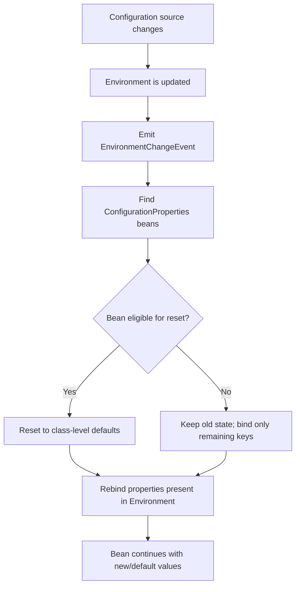

# Default Values and Handling Removed Properties

## 1. Problem Statement

Spring Boot applications typically configure timeouts, retry counts, connection limits, and feature flags. Not every environment declares every key, so configuration classes need **default values** so the application operates safely when a property is not supplied.

Difficulty arises when configuration sources change while the application is running. For example, a client timeout starts at 8 seconds, then an operator removes the key from Config Server and triggers a refresh. Will the application use the 3-second default, keep the old 8 seconds, or receive null? The outcome depends on how the bean is declared, the refresh mechanism, and whether the key actually disappeared from Environment.

In Spring Cloud, two mechanisms must be distinguished:

- **Rebinding ConfigurationProperties:** Spring Cloud receives EnvironmentChangeEvent and rebinds typed configuration beans. For eligible beans, it resets to class-level defaults before rebinding so removed properties do not retain stale values.
- **RefreshScope:** Spring Cloud evicts the target from cache; the next call creates a new target from current configuration. Spring Cloud documentation explicitly notes that completely deleting a property and refreshing is not guaranteed to update that property's presence.

This lesson belongs to the **Typed Configuration** chapter of the **SPRING_CLOUD_CORE** module. It focuses on designing predictable default values and safely handling properties that are no longer provided.

After this lesson, you will be able to:

- Distinguish defaults in Environment, defaults on mutable beans, and DefaultValue in constructor binding.
- Choose suitable defaults for booleans, numbers, durations, and nested objects.
- Explain how Spring Cloud rebinds ConfigurationProperties when properties are removed.
- Identify cases where the rebinder cannot reset to class-level defaults.
- Distinguish rebinding from RefreshScope and understand limitations when properties are removed.
- Write tests for initial state, updates, property removal, and falling back to defaults.

## 2. Three Places Where Default Values Can Be Defined

| Location | Example | Appears in Environment? | Suitable When |
| --- | --- | --- | --- |
| Configuration source | client.timeout=3s in application.yml | Yes | Value must be visible to all beans, placeholders, or conditions. |
| Field initializer / no-arg constructor | private Duration timeout = Duration.ofSeconds(3); | No | Default belongs to a mutable configuration bean. |
| Constructor binding with DefaultValue | DefaultValue("3s") Duration timeout | No | Immutable configuration or Java records. |

### 2.1. Defaults in Configuration Sources

Example in application.yml:

```yaml
client:
  timeout: 3s
  max-attempts: 2
  enabled: true
```

These are genuine Environment properties. Beans can bind them, Value can read them, and configuration conditions can inspect them. Higher-precedence sources can still override these values.

### 2.2. Defaults in Mutable Beans

For ConfigurationProperties using setter binding, fields can be initialized directly in the class:

```java
@ConfigurationProperties(prefix = "client")
public class ClientProperties {
    private Duration timeout = Duration.ofSeconds(3);
    private int maxAttempts = 2;
    private boolean enabled = true;

    public Duration getTimeout() { return timeout; }
    public void setTimeout(Duration timeout) { this.timeout = timeout; }
    public int getMaxAttempts() { return maxAttempts; }
    public void setMaxAttempts(int maxAttempts) { this.maxAttempts = maxAttempts; }
    public boolean isEnabled() { return enabled; }
    public void setEnabled(boolean enabled) { this.enabled = enabled; }
}
```

When a corresponding property is absent, the field keeps its initialized value. Without field initializers, Java uses type defaults: numbers are 0, booleans are false, references are null. Those defaults may not match the application's intended policy.

Mutable configuration classes typically have a single no-argument constructor (which can be Java's implicit default constructor). This also matters for Spring Cloud's reset mechanism during rebinding.

### 2.3. Defaults with Constructor Binding and DefaultValue

If immutable objects are needed, use constructor binding or Java records:

```java
import java.time.Duration;
import java.util.List;
import org.springframework.boot.context.properties.ConfigurationProperties;
import org.springframework.boot.context.properties.bind.DefaultValue;

@ConfigurationProperties(prefix = "client")
public record ClientProperties(
        @DefaultValue("3s") Duration timeout,
        @DefaultValue("2") int maxAttempts,
        @DefaultValue("true") boolean enabled,
        @DefaultValue Retry retry) {

    public record Retry(@DefaultValue("USER") List<String> roles) {
    }
}
```

Spring Boot uses DefaultValue on a constructor parameter or record component when the corresponding property is not supplied. The conversion service converts the string inside the annotation to the target type, so values like 3s, 2MB, or USER are converted using available converters.

DefaultValue **does not introduce a property into Environment**. It only determines the value the Binder passes into the constructor. If Environment needs to see the default, declare the default in a configuration source.

For nested objects:

- If no properties exist for the object and the parameter lacks DefaultValue, the object can be null.
- Valueless DefaultValue on an object parameter instructs the Binder to instantiate that object even when no child properties exist.
- Once the object is created, defaults on child parameters apply. For example, roles above receives a list containing USER if the roles key is absent.

Declare constructor-bound properties via EnableConfigurationProperties or configuration property scanning. Do not use Component or Bean in the usual way expecting Spring to apply constructor binding automatically for the same type.

### 2.4. Defaults in Value

Value also supports fallback syntax:

```java
@Component
public class ClientCaller {
    private final Duration timeout;

    public ClientCaller(
            @Value("${client.timeout:3s}") Duration timeout) {
        this.timeout = timeout;
    }
}
```

The fallback after the colon is used only when the placeholder cannot find the property. It does not create client.timeout in Environment, and ordinary singletons do not automatically re-run constructors when configuration changes. For configuration groups with multiple keys, ConfigurationProperties is usually clearer and easier to test than scattering Value across services.

## 3. Defaults Must Be Meaningful for Their Data Types

Do not pick defaults merely so the application boots. Values must be safe, have explicit units, and match system behavior.

| Data Type | Example Default | Things to Watch |
| --- | --- | --- |
| boolean | enabled = true or false | Choose fail-safe defaults; high-impact features should usually default to off. |
| Integer | maxAttempts = 2 | Use validation to forbid 0 or negative numbers when invalid. |
| Duration | Duration.ofSeconds(3) | State units explicitly; avoid confusing milliseconds and seconds. |
| DataSize | DataSize.ofMegabytes(8) | Specify MB, KB, or B clearly. |
| Enum | Mode.STANDARD | Have a stable default and handle invalid values clearly. |
| Nested object | new RetryProperties() | Decide whether the object always exists or may be null. |
| Collection | new ArrayList<>() | Distinguish an empty list from an omitted property. |

Example:

```yaml
client:
  enabled: true
  timeout: 3s
  max-attempts: 2
  retry:
    initial-delay: 200ms
    max-delay: 2s
```

If a default must be visible to conditions or another component, place it in a configuration source so the property exists in Environment.

## 4. What Happens When a Property Is Removed?

Before discussing refresh, clarify what "removed" means. A key might be deleted from one file or Config Server response yet remain present in another source.

Example:

```yaml
# application.yml in JAR
client:
  timeout: 3s
```

An external configuration source initially overrides it:

```yaml
client:
  timeout: 8s
```

The effective value is 8 seconds. If the key is deleted from the external source, Environment may fall back to 3 seconds from application.yml. In this case the property **did not disappear from Environment**; it simply took the value from a lower-precedence source.

Only when the key is absent from every relevant property source does the Binder consider it unsupplied. Deleting a line from Config Server does not guarantee Environment no longer contains that key.

### 4.1. Why Can a Bean Retain Stale Values?

For a mutable bean, suppose initially:

```text
class-level default: 3s
remote property:     8s
bean.timeout:        8s
```

After the remote property is removed, if the Binder merely writes properties still present in Environment onto the existing object holding old state, the timeout field would stay at 8 seconds. The Binder cannot infer on its own that the old value inside the object originally came from a now-deleted source.

Spring Cloud handles this for eligible ConfigurationProperties beans by **resetting the bean to class-level defaults before rebinding**.

## 5. Reset Mechanism During ConfigurationProperties Rebind

When Spring Cloud receives EnvironmentChangeEvent, ConfigurationProperties beans are rebound. In current Spring Cloud Commons, the rebinding process follows these general steps:

1. Identify configuration beans to rebind.
2. Reset properties to class-level defaults if the bean meets reset conditions.
3. Rebind properties currently present in Environment.
4. The bean continues serving with the new values, or defaults if corresponding keys are no longer supplied.



### 5.1. Crucial Condition: Single No-Argument Constructor

According to current Spring Cloud Commons documentation, resetting to class-level defaults happens only when the bean's class declares a **no-argument constructor as its sole constructor**.

Example mutable bean eligible for reset:

```java
@ConfigurationProperties("client")
public class ClientProperties {
    private Duration timeout = Duration.ofSeconds(3);
    private int maxAttempts = 2;

    public ClientProperties() {
    }

    // getters and setters
}
```

Example class with a no-argument constructor plus another constructor:

```java
@ConfigurationProperties("client")
public class ClientProperties {
    private Duration timeout = Duration.ofSeconds(3);

    public ClientProperties() {
    }

    public ClientProperties(ClientPolicy policy) {
        this.timeout = policy.defaultTimeout();
    }

    // getters and setters
}
```

In the second case, Spring Cloud skips the reset step because invoking the no-argument constructor would not reproduce the actual defaults used when the bean was created. Properties still present in Environment are rebound onto the existing bean state; removed properties may retain stale values. Therefore, do not add extra constructors to mutable configuration classes without considering refresh behavior.

### 5.2. Nested Properties

Resetting can descend into nested configuration objects, including some nested objects without setters. Spring Cloud avoids traversing into JDK types or types under standard jakarta.* and javax.* namespaces to prevent corrupting object graphs outside configuration.

If a configuration bean holds references to library types with cyclic object graphs, internal state, or objects that must not be reset, current Spring Cloud Commons provides:

```properties
spring.cloud.refresh.never-reset-nested-types=com.example.MyClient,com.acme.sdk.
```

The list accepts comma-separated fully qualified class names or package prefixes. Verify this feature against your project's exact Spring Cloud version.

### 5.3. Rebinding Does Not Replace the Bean Instance

ConfigurationProperties rebinding updates fields on the **same bean instance**. Overlapping rebinds of the same bean are serialized, but that does not guarantee another thread reading the bean mid-rebind will always see a consistent snapshot. Readers may observe intermediate state while fields update one by one.

If an operation needs to observe the entire configuration group as one consistent version, consider RefreshScope or an immutable snapshot design replaced in a controlled manner. Do not assume every mutable bean is safe to read concurrently with refreshes.

### 5.4. Constructor Binding and Java Records

ConfigurationProperties objects using constructor binding, including Java records, **are not refreshed by Spring Cloud via normal rebinding**.

| Design | Startup Default | Rebind After EnvironmentChangeEvent |
| --- | --- | --- |
| Mutable bean, class-level field initializers, single no-arg constructor | Field initializers kept if property absent | Can reset to class-level defaults and rebind |
| Mutable bean with multiple constructors | Initialized per bean creation | Reset skipped; keys remaining in Environment rebound |
| Constructor-bound class / record | Uses constructor values and DefaultValue | Not rebound by this mechanism |

If immutable configuration needs updates, design object recreation in a refresh-supporting abstraction tested on your target version, or use restart/redeploy. Do not assume slapping RefreshScope onto every constructor-bound type automatically solves it; bean registration and scope mechanics also affect the outcome.

## 6. RefreshScope and Property Removal

RefreshScope solves a different problem from ConfigurationProperties rebinding. Beans in this scope are usually accessed via a proxy. On refresh, Spring Cloud evicts the target from cache; the next call via the proxy constructs a new target from current configuration.

```java
@Service
@RefreshScope
public class ClientPolicy {
    private final Duration timeout;

    public ClientPolicy(
            @Value("${client.timeout:3s}") Duration timeout) {
        this.timeout = timeout;
    }

    public Duration timeout() {
        return timeout;
    }
}
```

For beans like this, the constructor runs when the target is created. However, Spring Cloud documentation warns that **deleting a property and then performing a refresh does not reliably update the presence of that property**. If application logic depends on whether a property is present or absent, redesign the condition to rely on explicit values or tested absence states.

For example, instead of deleting client.enabled to turn off a feature, update it to:

```yaml
client:
  enabled: false
```

The value false is an explicit change that is easy to observe and test. For toggle settings, avoid using key deletion as a control command.

### 6.1. How Do Rebinding and RefreshScope Differ?

| Aspect | Rebinding ConfigurationProperties | RefreshScope |
| --- | --- | --- |
| Goal | Update typed configuration beans | Recreate stateful target beans depending on configuration |
| Mechanism | Rebind on the same instance | Evict target cache; create new target on next call |
| Default when property removed | Can revert to class-level defaults if bean qualifies for reset | Do not rely on key deletion to update property presence |
| Constructor binding | Refresh not supported | Does not automatically work with all constructor-bound registration styles |
| Read consistency | May see partially updated fields | Scope serializes reads with target refresh |
| When suitable | Mutable configuration groups that can be rebound | Stateful beans needing reinitialization from configuration |

A regular singleton will not pick up new values merely because a config file changed. An Environment update and corresponding event or refresh scope trigger is required.

## 7. How Should Disabling or Removing Configuration Be Represented?

Deleting a property can carry several meanings: reverting to default, disabling a feature, removing inherited settings, or indicating an option is no longer managed. Avoid letting a single key deletion mean multiple things at once.

### 7.1. Use Explicit Values for Feature Flags

Instead of deleting client.enabled completely, set:

```yaml
client:
  enabled: false
```

Benefits:

- The new value is visible in Environment.
- Inspectable via Environment, ConfigurationProperties, or Actuator.
- Clearly expresses operator intent.
- Less dependent on differences between rebinding and refresh scope.

### 7.2. Use Sentinels or Enum States

For multi-state settings, use an enum or explicit state value:

```yaml
client:
  mode: DISABLED
```

Instead of deleting client.mode, the application distinguishes STANDARD, READ_ONLY, and DISABLED. This helps when configuration is audited or distributed across many instances.

### 7.3. Use Defaults When Reverting to Default Policy

If the true goal is reverting to the class-level default of a mutable ConfigurationProperties bean, remove the key from **every relevant source**, update Environment, and trigger rebinding. Then verify the bean reverted to its default. This is reliable only when the bean satisfies reset conditions and your Spring Cloud version behaves accordingly.

If defaults must apply across all beans or be visible to conditions, place defaults in application.yml or a baseline config source. Removing a remote override then lets the local default win via precedence.

### 7.4. Never Use Empty Strings for Every Kind of "Absence"

A property may:

- Not appear in any property source.
- Appear with an empty string.
- Appear with a null value per the source format.
- Appear with a sentinel value such as DISABLED.

These cases are not equivalent. An empty string is still a supplied value; converting it to a number, duration, boolean, or enum can behave differently or throw a conversion error. Pick one clear convention and test it.

## 8. End-to-End Example: Timeout Reverting to Default

Suppose `inventory-client` has a 3-second default timeout, while Config Server currently sets 8 seconds.

### 8.1. Mutable Configuration Class

```java
import java.time.Duration;
import org.springframework.boot.context.properties.ConfigurationProperties;
import org.springframework.validation.annotation.Validated;
import jakarta.validation.constraints.Min;
import jakarta.validation.constraints.NotNull;

@Validated
@ConfigurationProperties(prefix = "inventory.client")
public class InventoryClientProperties {
    @NotNull
    private Duration timeout = Duration.ofSeconds(3);
    @Min(1)
    private int maxAttempts = 2;
    private boolean enabled = true;

    public Duration getTimeout() { return timeout; }
    public void setTimeout(Duration timeout) { this.timeout = timeout; }
    public int getMaxAttempts() { return maxAttempts; }
    public void setMaxAttempts(int maxAttempts) { this.maxAttempts = maxAttempts; }
    public boolean isEnabled() { return enabled; }
    public void setEnabled(boolean enabled) { this.enabled = enabled; }
}
```

Register the class via ConfigurationPropertiesScan or EnableConfigurationProperties. Do not add Component just for the Binder to detect the configuration type.

### 8.2. Initial Values from Config Server

Config Server returns:

```yaml
inventory:
  client:
    timeout: 8s
    max-attempts: 4
```

After startup, the bean has timeout = 8 seconds, maxAttempts = 4, and enabled = true. The enabled value comes from the class-level default.

### 8.3. Removing the Timeout Override

An operator deletes inventory.client.timeout from the remote configuration source. After Config Client reloads configuration, verify that the key is truly absent from Environment or that no higher-precedence source still supplies 8 seconds.

When rebinding runs, an eligible bean resets to:

```text
timeout     = 3s  (class-level default)
maxAttempts = 2   (class-level default, if that key is also absent)
enabled     = true
```

If only timeout is deleted while max-attempts remains 4 in Environment, maxAttempts stays 4 after rebinding. Unremoved properties continue reading from active sources.

### 8.4. Verifying the Result

- Inspect property sources and effective values in Environment using controlled diagnostics.
- Check the bound bean via Actuator configprops if exposed and secured.
- Record state before and after refresh in integration tests.
- Verify real requests use the new timeout; updating the bean does not automatically guarantee every HTTP client or resource pool reconfigured itself.

## 9. Testing Defaults and Property Removal

A solid test covers both initial state and change lifecycles—not merely verifying that the Binder reads a present value.

| Test Case | Input | Expected Verification |
| --- | --- | --- |
| Property absent at startup | No client.timeout | Bean uses 3-second default. |
| Override present | client.timeout=8s | Bean uses 8 seconds. |
| Override removed, local default exists | Remote key removed, local client.timeout=3s remains | Bean receives 3 seconds from Environment. |
| Key removed from all sources | No client.timeout anywhere | Eligible bean resets to class-level 3-second default. |
| Nested property removed | client.retry.max-attempts removed | Eligible nested configuration resets to its default. |
| Bean with multiple constructors | No-arg plus parameterized constructor | Verify reset is skipped; do not expect stale field to revert to default. |
| Constructor-bound record | Property changes after startup | Do not expect record rebinding. |
| RefreshScope and key removal | Key removed before refresh | Do not rely on key removal to change presence; test explicit replacement value. |
| Empty property | client.name= | Test conversion and validation separately; do not treat as absent key. |

### 9.1. Testing with Environment and Binder

For mutable beans, write an integration test that starts an application context, adds a high-priority test property source, verifies bound values, then updates or removes the key in the property source and triggers rebinding. The test must use the same registration and lifecycle as the real application; calling Binder standalone does not exercise ConfigurationPropertiesRebinder.

General test flow:

```text
1. Start context: class default timeout = 3s.
2. Add test PropertySource: client.timeout = 8s.
3. Trigger supported rebind: assert timeout = 8s.
4. Remove client.timeout from that source and ensure no lower source still supplies 8s.
5. Trigger rebind again: assert timeout = 3s.
```

Do not simulate removal by setting an empty string. That is a different input and needs its own test.

### 9.2. Testing RefreshScope

For RefreshScope beans, verify that the proxy remains the same while the target is recreated after scope refresh. Changing a value from STANDARD to DISABLED is a better test case than merely deleting a key. If the system requires specific behavior when a key is absent, write an integration test against the actual Config Client and release train in use.

### 9.3. Checking with Actuator

Spring Cloud and Spring Boot provide observability endpoints:

- /actuator/env: Environment details and property sources (requires sanitization and access control).
- /actuator/configprops: values bound into ConfigurationProperties.
- /actuator/refresh: reloads bootstrap/refresh scope per your integration and version.
- /actuator/env POST: updates Environment and rebinds property beans when properly enabled.

Never expose management endpoints publicly just for debugging. Enable only needed endpoints, restrict network access, enforce authentication/authorization, and avoid exposing credentials.

## 10. Common Issues

| Symptom | Possible Cause | Resolution |
| --- | --- | --- |
| Key removed yet bean retains old value | Bean ineligible for reset, or key still exists in another property source | Check bean constructors and all sources in Environment. |
| Field unexpectedly becomes 0, false, or null | Missing class-level default | Initialize fields with meaningful defaults and add validation. |
| DefaultValue does not appear in Environment | Default only applies during constructor binding | Put default in a config source if Environment or conditions must see it. |
| Record does not change after refresh | Constructor-bound properties are not rebound by Spring Cloud | Use an appropriate recreation lifecycle or restart/redeploy; do not expect mutable rebinding. |
| Nested object becomes null | Nested properties absent and no default object | Initialize nested object or use appropriate DefaultValue. |
| RefreshScope does not react to key deletion | Refresh scope has limitations updating presence of removed properties | Use explicit values such as false or DISABLED. |
| Bean exhibits intermediate state during refresh | Rebinding mutates the same instance field by field | Use RefreshScope when serialized reads are needed or design snapshots. |
| Empty value causes conversion error | Empty string is not the same as an absent property | Define clear empty/null/sentinel conventions and test each data type. |
| Test fails to reproduce production | Test only calls Binder without real lifecycle/events | Write integration tests with real registration, Environment, and refresh mechanics. |

## 11. Design Guidelines

1. **Place defaults at the right layer.** If a default is an application-wide policy, put it in a config source. If it is purely an internal default for a mutable typed bean, field initializers work. For constructor-bound objects, use DefaultValue.
2. **Use ConfigurationProperties for configuration groups.** Keep prefixes clear, data types concrete, and validation on bounds.
3. **If removed properties should revert to defaults, keep mutable beans with a single no-arg constructor.** Re-verify this condition after every constructor change.
4. **Do not expect constructor-bound records to rebind.** Pick a recreation lifecycle or redeploy the application when immutable configuration must change.
5. **Use explicit values to disable features.** false, DISABLED, 0 (when meaningful), or explicit enum states are easier to operate than deleting keys.
6. **Do not rely on RefreshScope to detect property deletion.** Verify behavior against your exact Spring Cloud version.
7. **Test property source precedence.** Removing a key from Config Server does not remove it from Environment if application.yml, environment variables, or another source still defines it.
8. **Protect refresh operations.** Configuration changes can impact connections, timeouts, and security behavior; restrict execution to authorized operators.

## 12. Self-Check Questions

1. What is the difference between defaults in application.yml, field initializers, and DefaultValue?
2. Why do ConfigurationProperties defaults not automatically appear in Environment?
3. When a property is removed from Environment, how does Spring Cloud handle mutable ConfigurationProperties beans?
4. What constructor condition allows ConfigurationPropertiesRebinder to reset a bean to class-level defaults?
5. Why can a bean with both a no-arg constructor and a parameterized constructor retain stale values after rebinding?
6. What refresh limitations apply to constructor-bound classes and Java records?
7. How does RefreshScope differ from ConfigurationProperties rebinding in updating objects and handling removed properties?
8. Why is client.enabled=false usually easier to operate than deleting client.enabled completely?
9. How do you verify a property truly disappeared from every relevant property source?
10. Design an integration test confirming a timeout reverts from a remote override to its class-level default after the key is deleted.

## 13. Official References

- [Spring Cloud Commons — Application Context Services, Environment Changes, and Refresh Scope](https://docs.spring.io/spring-cloud-commons/reference/spring-cloud-commons/application-context-services.html)
- [Spring Boot — Externalized Configuration and Configuration Properties Binding](https://docs.spring.io/spring-boot/reference/features/external-config.html)

Reset and refresh behavior depends on the Spring Cloud version. No-argument constructor reset conditions, nested property handling, and RefreshScope limitations should always be cross-checked against your actual release train.
