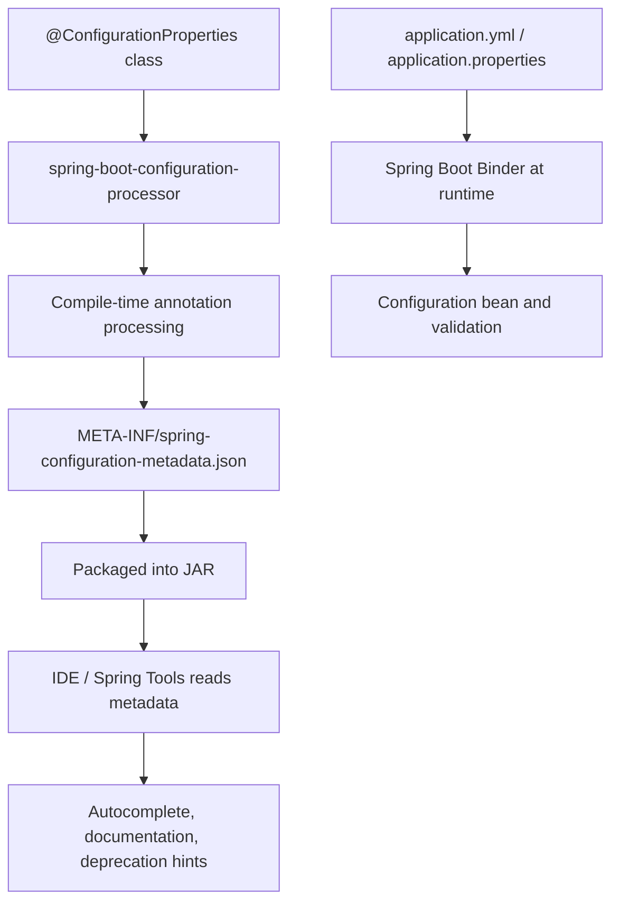

# Configuration Metadata and IDE Autocomplete Support

> **Chapter:** Typed Configuration  
> **Module:** `SPRING_CLOUD_CORE` — core Spring Cloud foundations in distributed systems, especially Spring Cloud Commons, Context, externalized configuration, and version compatibility with Spring Boot. Learners explore refresh scope, discovery, service registries, service communication, and how to test and operate shared abstractions.  
> **Focus:** Configuration metadata describes configuration properties so IDEs and developer tools can suggest names, data types, default values, descriptions, valid values, and deprecation status. Metadata helps developers write configuration accurately; runtime binding and validation remain the responsibility of Spring Boot and the application.

## 1. Why Is Configuration Metadata Needed?

A Spring Cloud application typically has many configuration properties: service names, Config Server endpoints, timeouts, retries, discovery, registries, logging, feature flags, and service connection details. Developers write configuration in YAML or properties files, but without accompanying metadata, IDEs struggle to know:

- which properties are actually supported;
- the canonical name and data type of each property;
- which default value a property has;
- whether a numeric value means milliseconds, seconds, or bytes;
- which enum constants or values are recommended;
- which properties are deprecated and what keys replace them;
- which component owns a given group of properties.

For instance, with an internal library, an author might mistype `platform.client.discover.enabled` instead of `platform.client.discovery.enabled`. The YAML remains syntactically valid, yet the typo prevents the library from enabling discovery as intended. An IDE with configuration metadata suggests key names, displays descriptions, and warns about deprecated names right inside the editor.

**Configuration metadata** is descriptive data about configuration, typically stored in JSON files using Spring Boot's format. Metadata is primarily generated from `@ConfigurationProperties` classes by an annotation processor; developers can supplement it manually when the processor cannot infer enough detail.

Metadata is read by IDEs, Spring Tools, and compatible tooling to provide autocomplete, quick documentation, and warnings. It is not a runtime configuration file, does not register beans, and does not validate values when the application runs.

### Learning Outcomes

After this lesson, you will be able to:

1. explain the purpose and structure of Spring configuration metadata;
2. distinguish generated metadata from additional metadata;
3. configure `spring-boot-configuration-processor` in Maven or Gradle;
4. generate metadata from `@ConfigurationProperties`, nested properties, and enums;
5. add hints, values, providers, and descriptions for IDEs;
6. mark properties as deprecated and guide users toward replacements;
7. inspect metadata inside build artifacts and diagnose missing IDE suggestions;
8. distinguish metadata from runtime binding, conversion, and validation.

## 2. Where Does Metadata Fit in the Configuration Process?

### 2.1. From Configuration Class to IDE

Suppose an internal Spring Cloud library provides configuration for a service-calling client. The team defines a `platform.client` prefix with `connect-timeout`, `read-timeout`, `retry.max-attempts`, and `mode`.

When compiling the module containing `@ConfigurationProperties` classes, the Spring Boot configuration processor inspects annotations and Java types to generate metadata. Metadata is written to `META-INF/spring-configuration-metadata.json` in the build output. When the library is packaged as a JAR, the metadata ships inside the artifact for consuming application IDEs. Javadoc on fields or constructor parameters can be used as descriptions when types are compiled from source in the module; types available only as precompiled dependencies often do not provide sufficient descriptive information.



The diagram shows two related flows occurring at different times:

- **Metadata flow:** happens at build time and serves developer tooling.
- **Runtime flow:** happens when Spring Boot reads properties, binds them into objects, and checks configuration constraints.

Metadata does not replace the Binder, and the Binder does not need an IDE to work.

### 2.2. Two Important Metadata Files

| File | Creation Source | Purpose |
| --- | --- | --- |
| `META-INF/spring-configuration-metadata.json` | Typically generated at compile time by the annotation processor | Metadata inferred from configuration classes |
| `META-INF/additional-spring-configuration-metadata.json` | Manually authored by developers in source resources | Supplements or adjusts descriptions, defaults, deprecations, and hints |

The generated file usually lands in the module's build output, for example:

- Maven: `target/classes/META-INF/spring-configuration-metadata.json`;
- Gradle: `build/classes/java/main/META-INF/spring-configuration-metadata.json` or the corresponding source-set output.

The exact path depends on the build tool and configuration. When packaging a JAR, verify the resource exists under `META-INF/` inside the artifact.

### 2.3. Metadata Is Not Application Configuration

A metadata file might describe `platform.client.read-timeout` as `java.time.Duration` with default `3s`. It does not put that value into `Environment`, nor does it force the Binder to apply a default if the configuration class itself declares none.

Runtime values come from Spring Boot's configuration sources and binding rules, such as:

- `application.yml` or `application.properties`;
- external configuration files and profiles;
- environment variables;
- system properties and command-line arguments;
- Config Data or Spring Cloud Config;
- default values declared inside configuration classes.

Metadata documents the configuration contract for developers. Classes, the Binder, converters, and validators determine actual runtime behavior.

## 3. Declaring @ConfigurationProperties as the Metadata Source

### 3.1. Creating a Typed Configuration Class

Example platform client properties:

```java
package com.example.platform.client;

import java.time.Duration;

import org.springframework.boot.context.properties.ConfigurationProperties;

@ConfigurationProperties(prefix = "platform.client")
public class PlatformClientProperties {

    private Duration connectTimeout = Duration.ofSeconds(1);
    private Duration readTimeout = Duration.ofSeconds(3);
    private Mode mode = Mode.DIRECT;

    private Retry retry = new Retry();

    public Duration getConnectTimeout() {
        return connectTimeout;
    }

    public void setConnectTimeout(Duration connectTimeout) {
        this.connectTimeout = connectTimeout;
    }

    public Duration getReadTimeout() {
        return readTimeout;
    }

    public void setReadTimeout(Duration readTimeout) {
        this.readTimeout = readTimeout;
    }

    public Mode getMode() {
        return mode;
    }

    public void setMode(Mode mode) {
        this.mode = mode;
    }

    public Retry getRetry() {
        return retry;
    }

    public void setRetry(Retry retry) {
        this.retry = retry;
    }

    public enum Mode {
        DIRECT,
        DISCOVERY
    }

    public static class Retry {
        private int maxAttempts = 3;
        private Duration backoff = Duration.ofMillis(200);

        public int getMaxAttempts() {
            return maxAttempts;
        }

        public void setMaxAttempts(int maxAttempts) {
            this.maxAttempts = maxAttempts;
        }

        public Duration getBackoff() {
            return backoff;
        }

        public void setBackoff(Duration backoff) {
            this.backoff = backoff;
        }
    }
}
```

This is a JavaBean-style configuration properties class illustrating setter binding. Defaults are declared right inside the class. The processor automatically recognizes the inner `Retry` class as a nested property; `@NestedConfigurationProperty` is unnecessary here.

For Spring Boot to create a bean from this class, the application must register it via an appropriate mechanism, such as:

```java
@SpringBootApplication
@EnableConfigurationProperties(PlatformClientProperties.class)
public class OrderApplication {
    public static void main(String[] args) {
        SpringApplication.run(OrderApplication.class, args);
    }
}
```

You can use `@ConfigurationPropertiesScan(basePackageClasses = PlatformClientProperties.class)` to scan by the configuration class's package. **The annotation processor that generates metadata does not register the configuration bean.** Those are two separate tasks.

### 3.2. Property Names in Canonical Form

From prefixes and fields, metadata describes keys in kebab-case:

| Java Property | Canonical Configuration Key | Type |
| --- | --- | --- |
| `connectTimeout` | `platform.client.connect-timeout` | `java.time.Duration` |
| `readTimeout` | `platform.client.read-timeout` | `java.time.Duration` |
| `mode` | `platform.client.mode` | Enum |
| `retry.maxAttempts` | `platform.client.retry.max-attempts` | `int` |
| `retry.backoff` | `platform.client.retry.backoff` | `java.time.Duration` |

Spring Boot supports relaxed binding across many name variants when binding. Still, in documentation and config files, use canonical kebab-case for consistency and accurate IDE recognition.

YAML example:

```yaml
platform:
  client:
    connect-timeout: 500ms
    read-timeout: 4s
    mode: DISCOVERY
    retry:
      max-attempts: 4
      backoff: 250ms
```

IDEs with metadata can suggest these keys and enum values as users edit configuration.

### 3.3. The Metadata Processor Does Not Replace ConfigurationPropertiesScan

Distinguish three steps:

1. `@ConfigurationProperties` defines the configuration type and prefix.
2. `@ConfigurationPropertiesScan` or `@EnableConfigurationProperties` registers the bean for runtime binding.
3. `spring-boot-configuration-processor` analyzes the type at compile time to produce metadata.

Metadata can exist even if the bean was never registered; the IDE suggests the right keys, yet the application has no bean receiving the settings. Conversely, a bean can be registered and bound cleanly without metadata, though the IDE lacks suggestions.

## 4. Installing the Configuration Processor

### 4.1. Maven

Add the processor to the module declaring `@ConfigurationProperties` classes:

```xml
<dependencies>
    <dependency>
        <groupId>org.springframework.boot</groupId>
        <artifactId>spring-boot-configuration-processor</artifactId>
        <optional>true</optional>
    </dependency>
</dependencies>
```

Marking the dependency optional prevents the processor from becoming a mandatory runtime dependency for applications consuming the library. Its version should be managed by the corresponding Spring Boot parent/BOM. With Maven Compiler Plugin 3.12.0+, configure the processor inside `annotationProcessorPaths` so it runs explicitly during compilation; if the project already configures custom annotation processor paths, add this processor there.

Example compiler plugin snippet (preserve any other existing plugins in the project):

```xml
<build>
    <plugins>
        <plugin>
            <groupId>org.apache.maven.plugins</groupId>
            <artifactId>maven-compiler-plugin</artifactId>
            <version>3.12.0</version>
            <configuration>
                <annotationProcessorPaths>
                    <path>
                        <groupId>org.springframework.boot</groupId>
                        <artifactId>spring-boot-configuration-processor</artifactId>
                    </path>
                </annotationProcessorPaths>
            </configuration>
        </plugin>
    </plugins>
</build>
```

After compiling:

```bash
mvn clean compile
```

Verify `target/classes/META-INF/spring-configuration-metadata.json` or the metadata resource inside the packaged JAR.

### 4.2. Gradle

With the Gradle Java plugin, declare the processor in the `annotationProcessor` configuration:

```groovy
dependencies {
    annotationProcessor 'org.springframework.boot:spring-boot-configuration-processor'

    implementation 'org.springframework.boot:spring-boot-starter'
}
```

If the module uses `additional-spring-configuration-metadata.json`, ensure resources are processed before `compileJava` runs the annotation processor:

```groovy
tasks.named('compileJava') {
    inputs.files(tasks.named('processResources'))
}
```

Then run:

```bash
./gradlew clean compileJava
```

Check the output in `build/classes/java/main/META-INF/`. If using Kotlin, configure the processor via `kapt` or the annotation processing setup chosen by your project; do not assume a Java-only `annotationProcessor` declaration processes Kotlin sources.

### 4.3. Placing the Processor in the Right Module

In multi-module projects:

- the module containing `@ConfigurationProperties` classes is where the processor must run;
- application modules consuming the library receive metadata packaged inside the dependency JAR;
- if configuration classes span multiple modules, each module owning classes must generate its own metadata;
- you do not need to add the processor as a runtime dependency of every application just to read metadata.

Example:

```text
platform-client/
  src/main/java/com/example/platform/client/
    PlatformClientProperties.java
  target/classes/META-INF/
    spring-configuration-metadata.json

order-service/
  pom.xml
  src/main/java/com/example/order/
    OrderApplication.java
```

If metadata is missing from the `platform-client` JAR, the IDE in `order-service` may not suggest library properties even though the configuration class exists.

## 5. Reading the Generated Metadata JSON Structure

A metadata document typically has three main sections and one optional section:

- `groups`: configuration groups or prefixes;
- `properties`: individual configurable properties;
- `hints`: value suggestions or value providers for IDEs;
- `ignored`: properties intentionally excluded from suggested metadata lists.

Simplified example:

```json
{
  "groups": [
    {
      "name": "platform.client",
      "type": "com.example.platform.client.PlatformClientProperties",
      "sourceType": "com.example.platform.client.PlatformClientProperties",
      "description": "Configuration for the service-communication client."
    }
  ],
  "properties": [
    {
      "name": "platform.client.connect-timeout",
      "type": "java.time.Duration",
      "description": "Maximum time to wait while establishing a connection.",
      "sourceType": "com.example.platform.client.PlatformClientProperties",
      "defaultValue": "PT1S"
    },
    {
      "name": "platform.client.read-timeout",
      "type": "java.time.Duration",
      "description": "Maximum time to wait while reading a response.",
      "sourceType": "com.example.platform.client.PlatformClientProperties",
      "defaultValue": "PT3S"
    }
  ],
  "hints": []
}
```

This example illustrates the structure rather than fixed output across every processor version. Actual class names, default values, and descriptions depend on source code and additional metadata.

The metadata format can also use `ignored.properties` to exclude a key from suggested lists when it should not be treated as a public configuration property:

```json
{
  "ignored": {
    "properties": [
      {
        "name": "platform.client.internal-cache-key"
      }
    ]
  }
}
```

Ignored metadata only controls what metadata is published to tooling; it does not remove properties from Environment and does not alter runtime binding.

### 5.1. Groups

A group typically represents a configuration prefix and the type that owns it. Common fields:

- `name`: prefix name, e.g., `platform.client`;
- `type`: Java type representing the group;
- `sourceType`: declaring source type;
- `description`: group description;
- `sourceMethod`: source method when metadata is generated from an eligible factory method.

Groups help IDEs present structure and high-level descriptions. Not every property must belong to its own group; properties can exist independently. The processor infers groups from the classes and configuration structures it recognizes.

### 5.2. Properties

Each property entry can include:

| Field | Meaning |
| --- | --- |
| `name` | Canonical property name |
| `type` | Java type or documented data type |
| `description` | Explanation of purpose |
| `sourceType` | Class owning the property |
| `defaultValue` | Documented default value |
| `deprecation` | Deprecation information, if any |
| `sourceMethod` | Method producing the property in certain cases |

A `Duration` property may be represented using ISO-8601 or whatever format the processor extracts. Never manually edit generated files to change default values: update defaults in the class or use additional metadata for appropriate documentation purposes.

For primitive types, metadata typically lists the corresponding wrapper type, e.g., `int` as `java.lang.Integer`. Default values are only inferred by the processor when statically readable from compiled sources; values derived from external constants or collection defaults may require manual declaration.

### 5.3. Hints

Hints provide choices or providers so IDEs can suggest values. Two primary forms:

- `values`: a static list of values with descriptions;
- `providers`: a provider supplying dynamic values or values following a known convention.

Hints help editors present selection lists. They do not turn properties into enums at runtime and do not prevent users from entering other values.

## 6. Adding Manual Descriptions

### 6.1. When Is Additional Metadata Needed?

The annotation processor can infer property names, types, and some defaults from Java classes. However, it cannot infer every domain nuance. Cases where additional metadata helps:

- properties created dynamically or coming from APIs the processor cannot analyze;
- writing clearer descriptions for a property;
- suggesting allowed or recommended values;
- supplying providers such as Spring profile names;
- marking properties as deprecated and pointing to replacements;
- documenting a shared prefix provided by a library.

Create `src/main/resources/META-INF/additional-spring-configuration-metadata.json`.

Example:

```json
{
  "groups": [
    {
      "name": "platform.client",
      "type": "com.example.platform.client.PlatformClientProperties",
      "description": "Shared configuration for service-calling clients."
    }
  ],
  "properties": [
    {
      "name": "platform.client.connect-timeout",
      "type": "java.time.Duration",
      "description": "Maximum time allowed to establish a connection to the service.",
      "defaultValue": "1s"
    },
    {
      "name": "platform.client.mode",
      "type": "com.example.platform.client.PlatformClientProperties.Mode",
      "description": "Selects how requests are routed to the service."
    }
  ],
  "hints": [
    {
      "name": "platform.client.mode",
      "values": [
        {
          "value": "DIRECT",
          "description": "Call the configured endpoint directly."
        },
        {
          "value": "DISCOVERY",
          "description": "Resolve instances via service discovery."
        }
      ]
    }
  ]
}
```

During the build, the processor automatically merges additional metadata with inferred metadata. When re-declaring an already discovered property, manually supplied `description`, `defaultValue`, and `deprecation` fields override the generated values. New properties in the additional file are also added to the final metadata even if not bound directly onto a bean. Use the exact filename and resource directory; a JSON file misplaced at the classpath root or misnamed will not be picked up by the processor.

### 6.2. Descriptions Should Help Users Make Decisions

A good description explains what the property does, what component it affects, and which units or limits matter. For example:

- Vague: `Timeout configuration.`
- Clearer: `Maximum time to wait for a response from the downstream service; value should be smaller than the business request deadline.`

For Spring Cloud settings, state clearly which Config Client, discovery, load balancer, refresh, or logging feature the property applies to. This helps avoid confusing application keys with provider-specific keys.

### 6.3. Never Turn Metadata into a Secret Store

Metadata is typically packaged into JARs and distributed with libraries. Never put tokens, passwords, sensitive internal endpoints, or secrets inside `description` or `defaultValue`. When documenting a secret property, describe only its purpose and safe supply channels, such as a secret manager or environment variable.

## 7. Hints: Suggesting Values and Providers

### 7.1. Static Values

Use `values` when a property has a finite set of values or recommended choices:

```json
{
  "hints": [
    {
      "name": "platform.client.mode",
      "values": [
        {
          "value": "DIRECT",
          "description": "Call the configured URI directly."
        },
        {
          "value": "DISCOVERY",
          "description": "Select instances via service discovery."
        }
      ]
    }
  ]
}
```

If a property is a Java enum, the processor can usually infer enum values automatically. Additional hints remain helpful for enriching descriptions or suggesting values on non-enum properties.

### 7.2. Value Providers

A provider suggests context-aware values known to the IDE instead of a hardcoded list. Example:

```json
{
  "hints": [
    {
      "name": "platform.client.profile",
      "providers": [
        {
          "name": "spring-profile-name"
        }
      ]
    }
  ]
}
```

`spring-profile-name` is an example provider allowing IDEs to suggest Spring profiles recognized in the project. Other providers can supply class names, logger names, or bean references depending on the IDE and metadata consumer.

Not every IDE supports every provider. If a provider is unsupported, the metadata remains readable, though dynamic suggestions may not appear.

### 7.3. Hints Are Neither Enums Nor Validators

Suppose metadata suggests only `DIRECT` and `DISCOVERY`. If the runtime class uses `String`, a user can still enter `UNKNOWN` and the Binder will bind that string successfully. Hints do not block values on their own.

To constrain values at runtime:

- use an enum if the value set is fixed;
- use a custom converter if mapping strings to a custom type;
- use validation when rules depend on values or cross-property relationships;
- enforce business checks when configuration is applied.

Never rely on metadata hints as the sole safeguard for endpoints, credentials, or security modes.

## 8. Marking Properties as Deprecated

### 8.1. Why Is Deprecation Metadata Needed?

In shared libraries, a property may be replaced by a clearer name or a new structure. Deleting an old key immediately can break many consuming applications. Deprecation lets IDEs warn users and point to replacements before the property is removed.

For example, a library previously used `platform.client.timeout` and now splits it into `connect-timeout` and `read-timeout`.

```java
import java.time.Duration;

import org.springframework.boot.context.properties.ConfigurationProperties;
import org.springframework.boot.context.properties.DeprecatedConfigurationProperty;

@ConfigurationProperties(prefix = "platform.client")
public class PlatformClientProperties {

    private Duration connectTimeout = Duration.ofSeconds(1);
    private Duration readTimeout = Duration.ofSeconds(3);
    private Duration timeout = Duration.ofSeconds(3);

    public Duration getConnectTimeout() {
        return connectTimeout;
    }

    public void setConnectTimeout(Duration connectTimeout) {
        this.connectTimeout = connectTimeout;
    }

    public Duration getReadTimeout() {
        return readTimeout;
    }

    public void setReadTimeout(Duration readTimeout) {
        this.readTimeout = readTimeout;
    }

    /**
     * @deprecated Use connect-timeout and read-timeout instead.
     */
    @Deprecated
    @DeprecatedConfigurationProperty(
        reason = "General timeout has been split per I/O phase.",
        replacement = "platform.client.connect-timeout"
    )
    public Duration getTimeout() {
        return timeout;
    }

    @Deprecated
    public void setTimeout(Duration timeout) {
        this.timeout = timeout;
    }
}
```

This example shows placing deprecation metadata on the getter. In real code, import `DeprecatedConfigurationProperty` from the Spring Boot package matching your version. Ensure the legacy property retains compatible semantics during the transition window if existing configs must still work.

### 8.2. Deprecation in JSON

Deprecation metadata can specify severity level, reason, and replacement property:

```json
{
  "properties": [
    {
      "name": "platform.client.timeout",
      "type": "java.time.Duration",
      "description": "Legacy general timeout.",
      "deprecation": {
        "level": "warning",
        "reason": "Connect and read timeouts have been separated.",
        "replacement": "platform.client.connect-timeout"
      }
    }
  ]
}
```

IDEs may show warnings or strikethroughs on old keys and suggest replacements. Exact presentation depends on the IDE. In manually authored metadata, `warning` means the property still binds; `error` means the property is no longer supported and does not bind per the metadata contract. `@DeprecatedConfigurationProperty` on a getter only produces level `warning`, since the code still handles the old property. Use level `error` only after support for that key has actually been removed and you want metadata to keep alerting users.

### 8.3. Safe Removal Roadmap

1. Introduce the new properties and update documentation.
2. Mark the old property deprecated, stating the reason and replacement.
3. If needed, support both keys during a transition period; define clearly which key wins if both are set.
4. Log a runtime warning when users still configure the old key, if detectable.
5. Update examples, starters, and sample configurations.
6. Remove the old key only in a major release aligned with your compatibility policy.

Metadata only helps developers spot changes. Backward-compatibility logic must be implemented in binding code or configuration adapters.

## 9. Metadata for Nested Properties, Maps, and Collections

### 9.1. Nested Properties

A `Retry` class nested inside `PlatformClientProperties` creates a child property group:

```yaml
platform:
  client:
    retry:
      max-attempts: 4
      backoff: 250ms
```

The processor automatically recognizes inner classes as nested properties. For a standalone class declared outside the configuration properties class, annotate the field or getter with `@NestedConfigurationProperty` so the metadata processor presents that type's properties as a subgroup. Example:

```java
@ConfigurationProperties(prefix = "platform.client")
public class PlatformClientProperties {

    @NestedConfigurationProperty
    private RetryProperties retry;

    public RetryProperties getRetry() {
        return retry;
    }

    public void setRetry(RetryProperties retry) {
        this.retry = retry;
    }
}
```

`RetryProperties` in this example is an independent class, not an inner class. This annotation only affects how the processor describes metadata; it does not enable binding and does not alter the Binder. It also has no special effect on collections or maps, which the processor recognizes automatically.

### 9.2. Maps

For maps, dynamic keys usually cannot be enumerated exhaustively in metadata:

```yaml
platform:
  client:
    headers:
      X-Region: ap-southeast-1
      X-Request-Source: checkout
```

Metadata can document the root property as `Map<String, String>`, though the IDE will not necessarily know every valid key. If certain keys are required by business rules, document them clearly in `description` or dedicated docs. Do not pretend a static hints list covers every dynamic key.

### 9.3. Collections

For lists:

```yaml
platform:
  client:
    trusted-services:
      - inventory-service
      - pricing-service
```

Metadata can indicate the property is `List<String>`, but cannot verify that each element exists in the service registry. Validating service IDs, duplicates, and access permissions belongs to runtime logic or application validators.

## 10. Metadata and Runtime Validation

### 10.1. Four Distinct Mechanisms

| Mechanism | Timing | Role |
| --- | --- | --- |
| Configuration metadata | Build time / IDE editing | Describes keys, types, defaults, deprecation, hints |
| ConfigurationProperties binding | Application startup or bind time | Converts property sources into typed objects |
| Type conversion | During binding | Converts strings to Duration, DataSize, enum, URI, etc. |
| Bean Validation | On initialization/bind if configured | Enforces constraints such as not blank, min/max, valid |

For example, metadata describes `max-attempts` as an integer and documents default `3`. If a user sets `max-attempts: -10`, metadata will not reject it. Runtime validation is required:

```java
@ConfigurationProperties(prefix = "platform.client")
@Validated
public class PlatformClientProperties {

    @Min(1)
    @Max(10)
    private int maxAttempts = 3;

    public int getMaxAttempts() {
        return maxAttempts;
    }

    public void setMaxAttempts(int maxAttempts) {
        this.maxAttempts = maxAttempts;
    }
}
```

The project needs a matching Bean Validation implementation dependency, such as the validation starter in Spring Boot applications, configured appropriately for the properties style. On violation, the application fails during binding/startup rather than merely showing an IDE warning.

### 10.2. Data Types and Units

Spring Boot supports conversion for many common types:

- `Duration` for time intervals;
- `DataSize` for data capacities;
- enums for fixed sets of values;
- URI/URL, booleans, integers, and primitive/basic types.

Metadata informs the IDE about types, while runtime value parsing is handled by the Binder and converters. For example, `read-timeout: 3s` binds to `Duration`; if a value cannot be parsed, the error occurs during binding rather than from metadata.

### 10.3. Default Values Must Stay Consistent

If a class sets default `Duration.ofSeconds(3)` while additional metadata lists `defaultValue: "5s"`, IDEs display a different default from runtime behavior. This misleads users who omit the property.

Keep these in sync:

- defaults in Java/Kotlin configuration properties;
- `defaultValue` in additional metadata when declared;
- descriptions in documentation;
- sample configurations and tests.

Never write fake defaults just to make the IDE suggest a value that runtime does not actually use.

## 11. Verifying Generated and Packaged Metadata

### 11.1. Verification Workflow

After adding the processor:

1. run a clean compile to avoid reading stale files;
2. inspect generated metadata in build outputs;
3. check for expected prefixes and keys;
4. confirm types, defaults, descriptions, and nested groups;
5. verify additional metadata was merged;
6. package the JAR and inspect resources under `META-INF`;
7. import the module/library into an IDE and confirm autocomplete.

Maven:

```bash
mvn clean package
jar tf target/platform-client-1.0.0.jar
```

Gradle:

```bash
./gradlew clean build
jar tf build/libs/platform-client-1.0.0.jar
```

The JAR filename depends on project group, artifact, and version. The goal is confirming metadata resources exist inside the artifact, not matching the example JAR name literally.

### 11.2. When the IDE Does Not Suggest Properties

| Symptom | Possible Cause | How to Check |
| --- | --- | --- |
| No generated metadata file | Processor did not run or missing from annotation processor path | Maven/Gradle dependency configuration |
| Generated file exists but lacks nested groups | Processor did not recognize nested type or missing annotation | Class structure and `@NestedConfigurationProperty` |
| Metadata exists in build output but missing from JAR | Resource not packaged or excluded | JAR contents under `META-INF/` |
| IDE does not suggest library properties | Dependency JAR lacks metadata or IDE has not refreshed index | Inspect artifact and reload project |
| Wrong default value suggested | Additional metadata differs from runtime default | Compare class and JSON |
| Deprecated key shows no warning | Annotation placed on wrong method or metadata lacks deprecation | Generated JSON and annotation target |
| Hints do not appear | Invalid JSON structure or IDE lacks provider support | Validate JSON and check metadata consumer |
| Suggested property has no runtime bean | Class not registered or wrong prefix | `@ConfigurationPropertiesScan` / `@EnableConfigurationProperties` |

### 11.3. Automated Testing

Write tests verifying configuration binds cleanly into objects:

```java
@SpringBootTest(properties = {
    "platform.client.connect-timeout=500ms",
    "platform.client.mode=DISCOVERY",
    "platform.client.retry.max-attempts=4"
})
class PlatformClientPropertiesTest {

    @Autowired
    PlatformClientProperties properties;

    @Test
    void bindsTypedConfiguration() {
        assertThat(properties.getConnectTimeout())
                .isEqualTo(Duration.ofMillis(500));
        assertThat(properties.getMode())
                .isEqualTo(PlatformClientProperties.Mode.DISCOVERY);
        assertThat(properties.getRetry().getMaxAttempts())
                .isEqualTo(4);
    }
}
```

This test verifies runtime binding, not IDE metadata. To verify metadata, inspect generated/additional JSON files and JAR contents in build verification or a dedicated resource test.

## 12. Configuration Metadata in Spring Cloud Libraries

### 12.1. Why Is Metadata Valuable for Shared Libraries?

A library providing abstractions like service discovery, load balancing, or service-communication clients can expose dozens of properties. Library users rarely read library source code when configuring applications.

Metadata lets a library offer a smooth configuration experience:

- clear module-scoped prefixes;
- concise, accurate descriptions for every property;
- appropriate types and units;
- default values matching the implementation;
- hints for enums or providers;
- deprecation paths when configuration APIs evolve.

For instance, an internal library can expose `platform.discovery.health-check.enabled`, `platform.discovery.refresh-interval`, and `platform.loadbalancer.strategy`. IDEs display these properties even though they are not part of Spring Boot core, provided metadata is packaged in the dependency.

### 12.2. Avoiding Prefix Collisions with Spring Boot/Spring Cloud

When designing a library, choose prefixes under your organization's or module's namespace, such as `company.inventory.client`. Avoid defining properties under Spring Boot or Spring Cloud prefixes unless building an official extension for that namespace.

If two libraries declare the same key with different types or defaults, metadata and runtime binding can conflict. Unique prefixes avoid collisions and clarify configuration ownership.

### 12.3. Metadata Is Part of the Developer-Facing API

When releasing libraries, changing property names, types, or defaults can impact consuming applications. Treat metadata and `@ConfigurationProperties` classes as part of the configuration contract:

- renaming keys requires deprecation or migration notes;
- changing types requires checking conversion and compatibility;
- changing defaults can alter production behavior even when no config files change;
- removing properties requires a versioning policy;
- updating hints must stay aligned with values runtime actually accepts.

## 13. Common Misconceptions

**"Having metadata means Spring automatically reads the configuration."**  
No. Metadata serves IDEs and tooling; runtime reads Environment and binds into beans.

**"The configuration processor registers `@ConfigurationProperties` beans."**  
No. You still need `@ConfigurationPropertiesScan` or `@EnableConfigurationProperties` to register beans.

**"If the IDE suggests certain values, runtime accepts only those values."**  
No. Hints are only suggestions. Use enums, converters, or validators to constrain runtime values.

**"Metadata is only for application-local code."**  
No. Libraries packaging metadata inside their JARs provide suggestions to consuming applications.

**"Editing generated JSON directly is enough."**  
No. Generated files get overwritten on subsequent builds. Edit source properties or additional metadata.

**"`@NestedConfigurationProperty` enables nested binding."**  
No. It mainly helps the processor describe nested groups; nested binding is handled by Spring Boot's Binder based on type structure.

**"Deprecation metadata automatically removes old properties."**  
No. It informs IDEs of status and replacements; code must decide how to support backward compatibility and when to remove keys.

**"Metadata default values are always runtime defaults."**  
No. The two can drift out of sync; keep classes and metadata consistent.

## 14. Practice Exercises

### Exercise 1 — Missing IDE Suggestions

A library contains `@ConfigurationProperties(prefix = "company.catalog")`, yet a consuming application gets no property suggestions in the IDE. Check the processor dependency, generated file, JAR resources, and IDE project refresh in order.

### Exercise 2 — Nested Properties

Create `company.catalog.cache` settings with `enabled`, `ttl`, and `max-size`. Define suitable types, default values, nested group metadata, and matching YAML. Explain the role of `@NestedConfigurationProperty`.

### Exercise 3 — Hints and Runtime Validation

A property `company.catalog.strategy` has two IDE-suggested values (`LOCAL` and `REMOTE`), while the runtime class uses `String`. Demonstrate why users can still configure `UNKNOWN`; then switch to an enum or appropriate validator.

### Exercise 4 — Deprecation

A library has a legacy `company.catalog.timeout` key, replaced by `connect-timeout` and `read-timeout`. Author deprecation metadata, specify replacements, and design a transition period supporting both keys without ambiguous precedence.

### Exercise 5 — Generated vs. Additional Metadata

A class has a runtime default of `2s`, yet the IDE displays `5s`. Locate the additional metadata overriding the description/default, fix the authoritative source, and add a build check to detect drift in future releases.

### Quick Self-Check

1. When is configuration metadata typically generated? **Compile time via annotation processing.**
2. Where does the generated metadata file live inside an artifact? **Inside `META-INF/spring-configuration-metadata.json`.**
3. What is the additional file named? **`META-INF/additional-spring-configuration-metadata.json`.**
4. Does metadata replace `@ConfigurationPropertiesScan`? **No.**
5. Do hints validate runtime values? **No.**
6. What mechanisms constrain retry counts at runtime? **Enums, converters, or Bean Validation/explicit validation logic; metadata only suggests.**
7. Why should libraries package metadata? **So consuming applications' IDEs can autocomplete and document library properties.**

## 15. Configuration Metadata Release Checklist

Before releasing a module containing `@ConfigurationProperties`, verify:

1. Properties classes have clear prefixes, readable field names, and appropriate types.
2. Runtime beans are registered via scanning or explicit enabling.
3. Configuration processor is declared in the right module and annotation processor path.
4. Generated metadata includes all expected groups and properties.
5. Additional metadata is valid JSON placed under `META-INF`.
6. Hints accurately describe values accepted at runtime.
7. Deprecated properties specify clear reasons and replacements.
8. Metadata defaults match runtime defaults.
9. Metadata is packaged inside the JAR and readable by consuming IDEs.
10. Runtime binding and validation have dedicated tests rather than relying on IDE hints.

**Core message:** Configuration metadata turns typed configuration classes into a discoverable developer contract. The annotation processor generates most metadata from `@ConfigurationProperties`; additional metadata fills in descriptions, hints, and deprecations that code alone cannot express fully. IDEs use this data to assist authoring, while Spring Boot's Binder and validation remain responsible for ensuring configuration binds and validates at runtime.

**References:** [Spring Boot Reference — Configuration Metadata](https://docs.spring.io/spring-boot/reference/configuration-metadata.html), [Spring Boot Reference — Type-safe Configuration Properties](https://docs.spring.io/spring-boot/reference/features/external-config.html#features.external-config.typesafe-configuration-properties), [Spring Boot Configuration Metadata Annotation Processor](https://docs.spring.io/spring-boot/specification/configuration-metadata/annotation-processor.html), and [Spring Cloud](https://spring.io/projects/spring-cloud). Processor details and IDE consumers can vary by version; consult the documentation for your active Spring Boot release.
