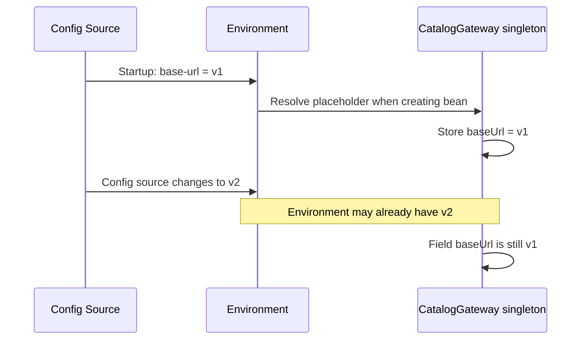
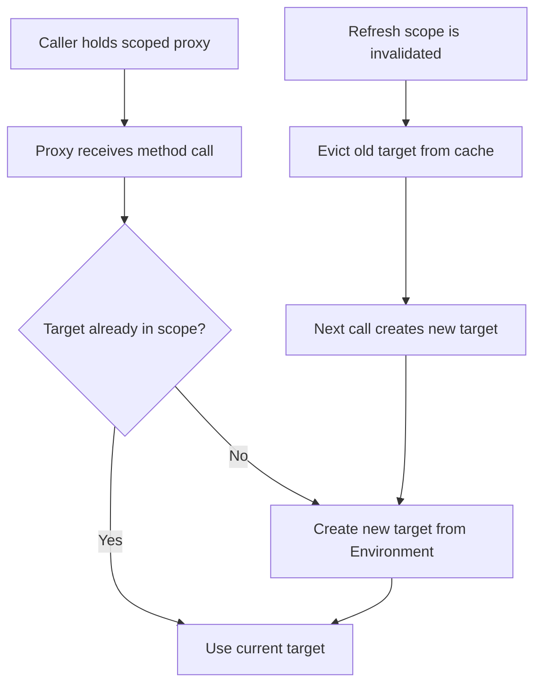

# The Problem of Beans Retaining Configuration Read at Initialization Time

In a Spring Boot/Spring Cloud application, configuration is typically loaded from YAML, environment variables, Config Server, or an external source. A bean can read configuration via `@Value`, `@ConfigurationProperties`, or `Environment` when it is created. However, after the bean has been initialized, **values read and stored into an object's fields do not automatically change just because the configuration source has changed**.

This is the core problem driving the need for refresh in Spring Cloud Context. An application may receive a new property in `Environment`, yet services, HTTP clients, caches, or connection pools continue using the old captured value. To handle this properly, you must distinguish between the configuration source, the properties object, the consuming bean, and the resources created from those values.

This lesson belongs to the **Refresh Scope** chapter of the `SPRING_CLOUD_CORE` module. The goal is to recognize the phenomenon where beans retain a configuration snapshot taken at initialization time, understand why singletons do not automatically re-read properties, and choose the right update strategy: dynamic value reading, properties rebinding, recreating beans with `@RefreshScope`, or controlled restart/rollout.

## 1. Scenario: Configuration Changed, But the Service Still Uses the Old Value

Suppose a service calls the Catalog API. Initially, the configuration has an endpoint:

```yaml
catalog:
  remote:
    base-url: https://catalog-v1.internal
```

A bean reads the endpoint in its constructor and stores it in a field:

```java
import org.springframework.beans.factory.annotation.Value;
import org.springframework.stereotype.Service;

@Service
public class CatalogGateway {
    private final String baseUrl;

    public CatalogGateway(
            @Value("${catalog.remote.base-url}") String baseUrl) {
        this.baseUrl = baseUrl;
    }

    public String endpoint() {
        return baseUrl;
    }
}
```

When the application starts, Spring resolves `${catalog.remote.base-url}` and passes the current string into the constructor. `CatalogGateway` keeps that string in a `final` field.

Later, Config Server is updated:

```yaml
catalog:
  remote:
    base-url: https://catalog-v2.internal
```

If the application only loads configuration once at startup, the bean still returns `https://catalog-v1.internal`. Even if a refresh mechanism has updated `Environment`, the `baseUrl` field in the existing object is not automatically reassigned.



This behavior is not a bug in `@Value`, `@Service`, or Spring singletons. Spring fulfilled its exact contract: injecting the value at bean creation time. The Java object then has its own lifecycle and state.

## 2. Four Layers to Distinguish

To pinpoint the root cause, separate these four layers:

| Layer | Example | What happens when configuration changes? |
| --- | --- | --- |
| Configuration source | Config Server, file, environment variable | The source may contain the new value; the application may not have re-read it yet |
| `Environment` / `PropertySource` | `Environment.getProperty(...)` | Changes only when an appropriate property source loading/updating mechanism runs |
| Properties bean | `CatalogClientProperties` | Can be rebound by a specific mechanism; not every object is updated by default |
| Consuming bean / resource | `CatalogGateway`, HTTP client, pool | May continue holding an old snapshot unless re-read, rebound, or recreated |

A new configuration value in Config Server does not automatically propagate through all four layers. Each step has its own mechanism and timing.

### 2.1. A Changed Configuration Source Does Not Guarantee the Application Received It

If you edit a file or push a new commit to the repository used by Config Server, a running instance does not necessarily poll and reload it automatically. Importing configuration at startup and refreshing at runtime are two different processes.

### 2.2. A New Value in Environment Does Not Guarantee the Bean Has the New Value

`Environment` is an abstraction for reading property sources. It does not track every field of every Java object and does not automatically reassign values that were copied into a constructor or field.

### 2.3. Updating the Properties Bean Does Not Guarantee the Client Is Rebuilt

A service might inject `CatalogClientProperties` and then create an HTTP client once in its constructor:

```java
@Service
public class CatalogGateway {
    private final CatalogHttpClient client;

    public CatalogGateway(CatalogClientProperties properties) {
        this.client = new CatalogHttpClient(properties.getBaseUrl());
    }
}
```

Even if the properties object is rebound, `CatalogHttpClient` was already created with the old endpoint. To change the endpoint, you need to update/rebuild that resource or read the configuration at the time of use.

### 2.4. Recreating a Bean Does Not Mean All Internal State Is Restored

If a bean holds caches, counters, sessions, or in-flight data, creating a new target can lose local state. `@RefreshScope` fits beans that can be safely recreated; it is not a tool for snapshotting/restoring arbitrary business state.

## 3. Why Do Singletons Keep Old Values?

The default scope of a Spring bean is `singleton`: one instance per `ApplicationContext`. When the context initializes a singleton, Spring creates the object, injects dependencies, and runs initialization callbacks. Afterward, the object is reused across calls.

Example:

```java
@Service
public class PaymentPolicy {
    private final int dailyLimit;

    public PaymentPolicy(
            @Value("${payment.daily-limit:100}") int dailyLimit) {
        this.dailyLimit = dailyLimit;
    }

    public boolean canAccept(int amount) {
        return amount <= dailyLimit;
    }
}
```

`dailyLimit` is assigned when Spring creates `PaymentPolicy`. Because the field is `final`, it cannot be reassigned later; even with a mutable field, Spring would not automatically know to reassign it when a property source changes.

The same applies to other injection styles:

- `@Value` on a field or constructor: the placeholder is resolved when the bean is processed/initialized.
- Constructor injection of `@ConfigurationProperties`: the bean receives the properties object at creation time.
- Calling `Environment.getProperty(...)` in the constructor and storing the result in a field: the field holds the snapshot that was read.
- Creating an HTTP client, executor, or pool using a configuration value: the resource may store that value in its internal configuration.

**Singleton does not mean configuration is always dynamic.** It only refers to the number of bean instances in the context.

## 4. Code Patterns Showing Configuration Snapshots

### 4.1. Reading from Environment in the Constructor

```java
import org.springframework.core.env.Environment;
import org.springframework.stereotype.Component;

@Component
public class CatalogEndpointSnapshot {
    private final String baseUrl;

    public CatalogEndpointSnapshot(Environment environment) {
        this.baseUrl = environment.getProperty(
                "catalog.remote.base-url", "https://catalog-default.internal");
    }

    public String baseUrl() {
        return baseUrl;
    }
}
```

This code calls `getProperty` exactly once in the constructor. Subsequent calls to `baseUrl()` simply return the stored field. Keeping a reference to `Environment` does not help because the result was already copied into a `String`.

### 4.2. `@ConfigurationProperties` Where the Consumer Still Keeps a Snapshot

```java
@ConfigurationProperties(prefix = "catalog.remote")
public class CatalogRemoteProperties {
    private String baseUrl;

    public String getBaseUrl() { return baseUrl; }
    public void setBaseUrl(String baseUrl) { this.baseUrl = baseUrl; }
}
```

Consumer:

```java
@Service
public class CatalogClientFactory {
    private final String baseUrl;

    public CatalogClientFactory(CatalogRemoteProperties properties) {
        this.baseUrl = properties.getBaseUrl();
    }
}
```

The consumer copied the string into its own field. If `CatalogRemoteProperties` is updated, `CatalogClientFactory.baseUrl` still does not change. This is an often-overlooked point when assuming that using `@ConfigurationProperties` automatically gives you refresh.

### 4.3. Creating a Resource from Configuration

```java
@Configuration
public class CatalogClientConfiguration {
    @Bean
    CatalogHttpClient catalogHttpClient(CatalogRemoteProperties properties) {
        return new CatalogHttpClient(properties.getBaseUrl());
    }
}
```

`CatalogHttpClient` typically retains the endpoint, connection pool, or routes inside the object. Updating properties does not mean the already-created client object automatically changes its configuration. You must check whether the client's API supports changing endpoints safely or whether you need to create a new client and close the old one.

## 5. Strategies for Handling Configuration Changes

Not every property needs to change immediately when the configuration source changes. Choose a strategy based on business requirements, resource complexity, and desired consistency level.

| Strategy | How it works | Best suited when |
| --- | --- | --- |
| Restart/rollout | Creates a new instance and loads configuration from scratch | Changes are infrequent, predictable behavior is required, or resources are hard to reconfigure |
| Dynamic reading from `Environment`/provider | Reads the value at processing time | Simple values that need fast updates and do not require recreating resources |
| Reading from properties bean on each use | Consumer keeps a reference to properties and calls getters when needed | Properties have an appropriate rebind mechanism and the consumer does not create its own snapshot |
| Rebinding `@ConfigurationProperties` | Spring Cloud Context updates properties beans via rebinding | Properties beans can change safely and consumers use the new values directly |
| `@RefreshScope` | Destroys the current target in scope; creates a new target on the next access | Beans can be recreated from the new Environment, such as client wrappers or policies |
| Dedicated reconfiguration API | Bean updates its own configuration/resources through controlled methods | The library supports runtime updates and explicit state transition management is needed |

No single option fits every bean type. An integer timeout can be read dynamically with ease; a connection pool or client with many active sockets requires a careful transition and resource-closing procedure.

## 6. Reading Values Dynamically Instead of Storing a Snapshot

If a value needs to change without creating complex resources, you can read it from a provider at processing time.

Example:

```java
import org.springframework.core.env.Environment;
import org.springframework.stereotype.Service;

@Service
public class CatalogRoutingPolicy {
    private final Environment environment;

    public CatalogRoutingPolicy(Environment environment) {
        this.environment = environment;
    }

    public String currentBaseUrl() {
        return environment.getRequiredProperty("catalog.remote.base-url");
    }
}
```

Unlike the example storing a `String` in the constructor, this method queries `Environment` on every call. If a refresh mechanism has updated the property source in the same Environment, subsequent calls can receive the new value.

However, keep the limitations in mind:

- `Environment` does not automatically poll Config Server or detect file changes.
- If the property source has not been updated, the method still returns the old value.
- If a caller reads the value once and stores it elsewhere, a snapshot still appears in that caller.
- Dynamic reading does not automatically rebuild previously created connection pools or HTTP clients.
- If the same operation reads multiple times within a single request, it may receive two different values if a refresh happens in between.

For a business operation that needs to use a consistent configuration version throughout its execution, you can read once at the start of the operation and pass an immutable snapshot down to subsequent steps. What matters is clearly defining the snapshot boundary and when it is created.

## 7. Rebinding `@ConfigurationProperties`

The Spring Boot Binder maps property sources onto `@ConfigurationProperties` objects. In Spring Cloud Context, the refresh mechanism can publish Environment change events and use `ConfigurationPropertiesRebinder` to update eligible properties beans according to configuration/version.

Mutable properties example:

```java
import java.time.Duration;
import org.springframework.boot.context.properties.ConfigurationProperties;

@ConfigurationProperties(prefix = "catalog.remote")
public class CatalogRemoteProperties {
    private String baseUrl;
    private Duration timeout = Duration.ofSeconds(2);

    public String getBaseUrl() { return baseUrl; }
    public void setBaseUrl(String baseUrl) { this.baseUrl = baseUrl; }
    public Duration getTimeout() { return timeout; }
    public void setTimeout(Duration timeout) { this.timeout = timeout; }
}
```

Consumer reading properties when executing an operation:

```java
@Service
public class CatalogRequestPolicy {
    private final CatalogRemoteProperties properties;

    public CatalogRequestPolicy(CatalogRemoteProperties properties) {
        this.properties = properties;
    }

    public RequestSettings currentSettings() {
        return new RequestSettings(
                properties.getBaseUrl(),
                properties.getTimeout());
    }
}
```

If the properties bean is rebound, a method calling the getters on each invocation can see the new values. However, if `CatalogRequestPolicy`'s constructor copied the getters into its own fields, the consumer keeps the old snapshot again.

Rebinding has limitations and depends on the bean type, binding strategy, version, and refresh approach. You should not assume every `@ConfigurationProperties` bean—especially immutable types or objects created from them—changes in the same way. For beans consuming complex resources, consider recreating the bean or using a dedicated reconfiguration API.

## 8. `@RefreshScope` Solves the Problem of Beans Retaining Old Configuration

### 8.1. How It Works

Spring Cloud Context provides `@RefreshScope` to place a bean into a refreshable scope. The bean is accessed through a scoped proxy. The proxy acts as a forwarder that delegates calls to the current target in the scope.

When the refresh scope is refreshed, the current target bean is evicted from the scope's cache. On the next call through the proxy, a new target is created and its dependencies/configuration are resolved against the current state of the context.



The proxy can live long-term while the target behind it is replaced. Therefore, other beans injecting the proxy can still call the new target after refresh without having to re-inject dependencies themselves.

### 8.2. Example with `@RefreshScope`

```java
import org.springframework.beans.factory.annotation.Value;
import org.springframework.cloud.context.config.annotation.RefreshScope;
import org.springframework.stereotype.Component;

@Component
@RefreshScope
public class RefreshableCatalogGateway {
    private final String baseUrl;

    public RefreshableCatalogGateway(
            @Value("${catalog.remote.base-url}") String baseUrl) {
        this.baseUrl = baseUrl;
    }

    public String endpoint() {
        return baseUrl;
    }
}
```

The bean holds `baseUrl` in a field just like the opening example, but the target lives inside the refresh scope. After Environment is updated and the scope is refreshed, the next call to `endpoint()` through the proxy creates a new target with the current property.

Another bean can inject the gateway:

```java
@Service
public class CatalogService {
    private final RefreshableCatalogGateway gateway;

    public CatalogService(RefreshableCatalogGateway gateway) {
        this.gateway = gateway;
    }

    public String catalogEndpoint() {
        return gateway.endpoint();
    }
}
```

`CatalogService` holds a reference to the injected proxy. When the gateway's target is replaced, method calls through the proxy are routed to the new target. This differs from `CatalogService` copying `baseUrl` into its own field.

### 8.3. Using with Beans Declared via `@Bean`

You can place `@RefreshScope` on a bean factory method:

```java
@Configuration(proxyBeanMethods = false)
public class CatalogClientConfiguration {
    @Bean
    @RefreshScope
    CatalogHttpClient catalogHttpClient(
            @Value("${catalog.remote.base-url}") String baseUrl) {
        return new CatalogHttpClient(baseUrl);
    }
}
```

When the target is recreated, the factory method runs again and receives the new configuration value. Make sure `CatalogHttpClient` can be safely created and destroyed repeatedly; if the old resource still has in-flight requests, you must understand the library's close semantics.

### 8.4. When Does Refresh Actually Happen?

`@RefreshScope` does not automatically detect changes in Config Server. The application needs a workflow that updates Environment and requests a scope refresh. Depending on your architecture, you can use:

- The Actuator endpoint `POST /actuator/refresh` when the dependency, endpoint exposure, and security are properly configured.
- Spring Cloud Bus to broadcast refresh events to multiple instances when Bus is installed and configured.
- Calling the `ContextRefresher` API from a controlled internal management component.
- Instance restart/rollout to load new configuration from scratch.

In a Config Client application, changing the configuration repository does not automatically mean all clients have reloaded it. There must be a refresh trigger, polling, or rollout according to the chosen architecture. Do not expose the refresh endpoint publicly without authentication, authorization, and access restrictions.

## 9. What `@RefreshScope` Does Not Do

`@RefreshScope` handles recreating target beans, but it is not a general-purpose state synchronization mechanism.

### 9.1. Does Not Update Every Created Object

If another bean copies a value into its own field, that object is not automatically recreated just because the gateway bean has refresh scope. You must identify which object actually holds the configuration that needs to change and place the scope/update logic at the right boundary.

### 9.2. Does Not Automatically Update Every Native Resource

An HTTP client, connection pool, thread pool, or native resource may have its own initialization and shutdown procedures. Recreating a wrapper bean does not necessarily close the old resource properly if ownership is unclear. Check the resource's API and ensure destroy callbacks are executed.

### 9.3. Does Not Guarantee Every Bean Is Refreshable

Some beans or resource types have limitations when refreshing; you may need to configure `spring.cloud.refresh.extra-refreshable` or `spring.cloud.refresh.never-refreshable` depending on the type and version. Some objects are designed such that they cannot be safely recreated or require a process restart. Check the documentation for the Spring Cloud Context version you are using.

### 9.4. Does Not Replace Restarts for Every Configuration Type

Properties affecting context structure, server port, logging initialization, datasource topology, or components that only read configuration at startup may not change completely via refresh. For such changes, a rolling restart is usually more predictable.

### 9.5. Does Not Make Multiple Instances Change at the Exact Same Time

Each replica has its own JVM, `Environment`, and refresh scope. If only A receives a refresh, B may still use the old configuration. Spring Cloud Bus can distribute events, but it does not create an atomic transaction across the whole cluster. You need to monitor refresh status and configuration version per instance.

## 10. Choosing the Right Bean Boundary to Refresh

A common design mistake is putting `@RefreshScope` on a bean that does not hold the snapshot, while the bean actually keeping the old value lives elsewhere.

Example:

```java
@Service
public class CatalogService {
    private final String baseUrl;
    private final CatalogGateway gateway;

    public CatalogService(
            @Value("${catalog.remote.base-url}") String baseUrl,
            CatalogGateway gateway) {
        this.baseUrl = baseUrl;
        this.gateway = gateway;
    }
}
```

If you only put `@RefreshScope` on `CatalogGateway`, the `CatalogService.baseUrl` field remains stale. Ask yourself:

1. Which bean reads the property?
2. Which bean copies the property into a field?
3. Which bean creates a resource based on the property?
4. Which callers hold a direct reference to the object versus a proxy?
5. When the target is recreated, is the old resource closed and are in-flight requests safe?

Place the refresh scope at the boundary that owns the configuration and resources needing recreation. If a bean consumes multiple dependencies with different lifecycles, split the bean so the refreshable part is smaller and easier to control.

## 11. Concurrency Issues During Refresh

Refresh often happens while the application is still serving requests. Therefore, you need to consider the transition from the old target to the new target.

### 11.1. In-Flight Requests

A request that has already invoked the old target may continue using that target while the refresh takes place, depending on how the proxy and resource behave. New requests after target invalidation can trigger creation of the new target. This means that for a brief period, two targets may coexist or the old resource may still be in use.

Do not close the old resource immediately from an arbitrary callback if requests are still using it. Rely on the lifecycle/close semantics of the specific bean and library, or use a resource-swapping mechanism with draining.

### 11.2. Multi-Field Configuration Must Be Consistent

Suppose an endpoint and a token must change together. If they are read from two sources or updated asynchronously, a request could combine the new endpoint with the old token. Group related properties into a single configuration/version object and create the new target from the same bound snapshot.

### 11.3. Configuration Version Transitions May Need Monitoring

For configuration affecting business rules, you can attach a `configVersion` or revision to observe which version an instance is running. Logs/metrics should record the version ID, refresh timestamp, and outcome—never secrets or entire configuration values.

## 12. Testing the Stale Configuration Problem

Good tests should prove both things: regular beans keep the old snapshot, and beans designed for refresh actually use the new value after a valid trigger.

| Scenario | How to test | Expected result to verify |
| --- | --- | --- |
| Constructor snapshot | Create bean with `base-url=v1`, then change property source | Regular bean still returns v1 |
| Dynamic Environment read | Change property source then call `Environment.getProperty` again | Subsequent read returns the new value |
| Properties rebind | Perform refresh/rebind via Spring Cloud Context mechanism | Eligible properties bean receives the new value |
| Consumer copying field | Rebind properties, but consumer copied value into a final field | Consumer still keeps the old snapshot |
| RefreshScope | Create target with v1, update Environment, and refresh scope | Next call through proxy creates target with v2 |
| Old resource | Track client create/close | Resource is closed according to designed ownership/lifecycle |
| Multiple instances | Refresh A, leave B unrefreshed | A and B can temporarily have different config versions |
| Refresh failure | Configuration source fails or new target creation fails | Application reports error and maintains safe behavior per design |

### 12.1. Testing Snapshots with a Unit Test

A simple test can prove that the constructor captured the value:

```java
import org.junit.jupiter.api.Test;
import org.springframework.mock.env.MockEnvironment;

class CatalogEndpointSnapshotTest {
    @Test
    void keepsValueCapturedAtConstruction() {
        MockEnvironment environment = new MockEnvironment()
                .withProperty("catalog.remote.base-url", "https://v1.internal");

        CatalogEndpointSnapshot bean = new CatalogEndpointSnapshot(environment);
        environment.setProperty("catalog.remote.base-url", "https://v2.internal");

        // Assert bean.baseUrl() is still https://v1.internal.
        // Assert environment.getProperty(...) is https://v2.internal.
    }
}
```

This test does not need to start a full Spring context because it verifies Java behavior: the object stores a snapshot in its constructor. It helps clearly distinguish an Environment change from a bean field change.

### 12.2. Testing RefreshScope at the Context Level

For `@RefreshScope`, you need an integration test with Spring Cloud Context and an appropriate refresh trigger. One way to test is:

1. Start the context with `catalog.remote.base-url=https://v1.internal`.
2. Call a method through the bean proxy and verify the target uses v1.
3. Update the configuration source in the test context using a supported mechanism.
4. Trigger refresh scope or `ContextRefresher` using the version's proper API.
5. Call through the proxy again and verify the new target uses v2.
6. Verify the old target's destroy callback was called and resources were properly released.

Do not merely assert that `Environment.getProperty()` returns v2; call the bean through the proxy to confirm the target was actually recreated. Avoid writing tests based on `Thread.sleep()`; use events, latches, or assertions with timeouts when waiting for asynchronous processing.

## 13. Diagnosing Why New Configuration Has No Effect

| Symptom | Possible cause | How to investigate |
| --- | --- | --- |
| Config Server changed, but Environment is still old | No reload trigger occurred or client did not fetch new source | Check Config Client, refresh events, and property sources |
| Environment is new, but `@Value` field is still old | Bean captured the value at initialization time | Check whether the bean has refresh scope or a custom update mechanism |
| Properties bean is new, but HTTP client still uses old endpoint | Client was created once from a properties snapshot | Identify resources that need rebuilding/reconfiguring |
| A service still returns the old policy | Service copied property into its own field | Inspect snapshot ownership boundaries |
| Refresh endpoint returns success, but bean did not change | Bean is not in scope or was not rebound | Verify proxy, scope, bean type, and refresh logs |
| Only some replicas use the new configuration | Only some instances received the refresh | Compare instance IDs and config versions |
| Resource errors occur after refresh | Recreating/closing resource violated lifecycle | Check destroy callbacks, in-flight requests, and close API |
| Refresh does not change port or context structure | Property is only applied at startup | Use restart/rollout if the component does not support runtime refresh |

Recommended inspection sequence:

1. Verify the configuration source contains the new value.
2. Verify the instance has loaded the new value into `Environment`.
3. Identify which bean read the property and when it was read.
4. Locate fields or resources that captured that value.
5. Check whether the bean has `@RefreshScope`, rebinding, or a suitable reconfigure API.
6. Trigger refresh via the configured mechanism and inspect logs/events.
7. Call again through the actual proxy/caller to confirm the effective value.
8. Check remaining replicas and the state of old resources.

## 14. Practice: Switching the Catalog API Endpoint from v1 to v2

Suppose `catalog-service` uses a remote endpoint that can vary by environment.

**Step 1 — Create initial configuration:**

```yaml
catalog:
  remote:
    base-url: https://catalog-v1.internal
```

**Step 2 — Create a bean holding a snapshot:** use `@Value` in the constructor as in the opening `CatalogGateway` example and invoke the endpoint method.

**Step 3 — Change the configuration source:** update Config Server to `https://catalog-v2.internal`.

**Step 4 — Observe:** verify the remote source and the instance's Environment. If Config Data is only loaded at startup, both the bean and Environment may remain at v1 until a refresh/restart process runs.

**Step 5 — Choose a solution:**

- If the endpoint only changes during deployments, use a rolling restart so each instance starts with the new configuration.
- If runtime changes are required and the gateway can be recreated, place `@RefreshScope` on the gateway or the bean owning the client.
- If you only need to read a simple URL per request, use a provider that dynamically reads from Environment after Environment is refreshed.
- If the client has a connection pool or in-flight requests, design a safe transition and closure for the old resource.

**Step 6 — Test multiple replicas:** refresh A first, confirm A uses v2 while B may still use v1; once B receives the trigger or is rolled out, confirm both share the desired configuration version.

### Self-Check Questions

1. Why does a singleton bean retain an old `@Value` after the property source changes?
2. Does `Environment` automatically detect changes in a Config Server repository?
3. If `@ConfigurationProperties` is rebound, why might an HTTP client created from it still use the old endpoint?
4. How does calling `Environment.getProperty()` inside every method differ from calling it in the constructor and storing a field?
5. Does `@RefreshScope` keep a fixed proxy or a fixed target bean for the entire context lifecycle?
6. What happens when the target is invalidated and a caller invokes a method through the proxy next?
7. Why shouldn't refresh scope be placed on every bean or every connection pool?
8. Does refreshing one replica guarantee all replicas use the new configuration at the same time?
9. When is a rolling restart a more predictable choice than runtime refresh?

**Answer Hints:** (1) Values are resolved and assigned when the bean is initialized; (2) No, a loading/refresh mechanism is needed; (3) The client copied the value into its internal configuration at creation time; (4) Constructor creates a snapshot, dynamic method read queries Environment each time; (5) The proxy delegates to a scoped target; (6) The scope creates a new target when needed; (7) Because resources have lifecycles and active state, recreating them can cause disruption; (8) No, each instance has its own Environment/scope; (9) When configuration affects startup structure or resources that are hard to refresh safely.

## 15. Key Principles to Remember

- `@Value`, constructor injection, and `Environment.getProperty()` in a constructor typically create a snapshot at bean initialization time if the result is stored in a field.
- Changing a configuration source does not mean Environment has been updated; updating Environment does not mean every bean has changed.
- `@ConfigurationProperties` can be rebound by Spring Cloud Context, but consumers that copied values or resources created from a snapshot may still be stale.
- `@RefreshScope` maintains a scoped proxy and allows recreating the target when the scope is refreshed; subsequent calls through the proxy use the new target.
- Refresh scope requires a trigger that updates Environment and refreshes beans; it does not automatically poll Config Server or synchronize multiple instances.
- Choose the refresh boundary on the bean that actually owns the snapshot/resource; control closing old resources and handling in-flight requests.
- Use dynamic reading for simple values, rebinding for suitable properties, refresh scope for recreatable beans, and restart/rollout for startup-only changes.
- Test the configuration source, Environment, properties bean, consumer, and post-refresh target separately; verify each replica in multi-instance environments.

Understanding why beans retain configuration read at initialization time enables you to distinguish configuration-loading issues from object-lifecycle issues, select the right refresh mechanism, and prevent a Spring Cloud system from running with unexpectedly stale values.
