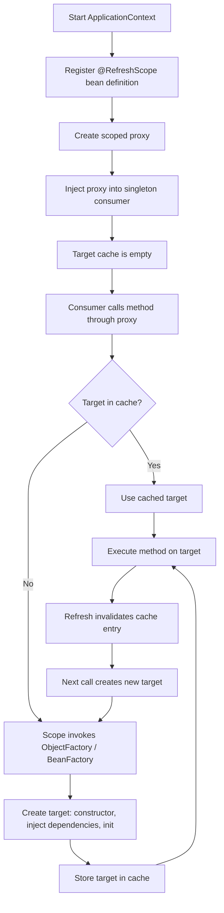
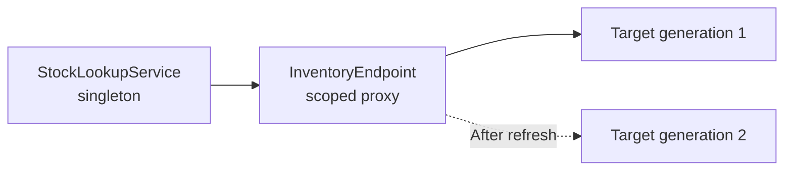
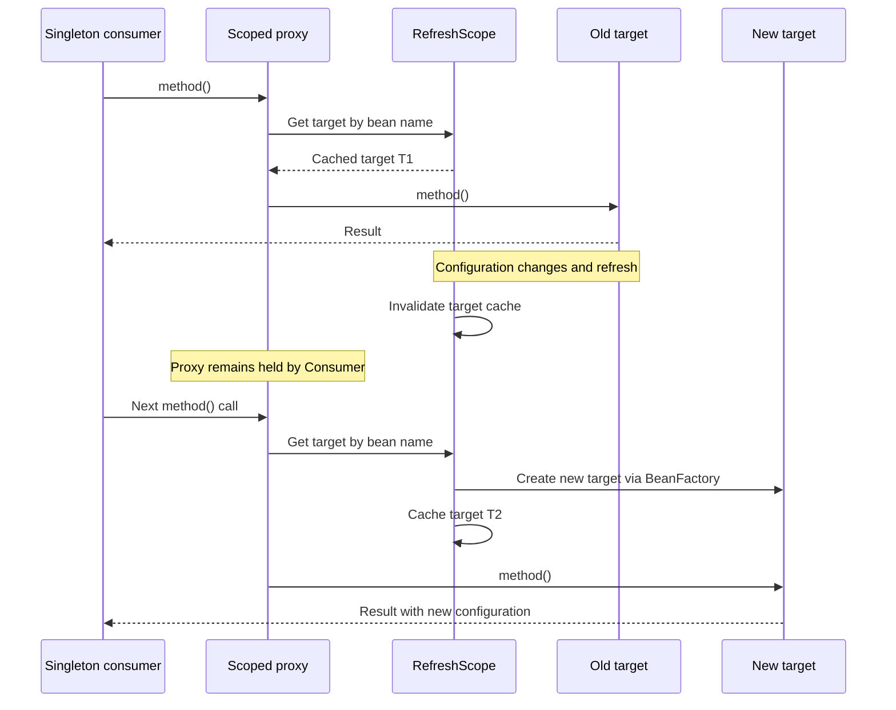

# Initializing the Target on First Call in Spring Cloud Refresh Scope

## 1. The Proxy Is Created First, the Target Is Created When Needed

When you annotate a bean with `@RefreshScope`, Spring Cloud exposes that bean through a **scoped proxy**. The proxy can be injected into singletons during application context startup, while the real instance behind the proxy—called the **target**—is lazily created on the first call that needs to use the target.

Here are the core points of this topic:

- **Proxy** is the stand-in object to which other beans hold references. The proxy is typically already available once the application context starts.
- **Target** is the real instance holding the state, configuration properties, and business logic of the refresh-scoped bean.
- **Refresh scope** manages a target cache keyed by bean name. When the cache has no target, the scope creates an instance via the bean factory and stores it. Subsequent calls reuse the created target.
- When a refresh invalidates the cache, the proxy stays intact. The next call causes the scope to create a new target with the current configuration.

Therefore, injecting the proxy does not mean the target's constructor has run. A singleton receiving a `@RefreshScope` bean via its constructor can be created at application startup while the target does not yet exist.

After this lesson, readers can trace when proxies and targets are created, explain the refresh scope cache, predict post-refresh behavior, and write tests verifying that the target is only initialized when invoked.

## 2. Distinguishing Between the Bean Proxy and the Target

Suppose `order-service` has an `InventoryEndpoint` bean holding the URL of `inventory-service`. The URL is injected when the bean is initialized. If the URL changes in `Environment`, the already-created instance still retains the old value. `@RefreshScope` solves this case by placing the target behind a proxy that can swap the target upon refresh.

| Object | When is it created? | Role |
| --- | --- | --- |
| Bean definition and scoped proxy | During application context assembly | Provides an object that can be injected into other beans |
| Target of a refresh-scoped bean | First time the proxy needs the target and the cache has no instance | Holds state and executes the real logic |
| Cached target | After successful creation | Reused for subsequent calls |
| New target after refresh | Next call after the cache entry is invalidated | Receives configuration at recreation time |

The proxy is a stable reference point. The target can change across refresh cycles. A singleton consumer typically does not need to be recreated just because the target changes, because it keeps calling through the same proxy.

### 2.1. Lifecycle Diagram



"First call" means the first time the target is actually requested, not necessarily the first external HTTP request. If startup code calls a method on the proxy before the first request, the target will be created earlier.

## 3. What Happens When the Application Context Starts?

Spring creates a bean definition for the bean with scope `refresh`. `@RefreshScope` combines this scope with the scoped proxy mechanism. Because the proxy is the injected object, singletons depending on that bean can initialize normally without forcing the target to be created immediately.

For example, `StockLookupService` needs `InventoryEndpoint`:

```java
@Service
public class StockLookupService {

    private final InventoryEndpoint inventoryEndpoint;

    public StockLookupService(InventoryEndpoint inventoryEndpoint) {
        this.inventoryEndpoint = inventoryEndpoint;
    }

    public String inventoryBaseUrl() {
        return inventoryEndpoint.baseUrl();
    }
}
```

When Spring creates `StockLookupService`, the `inventoryEndpoint` parameter resolves to the proxy. `StockLookupService`'s constructor can finish running before the target `InventoryEndpoint`'s constructor has run.

With default eager singletons, Spring typically creates instances during context initialization. With refresh-scoped beans, the proxy is created to satisfy injection, while the target is managed on demand by the scope.

### 3.1. Do Not Confuse with `@Lazy`

Spring Framework's `@Lazy` defers creation of a bean until that bean is requested. `@RefreshScope` additionally provides a target cache and invalidation capability to recreate the target after a refresh.

| Mechanism | Representative proxy | Scope-level target cache | Recreated after refresh |
| --- | --- | --- | --- |
| Regular singleton | Not required | Container singleton cache | Not automatically recreated |
| `@Lazy` singleton | Does not necessarily have a proxy unless injected as a lazy proxy | No separate refresh target cache | Not automatically recreated just because configuration changes |
| `@RefreshScope` | Has scoped proxy | Has target cache | Yes; after cache entry is invalidated and target is called again |

Do not replace `@RefreshScope` with `@Lazy` if the goal is to swap instances after configuration changes.

## 4. How Is the Target Created on the First Call?

When a consumer invokes a business method on the proxy, the proxy asks the target source to supply the real instance. Refresh scope looks up the target by bean name in the cache:

1. If the cache already has a target, the scope returns the current target.
2. If the cache does not yet have a target, the scope uses the container-provided factory to create the bean according to the original bean definition.
3. Spring performs the normal bean creation steps: invokes the constructor or factory method, injects dependencies, and processes initialization steps and lifecycle callbacks.
4. The new target is stored in the refresh scope's cache.
5. The proxy forwards the call to that target and returns the result to the consumer.

On the second call, the cache has the target, so the constructor and initialization callbacks do not run again. The target is reused until the scope invalidates the entry.

### 4.1. Example of a Target Receiving Configuration in Its Constructor

```yaml
inventory:
  client:
    base-url: https://inventory.internal
```

```java
import org.springframework.beans.factory.annotation.Value;
import org.springframework.cloud.context.config.annotation.RefreshScope;
import org.springframework.stereotype.Component;

@Component
@RefreshScope
public class InventoryEndpoint {

    private final String baseUrl;

    public InventoryEndpoint(
            @Value("${inventory.client.base-url}") String baseUrl) {
        this.baseUrl = baseUrl;
        System.out.println("InventoryEndpoint target initialized");
    }

    public String baseUrl() {
        return baseUrl;
    }
}
```

`System.out.println` is only for observing the example. In real applications, use a logger and do not log sensitive information such as tokens, passwords, or URLs containing credentials.

When the application context starts, Spring creates the proxy for injection. The log line inside the target constructor only appears on the first call through the proxy, such as:

```java
String url = stockLookupService.inventoryBaseUrl();
```

Only at that moment does the scope create `InventoryEndpoint`, read `inventory.client.base-url` from `Environment`, store the target, and execute `baseUrl()`.

### 4.2. Target Dependencies Are Also Resolved When the Target Is Created

If the target's constructor accepts another dependency, that dependency is resolved when the target is created. However, a singleton dependency may already exist beforehand; the scope does not automatically recreate every dependency just because the target is created anew.

```java
@Component
@RefreshScope
public class InventoryEndpoint {

    private final InventoryHttpClient httpClient;
    private final String baseUrl;

    public InventoryEndpoint(
            InventoryHttpClient httpClient,
            @Value("${inventory.client.base-url}") String baseUrl) {
        this.httpClient = httpClient;
        this.baseUrl = baseUrl;
    }

    public InventoryResponse find(String sku) {
        return httpClient.get(baseUrl + "/api/stocks/" + sku);
    }
}
```

In this example, `InventoryEndpoint` is the refresh-scoped target. `InventoryHttpClient` is only recreated if that bean itself has an appropriate scope or lifecycle. If it is a singleton, the new target receives the same singleton instance.

`InventoryHttpClient` and `InventoryResponse` here are application-provided types; the snippet only illustrates that dependencies are injected into the target at the time the target is created.

## 5. The Singleton Consumer Keeps Holding the Proxy

An important benefit of a scoped proxy is that the consuming bean does not need to know the target changed. For example, `StockLookupService` is created once and holds a reference to the proxy:



Before refresh, the proxy forwards calls to target generation 1. After the cache is cleared, the proxy is still the object `StockLookupService` holds, but the next call is routed to target generation 2.

This only works if the consumer continues calling through the proxy. If the consumer retrieves a value from the target and stores it in its own field—such as saving a URL or a child object in its constructor—that field is not automatically updated just because the target is refreshed.

### 5.1. Avoid Storing Copies of State from the Target

The following design forfeits the benefit of the proxy:

```java
@Service
public class StockLookupService {

    private final String cachedBaseUrl;

    public StockLookupService(InventoryEndpoint endpoint) {
        // Save a value from the target at consumer initialization time.
        this.cachedBaseUrl = endpoint.baseUrl();
    }
}
```

Calling `endpoint.baseUrl()` right in the constructor can also trigger target creation early. After refresh, `cachedBaseUrl` still keeps the old string because it is a field on the singleton consumer.

Keep the proxy and call the method when needed:

```java
@Service
public class StockLookupService {

    private final InventoryEndpoint endpoint;

    public StockLookupService(InventoryEndpoint endpoint) {
        this.endpoint = endpoint;
    }

    public String currentBaseUrl() {
        return endpoint.baseUrl();
    }
}
```

## 6. Refresh Invalidates the Cache, Not Creating the Target Immediately

Refresh scope is a cache of initialized targets. When calling `RefreshScope.refresh(beanName)` or `refreshAll()`, the scope invalidates the corresponding target cache. This operation does not need to create the replacement target immediately.

Typical flow:

1. Configuration in `Environment` is updated by the refresh mechanism.
2. Refresh scope clears the target cache by bean name or clears the entire target cache.
3. The scoped proxy still exists and remains injected in consumers.
4. The next call goes through the proxy, hits a cache miss, so the scope creates a new target.
5. The constructor and target initialization run with current configuration values.



### 6.1. Refreshing a Single Bean

You can inject `RefreshScope` to invalidate a specific target:

```java
import org.springframework.cloud.context.scope.refresh.RefreshScope;
import org.springframework.stereotype.Service;

@Service
public class ConfigurationRefreshService {

    private final RefreshScope refreshScope;

    public ConfigurationRefreshService(RefreshScope refreshScope) {
        this.refreshScope = refreshScope;
    }

    public void refreshInventoryEndpoint() {
        refreshScope.refresh("inventoryEndpoint");
    }
}
```

The default bean name for component `InventoryEndpoint` is `inventoryEndpoint`. If a different name is declared with `@Component("...")` or `@Bean(name = "...")`, pass the exact bean name.

`refresh(String)` only invalidates the cache entry. It does not guarantee the new target has already finished creating before the method returns. The target is created when the proxy is next invoked.

### 6.2. Refreshing All Targets

```java
refreshScope.refreshAll();
```

`refreshAll()` clears the refresh scope's target cache. Refresh-scoped beans that were already in use will be recreated on demand. Beans that were never called and have no target in the cache still do not need to be initialized yet.

### 6.3. Concurrent Access During Refresh

Refresh scope coordinates reads of beans in the scope with the refresh operation so a caller does not observe target replacement in an inconsistent way. However, that does not make state that a consumer copied into its own field update automatically, nor does it guarantee thread safety for shared objects living outside the target. Resources and state outside the scope still require their own synchronization policy.

### 6.4. Via the Actuator Endpoint

In applications with Spring Boot Actuator and appropriate Spring Cloud Context, you can expose the refresh endpoint:

```yaml
management:
  endpoints:
    web:
      exposure:
        include: refresh
```

The endpoint is typically invoked with `POST /actuator/refresh`. The refresh workflow can update `Environment` and then refresh beans in the scope. Only expose this endpoint over an administrative network protected by proper authentication, authorization, and network policies; never expose configuration-changing endpoints to the public Internet.

When running multiple instances, refreshing one instance does not automatically mean all other instances have refreshed. You can use Spring Cloud Bus or an appropriate orchestration mechanism to broadcast events to the instances needing updates.

## 7. Target Lifecycle

Targets are created through the normal bean creation pipeline, so target-bound lifecycle steps occur when the target is created rather than when the proxy is injected:

| Event | Timing |
| --- | --- |
| Constructor or `@Bean` factory method | When the scope first needs to create the target |
| Dependency injection | During target creation |
| `@PostConstruct` / `InitializingBean` / init method | After dependencies are injected and before the target is used |
| Business calls | After the target is created and placed in cache |
| Destruction callbacks (`@PreDestroy`, `DisposableBean`, destroy method) | When the target is evicted from scope and callbacks are registered |
| Creating a new target | On the next call after the cache entry is invalidated |

This matters for beans that open connections, create clients, or initialize resources. Constructors and initialization callbacks must be safe to re-run after each refresh. Do not place non-repeatable side effects inside target creation if refreshes can happen multiple times.

### 7.1. Initialization Errors May Surface on the First Request

Because targets are lazily created, constructor errors, missing required properties, or connection failures may not show up at application context startup. They may appear the first time a request calls the bean.

For beans critical to availability, consider readiness checks or an intentional warm-up step after application startup. Calling the proxy during warm-up creates the target early; you still retain refresh capability afterward while avoiding deferring initial creation until a live business request.

## 8. What Is Not Automatically Refreshed?

`@RefreshScope` applies to beans placed in the scope. It does not automatically turn every bean in the application context into a refresh-scoped bean.

### 8.1. Annotating `@Configuration` Does Not Make Every `@Bean` Refresh-Scoped

Example:

```java
@Configuration
@RefreshScope
public class ClientConfiguration {

    @Bean
    public InventoryHttpClient inventoryHttpClient() {
        return new InventoryHttpClient();
    }
}
```

Annotating a configuration class with `@RefreshScope` does not mean all beans declared by its `@Bean` methods automatically belong to refresh scope. If a bean needs target replacement, put the scope on that bean itself or redesign dependency boundaries.

### 8.2. Distinguishing from `@ConfigurationProperties` Rebinding

Spring Cloud can rebind `@ConfigurationProperties` beans upon receiving an `EnvironmentChangeEvent`. Rebinding updates properties on the same instance. Refresh scope replaces the target by clearing the cache and creating a new instance when called.

| Mechanism | How it updates | Characteristics |
| --- | --- | --- |
| `@ConfigurationProperties` rebind | Rebinds fields on the existing instance | Object identity stays the same; update process may let concurrent readers observe intermediate state |
| `@RefreshScope` | Invalidates target and creates a new target when needed | Consumers calling through proxy receive the new target; scope coordinates reads with refresh |

If you need a consistent configuration snapshot during reads, refresh scope is a fitting choice for beans with state constructed from configuration. Not every `@ConfigurationProperties` can be refreshed; for example, constructor-bound properties, including Java records, have specific limitations per Spring Cloud documentation.

## 9. Limitations and Caveats When Using Scoped Proxies

1. **The class must be proxyable.** The default configuration uses class-based proxies; avoid declaring the target class as `final` or intercepted methods as `final`.
2. **Do not instantiate the target directly with `new`.** Self-created objects sit outside the bean factory and refresh scope, so they are not managed by the proxy.
3. **Avoid unintended early target calls.** A consumer's `@PostConstruct`, startup runner, or health check can invoke the proxy and initialize the target before the first request.
4. **Do not retain copies of state from the target.** Keep the proxy in consumers; avoid caching values obtained from the target if you want post-refresh values.
5. **Constructors and init callbacks must be safely repeatable.** The target may be created multiple times over the application's lifecycle.
6. **Not every bean type is refreshable.** Under current defaults, `HikariDataSource` is in the non-refreshable group (`spring.cloud.refresh.never-refreshable`). Check the `never-refreshable` and `extra-refreshable` lists before expecting a specific bean type to be replaced.
7. **AOT and native images have limitations.** Context refresh is not supported for Spring AOT transformations and native images per current documentation; configure `spring.cloud.refresh.enabled=false` in such cases.
8. **Refresh does not replace rollouts.** If changes require synchronizing external resources, database schemas, or multi-instance state, design a separate deployment and coordination process.

## 10. Testing Target Creation Timing

An integration test can use a counter to verify that the proxy does not create the target upon injection, that the target is cached after the first call, and that a new target is created after refresh:

```java
import static org.assertj.core.api.Assertions.assertThat;

import java.util.concurrent.atomic.AtomicInteger;

import org.junit.jupiter.api.Test;
import org.springframework.beans.factory.annotation.Autowired;
import org.springframework.boot.test.context.SpringBootTest;
import org.springframework.boot.test.context.TestConfiguration;
import org.springframework.context.annotation.Bean;
import org.springframework.cloud.context.config.annotation.RefreshScope;
import org.springframework.cloud.context.scope.refresh.RefreshScope;

@SpringBootTest
class RefreshScopeLazyTargetTests {

    private static final AtomicInteger CREATIONS = new AtomicInteger();

    @TestConfiguration
    static class TestBeans {

        @Bean
        @RefreshScope
        Target target() {
            return new Target(CREATIONS.incrementAndGet());
        }
    }

    static class Target {
        private final int generation;

        Target(int generation) {
            this.generation = generation;
        }

        int generation() {
            return generation;
        }
    }

    @Autowired
    private Target target;

    @Autowired
    private RefreshScope refreshScope;

    @Test
    void createsTargetOnFirstCallAndAgainAfterRefresh() {
        int before = CREATIONS.get();

        int firstGeneration = target.generation();
        assertThat(CREATIONS.get()).isEqualTo(before + 1);

        assertThat(target.generation()).isEqualTo(firstGeneration);
        assertThat(CREATIONS.get()).isEqualTo(before + 1);

        refreshScope.refresh("target");
        assertThat(CREATIONS.get()).isEqualTo(before + 1);

        int nextGeneration = target.generation();
        assertThat(nextGeneration).isEqualTo(before + 2);
        assertThat(CREATIONS.get()).isEqualTo(before + 2);
    }
}
```

This example assumes the test application loads Spring Cloud Context and refresh scope auto-configuration. The counter uses a `before` baseline to avoid depending on how many test contexts were created earlier. Injecting the `target` field only grabs the proxy; calling `generation()` is what requests the real target.

### 10.1. Test Cases to Include

| Case | Action | Expected result |
| --- | --- | --- |
| Context startup only | Inject proxy into singleton without calling target methods | Target is not created yet |
| First call | Call a method through the proxy | Constructor/factory method runs once |
| Subsequent calls | Call more methods through the proxy | Same cached target is reused |
| Refresh a single bean | Call `refresh(beanName)` | Cache entry is invalidated; no immediate target creation needed |
| Call after refresh | Call method through the proxy | New target is created using current configuration |
| Refresh all | Call `refreshAll()` | Cached targets are invalidated |
| Singleton consumer | Hold proxy across multiple refreshes | Consumer can still call the current active target |
| Initialization failure | Required configuration is wrong or missing | Error occurs when target creation is requested |
| Startup calls proxy | `@PostConstruct` or runner invokes target | Target is created earlier than the first request |

## 11. Common Troubleshooting

| Symptom | Possible cause | How to investigate |
| --- | --- | --- |
| Target constructor runs right at startup | Another bean invoked the proxy during startup | Look for `@PostConstruct`, runners, health checks, or factories calling target methods |
| Target constructor does not run even though bean is injected | Only the proxy was injected; no call needed the target yet | Trace request paths and method invocation points |
| Target is not recreated after refresh | Wrong bean name, bean not in refresh scope, or refresh did not run | Check scope, bean name, and cache invalidation |
| Consumer still uses old configuration | Consumer copied value from target into its own field | Keep the proxy and read through the proxy when needed |
| Custom bean is not proxied | Bean was instantiated manually or declared outside Spring container | Register bean via component scan or `@Bean` |
| Proxy error with `final` class/method | Class-based proxy cannot override `final` class/method | Use proxyable classes and methods |
| Initialization error only appears on first request | Target is lazily created, so constructor/init did not run at startup | Check target initialization logs and readiness/warm-up |
| Bean in configuration does not refresh as expected | Only `@Configuration` class was annotated | Annotate the bean needing refresh or redesign dependencies |
| `HikariDataSource` does not swap target | Bean is in default `never-refreshable` | Check `spring.cloud.refresh.never-refreshable` and datasource docs |

When investigating, add separate logs for the target's constructor and destruction callbacks, logging only safe identifying details. You can add a generation ID in test environments to observe which target the proxy is forwarding to.

## 12. References

- [Spring Cloud Commons — Spring Cloud Context: Application Context Services](https://docs.spring.io/spring-cloud-commons/reference/spring-cloud-commons/application-context-services.html): the Refresh Scope section describes lazy proxies, target cache, `refreshAll()`, `refresh(String)`, and limitations.
- [Spring Framework — Scoped Beans](https://docs.spring.io/spring-framework/reference/core/beans/factory-scopes.html): bean scopes and how the container manages lifecycles.
- [Spring Framework — Lazy-initialized Beans](https://docs.spring.io/spring-framework/reference/core/beans/dependencies/factory-lazy-init.html): distinguishing lazy singletons from scoped proxies.

The key point to remember is that **the proxy can be injected as soon as the application context starts, while the target is only created when the proxy needs a real instance**. Refresh scope caches initialized targets; refreshing invalidates the cache without forcing immediate creation of new targets. Only the next call through the proxy triggers creation of the new target, allowing singleton consumers to keep operating with updated configuration.
