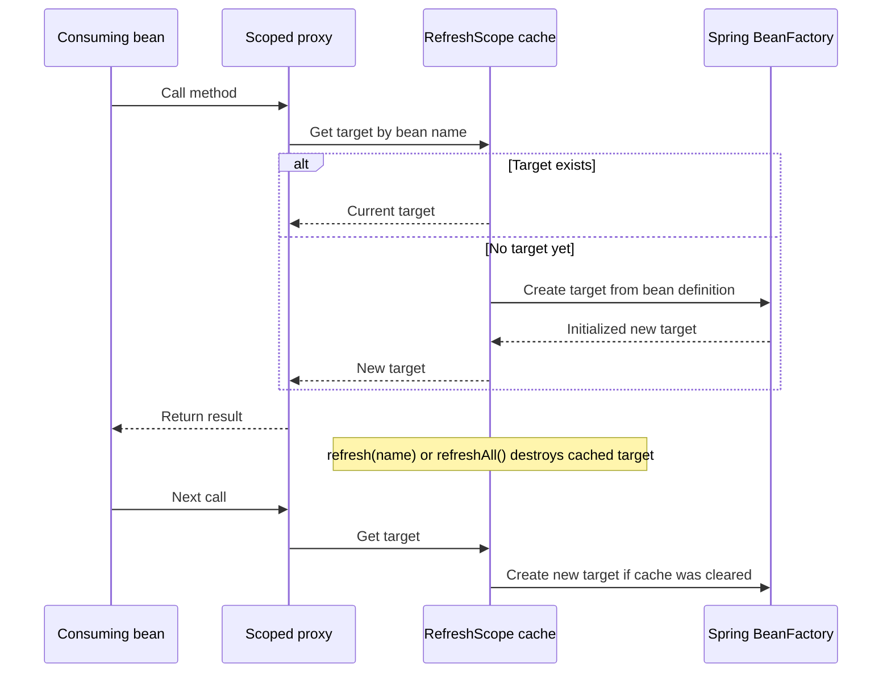
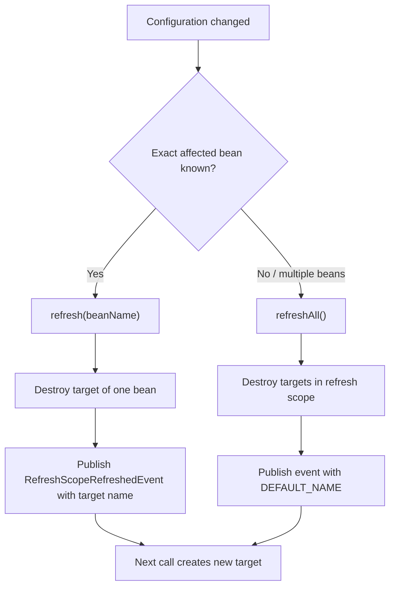

# RefreshScope.refresh by Name and refreshAll

## 1. When Should a Single Bean Be Refreshed?

In a Spring application, a singleton bean is typically created once during the lifecycle of the application context. If the bean reads configuration through its constructor or `@Value` at initialization, changing `Environment` does not automatically replace the already-created object. Spring Cloud Context provides **refresh scope** so selected beans can have their current instance destroyed and a new instance created when needed.

`RefreshScope` provides two direct operations:

- `refresh(String name)`: refreshes a single bean in refresh scope by bean name.
- `refreshAll()`: refreshes all beans belonging to refresh scope.

Both operations act on the **refresh scope's instance cache**. They destroy the current target and force the scope to create a new target on the next access. They do not query Config Server on their own, do not automatically load new configuration files, and do not modify `Environment`.

This lesson belongs to the **Refresh Scope** chapter of the **SPRING_CLOUD_CORE** module. The module helps learners understand Spring Cloud Commons, Spring Cloud Context, externalized configuration, refresh scope, discovery, service registry, Spring Boot compatibility, and how to test and operate shared abstractions.

After this lesson, learners will be able to:

- Explain how refresh scope stores target beans and forwards calls through a scoped proxy.
- Call `refresh(String)` with the right bean name and interpret the returned boolean.
- Call `refreshAll()` and understand the scope of affected beans.
- Distinguish refreshing one bean, refreshing the entire scope, and refreshing the entire `Environment`.
- Observe `RefreshScopeRefreshedEvent` and lifecycle callbacks.
- Design tests to verify that the old instance is destroyed, a new instance is created, and new configuration is read.
- Avoid refreshing the wrong bean, refreshing too broadly, or letting refresh operations cause unintended side effects.

## 2. How Does `RefreshScope` Work?

### 2.1. Refresh Scope Is a Cache with Its Own Lifecycle

Spring Cloud Context registers a scope named `refresh`. For a bean annotated with `@RefreshScope`, Spring creates a scoped proxy. Other beans inject this proxy; the proxy forwards calls to the target instance managed by the scope.

You can picture it as:

1. Spring creates the proxy and registers the bean definition.
2. When the application calls a method through the proxy, refresh scope fetches the target from cache; if no target exists yet, the scope creates a target from the bean definition.
3. The target receives dependency injection, resolves placeholders, and runs initialization callbacks.
4. During refresh, the current target is removed from the cache and destruction callbacks are invoked.
5. The next call through the proxy creates a new target; dependencies and property placeholders are re-resolved against `Environment` at creation time.



The crucial point is that the proxy can stay unchanged in dependent beans while the target inside the proxy is replaced. Thus, an `OrderService` that injected a `PricingPolicy` proxy can still call into the new `PricingPolicy` instance without recreating `OrderService`.

### 2.2. Marking a Bean with `@RefreshScope`

The annotation belongs to package:

- `org.springframework.cloud.context.config.annotation.RefreshScope`

Example of a bean reading a discount rate from configuration:

```java
import java.math.BigDecimal;

import org.springframework.beans.factory.annotation.Value;
import org.springframework.cloud.context.config.annotation.RefreshScope;
import org.springframework.context.annotation.Bean;
import org.springframework.context.annotation.Configuration;

@Configuration(proxyBeanMethods = false)
class PricingConfiguration {

    @Bean("pricingPolicy")
    @RefreshScope
    PricingPolicy pricingPolicy(
            @Value("${pricing.discount:0.05}") BigDecimal discount) {

        return new PricingPolicy(discount);
    }
}

class PricingPolicy {

    private final BigDecimal discount;

    PricingPolicy(BigDecimal discount) {
        this.discount = discount;
    }

    BigDecimal discount() {
        return discount;
    }
}
```

The bean name is explicitly declared as `pricingPolicy`. This is the name used when calling `refresh("pricingPolicy")`.

### 2.3. Not Every Bean Automatically Belongs to Refresh Scope

Only beans annotated with `@RefreshScope` or explicitly configured to participate in the scope are affected by `RefreshScope.refresh...`.

- Regular singleton beans are not replaced by `refreshAll()`.
- `@RefreshScope` on a `@Configuration` class does not automatically put every `@Bean` declared inside that class into refresh scope.
- A bean depending on a refresh-scoped proxy can keep using the stable proxy; if it stores a copy of a value or its own resource, that copy/resource does not update automatically.
- Some bean types have specific refresh restrictions. Current Spring Cloud documentation notes that `HikariDataSource` is in the default `spring.cloud.refresh.never-refreshable` list.

Choose beans whose state is initialized from configuration and can be safely recreated. Avoid putting the entire business layer into refresh scope without a clear need.


## 3. `refresh(String name)`: Refreshing Exactly One Bean

### 3.1. Signature and Parameter Meaning

API:

```java
boolean refresh(String name)
```

`name` is the **Spring bean name** of the bean in refresh scope. It is not the class name, property name, profile name, or service name in a registry.

With the previous example, call:

```java
refreshScope.refresh("pricingPolicy");
```

Spring Cloud processes the bean name via `ScopedProxyUtils`. If you pass the normal proxy name, `RefreshScope` translates it to the internal target name (`scopedTarget.<beanName>`) before clearing the cache. Therefore, applications usually pass the public bean name `pricingPolicy` without manually prepending `scopedTarget.`.

### 3.2. What Happens When Calling `refresh(name)`?

When calling `refresh("pricingPolicy")`, the high-level flow is:

1. Normalize the name to the scoped proxy's target name if needed.
2. Ask the scope to destroy the current target in cache.
3. Run registered destruction callbacks for the current target if present.
4. If destruction succeeds, publish `RefreshScopeRefreshedEvent` carrying the target name and return `true`.
5. If there is no corresponding target to destroy or the destroy operation does not succeed, return `false`.
6. When the proxy is called next, the scope creates a new target from the bean definition.

The return value should be interpreted accurately:

| Result | Meaning | Next step |
| --- | --- | --- |
| `true` | The scope destroyed the corresponding cached target and published a refresh event | Call the bean through the proxy to trigger creation of the new target |
| `false` | Could not destroy a cached target for the supplied name | Check the bean name, scope, and cache state |

`true` **does not mean** the new target has already been created successfully. Creation of the new target happens on the next access and can still raise initialization errors if the new configuration is invalid, dependencies are unavailable, or resources fail to open.

### 3.3. Encapsulating Refresh Operations by Name

Avoid assembling bean names across many places in business code. Group the operation into a management service:

```java
import org.springframework.stereotype.Service;
import org.springframework.cloud.context.scope.refresh.RefreshScope;

@Service
class RefreshOperations {

    private final RefreshScope refreshScope;

    RefreshOperations(RefreshScope refreshScope) {
        this.refreshScope = refreshScope;
    }

    boolean refreshPricingPolicy() {
        return refreshScope.refresh("pricingPolicy");
    }
}
```

Note that there are two types named `RefreshScope`:

- Annotation `org.springframework.cloud.context.config.annotation.RefreshScope` used to mark beans.
- Class `org.springframework.cloud.context.scope.refresh.RefreshScope` providing `refresh` and `refreshAll` operations.

When importing both in the same Java file, use a fully qualified name or import only one type to avoid ambiguity.

### 3.4. When Should You Refresh by Name?

Use `refresh(name)` when you know exactly which bean is affected by a configuration change:

- Only the pricing policy for one feature group changed.
- A partner integration client with its own endpoint or timeout was updated.
- A filter or adapter used for a single business flow needs reinitialization.
- A component builds a resource from a new property and can safely destroy the old resource.

This limits the target destruction blast radius, reduces the number of beans needing reinitialization, and makes event tracing clearer. However, if another bean holds state precomputed from the bean you just refreshed, consider refreshing that dependent bean too or redesigning it to read through the proxy instead of keeping a stale copy.

## 4. `refreshAll()`: Refreshing the Entire Refresh Scope

### 4.1. Signature and Scope

API:

```java
void refreshAll()
```

`refreshAll()` asks the scope to destroy all existing target instances in the **refresh scope** cache. It does not remove every bean in the application context.

Regular singletons, prototype beans, and beans in other scopes are not removed just because `refreshAll()` was called.

### 4.2. Execution Flow

When calling `refreshAll()`:

1. The scope destroys targets currently managed in the refresh-scope cache.
2. Destruction callbacks of current targets are executed.
3. The scope publishes a `RefreshScopeRefreshedEvent` using the default name `RefreshScopeRefreshedEvent.DEFAULT_NAME`.
4. The method finishes without returning a count of destroyed beans.
5. Proxies continue to exist; new targets are created as each proxy is used again.

Unlike `refresh(String)`, `refreshAll()` has return type `void`. To know which beans were recreated, monitor lifecycle logs, metrics, or the application's own initialization events.

### 4.3. Example Calling `refreshAll`

```java
import org.springframework.cloud.context.scope.refresh.RefreshScope;
import org.springframework.stereotype.Service;

@Service
class ConfigurationRefreshOperations {

    private final RefreshScope refreshScope;

    ConfigurationRefreshOperations(RefreshScope refreshScope) {
        this.refreshScope = refreshScope;
    }

    void refreshAllRefreshScopedBeans() {
        refreshScope.refreshAll();
    }
}
```

Suppose the application has `pricingPolicy`, `inventoryClient`, and `notificationSettings`, all in refresh scope. The call above destroys the current targets for all three. When each bean is invoked again, its corresponding target is recreated using current configuration and dependencies.

If a bean does not yet have a target in the cache, there is no old instance to run a destruction callback on. Even so, `refreshAll()` still publishes the scope-wide event per Spring Cloud's implementation.

### 4.4. When Should You Use `refreshAll`?

Choose `refreshAll()` when:

- Multiple refresh-scoped beans depend on a group of configuration values that just changed.
- A configuration change event needs to refresh an entire group of recreatable components.
- The system just reloaded `Environment` and needs refresh-scoped targets to re-read the new values.
- You cannot pinpoint the exact set of affected beans, or operational policy calls for a full scope refresh.

Do not use `refreshAll()` as a substitute for restarting the application. It only affects the refresh scope cache; startup-only settings, bean definition structures, and state inside regular singletons stay unchanged.

## 5. Comparing the Two Operations

| Criterion | `refresh(String name)` | `refreshAll()` |
| --- | --- | --- |
| Scope | One target bean by name | All targets in the refresh-scope cache |
| Parameter | Spring bean name | None |
| Return value | `boolean` | `void` |
| Destroys current instance | Yes, if the corresponding target is found and destroyed cleanly | Yes, for targets currently in cache |
| Creates new instance immediately inside method? | No | No |
| When new target is created | Next call through the proxy | Next call on each proxy |
| Event | `RefreshScopeRefreshedEvent` with target name | `RefreshScopeRefreshedEvent.DEFAULT_NAME` |
| Regular singleton scope | Unaffected | Unaffected |
| Best suited for | Localized change where the affected bean is known | Change affecting multiple refresh-scoped beans |



An easy rule of thumb: **when you know the exact bean, refresh by name; when you need to refresh the whole refresh scope, use `refreshAll`**.


## 6. Complete Example: Changing a Pricing Policy

Suppose the application has configuration:

```yaml
pricing:
  discount: 0.05
```

The `pricingPolicy` bean reads the value when creating the target:

```java
@Configuration(proxyBeanMethods = false)
class PricingConfiguration {

    @Bean("pricingPolicy")
    @RefreshScope
    PricingPolicy pricingPolicy(
            @Value("${pricing.discount:0.05}") BigDecimal discount) {
        return new PricingPolicy(discount);
    }
}
```

A service calls the bean:

```java
@Service
class CheckoutService {

    private final PricingPolicy pricingPolicy;

    CheckoutService(PricingPolicy pricingPolicy) {
        this.pricingPolicy = pricingPolicy;
    }

    BigDecimal discountForCheckout() {
        return pricingPolicy.discount();
    }
}
```

Suppose the configuration in `Environment` is updated from `0.05` to `0.10`. Before refreshing, the existing target still holds `0.05`, because its constructor ran with the old value.

Refresh just that bean:

```java
boolean refreshed = refreshScope.refresh("pricingPolicy");

if (!refreshed) {
    throw new IllegalStateException(
            "Could not invalidate pricingPolicy refresh target"
    );
}
```

Next call:

```java
BigDecimal currentDiscount = checkoutService.discountForCheckout();
```

The proxy forwards the call to the new target. When Spring creates the target, the `pricing.discount` placeholder is re-resolved and the bean receives `0.10`.

If the same change affects `pricingPolicy`, `inventoryClient`, and `notificationSettings`, you can call:

```java
refreshScope.refreshAll();
```

Afterward, each target is recreated on its next access. Not all targets are created simultaneously during the `refreshAll()` call itself.

## 7. The `RefreshScopeRefreshedEvent` Event

### 7.1. When Is the Event Published?

`RefreshScope` publishes `RefreshScopeRefreshedEvent` after target destruction succeeds:

- `refresh(name)` publishes an event with the target bean name.
- `refreshAll()` publishes an event using the default name `RefreshScopeRefreshedEvent.DEFAULT_NAME` to indicate a scope-wide operation.

The event indicates that the scope performed invalidation. It does not prove that new targets initialized successfully; new targets are only created on the next call.

### 7.2. Listening for the Event

You can use an event listener to record the operation or ask an auxiliary component to update its own cache:

```java
import org.springframework.cloud.context.scope.refresh.RefreshScopeRefreshedEvent;
import org.springframework.context.event.EventListener;
import org.springframework.stereotype.Component;
import org.slf4j.Logger;
import org.slf4j.LoggerFactory;

@Component
class RefreshAuditListener {

    private static final Logger log =
            LoggerFactory.getLogger(RefreshAuditListener.class);

    @EventListener
    void onRefreshScopeRefreshed(RefreshScopeRefreshedEvent event) {
        if (RefreshScopeRefreshedEvent.DEFAULT_NAME.equals(event.getName())) {
            log.info("Refresh scope cache was invalidated");
        }
        else {
            log.info("Refresh target invalidated: {}", event.getName());
        }
    }
}
```

Do not treat this event as a signal that all remote configuration loaded successfully. To record configuration loading outcomes, observe `ContextRefresher`, Config Client, or the corresponding configuration source.

### 7.3. Impact of Listeners

Some Spring Cloud components react to `RefreshScopeRefreshedEvent`. For instance, a Spring Cloud Gateway listener can use the event to refresh its route cache. That allows integrated modules to update dependent data when a refresh happens.

If writing your own listener:

- Keep handling short and idempotent.
- Do not unconditionally call `refreshAll()` inside a listener receiving the refresh event itself, as that can create a loop.
- Distinguish single-bean events from scope-wide events.
- Log bean names or revisions, avoiding sensitive configuration data.

## 8. Distinguishing Refresh Scope from `ContextRefresher` and Actuator

The following three APIs are often loosely called "refresh," yet their responsibilities differ:

| API / mechanism | Primary responsibility |
| --- | --- |
| `RefreshScope.refresh(name)` | Destroys the cached target of a single refresh-scoped bean |
| `RefreshScope.refreshAll()` | Destroys cached targets across the entire refresh scope |
| `ContextRefresher.refresh()` | Updates `Environment`, detects changed keys, publishes `EnvironmentChangeEvent`, and calls `refreshAll()` |

In a Spring Cloud configuration with Actuator, the `POST /actuator/refresh` endpoint triggers the context-level refresh workflow: reloading configuration via the active mechanism, updating `Environment`, and refreshing refresh-scoped beans.

Example exposing the endpoint:

```yaml
management:
  endpoints:
    web:
      exposure:
        include: health,info,refresh
```

This endpoint must be protected with authentication/authorization and network access restrictions. Do not expose configuration-changing operations to public users.

If the application already updated `Environment` through a custom mechanism and only wants to swap a single bean's target, calling `refresh(name)` is more direct. If you need to reload the configuration source and apply it to all beans, use `ContextRefresher` or the refresh endpoint per your application's integration.

## 9. Lifecycle, Concurrency, and External Resources

### 9.1. Destruction and Initialization Callbacks

When a target is destroyed, Spring runs registered destruction callbacks, such as:

- `@PreDestroy`.
- `DisposableBean.destroy()`.
- Destruction methods declared in the bean definition.

The new target runs standard initialization steps, including dependency injection, `@PostConstruct`, `InitializingBean.afterPropertiesSet()`, and any declared initialization method.

Make sure callbacks close old resources cleanly. If a bean manages connections, executors, schedulers, file handles, or subscriptions, callbacks must release them before the new target is created.

### 9.2. Proxies and In-Flight Calls

Other beans typically hold the scoped proxy rather than the target directly. The proxy mechanism helps the scope coordinate target access and per-bean refresh.

However, do not view refresh as a transaction spanning every bean in the application. `refreshAll()` refreshes the cache for many targets, yet targets may be recreated at different times as they are invoked. If a business operation needs a consistent configuration snapshot across multiple beans, design a shared configuration/version object or a controlled transition process.

### 9.3. External Resources Do Not Change Automatically Just Because the Cache Was Cleared

For instance, refreshing a bean wrapping a `DataSource` may close the old target and create a new one. That does not automatically ensure every connection held elsewhere in the application transitions safely. You must understand the pool's lifecycle, in-flight requests, and resource-closing callbacks.

Current Spring Cloud documentation notes that `HikariDataSource` is in the default `spring.cloud.refresh.never-refreshable` list. If you need to refresh a `DataSource` type, check the implementation, `spring.cloud.refresh.never-refreshable` settings, and practical connection pool limits. Do not remove a class from the protection list merely to force a refresh without evaluating safety.


## 10. Testing Refresh by Name and `refreshAll`

A meaningful test should check before/after values, initialization counts, destruction callbacks, and events.

### 10.1. Testing Refresh by Name

Suppose the test has a `MapPropertySource` named `testOverrides` containing `pricing.discount`. You can change the value in the map, call `refresh("pricingPolicy")`, and verify the new target reads the new value:

```java
import java.math.BigDecimal;
import java.util.Map;
import java.util.concurrent.ConcurrentHashMap;

import org.junit.jupiter.api.Test;
import org.springframework.beans.factory.annotation.Autowired;
import org.springframework.boot.test.context.SpringBootTest;
import org.springframework.cloud.context.scope.refresh.RefreshScope;
import org.springframework.context.ApplicationContextInitializer;
import org.springframework.context.ConfigurableApplicationContext;
import org.springframework.core.env.MapPropertySource;
import org.springframework.test.context.ContextConfiguration;
import org.springframework.test.annotation.DirtiesContext;

import static org.assertj.core.api.Assertions.assertThat;

@SpringBootTest
@ContextConfiguration(initializers = PricingRefreshTest.PropertySourceInitializer.class)
@DirtiesContext
class PricingRefreshTest {

    private static final Map<String, Object> OVERRIDES =
            new ConcurrentHashMap<>();

    static class PropertySourceInitializer
            implements ApplicationContextInitializer<ConfigurableApplicationContext> {

        @Override
        public void initialize(ConfigurableApplicationContext context) {
            OVERRIDES.clear();
            OVERRIDES.put("pricing.discount", new BigDecimal("0.05"));
            context.getEnvironment().getPropertySources().addFirst(
                    new MapPropertySource("testOverrides", OVERRIDES)
            );
        }
    }

    @Autowired
    RefreshScope refreshScope;

    @Autowired
    CheckoutService checkoutService;

    @Test
    void refreshesOnlyTheNamedBean() {
        assertThat(checkoutService.discountForCheckout())
                .isEqualByComparingTo("0.05");

        OVERRIDES.put("pricing.discount", new BigDecimal("0.10"));

        assertThat(refreshScope.refresh("pricingPolicy")).isTrue();

        assertThat(checkoutService.discountForCheckout())
                .isEqualByComparingTo("0.10");
    }
}
```

This test demonstrates three things: changing the property source does not yet change the current target's value; refreshing by name invalidates the target; calling through the proxy creates a new target and reads the current property.

To keep tests independent, ensure the `pricingPolicy` bean has already been created before changing the property source. If the target does not yet exist, there is no old instance to prove destruction callbacks.

### 10.2. Testing `refreshAll`

Create at least two refresh-scoped beans reading values from two different keys. Change both values in the test property source and call `refreshAll()`.

Verify:

- Both beans return the new values on next access.
- Each old target ran its destruction callback if it had been initialized earlier.
- Each new target runs its initialization callback when accessed.
- An event was published with `RefreshScopeRefreshedEvent.DEFAULT_NAME`.
- Singleton beans outside refresh scope keep their existing instances.

### 10.3. Testing Error Cases

| Case | Expectation |
| --- | --- |
| Valid bean name and target is cached | `refresh(name)` returns `true`; next call creates a new target |
| Bean name does not exist in cache | Result may be `false`; do not conclude a new target was created |
| Bean name exists but is not in refresh scope | Do not use this API to refresh regular singletons |
| New target is missing a required property | Refresh may destroy the old target cleanly, but creating the new target fails |
| Calling `refreshAll()` when cache is empty | Method completes and publishes scope-wide event; no old targets to destroy |
| Multiple concurrent requests calling proxy | Verify per-bean behavior and ensure old resources are closed properly |
| Listener handling events | Bean-name events and scope-wide events are distinguished properly |

Do not only assert the return value of `refresh(name)`. Call through the proxy and verify a new target is actually created, because returning `true` reflects destroying the target cache entry rather than the outcome of creating the new target.

## 11. Common Errors and Troubleshooting

| Symptom | Common cause | Resolution |
| --- | --- | --- |
| Calling `refresh("PricingPolicy")` returns `false` | Passed class name instead of bean name or wrong casing | Check bean name in `@Bean` or component name |
| Refresh succeeded, yet value stays old | `Environment` has not received the new value or bean does not re-read property at init | Check property source first, then verify newly created target |
| Dependent bean still holds old state | Dependent bean copied data or kept its own resource | Inject proxy, refresh dependent bean, or redesign state relationship |
| `refreshAll()` does not refresh a singleton | Singleton does not belong to refresh scope | Only expect refresh-scoped targets to be replaced |
| Event listener does not see expected bean name | Event uses the scoped proxy's internal target name | Compare against actual event name and `DEFAULT_NAME` |
| `refresh(name)` returns `true`, but subsequent request fails | New target failed to initialize or dependency/resource is unavailable | Check exceptions when the target is created on next access |
| New configuration from Config Server does not appear | Only called `RefreshScope.refresh...` without updating `Environment` | Use a config reload mechanism such as `ContextRefresher` or `/actuator/refresh` |
| `@Configuration` refreshed, yet inner beans did not change | Annotation on configuration class does not put `@Bean` methods into refresh scope | Mark each bean needing refresh with `@RefreshScope` |
| Refreshing `DataSource` has no effect | Implementation is on the non-refreshable list or has specific restrictions | Check `never-refreshable` and pool lifecycle |

## 12. Operational Checklist

Before allowing a component to be refreshed in production, confirm:

1. Does the bean truly belong to refresh scope?
2. Is the bean name passed to `refresh(name)` accurate and stable?
3. Are property sources updated prior to invalidation?
4. Do destruction callbacks close resources safely?
5. Can the new target be created with the active configuration?
6. Do dependent beans hold the proxy or copies of stale state?
7. Do you only need to refresh one bean or the entire scope?
8. Do listeners distinguish bean-name events from scope-wide events?
9. Is the Actuator endpoint protected and access-restricted?
10. Are there metrics/logs for refresh count, new-target initialization errors, and recovery time?
11. Is there a rollback plan if the new target fails to initialize?
12. Has it been tested under concurrent requests and with external resources like connection pools?

## 13. Official References

- [Spring Cloud Context — Refresh Scope](https://docs.spring.io/spring-cloud-commons/reference/spring-cloud-commons/application-context-services.html#refresh-scope): how refresh scope works, `refresh(String)`, `refreshAll()`, scoped proxies, and limitations.
- [RefreshScope.java — Spring Cloud Commons](https://github.com/spring-cloud/spring-cloud-commons/blob/main/spring-cloud-context/src/main/java/org/springframework/cloud/context/scope/refresh/RefreshScope.java): implementation translating proxy names to targets, destroying, publishing events, and return semantics.
- [@RefreshScope annotation — Spring Cloud Commons](https://github.com/spring-cloud/spring-cloud-commons/blob/main/spring-cloud-context/src/main/java/org/springframework/cloud/context/config/annotation/RefreshScope.java): annotation marking a bean with scope `refresh`.
- [RefreshScope integration tests](https://github.com/spring-cloud/spring-cloud-commons/blob/main/spring-cloud-context/src/test/java/org/springframework/cloud/context/scope/refresh/RefreshScopeLazyIntegrationTests.java): test examples for `refresh(name)`, `refreshAll()`, lifecycle callbacks, and events.
- [ContextRefresher.java — Spring Cloud Commons](https://github.com/spring-cloud/spring-cloud-commons/blob/main/spring-cloud-context/src/main/java/org/springframework/cloud/context/refresh/ContextRefresher.java): workflow for updating `Environment`, publishing `EnvironmentChangeEvent`, and calling `refreshAll()`.

**Remember:** `refresh(name)` removes one bean's target from the refresh-scope cache; `refreshAll()` removes targets across the entire refresh scope. Both keep proxies intact and only create new targets on the next access. To read new configuration from an external source, first update `Environment` via the appropriate mechanism; only then use refresh scope to replace beans that need reinitialization.
