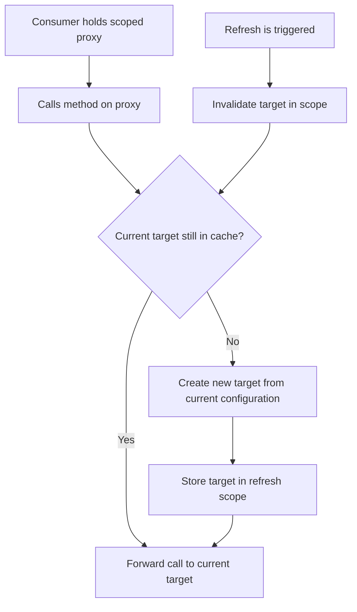
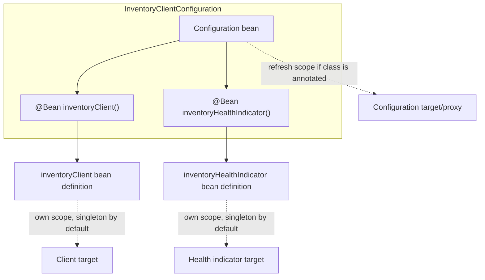

# `@RefreshScope` on `@Configuration` and the Scope of `@Bean` Methods Inside

In Spring, a `@Configuration` class typically declares multiple `@Bean` methods. When external configuration changes, you sometimes want to recreate client, pool, or adapter configurations without restarting the entire application. Spring Cloud Context's `@RefreshScope` supports this through a scope with a proxy and a target cache.

The exact point to understand is that **placing `@RefreshScope` on a `@Configuration` class does not automatically put every bean declared by `@Bean` methods in that class into refresh scope**. The annotation on the configuration class governs the configuration bean itself; each produced bean still keeps its own scope according to its definition. Therefore, if a specific client needs to be recreated after refresh, annotate the `@Bean` method creating that client or the corresponding bean class itself.

This lesson belongs to the **Refresh Scope** chapter of **SPRING_CLOUD_CORE**. It focuses on the annotation's scope of application, the relationship between the configuration bean and produced beans, how dependencies hold references to proxies/targets, and how to test to avoid wrong expectations when configuration changes.

## 1. Learning Objectives

After this lesson, you will be able to:

- Explain how `@RefreshScope` creates a scoped proxy and manages target beans.
- Distinguish the scope of a `@Configuration` bean from the scopes of beans declared via `@Bean`.
- Recognize why `@RefreshScope` on a configuration class does not propagate to `@Bean` methods.
- Place the annotation accurately on each bean that needs to be recreated.
- Distinguish beans consuming a refresh-scoped proxy from beans holding direct references to an old singleton.
- Understand when a dependent bean also needs refresh scope to be recreated and have dependencies re-injected.
- Trigger a refresh after `Environment` has received new configuration.
- Test the lifecycle by counting target creations and verifying configuration values.
- Identify refresh scope limitations regarding resources, proxies, constructor binding, and native environments.

## 2. How Does Refresh Scope Work?

`@RefreshScope` is an annotation bound to the scope named `refresh`. Spring Cloud Context registers this scope in the container and creates proxies for annotated beans. The proxy is the object other components typically receive during dependency injection.

Refresh scope maintains the created target instance. When a refresh operation runs, the corresponding target is invalidated and destroyed via appropriate lifecycle callbacks. The next call through the proxy asks the scope to create a new target, then caches that target for subsequent uses.



Refresh scope **does not automatically detect** that files or Config Server have changed. Another mechanism must update `Environment` and trigger the refresh. The scope is solely responsible for managing targets of beans placed inside that scope.

### 2.1. The Proxy and the Target Are Two Different Objects

Suppose an `InventoryClient` is annotated with `@RefreshScope`:

- Consumers are injected with a Spring-created proxy.
- The actual `InventoryClient` target is managed inside refresh scope.
- When refresh invalidates the target, consumers continue holding the proxy.
- The next call through the proxy obtains a new target.

Because consumers hold a stable proxy, there is no need to re-inject dependencies into consumers just to swap the target of that refresh-scoped bean itself.

### 2.2. Refresh Scope Is Not Prototype

| Characteristic | `prototype` | `refresh` |
| --- | --- | --- |
| When retrieving bean from container | Typically creates a new instance on every bean request | Scope caches the target and reuses it |
| Common usage | Objects needing a fresh instance per lookup | Beans needing stability between calls while allowing target replacement after refresh |
| Target replacement mechanism | Requesting a new instance | Invalidate cache; proxy creates/fetches new target on next use |
| Effect of refresh event | No default refresh mechanism | Refresh scope is asked to clear the target cache |

Refresh scope fits beans whose configuration is read at initialization, such as clients or adapters that need recreating when an endpoint changes. Do not use it as a replacement for every other scope.

## 3. Crucial Boundary: `@Configuration` and `@Bean`s

A `@Configuration` class is itself a bean in the container. The `@Bean` methods inside that class define separate beans. They have their own bean definitions, names, and scopes.

Example:

```java
@Configuration
@RefreshScope
public class InventoryClientConfiguration {

    @Bean
    public InventoryClient inventoryClient(InventoryProperties properties) {
        return new InventoryClient(
                properties.baseUrl(),
                properties.timeout());
    }

    @Bean
    public InventoryHealthIndicator inventoryHealthIndicator(
            InventoryClient inventoryClient) {
        return new InventoryHealthIndicator(inventoryClient);
    }
}
```

In this example:

- `InventoryClientConfiguration` is the configuration bean marked `@RefreshScope`.
- `inventoryClient` is a bean produced by a `@Bean` method; this method **does not have `@RefreshScope`**, so it does not automatically become refresh-scoped.
- `inventoryHealthIndicator` also has its own scope; the annotation on the configuration class does not automatically apply to it.

This is the single most common source of confusion: **the scope of a configuration class is not the default scope for the beans it produces**.

### 3.1. What Happens When Refreshing a `@Configuration` Class?

Spring Cloud allows placing `@RefreshScope` on a `@Configuration` class, but the official documentation warns this can lead to unexpected behavior:

1. The configuration class bean has its own target in refresh scope.
2. Beans declared by `@Bean` methods still have scopes determined individually in each bean's definition.
3. Another bean depending on those produced beans cannot assume by default that its dependencies will be replaced just because the configuration class was refreshed.
4. If the consuming bean is also in `@RefreshScope`, it can be recreated after refresh and have dependencies re-injected from the refreshed configuration.

Therefore, do not assume that "refreshing a configuration class" equals "rebuilding the entire object graph declared in that class." Place the scope on the exact beans needing target replacement and test dependency relationships.

### 3.2. Scope Diagram of Configuration and Produced Beans



The diagram shows that the annotation on the configuration class only determines the scope of the configuration bean. Each `@Bean` method creates a separate bean definition; to manage that bean's target in refresh scope, configure the scope for that bean itself.

## 4. Recommended Approach: Placing `@RefreshScope` on `@Bean` Methods

If `InventoryClient` needs to be recreated when `inventory.base-url` or `inventory.timeout` changes, annotate the client-creating method:

```java
@Configuration(proxyBeanMethods = false)
public class InventoryClientConfiguration {

    @Bean
    @RefreshScope
    public InventoryClient inventoryClient(
            InventoryProperties properties) {
        return new InventoryClient(
                properties.baseUrl(),
                properties.timeout());
    }
}
```

Here:

- `InventoryClientConfiguration` remains a normal configuration bean.
- Only the `inventoryClient` bean is placed in refresh scope.
- Consumers injecting `InventoryClient` receive a scoped proxy via the scope's proxy mechanism.
- After refresh, the old client target is invalidated; the next call through the proxy creates a new client from current dependencies/configuration.

### 4.1. Consumers Can Stay Singletons

```java
@Service
public class CheckoutService {

    private final InventoryClient inventoryClient;

    public CheckoutService(InventoryClient inventoryClient) {
        this.inventoryClient = inventoryClient;
    }

    public StockView getStock(String sku) {
        return inventoryClient.getStock(sku);
    }
}
```

`CheckoutService` can remain a singleton. It holds the `InventoryClient` proxy; when `InventoryClient`'s target is refreshed, the proxy keeps forwarding calls to the new target. There is no need to mark `CheckoutService` refresh-scoped just because it uses a properly proxied dependency.

### 4.2. When Does the Consumer Also Need Refresh Scope?

If a consumer holds a **non-refresh-scoped** dependency that still needs to be recreated with new configuration, the consumer may continue holding the old reference. In that case, you can:

- Place `@RefreshScope` on the dependency bean itself that needs target replacement; or
- Place `@RefreshScope` on the consumer if you want the consumer recreated and its dependencies re-injected after refresh; or
- Design an abstraction/provider to retrieve the active dependency when needed.

Choose based on actual lifecycles. Do not mark the entire service layer refresh-scoped when only an HTTP client needs target replacement.

## 5. When Should `@RefreshScope` Be Placed on `@Configuration`?

There may be cases where you want the configuration bean itself recreated—for instance, if it holds state or computes configuration at initialization and consuming beans are also designed to receive fresh dependencies after refresh.

```java
@Configuration
@RefreshScope
public class RemoteAdapterConfiguration {

    @Bean
    public RemoteAdapter remoteAdapter(RemoteProperties properties) {
        return new RemoteAdapter(
                properties.endpoint(),
                properties.connectTimeout());
    }
}
```

This only scopes `RemoteAdapterConfiguration`. It **does not scope `remoteAdapter`**. If the goal is to replace the target of `RemoteAdapter`, a clearer configuration is:

```java
@Configuration(proxyBeanMethods = false)
public class RemoteAdapterConfiguration {

    @Bean
    @RefreshScope
    public RemoteAdapter remoteAdapter(RemoteProperties properties) {
        return new RemoteAdapter(
                properties.endpoint(),
                properties.connectTimeout());
    }
}
```

### 5.1. If You Still Need to Refresh the Configuration Bean Too

When there is a genuine reason to refresh a configuration class, clarify:

- What state or initialization logic does the configuration class have that needs recreation?
- Which produced beans must have their targets replaced?
- Which beans hold references to those produced beans?
- Which consumers need to be recreated to re-inject dependencies?
- Do the produced beans need their own scopes?

If you cannot answer these questions, annotating `@Configuration` usually just adds complexity without delivering the desired behavior.

## 6. Complete Example: Changing the Endpoint of `InventoryClient`

Let's build an example service calling `inventory-service`. Endpoint and timeout come from `InventoryProperties`.

### 6.1. Configuration Type

```java
@ConfigurationProperties(prefix = "inventory")
@Validated
public record InventoryProperties(
        @NotNull URI baseUrl,
        @NotNull Duration timeout) {
}
```

Registering configuration:

```java
@SpringBootApplication
@ConfigurationPropertiesScan
public class CheckoutApplication {
    public static void main(String[] args) {
        SpringApplication.run(CheckoutApplication.class, args);
    }
}
```

### 6.2. Refreshable Client Bean

```java
@Configuration(proxyBeanMethods = false)
public class InventoryClientConfiguration {

    @Bean
    @RefreshScope
    public InventoryClient inventoryClient(
            InventoryProperties properties) {
        return new InventoryClient(
                properties.baseUrl(),
                properties.timeout());
    }
}
```

Simple `InventoryClient` example:

```java
public class InventoryClient {

    private final URI baseUrl;
    private final Duration timeout;

    public InventoryClient(URI baseUrl, Duration timeout) {
        this.baseUrl = baseUrl;
        this.timeout = timeout;
    }

    public URI baseUrl() {
        return baseUrl;
    }

    public Duration timeout() {
        return timeout;
    }
}
```

A real client might hold `WebClient`, an HTTP connection provider, or another resource. The simplified example only demonstrates that endpoint and timeout are read when the target is created.

### 6.3. Consumer Holding the Proxy

```java
@Service
public class InventoryFacade {

    private final InventoryClient inventoryClient;

    public InventoryFacade(InventoryClient inventoryClient) {
        this.inventoryClient = inventoryClient;
    }

    public URI currentInventoryEndpoint() {
        return inventoryClient.baseUrl();
    }
}
```

`InventoryFacade` does not need to know about refresh scope. It calls its dependency through the Spring-injected proxy.

### 6.4. Initial Configuration

```yaml
inventory:
  base-url: https://inventory-v1.internal
  timeout: 1s
```

After the application starts and the target is created, `InventoryClient` uses the `inventory-v1.internal` endpoint.

### 6.5. Updating Configuration and Refreshing

Suppose the external configuration source is updated:

```yaml
inventory:
  base-url: https://inventory-v2.internal
  timeout: 700ms
```

Workflow:

1. The new configuration source is loaded into `Environment` via the appropriate mechanism, such as Config Client.
2. A refresh operation is triggered.
3. Refresh scope invalidates the current target of `inventoryClient`.
4. `InventoryFacade` keeps holding the `inventoryClient` proxy.
5. The next call through the proxy creates a new target with the active `InventoryProperties`.
6. Requests already started before refresh must be handled according to the lifecycle and safety guarantees of the old client/resource.

The key point is that refresh scope does not fetch data from Config Server on its own. Loading configuration and invalidating the scope must be carried out by the application's refresh mechanism.

## 7. Creating Refresh Scope at the Component Level

Beans do not have to be declared via `@Bean`. You can place `@RefreshScope` directly on a component:

```java
@Component
@RefreshScope
public class ExternalEndpointResolver {

    private final URI endpoint;

    public ExternalEndpointResolver(
            @Value("${external.endpoint}") URI endpoint) {
        this.endpoint = endpoint;
    }

    public URI endpoint() {
        return endpoint;
    }
}
```

When refresh is triggered, the target of `ExternalEndpointResolver` can be recreated with current properties. Consumers injecting the proxy will continue using that proxy.

For components discovered by component scan, the annotation on the class defines the scope of the component bean itself. For beans created via a `@Bean` method, the annotation on the method defines the scope of that produced bean.

## 8. Scopes of Multiple Beans in the Same Configuration

A configuration class can declare multiple beans with different lifecycle requirements:

```java
@Configuration(proxyBeanMethods = false)
public class IntegrationConfiguration {

    @Bean
    @RefreshScope
    public InventoryClient inventoryClient(InventoryProperties properties) {
        return new InventoryClient(
                properties.baseUrl(),
                properties.timeout());
    }

    @Bean
    public MetricsRegistry metricsRegistry() {
        return new MetricsRegistry();
    }

    @Bean
    @RefreshScope
    public PartnerTokenProvider partnerTokenProvider(
            PartnerProperties properties) {
        return new PartnerTokenProvider(properties.token());
    }
}
```

In this example:

| Bean | Scope | Reason |
| --- | --- | --- |
| `inventoryClient` | `refresh` | Endpoint/timeout can change and the client needs recreation |
| `metricsRegistry` | default `singleton` | Does not depend on configuration needing refresh in this example |
| `partnerTokenProvider` | `refresh` | Token provider needs a new target when token configuration changes |

Placing annotations per method clearly expresses which beans get refreshed. Remaining beans keep their normal lifecycle, reducing unnecessary resource recreation.

## 9. `RefreshScope`, `Environment`, and `@ConfigurationProperties`

These three mechanisms have distinct responsibilities:

| Component | Role |
| --- | --- |
| `Environment` | Supplies current properties from `PropertySource` instances |
| `@ConfigurationProperties` | Binds a group of properties to a typed object |
| `@RefreshScope` | Manages target beans and recreates targets after the scope is invalidated |

A property change in `Environment` does not automatically update fields in singletons. Spring Cloud Context also has a rebinding mechanism for certain `@ConfigurationProperties` beans, but that differs from creating a new target in refresh scope.

If you need a consistent configuration view throughout an operation's execution, a refresh-scoped bean may suit better than rebinding a mutable object in place while multiple threads read it. Even so, consumers still need to understand when proxies and resources are replaced.

### 9.1. Constructor-Bound Records

`@ConfigurationProperties` objects using constructor binding, including Java records, cannot be refreshed via normal mutable-field rebinding. If constructor-bound configuration needs to change at runtime, consider placing the consuming bean in refresh scope or creating a refresh-scoped bean that uses the configuration data to construct new objects.

### 9.2. Deleting a Property Differs from Changing Its Value

According to Spring Cloud Context documentation, removing a key from a configuration source and refreshing does not necessarily update the presence of the property as expected. If logic depends on a key disappearing, explicitly design missing-value behavior or use a conventional sentinel state value.

## 10. Triggering Refresh

`RefreshScope` provides the operation to clear the target cache. Spring Cloud Context integrates this operation with the context refresh workflow. In an application with Actuator and the refresh endpoint enabled, you can expose the management endpoint:

```yaml
management:
  endpoints:
    web:
      exposure:
        include: refresh
```

The refresh endpoint can be invoked at the configured Actuator path, typically `POST /actuator/refresh` under the default base path. The actual path depends on `management.endpoints.web.base-path`.

Before refreshing the scope, the application must load the new configuration into `Environment`. If you merely trigger refresh while property sources are unchanged, the new target will be recreated with the same old values.

### 10.1. Securing the Endpoint

The refresh endpoint can alter the behavior of clients, connections, or adapters inside the application. Expose it only when needed and protect it with:

- Authentication and authorization.
- Network policies or a separate management port when appropriate.
- Endpoint invocation privileges restricted to operational systems.
- Audit logs for refresh operations.
- Synchronized rollout/refresh mechanisms when running multiple replicas.

Never expose management endpoints to the public Internet merely for testing convenience.

## 11. Beans You Should Not Refresh Arbitrarily

Not every object is safe to destroy and recreate.

| Bean type | What to consider |
| --- | --- |
| Stateless HTTP client | Usually recreatable if old resources are closed properly |
| Connection pool | Must handle in-use connections, drain requests, and close old pool |
| `DataSource` | Some implementations are excluded from refresh by default; `HikariDataSource` is non-refreshable by default in current Spring Cloud configuration |
| Thread pool | Must avoid losing running tasks or creating two pools concurrently by mistake |
| Beans holding business state | May lose state when old target is destroyed; separate state from configuration |
| Unproxied singleton | Consumers may keep old references after configuration changes |

Spring Cloud provides properties such as `spring.cloud.refresh.never-refreshable` and `spring.cloud.refresh.extra-refreshable` to adjust special bean lists per version documentation. Do not add a class to the refreshable list without understanding its lifecycle and proxyability.

Context refresh is not supported for Spring AOT transformations and native images per current Spring Cloud documentation. For such applications, disable refresh using the documented configuration and select an appropriate configuration strategy.

## 12. Testing `@RefreshScope` Scope Boundaries

The most important test for this topic proves that annotating `@Configuration` does not propagate to produced beans, whereas annotating a `@Bean` method puts that bean into refresh scope.

### 12.1. Verifying Produced Beans Are Not Automatically Refresh-Scoped

Suppose:

```java
@Configuration
@RefreshScope
class ScopedConfiguration {

    @Bean
    ExampleClient exampleClient() {
        return new ExampleClient();
    }
}
```

The `scopedConfiguration` bean lives in refresh scope; the `exampleClient` bean still keeps its default scope. Tests should inspect bean definitions or instance creation behavior rather than merely looking at the annotation on the configuration class.

### 12.2. Verifying Produced Beans Have Refresh Scope

```java
@Configuration(proxyBeanMethods = false)
class ScopedClientConfiguration {

    @Bean
    @RefreshScope
    ExampleClient exampleClient() {
        return new ExampleClient();
    }
}
```

When refresh scope is invalidated, the `exampleClient` proxy remains the reference held by consumers; the target behind the proxy is recreated on the next call.

### 12.3. Using a Counter to Verify Target Recreation

A concise test example:

```java
class ExampleClient {
    static final AtomicInteger CREATED = new AtomicInteger();
    private final int instanceId = CREATED.incrementAndGet();

    int instanceId() {
        return instanceId;
    }
}
```

After obtaining the proxy and calling `instanceId()`, record the first ID. Call `RefreshScope.refresh("exampleClient")` or refresh the entire scope, then invoke the proxy again. The new target ID must differ from the old ID. When testing, use the exact bean name and a context with refresh scope registered.

Do not use `assertThat(proxy).isNotSameAs(...)` to conclude the target changed: the proxy usually remains the exact same object. Call a method returning target identity information.

### 12.4. Testing the Configuration Class and Consumer

An integration test can create three beans:

1. A configuration class annotated with `@RefreshScope`.
2. A produced bean without `@RefreshScope`.
3. A produced bean with `@RefreshScope`.

Record creation counts of each object before and after refresh. Results confirm that the annotation on the configuration class does not automatically cause singleton produced beans to be recreated.

If the consumer is also annotated with `@RefreshScope`, record consumer creation counts and verify dependencies are re-injected. Do not infer outcomes solely from `Environment` containing the new property.

## 13. Real-World Scenario: Configuration Class Refreshed, Yet Client Unchanged

A team declares:

```java
@Configuration
@RefreshScope
class PaymentClientConfiguration {

    @Bean
    PaymentClient paymentClient(PaymentProperties properties) {
        return new PaymentClient(properties.endpoint());
    }
}
```

After updating `payment.endpoint` and triggering refresh, requests still go to the old endpoint.

Analysis:

1. `PaymentClientConfiguration` has refresh scope, but `paymentClient` has no scope annotation of its own.
2. `paymentClient` remains a singleton per its bean definition.
3. Singleton consumers kept references to the old `PaymentClient`.
4. Refreshing the configuration class does not automatically replace produced beans or references already injected into consumers.

Targeted fix:

```java
@Configuration(proxyBeanMethods = false)
class PaymentClientConfiguration {

    @Bean
    @RefreshScope
    PaymentClient paymentClient(PaymentProperties properties) {
        return new PaymentClient(properties.endpoint());
    }
}
```

Now the `paymentClient` bean has a scoped proxy. Consumers hold that proxy, the target is recreated after refresh, and the next call uses the active endpoint.

If a consumer also holds other singleton dependencies constructed from old configuration, evaluate those dependencies individually. They may need their own scope or consumer recreation; do not assume one refresh annotation in one place refreshes the entire dependency graph.

## 14. Common Errors

| Symptom | Common cause | Resolution |
| --- | --- | --- |
| `@RefreshScope` placed on `@Configuration` but `@Bean` stays stale | Annotation does not propagate to produced beans | Place `@RefreshScope` on each `@Bean` method needing refresh |
| Consumer still uses old object | Consumer holds unproxied singleton reference | Scope the dependency bean or redesign consumer/provider |
| Refresh runs yet values stay unchanged | `Environment` was not updated | Check property source and refresh workflow |
| Proxy does not create new target | Bean is not in refresh scope or wrong name passed to single-bean refresh | Check bean definition, scope, and bean name |
| New target created, yet requests fail | New configuration is invalid or new resource fails to connect | Validate config and test connectivity |
| Refresh causes dropped requests | Old resource closed while still active | Design drain/close lifecycle and timeouts |
| `final` bean cannot be proxied | Proxy mode or subclassing restriction | Use a compatible proxy mode or design proxyable beans |
| Hikari pool is not recreated | Bean belongs to default `never-refreshable` group | Evaluate implementation and supported refresh policies |
| Native app does not support refresh | Context refresh is unsupported for AOT/native per docs | Disable refresh and use rollout/restart |
| Consumer refreshed yet still gets old dependency | Produced dependency lacks proper scope or singleton was kept | Inspect each bean definition and test re-injection |

## 15. Design Principles

- Place `@RefreshScope` on beans that actually need target replacement, not by default on entire configuration classes.
- For beans declared via `@Bean`, put the annotation directly on the bean-creating method.
- Use scoped proxies so consumers keep stable references while targets are replaced.
- Only scope consumers if the consumers themselves or their unproxied dependencies need recreation.
- Separate business state from beans with refresh lifecycles.
- Ensure new configuration is in `Environment` before invalidating the scope.
- Validate configuration before putting new targets into service.
- Verify lifecycles of connections, pools, executors, and resources when old targets are destroyed.
- Protect refresh endpoints and monitor results across all replicas.
- Test target identity and bean creation counts; do not check proxy identity alone.

## 16. Summary

`@RefreshScope` manages target beans through a scoped proxy and cache. When refresh is triggered, targets in the scope are invalidated; the next call through the proxy creates a new target with active configuration.

`@RefreshScope` on a `@Configuration` class only sets the scope for the configuration bean itself. It **does not automatically set the scope for beans created by `@Bean` methods inside that class**. If `InventoryClient`, `PaymentClient`, or a specific adapter needs to be recreated, annotate the `@Bean` method creating that bean or the corresponding component class.

Singleton consumers can hold proxies of refresh-scoped beans and keep calling new targets. If a consumer holds a direct reference to a non-refresh-scoped singleton, that reference does not change on its own; evaluate the dependency's scope or the consumer's lifecycle. Designing proper scope boundaries and testing each bean definition makes refresh behavior predictable and avoids expecting a single annotation on a configuration class to refresh an entire object graph.

## 17. References

- [Spring Cloud Commons — Spring Cloud Context: Refresh Scope](https://docs.spring.io/spring-cloud-commons/reference/spring-cloud-commons/application-context-services.html#refresh-scope)
- [Spring Cloud Commons — Application Context Services](https://docs.spring.io/spring-cloud-commons/reference/spring-cloud-commons/application-context-services.html)
- [Spring Cloud Commons — RefreshScope API](https://docs.spring.io/spring-cloud-commons/docs/current/javadoc-api/org/springframework/cloud/context/scope/refresh/RefreshScope.html)
- [Spring Cloud Commons — RefreshScope source](https://github.com/spring-cloud/spring-cloud-commons/blob/main/spring-cloud-context/src/main/java/org/springframework/cloud/context/scope/refresh/RefreshScope.java)
