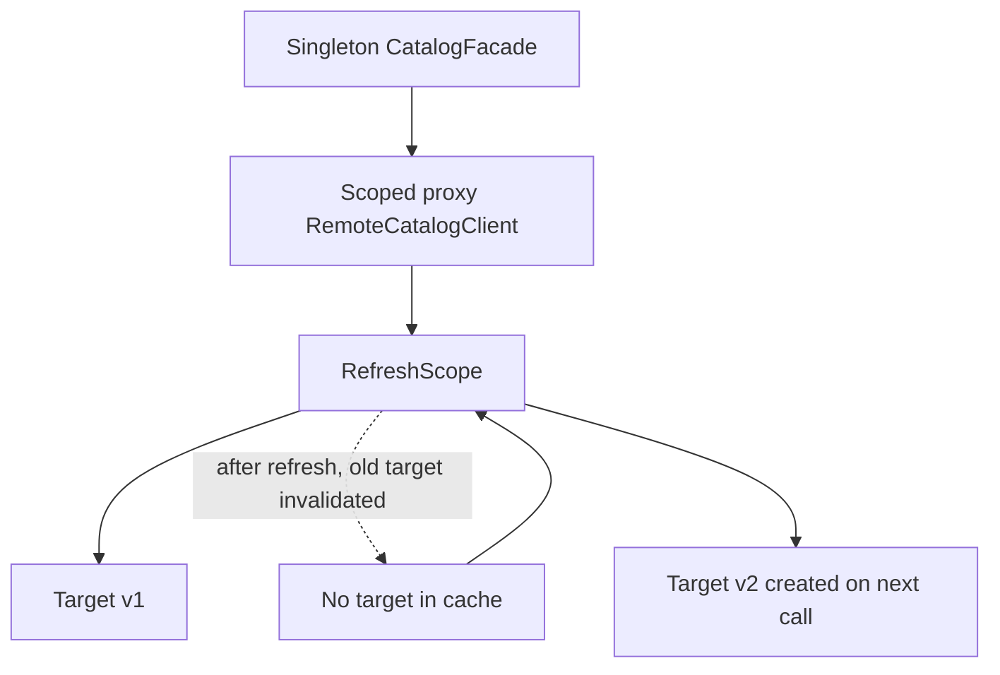

# Dependent Beans Holding Stale References and Proxy Limitations

`@RefreshScope` allows a bean to be recreated when configuration changes. However, in a Spring application, beans are typically injected into other beans, and those dependent beans may continue holding references or data previously obtained from that bean. To understand how far refresh takes effect, you must distinguish **references to a scoped proxy**, **direct references to a target object**, and **values/objects that a caller extracted and stored separately**.

A dependent singleton can hold a stable proxy and reach a new target on subsequent calls. However, a proxy cannot automatically update a field that the singleton copied, cannot replace a child object saved by a caller, and cannot intercept internal calls inside the target itself. These limitations matter greatly when refreshing an HTTP client, policy, connection pool, or stateful bean in Spring Cloud Context.

This lesson belongs to the **Refresh Scope** chapter of the `SPRING_CLOUD_CORE` module. Its goal is to pinpoint exactly where stale references are held, understand how proxies forward calls, recognize self-invocation and unwrapped objects, and design lifecycles and tests so refreshes do not produce unexpected behavior.

## 1. Referencing a Proxy Differs from Referencing a Target

Suppose a `RemoteCatalogClient` bean is annotated with `@RefreshScope`. Spring registers this bean as a **scoped proxy**. Other beans receiving injection normally receive the proxy representing the bean, not a fixed target object.



The proxy can live throughout the entire lifecycle of `CatalogFacade`. When a caller invokes a method through the proxy, the proxy looks up the active target in the scope and forwards the call to that target. After the scope is refreshed, the old target is evicted from the cache; the next call can create a new target from the current configuration.

Therefore, the phrase "the dependent bean holds a stale reference" needs clarification:

- If the dependent bean holds a **reference to the proxy**, subsequent calls through the proxy can reach the new target.
- If the dependent bean holds a **direct reference to the target**, it continues calling the old object.
- If the dependent bean copies a **return value** from the target into its own field, that field is not updated by the proxy.
- If a caller holds a child object, callback, or resource returned from the target, that object may outlive the target and become a stale reference.

This is the single most important distinction when diagnosing refresh issues.

## 2. The Right Case: Singleton Holding a Scoped Proxy

Client bean example:

```java
import org.springframework.beans.factory.annotation.Value;
import org.springframework.cloud.context.config.annotation.RefreshScope;
import org.springframework.stereotype.Component;

@Component
@RefreshScope
public class RemoteCatalogClient {
    private final String baseUrl;

    public RemoteCatalogClient(
            @Value("${catalog.remote.base-url}") String baseUrl) {
        this.baseUrl = baseUrl;
    }

    public String currentEndpoint() {
        return baseUrl;
    }

    public CatalogItem find(String id) {
        // Call endpoint based on the current target's baseUrl.
        return new CatalogItem(id, baseUrl);
    }
}
```

Dependent bean:

```java
import org.springframework.stereotype.Service;

@Service
public class CatalogFacade {
    private final RemoteCatalogClient client;

    public CatalogFacade(RemoteCatalogClient client) {
        this.client = client;
    }

    public CatalogItem find(String id) {
        return client.find(id);
    }
}
```

`CatalogFacade` is a singleton and keeps a `client` field throughout its lifecycle. That field references the scoped proxy. When refresh scope invalidates the old target, `CatalogFacade` does not need to be recreated; the next `client.find(id)` call still goes through the proxy and can use the new target.

Example flow:

| Moment | `CatalogFacade.client` | Target in `RefreshScope` | Result |
| --- | --- | --- | --- |
| Startup, before first call | Proxy P | Not yet created | No target yet |
| First call | Proxy P | Creates T1 with URL v1 | Caller uses v1 |
| Refresh scope | Still proxy P | T1 invalidated/destroyed per lifecycle | Proxy unchanged |
| Call after refresh | Still proxy P | Creates T2 with URL v2 | Caller uses v2 |

The proxy solves **holding a stable reference to a bean whose target changes**. It does not mean every piece of data that bean previously returned also changes.

## 3. The Wrong Case: Dependent Bean Copying a Value from the Proxy

Consider a facade storing the endpoint in its constructor:

```java
@Service
public class CatalogFacade {
    private final RemoteCatalogClient client;
    private final String endpointSnapshot;

    public CatalogFacade(RemoteCatalogClient client) {
        this.client = client;
        this.endpointSnapshot = client.currentEndpoint();
    }

    public String endpoint() {
        return endpointSnapshot;
    }
}
```

In the constructor, calling `client.currentEndpoint()` goes through the proxy and may create target T1. The string value v1 is returned and copied into `endpointSnapshot`. After refresh, the `client` proxy can forward calls to T2, yet `endpointSnapshot` remains v1.

Fix by keeping only the proxy and reading through the proxy when needed:

```java
@Service
public class CatalogFacade {
    private final RemoteCatalogClient client;

    public CatalogFacade(RemoteCatalogClient client) {
        this.client = client;
    }

    public String endpoint() {
        return client.currentEndpoint();
    }
}
```

If a caller needs a consistent snapshot for an entire operation, create the snapshot at that operation's boundary and accept that the snapshot lives until the operation completes. Never store snapshots inside a singleton if the goal is for each call to observe the new target.

## 4. References to an Unwrapped Target

Under normal dependency injection, Spring injects the scoped proxy per the bean definition. However, custom code or libraries may extract the target object inside the proxy, save it, and keep using it after refresh.

Several patterns can bypass the proxy layer:

- Instantiating the object directly with `new` instead of obtaining the bean from the container.
- Calling a factory method directly or holding an object created outside Spring's lifecycle.
- Using internal APIs/test utilities to unwrap the proxy and storing the target in a field.
- Grabbing an internal delegate/client from the target and passing that object to another bean.
- Registering a callback or listener bound directly to the old target.

Example illustrating an ownership mistake:

```java
@Service
public class LegacyCatalogAdapter {
    private final CatalogTransport transport;

    public LegacyCatalogAdapter(RemoteCatalogClient client) {
        // Suppose this API returns the target's internal delegate.
        // The delegate is stored directly, bypassing the scoped proxy.
        this.transport = client.unwrapTransport();
    }

    public void call() {
        transport.execute();
    }
}
```

`unwrapTransport()` is only a hypothetical API for illustration, not a Spring method. If real code has an API returning an internal delegate, determine which target lifecycle that delegate belongs to. When the target refreshes, the old delegate is not automatically replaced.

A safer design is keeping a reference to the bean proxy and calling its public API. If a separate transport must be shared, give that transport its own bean ownership and lifecycle, or create a factory/provider to fetch the active resource rather than extracting an internal target and storing it long-term.

## 5. Proxies Cannot Fix Child Objects Already Retained by Callers

Even when every call to the main bean goes through the proxy, a bean's method can still return a child object. Callers might keep that object across a refresh.

Example:

```java
@Component
@RefreshScope
public class CatalogRuntimeSettings {
    private final CatalogOptions options;

    public CatalogRuntimeSettings(
            @Value("${catalog.remote.base-url}") String baseUrl) {
        this.options = new CatalogOptions(baseUrl);
    }

    public CatalogOptions options() {
        return options;
    }
}
```

Caller:

```java
@Service
public class CatalogFacade {
    private final CatalogOptions cachedOptions;

    public CatalogFacade(CatalogRuntimeSettings settings) {
        this.cachedOptions = settings.options();
    }
}
```

`settings` is a proxy, but `cachedOptions` is a child object returned from target T1. When target T1 is invalidated, `cachedOptions` still references the old child object. The proxy only intercepts method calls passing through the proxy itself; it cannot track every object that escaped the target.

There are three common design approaches:

1. Avoid exposing mutable/internal objects; provide methods that perform operations through the proxy.
2. Return an immutable snapshot and require callers to use the snapshot only within a clearly bounded operation.
3. Return a dedicated provider/proxy with a managed lifecycle so each access retrieves the current state.

Never let callers directly retain internal structures that the target may replace or release.

## 6. The Self-Invocation Limitation

A scoped proxy can only forward calls **passing through the proxy**. When a method inside the target calls another method on the same object via `this`, that call does not go back through the proxy.

Example:

```java
@Component
@RefreshScope
public class CatalogPolicy {
    private final String region;

    public CatalogPolicy(@Value("${catalog.region}") String region) {
        this.region = region;
    }

    public String currentRegion() {
        return region;
    }

    public String describe() {
        // Self-invocation on the same target object.
        return "region=" + this.currentRegion();
    }
}
```

When a caller invokes `proxy.describe()`, the proxy selects target T1 and invokes `describe()` on T1. Inside T1, `this.currentRegion()` executes directly on T1; no new target lookup happens between the two methods. This is usually desirable within a single method execution: both methods observe the same target.

What to avoid is expecting self-invocation to perform a proxy hop or refresh the target between two methods. If you need a separate proxy boundary, split the logic into another bean injected through a proxy or invoke from the caller through the proxy at the proper boundary.

Self-invocation is also a familiar limitation of proxy-based AOP such as `@Transactional`. Do not work around it by arbitrarily grabbing the current proxy; separating responsibilities across beans is usually clearer and easier to test.

## 7. Class and Method Proxy Limitations

`@RefreshScope` uses a scoped proxy to forward method calls. Under common class-based proxy configurations, Spring must generate a subclass proxy. Therefore, `final` classes or `final` methods may not be proxyable as expected.

Example unsuitable for class-based proxies:

```java
@Component
@RefreshScope
public final class FinalCatalogClient {
    public final String endpoint() {
        return "https://catalog.internal";
    }
}
```

A `final` class cannot be subclassed; a `final` method cannot be overridden to intercept calls. Avoid marking classes/methods needing proxying as `final` when using default class-based proxies. In Kotlin, pay attention to the `all-open` plugin or equivalent class declarations.

Some proxy configurations can use interface-based proxies, provided injected types match the interface and active proxy mode. Do not infer proxy mode solely from a bean implementing an interface; inspect annotations, scope configuration, and runtime types when encountering cast errors or proxy creation failures.

Additionally:

- Invoked methods must be interceptable under the active proxy type.
- Do not force-cast a proxy to its implementation class unless the proxy mode guarantees that type.
- Do not use `==` to infer whether the target was replaced; the proxy can keep a stable identity while the target changes.
- Do not rely on `toString()`, `equals()`, or `hashCode()` to inspect the current target; their semantics may depend on the proxy implementation.

## 8. Other Dependent Beans May Still Hold Old State

Placing `@RefreshScope` on a bean does not automatically put all of its dependencies into refresh scope.

Example:

```java
@Component
public class ApiTokenProvider {
    private final String token;

    public ApiTokenProvider(@Value("${catalog.api-token}") String token) {
        this.token = token;
    }

    public String token() {
        return token;
    }
}

@Component
@RefreshScope
public class RemoteCatalogClient {
    private final ApiTokenProvider tokenProvider;

    public RemoteCatalogClient(ApiTokenProvider tokenProvider) {
        this.tokenProvider = tokenProvider;
    }

    public String currentToken() {
        return tokenProvider.token();
    }
}
```

When `RemoteCatalogClient` is recreated, it still receives the existing `ApiTokenProvider` singleton. If the token provider captured the old token and was not rebound/refreshed, the new client target will also read the old token.

For the new target to use the new token, handle the bean owning the token properly: let the provider read dynamically from an updated source, support rebinding via an appropriate mechanism, or place the provider in a refreshable scope if its lifecycle allows. Refreshing only an upper-layer bean does not alter existing singleton dependencies.

## 9. Target Invalidation and Old Resources

Refresh scope acts as a target cache. When the scope is refreshed, the cached target is evicted and its destruction callbacks run per the scope's lifecycle. Only the next call creates a new target. This has important consequences for resources:

- The old target may own HTTP clients, connection pools, executors, or file handles.
- A caller may be executing a request on the old target while a refresh occurs.
- The destroy callback may close the old resource while an operation is still using it if the design lacks a draining mechanism.
- The new target is created lazily; configuration or connection errors may only appear on the first call after refresh.

Do not assume refresh scope automatically performs an atomic resource swap or waits for every in-flight request. Safe behavior depends on the implementation and resource lifecycle. For clients with long-running requests, explicitly design timeouts, draining, connection management, and error handling.

Example of a bean owning a resource:

```java
import jakarta.annotation.PreDestroy;
import org.springframework.beans.factory.annotation.Value;
import org.springframework.cloud.context.config.annotation.RefreshScope;
import org.springframework.stereotype.Component;

@Component
@RefreshScope
public class CatalogTransport {
    private final HttpTransport delegate;

    public CatalogTransport(
            @Value("${catalog.remote.base-url}") String baseUrl) {
        this.delegate = HttpTransport.connect(baseUrl);
    }

    public Response execute(Request request) {
        return delegate.execute(request);
    }

    @PreDestroy
    public void close() {
        delegate.close();
    }
}
```

`HttpTransport` is an illustrative API. In real libraries, check whether `close()` waits for in-flight requests, is thread-safe, and permits repeated calls. If graceful handover is required, you may need a dedicated resource manager tracking client versions and active request counts per version.

## 10. Notes When Using `@RefreshScope` with `@Bean` and Configuration Classes

You can annotate a bean factory method:

```java
@Configuration(proxyBeanMethods = false)
public class CatalogClientConfiguration {
    @Bean
    @RefreshScope
    CatalogTransport catalogTransport(
            @Value("${catalog.remote.base-url}") String baseUrl) {
        return new CatalogTransport(baseUrl);
    }
}
```

In this case, the bean created by the factory method is the refresh-scoped bean. Other beans injecting `CatalogTransport` via the container receive a scoped proxy.

If you annotate an entire `@Configuration` class with `@RefreshScope`, read the exact semantics for your Spring Cloud version and verify which beans are actually placed in the scope. Do not assume objects manually created inside methods or dependencies of the configuration class automatically become refresh-scoped. The clearest approach when control is needed is annotating the specific bean factory methods that truly need recreation directly.

Some setups may fail when class-based proxying is applied to configuration classes or incompatible types. Keep configuration classes focused on declaring beans and place refresh scope on the specific target beans.

## 11. Refresh Triggers and Proxy State

`@RefreshScope` does not automatically detect Config Server changes. A refresh workflow typically needs:

1. Fetching new configuration from an external source or updating property sources in `Environment`.
2. Publishing appropriate refresh/rebind events.
3. Invalidating the refresh scope's target cache.
4. Allowing subsequent calls through proxies to create new targets.

Common triggers include the `POST /actuator/refresh` endpoint when properly exposed and secured, `ContextRefresher` in an internal management component, or Spring Cloud Bus to broadcast events across multiple instances. Exact mechanisms and dependencies vary by release train.

Refresh scope does not mean new targets are initialized right at refresh time. Because targets are typically created lazily, constructor or resource initialization failures can occur on the first request after refresh. If errors must be caught before serving live traffic, include an active validation/probe step and appropriate readiness policies.

## 12. Design Patterns to Avoid Stale References

### 12.1. Hold the Proxy, Not the Target

Inject refresh-scoped beans via Spring and retain the proxy reference. Do not unwrap targets or store internal delegates inside other singletons.

### 12.2. Do Not Copy Configuration into Singletons When Dynamic Values Are Needed

If values need to change, read through a proxy/provider at the time of use or create a time-bounded snapshot scoped to a single request/job. Avoid storing `String`, `URI`, `Duration`, or settings objects in singleton fields without an update workflow.

### 12.3. Do Not Let Internal Objects Escape the Target

Expose methods that perform operations or return immutable DTOs/snapshots. Avoid returning mutable collections, delegates, connections, or child objects whose lifecycles are tied to the target.

### 12.4. Separate Beans by Resource Ownership

If a client holds multiple resources, separate the factory/manager and target service so owner lifecycles are clear. When a target is recreated, old resources must be closed properly; callers must not retain resources after the owner closes them.

### 12.5. Design the Dependency Graph Deliberately

If the new target needs a dependency that also holds changing configuration, ensure that dependency reads dynamically, rebinds, or has an appropriate refresh lifecycle too. Refreshing an upper layer does not automatically replace stale singleton dependencies.

## 13. Testing Proxy Limits and Stale References

A test that only verifies `Environment` has the new value is insufficient. You must verify which references are held and whether method calls go through the proxy.

| Scenario | How to test | Expected result to verify |
| --- | --- | --- |
| Singleton holds proxy | Inject refresh-scoped bean into singleton, call before/after refresh | Proxy reference is stable; target changes after refresh |
| Value copy | Constructor calls proxy and stores string in field | Snapshot field still holds old value |
| Unwrapped target | Extract target/delegate in test and hold reference | Direct reference does not switch to new target |
| Returned child object | Obtain object from target and keep it in caller | Child object remains old after refresh |
| Self-invocation | Target method calls `this.otherMethod()` | Internal call does not pass through scoped proxy again |
| Stale singleton dependency | Refresh-scoped target injects singleton provider that captured config | New target still gets old singleton provider unless provider updates |
| Final class/method | Attempt proxying a type that cannot be subclassed/overridden | Identify proxy error and adjust type/proxy strategy |
| Resource destroy | Track create/close during refresh | Old target releases resource per designed lifecycle |
| Lazy recreation | Update config, invalidate scope without calling bean yet | New target is created only upon appropriate access |
| Multi-instance | Refresh one instance before another | Each instance can temporarily use different target/config versions |

### 13.1. Testing a Stable Proxy Reference

You can create a refresh-scoped test bean returning a version string injected from a property. An integration test performs:

1. Start the context with `demo.version=v1`.
2. Obtain the proxy from the context and keep that reference.
3. Call the method and confirm the target returns `v1`.
4. Update the property source via a test-context-supported mechanism and trigger refresh scope.
5. Call again through the same proxy reference.
6. Confirm the new target returns `v2`.

The critical point is **using the exact same proxy reference** in step 2 and step 5. If the test re-fetches the bean from the context after refresh, it may fail to prove that existing dependent singletons still hold a working proxy.

### 13.2. Testing Snapshots and Child Objects

Create a dependent singleton with two fields: one holding the proxy and one holding a value read from the proxy in its constructor. After refresh, assert:

- Calling through the proxy returns the new value.
- The snapshot field still returns the old value.
- If the constructor saved a returned child object, that child object still carries old data.

This test clarifies the boundary between the proxy and data that escaped the proxy.

### 13.3. Testing Resources in Active Use

Use a fake transport with create/close counters and latches to simulate an in-flight request. Refresh while the request holds the old target, then verify:

- The old target is invalidated per scope semantics.
- The destroy callback runs per the actual lifecycle.
- A new target is created when the proxy is called again.
- Behavior when the old resource closes during an in-flight request matches the designed policy.

Do not use `Thread.sleep()` to infer ordering. Use `CountDownLatch`, `CompletableFuture`, or test synchronization tools to control exact timing.

## 14. Diagnosing When Dependent Beans Still Use Stale References

| Symptom | Possible cause | How to investigate |
| --- | --- | --- |
| Proxy call returns new data, yet facade field stays old | Facade copied value from proxy into a field | Find snapshot fields and switch to calling proxy/provider when needed |
| A collaborator still uses old endpoint | Collaborator saved an unwrapped delegate/target | Check where the target was obtained or APIs returning internal objects |
| New refresh-scoped bean still uses old token | Token provider is a singleton that captured the token | Rebind/refresh the provider or read tokens dynamically |
| Method A uses new target, yet method B in same target stays old | Self-invocation runs on the same target | Split beans or place proxy boundary at the caller |
| Returned object still contains old config | Caller retained child object from previous target | Return bounded DTO snapshots or keep provider/proxy |
| Refresh fails with `final` class | Class-based proxy cannot subclass | Remove `final` or design an appropriate proxy/interface |
| New target created, yet old resource still running | Lifecycle/resource ownership lacks draining | Design shutdown/drain and close resources safely |
| New target not seen immediately after refresh | Target is lazily created when proxy is invoked | Call through proxy and inspect target after access |

Diagnostic sequence:

1. Confirm the instance loaded the new configuration into `Environment`.
2. Confirm refresh scope invalidated the target.
3. Identify whether fields in dependent beans hold the proxy, the target, or a copied value.
4. Check whether objects returned from the target are retained long-term.
5. Look for self-invocation and method references/callbacks capturing old objects.
6. Check whether singleton dependencies inside the target hold stale configuration state.
7. Check proxy mode, `final` classes/methods, and injected types.
8. Inspect destroy callbacks, in-flight requests, and old resources.
9. Repeat verification on every replica if running multiple instances.

## 15. Practice: Refreshing an Endpoint While the Facade Stays Alive

Suppose `catalog-service` needs to switch its endpoint from v1 to v2 without restarting the entire context.

**Step 1 — Create a refresh-scoped target bean:**

```java
@Component
@RefreshScope
public class CatalogEndpointProvider {
    private final URI endpoint;

    public CatalogEndpointProvider(
            @Value("${catalog.remote.base-url}") URI endpoint) {
        this.endpoint = endpoint;
    }

    public URI currentEndpoint() {
        return endpoint;
    }
}
```

**Step 2 — Create a facade holding the proxy:**

```java
@Service
public class CatalogFacade {
    private final CatalogEndpointProvider provider;

    public CatalogFacade(CatalogEndpointProvider provider) {
        this.provider = provider;
    }

    public URI endpoint() {
        return provider.currentEndpoint();
    }
}
```

**Step 3 — Initial test:** configure `catalog.remote.base-url=https://catalog-v1.internal`; call the facade and confirm v1.

**Step 4 — Refresh:** update `Environment` via the application's mechanism, then invalidate refresh scope using a supported trigger. Do not just edit a file/repository and assume the target changed.

**Step 5 — Call again through the same facade:** `CatalogFacade` remains the old singleton holding the same proxy; the next call through the proxy must create/read a new target with v2.

**Step 6 — Try the anti-pattern:** add a `private final URI snapshot` field assigned from `provider.currentEndpoint()` in the facade's constructor. Confirm the `snapshot` field stays v1 after refresh while the method calling through the proxy returns v2.

**Step 7 — Extend to a real resource:** replace the endpoint provider with a real HTTP client, add a `close` callback, and test an in-flight request to determine your draining policy.

### Self-Check Questions

1. When a singleton injects a `@RefreshScope` bean, does it typically hold the target or a scoped proxy?
2. Why can the proxy keep a stable identity while the target changes?
3. If a dependent bean's constructor calls a proxy method and stores the result in a `final String`, does that field update automatically?
4. Why can a child object returned from a target become a stale reference?
5. Does self-invocation go through the scoped proxy again?
6. Why does refreshing a target not automatically refresh singleton dependencies injected by that target?
7. What limitations require attention with class-based proxies and `final` classes/methods?
8. Why can't you assume refresh scope waits for every in-flight request before closing the old target?
9. How do you prove an existing dependent singleton still works with a new target?

**Answer Hints:** (1) Typically holds a scoped proxy; (2) The proxy looks up the current target in scope for each eligible call; (3) No, it is a snapshot; (4) The caller holds the child object directly and no longer calls through the proxy; (5) No, `this.method()` calls inside the target do not go back through the proxy; (6) Singleton dependencies remain old instances unless they rebind/refresh; (7) Class-based proxies cannot subclass `final` classes or override `final` methods; (8) Refresh scope is not a general-purpose transaction/resource draining mechanism; (9) Hold the same proxy reference before and after refresh, call methods at both times, and compare targets/versions.

## 16. Key Principles to Remember

- Dependent beans injected with a refresh-scoped bean typically hold a **scoped proxy**; the proxy can forward post-refresh calls to the new target.
- Values copied from a proxy, unwrapped targets, delegates, child objects, or callbacks bound to an old target are not automatically replaced.
- Self-invocation inside a target does not pass back through the proxy; internal methods run on the current call's target.
- Refreshing one bean does not automatically refresh the singleton dependencies it uses.
- Class-based proxies require types that can be subclassed/overridden; check `final` classes, `final` methods, and injected types.
- Targets are usually created lazily after scope invalidation; initialization errors can surface on the first call after refresh.
- Recreating targets may close old resources; manage in-flight requests, draining, and resource ownership.
- Test using the exact same proxy reference before and after refresh, and also test snapshots, child objects, self-invocation, and individual replicas.

Understanding proxy boundaries helps design the right separation between dependent beans and refreshable targets. When callers hold the proxy and all operations needing updates go through the proxy, Spring Cloud Context can swap targets by scope; meanwhile, snapshots, delegates, and resources that escaped the target require their own lifecycle strategy.
