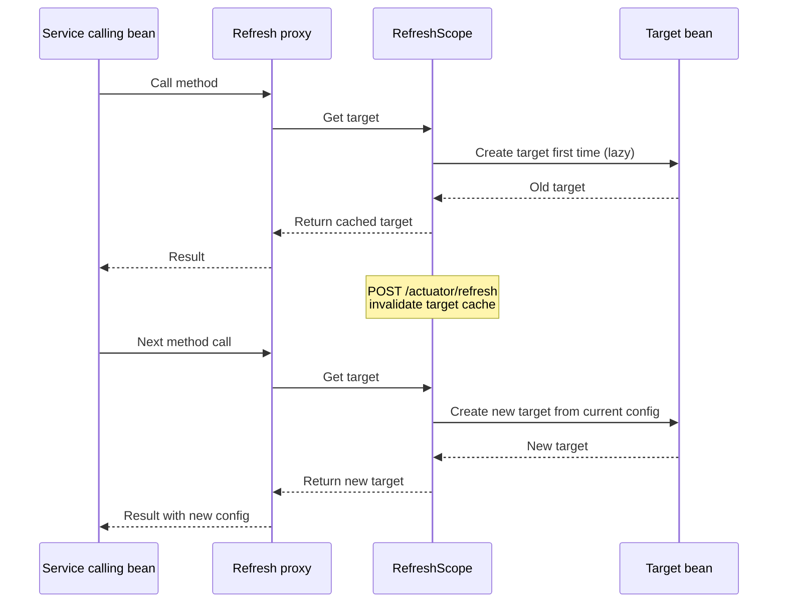
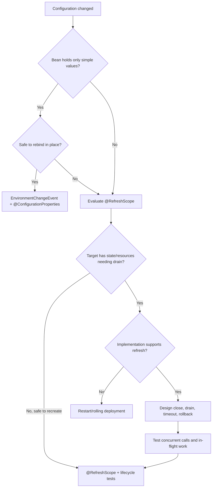

# Refresh Limitations for Stateful Resources and Concurrency Handling

## 1. Why Can Refresh Introduce Risks?

Spring Cloud Context supports updating configuration while the application is running. Thanks to `@RefreshScope`, a bean can be recreated to use new configuration values without restarting the entire JVM. This is useful for endpoints, timeouts, policies, or clients that need reinitializing under new configuration.

However, many beans do not merely hold a few simple values. They also manage **stateful resources** such as connection pools, HTTP clients, thread pools, caches, message consumers, file handles, or long-lived connection sessions. When a bean refreshes, the old target is evicted from cache and a new target is created on the next access. Without proper resource lifecycle management, refreshing can lose state, interrupt in-flight work, or create two overlapping generations of active resources.

This lesson belongs to the **Refresh Scope** chapter of **SPRING_CLOUD_CORE**. Its focus is understanding refresh limitations for stateful resources, how Spring Cloud handles concurrent access, and how to design safe refreshes within a single instance as well as across multi-instance clusters.

Distinguish three mechanisms:

| Mechanism | Behavior | When appropriate |
| --- | --- | --- |
| Rebinding `@ConfigurationProperties` | Updates fields on **the same bean instance** | Simple mutable configuration where in-place updates are acceptable |
| `@RefreshScope` | Uses a proxy and target cache; refresh removes old target so next call creates a new target | Beans needing reinitialization from new configuration and a more consistent view during refresh |
| Application restart/rollout | Creates a new process/context per deployment lifecycle | Infrastructure-impacting changes or when controlled resource transition is required |

There is no single right choice for every bean. Classify resources, identify what work may be running, and verify the actual behavior of resource-management libraries before enabling refresh.

## 2. How Does `@RefreshScope` Work?

A bean annotated with `@RefreshScope` is placed by Spring into a **proxied scope**. The proxy is injected into other beans; the actual target is created when the proxy is first used. The scope caches the target.

Upon refresh:

1. Spring Cloud invalidates the bean's target cache in refresh scope.
2. Destruction callbacks on the old target are invoked per bean lifecycle.
3. The proxy remains the object referenced by other beans.
4. On the next method call, the scope creates a new target from the current `Environment` and caches that target.



Simple policy bean example:

```java
import java.math.BigDecimal;

import org.springframework.beans.factory.annotation.Value;
import org.springframework.cloud.context.config.annotation.RefreshScope;
import org.springframework.stereotype.Component;

@Component
@RefreshScope
public class ShippingPolicy {

    private final BigDecimal freeShippingThreshold;

    public ShippingPolicy(
            @Value("${app.shipping.free-shipping-threshold:300000}")
            BigDecimal freeShippingThreshold) {
        this.freeShippingThreshold = freeShippingThreshold;
    }

    public boolean isFreeShipping(BigDecimal orderTotal) {
        return orderTotal.compareTo(freeShippingThreshold) >= 0;
    }

    public BigDecimal threshold() {
        return freeShippingThreshold;
    }
}
```

When the `ShippingPolicy` target is created, the constructor receives the current value in `Environment`. After the property is updated and the target is refreshed, the next call creates a new `ShippingPolicy` with the new threshold.

**The proxy is not the target.** Other services hold a reference to the proxy so they do not have to locate a new bean after each refresh. However, if code extracts the target and saves it directly into a variable, or passes internal resources outside the proxy, those escaped references may no longer participate in the refresh mechanism.

### 2.1. `refreshAll()` and Refreshing a Single Bean

`RefreshScope` provides two primary operations:

- `refreshAll()` clears the target cache of all beans belonging to refresh scope in the context.
- `refresh(String beanName)` clears the cached target of a bean by name.

The Actuator endpoint `/actuator/refresh` invokes the context's refresh scope mechanism. This is a **cache invalidation** operation, not an immediate concurrent reinitialization of every target. Targets are recreated on the next call to their proxies.

Example endpoint exposure configuration:

```yaml
management:
  endpoints:
    web:
      exposure:
        include: health,info,refresh
```

Invoke refresh:

```bash
curl -X POST http://localhost:8080/actuator/refresh
```

Expose the endpoint only when truly necessary. In production, secure it with authentication, authorization, network restrictions, and administrative auditing. Never leave the refresh endpoint open to external clients.

### 2.2. Not Every Bean Inside a `@Configuration` Automatically Belongs to Refresh Scope

Annotating a `@Configuration` class with `@RefreshScope` does not mean every bean declared with `@Bean` inside that class automatically becomes refresh-scoped. Beans depending on them are also not automatically recreated upon refresh.

If a dependent bean needs to receive fresh dependencies after refresh, that dependent bean must also be designed with an appropriate scope/lifecycle. A clearer approach is usually annotating the bean needing refresh directly:

```java
import java.net.URI;
import java.time.Duration;

import org.springframework.beans.factory.annotation.Value;
import org.springframework.cloud.context.config.annotation.RefreshScope;
import org.springframework.context.annotation.Bean;
import org.springframework.context.annotation.Configuration;

@Configuration(proxyBeanMethods = false)
public class PricingClientConfiguration {

    @Bean(destroyMethod = "close")
    @RefreshScope
    PricingClient pricingClient(
            @Value("${app.pricing.base-url}") URI baseUrl,
            @Value("${app.pricing.timeout:2s}") Duration timeout) {
        return new PricingClient(baseUrl, timeout);
    }
}
```

This example assumes `PricingClient` is an application-owned client with a `close()` method to release resources. When the target is invalidated, Spring invokes the destroy method per the bean lifecycle. The next call creates a new client from the current URL and timeout.

If a client is instantiated manually with `new` outside Spring or stored in a static field, Spring cannot manage that object's refresh lifecycle.

## 3. `@ConfigurationProperties` Rebinding Differs from `@RefreshScope`

Spring Cloud Context listens for `EnvironmentChangeEvent`. When the event is published, `@ConfigurationProperties` beans in the context can be rebound; loggers with `logging.level.*` keys can also be updated.

Standard rebinding **mutates fields on the same instance**. It does not replace the object with a new instance. Rebinding a single bean is internally serialized, yet another thread reading the bean during rebinding can still observe intermediate state: one field reset to its default value while another field has not yet received its new value.

Example of a mutable configuration with two related limits:

```java
import java.math.BigDecimal;

import org.springframework.boot.context.properties.ConfigurationProperties;

@ConfigurationProperties(prefix = "app.checkout")
public class CheckoutLimits {

    private BigDecimal minimumTotal = BigDecimal.ZERO;
    private BigDecimal maximumDiscountRate = BigDecimal.ZERO;

    public BigDecimal getMinimumTotal() {
        return minimumTotal;
    }

    public void setMinimumTotal(BigDecimal value) {
        this.minimumTotal = value;
    }

    public BigDecimal getMaximumDiscountRate() {
        return maximumDiscountRate;
    }

    public void setMaximumDiscountRate(BigDecimal value) {
        this.maximumDiscountRate = value;
    }
}
```

If a request reads `minimumTotal`, a refresh rebind happens, and then the request reads `maximumDiscountRate`, it may observe two values from two different points in time. For policies requiring consistency, this can produce incorrect decisions.

Spring Cloud recommends using `@RefreshScope` when an application needs a consistent view of a bean across a refresh. For beans in this scope, the scope mechanism serializes proxy access with refresh. Even so, that does not create a distributed transaction spanning every bean, request, and instance.

Spring Cloud describes `@RefreshScope` as the choice when atomic-style updates at the `ApplicationContext` level are needed. This boundary covers beans actually belonging to refresh scope within that context; beans outside the scope, work already dispatched to external systems, and other JVMs still require separate lifecycles/coordination.

### 3.1. Constructor Binding and Java Records

`@ConfigurationProperties` objects using constructor binding, including Java records, are not refreshed/rebound by this Spring Cloud Context mechanism.

Example:

```java
@ConfigurationProperties(prefix = "app.checkout")
public record CheckoutPolicyProperties(
        BigDecimal minimumTotal,
        BigDecimal maximumDiscountRate
) {
}
```

Records fit immutable configuration determined at startup. If runtime policy changes are required, choose a design that explicitly supports refresh: a mutable properties bean with proper validation, or a refresh-scoped bean that reads fresh configuration when its target is recreated. Do not assume merely putting `@RefreshScope` on a record will re-run constructor binding.

## 4. Stateful Resources and Limitations When Refreshing

A target bean may own resources outside the JVM. Refresh only manages the target lifecycle within the Spring scope; how resources are actually closed, drained, initialized, and handed over depends on the implementation.

| Resource | State that can be affected | Risks during refresh | Handling approach |
| --- | --- | --- | --- |
| Database connection pool | Borrowed connections, transactions, pool statistics | Closing pool too early, breaking active transactions, or failing to build new pool | Use a refresh-supported implementation; manage borrowers and shutdown; test connection lifecycles |
| HTTP client / connection pool | Keep-alive connections, TLS sessions, in-flight requests | Mid-flight request failures, lost connection reuse, latency spikes on recreation | Create new client safely, drain old client, use bounded timeouts and retries |
| Thread pool / executor | Running tasks, queues, worker threads | Lost queued tasks, duplicate workers, or thread leaks | Stop accepting new tasks, drain queue, wait for running tasks, then shut down |
| Message consumer | Consumer sessions, offsets, in-flight messages | Duplicate processing, lost partition ownership, or re-delivery | Pause/stop consumer per protocol, commit/ack timely, and restart cleanly |
| In-memory cache | Entries and local cache state | Cold cache, backend load spikes, loss of unpersisted data | Use regenerable caches or externalize state |
| WebSocket / streaming session | Open sessions, buffers, per-connection state | Dropping long-lived connections, losing sessions or in-flight data | Drain connections, support reconnect/resume, or keep sessions outside refreshable beans |
| Scheduler / background worker | Schedules and executing jobs | Overlapping job executions or mid-job termination | Pause, drain, and enforce idempotency/leader coordination |

### 4.1. In-Memory State Is Lost When the Target Is Recreated

If a bean holds counters, session maps, caches not reconstructed from external sources, or unpersisted processing state, the new target does not automatically inherit state from the old target.

Example:

```java
@Component
@RefreshScope
public class LocalCounter {

    private final AtomicLong counter = new AtomicLong();

    public long next() {
        return counter.incrementAndGet();
    }
}
```

After refresh, the new target gets a brand-new `AtomicLong` starting from its initial value. If the counter represents order numbers, processing counts, or data that must be preserved, this design is unsuitable.

Store business-critical state in a database, distributed cache, event log, or appropriate durable store. Refreshable beans should hold configuration and recreatable resources, never act as the sole holder of critical data.

### 4.2. Destruction Callbacks Do Not Replace Draining Procedures

Spring invokes the old target's destruction callback when the scope invalidates the target. That closes resources if the bean declares the proper lifecycle (`close`, `shutdown`, `@PreDestroy`, `DisposableBean`, or `@Bean` destroy method).

However, calling `close()` does not automatically guarantee every implementation waits for external operations to finish. An already-sent HTTP request, a borrowed JDBC connection, or a received message may have its own lifecycle. Clarify:

- Does it stop accepting new work before closing?
- How long are in-flight tasks/requests awaited?
- Are borrowed connections returned or closed immediately?
- What is the drain timeout?
- When draining fails, does the system retry, cancel, or fall back to rollout?
- Does creating the new resource finish before heavy traffic hits it?

For transactions, never sever a connection holding an active transaction just because a URL configuration changed. Verify how the pool and transaction manager handle old connections.

## 5. Special Limitation with `HikariDataSource`

Spring Cloud Context currently marks `com.zaxxer.hikari.HikariDataSource` as **never-refreshable** by default. If an application uses Hikari as its `DataSource`, you cannot expect `@RefreshScope` to refresh that datasource like a regular bean.

When Hikari database URLs or credentials must change, typically choose one of these paths:

1. Perform a controlled rollout/restart so the new process creates the pool with new configuration.
2. Design a datasource/pool management layer with explicit lifecycle and switchover capability, thoroughly tested with active transactions and borrowed connections.
3. Choose a different datasource implementation if architectural requirements genuinely demand supported refresh mechanics.

The `spring.cloud.refresh.never-refreshable` property contains Hikari by default. If you redeclare this list in configuration, retain `com.zaxxer.hikari.HikariDataSource` if the application still uses Hikari to avoid unintended refresh handling. Do not remove Hikari from the list merely to force refresh to run; pick a proper pool strategy and test thoroughly.

`spring.cloud.refresh.extra-refreshable` can declare additional classes or beans to post-process into refresh scope in special cases. This is not a mechanism that makes arbitrary resources safe to refresh and does not replace lifecycle management.

## 6. Concurrency Handling Inside a Refresh-Scoped Bean

Two operations can occur concurrently:

- Thread A invokes a method through the `@RefreshScope` proxy.
- Thread B performs a refresh and invalidates the target cache.

Spring Cloud `RefreshScope` manages proxy access and serializes reads with refreshes for beans in the scope. This prevents callers from reading a bean whose fields are partially mutated, unlike in-place mutable `@ConfigurationProperties` rebinding.

However, this protection has boundaries:

- Only accesses going through the Spring proxy are managed by the scope.
- An internal object or resource returned outside the proxy may continue being used by callers under its own lifecycle.
- A request that has already started communicating with an external system must still obey that resource's timeout, transaction, cancellation, and shutdown semantics.
- The scope does not create a distributed transaction across multiple beans or multiple services.
- Different JVM instances maintain separate target caches; refreshing one instance does not refresh other instances.

Example of a bean that can leak an internal resource:

```java
import java.net.URI;

import jakarta.annotation.PreDestroy;

import org.springframework.beans.factory.annotation.Value;
import org.springframework.cloud.context.config.annotation.RefreshScope;
import org.springframework.stereotype.Component;

@Component
@RefreshScope
public class ClientHolder {

    private final PricingClient client;

    public ClientHolder(
            @Value("${app.pricing.base-url}") URI baseUrl) {
        this.client = new PricingClient(baseUrl);
    }

    public PricingClient client() {
        return client;
    }

    @PreDestroy
    void close() {
        client.close();
    }
}
```

A caller could store the result of `clientHolder.client()` in its own field. When `ClientHolder` refreshes, the caller still holds a reference to the old client. A safer design exposes business methods through the proxy rather than returning internal resources for other components to retain:

```java
import java.net.URI;

import jakarta.annotation.PreDestroy;

import org.springframework.beans.factory.annotation.Value;
import org.springframework.cloud.context.config.annotation.RefreshScope;
import org.springframework.stereotype.Component;

@Component
@RefreshScope
public class PricingGateway {

    private final PricingClient client;

    public PricingGateway(
            @Value("${app.pricing.base-url}") URI baseUrl) {
        this.client = new PricingClient(baseUrl);
    }

    public Price quote(String sku) {
        return client.quote(sku);
    }

    @PreDestroy
    void close() {
        client.close();
    }
}
```

Callers inject the `PricingGateway` proxy and invoke `quote()`. The resource stays inside the target; the scope has the opportunity to manage the target's lifecycle. The actual bean must still close the client properly when the target is destroyed.

## 7. Consistency When Multiple Beans Depend on One Configuration Set

Suppose an application has two refresh-scoped beans:

- `ShippingPolicy` holds the free-shipping threshold.
- `DiscountPolicy` holds the maximum discount rate.

A refresh can invalidate the caches of both. Because targets are lazily created as each bean is called, they may be reinitialized at different moments. A request calling both proxies on opposite sides of a refresh could observe two different policy generations.

If two values must be applied as a single unified policy, group them into **one snapshot**:

```java
import java.math.BigDecimal;

public record CheckoutPolicySnapshot(
        BigDecimal freeShippingThreshold,
        BigDecimal maximumDiscountRate,
        String version
) {
}
```

A refresh-scoped bean reads all properties and builds the snapshot in its constructor:

```java
import java.math.BigDecimal;

import org.springframework.beans.factory.annotation.Value;
import org.springframework.cloud.context.config.annotation.RefreshScope;
import org.springframework.stereotype.Component;

@Component
@RefreshScope
public class CheckoutPolicyProvider {

    private final CheckoutPolicySnapshot snapshot;

    public CheckoutPolicyProvider(
            @Value("${app.checkout.free-shipping-threshold}") BigDecimal threshold,
            @Value("${app.checkout.maximum-discount-rate}") BigDecimal discountRate,
            @Value("${app.checkout.policy-version}") String version) {
        this.snapshot = new CheckoutPolicySnapshot(
                threshold,
                discountRate,
                version
        );
    }

    public CheckoutPolicySnapshot current() {
        return snapshot;
    }
}
```

At the start of each business operation, the service reads the snapshot once and passes that snapshot through subsequent steps:

```java
public CheckoutResult checkout(Order order) {
    CheckoutPolicySnapshot policy = policyProvider.current();

    return checkoutCalculator.calculate(order, policy);
}
```

Thus, a single checkout uses the same set of thresholds and the same policy version, even if a refresh happens mid-processing. The next request can receive the new snapshot after the proxy creates a new target.

If business rules require every request across the entire cluster to switch to the new version at the exact same instant, `@RefreshScope` alone is insufficient to guarantee that. You need a rollout/versioning protocol or a policy service capable of coordinating effective times.

## 8. Multi-Instance Refresh Is Not a Cluster-Wide Atomic Operation

Each JVM has its own `ApplicationContext`, `Environment`, and refresh scope. When calling:

```bash
curl -X POST http://instance-a:8080/actuator/refresh
```

only the instance receiving the request performs the refresh. Other instances may continue holding old targets until they receive the signal or are restarted/rolled out.

In multi-instance applications:

1. Update the centralized configuration source.
2. Broadcast refresh events to all instances or perform a rolling restart.
3. Each instance loads the new configuration and invalidates its own target cache.
4. Verify health, policy versions, and resource connectivity on every instance.
5. Complete the rollout only once instances have converged on the desired version.

Spring Cloud Bus can broadcast `EnvironmentChangeEvent` or refresh events to multiple instances. Without Bus, orchestrate per-instance updates via your deployment platform or management system. Never call the endpoint on a single node and assume the entire cluster updated.

Spring Cloud Config Client does not poll Config Server by default to detect changes. Consequently, server-side changes do not automatically refresh every JVM. Proactively broadcast events with Spring Cloud Bus or orchestrate refreshes/rollouts through your deployment platform.

For sensitive changes like database credentials, certificates, or endpoint registries, you may need a two-phase transition: allow new credentials to work alongside old ones, roll out instances, confirm new connections, and only then revoke old credentials. Revoking too early can break connections on instances that have not refreshed yet.

## 9. Other Refresh Limitations

### 9.1. Removing a Key from Configuration Differs from Changing Its Value

Spring Cloud documentation notes that deleting a configuration value and refreshing does not necessarily update the presence of the property as expected. A property must remain present to update its value after refresh.

If logic depends on whether a key exists, design around an explicit state value—such as `feature.enabled=false`—rather than relying on deleting the key. You can also design logic around the new value instead of property absence.

### 9.2. AOT and Native Images

Context Refresh is not supported for Spring AOT transformations and native images. For AOT/native applications, documentation requires setting:

```yaml
spring:
  cloud:
    refresh:
      enabled: false
```

If an application needs runtime configuration changes in a native environment, choose another supported architecture and verify against the exact version in use.

### 9.3. `RefreshScope` Health Indicator

Spring Cloud can auto-configure `RefreshScopeHealthIndicator`. If a bean fails to reinitialize or configuration properties fail to rebind after a context refresh, the health indicator transitions to `DOWN` and provides the relevant exception details.

You can disable the indicator with:

```yaml
management:
  health:
    refresh:
      enabled: false
```

In production, keep this health signal enabled if refresh is part of operations, and configure monitoring and alerts to detect targets that fail to initialize.

### 9.4. Refresh on JVM Restart / Checkpoint Restore

Some Spring Cloud versions provide `RefreshScopeLifecycle` to trigger context refresh upon JVM restart, useful in checkpoint/restore environments such as Project CRaC. This behavior can be disabled with `spring.cloud.refresh.on-restart.enabled=false`.

This is a lifecycle feature specific to those versions and runtimes. Do not confuse it with automatically watching configuration files or polling Config Server while the application is running.

## 10. Endpoints and Configuration Update Sequence

Two Actuator endpoints are frequently confused:

| Endpoint | Effect | Notes |
| --- | --- | --- |
| `POST /actuator/env` | Updates `Environment`, rebinds `@ConfigurationProperties`, and updates log levels | Requires POST enabled, key allowlisting, and access protection |
| `POST /actuator/refresh` | Reloads eligible configuration sources and refreshes `@RefreshScope` beans | Requires endpoint exposure and administrative protection |

Example configuration exposing refresh:

```yaml
management:
  endpoints:
    web:
      exposure:
        include: health,info,refresh
```

If enabling POST on `env`, configure explicitly:

```yaml
management:
  endpoint:
    env:
      post:
        enabled: true
        valid-keys-regex: "app\.(checkout|pricing)\..*"
```

The `env` endpoint can modify configuration at runtime and therefore requires strict key allowlisting and security policies. Never expose management endpoints broadly on public networks. Restrict administrative paths to internal networks, enforce authentication/authorization, audit who triggered refreshes, and monitor post-operation outcomes.

A practical workflow:

1. Update the property source or submit changes via a controlled configuration mechanism.
2. Verify the new values are valid and present in `Environment`.
3. Trigger events/reloads to update `Environment`.
4. Invoke refresh to invalidate targets of beans needing recreation.
5. Run health checks and confirm new resources initialize successfully.
6. Monitor connection errors, request latency, and draining operations.
7. Roll back or restart if new targets fail to initialize stably.

## 11. Testing Refresh and Concurrency Handling

Do not just verify the endpoint returns HTTP 200. Verify that new targets are actually created, old resources are closed, and concurrent requests never observe invalid state.

### 11.1. Verifying Target Recreation

Example test updating a property source in `Environment` and calling `RefreshScope.refresh()`:

```java
import java.util.Map;

import org.junit.jupiter.api.Test;
import org.springframework.beans.factory.annotation.Autowired;
import org.springframework.boot.test.context.SpringBootTest;
import org.springframework.cloud.context.scope.refresh.RefreshScope;
import org.springframework.core.env.ConfigurableEnvironment;
import org.springframework.core.env.MapPropertySource;

import static org.assertj.core.api.Assertions.assertThat;

@SpringBootTest(properties = {
        "app.shipping.free-shipping-threshold=300000"
})
class ShippingPolicyRefreshTest {

    @Autowired
    ConfigurableEnvironment environment;

    @Autowired
    RefreshScope refreshScope;

    @Autowired
    ShippingPolicy shippingPolicy;

    @Test
    void createsTargetWithUpdatedConfiguration() {
        assertThat(shippingPolicy.threshold())
                .isEqualByComparingTo("300000");

        environment.getPropertySources().addFirst(
                new MapPropertySource(
                        "testOverride",
                        Map.of(
                                "app.shipping.free-shipping-threshold",
                                "500000"
                        )
                )
        );

        refreshScope.refresh("shippingPolicy");

        assertThat(shippingPolicy.threshold())
                .isEqualByComparingTo("500000");
    }
}
```

This illustrative test assumes `ShippingPolicy` is registered with bean name `shippingPolicy` and is refresh-scoped. Spring Boot Test and Spring Cloud Context dependencies matching your project's release train are required.

### 11.2. Verifying Destruction Callbacks

For resources with `close()`:

- Create the target the first time and verify the resource opens.
- Trigger bean refresh.
- Verify the old target's destroy callback runs.
- Call the proxy next and verify a new resource is created.
- Verify the new resource uses the new endpoint/credentials.
- Check that no threads, sockets, or file handles from the old target leak.

You can use a fake client with `createdCount` and `closedCount` counters to test lifecycle in unit/integration tests without depending on external systems.

### 11.3. Testing Concurrency

Design a test with multiple threads calling the bean through the proxy while one thread updates properties and triggers refresh:

- Every result must belong to a valid policy version.
- No result may mix half old values and half new values in the same snapshot.
- Old resources must not close before operations designed to drain have finished.
- After refresh, new calls must use the new target.
- Consecutive refreshes must not cause resource leaks or multiple pools/workers running concurrently by mistake.

For a request calling multiple beans, also test the case where refresh happens between two proxy calls. If a unified policy is needed, use a snapshot read once at the start of the operation as shown earlier.

### 11.4. Testing Multiple Instances

In an integration environment, start at least two instances with the same service name but different instance IDs. Update the policy version, send the refresh event, and verify each instance:

- Receives the exact version.
- Creates new targets successfully.
- Reports healthy status appropriately.
- Leaves no instance running the old version after the workflow completes.
- Does not leave two generations of consumers or schedulers executing the same job unexpectedly.

## 12. Pre-Production Checklist Before Enabling Refresh

| Item | Questions to answer |
| --- | --- |
| Bean scope | Which beans truly need refresh? Which dependent beans must be recreated simultaneously? |
| Proxy | Do all callers access through the Spring proxy? Are any target/resource references held outside? |
| State | Does the target hold business state or unpersisted data? |
| Lifecycle | Does the destroy callback close resources cleanly and idempotently? |
| In-flight work | How are running requests, transactions, tasks, or messages drained/finished? |
| Concurrency | Can a request read multiple policy beans across a refresh boundary? Is a snapshot/version needed? |
| Pool/client | Does the implementation support refresh? Are there limits like `HikariDataSource`? |
| Multi-instance | How do events reach every instance? How do you verify version convergence? |
| Rollback | If the new target fails to initialize, can you revert configuration or restart? |
| Security | Are refresh/env endpoints secured, network-restricted, and audited? |
| Runtime | Are you using AOT/native images? Is Context Refresh supported? |
| Observability | Do health indicators, logs, metrics, and alerts detect refresh failures? |

## 13. Common Misconceptions

| Misconception | Reality |
| --- | --- |
| "Refresh just swaps a few fields." | `@RefreshScope` invalidates the target and recreates the bean when the proxy is called; target resources and state can change. |
| "After refresh, all targets are immediately recreated." | The cache is cleared; targets are lazily created on the next access. |
| "Rebinding `@ConfigurationProperties` is atomic." | Rebinding mutates the same instance; reading threads may observe intermediate state. |
| "`@RefreshScope` guarantees the entire cluster shares the same version." | Each JVM has its own scope; broadcast or rollout and per-instance verification are required. |
| "`HikariDataSource` refreshes automatically under `@RefreshScope`." | `HikariDataSource` is in the default `never-refreshable` list. |
| "Annotating `@Configuration` refreshes every `@Bean`." | Each dependent bean needs appropriate scope/lifecycle; annotating configuration does not cover all inner beans automatically. |
| "Deleting a property and refreshing removes it from every bean." | Key deletion has limitations; design around explicit state values. |
| "Once the old target is replaced, all old requests are automatically safe." | Borrowed resources or external operations have their own lifecycles; design draining and shutdown explicitly. |

## 14. Decision Flow: Refresh or Restart?



Use `@RefreshScope` when targets are recreatable, resources have clear lifecycles, critical state is externalized, and the application accepts lazy recreation. Choose restart/rollout when changes involve server ports, complex connection topologies, non-refreshable resources, or require a controlled process-wide cutover.

## 15. Self-Check Questions

1. Why does `@RefreshScope` use a proxy and lazy target instead of mutating every field directly?
2. How does `refreshAll()` differ from recreating all targets immediately?
3. What problem can rebinding a mutable `@ConfigurationProperties` bean cause for concurrent reading threads?
4. Why is `@RefreshScope` better suited when you need a consistent view of a bean across a refresh?
5. What happens to a bean holding an in-memory counter or session map after its target is invalidated?
6. Why is `HikariDataSource` not refreshed by default?
7. When a request is currently borrowing a JDBC connection, what must be considered before closing the old pool?
8. Why might a request calling two refresh-scoped beans need to read a single policy snapshot?
9. Does `POST /actuator/refresh` on one instance update the remaining JVMs?
10. Why is runtime refresh unsupported for Spring AOT/native images?
11. When should restart/rolling deployment be used instead of refresh scope?
12. What should be tested beyond checking that the refresh endpoint returns HTTP success?

## 16. Official References

- [Spring Cloud Context — Application Context Services](https://docs.spring.io/spring-cloud-commons/reference/spring-cloud-commons/application-context-services.html) — `EnvironmentChangeEvent`, rebinding, `@RefreshScope`, `HikariDataSource`, refresh endpoint, and AOT/native limits.
- [Spring Cloud Commons — Configuration Properties](https://docs.spring.io/spring-cloud-commons/reference/configprops.html) — `spring.cloud.refresh.enabled`, `extra-refreshable`, `never-refreshable`, and health indicator properties.
- [Spring Boot — Actuator Endpoints](https://docs.spring.io/spring-boot/reference/actuator/endpoints.html) — exposing and securing management endpoints.
- [Spring Cloud Bus](https://docs.spring.io/spring-cloud-bus/reference/) — propagating configuration events across multiple instances.
- [Spring Boot — Graceful Shutdown](https://docs.spring.io/spring-boot/reference/web/graceful-shutdown.html) — controlled shutdown behavior for web servers.

*This document focuses on refresh limitations within a single `ApplicationContext` and across multi-instance deployments. Drain/close behavior of connection pools, HTTP clients, consumers, and executors depends on implementation; test with the exact libraries and versions running in production before adopting.*
