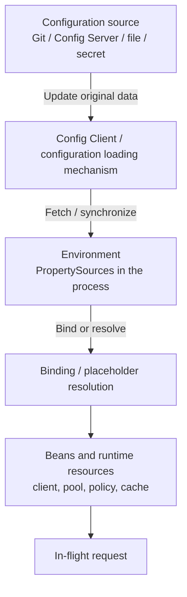
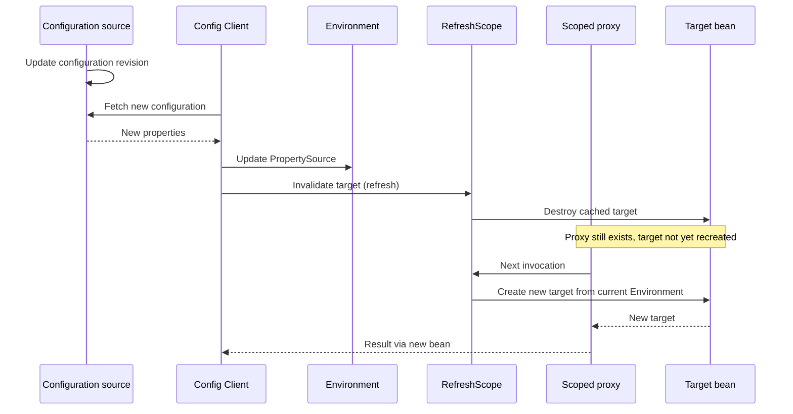

# Distinguishing Configuration Source Updates, Environment, and Beans

In a Spring Cloud application, a configuration change can begin in Git, Config Server, environment variables, or a secret management system. However, changing data at the storage location does not mean the running application has received the new value; and the fact that the Environment has the new value does not guarantee that every bean using that value has changed either.

To understand the configuration refresh process accurately, it is necessary to distinguish three layers:

1. **Configuration source:** the place that stores or provides the original value, such as a Git repository, Config Server, file, secret store, or environment variable.
2. **Environment and PropertySource:** the configuration snapshot that a Spring process is currently using to look up properties at the present time.
3. **Beans and runtime resources:** objects that have already been created, bound, or injected from configuration; they may hold values in fields, caches, connection pools, or initialized clients.

These are three states with different lifecycles. A change only affects the next layer when there is an explicit mechanism to propagate and apply it. This lesson belongs to the **Configuration Refresh** chapter of the **SPRING_CLOUD_CORE** module, focusing on Spring Cloud Context, externalized configuration, Config Client, and how to test refresh safely.

## 1. Three Configuration Layers in a Running Application

For example, `order-service` uses a catalog address and timeout:

```yaml
catalog:
  api:
    base-url: https://catalog-v1.internal
    timeout: 2s
```

This value may be stored in Git, served by Config Server, loaded into the Environment by Config Client, and finally used to create an HTTP client.



Each arrow is a step that must be carried out:

- Editing a file in Git only changes the original source; Config Server may need to receive the commit or refresh its repository.
- Config Server having the new value does not mean every client has fetched it.
- Config Client fetching the new value does not mean the Environment of every replica has been updated.
- The Environment having the new value does not mean previously bound/injected beans have been recreated.
- A new bean being created does not mean an in-flight request executing on the old bean switches to the new bean.

You should not use the word "refresh" for the entire chain without specifying which layer is being refreshed.

## 2. Layer 1: Updating the Configuration Source

The configuration source is where the original values are managed. Depending on the architecture, the source can be:

| Source | Example change | Component that may need synchronization |
| --- | --- | --- |
| Git repository | Commit changing timeout or endpoint | Config Server or watcher/pipeline |
| Spring Cloud Config Server | Update repository/backend served by the server | Config Server backend/cache and Config Client |
| File on filesystem | Write new file contents | File reload mechanism or next startup/load |
| Environment variable | Change value in the deployment environment | Usually requires recreating the process/container so the process receives the new environment |
| Secret manager | Create a new secret version | Secret integration/agent and the application |
| Configuration database | Update a record | Adapter/poller or sync event |

**A source change is a change to the original data**, not yet a change to the state of the running JVM.

For example, when modifying `catalog.api.base-url` in Git:
1. A new commit is created.
2. Config Server needs to serve the new revision according to its backend and configuration.
3. The client needs to request or receive a notification to fetch the configuration.
4. The Environment in each process needs to be updated.
5. The bean using the endpoint needs to be rebound or recreated.

If you stop at step 1, the running application does not automatically know there is a new commit. If Config Server has not yet seen the new revision, the client can reload and still receive the old value.

### 2.1. Config Server and Config Client Have Different Responsibilities

- **Config Server** provides configuration to applications based on the requested application name, profile, and label/backend.
- **Config Client** runs inside the application process, connects to Config Server, and loads properties into the application's environment.
- **Spring Environment** holds the PropertySources that the application looks up after loading.

Config Server does not directly modify Java objects inside the client's JVM. It only serves data. The client must perform the fetching and applying of that data.

With Spring Boot Config Data, an application can declare a Config Server source via `spring.config.import=configserver:`. Projects using legacy bootstrap have a different initialization mechanism. Initial loading and runtime refresh mechanisms must follow the Spring Boot/Spring Cloud version in use.

## 3. Layer 2: Environment and PropertySource

`Environment` is the in-process API for reading properties and profiles. Values come from multiple `PropertySource` instances looked up in precedence order. Environment is neither Config Server nor a configuration bean; it is where the application reads the effective value.

Example:

```java
import org.springframework.core.env.Environment;
import org.springframework.stereotype.Component;

@Component
public class CatalogDiagnostics {
    private final Environment environment;

    public CatalogDiagnostics(Environment environment) {
        this.environment = environment;
    }

    public String currentBaseUrl() {
        return environment.getProperty("catalog.api.base-url");
    }
}
```

Each time `getProperty` is called, the code looks up the value across the existing PropertySources. If a PropertySource is updated or replaced, the next lookup can see the new value.

### 3.1. Environment Can Change Without Changing Beans

Suppose a bean is created with:

```java
@Value("${catalog.api.base-url}")
private String baseUrl;
```

Placeholders are typically resolved when the bean is initialized and the value is assigned to the field. If the PropertySource changes afterward, the `baseUrl` field is not automatically reassigned just because the Environment has a new value.

Similarly, a bean bound with `@ConfigurationProperties` may hold an object containing the bound fields. Whether and how that object updates depends on the integration and version; you should not assume every configuration bean automatically changes when a PropertySource changes.

This creates two results that can coexist:
- `environment.getProperty("catalog.api.base-url")` returns the new URL.
- An existing bean still returns the old URL because it retains the previously injected value.

This is not a contradiction. The two APIs are reading two different layers of state.

### 3.2. PropertySource Ordering Still Matters

When updating the Environment, you must ensure the new PropertySource is actually added or replaced in the intended position. If a higher-precedence source still contains the old key, the new value in a lower-precedence source may not become the effective value.

Example:

```text
1. commandLineArgs
     catalog.api.timeout = 5s
2. remoteConfig
     catalog.api.timeout = 3s
3. applicationConfig
     catalog.api.timeout = 2s
```

In this structure, the first source can continue to win. Therefore, when refreshing, check both **the value in the new source** and **the source ordering in the Environment**.

Do not log all properties or secrets for debugging. You can log the source name, revision, and a few non-sensitive keys; for credentials, mask or omit them.

## 4. Layer 3: Created Beans and Runtime State

A bean is an object managed by Spring in the ApplicationContext. When a bean initializes, it can receive configuration via:
- Constructor arguments.
- `@Value`.
- `@ConfigurationProperties`.
- A factory method reading the Environment.
- A client/builder created from configuration values.

After initialization, a bean may hold its own values or resources. For example:
- An HTTP client created with a base URL and timeout.
- A connection pool opened with the initial configuration.
- A cache storing results keyed by the old endpoint.
- A policy object computed from a group of properties.
- A scheduler with an already created schedule.

Updating the Environment does not automatically fix all of these objects. You need to choose the appropriate mechanism:
- Rebind the configuration object if the integration supports it.
- Invalidate and recreate the bean via refresh scope.
- Update a component that exposes a runtime mutation API.
- Restart/redeploy if the property is used when initializing a resource that cannot be safely changed.

### 4.1. Example of a Bean Holding an Old Value

```java
import org.springframework.beans.factory.annotation.Value;
import org.springframework.stereotype.Component;

@Component
public class FixedCatalogClient {
    private final String baseUrl;

    public FixedCatalogClient(
            @Value("${catalog.api.base-url}") String baseUrl) {
        this.baseUrl = baseUrl;
    }

    public String endpoint() {
        return baseUrl;
    }
}
```

If the Environment changes after the bean is created, `endpoint()` still returns the value the constructor received. This is normal behavior for a Java object; Spring does not automatically re-invoke the constructor of every singleton when properties change.

### 4.2. Typed Configuration Bean

```java
import java.time.Duration;
import org.springframework.boot.context.properties.ConfigurationProperties;

@ConfigurationProperties(prefix = "catalog.api")
public class CatalogApiProperties {
    private String baseUrl;
    private Duration timeout = Duration.ofSeconds(2);

    public String getBaseUrl() {
        return baseUrl;
    }

    public void setBaseUrl(String baseUrl) {
        this.baseUrl = baseUrl;
    }

    public Duration getTimeout() {
        return timeout;
    }

    public void setTimeout(Duration timeout) {
        this.timeout = timeout;
    }
}
```

Register this class as a bean using `@ConfigurationPropertiesScan` on the application class or `@EnableConfigurationProperties(CatalogApiProperties.class)` on a configuration class. Without registration, having the annotation on the class alone is not enough to inject the object into `CatalogClientConfiguration`.

This bean groups properties into a typed object. In Spring Cloud Context, mechanisms such as `EnvironmentChangeEvent` and `ConfigurationPropertiesRebinder` can be used to update `@ConfigurationProperties` beans when the Environment changes. How registration works, bean scope, and exact behavior depend on the release train and application configuration.

Do not assume that merely having `@ConfigurationProperties` means every field is updated in every situation. Check the integration you are using and write tests verifying the bean's values after a refresh.

## 5. Three Operations That Cannot Substitute for Each Other

| Operation | Direct effect | What it does not do automatically |
| --- | --- | --- |
| Update source | Changes data at the configuration management location | Does not automatically update the JVM's Environment |
| Update Environment | Replaces/adds a new PropertySource into the process | Does not automatically update all bean fields or resources |
| Refresh bean/target | Rebinds or recreates objects according to the corresponding mechanism | Does not automatically fetch new configuration from an external source |

A complete refresh workflow must chain these operations in the right order. For a bean using `@RefreshScope`, the general flow is:



The diagram illustrates responsibilities. In Spring Cloud Context, `ContextRefresher` coordinates updating the Environment and refreshing the scope according to the version's mechanism; not every application writes out each step manually as in the diagram.

## 6. ContextRefresher and EnvironmentChangeEvent

Spring Cloud Context provides mechanisms for an application to refresh configuration at runtime. A key component is `ContextRefresher`. In a supported setup, calling `refresh()` will:
1. Update the Environment by reloading the integrated sources.
2. Identify changed keys according to the version's comparison mechanism.
3. Publish `EnvironmentChangeEvent` so relevant listeners can react.
4. Instruct refresh scope to refresh cached targets.

Example invocation from an internal administration service:

```java
import java.util.Set;

import org.springframework.cloud.context.refresh.ContextRefresher;
import org.springframework.stereotype.Component;

@Component
public class ConfigurationRefreshService {
    private final ContextRefresher contextRefresher;

    public ConfigurationRefreshService(ContextRefresher contextRefresher) {
        this.contextRefresher = contextRefresher;
    }

    public Set<String> refreshConfiguration() {
        return contextRefresher.refresh();
    }
}
```

The API and how the `ContextRefresher` bean is provided depend on the Spring Cloud Config/Context version and the application's bootstrap/config data mechanism. The code snippet illustrates invoking a refresh; it does not replace Config Client setup, does not update the backend by itself, and does not automatically broadcast triggers to every replica.

### 6.1. What Is EnvironmentChangeEvent Used For?

`EnvironmentChangeEvent` notifies that a set of keys in the Environment has changed. Listeners can react within their scope, for example:
- Rebinding supported configuration beans.
- Updating logging levels in the corresponding integrations.
- Executing internal logic when a specific property changes.
- Recording the event for observability or auditing.

The event does not automatically know which objects are holding an old value. Each listener must have appropriate logic. If a bean creates a connection pool or its own client, the application needs to explicitly define how to update or replace that resource.

### 6.2. Rebind and RefreshScope Are Different

- **Rebind:** updates an existing configuration object with new values via the binder/rebinder mechanism.
- **RefreshScope:** invalidates the target cache; the proxy will obtain a new target on the next invocation.
- **EnvironmentChangeEvent:** notifies of property changes so listeners can rebind or perform related actions.

All three mechanisms can work together during a single refresh, but they are not synonymous. Not every bean is refresh-scoped; not every bean can be safely rebound.

## 7. RefreshScope: Recreating the Target from the New Environment

For beans that need to be recreated when configuration changes, you can use `@RefreshScope`. Consumers hold a scoped proxy; the target behind the proxy is managed by the scope.

Example:

```java
import org.springframework.cloud.context.config.annotation.RefreshScope;
import org.springframework.context.annotation.Bean;
import org.springframework.context.annotation.Configuration;

@Configuration(proxyBeanMethods = false)
public class CatalogClientConfiguration {

    @Bean
    @RefreshScope
    CatalogClient catalogClient(CatalogApiProperties properties) {
        return new CatalogClient(
                properties.getBaseUrl(),
                properties.getTimeout()
        );
    }
}
```

When the target is invalidated, the proxy remains injected in the consumer. The next call through the proxy creates a new target, reading the current values in the Environment/bound properties according to how the bean is configured.

Note: if `CatalogApiProperties` still holds the old value because it has not been rebound, the new target may also receive the old value. Therefore, you need to verify both the configuration object and the target after a refresh.

### 7.1. The Target Is Not Recreated Immediately

Refresh scope usually removes the target from the cache and defers creating a new one until the next call. That means:
- The refresh command can complete before the new target exists.
- The first request after refresh may incur initialization cost.
- If the new configuration is invalid, the error may surface when the new target is created.
- The proxy is stable while the target changes; you should not store a reference to the old target elsewhere.

### 7.2. Resources That May Require a Restart

Not every configuration is suitable for refresh scope. For example, changing the web server port after the socket has bound cannot be done simply by recreating an ordinary bean. Some connection pools or resources with complex lifecycles require their own replacement procedure. Some beans, such as a Hikari datasource, may be excluded from default refresh depending on configuration/version.

You must classify properties:
- Can be re-read directly from the Environment.
- Can be bean-rebound.
- Can have its target safely recreated.
- Requires closing/reopening the resource via a dedicated procedure.
- Requires a restart/redeploy.

## 8. Hands-on Example: Endpoint Changing from v1 to v2

Suppose the configuration source initially contains:

```yaml
catalog:
  api:
    base-url: https://catalog-v1.internal
    timeout: 2s
```

After updating the source:

```yaml
catalog:
  api:
    base-url: https://catalog-v2.internal
    timeout: 3s
```

We can check step by step:

| Step | What to observe | Expected result |
| --- | --- | --- |
| 1. Update source | Config Server revision/backend | v2 values are saved and served by the server |
| 2. Reload configuration | Config Client logs/response | Client receives v2 properties |
| 3. Check Environment | `Environment.getProperty` | Returns v2 endpoint and 3s timeout |
| 4. Check properties bean | `CatalogApiProperties` | Values have been rebound or recreated per chosen mechanism |
| 5. Invalidate target | RefreshScope | Old target is destroyed |
| 6. Call through proxy | Next request | New target uses v2 endpoint |

If step 3 is correct but step 4 is still v1, the issue is in rebinding/bean configuration. If step 4 is correct but requests still go to v1, the old target may not have been invalidated or the consumer is holding a direct reference. If the v2 request fails, check the endpoint, DNS, network, credentials, and readiness of the new service.

## 9. Updating Configuration Across Multiple Replicas

Each replica of a microservice is a separate process with its own Environment and bean instances. Updating a centralized configuration source does not automatically synchronize immediately to every JVM.

Example:

```text
Config Server
   |
   +--> order-service instance A
   |       Environment A
   |       Bean/target A
   |
   +--> order-service instance B
   |       Environment B
   |       Bean/target B
   |
   +--> order-service instance C
           Environment C
           Bean/target C
```

Each instance needs to receive the new configuration and run its own refresh process. A call to the refresh endpoint on instance A typically affects only A, unless there is an event distribution mechanism.

Spring Cloud Bus can be used to propagate refresh events across applications through a message broker. When using the bus, you need to configure the broker, instance identifiers, security, and event scope. You should not assume that simply adding the bus dependency makes every instance synchronize automatically if the broker or endpoints are not configured.

Common strategies:
- Orchestrated refresh calls to each instance.
- Publishing events via Spring Cloud Bus so instances receive and refresh.
- Using rolling restart/redeploy if the change requires a restart.
- Using orchestration to limit the number of instances changing simultaneously.

You need to observe the configuration revision on each instance to detect version skew.

## 10. Consistency and Rollback During Refresh

A change can affect multiple beans at the same time. If one bean is rebound, another uses refresh scope, and a third reads values only at startup, the application can temporarily operate with different configuration versions.

Before applying:
- Group interdependent properties into the same revision.
- Validate the new configuration before propagating it.
- Identify which beans need rebinding, which need recreation, and which components require a restart.
- Have a strategy to roll back to the previous revision.
- Avoid updating multiple related properties across separate, disjoint operations that cause requests to read a half-old, half-new state.

For example, changing the base URL while keeping the credential of the old endpoint can cause requests to fail. Endpoint configuration, credential references, and timeouts should be released as a consistent set.

Refresh does not automatically guarantee a distributed transaction across all replicas. If one instance refreshes successfully and another fails, the system can enter a mixed state. You must record revisions, results, and have a clear recovery action.

## 11. Testing the Three Layers Separately

A test that only verifies Config Server returns data does not prove that beans in the application are using the new value. You should separate tests by layer:

| Test type | Goal | Example |
| --- | --- | --- |
| Source test | Source has desired revision/values | Test Config Server or backend test |
| Environment test | Process has loaded the new PropertySource | Read `Environment.getProperty` after refresh |
| Rebind test | Configuration bean receives new values | Check `@ConfigurationProperties` after EnvironmentChangeEvent |
| Scope test | Old target is invalidated and new target is created | Count generation/factory invocations |
| Integration test | Real request uses new configuration | Call endpoint through proxy and verify target endpoint |
| Multi-instance test | All replicas receive the same revision | Check each instance's state after bus/rollout |

### 11.1. Testing Environment Changes

You can create a mutable `MapPropertySource` in a test and change values to verify subsequent Environment reads. Remember this test only checks the Environment; it does not verify that beans have rebound.

```java
import static org.assertj.core.api.Assertions.assertThat;

import java.util.Map;
import java.util.concurrent.ConcurrentHashMap;

import org.junit.jupiter.api.Test;
import org.springframework.core.env.MapPropertySource;
import org.springframework.core.env.StandardEnvironment;

class EnvironmentUpdateTest {

    @Test
    void environmentReadsUpdatedPropertyFromMutableSource() {
        Map<String, Object> values = new ConcurrentHashMap<>();
        values.put("catalog.api.base-url", "https://catalog-v1.internal");

        StandardEnvironment environment = new StandardEnvironment();
        environment.getPropertySources().addFirst(
                new MapPropertySource("testOverrides", values)
        );

        assertThat(environment.getProperty("catalog.api.base-url"))
                .isEqualTo("https://catalog-v1.internal");

        values.put("catalog.api.base-url", "https://catalog-v2.internal");

        assertThat(environment.getProperty("catalog.api.base-url"))
                .isEqualTo("https://catalog-v2.internal");
    }
}
```

The test uses a mutable map to demonstrate a PropertySource reading updated values. In a real application, Config Client may replace a PropertySource or create a new Environment according to its own mechanism; do not use direct map mutation as a production refresh mechanism.

### 11.2. Testing Beans/Targets After Refresh

For refresh-scoped beans, use a factory counter or a generation property to verify the target is recreated after invalidation. The test must invoke through the proxy, not on an unwrapped target.

Additionally, you should verify:
- The old target receives destruction callbacks.
- The new target reads the new properties correctly.
- In-flight requests are not assumed to switch mid-execution.
- Errors creating the new target are clearly observed.
- Consecutive refreshes do not leak resources.

### 11.3. Testing Failures and Rollback

Do not test only the happy path. Simulate:
- Config Server being unreachable.
- A required property being missing.
- A property having the wrong type or format.
- The new target failing to initialize.
- One replica receiving the refresh while another does not.
- The new revision being applied, but request health checks failing.

When refresh fails, you need to know which layer failed: source, fetching configuration, updating Environment, rebinding, or creating the target. Do not report "refresh succeeded" just because the endpoint returned HTTP 200 if beans are not actually using the new revision.

## 12. Observability and Security

A good refresh process should have logs/metrics to answer:
- Which configuration revision or version is the instance using?
- Which configuration sources were loaded successfully?
- Which keys changed (non-sensitive key names only)?
- When was the Environment updated?
- Which beans were rebound or which targets were invalidated?
- Was the new target created successfully?
- How many replicas have applied the revision?
- Did errors or latency increase for requests after the refresh?

Management endpoints such as Actuator refresh must be exposed intentionally, protected with authentication/authorization, and network-restricted. Do not publicly expose endpoints that can change runtime configuration. Do not log or audit tokens, passwords, private keys, or secrets.

If refresh is broadcast via a message broker, secure the broker and publish/consume permissions. A refresh event that contains no secrets can still trigger application behavior changes, so you must control who is allowed to publish events.

## 13. Common Misconceptions

**Editing Config Server automatically changes the running application.** Incorrect. The client needs to fetch or be notified of the new configuration.

**Once Config Client fetches the new value, every bean has changed.** Incorrect. The Environment may already be updated while previously bound/injected objects still hold old values.

**`Environment.getProperty` returning the new value means the HTTP client uses the new URL.** Not necessarily. The client may have been created with the old URL and hold the endpoint in a field.

**Calling `RefreshScope.refreshAll()` reloads Config Server.** Incorrect. Refresh scope invalidates the target cache; updating the source and Environment are separate steps.

**Rebind and RefreshScope are the same thing.** Incorrect. Rebind updates existing configuration objects through a supported mechanism; RefreshScope recreates targets when accessed through a proxy.

**Refreshing one instance refreshes the entire cluster.** Incorrect. Each replica has its own Environment and beans; a bus or orchestration is needed to distribute the trigger.

**Every property can be hot-reloaded.** Incorrect. Some properties only apply at startup or are tied to resources requiring a restart/redeploy.

**A successful refresh means in-flight requests use the new configuration.** Incorrect. Requests that have already started may continue using the old target; subsequent calls through the proxy resolve the new target.

## 14. Recommended Practical Workflow

When you need to change the endpoint of a running client, follow this order:

1. Update the revision at the configuration source and verify Config Server serves the right revision.
2. Instruct Config Client/`ContextRefresher` to fetch the new configuration.
3. Read the effective value in the Environment to confirm property source and precedence.
4. Confirm `@ConfigurationProperties` beans are rebound or choose an appropriate bean recreation mechanism.
5. Invalidate the refresh-scoped target if the client is designed with proxy/target.
6. Send a verification request through the proxy and confirm the new endpoint is used.
7. Monitor errors, latency, and resources of the old target.
8. Propagate the refresh to the remaining replicas or use a planned rollout.
9. Record the applied revision and retain rollback capability if health checks fail.

If the changed property does not support hot reload, use a controlled restart/redeploy instead of trying to force refresh scope to handle it.

## Key Takeaways

The configuration source, Environment, and beans are three distinct state layers. The **source** stores the original values; the **Environment** holds the PropertySources a process currently uses; **beans** may already hold values or resources created from earlier configuration. For a change to take effect, you must update the source, load values into the Environment, and then rebind or recreate the right beans/resources. Spring Cloud Context provides events, rebinders, ContextRefresher, and RefreshScope to support these steps, yet the application still must determine which properties are refreshable, verify each replica, and prepare for rollback.
