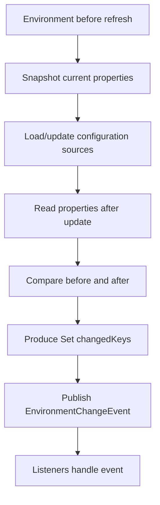
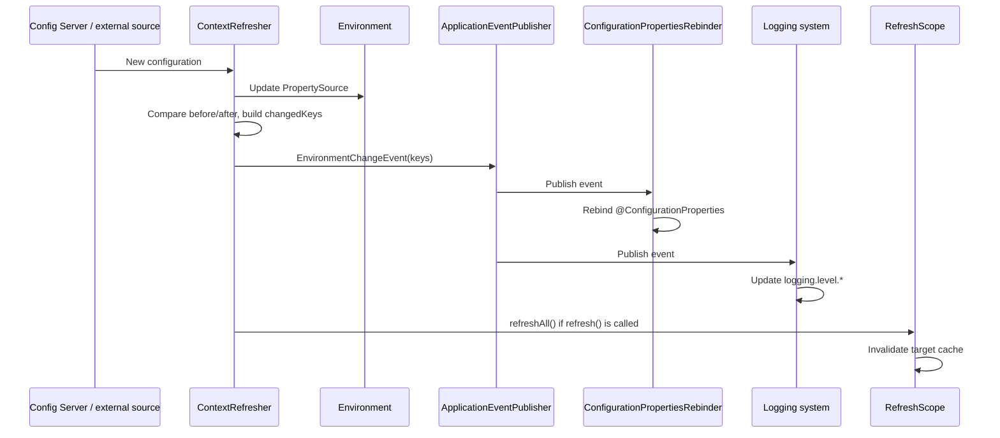
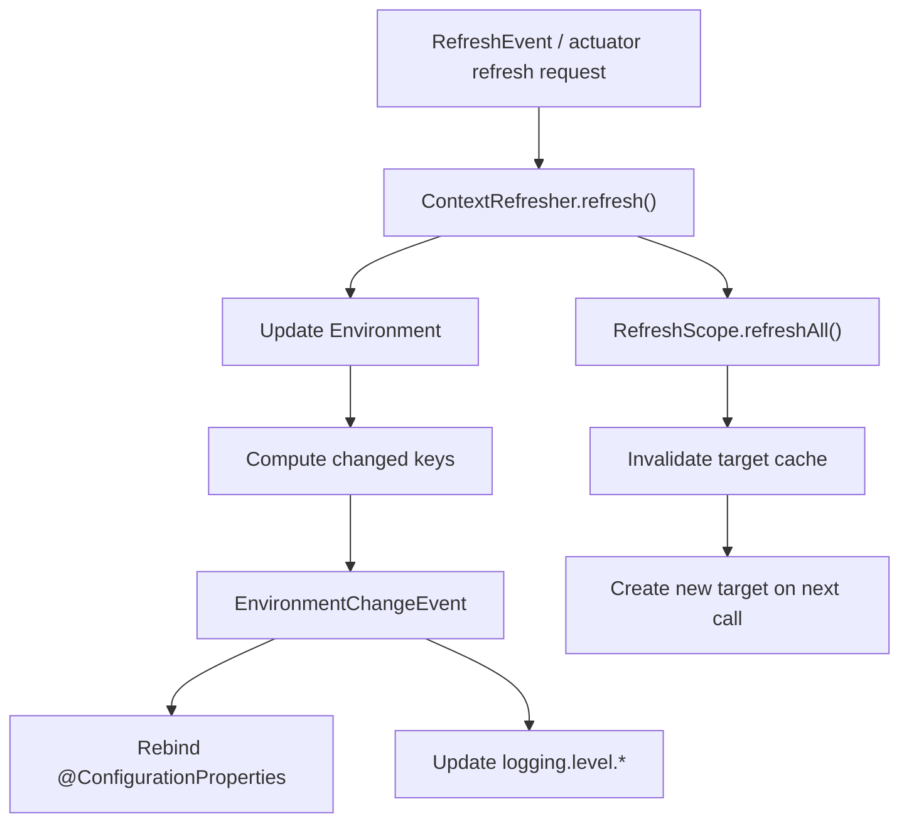

# EnvironmentChangeEvent and the Changed Key Set

In a Spring Cloud application, configuration can change while the application is running: a service call timeout is adjusted, a connection limit is increased, a feature flag is enabled, or a log level is changed to diagnose an incident. After `Environment` receives the new values, the application needs to know **which properties have changed** and take the appropriate action.

`EnvironmentChangeEvent` is a Spring Cloud Context event used to notify that the Environment has changed. The central payload of the event is a `Set<String>` containing the names of the keys considered to have changed. Listeners registered in the application context can use this key set to react; standard Spring Cloud listeners support rebinding `@ConfigurationProperties` and updating logger levels for `logging.level.*` keys.

For **SPRING_CLOUD_CORE**, understanding this event and its key set properly helps build controlled refresh workflows for externalized configuration, Spring Cloud Config, discovery, service registry, and inter-service communication. This lesson belongs to the **Configuration Refresh** chapter, focusing on event structure, how the key set is computed, Environment update ordering, and the limitations of bean rebinding.

## 1. Learning Objectives

After this lesson, you will be able to:

- Explain the role of `EnvironmentChangeEvent` in Spring Cloud Context.
- Read the changed key set via `getKeys()` and distinguish it from property values.
- Distinguish added, modified, and removed keys.
- Describe how `ContextRefresher` compares configuration before and after a refresh.
- Explain why the Environment must be updated before the event is published.
- Understand how `ConfigurationPropertiesRebinder` and the logging mechanism react to the event.
- Distinguish `EnvironmentChangeEvent`, `RefreshEvent`, and invalidating `@RefreshScope`.
- Write custom listeners that only process the key group they care about.
- Design tests for the changed key set, rebinding, and refresh.
- Operate refresh across multiple instances using an appropriate broadcast mechanism.

## 2. What Is EnvironmentChangeEvent?

`org.springframework.cloud.context.environment.EnvironmentChangeEvent` is a Spring `ApplicationEvent`. It represents a notification that a set of properties in the Environment has changed.

The core API can be understood through an example:

```java
Set<String> changedKeys = Set.of(
        "inventory.timeout",
        "inventory.max-attempts",
        "logging.level.com.example.checkout");

EnvironmentChangeEvent event =
        new EnvironmentChangeEvent(applicationContext, changedKeys);
```

The event contains:

- **Source:** the object publishing the event, typically the corresponding `ApplicationContext`.
- **Keys:** the set of property names determined to have changed.

You can retrieve the key set with:

```java
Set<String> keys = event.getKeys();
```

The event does not contain a map of old/new values. Nor does it update `Environment` itself. The configuration source must be changed first; then the event is published so listeners can perform follow-up work.

### 2.1. What Does the Key Set Mean?

For example, before refresh:

```yaml
inventory:
  timeout: 2s
  max-attempts: 2
```

After refresh:

```yaml
inventory:
  timeout: 800ms
  max-attempts: 3
```

The changed key set may be:

```text
inventory.timeout
inventory.max-attempts
```

A listener can check whether any key belongs to the `inventory.` prefix to decide if it needs to update metrics, caches, or related integration state.

### 2.2. The Event Is Not a Copy of the Environment

`EnvironmentChangeEvent` is only a signal and metadata about the changed keys. It does not carry:

- The entire `PropertySource`.
- Values before the change.
- Values after the change.
- Active profiles.
- A list of beans to recreate.
- Validation results of the new configuration.

If a listener needs the new value, it must read it again from `Environment` after the configuration source has been updated:

```java
String timeout = environment.getProperty("inventory.timeout");
```

You should not take the key set from the event and assume the new value will always be present or already bound into every bean.

## 3. Added, Changed, and Removed Keys

When comparing two configuration states, there are three cases:

| State | Before refresh | After refresh | Present in key set? |
| --- | --- | --- | --- |
| Added | Key absent | Has value | Yes |
| Changed | Has value A | Has value B different from A | Yes |
| Removed | Has value A | Key no longer present | Yes |
| Unchanged | Has value A | Still A | No |

Example:

```yaml
# Before
inventory:
  timeout: 2s
  max-attempts: 2
  legacy-mode: true
```

```yaml
# After
inventory:
  timeout: 800ms
  max-attempts: 2
  region: ap-southeast-1
```

The changed keys are:

```text
inventory.timeout
inventory.legacy-mode
inventory.region
```

`inventory.max-attempts` is not in the key set because its value did not change.

An important point: **a removed key is still a changed key**. When computing the diff, the system may record the removed key with a new value of `null`, then include the key name in the `Set<String>`. Because listeners only receive key names, they must read the current Environment to see whether the key still exists.

### 3.1. The Key Set Is Not a Prefix Set

The event typically contains full property names:

```text
inventory.timeout
inventory.retry.max-attempts
logging.level.com.example.checkout
```

Do not publish an event with a generic prefix like `inventory` and expect every standard listener to interpret that as the entire `inventory.*` property group. If you construct an event manually, pass the actual changed key names.

### 3.2. Empty Key Set

A refresh may detect no differences. In that case, the key set can be empty:

```java
Set<String> changedKeys = Set.of();
```

This does not necessarily prove the refresh workflow failed to run. It may mean the configuration source was reloaded, but the values observed by the comparison mechanism did not change.

Do not use the fact that an event was published as sole proof that the new configuration differs from the old one. Check both the key set and the final values in the Environment.

## 4. How Does ContextRefresher Compute the Key Set?

In the typical Spring Cloud Context refresh workflow, `ContextRefresher` is responsible for:

1. Capturing the current properties.
2. Loading/updating configuration sources according to the active mechanism.
3. Re-reading the properties after the update.
4. Comparing the two states.
5. Producing the changed key set.
6. Publishing `EnvironmentChangeEvent`.

Diagram:



### 4.1. Distinguishing refreshEnvironment() and refresh()

`ContextRefresher` has two important operations:

| Method | Work performed |
| --- | --- |
| `refreshEnvironment()` | Updates Environment, computes changed keys, publishes `EnvironmentChangeEvent`, and returns the key set |
| `refresh()` | Calls `refreshEnvironment()`, then instructs `RefreshScope` to refresh cached targets |

Therefore, calling only `refreshEnvironment()` does not mean beans in `@RefreshScope` have been invalidated. The `refresh()` method performs the additional scope refresh step.

### 4.2. Comparing Configuration Before and After

In current implementations, `ContextRefresher` extracts properties from sources whose keys can be enumerated, including `EnumerablePropertySource` and the members of `CompositePropertySource`. It builds before/after states and compares them:

- Key present only after update: new key.
- Key present in both with different values: changed key.
- Key present only before update: removed key.
- Key with identical value: ignored.

Not every custom source can enumerate property names. A `PropertySource` that does not support enumeration may not participate fully in automatic diff computation. If the application manages such a source itself, you must explicitly define how events and key lists are published.

### 4.3. The Key Set Is Not a Default Bean Filter

`Set<String>` is very useful for custom listeners to know which properties changed. However, do not assume `ConfigurationPropertiesRebinder` always maps each key to a single bean and rebinds only that bean.

In current implementations, when receiving a valid event from the application context, `ConfigurationPropertiesRebinder` runs the rebind process on the `@ConfigurationProperties` beans it tracks. The event's key set provides information about changes; it is not a guarantee that the built-in rebinder only processes beans whose prefix matches the keys.

If you need selective behavior by prefix or key, write a dedicated listener/handler and test that filtering condition.

## 5. Sequence of Environment Update and Event Publication

Execution order is critical. Listeners must be able to read the new values when they receive the event.



The diagram describes the standard workflow conceptually. Event listeners may be invoked in Spring's registration/ordering sequence; do not rely on a custom listener always running after all other listeners unless you have declared and tested the ordering.

### 5.1. If the Event Is Published Before Updating the Environment

If a listener runs while the Environment still contains old values, it will read the old configuration and may rebind beans back to old values. When the source is updated afterward without a second event, beans can remain in an unintended state.

Operational rule:

1. Update the `PropertySource` or load the new source.
2. Compute the changed keys.
3. Publish the event with that key set.
4. Let listeners read the new values and perform their actions.

### 5.2. Publishing the Event Does Not Change the Data Source Itself

The following code only sends a signal:

```java
context.publishEvent(new EnvironmentChangeEvent(
        context,
        Set.of("inventory.timeout")));
```

It does not fetch Config Server, edit YAML files, add a property source, or change environment variables. Without updating the Environment beforehand, listeners may simply rebind the old value again.

## 6. Standard Spring Cloud Listeners

Spring Cloud Context can react to `EnvironmentChangeEvent` in several common ways:

| Listener/mechanism | Reaction |
| --- | --- |
| `ConfigurationPropertiesRebinder` | Rebinds managed `@ConfigurationProperties` beans |
| Logging rebinding | Updates log levels for properties under `logging.level.*` |
| Application-declared listener | Reacts to key groups the application cares about |

### 6.1. Rebinding @ConfigurationProperties

Example configuration bean:

```java
@ConfigurationProperties(prefix = "inventory")
@Validated
public class InventoryProperties {

    @NotNull
    private Duration timeout = Duration.ofSeconds(2);

    @Min(1)
    private int maxAttempts = 3;

    public Duration getTimeout() {
        return timeout;
    }

    public void setTimeout(Duration timeout) {
        this.timeout = timeout;
    }

    public int getMaxAttempts() {
        return maxAttempts;
    }

    public void setMaxAttempts(int maxAttempts) {
        this.maxAttempts = maxAttempts;
    }
}
```

When the event is published after the Environment has been updated, the rebinder can rebind the bean's values. Components using this bean can then observe the updated configuration.

### 6.2. Resetting to Default Values When a Property Is Removed

If a property has been removed from the Environment, rebinding should not keep the old value in the field indefinitely. Under Spring Cloud Context's reset mechanism, `@ConfigurationProperties` bean properties are reset to class-level defaults before rebinding; this operation can also recurse into nested configuration objects.

Example:

```java
private Duration timeout = Duration.ofSeconds(2);
```

If `inventory.timeout` is removed, the value can return to `2s` instead of retaining the old runtime value. Reset details depend on the bean's constructor structure and the rules of the Spring Cloud version in use.

### 6.3. Limitations with Constructor Binding and Java Records

`@ConfigurationProperties` beans using constructor binding, including Java records, are not refreshed by the standard mutable-field rebind mechanism. If configuration needs to change at runtime, consider an appropriate mutable bean, a `@RefreshScope` bean that creates a new target, or a dedicated update strategy.

### 6.4. Rebinding Does Not Replace the Instance

Standard rebinding updates the fields of the same bean instance. It does not necessarily destroy the old object and replace it with a new one.

In current implementations, concurrent rebinds of the same bean are serialized with respect to each other. However, serializing two rebind operations does not make threads reading the bean safe while rebinding is in progress. Because the object is updated in place, a concurrent reader can observe an intermediate state where some fields have been reset/updated while others have not finished.

If the application needs a consistent configuration view during a refresh, evaluate `@RefreshScope` for the appropriate bean. Refresh scope manages target/proxy lifecycle and coordinates reads with refreshes via its own mechanism.

## 7. Updating logging.level.*

Spring Cloud Context supports changing log levels when `logging.level.*` keys change.

Example configuration:

```yaml
logging:
  level:
    com.example.checkout: INFO
    org.springframework.cloud: WARN
```

If `logging.level.com.example.checkout` changes to `DEBUG` and `EnvironmentChangeEvent` is published, the logging rebinding mechanism can update the corresponding logger without restarting the application.

The key set may contain:

```text
logging.level.com.example.checkout
```

Custom listeners can ignore `logging.level.*` keys if they are not responsible for managing logging, because Spring Cloud already provides standard behavior.

Note: early-startup logging configuration has its own rules. Not all logging properties can be changed at runtime via events; this section focuses on logger levels.

## 8. Writing Custom Listeners by Key Set

An application can register listeners to handle only the property groups relevant to its functionality.

### 8.1. Listener with @EventListener

```java
import java.util.Set;

import org.springframework.cloud.context.environment.EnvironmentChangeEvent;
import org.springframework.context.event.EventListener;
import org.springframework.core.env.Environment;
import org.springframework.stereotype.Component;

@Component
public class InventoryConfigurationListener {

    private final Environment environment;

    public InventoryConfigurationListener(Environment environment) {
        this.environment = environment;
    }

    @EventListener
    public void onEnvironmentChange(EnvironmentChangeEvent event) {
        Set<String> keys = event.getKeys();

        boolean inventoryChanged = keys.stream()
                .anyMatch(key -> key.startsWith("inventory."));

        if (!inventoryChanged) {
            return;
        }

        String timeout = environment.getProperty("inventory.timeout");
        // Record a safe diagnostic or trigger application-specific work.
    }
}
```

The listener checks the `inventory.` prefix. If no key belongs to this group, it returns early. If there is a match, it reads the value again from the Environment.

Do not log the entire configuration. If observability is needed, log the key names or a value confirmed to be non-sensitive.

### 8.2. Listener with ApplicationListener

You can implement it directly:

```java
@Component
public class LoggingConfigurationAuditListener
        implements ApplicationListener<EnvironmentChangeEvent> {

    @Override
    public void onApplicationEvent(EnvironmentChangeEvent event) {
        event.getKeys().stream()
                .filter(key -> key.startsWith("logging.level."))
                .forEach(key -> {
                    // Audit the changed logger name, not the full configuration.
                });
    }
}
```

`@EventListener` suits small handlers, while `ApplicationListener` is useful when you want to declare the event type explicitly in the class signature.

### 8.3. Do Not Use Event Listeners to Replace Configuration Binding

If the goal is simply to receive new configuration values, let `@ConfigurationProperties` and the standard rebinding mechanism handle it. Custom listeners should only perform truly necessary work, such as:

- Clearing caches built from configuration.
- Emitting metrics or audit events.
- Refreshing an adapter not managed by Spring Cloud.
- Notifying a business component of a state change.

Avoid manually rebinding all configuration inside a listener unless specifically required; doing so can overlap with `ConfigurationPropertiesRebinder`.

## 9. Updating a PropertySource Manually and Publishing the Event

In an application that needs to update a runtime value it manages itself, you can replace a `MapPropertySource` and then publish the event.

Abbreviated service example:

```java
import java.time.Duration;
import java.util.HashMap;
import java.util.Map;
import java.util.Set;

import org.springframework.cloud.context.environment.EnvironmentChangeEvent;
import org.springframework.context.ConfigurableApplicationContext;
import org.springframework.core.env.ConfigurableEnvironment;
import org.springframework.core.env.MapPropertySource;
import org.springframework.core.env.MutablePropertySources;
import org.springframework.stereotype.Service;

@Service
public class RuntimeInventorySettings {

    private static final String SOURCE_NAME = "runtimeInventoryOverrides";

    private final ConfigurableApplicationContext context;
    private final ConfigurableEnvironment environment;

    public RuntimeInventorySettings(
            ConfigurableApplicationContext context,
            ConfigurableEnvironment environment) {
        this.context = context;
        this.environment = environment;
    }

    public void updateTimeout(Duration timeout) {
        Map<String, Object> values = new HashMap<>();
        values.put("inventory.timeout", timeout);

        MutablePropertySources sources = environment.getPropertySources();
        MapPropertySource replacement =
                new MapPropertySource(SOURCE_NAME, values);

        if (sources.contains(SOURCE_NAME)) {
            sources.replace(SOURCE_NAME, replacement);
        }
        else {
            sources.addFirst(replacement);
        }

        context.publishEvent(new EnvironmentChangeEvent(
                context,
                Set.of("inventory.timeout")));
    }
}
```

The example illustrates the essential steps:

1. Create an override source containing the new value.
2. Replace or add the source in the Environment.
3. Publish the event with the exact key name that changed.
4. Listeners re-read the property and rebind the appropriate beans.

### 9.1. Choosing Precedence Deliberately

In the example, `addFirst` places the runtime source at the top of the Environment. This is a decision that can override configuration files, environment variables, or lower-priority remote sources in the current set. Use it only when application policy genuinely allows it.

If the source only provides defaults, you can use `addLast`. If you need to place the source relative to a known source, use `addBefore` or `addAfter` and verify the reference source name.

### 9.2. The Key Set Must Reflect Actual Changes

Do not publish `inventory.timeout` if the operation only changed `inventory.max-attempts`. If multiple keys are updated, include all actual changed keys in the same set:

```java
Set<String> changedKeys = Set.of(
        "inventory.timeout",
        "inventory.max-attempts");
```

The event is the information listeners rely on to decide actions. An incorrect or incomplete key set can cause custom listeners to miss an important change.

### 9.3. Synchronizing Multi-Key Updates

If multiple properties must change as a logical group, update them in a single source replacement and publish one event containing all keys. Avoid publishing multiple separate events while the new configuration is only partially updated, because listeners may observe intermediate states.

For requirements needing atomic updates across multiple beans, evaluate `@RefreshScope` or an immutable configuration snapshot design instead of relying on multiple field mutations.

## 10. Distinguishing EnvironmentChangeEvent, RefreshEvent, and RefreshScope

These three concepts are related but do not replace one another.

| Component | Meaning | Primary effect |
| --- | --- | --- |
| `EnvironmentChangeEvent` | Environment has changed; includes key set | Listeners rebind configuration, update log levels, or run custom handlers |
| `RefreshEvent` | Request to execute a refresh workflow | `RefreshEventListener` can invoke `ContextRefresher.refresh()` when the application is ready |
| `RefreshScope` | Scope managing target beans via proxy/cache | Invalidates targets and recreates them on the next access |

Typical flow:



Publishing `EnvironmentChangeEvent` directly does not automatically call `RefreshScope.refreshAll()`. If you need both rebinding and invalidating refresh-scoped beans, use an appropriate refresh workflow such as `ContextRefresher.refresh()` or the corresponding management mechanism.

## 11. Spring Cloud Config and Spring Cloud Bus

Spring Cloud Config Client does not automatically poll Config Server for every change after the application has started. A refresh trigger mechanism is needed:

- Calling the appropriate management endpoint on an instance.
- Publishing an internal event when the configuration source is updated.
- Using Spring Cloud Bus to propagate refresh notifications to multiple instances.

### 11.1. Why Per-Instance Polling Is Not Ideal

Suppose there are 20 replicas of `checkout-service`. If each replica polls Config Server on its own:

- It can generate many repetitive requests.
- Instances can detect changes at different times.
- It can create load spikes on Config Server.
- It is harder to coordinate rollout state and observe configuration versions.

Spring Cloud Bus allows broadcasting events to instances connected to the bus, enabling them to execute the refresh workflow according to the configured mechanism.

### 11.2. An Event on One Instance Does Not Automatically Spread to the Cluster

`ApplicationEventPublisher` publishes events within the current application's context. It does not automatically send events to other JVMs.

With multiple instances, you need a messaging mechanism such as Spring Cloud Bus or custom orchestration. Once each instance receives the notification, that instance still needs to update its Environment and handle the event locally.

### 11.3. Tracking Results After Broadcast

Do not treat the Bus receiving an event as proof that all replicas applied the configuration successfully. Observe:

- Number of instances that received the refresh.
- Number of instances that completed rebinding/refresh.
- Validation errors or bean recreation errors.
- Active configuration values on each instance.
- Readiness and request success rate after refresh.

## 12. Securing Endpoints and Operational Workflows

Spring Boot Actuator can expose endpoints for updating the Environment and refreshing depending on dependencies, versions, and configuration. Common operations include:

| Endpoint | General role |
| --- | --- |
| `POST /actuator/env` | Updates the Environment and triggers change handling per endpoint configuration |
| `POST /actuator/refresh` | Refreshes the Environment and refresh scope per Spring Cloud's mechanism |
| `POST /actuator/busrefresh` | When using Spring Cloud Bus, broadcasts a refresh request to matching instances |

Paths and availability depend on the version, Actuator/Bus modules, and exposure configuration. Do not assume every endpoint is enabled by default.

### 12.1. Restricting Allowed Keys for Updates

If you enable an endpoint that allows writing properties, restrict which keys may be updated via appropriate configuration, such as a regular expression permitting safe property groups. Do not allow an untrusted client to arbitrarily change:

- `spring.datasource.*`.
- Credentials.
- Security configuration.
- Internal registry or endpoint addresses.
- Properties controlling logging or actuator beyond operational scope.

### 12.2. Protecting Endpoints

- Enable authentication and authorization.
- Restrict network exposure or use a dedicated management port.
- Audit the user/process requesting the refresh.
- Validate new data before broadcasting.
- Monitor rebind and refresh scope errors.
- Have a rollback plan when a group of instances fails to apply configuration.

The changed key set can contain sensitive property names even when it contains no values. Do not send event keys to public logging systems if key names themselves disclose internal information.

## 13. Testing EnvironmentChangeEvent

Tests should verify both the event payload and listener behavior.

### 13.1. Testing the Key Set

```java
@Test
void eventContainsChangedKeys() {
    Set<String> keys = Set.of(
            "inventory.timeout",
            "inventory.max-attempts");

    EnvironmentChangeEvent event =
            new EnvironmentChangeEvent(context, keys);

    assertThat(event.getKeys())
            .containsExactlyInAnyOrder(
                    "inventory.timeout",
                    "inventory.max-attempts");
}
```

This test verifies that the event holds the passed key set. It does not test whether `ContextRefresher` computes the diff accurately between two Environments.

### 13.2. Testing That a Listener Only Reacts to the Needed Prefix

```java
@Test
void inventoryListenerIgnoresUnrelatedKeys() {
    Set<String> keys = Set.of("logging.level.com.example");
    EnvironmentChangeEvent event =
            new EnvironmentChangeEvent(context, keys);

    listener.onEnvironmentChange(event);

    assertThat(inventoryRefreshCounter.get()).isZero();
}
```

For keys under `inventory.`, verify the listener executes the expected action exactly once.

### 13.3. Testing Removed Keys

Create two property source states:

```text
Before: inventory.legacy-mode = true
After:  no inventory.legacy-mode
```

Verify the key set contains `inventory.legacy-mode`. Then check that the `@ConfigurationProperties` bean returns to the appropriate default or that the application handles the absence as designed.

### 13.4. Testing Configuration Bean Rebinding

An integration test should:

1. Initialize the context with `inventory.timeout=2s`.
2. Retrieve the `InventoryProperties` bean and assert the initial value.
3. Replace the property source with `inventory.timeout=800ms`.
4. Publish `EnvironmentChangeEvent` from the matching application context.
5. Verify the configuration bean receives the new value.

The test must use the same `@ConfigurationProperties` registration and validation setup as the application. If you only create an `EnvironmentChangeEvent` without updating the Environment, the new value cannot appear on its own.

### 13.5. Testing Refresh Scope Separately

If the application also has `@RefreshScope` beans, test separately that:

- `EnvironmentChangeEvent` rebinds tracked configuration beans.
- The `ContextRefresher.refresh()` workflow also invalidates refresh scope.
- The proxy stays stable while the target is recreated on the next invocation.

Do not conclude refresh scope ran just because `@ConfigurationProperties` received new values.

## 14. Diagnosing When the Event Fired but Configuration Did Not Change

| Symptom | Possible cause | How to check |
| --- | --- | --- |
| `getKeys()` is empty | No difference detected between before/after states | Check source values and diff algorithm |
| Listener is not invoked | Listener is not in the context or event was published in another context | Check bean registration and event source |
| Listener receives keys but reads old value | Event was published before updating Environment | Check order of source update and event publication |
| `@ConfigurationProperties` did not change | Bean is not tracked by rebinder or binding failed | Check bean registration, validation, and rebinder logs |
| Only some fields changed | Missing property, wrong key name, or conversion/validation error | Check individual keys and binding state |
| Config bean changed but client still uses old value | Client kept value in constructor or is not refresh-scoped | Check client lifecycle and proxy |
| `@RefreshScope` did not change | Only `EnvironmentChangeEvent` was published without invalidating scope | Use a refresh workflow that runs `refreshAll()` |
| Some replicas still use old configuration | Event was published in only one JVM or broadcast did not reach all instances | Check Spring Cloud Bus and state of each replica |
| Property removed but bean keeps old value | Reset/rebind does not fit bean structure or key was not handled as expected | Check defaults, constructor, and rebinder logs |

### 14.1. Check the Source and Value Before Checking the Listener

If a listener does not produce the expected result, follow this order:

1. Confirm the new property source was added or replaced.
2. Read the new value via `Environment`.
3. Confirm the key set contains the exact property name.
4. Confirm the event was published from the application context managing the bean.
5. Verify the listener is registered in that context.
6. Check whether rebinding or custom actions threw an error.
7. Check whether consuming beans hold an old reference or need refresh scope.

Do not start by increasing retries or publishing the event repeatedly; repeated events cannot fix an Environment that has not been updated.

## 15. Real-World Scenario: Changing Inventory Timeout and Retry Count

`checkout-service` calls `inventory-service` with configuration:

```yaml
inventory:
  timeout: 2s
  max-attempts: 2
  region: local
```

Operations updates it to:

```yaml
inventory:
  timeout: 800ms
  max-attempts: 3
  region: local
```

### 15.1. Changed Key Set

After ContextRefresher compares before/after states:

```text
inventory.timeout
inventory.max-attempts
```

`inventory.region` is not included in the set because its value did not change.

### 15.2. Application Reaction

- `ConfigurationPropertiesRebinder` receives the event and rebinds tracked configuration beans.
- A custom listener can emit a metric for changes under the `inventory.` prefix.
- If the HTTP client stores the timeout in its constructor and needs to be recreated, the client bean can be annotated with `@RefreshScope`.
- Other instances in the cluster need to receive the refresh notification via a broadcast mechanism.

### 15.3. Verification After Refresh

- `Environment#getProperty("inventory.timeout")` returns `800ms`.
- `InventoryProperties` reflects the new timeout and max-attempts.
- Refresh-scoped clients use the new target on the next invocation.
- Metrics record a successful refresh.
- Replicas have applied the configuration with no validation errors.

If you only publish the event without updating the property source, all subsequent steps can still use old values. If you only rebind `InventoryProperties` while the client neither re-reads the property nor refreshes, the client may continue keeping the old timeout.

## 16. Design Principles

- Update the Environment before publishing `EnvironmentChangeEvent`.
- Pass full key names accurately reflecting added, changed, or removed properties.
- Treat `getKeys()` as metadata about changes, not as configuration values.
- Let `ConfigurationPropertiesRebinder` handle standard rebinding; custom listeners should handle only custom responsibilities.
- Do not assume the key set filters the exact beans rebound by default.
- Distinguish `refreshEnvironment()` from `refresh()` and `RefreshScope` invalidation.
- Test constructor-bound properties, nested properties, and validation errors during rebinding.
- Do not rely on default Config Client polling; use an appropriate trigger/broadcast mechanism.
- With multiple instances, verify each replica received and applied the refresh.
- Protect management endpoints, restrict updatable keys, and do not log sensitive data.

## 17. Summary

`EnvironmentChangeEvent` is a Spring Cloud Context notification indicating that the Environment has changed. It carries a `Set<String>` containing the property names determined to have been added, changed, or removed. The event does not carry old/new values and does not update the Environment itself.

`ContextRefresher` typically snapshots property state before and after loading configuration, computes the changed key set, and publishes the event. Standard listeners can rebind `@ConfigurationProperties` and update logger levels for `logging.level.*`. The key set also enables custom listeners to react by configuration group; however, you should not assume the built-in rebinder only rebinds beans matching individual keys.

`EnvironmentChangeEvent` and `RefreshScope` address two different parts. The event supports rebinding and handling configuration changes; `ContextRefresher.refresh()` also invalidates the refresh scope target cache. When deploying across multiple replicas, you need to broadcast events and verify each instance's state. Understanding the key set, update ordering, and bean lifecycle makes the refresh workflow observable, testable, and safe to operate.

## 18. References

- [Spring Cloud Commons — Environment Changes](https://docs.spring.io/spring-cloud-commons/reference/spring-cloud-commons/application-context-services.html#environment-changes)
- [Spring Cloud Commons — ContextRefresher source](https://github.com/spring-cloud/spring-cloud-commons/blob/main/spring-cloud-context/src/main/java/org/springframework/cloud/context/refresh/ContextRefresher.java)
- [Spring Cloud Commons — EnvironmentChangeEvent source](https://github.com/spring-cloud/spring-cloud-commons/blob/main/spring-cloud-context/src/main/java/org/springframework/cloud/context/environment/EnvironmentChangeEvent.java)
- [Spring Cloud Commons — ConfigurationPropertiesRebinder source](https://github.com/spring-cloud/spring-cloud-commons/blob/main/spring-cloud-context/src/main/java/org/springframework/cloud/context/properties/ConfigurationPropertiesRebinder.java)
- [Spring Cloud Commons — Refresh Scope](https://docs.spring.io/spring-cloud-commons/reference/spring-cloud-commons/application-context-services.html#refresh-scope)
- [Spring Cloud Bus — Reference Documentation](https://docs.spring.io/spring-cloud-bus/reference/)
- [Spring Boot Actuator — Configuration Properties Endpoint](https://docs.spring.io/spring-boot/reference/actuator/endpoints.html)
