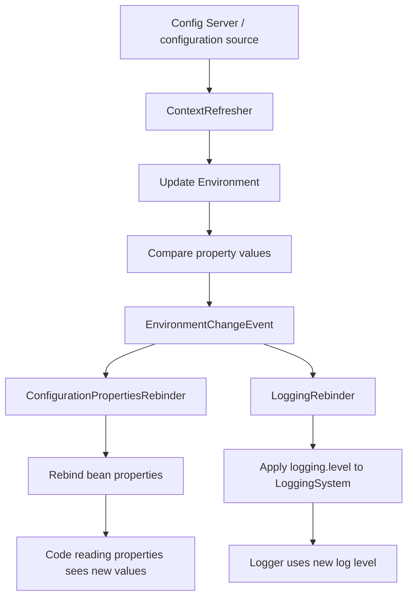
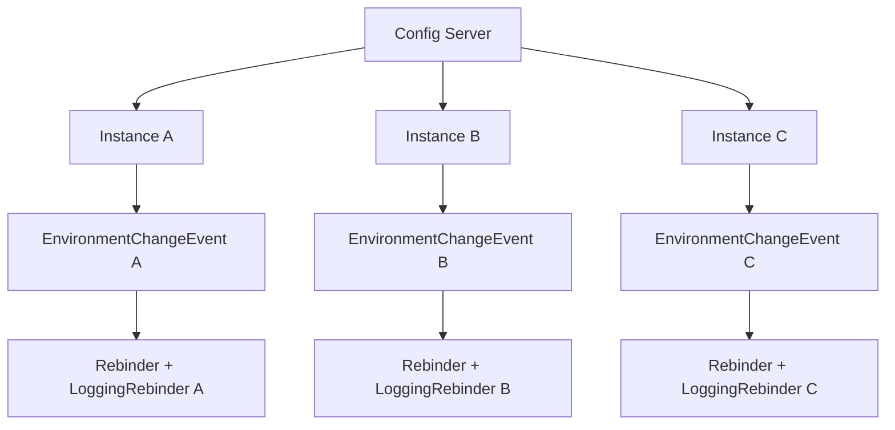

# Rebinding `@ConfigurationProperties` and Updating `logging.level`

When externalized configuration changes, a Spring Cloud application needs running components to receive the new values. Spring Cloud Context provides mechanisms to detect changes in `Environment`, publish `EnvironmentChangeEvent`, and connect that event to components such as **`ConfigurationPropertiesRebinder`** and **`LoggingRebinder`**. As a result, certain configuration beans can be rebound and log levels can be changed while the application is still running.

These two behaviors are related yet distinct. `@ConfigurationProperties` describes how configuration is mapped into a Java object; the rebinder updates beans in this group when receiving the appropriate event. `logging.level` is applied to the logging system through `LoggingRebinder`, rather than merely being a field in a properties bean. Understanding the event flow helps avoid assuming that editing a configuration file causes every object to change immediately.

This lesson belongs to the **Configuration Refresh** chapter of the `SPRING_CLOUD_CORE` module. The content focuses on the rebind lifecycle, updating `logging.level` from external configuration sources, precedence, limitations, Actuator security, and testing runtime changes.

## 1. From Configuration Change to New Behavior

Suppose a service configures retry counts and log levels:

```yaml
catalog:
  retry:
    max-attempts: 3
    backoff: 500ms

logging:
  level:
    root: INFO
    com.example.catalog: INFO
```

While the application is running, the operations team wants to increase `max-attempts` to `5` and enable `DEBUG` for the `com.example.catalog` package to investigate an incident. If these values come from Config Server, committing changes to the configuration repository only updates the **data source**. Running instances still need to reload the configuration and process the change event.

Overall flow:



In this flow:

1. A refresh mechanism fetches the new configuration and updates the instance's `Environment`.
2. Spring Cloud Context identifies the keys whose values changed and publishes `EnvironmentChangeEvent`.
3. `ConfigurationPropertiesRebinder` processes eligible `@ConfigurationProperties` beans.
4. `LoggingRebinder` processes logging-related changes and updates log levels through the logging system.

`EnvironmentChangeEvent` is a signal about **which keys have changed**. It does not fetch configuration from Config Server by itself. If you only publish the event manually without updating `Environment` first, listeners will process the existing values and will not automatically know where the new values are.

## 2. `EnvironmentChangeEvent` and the Role of Spring Cloud Context

### 2.1. What Does the Event Represent?

`EnvironmentChangeEvent` carries the set of property names determined to have changed in `Environment`. Listeners can use the key list to decide which components need updating.

For example, the key set might include:

```text
catalog.retry.max-attempts
catalog.retry.backoff
logging.level.com.example.catalog
```

The event does not mean every bean in the context is destroyed and recreated. Each listener has its own scope: the rebinder handles configuration property beans, the logging rebinder handles logging, while refresh scope has its own target invalidation mechanism.

### 2.2. ContextRefresher

In a Spring Cloud Context application, `ContextRefresher` coordinates refreshing the Environment. With supported remote configuration, it loads/updates configuration sources, identifies changed properties, and publishes the corresponding event. The Actuator `/actuator/refresh` endpoint typically invokes this mechanism.

A refresh operation should not be understood simply as "re-reading a YAML file." Depending on the version and Config Client integration, the workflow may process Config Data, remote property sources, profiles, and other configuration sources. Always use the right dependencies and release train for your application.

### 2.3. Events and Refresh Scope Are Two Separate Processing Branches

`ConfigurationPropertiesRebinder` and `LoggingRebinder` handle `EnvironmentChangeEvent`. `@RefreshScope` uses a refreshable scope to invalidate target beans and create new targets on the next access. Both mechanisms are often triggered in the same Spring Cloud Context refresh workflow, but they should not be conflated:

| Mechanism | Target affected | Result |
| --- | --- | --- |
| `EnvironmentChangeEvent` + rebinder | Eligible `@ConfigurationProperties` beans | Bean properties are rebound according to the rebinder mechanism |
| `EnvironmentChangeEvent` + `LoggingRebinder` | Logging configuration | Logging system receives the new log levels |
| Refresh scope invalidation | Target beans in `@RefreshScope` | Old target is invalidated; new target is created when the proxy is invoked |

Not every bean needs `@RefreshScope`. If a mutable properties bean is updated by the rebinder and the service calls getters dynamically, recreating the service may not be necessary. If a bean creates a resource from configuration and that resource must be rebuilt, refresh scope or a reconfiguration API may be more appropriate.

## 3. How Does Rebinding `@ConfigurationProperties` Work?

### 3.1. Properties Beans Must Be Registered

First, the configuration class must be managed by Spring via `@ConfigurationPropertiesScan` or `@EnableConfigurationProperties`.

```java
import java.time.Duration;
import jakarta.validation.constraints.Min;
import jakarta.validation.constraints.NotNull;
import org.springframework.boot.context.properties.ConfigurationProperties;
import org.springframework.validation.annotation.Validated;

@Validated
@ConfigurationProperties(prefix = "catalog.retry")
public class CatalogRetryProperties {
    @Min(1)
    private int maxAttempts = 3;

    @NotNull
    private Duration backoff = Duration.ofMillis(500);

    public int getMaxAttempts() {
        return maxAttempts;
    }

    public void setMaxAttempts(int maxAttempts) {
        this.maxAttempts = maxAttempts;
    }

    public Duration getBackoff() {
        return backoff;
    }

    public void setBackoff(Duration backoff) {
        this.backoff = backoff;
    }
}
```

Registering the properties class:

```java
import org.springframework.boot.SpringApplication;
import org.springframework.boot.autoconfigure.SpringBootApplication;
import org.springframework.boot.context.properties.ConfigurationPropertiesScan;

@SpringBootApplication
@ConfigurationPropertiesScan
public class CatalogApplication {
    public static void main(String[] args) {
        SpringApplication.run(CatalogApplication.class, args);
    }
}
```

The example uses `jakarta.validation`; older Spring Boot projects may require a different validation namespace. For validation annotations to work, an appropriate Bean Validation provider must be on the classpath.

### 3.2. ConfigurationPropertiesRebinder

Spring Cloud Context provides `ConfigurationPropertiesRebinder` to handle configuration beans when the Environment changes. Upon receiving `EnvironmentChangeEvent`, the rebinder identifies beans managed as configuration properties and executes the rebind lifecycle supported by the Spring Cloud version.

From a usage standpoint, what matters is that the `CatalogRetryProperties` bean is updated with the new values already present in `Environment`. A service holding a reference to the properties bean and calling getters when performing work can observe the rebound values:

```java
import java.time.Duration;
import org.springframework.stereotype.Service;

@Service
public class CatalogRetryPolicy {
    private final CatalogRetryProperties properties;

    public CatalogRetryPolicy(CatalogRetryProperties properties) {
        this.properties = properties;
    }

    public boolean shouldRetry(int attempt) {
        return attempt < properties.getMaxAttempts();
    }

    public Duration currentBackoff() {
        return properties.getBackoff();
    }
}
```

`CatalogRetryPolicy` does not copy `maxAttempts` into a separate field in its constructor. Each time it makes a retry decision, it calls getters on the Spring-managed properties bean. Because of this, when the rebinder updates the object via the context mechanism, the policy can use the new values.

### 3.3. Rebinding Does Not Update Objects That Took a Snapshot

If a service copies the value at initialization time:

```java
@Service
public class FixedRetryPolicy {
    private final int maxAttempts;

    public FixedRetryPolicy(CatalogRetryProperties properties) {
        this.maxAttempts = properties.getMaxAttempts();
    }
}
```

then `maxAttempts` remains a snapshot. Rebinding the properties bean does not automatically find every field on other beans and reassign them. You should read from the properties bean at usage time, place the consuming bean in a refreshable scope if appropriate, or implement an explicit reconfiguration API.

### 3.4. Mutable and Immutable Configuration Properties

Rebinding fits best with properties beans that have a supported rebind mechanism, typically mutable JavaBeans with setters. For constructor-bound types, records, or immutable objects, do not assume the rebinder can update `final` fields the same way as a mutable bean.

If configuration needs to be immutable:

- You can place the configuration-consuming bean in `@RefreshScope` so a new target is created from the new Environment, if dependencies and lifecycle allow.
- You can use a provider/factory that creates a new immutable settings object per configuration version.
- You can choose a restart/rollout if the change should only apply at startup.

Exact rebinder behavior across binding styles depends on the Spring Boot/Spring Cloud version. Test on your exact release train before relying on immutable properties in a production refresh workflow.

## 4. Limitations and Caveats When Rebinding

Rebinding is a mechanism for updating configuration beans, not a magic transformation of the entire application state.

### 4.1. Beans Must Be Within the Appropriate Management Scope

An object created with `new CatalogRetryProperties()` and stored in a static field is not managed by the rebinder. Similarly, a bean that is not properly registered or not recognized as configuration properties may not be updated.

### 4.2. Consumers May Have Copied Values

If a service stores an `int`, `String`, `URI`, or `Duration` from properties into a field, that field remains the copied value. Keep a reference to the properties bean and call getters when needed, or use an explicit recreation strategy.

### 4.3. Resources Created from Properties Do Not Change Automatically

For example, a bean creates an HTTP client from `base-url` or a connection pool from `max-size`. Rebinding properties does not automatically reconfigure a previously created client or pool. You must check whether the resource's API supports runtime updates, or create a new resource and close the old one following a safe lifecycle.

### 4.4. Validation and Binding Errors

New values may be invalid. For instance, `max-attempts=0` violates `@Min(1)`, or `backoff` cannot be converted to a `Duration`. You need to observe logs and refresh status, test errors before deployment, and have a rollback procedure. Do not assume refresh succeeded just because the endpoint returned an HTTP response.

### 4.5. A Configuration Change Is Not a Business Transaction

If multiple related properties need to change together, group them into a configuration structure/version and test the consumed snapshot. An in-flight request may have already read the old value before rebinding completed; define clearly whether current requests are allowed to use the old version or must check the new version.

## 5. Updating `logging.level` While the Application Is Running

### 5.1. Declaring Log Levels in Configuration

Spring Boot supports configuring log levels by root logger or logger name:

```yaml
logging:
  level:
    root: INFO
    com.example.catalog: INFO
    com.example.catalog.client: WARN
```

Common levels:

| Level | Meaning |
| --- | --- |
| `TRACE` | Very fine-grained details, usually for short-term diagnostics |
| `DEBUG` | Information for debugging |
| `INFO` | Normal operational events |
| `WARN` | Situations requiring attention, though the application can continue |
| `ERROR` | Errors that need handling or investigation |
| `OFF` | Disables logging on the corresponding logger |

Child loggers usually inherit the effective level from their parent logger if they have no explicit configuration. For example, `com.example.catalog.client` can use `WARN` while the rest of `com.example.catalog` uses `INFO`.

### 5.2. LoggingRebinder

Spring Cloud Context includes `LoggingRebinder` to listen for Environment changes related to logging. When keys under the `logging.*` group change in a refresh event, this component updates log levels through Spring Boot's `LoggingSystem`.

For example, Config Server returns new configuration:

```yaml
logging:
  level:
    root: INFO
    com.example.catalog: DEBUG
    com.example.catalog.client: TRACE
```

After the instance loads the new properties and publishes `EnvironmentChangeEvent`, `LoggingRebinder` can apply the new log levels to the logging system without restarting the entire JVM.

This is a dedicated mechanism for logging. `logging.level.*` does not need to be bound into a custom `@ConfigurationProperties` bean and applied via manual setters. The logging system is where log level configuration takes effect.

### 5.3. Effective Log Level and Source Configuration

When a logger has its own configuration, the effective log level can differ from the root level. Distinguish:

- **Configured level:** the level explicitly configured for the logger.
- **Effective level:** the level the logger actually uses after considering inheritance from parent loggers.

For example, if root is `INFO` and package `com.example.catalog` has no separate level, loggers in that package typically have an effective level of `INFO`. If you set the package to `DEBUG`, loggers in the package can emit debug logs.

Log levels can also be overridden by a source with higher precedence than Config Server, such as container environment variables, `SPRING_APPLICATION_JSON`, or command-line arguments. If remote config changes `logging.level.com.example.catalog` but the effective value does not change, check property source precedence before concluding `LoggingRebinder` is broken.

## 6. Two Ways to Control Logging at Runtime

There are two common ways to change log levels while the application is running. They serve different purposes.

### 6.1. Changing via Configuration and Refresh

This approach fits when you want log level changes to originate from centrally managed configuration:

1. Update `logging.level.*` in Config Server or the configuration source used by the application.
2. Trigger a refresh on the instance.
3. `Environment` receives the new values.
4. `EnvironmentChangeEvent` is published.
5. `LoggingRebinder` applies the new log levels.
6. Verify the logger and actual log output.

The advantage is that configuration can be managed, reviewed, and versioned alongside other properties. On restart or another refresh, the configuration source remains the basis applied.

### 6.2. Using the Actuator Loggers Endpoint

Spring Boot Actuator provides the `loggers` endpoint to read and change log levels at runtime. For example, reading logger state:

```http
GET /actuator/loggers/com.example.catalog
```

Changing the log level:

```http
POST /actuator/loggers/com.example.catalog
Content-Type: application/json

{"configuredLevel":"DEBUG"}
```

You can set `configuredLevel` to `null` to clear the explicit configuration and let the logger inherit from its parent, according to the endpoint's semantics. This endpoint acts directly on the logging system of the instance receiving the request.

An important difference: changes via `/actuator/loggers` do not write back to Config Server or configuration files. Therefore, manual changes can be overwritten on refresh/restart or when source configuration is reapplied. If you need controlled, consistent changes across instances, update the central configuration source and then refresh/roll out according to your process.

### 6.3. Comparing the Two Approaches

| Criterion | Config source + refresh | Actuator `loggers` |
| --- | --- | --- |
| Where the decision is stored | Managed configuration source | The instance's logging system |
| Scope | Each instance receiving refresh; can be coordinated across instances | Only the instance receiving the request |
| Versioned/reviewed configuration | Yes, if the configuration source is managed | Not automatically |
| Can be overwritten on refresh | According to property source precedence | Can be overwritten when source configuration is reapplied |
| Best suited for | Intentional, reproducible configuration changes | Quick diagnostics or temporary adjustments |

## 7. Enabling and Securing Actuator Endpoints

To use the refresh and loggers endpoints over HTTP, the application needs the appropriate Actuator and Spring Cloud Context dependencies. Endpoints must be exposed and protected with your system's authentication/authorization mechanisms.

Example exposure configuration:

```yaml
management:
  endpoints:
    web:
      exposure:
        include: health,info,refresh,loggers
```

The list above only illustrates exposure; in production, expose only the necessary endpoints. Do not open all management endpoints to the public network.

Example refresh call:

```bash
curl -X POST \
  -H "Authorization: Bearer <access-token>" \
  http://localhost:8080/actuator/refresh
```

The response is typically the list of keys detected as changed, such as:

```json
[
  "catalog.retry.max-attempts",
  "catalog.retry.backoff",
  "logging.level.com.example.catalog"
]
```

Checking the log level:

```bash
curl \
  -H "Authorization: Bearer <access-token>" \
  http://localhost:8080/actuator/loggers/com.example.catalog
```

Changing the logger:

```bash
curl -X POST \
  -H "Authorization: Bearer <access-token>" \
  -H "Content-Type: application/json" \
  -d '{"configuredLevel":"DEBUG"}' \
  http://localhost:8080/actuator/loggers/com.example.catalog
```

These commands use token placeholders; do not commit tokens or leave real tokens in shell history. The refresh endpoint can alter application behavior; the loggers endpoint can increase log volume and expose sensitive data if `TRACE`/`DEBUG` is enabled. Restrict permissions, audit actions, and set a schedule to restore log levels to normal.

## 8. Precedence: Why Remote Configuration Changed but the Value Stayed Old

Spring Boot combines multiple property sources. A key from Config Server can be overridden by a higher-precedence source, such as:

- Container environment variables.
- Java system properties.
- `SPRING_APPLICATION_JSON`.
- Command-line arguments.
- Test properties or other special sources in test environments.

For example, Config Server sets:

```yaml
logging:
  level:
    com.example.catalog: DEBUG
```

However, the container has an environment variable or command-line argument setting that logger to `INFO`. After refresh, the effective value can still be `INFO`. The same applies to `catalog.retry.max-attempts`.

When diagnosing, check the **effective value**, not just the value in Git. Actuator `env` can reveal the property source if the endpoint is exposed and secured; pay attention to masking because configuration information can be sensitive.

## 9. Multiple Instances and Consistency Limits

`EnvironmentChangeEvent`, `ConfigurationPropertiesRebinder`, and `LoggingRebinder` operate within the application context of a single JVM. Refreshing instance A does not automatically publish an event in instance B.

If the application has three replicas:



Each instance needs to receive a refresh trigger or undergo a rollout/restart. Spring Cloud Bus can propagate refresh events to instances when a broker and Bus are configured, but event delivery is not a cluster-wide atomic transaction. For a period of time, replicas may use different log levels or retry policies.

For changes affecting business decisions, track config version and refresh status per instance. For logging, a few seconds of skew during investigation may be acceptable; for payment limits or data protection, clearly define consistency requirements and rollout policies.

## 10. Testing Rebind and Logging Levels

Do not test only that the endpoint returns HTTP 200. Verify that beans actually receive the new values and the logging system has applied the corresponding log levels.

| Goal | How to test | What to verify |
| --- | --- | --- |
| Rebind mutable properties | Update property source and publish refresh event in test context | Properties getters return new values |
| Service reading properties dynamically | Call service before/after rebind | Business logic uses current values |
| Consumer copying snapshot | Store value into field in constructor | Snapshot field stays old; test catches anti-pattern |
| Validation during rebind | Supply invalid value | Error is clearly reported and app enforces safe policy |
| LoggingRebinder | Change `logging.level.<logger>` and refresh | Configured/effective level is updated |
| Actuator loggers | GET/POST endpoint in integration test | Logger on target instance receives new level |
| Property precedence | Same key in remote and env override | Effective value matches higher-precedence source |
| Multi-instance | Refresh A before B | A and B may differ in state until B receives event |
| Security | Call endpoint without permission | Request is rejected according to policy |

### 10.1. Testing EnvironmentChangeEvent

In an integration test, you can use a dedicated `MapPropertySource`, update values in the map, and publish `EnvironmentChangeEvent` via `ApplicationEventPublisher` to verify the rebinder is registered and working in the context:

```java
Map<String, Object> values = new HashMap<>();
values.put("catalog.retry.max-attempts", 3);

MapPropertySource source = new MapPropertySource("testOverrides", values);
environment.getPropertySources().addFirst(source);

// Properties bean is already registered in the test context.
values.put("catalog.retry.max-attempts", 5);
publisher.publishEvent(new EnvironmentChangeEvent(
        this, Set.of("catalog.retry.max-attempts")));

// Assert properties.getMaxAttempts() == 5.
```

This snippet illustrates the test idea; inject `ConfigurableEnvironment`, `ApplicationEventPublisher`, and `CatalogRetryProperties` from the same context. For full refresh testing, use `ContextRefresher` or the real endpoint in an integration test to cover both loading the configuration source and generating the event. Manually publishing an event only tests the event-handling branch; it does not prove Config Server was queried.

### 10.2. Testing Logging Levels

You can verify log levels via the Actuator `loggers` endpoint or the corresponding `LoggingSystem`. Tests should check the specific logger, not just the root logger, because child loggers can have their own configured level or inherit from a parent.

A complete test:

1. Start the context with `com.example.catalog=INFO`.
2. Assert the initial configured/effective level.
3. Update the property source to `DEBUG` and trigger the refresh event.
4. Read the logger again via Actuator or LoggingSystem.
5. Assert the new log level is in effect.
6. Reset to the old level so other tests are not affected.

Do not use raw log output alone as the sole assertion if logger appenders or async logging delay output. You can combine checking logger configuration with an appropriate test appender.

## 11. Diagnosing Common Failures

| Symptom | Possible cause | Where to check |
| --- | --- | --- |
| Environment changed but properties bean stayed old | Bean not registered/recognized or event did not reach rebinder | Check `@ConfigurationPropertiesScan`, Spring Cloud Context dependency, and events |
| Properties bean updated but service still uses old value | Service copied value into a field | Read getter at usage time or recreate the appropriate bean |
| HTTP client still calls old endpoint | Client was created from a snapshot and does not support reconfiguration | Recreate client/target, check resource lifecycle |
| `/actuator/refresh` does not exist | Missing dependency, endpoint not exposed, or version differs from expectations | Check Actuator, Spring Cloud Context, and endpoint exposure |
| Refresh returns empty list | Effective value unchanged, source not updated, or key overridden | Check property sources and precedence |
| `logging.level` did not change | Wrong logger key, property unchanged, override, or different logging integration | Check exact key, configured/effective level, and LoggingSystem |
| Actuator logger changed but refresh reverted to old level | Manual change was not saved in config source | Update central configuration source if persistence is desired |
| One replica changed, others did not | Only one instance received refresh | Check Bus/event delivery and each replica's state |
| Rebind failed with new value | Type mismatch, validation failure, or bean does not support rebind | Check binding logs, constraints, and immutable/mutable design |
| DEBUG does not appear | Child logger has explicit config, appender/filter, or different profile | Check specific logger and logging backend |

Diagnostic order:

1. Confirm Config Server/configuration source has the new value.
2. Confirm the instance loaded the value into `Environment`.
3. Check the key list in `EnvironmentChangeEvent` or the refresh response.
4. Confirm the properties bean is registered and processed by the rebinder.
5. Check whether the service reads getters dynamically or holds a snapshot.
6. Check whether `logging.level.*` is overridden by a higher-precedence source.
7. Read configured/effective logger levels via the appropriate management tool.
8. Repeat on each instance and record config versions.

## 12. Hands-on: Changing Retry Policy and Enabling DEBUG Safely

Suppose Config Server currently provides:

```yaml
catalog:
  retry:
    max-attempts: 3
    backoff: 500ms

logging:
  level:
    root: INFO
    com.example.catalog: INFO
```

### Step 1 — Ensure the Properties Bean Is Rebindable

Register `CatalogRetryProperties` with `@ConfigurationPropertiesScan`, use setters for fields that need updating, and add validation for critical values. The service calls getters when making retry decisions rather than copying retry counts into a constructor field.

### Step 2 — Update Configuration in the Managed Source

```yaml
catalog:
  retry:
    max-attempts: 5
    backoff: 250ms

logging:
  level:
    root: INFO
    com.example.catalog: DEBUG
```

### Step 3 — Refresh the Instance

Call `POST /actuator/refresh` on the target instance, or publish an event through Spring Cloud Bus if the architecture has it configured. Confirm the changed keys are detected.

### Step 4 — Verify Properties

Invoke a business operation or inspect the properties bean in a test/management environment to confirm `maxAttempts=5` and `backoff=250ms`. Do not log secrets or the entire configuration object.

### Step 5 — Verify Logging

Read `GET /actuator/loggers/com.example.catalog` and confirm the configured/effective level is `DEBUG`. Observe logs for the necessary window, then restore `INFO` in the managed configuration source and refresh again.

### Step 6 — Verify Across the Cluster

If the service has multiple replicas, verify each instance has received the new configuration. A successful refresh request on Pod A does not prove Pod B/C have also updated.

### Self-Check Questions

1. What information does `EnvironmentChangeEvent` carry, and does it query Config Server itself?
2. How does the role of `ConfigurationPropertiesRebinder` differ from `LoggingRebinder`?
3. Why should a service call getters on the properties bean instead of copying values into constructor fields?
4. Why do immutable/constructor-bound properties require separate testing when using refresh?
5. Which component does `logging.level.com.example.catalog=DEBUG` get applied to?
6. Config Server changed `logging.level`, yet the log level stayed old; what should you check first?
7. How does Actuator `/loggers` differ from updating `logging.level` in Config Server?
8. Why does refreshing one instance not automatically update every replica?
9. If a new value violates validation, what operational policy should be in place?

**Answer hints:** (1) The set of property keys detected as changed; (2) Rebinder updates properties beans, LoggingRebinder updates the logging system; (3) To avoid holding stale snapshots; (4) Because immutable objects cannot have fields updated like mutable JavaBeans and behavior depends on version; (5) The instance's LoggingSystem; (6) Property precedence, exact key name, and refresh event; (7) The loggers endpoint edits the instance's logging system directly and does not persist to the configuration source; (8) Each JVM/context has its own Environment and events; (9) Validation, rollback, readiness checks, and per-instance status tracking.

## 13. Principles to Remember

- `EnvironmentChangeEvent` notifies which property keys changed; it does not fetch new data from the configuration source itself.
- `ConfigurationPropertiesRebinder` processes eligible `@ConfigurationProperties` beans upon receiving the event; services can still hold snapshots if they copy values into separate fields.
- Mutable JavaBean properties fit standard rebinding better; constructor-bound/immutable properties and resources created from configuration need dedicated strategies.
- `LoggingRebinder` applies `logging.*` changes to the logging system; there is no need to create a custom properties bean to change log levels.
- `logging.level` can be managed through Config Server and refresh, or modified directly through Actuator `loggers`; the two approaches differ in scope and persistence.
- Check property source precedence, configured/effective logger levels, and per-replica state when values do not change as expected.
- Protect Actuator refresh/loggers, audit operations, and time-box `DEBUG`/`TRACE` log levels.
- Test rebinding, the logging system, validation failures, consumer snapshots, and multi-instance updates.

Understanding how `@ConfigurationProperties` rebinding and `logging.level` updates work allows operators to adjust certain runtime behaviors in a controlled way. Once you understand events, the rebinder, the logging system, and snapshot limitations, a Spring Cloud application can adopt new configuration without confusing a refresh with automatically mutating every object in the JVM.
