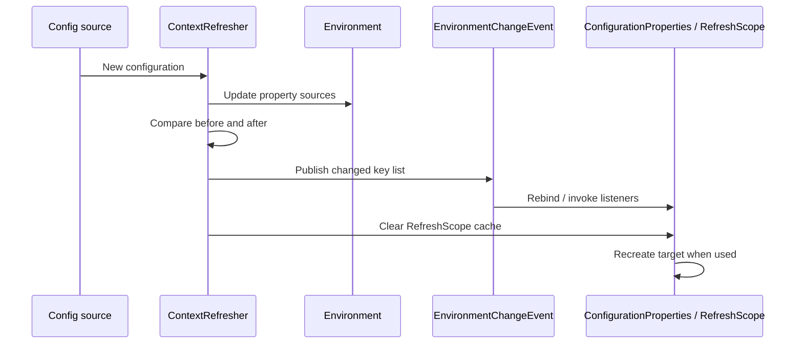

# Behavior of Adding, Updating, and Deleting Properties Across Versions

In a Spring Boot application with Spring Cloud Context, configuration does not necessarily get read only once at startup. When a configuration source is updated and the application performs a refresh, Spring can detect new keys, changed keys, and keys that no longer appear in the configuration environment. Depending on the bean type and Spring Cloud version, these changes are applied in different ways.

The key distinction to understand is that **changing a property source**, **changing the effective value in the Environment**, and **changing the state of a running bean** are three related yet distinct things. Deleting a key from a remote file does not guarantee the application loses that value: a lower-precedence property source can still supply the same key; a bean can also hold its initialized state until it is rebound or recreated.

This lesson belongs to the **Configuration Refresh** chapter of the **SPRING_CLOUD_CORE** module. The content explains the refresh flow, differences between add/update/delete, ConfigurationProperties and RefreshScope behavior, notable version milestones, as well as testing and operations.

## 1. Learning Objectives

After this lesson, learners will be able to:

- Describe how Spring Cloud Context compares the Environment before and after a refresh.
- Distinguish an added property source, a modified property value, and a property removed from a source.
- Explain EnvironmentChangeEvent and Spring Cloud's standard listeners.
- Know when ConfigurationProperties is rebound and when beans are recreated via RefreshScope.
- Understand why removing a key from a remote source does not necessarily remove the key from effective values.
- Recognize limitations with constructor binding, Java records, nested properties, and resource-holding beans.
- Cross-check behavior against Spring Boot 2.4, Spring Cloud 2022.0.3 milestones, and current Spring Cloud limitations.
- Write tests for add, update, delete, refresh failure, and multiple instances.

## 2. Three Layers to Distinguish When Discussing Configuration Changes

Suppose an application has the `catalog.timeout` key served from Config Server:

| Layer | Question to answer | Example |
| --- | --- | --- |
| Property source | Which configuration source contains the key? | remote-config has catalog.timeout=2s |
| Environment | When looking up the key, which value is effective? | Remote returns 2s, local file has 5s; result depends on precedence |
| Bean/runtime | Has the running object received the new value? | CatalogProperties has rebound or client has been recreated |

A new commit on Git only changes data in the backend. Config Client does not poll by default to detect that commit. The application must receive a refresh request, reload configuration sources, update the Environment, and then apply changes to beans via the appropriate mechanism.

Overall flow:



In ContextRefresher, the refresh operation calls refreshEnvironment first, and then calls RefreshScope.refreshAll. Thus, updating the environment and recreating refresh-scoped beans follow a defined order in the standard workflow.

## 3. How Does Spring Cloud Detect Which Keys Changed?

Conceptually, ContextRefresher takes a snapshot of enumerable properties in the Environment, calls the environment update mechanism, and then compares the new snapshot against the old snapshot.

There are three cases:

| Before state | After state | Diff result |
| --- | --- | --- |
| Key absent | Key present with value true | New key recorded |
| Key timeout=2s | Key timeout=5s | Changed key recorded |
| Key endpoint present | Key absent from snapshot | Removed key recorded with diff value null |

EnvironmentChangeEvent carries the list of changed key names. Listeners can use these key names to decide whether they need to rebind, clear caches, or perform secondary actions.

Example listener interested only in the `catalog` namespace:

```java
import org.springframework.cloud.context.environment.EnvironmentChangeEvent;
import org.springframework.context.event.EventListener;
import org.springframework.stereotype.Component;

@Component
public class CatalogChangeListener {

    private final CatalogCache catalogCache;

    public CatalogChangeListener(CatalogCache catalogCache) {
        this.catalogCache = catalogCache;
    }

    @EventListener
    public void onEnvironmentChange(EnvironmentChangeEvent event) {
        boolean catalogChanged = event.getKeys().stream()
            .anyMatch(key -> key.startsWith("catalog."));

        if (catalogChanged) {
            catalogCache.invalidate();
        }
    }
}
```

The event only indicates which **key names** changed; listeners should re-read effective values from the Environment or properties beans when needed. Do not assume the event contains full old/new value pairs. If a key was removed from one source yet still exists in a lower-precedence source, re-reading the Environment may return the fallback value instead of null.

### 3.1. Property Sources Need to Support Key Enumeration

The standard diff mechanism must know key names to compare them. For custom sources, use a type that can enumerate key names, such as EnumerablePropertySource or MapPropertySource. A source that only implements getProperty lookup without providing a list of key names may not be fully extracted during standard comparison.

If a custom source cannot enumerate keys, design a dedicated event/diff or ensure the source emits an explicit change signal. Do not rely on ContextRefresher always detecting every change in every PropertySource implementation.

## 4. When Adding a New Property

Suppose the old configuration version did not have catalog.retry.enabled, while the new configuration adds:

```yaml
catalog:
  base-url: https://catalog.internal
  timeout: 2s
  retry:
    enabled: true
```

After refresh, if the new property source is placed into the Environment and the key did not exist in other sources, catalog.retry.enabled becomes a new key. EnvironmentChangeEvent includes that key name. A ConfigurationProperties bean with a matching field can receive the value after rebinding.

Example:

```java
import java.time.Duration;
import org.springframework.boot.context.properties.ConfigurationProperties;

@ConfigurationProperties(prefix = "catalog")
public class CatalogProperties {

    private String baseUrl = "http://localhost:8080";
    private Duration timeout = Duration.ofSeconds(2);
    private Retry retry = new Retry();

    public static class Retry {
        private boolean enabled = false;

        public boolean isEnabled() {
            return enabled;
        }

        public void setEnabled(boolean enabled) {
            this.enabled = enabled;
        }
    }

    public String getBaseUrl() {
        return baseUrl;
    }

    public void setBaseUrl(String baseUrl) {
        this.baseUrl = baseUrl;
    }

    public Duration getTimeout() {
        return timeout;
    }

    public void setTimeout(Duration timeout) {
        this.timeout = timeout;
    }

    public Retry getRetry() {
        return retry;
    }

    public void setRetry(Retry retry) {
        this.retry = retry;
    }
}
```

This is a mutable JavaBean with a no-argument constructor and class-level default values. It is well-suited for illustrating the ConfigurationProperties rebind mechanism.

In the application, register this class using ConfigurationPropertiesScan or EnableConfigurationProperties(CatalogProperties.class) so Spring creates the properties bean.

When adding a key, verify:

- The prefix and key name bind correctly.
- The data type can be converted.
- The properties bean is registered in the context.
- Whether any validation causes refresh to fail when the new value is invalid.
- Whether configuration-consuming logic actually re-reads the value after refresh or holds an old copy in another field.

Adding a property to the Environment does not automatically create a new bean or turn on a feature if the application has no code reading that property.

## 5. When Changing a Property's Value

Suppose catalog.timeout changes from 2s to 5s:

```yaml
catalog:
  timeout: 5s
```

If the effective value in the Environment changes, ContextRefresher records the catalog.timeout key in the diff and publishes EnvironmentChangeEvent.

Spring Cloud handles two common cases:

1. ConfigurationProperties beans are rebound.
2. Loggers with keys matching logging.level.* have their log levels updated.

Rebinding can mutate fields on an existing bean. It does not mean Spring creates a new instance for every bean that depends on properties.

Example of a service holding a reference to CatalogProperties:

```java
@Service
public class CatalogService {

    private final CatalogProperties properties;

    public CatalogService(CatalogProperties properties) {
        this.properties = properties;
    }

    public Duration timeout() {
        return properties.getTimeout();
    }
}
```

If the properties bean is rebound in place, the service keeps the same reference and the next call reads the new field value. However, if the service copied the value into its own field in the constructor, that field does not update automatically:

```java
@Service
public class CatalogClient {

    private final Duration timeout;

    public CatalogClient(CatalogProperties properties) {
        this.timeout = properties.getTimeout();
    }

    public Duration timeout() {
        return timeout;
    }
}
```

CatalogClient in the second example keeps the timeout from creation time. For it to receive the new value, redesign it to read properties at usage time or place the bean needing recreation in refresh scope.

### 5.1. Rebinding Does Not Guarantee Consistent Reads During Updates

ConfigurationProperties rebinding mutates fields on the same instance. Rebinds of the same bean are serialized internally, yet another thread reading the bean can observe an intermediate state: one field already reset to default while another field has not yet received its new value.

If multiple fields must stay consistent as an atomic configuration set, consider RefreshScope for the bean consuming them or construct a new immutable snapshot and swap the reference in one atomic operation.

## 6. When Deleting a Property from a Configuration Source

Deletion is the case most prone to misunderstanding. Suppose a remote source previously had:

```yaml
catalog:
  endpoint: https://catalog-v1.internal
```

Later, the remote file removes the catalog.endpoint key.

That only states that **the remote source no longer declares the key**. The effective value in the Environment still depends on other property sources:

- If local application.yml also declares catalog.endpoint, the local value can become a fallback.
- If environment variables or command-line arguments contain the same key, they can still supply the value.
- If no source supplies the key anymore, Environment.getProperty can return null; code with defaults receives those defaults.
- If a bean copied the value into its own field, the field may keep the old value until the bean is rebound or recreated.

Therefore, do not treat deleting a line in Git as a deletion command with identical effect across all applications.

### 6.1. Diff May Record the Removed Key, but the Event Is Not a Tombstone

In ContextRefresher implementations, if a key existed in the before snapshot and no longer exists in the after snapshot, the internal diff records that key with a null value. EnvironmentChangeEvent announces the set of changed key names. Listeners receive the key name, not a durable tombstone directive for every bean or property source.

A lower-precedence property source can keep providing that key. A bean with defaults can also receive its default after being rebound or recreated. Hence, distinguish:

- Key deleted from one remote source.
- Key no longer resolved across the entire Environment.
- Bean has applied the absent state of the key.

These three conditions do not automatically occur simultaneously.

### 6.2. ConfigurationProperties Rebind and Deleted Values

Current Spring Cloud resets fields of ConfigurationProperties beans to class-level defaults before rebinding, to avoid retaining old values for properties removed from the Environment. This reset mechanism has conditions:

- The bean has a no-argument constructor as its only constructor.
- Nested ConfigurationProperties are also reset recursively according to supported rules.
- Certain library types or JDK/Jakarta/Javax types are not reset recursively.
- If a parameterized constructor exists alongside the no-argument constructor, full reset may be skipped because the default constructor does not reproduce actual initial values.

For example, CatalogProperties earlier has a default timeout of 2s. If catalog.timeout is removed from all sources and the bean is eligible for reset, rebinding can restore the field to 2s. If deleted remotely while a local file still declares 5s, the effective value can still be 5s.

### 6.3. Key Deletion Is Not a Good Way to Represent a Business Command

If the application needs to know a feature is disabled, use an explicit state property:

```yaml
catalog:
  retry:
    enabled: false
```

This differs from deleting catalog.retry.enabled entirely. The value `false` is a state that can be validated, propagated through events, and bound explicitly. When more states are needed, use an enum:

```yaml
catalog:
  mode: DISABLED
```

Values like ENABLED, DISABLED, READ_ONLY, or MAINTENANCE are usually clearer than inferring intent from whether a property exists.

## 7. ConfigurationProperties and RefreshScope Handle Changes Differently

| Characteristic | ConfigurationProperties rebind | RefreshScope |
| --- | --- | --- |
| How applied | Rebinds fields on the current instance | Clears the scope's target cache |
| When does the object change? | Same instance is updated | New target is created on next use |
| Default values | Can reset to class defaults when property is deleted and bean is eligible | New target reads Environment at creation time |
| Read consistency | Other threads may see intermediate rebind state | Scope synchronizes target access with refresh |
| Best suited for | Mutable, directly bound configuration | Stateful beans needing re-initialization from configuration |
| Limitations | Constructor-bound/record cannot be refreshed | Does not automatically refresh all dependencies or resources |

### 7.1. Using RefreshScope for Beans That Must Be Recreated

Example creating an HTTP client from configuration:

```java
@Configuration(proxyBeanMethods = false)
public class CatalogClientConfiguration {

    @Bean
    @RefreshScope
    CatalogHttpClient catalogHttpClient(CatalogProperties properties) {
        return new CatalogHttpClient(
            URI.create(properties.getBaseUrl()),
            properties.getTimeout()
        );
    }
}
```

When refresh scope is refreshed, the CatalogHttpClient target is evicted from the cache. The next call through the proxy creates a new target and injects the current configuration.

Putting RefreshScope on a Configuration class does not mean every bean declared inside automatically belongs to refresh scope. Annotate the specific bean needing recreation directly, or ensure dependent consumers are also recreated.

Spring Cloud documentation also warns that removing a property altogether and refreshing is not a reliable mechanism for changing property presence across all beans. If business logic needs to distinguish enabled/disabled, update an explicit state value instead of relying on key deletion as a tombstone.

### 7.2. Resource-Holding Beans Need Their Own Lifecycle

Changing an endpoint or credential may require closing old connections, creating new connections, and handling in-flight requests. Not every bean can be refreshed safely.

For example, a connection pool with active connections needs a graceful replacement policy. Some DataSource types—including HikariDataSource, which is marked non-refreshable by default in current Spring Cloud—cannot be recreated simply via refresh scope. Check your version's documentation and choose an appropriate replacement/rollout approach.

RefreshScope also does not turn a configuration change into an atomic transaction across the entire ApplicationContext. It coordinates the cache of beans in that scope; out-of-scope singletons and external resources retain their own lifecycles.


## 8. Version Milestones Affecting Refresh Behavior

Refresh behaviors must be read in light of both the Spring Boot and Spring Cloud versions. There is no single change that makes every application from a given version onward handle add/update/delete identically.

| Milestone | Notable change | Deployment impact |
| --- | --- | --- |
| Spring Boot 2.4 | Introduces Config Data API and spring.config.import | Config Server gets the modern loading mechanism; legacy bootstrap is no longer default for new apps |
| Spring Cloud 2022.0.3 | PropertySourceLocator invoked in two passes during bootstrap flow | First pass fetches profile-less config to allow activating profiles; second pass fetches config for active profiles |
| Before Spring Cloud 2022.0.3 | Locator often runs in main application context | spring.cloud.config.initialize-on-context-refresh=true could be configured in bootstrap file to run locator in bootstrap context per version guide |
| Current Spring Cloud | Rebind, refresh scope, health indicator, and AOT limits clearly documented in Context docs | Must check constructor binding, default resets, non-refreshable beans, and native-image constraints |

### 8.1. Config Data Is Not the Same as Legacy Bootstrap

Starting with Spring Boot 2.4, Config Data import is the recommended default mechanism for fetching configuration from Config Server. Example:

```yaml
spring:
  config:
    import: "configserver:http://config-server:8888"
```

Legacy bootstrap must be enabled explicitly via system property/environment or the bootstrap starter. The two modes have different loading lifecycles; when reading refresh logs, identify which mode the application uses.

The Spring Cloud version must belong to a release train compatible with your Spring Boot version. Check the compatibility matrix and BOM before upgrading; the Spring Boot 2.4 milestone specifically concerns the Config Data API and does not mean every Spring Cloud version is compatible with every Boot 2.4+ release.

Do not take the two-pass PropertySourceLocator behavior in bootstrap and assume it applies verbatim to every Config Data resolver/loader. For custom sources using Config Data, check the resolver/loader and refresher APIs of your deployed release train.

### 8.2. Two Locator Passes Since Spring Cloud 2022.0.3

Since Spring Cloud 2022.0.3, a locator may be called first without active profiles to retrieve base values, which can include spring.profiles.active. After the main application context starts, the locator is called again with the activated profiles.

Therefore, the same locator can receive two different Environments during a single startup. If caching only keys on application name and ignores profiles, the locator may return the wrong snapshot. Include all dimensions affecting the result in the cache key and ensure reads produce no side effects.

### 8.3. Constructor Binding and Java Records

In current Spring Cloud, ConfigurationProperties beans using constructor binding, including Java records, are not refreshed by the standard rebind mechanism. If configuration needs dynamic updates, you can:

- Use mutable JavaBean properties suitable for rebinding.
- Place the component needing re-initialization into RefreshScope.
- Or restructure to build a new immutable snapshot and swap references via a custom mechanism.

Do not convert a record into a mutable class just to make one test pass; choose the model based on consistency requirements and object lifecycle.

### 8.4. AOT and Native Image

Context refresh is currently unsupported for Spring AOT transformations and native images according to current Spring Cloud documentation. For AOT/native applications, set:

```yaml
spring:
  cloud:
    refresh:
      enabled: false
```

In that environment, use restart/rollout to apply new configuration instead of relying on runtime refresh.


## 9. Configuration Sources and Refresh Mechanisms by Mode

### 9.1. Config Client Does Not Poll by Default

Spring Cloud Config Client does not periodically check Config Server for changes by default. A new commit in the repository does not automatically publish EnvironmentChangeEvent to every instance.

You can design polling with a scheduler, though you must control frequency, timeouts, jitter, and avoid all replicas fetching configuration simultaneously. For multi-instance systems, Spring Cloud Bus is generally better suited to broadcast refresh signals to nodes.

### 9.2. Refresh via Actuator

In applications with Actuator and Spring Cloud Context, the refresh endpoint can be exposed to request reloading bootstrap configuration and refreshing refresh-scoped beans.

Example exposing only needed endpoints:

```yaml
management:
  endpoints:
    web:
      exposure:
        include: health,refresh
```

Then send a POST to the refresh endpoint on the application's base path and management port. This action can alter runtime configuration, so require authentication, authorization, network restrictions, and auditing. Do not open management endpoints to the Internet just for convenience.

The POST /actuator/env endpoint can update the Environment and rebind properties in supported versions/configurations. If used, enable the endpoint explicitly and restrict updatable keys using regular expressions. This grants direct configuration modification capability and must be strictly protected.

### 9.3. Distributing Refresh to Multiple Instances

One instance refreshing successfully does not mean all replicas have received the new configuration. You can use Spring Cloud Bus to broadcast refresh notifications through a broker. Each instance handles the signal and updates its own Environment.

The workflow should track the revision per instance:

1. Config repository creates a new revision.
2. Release agent triggers refresh or Bus event.
3. Each instance fetches/applies configuration.
4. Instance records the applied revision.
5. System compares revisions across replicas and alerts if any node lags behind.

Do not rely solely on HTTP 200 from a Bus or refresh endpoint. Verify that instances have actually applied the configuration and critical beans were successfully recreated/rebound.

## 10. Designing Behavior When a Property Is Deleted

Clearly define the business intent of deletion:

| Intent | Representation to consider |
| --- | --- |
| Use default value | Remove property from all sources or declare an explicit default value |
| Disable a feature | Set feature.enabled=false |
| Disable an endpoint | Use state endpoint-mode: DISABLED or a validated sentinel value |
| Clear cache | Emit a dedicated event/command; do not use property deletion as an implicit side effect |
| Revoke credentials | Update secret per secret management workflow, then refresh/restart resources using it |

### 10.1. Distinguishing Null, Empty, and Missing

These three states are not identical:

- **Missing:** the key does not exist in the property source.
- **Null:** a source may return null or a diff marks a key removed; the resolver may keep searching lower-precedence sources.
- **Empty:** the key exists, but its value is an empty string or empty collection.

Example:

```yaml
catalog:
  endpoint: ""
```

differs from omitting catalog.endpoint. For some properties, an empty string is still valid; for others, validation may reject it. Clearly define the schema and meaning of each state.

### 10.2. Do Not Let Fallbacks Mask Deletion Errors

If a remote source removes catalog.endpoint while local application.yml still contains a dev endpoint, production may accidentally fall back to the local address. For required properties, validate values per profile and fail fast when no valid endpoint exists.

A good default for local development is not necessarily a safe fallback for production. Avoid defaults that could route real requests to sandbox or localhost when the remote source is missing.


## 11. Testing Add, Update, and Delete

Refresh tests should verify all three layers: property source, Environment values, and beans/runtime. A test checking only that the refresh endpoint returns HTTP 200 is insufficient.

### 11.1. Basic Test Matrix

| Test case | Input change | Expected result to verify |
| --- | --- | --- |
| Add | Add new key to remote source | Environment resolves key; event contains key name; properties bean receives value |
| Update | Change catalog.timeout from 2s to 5s | Effective value and consumer use the new value |
| Delete from remote | Remove key in remote source while keeping local fallback | Local value becomes effective if precedence allows |
| Delete from all sources | Remove key from both remote and local | Environment no longer resolves key; bean reverts to default/null per chosen mechanism |
| Explicit disable | Set catalog.retry.enabled=false | Listeners and consumers apply disabled state |
| Invalid update | Send negative timeout or malformed URL | Validation rejects; system retains designed safe behavior |
| Repeated refresh | Send same revision multiple times | Does not duplicate sources or trigger repeated side effects |
| Multi-instance | Only one replica receives event | Monitoring detects revision skew across nodes |

### 11.2. Testing EnvironmentChangeEvent

You can write a test listener to confirm the event contains only keys of interest. With an enumerable source, test add, update, and delete. When testing delete, verify the key is removed from all relevant sources; if another source still contains the key, the test must expect the fallback rather than null.

### 11.3. Testing ConfigurationProperties Reset

Create a mutable bean with class-level defaults and a no-argument constructor as its only constructor. Load a remote property, verify the field receives the remote value, then remove the property from the Environment and trigger rebinding. Verify the field returns to its default.

Repeat with a constructor-bound/record bean to confirm it is not rebound by this mechanism. If immutable updates are needed, test bean recreation or snapshot replacement paths.

### 11.4. Testing RefreshScope

Configure a refresh-scoped bean so it captures configuration values at creation time. Call the bean, change the configuration source, execute refresh, and call again through the proxy. Confirm the new target uses the new values.

Also test property deletion: if a fallback exists in another source, the new target still receives the fallback. If the application must distinguish missing from disabled, use an explicit state property and test that state.

### 11.5. Testing Errors and Concurrency

- Config Server timeout: confirm the application retains active configuration or fails according to policy.
- New response breaks schema: do not publish partial configuration.
- Two concurrent refreshes: do not let an older response overwrite a newer revision.
- Refresh scope bean fails recreation: check refresh health indicator and readiness.
- One replica misses a Bus event: confirm a detection and resynchronization mechanism exists.

## 12. Diagnosing Common Issues

| Symptom | Possible cause | How to check |
| --- | --- | --- |
| Remote file deleted key, yet app still sees value | Local file, environment, or system property still supplies key | Inspect all PropertySources and value origins |
| Event lacks newly changed key name | PropertySource is not enumerable or source excluded from diff snapshot | Inspect source implementation and key list |
| ConfigurationProperties still holds old value | Bean ineligible for reset, old source not replaced, or rebind did not run | Check constructors, property source names, and events |
| Record does not receive new value | Constructor binding does not support rebind refresh | Use refresh scope or snapshot replacement |
| Bean uses old timeout after refresh | Bean copied value into field at initialization | Read properties at usage time or recreate bean |
| RefreshScope bean is not recreated | Bean not proxied in scope or refresh did not invoke refreshAll | Check annotations and endpoint/events |
| Some beans still use old dependency | Only beans marked refresh scope are recreated | Inspect dependency graph and refresh scope boundaries |
| One replica uses old configuration | Instance missed refresh event or fetch request failed | Compare revisions and health per replica |
| Native image cannot refresh | Context refresh is not supported in AOT/native | Use restart/rollout and disable refresh per guidance |

When diagnosing, go in order: verify the refresh request, verify sources reloaded, verify Environment changed, verify the event contains the key, and then verify beans received the change. This narrows failures down to the right layer.

## 13. Choosing a Production Strategy

- For simple values, use mutable ConfigurationProperties with explicit defaults.
- For stateful beans or clients built from endpoints/credentials, consider RefreshScope and resource closing lifecycles.
- For enabled/disabled states, use explicit boolean or enum properties instead of deleting keys.
- For required configuration, validate and fail fast when values become invalid.
- With multiple replicas, use Bus or controlled rollouts and track revisions per instance.
- For changes affecting connection pools, TLS, or non-refreshable resources, rolling restarts can be more predictable than hot refresh.
- With AOT/native images, do not rely on Context Refresh; apply new configuration via restart/rollout.

A production configuration change should be reviewed like a code change: clear ownership, traceable revisions, pre-promotion testing, and a rollback plan.

## 14. Practice Exercise

A catalog service receives these properties:

```yaml
catalog:
  endpoint: https://catalog-v1.internal
  timeout: 2s
  retry:
    enabled: true
```

Operations then releases three revisions in sequence:

- Revision A adds catalog.retry.max-attempts: 3.
- Revision B changes catalog.endpoint to the v2 endpoint and catalog.timeout to 5s.
- Revision C deletes catalog.endpoint from the remote source, while local application.yml still has the dev endpoint.

Perform the following:

1. Identify which keys appear in EnvironmentChangeEvent for each revision.
2. Explain why after revision C, the application can resolve the dev endpoint instead of null.
3. Write a mutable ConfigurationProperties bean with defaults and test rebinding after deleting the key from all sources.
4. Write a RefreshScope bean creating an HTTP client and test the new target after revision B.
5. Replace endpoint deletion with an `endpoint-mode: DISABLED` state; explain the benefits for business logic.
6. Try a constructor-bound/record bean and describe how to apply new configuration to it.
7. Simulate two replicas: one receives the refresh event, one misses it. Propose metrics and a resynchronization procedure.
8. Propose a rollout plan when configuration changes a connection pool or credentials of a downstream service.

**Completion criteria:** distinguish source-level deletion from effective property absence; understand diff events; choose rebind or refresh scope appropriately; have tests for add/update/delete and fallback; identify version-specific limits and an appropriate operational plan.

## 15. Key Takeaways

- ContextRefresher compares the Environment before and after updating sources, then publishes EnvironmentChangeEvent with changed keys.
- Add, update, and delete can appear in the diff, yet deleting from one source does not guarantee the key disappears from the entire Environment.
- Mutable ConfigurationProperties can be rebound; current Spring Cloud resets class defaults when keys are removed if the bean meets constructor conditions.
- Constructor-bound properties and Java records are not refreshed by the standard rebind mechanism.
- RefreshScope clears the target cache and creates a new bean on next use; it does not automatically refresh every dependency or resource.
- Use explicit booleans/enums to represent disabled states instead of relying on key deletion.
- Config Client does not poll by default; multiple instances require Bus or controlled rollouts.
- Locator behavior changed in Spring Cloud 2022.0.3; Config Data import was introduced in Spring Boot 2.4.
- Verify the exact Spring Boot/Spring Cloud pair, read release notes, and re-test semantics before upgrading.

## 16. References

- [Spring Cloud Context — Application Context Services](https://docs.spring.io/spring-cloud-commons/reference/spring-cloud-commons/application-context-services.html): EnvironmentChangeEvent, rebinding, reset defaults, RefreshScope, AOT limits, and Actuator endpoints.
- [Spring Cloud Config Client Reference](https://docs.spring.io/spring-cloud-config/reference/client.html): Config Data import and legacy bootstrap.
- [ContextRefresher.java](https://github.com/spring-cloud/spring-cloud-commons/blob/main/spring-cloud-context/src/main/java/org/springframework/cloud/context/refresh/ContextRefresher.java): diff between before/after Environment snapshots and ordering of event publication/refresh scope.
- [EnvironmentChangeEvent.java](https://github.com/spring-cloud/spring-cloud-commons/blob/main/spring-cloud-context/src/main/java/org/springframework/cloud/context/environment/EnvironmentChangeEvent.java): event contract containing the changed key set.


