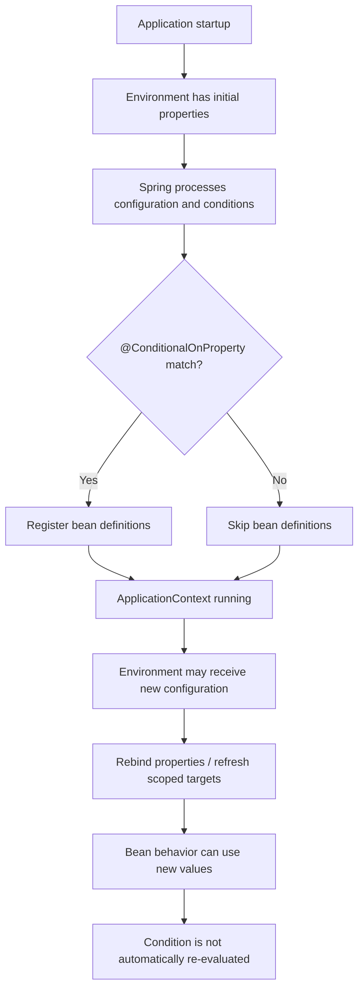
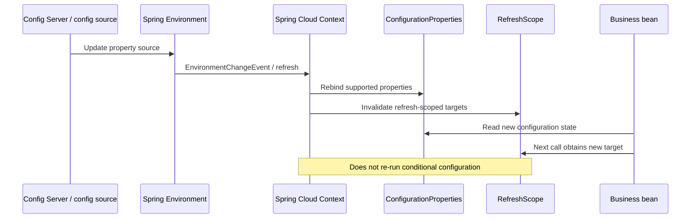

# Runtime Limitations of Updating @ConditionalOnProperty Conditions

A Spring Cloud application can use a property to decide whether a feature is configured or not. For instance, app.inventory.enabled=true allows Spring Boot to register the inventory client and integration beans; setting the value to false can cause that auto-configuration to be skipped when the application starts up.

A common misconception is that changing a property while the application is running **causes Spring to re-evaluate @ConditionalOnProperty**. This annotation is an ApplicationContext construction condition. It determines whether a bean definition is registered during configuration processing. Spring Cloud's refresh mechanisms can update the Environment, rebind configuration properties, or recreate targets of refresh-scoped beans, yet they do not re-run configuration parsing to add or remove bean definitions based on conditions.

This lesson belongs to the **Configuration Refresh** chapter of **SPRING_CLOUD_CORE**. We will distinguish structural conditions from runtime feature flags, examine both directions of change (true → false and false → true), understand the limits of @RefreshScope, and design controllable runtime feature toggling without confusing bean refresh with ApplicationContext restructuring.

## 1. Learning Objectives

After this lesson, learners will be able to:

1. Explain when Spring evaluates @ConditionalOnProperty.
2. Distinguish a property updated in the Environment from a bean definition registered in the context.
3. Describe what happens when a property switches true → false or false → true after startup.
4. Explain why /actuator/refresh and @RefreshScope do not automatically re-evaluate conditional configuration.
5. Choose between conditional auto-configuration, runtime feature gates, and explicit bean lifecycle management.
6. Use @ConfigurationProperties and Spring Cloud Context to update runtime behavior appropriately.
7. Test both startup conditions and condition limits after the context is already running.

## 2. Two Different Types of Decisions

An application has two questions that must be kept separate:

- **Context structure:** Which beans exist? Which dependencies are registered? Which integrations are included in the ApplicationContext?
- **Runtime behavior:** Should an already existing bean execute a capability at the current moment?

@ConditionalOnProperty fits the first question. A runtime feature gate fits the second question.

For example, if an inventory library is an optional dependency and you only want to register the adapter when the application enables the integration at startup, conditional auto-configuration is the right choice. If the business wants to toggle inventory synchronization per environment or change it during operational hours, the application needs a mechanism that reads feature state at runtime.



Remember: changing the Environment changes configuration data; changing the bean registry changes container structure. The two have separate lifecycles and mechanisms.

## 3. When Is @ConditionalOnProperty Evaluated?

### 3.1. Conditions Are Part of Context Construction

Example:

```java
@AutoConfiguration
@ConditionalOnProperty(
    prefix = "app.inventory",
    name = "enabled",
    havingValue = "true",
    matchIfMissing = false
)
public class InventoryAutoConfiguration {

    @Bean
    InventoryClient inventoryClient(InventoryProperties properties) {
        return new InventoryClient(properties);
    }
}
```

While Spring Boot processes configuration classes and bean methods, the condition reads the property from the Environment. If the property matches, the configuration or bean definition is added to the registry according to the annotation's scope. If it does not match, that configuration is skipped.

Conditions can sit on a @Configuration/@AutoConfiguration class or on a @Bean method. A class-level condition affects the entire configuration; a method-level condition governs that bean method.

Evaluation happens while processing bean definitions before ordinary singletons are instantiated. Some condition types are evaluated at different phases of configuration parsing/registration, yet all belong to the context construction workflow.

### 3.2. A Condition Is Not a Property-Watching Listener

@ConditionalOnProperty does not register a listener for the key. It does not listen for EnvironmentChangeEvent, watch YAML files, or observe Config Server to add or remove beans.

After the condition has been processed:

- If it matched, the bean definition can exist in the registry and the bean is created per its normal lifecycle.
- If it did not match, that bean definition is not registered from that configuration.
- When the Environment changes values, Spring does not automatically re-run ConfigurationClassPostProcessor to re-evaluate all configuration.
- The Condition Evaluation Report reflects the decision during that context construction; it is not a live status table of feature flags.

### 3.3. Default Values Do Not Make a Condition Dynamic

The attributes `havingValue` and `matchIfMissing` only define how the condition evaluates the value at context construction time:

```java
@ConditionalOnProperty(
    prefix = "app.inventory",
    name = "enabled",
    havingValue = "true",
    matchIfMissing = false
)
```

Here, a missing property or one different from the string `true` causes the condition not to match. Setting `matchIfMissing=true` only changes the outcome when the property is absent at evaluation time; it does not create self-updating behavior after startup.

## 4. What Happens When the Property Changes at Runtime?

Suppose the initial configuration is:

```yaml
app:
  inventory:
    enabled: true
```

Auto-configuration is activated and InventoryClient is registered.

### 4.1. Switching from true to false

When Config Server or a runtime configuration source updates app.inventory.enabled=false, the Environment can receive the new value after a valid refresh workflow. However:

- The InventoryClient bean definition remains in the registry.
- Already-instantiated beans are not automatically deleted.
- If the bean is in @RefreshScope, its target can be evicted from the cache and recreated on the next access.
- The original condition remains the decision used when the context was built; Spring does not remove the bean just because the new property is false.

Therefore, if code relies solely on the presence of InventoryClient, the feature may keep getting called even though the new configuration flag is off. The bean needs a runtime gate or an actual lifecycle management mechanism.

### 4.2. Switching from false to true

Suppose the application starts with:

```yaml
app:
  inventory:
    enabled: false
```

Because the condition did not match, InventoryClient was not registered from that auto-configuration. After the property changes to true:

- The Environment can return the value true.
- @ConfigurationProperties can be rebound if Spring Cloud Context processes the appropriate event.
- Existing refresh-scoped beans can be recreated.
- However, the InventoryClient bean definition skipped at startup does not appear on its own.

There is no bean proxy or definition to refresh in this case. To obtain the integration afterward, you need a custom dynamic bean creation mechanism or to rebuild the ApplicationContext/restart the application.

### 4.3. Outcome Table

| Startup value | New runtime value | Outcome for condition and bean |
| --- | --- | --- |
| true | false | Condition already matched; bean definition still exists |
| false | true | Condition did not match; bean definition is not added automatically |
| true | true | No change to initial structural decision |
| false | false | Bean remains unregistered from that configuration |

This is why @ConditionalOnProperty should not be used as a runtime toggle.

## 5. What Does Refresh Update?

Spring Cloud Context provides mechanisms to refresh configuration and beans. Clearly distinguish which components are updated.

| Component | Can change on refresh? | Meaning |
| --- | --- | --- |
| Environment / property sources | Yes, if configuration sources are loaded/updated by the refresh workflow | Effective property values can change |
| @ConfigurationProperties bean | Can be rebound when Environment changes are processed via Spring Cloud Context | Mutable configuration fields can receive new values |
| Bean in @RefreshScope | Target can be evicted from cache and recreated when used | Bean re-reads configuration when the new target is created |
| Ordinary singleton with @Value constructor | Does not automatically replace injected values | Instance keeps state received at creation |
| Bean definition skipped by condition | No | Refresh does not automatically register new definitions |
| Bean definition registered via condition match | Does not get removed automatically | Refresh does not automatically remove definitions from the registry |

Refresh is not a full re-execution of the startup sequence. It acts on supported parts of the Environment and bean lifecycle.

## 6. Why Doesn't @RefreshScope Re-evaluate Conditions?

@RefreshScope is a special scope in Spring Cloud Context. Beans in this scope are usually accessed via a proxy. When the scope is refreshed, the current target is evicted from the cache; the next call creates a new target and injects current dependencies/values according to bean creation rules.

Example:

```java
@Bean
@RefreshScope
InventoryClient inventoryClient(InventoryProperties properties) {
    return new InventoryClient(properties);
}
```

If this bean was registered from the beginning, refresh can cause the InventoryClient target to be recreated. However, the scope only manages targets for beans that already have definitions; it does not drive configuration class parsing.

If the method above resides inside a class excluded by @ConditionalOnProperty at startup, the method never created a bean definition. @RefreshScope cannot make an unregistered bean appear.

### 6.1. Refreshing a Target Is Not Deleting a Bean

When a target is refreshed, the proxy and bean definition can still remain. Thus, @RefreshScope is not a way to delete a bean from the context when a feature flag turns false.

A refresh-scoped bean can be recreated with new properties, yet if its constructor still builds an active client regardless of enabled=false, the client still exists. Code must check the enabled value or manage lifecycle explicitly.

### 6.2. Do Not Put @RefreshScope on a Configuration Class and Assume Every Child Bean Refreshes

@RefreshScope on a @Configuration class does not automatically make every bean method inside a refresh-scoped bean. If a specific bean needs its target recreated, apply the scope directly to that bean according to the guidance for your Spring Cloud version.

## 7. Designing a Runtime Feature Gate

If the goal is to toggle behavior without adding/removing beans, let the required beans exist and check feature status at usage time.

### 7.1. Declare Typed Configuration

```java
@ConfigurationProperties(prefix = "app.inventory")
public class InventoryFeatureProperties {

    private boolean enabled;

    public boolean isEnabled() {
        return enabled;
    }

    public void setEnabled(boolean enabled) {
        this.enabled = enabled;
    }
}
```

Register the properties bean:

```java
@Configuration(proxyBeanMethods = false)
@EnableConfigurationProperties(InventoryFeatureProperties.class)
class InventoryFeatureConfiguration {
}
```

In Spring Cloud Context, @ConfigurationProperties beans are managed by the rebinding mechanism when Environment changes are processed. For runtime rebind needs, mutable JavaBean properties are easy to observe and test; for record/constructor-bound properties, verify support in your version and select an appropriate recreation mechanism.

### 7.2. Check the Flag at Invocation Time

```java
@Component
class InventoryFeatureGate {

    private final InventoryFeatureProperties properties;

    InventoryFeatureGate(InventoryFeatureProperties properties) {
        this.properties = properties;
    }

    boolean isEnabled() {
        return properties.isEnabled();
    }
}
```

The business bean checks the gate before calling the integration:

```java
@Service
class InventorySyncService {

    private final InventoryFeatureGate gate;
    private final InventoryClient client;

    InventorySyncService(
            InventoryFeatureGate gate,
            InventoryClient client) {
        this.gate = gate;
        this.client = client;
    }

    void synchronize() {
        if (!gate.isEnabled()) {
            return;
        }

        client.synchronize();
    }
}
```

InventoryClient is registered via appropriate structural configuration; InventoryFeatureGate controls whether the operation executes. When the property is updated and the properties bean is rebound, the next call reads the new state.

This keeps the dependency graph intact. It is particularly suitable for features that can be toggled per request or per processing cycle.

### 7.3. Reading Directly from Environment When Needed

Another option is querying Environment at usage time:

```java
@Component
class InventoryFeatureGate {

    private final Environment environment;

    InventoryFeatureGate(Environment environment) {
        this.environment = environment;
    }

    boolean isEnabled() {
        return environment.getProperty(
            "app.inventory.enabled",
            Boolean.class,
            false
        );
    }
}
```

This reads the current value from Environment on every call. It is useful when only a simple flag is needed and a large configuration object is unnecessary. Avoid scattering property reads across the codebase; centralizing reads inside a gate makes testing and observability easier.

Calling getProperty does not update configuration sources on its own. You still need a source/property refresh mechanism to bring new values into Environment.

## 8. Combining Conditional Auto-Configuration with a Runtime Gate

The two mechanisms can work together when each is responsible for a different decision.

Example:

```java
@AutoConfiguration
@ConditionalOnClass(InventoryClient.class)
@ConditionalOnProperty(
    prefix = "app.inventory",
    name = "integration-installed",
    havingValue = "true"
)
@EnableConfigurationProperties(InventoryFeatureProperties.class)
public class InventoryIntegrationAutoConfiguration {

    @Bean
    @ConditionalOnMissingBean
    InventoryClient inventoryClient(InventoryFeatureProperties properties) {
        return new InventoryClient(properties);
    }

    @Bean
    @ConditionalOnMissingBean
    InventoryFeatureGate inventoryFeatureGate(
            InventoryFeatureProperties properties) {
        return new InventoryFeatureGate(properties);
    }
}
```

In this example:

- @ConditionalOnClass checks whether the API is on the runtime classpath.
- integration-installed is a structural startup decision indicating whether the application has the integration installed.
- app.inventory.enabled inside InventoryFeatureProperties is a behavioral flag that can be updated via the runtime refresh mechanism.
- @ConditionalOnMissingBean lets the application replace the default bean during context construction.

Separating the two properties helps operators clearly understand: one property chooses which components enter the application; the other controls the behavior of existing components.

If an integration is never installed in an environment, you can let the condition exclude it at startup. If the integration is installed yet needs flexible toggling, keep the required beans and use a runtime gate.

## 9. When Do Beans Actually Need to Be Created or Destroyed?

A runtime gate only prevents business behavior; it does not guarantee releasing resources. For example, if a client creates background threads, connection pools, or schedulers, setting enabled=false in a gate does not automatically close those resources.

If the requirement is truly enabling/disabling resources at runtime, a lifecycle management component is needed:

- Track the desired state from configuration/events.
- Create resources when state transitions to enabled.
- Stop accepting work and close resources when state transitions to disabled.
- Ensure state transitions are synchronized and idempotent.
- Handle errors during resource initialization or closing.
- Ensure ApplicationContext shutdown still releases active resources.

You can use a factory, registry, SmartLifecycle, or an abstraction managing clients according to application lifecycle. The choice depends on resource type and consistency requirements. Do not mutate BeanDefinitionRegistry inside an event listener to simulate re-running conditions; that easily leaves the context in an unpredictable state and bypasses Spring's standard lifecycle.

If a change broadly alters the dependency graph, auto-configuration, or core infrastructure, rolling restarts/recreating the ApplicationContext are usually easier to operate and verify.

## 10. Refresh Workflow in Spring Cloud

A typical refresh workflow can consist of:

1. New configuration is updated in an external or runtime source.
2. Config Client/Environment receives the new property source per application configuration.
3. Spring Cloud Context publishes an Environment change signal.
4. @ConfigurationProperties beans are processed for rebinding via supported mechanisms.
5. Refresh scope invalidates target caches of scoped beans.
6. The next access creates a new target with current configuration values.



Endpoint and trigger details depend on dependencies, release train, and deployment setup. For example, Spring Cloud Config Client can expose /actuator/refresh when Actuator endpoints are enabled; Spring Cloud Bus can broadcast refresh signals to multiple instances. Management endpoints must be secured via authentication, authorization, and network policies.

Do not assume merely editing a file on Config Server automatically broadcasts to every instance. There must be a corresponding client refresh, event/bus, or restart mechanism.

## 11. Immutable Configuration and Limitations to Consider

Constructor-bound records are a good choice for immutable configuration at startup. However, runtime change requirements demand checking how the framework can update that object.

A record has no setters for a rebinder to mutate fields like a mutable JavaBean. Depending on the Boot/Cloud version and how properties are registered, constructor-bound properties may need recreation via another mechanism. Therefore:

- Use JavaBean properties when you need mutable state rebinding supported by Spring Cloud Context.
- With records, consider placing the consumer in @RefreshScope so targets are recreated after Environment updates, if bean lifecycle fits.
- Or use a provider/gate reading the Environment at usage time.
- Test against your exact Boot/Cloud versions instead of inferring from the fact that records bind at startup.

Additionally, refresh may be restricted or disabled in certain deployment environments. For example, some native image/AOT scenarios do not support refresh the same way an ordinary JVM does; check the compatibility documentation for your version.

## 12. Testing Startup Conditions

Use ApplicationContextRunner to verify conditions behave properly with initial properties.

```java
class InventoryAutoConfigurationTests {

    private final ApplicationContextRunner runner =
        new ApplicationContextRunner()
            .withConfiguration(
                AutoConfigurations.of(
                    InventoryAutoConfiguration.class
                )
            );

    @Test
    void createsClientWhenEnabledAtStartup() {
        runner
            .withPropertyValues("app.inventory.enabled=true")
            .run(context -> {
                assertThat(context)
                    .hasSingleBean(InventoryClient.class);
            });
    }

    @Test
    void skipsClientWhenDisabledAtStartup() {
        runner
            .withPropertyValues("app.inventory.enabled=false")
            .run(context -> {
                assertThat(context)
                    .doesNotHaveBean(InventoryClient.class);
            });
    }
}
```

These two tests verify structural decisions when the context is created. They do not prove conditions can change at runtime.

## 13. Testing That Conditions Are Not Re-evaluated

You can modify the context's Environment after it has started and verify that bean definitions remain unchanged.

### 13.1. true Changing to false

```java
@Test
void changingPropertyToFalseDoesNotRemoveExistingBean() {
    runner
        .withPropertyValues("app.inventory.enabled=true")
        .run(context -> {
            assertThat(context)
                .hasSingleBean(InventoryClient.class);

            Map<String, Object> changed = Map.of(
                "app.inventory.enabled", false
            );

            context.getEnvironment()
                .getPropertySources()
                .addFirst(new MapPropertySource("runtime-test", changed));

            assertThat(context.getEnvironment()
                .getProperty("app.inventory.enabled", Boolean.class))
                .isFalse();

            assertThat(context)
                .hasSingleBean(InventoryClient.class);
        });
}
```

The test shows Environment reads false while the registered bean remains. Adding MapPropertySource here only demonstrates changing the value; it does not automatically publish EnvironmentChangeEvent and does not test rebinding or refresh scope.

### 13.2. false Changing to true

```java
@Test
void changingPropertyToTrueDoesNotRegisterMissingBean() {
    runner
        .withPropertyValues("app.inventory.enabled=false")
        .run(context -> {
            assertThat(context)
                .doesNotHaveBean(InventoryClient.class);

            Map<String, Object> changed = Map.of(
                "app.inventory.enabled", true
            );

            context.getEnvironment()
                .getPropertySources()
                .addFirst(new MapPropertySource("runtime-test", changed));

            assertThat(context.getEnvironment()
                .getProperty("app.inventory.enabled", Boolean.class))
                .isTrue();

            assertThat(context)
                .doesNotHaveBean(InventoryClient.class);
        });
}
```

This test proves a bean skipped at startup does not automatically appear when the property changes to true. Both tests serve as regression tests for the boundary between Environment and the bean registry.

## 14. Testing Runtime Feature Gates and Refresh

In addition to testing conditions, you must test that beans actually read the new runtime state after Spring Cloud Context processes configuration changes.

A test for InventoryFeatureGate can mutate the properties bean directly to verify gate behavior:

```java
@Test
void gateUsesCurrentPropertiesValue() {
    InventoryFeatureProperties properties =
        new InventoryFeatureProperties();

    InventoryFeatureGate gate =
        new InventoryFeatureGate(properties);

    assertThat(gate.isEnabled()).isFalse();

    properties.setEnabled(true);

    assertThat(gate.isEnabled()).isTrue();
}
```

This is a unit test for the gate, not an integration test of the rebinder. An integration test must create a context with Spring Cloud Context, update the property source using a supported mechanism, publish the corresponding event/refresh, and verify the properties bean is rebound.

For @RefreshScope beans, tests must verify the target is recreated after refresh and the new target observes current values. Do not use a plain ApplicationContextRunner test alone to claim the entire Config Client/Actuator refresh pipeline works.

## 15. Common Design Mistakes

**Using @ConditionalOnProperty as a runtime feature flag.** Conditions only decide bean definitions when the context is built; switch to a runtime gate if behavior needs to change.

**Assuming /actuator/refresh will create missing beans.** Refresh does not automatically re-run auto-configuration; beans not registered initially still do not exist.

**Assuming setting the property to false deletes the bean.** Matched conditions are not reversed when Environment changes; bean definitions and instances can still remain.

**Putting @RefreshScope on a bean without checking enabled.** Recreating a target does not mean the feature turns off or resources are released automatically.

**Reading @Value in a singleton and expecting the field to update automatically.** Values injected into ordinary instances do not update on their own; use properties rebinding, refresh-scoped targets, or a provider reading Environment.

**Using refresh scope for resources with complex lifecycles without checking shutdown.** Clients, schedulers, and pools must close resources properly when targets refresh or the context stops.

**Treating editing a Config Server file as an automatic broadcast.** You need a refresh trigger, bus, or corresponding deployment mechanism for instances to receive new configuration.

**Mutating the bean registry directly inside an event listener.** This bypasses the standard lifecycle and easily causes inconsistent context state; use a factory/lifecycle manager or restart.

## 16. Mechanism Selection Checklist

| Need | Mechanism to consider |
| --- | --- |
| Optional dependency decided only at startup | @ConditionalOnClass |
| Register bean only if property is enabled at startup | @ConditionalOnProperty |
| Allow application to replace default bean | @ConditionalOnMissingBean |
| Toggle business operation at runtime | Runtime feature gate + @ConfigurationProperties |
| Read latest Environment value on each call | Provider/gate querying Environment |
| Recreate target bean when configuration changes | @RefreshScope |
| Rebind mutable configuration group | @ConfigurationProperties + Spring Cloud Context |
| Truly create/destroy resources when state changes | Factory/registry/SmartLifecycle managing lifecycle |
| Major changes to dependency graph structure | Recreate ApplicationContext or rolling restart |

Before choosing, answer three questions:

1. Does the property change only affect behavior, or does it need to change bean existence?
2. Can the bean exist while remaining idle when the feature is disabled?
3. When disabling the feature, is it necessary to close resources, cancel listeners, or stop schedulers?

The answers will determine whether to use a runtime gate, refresh scope, or lifecycle manager.

## 17. Applied Exercises

### Exercise 1. Analyzing Two-Way Changes

An application has:

```java
@AutoConfiguration
@ConditionalOnProperty(
    prefix = "app.report",
    name = "enabled",
    havingValue = "true"
)
class ReportAutoConfiguration {

    @Bean
    @RefreshScope
    ReportClient reportClient(ReportProperties properties) {
        return new ReportClient(properties);
    }
}
```

Explain:

1. What happens when starting with enabled=true, then switching to false?
2. What happens when starting with enabled=false, then switching to true?
3. Which part does @RefreshScope change in both scenarios?
4. What mechanism must be added so the report client actually stops sending reports when the feature is disabled?

### Exercise 2. Designing a Runtime Feature Gate

A catalog synchronization service needs to be toggled during operational hours. Design:

- CatalogFeatureProperties using @ConfigurationProperties.
- CatalogFeatureGate reading current state.
- CatalogSyncService checking the gate before calling the client.
- A test verifying the gate reflects new property values.
- An integration test verifying Spring Cloud Context rebinds properties after refresh.

Explain why @ConditionalOnProperty should not be used to control each sync run.

### Exercise 3. Managing Resources

An integration creates a connection pool and scheduler. When enabled=false, the requirement is no remaining background threads and all connections closed.

Propose a lifecycle manager using a factory/registry or SmartLifecycle. Describe how to handle concurrent state transitions, initialization errors, resource closing errors, and full application shutdown.

### Self-Check Questions

1. During which phase is @ConditionalOnProperty evaluated?
2. Why does changing the Environment not cause conditions to re-run?
3. When true → false, does an already-registered bean definition disappear automatically?
4. When false → true, does refresh create a bean that was skipped at startup?
5. Which component does @RefreshScope invalidate?
6. Why does a singleton with @Value in its constructor not automatically receive new values?
7. When should you use mutable @ConfigurationProperties, and when should you re-check constructor binding?
8. Which decision distinguishes a runtime gate from conditional auto-configuration?
9. When must you use a lifecycle manager instead of just checking a boolean?
10. Why is a dedicated integration test needed for the Spring Cloud refresh pipeline?

## 18. References

- [Spring Boot Reference — Auto-configuration](https://docs.spring.io/spring-boot/reference/using/auto-configuration.html): how Spring Boot applies auto-configuration based on classpath and conditions.
- [Spring Boot Reference — Developing Auto-configuration](https://docs.spring.io/spring-boot/reference/features/developing-auto-configuration.html): condition annotations, bean conditions, and testing auto-configuration.
- [Spring Cloud Commons Reference — Application Context Services](https://docs.spring.io/spring-cloud-commons/reference/spring-cloud-commons/application-context-services.html): Environment changes, refresh scope, and context services.
- [Spring Cloud Config Reference — Client](https://docs.spring.io/spring-cloud-config/reference/client.html): Config Client and loading external configuration.
- [Spring Boot Actuator Reference](https://docs.spring.io/spring-boot/reference/actuator/endpoints.html): management endpoints and how to configure exposure/security.

## Key Takeaways

@ConditionalOnProperty determines ApplicationContext structure while Spring processes configuration. After startup, changing the Environment does not automatically add or remove bean definitions. @RefreshScope can recreate targets of existing beans; @ConfigurationProperties can be rebound via Spring Cloud Context mechanisms. If you want to toggle runtime behavior, use a feature gate reading the latest state. If you truly need to create or destroy resources, manage their lifecycle explicitly or recreate the context through a controlled deployment workflow.
