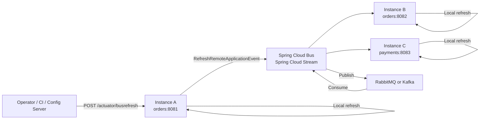
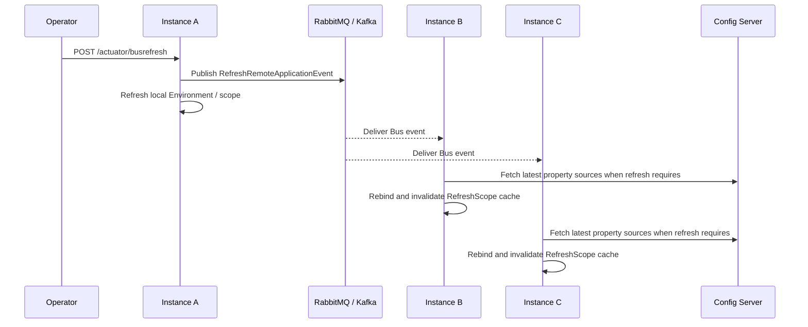
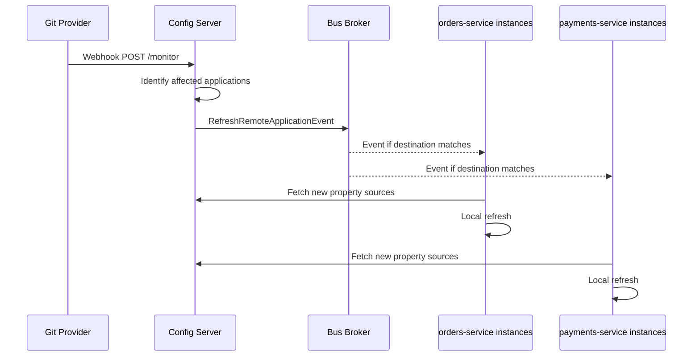

# Relationship with Spring Cloud Bus in Broadcasting Refresh Requests

## 1. Why Is Spring Cloud Bus Needed?

Spring Cloud Context provides a mechanism to refresh configuration within **a single application instance**. Calling the `POST /actuator/refresh` endpoint causes that instance to update its `Environment`, rebind eligible `@ConfigurationProperties` beans, and refresh `@RefreshScope` targets.

In a system running multiple instances of the same service, calling this endpoint on one instance does not automatically refresh the remaining instances. If operated manually, the management system would have to know every instance's address and send a separate request to each one. That approach scales poorly when instance counts change due to autoscaling or rolling deployments.

**Spring Cloud Bus** adds a channel to broadcast management events through a message broker. One instance sends a refresh request onto the Bus; participating instances receive the event, check the target destination, and run their local refresh workflow. As a result, a single operation can notify the entire cluster or a group of instances by service ID.

The key point is that the Bus **broadcasts the request**, while each application still refreshes its own `Environment`, rebinds configuration, and invalidates its own refresh scope cache. The Bus does not replace Config Server and does not turn configuration file changes into an instantaneous synchronized state across all nodes.

After this lesson, readers will be able to distinguish `/actuator/refresh` from `/actuator/busrefresh`, describe the event flow through a broker, select broadcast scopes, configure Bus for RabbitMQ/Kafka, monitor results, and troubleshoot when some instances have not refreshed.

## 2. Local Refresh and Refresh via Bus

The two endpoints have related goals yet different scopes:

| Endpoint | Scope | Behavior |
| --- | --- | --- |
| `POST /actuator/refresh` | Single instance receiving the HTTP request | Refreshes configuration within that instance |
| `POST /actuator/busrefresh` | Instances receiving the matching Bus event | Broadcasts a request so each instance refreshes locally |
| `POST /actuator/busrefresh/{destination}` | Instance or group of instances matching the destination | Only nodes with a matching Bus ID handle the event |

In current Spring Cloud Bus, the endpoint is named `busrefresh`. Some older release trains used the hyphenated form such as `bus-refresh`; always use the exact endpoint ID of your Spring Cloud version.

`/actuator/busrefresh` performs the operations corresponding to refresh on each node: clearing the `RefreshScope` cache and rebinding `@ConfigurationProperties`. This endpoint must be exposed via Actuator configuration:

```yaml
management:
  endpoints:
    web:
      exposure:
        include:
          - health
          - busrefresh
```

This example exposes only `busrefresh` along with `health`. If the application needs the local `refresh` endpoint for diagnostics or targeted operations, expose it according to your needs and security policies.

## 3. Architecture for Broadcasting Refresh Requests

Spring Cloud Bus links nodes in a distributed system using a lightweight message broker. Bus uses Spring Cloud Stream to send and receive events. Common binders are provided for RabbitMQ (AMQP) and Kafka.



The diagram shows nodes participating in a Bus destination. When a node publishes an event, the broker distributes the message to subscribers. Each node uses its Bus ID and the event's destination to decide whether to process or ignore it. If the event targets all nodes, matching applications perform a local refresh.

### 3.1. Responsibility of Each Component

| Component | Responsibility |
| --- | --- |
| Spring Cloud Context | Performs refresh inside one application context: updates Environment, publishes configuration change events, rebinds, and refreshes scoped beans |
| Spring Cloud Bus | Wraps management requests into remote application events and broadcasts them through a broker |
| Spring Cloud Stream | Provides binder abstractions to publish/consume messages |
| RabbitMQ or Kafka | Transports messages between instances |
| Spring Cloud Config Server (if present) | Stores and serves property sources; can publish events upon receiving configuration change notifications |
| Actuator Bus endpoint | HTTP entry point for operators to ask the Bus to execute a refresh |

The Bus is not a registry storing configuration state. It is an event transport channel. Configuration values still come from each application's sources, such as Config Server, Config Data, environment variables, or configuration files.

## 4. Processing Flow When Calling busrefresh

Suppose three instances of `orders-service` all consume configuration from Config Server. An administrator calls `POST /actuator/busrefresh` on instance A.



Detailed steps can vary depending on the Config Client type and Spring Cloud version. The flow means:

1. The Bus endpoint receives the HTTP request and creates a refresh event from the issuing instance.
2. Bus sends the event through the Spring Cloud Stream binder to the broker.
3. Nodes listening on the destination receive the message.
4. Each node checks origin and destination; nodes outside the scope ignore it.
5. Selected nodes execute refresh in their own context. `@ConfigurationProperties` beans are rebound; `@RefreshScope` target caches are cleared.
6. Refresh-scoped targets are recreated on demand at the next call through the proxy.

A Bus event is a coordination notification, not a complete copy of all configuration files. When using Config Server, each Config Client must connect to Config Server and fetch configuration for its application name, profile, and label during the refresh workflow.

### 4.1. Refresh Does Not Mean Immediate Target Recreation

Bus refresh invalidates the `RefreshScope` cache on receiving nodes. It does not force immediate creation of new targets. When a subsequent request invokes a bean through its scoped proxy, the scope creates a new target with the updated configuration.

This means a node may have processed the refresh event while the target's constructor has not yet re-run because no call needed the target yet. When checking results, do not rely solely on constructor logs; observe both the refresh event and subsequent configuration-consuming behavior.

## 5. Adding Spring Cloud Bus to an Application

### 5.1. Adding Dependencies

You can choose either the AMQP or Kafka starter. Maven example with RabbitMQ:

```xml
<dependency>
    <groupId>org.springframework.cloud</groupId>
    <artifactId>spring-cloud-starter-bus-amqp</artifactId>
</dependency>
```

Or Kafka:

```xml
<dependency>
    <groupId>org.springframework.cloud</groupId>
    <artifactId>spring-cloud-starter-bus-kafka</artifactId>
</dependency>
```

Let the Spring Cloud BOM manage versions of starters and Spring Cloud modules. Do not arbitrarily mix Bus, Stream binder, and release train versions. After adding the dependency, Boot auto-configuration detects Bus on the classpath; the corresponding broker must be available and configured.

### 5.2. Configuring RabbitMQ

Example broker connection configuration using Spring Boot properties:

```yaml
spring:
  application:
    name: orders-service
  rabbitmq:
    host: rabbitmq.internal
    port: 5672
    username: ${RABBITMQ_USERNAME}
    password: ${RABBITMQ_PASSWORD}
  cloud:
    bus:
      enabled: true
      destination: springCloudBus
```

The destination name is the channel/topic shared by instances to send and receive Bus messages. The default is usually sufficient; change it only when clear partitioning or environment separation is required. Never commit broker credentials into the repository.

### 5.3. Configuring Kafka

With Kafka, configure bootstrap servers and Bus destination:

```yaml
spring:
  application:
    name: orders-service
  kafka:
    bootstrap-servers: kafka-1.internal:9092,kafka-2.internal:9092
  cloud:
    bus:
      enabled: true
      destination: springCloudBus
```

Kafka security settings such as SASL, TLS, truststores, and ACLs must follow actual infrastructure requirements. Bus builds on Spring Cloud Stream binders, so detailed broker configuration follows the corresponding binder documentation.

### 5.4. Common Bus Properties

| Property | Meaning |
| --- | --- |
| `spring.cloud.bus.enabled` | Enables/disables Bus |
| `spring.cloud.bus.destination` | Bus destination on middleware |
| `spring.cloud.bus.id` | Unique identifier of the instance on the Bus |
| `spring.cloud.bus.refresh.enabled` | Enables/disables handling refresh events |
| `spring.cloud.bus.env.enabled` | Enables/disables handling Environment change events |
| `spring.cloud.bus.ack.enabled` | Enables/disables event acknowledgements |
| `spring.cloud.bus.trace.enabled` | Enables tracing of events and acknowledgements |

Defaults can change across versions. Check the configuration properties for your release train before deploying to production.

## 6. Selecting Which Instances Receive Refresh

Spring Cloud Bus supports sending events to all listening nodes or to a specific node/group of nodes. Each instance has a Bus ID, typically constructed from `spring.application.name`, port or index, and an instance identifier.

Endpoint examples:

```bash
# Send refresh to all instances on the Bus
curl -X POST http://localhost:8081/actuator/busrefresh

# Target only one instance with the matching Bus ID
curl -X POST http://localhost:8081/actuator/busrefresh/orders-service:8082

# Target all instances of orders-service
curl -X POST http://localhost:8081/actuator/busrefresh/orders-service:**
```

Destinations are matched using `PathMatcher`, using `:` as the separator in Bus IDs. The pattern `orders-service:**` can target all instances of that service regardless of the trailing identifier segment.

### 6.1. Ensuring Unique Bus IDs

The default Bus ID is constructed from application and instance metadata. When running outside Cloud Foundry or in environments with auto-assigned indices, ensure each instance has a distinct ID. You can configure `spring.application.index` or set a unique `spring.cloud.bus.id` per node.

If multiple instances share the same Bus ID, Bus may mistake an event emitted by another instance for its own and ignore it; nodes with duplicate IDs also cannot be properly distinguished during routing. This is a common mistake when running multiple local copies or in container environments with manually configured IDs.

### 6.2. Broadcast or Specific Destination?

| Need | Suitable destination |
| --- | --- |
| Update shared configuration affecting all services | Omit destination to broadcast across the entire Bus |
| Change configuration only for `orders-service` | `orders-service:**` |
| Inspect a single misbehaving instance | Exact Bus ID of the instance |
| Canary rollout or pre-validation | Destination of the canary instance group |

When using a specific destination, verify node Bus IDs are configured accurately. If the pattern does not match, the message can still be delivered by the broker without the node performing a refresh.

## 7. Spring Cloud Config Server Combined with Bus

A common pattern keeps configuration in a Git repository, Config Server serves configuration, applications act as Config Clients, and all participate in the Bus.

### 7.1. Update Flow from a Git Webhook

Spring Cloud Config can receive webhooks from GitHub, GitLab, Gitea, Gitee, Gogs, or Bitbucket. When adding the `spring-cloud-config-monitor` dependency and enabling Bus on Config Server, the `/monitor` endpoint is provided.



By default, Config Server matches changed filenames against application names. For instance, `orders-service.yml` targets `orders-service`; `application.yml` is shared configuration and can target all applications. You can customize how applications are resolved from file paths via `PropertyPathNotificationExtractor`.

`RefreshRemoteApplicationEvent` from Config Server is only propagated when Spring Cloud Bus is enabled on **both Config Server and client applications**. If only clients have Bus or only Config Server has Bus, webhooks may be received, yet refresh requests will not be broadcast through this flow.

### 7.2. Dependencies for Config Server

Config Server needs a Bus starter and `spring-cloud-config-monitor`:

```xml
<dependency>
    <groupId>org.springframework.cloud</groupId>
    <artifactId>spring-cloud-starter-bus-amqp</artifactId>
</dependency>
<dependency>
    <groupId>org.springframework.cloud</groupId>
    <artifactId>spring-cloud-config-monitor</artifactId>
</dependency>
```

Clients need the corresponding Bus starter and Config Client. Both server and clients must connect to the appropriate Bus infrastructure, use the same destination, and have publish/consume permissions per design.

### 7.3. Protecting Webhooks

Webhooks are an input capable of triggering configuration refresh. Config Server supports verifying signatures or tokens from Git providers via a webhook secret. Without a configured secret, the monitor endpoint rejects webhooks by default in current documentation versions.

Do not disable webhook authentication in production just to troubleshoot integration issues. Configure the secret to match your Git provider, validate signature headers, and restrict network access to Config Server.

## 8. Distinguishing busrefresh, busenv, and Local Refresh

These endpoints have different effects:

| Endpoint | Purpose | Scope |
| --- | --- | --- |
| `/actuator/refresh` | Refreshes the context of the current instance | Local |
| `/actuator/busrefresh` | Broadcasts a refresh event; receiving nodes clear RefreshScope cache and rebind properties | One or more instances via Bus |
| `/actuator/busenv` | Sends a key/value pair to update the Environment of receiving nodes | One or more instances via Bus |
| `/actuator/env` | Updates the Environment of the current instance per the corresponding Actuator endpoint | Local |

`busrefresh` does not carry an arbitrary configuration map in the request. It instructs nodes to run their refresh workflow. `busenv` is the endpoint that sends a specific key/value across the Bus; do not use `busenv` as a substitute for Config Server as a long-term configuration store.

## 9. Monitoring Events and Confirming Node Receipt

### 9.1. Enabling Bus Tracing

Tracing can be enabled:

```yaml
spring:
  cloud:
    bus:
      trace:
        enabled: true
```

When tracing is enabled and a Spring Boot `TraceRepository` is available, traces can record sent events and acknowledgements from instances. Common signals include:

- `spring.cloud.bus.sent`: instance emitted an event.
- `spring.cloud.bus.ack`: an instance acknowledged receiving an event.
- `RefreshRemoteApplicationEvent`: the event type used to request a refresh.

You can listen to `SentApplicationEvent` and `AckRemoteApplicationEvent` using `@EventListener` if building custom monitoring. Exact observation details depend on version and tracing configuration.

### 9.2. Ack Does Not Mean All Business Operations Succeeded

An ack indicates a node received/processed the Bus signal under the acknowledgement mechanism. It does not substitute for verifying that:

- Config Client fetched the new configuration.
- New configuration values are valid.
- `@ConfigurationProperties` beans bound successfully.
- `@RefreshScope` targets recreated successfully on the next call.
- Actual business requests are using the new values.

Therefore, combine Bus traces with per-instance refresh logs, refresh scope health indicators, metrics, and post-refresh behavioral checks.

### 9.3. Trace Fields to Observe

| Field | Meaning |
| --- | --- |
| `type` | Event type, such as `RefreshRemoteApplicationEvent` |
| `id` | Event ID |
| `origin` | Bus ID of the instance that emitted the event |
| `destination` | Target scope receiving the event |
| `signal` | Whether the event was sent or an acknowledgement |

When some nodes do not send an ack, check broker connectivity, consumer subscriptions, Bus IDs, destination patterns, and broker permissions before concluding refresh logic is broken.

## 10. Reliability, Consistency, and Operational Limits

Spring Cloud Bus reduces the number of HTTP calls that must be orchestrated, yet it does not create an atomic cluster-wide refresh transaction.

- **Asynchronous:** nodes receive and process messages at different times. Briefly, some nodes may have already refreshed while others have not yet processed the event.
- **Broker is an operational dependency:** if the broker disconnects or consumers stop, broadcasting is interrupted.
- **Refresh can fail locally:** one node may fail to fetch configuration, fail data-type binding, or fail to recreate targets.
- **Configuration can vary by profile/label:** the same event does not guarantee every service receives the exact same properties; each client fetches configuration for its own application name, profile, and label.
- **Events can be ignored by destination:** the broker receiving a message does not mean every node is selected to process it.
- **Bus IDs must be unique:** duplicate IDs can break routing or event handling.

If batched rollouts are required, use destination patterns and verification steps after each group. If a configuration change risks breaking compatibility across services, deploy in backward-compatible phases rather than broadcasting an incompatible change simultaneously.

## 11. Securing Endpoints and Brokers

`busrefresh` is an administrative operation spanning multiple instances. Unauthorized callers could force the entire cluster to reload configuration or recreate beans. When deploying:

1. Expose `busrefresh` only on the required management interface.
2. Protect the endpoint with administrative authentication and authorization.
3. Restrict network access to the management port; never expose Bus endpoints to the Internet.
4. Enable TLS and proper credentials for RabbitMQ/Kafka.
5. Use broker ACLs to restrict producers/consumers by application and destination.
6. Protect the `/monitor` webhook with a secret/signature and restrict allowed senders.
7. Do not log broker credentials or configuration secrets.

Exposing an endpoint in `management.endpoints.web.exposure.include` only makes it reachable over the web; it does not configure authentication or authorization automatically.

## 12. Testing the Relationship Between Bus and Refresh

Split tests into three layers to pinpoint errors accurately.

### 12.1. Testing Local Refresh

First verify that a single instance handles refresh properly when calling `POST /actuator/refresh`:

1. Load an initial configuration value.
2. Create the `@RefreshScope` target and call it through the proxy to cache the target.
3. Modify the property source or Config Server.
4. Call the local refresh endpoint.
5. Call the proxy again and confirm the new target uses the new value.

This layer tests Spring Cloud Context, not yet the broker or Bus.

### 12.2. Testing Bus Between Two Instances

Run two instances of the same service with unique Bus IDs and the same broker:

```yaml
spring:
  application:
    name: orders-service
  cloud:
    bus:
      id: orders-service:${INSTANCE_INDEX}:${server.port}
      destination: springCloudBus
```

Then:

1. Put both instances on the same Bus destination.
2. Configure each instance to read the same property from Config Server.
3. Call `POST /actuator/busrefresh` on the first instance.
4. Observe sent/ack events on both instances.
5. Invoke a refresh-scoped bean on each instance and verify each uses a target created from the new configuration.

If only the sending instance refreshes, inspect the binder, broker, destination, and Bus ID of the other instance.

### 12.3. Testing Routing

Test three cases:

| Request | Expected outcome |
| --- | --- |
| `/actuator/busrefresh` | All matching instances on the Bus handle it |
| `/actuator/busrefresh/orders-service:**` | Instances belonging to orders-service handle it |
| `/actuator/busrefresh/orders-service:8082` | Only the instance with the matching Bus ID handles it |

Do not verify only the HTTP response of the sending node. Inspect event traces and configuration behavior on each target node.

### 12.4. Testing Config Server Webhooks

With the Git webhook model:

1. Enable Bus on Config Server and all Config Clients that must receive notifications.
2. Add `spring-cloud-config-monitor` to Config Server.
3. Configure the webhook secret on both the Git provider and Config Server.
4. Modify a configuration file in the repository.
5. Confirm Config Server receives `/monitor` and publishes `RefreshRemoteApplicationEvent`.
6. Confirm the event has the right destination and clients receive/ack it.
7. Verify each client loaded the new property sources and operates with the new configuration.

## 13. Common Errors and Diagnostics

| Symptom | Possible cause | Resolution |
| --- | --- | --- |
| `POST /actuator/busrefresh` returns 404 | Bus starter or Actuator missing, or endpoint not exposed | Check dependencies, auto-configuration, and `management.endpoints.web.exposure.include` |
| HTTP endpoint returns success, yet other nodes do not refresh | Nodes not connected to broker or not subscribed to the same destination | Check binder, broker connectivity, and `spring.cloud.bus.destination` |
| Some nodes lack acks | Node down, consumer error, duplicate Bus ID, or destination mismatch | Check service IDs, traces, broker consumers, and destination patterns |
| All nodes receive event, yet still use old configuration | Config Server lacks new values or clients cannot fetch remote property sources | Check Git revision, Config Server responses, and Config Client logs |
| Bus event sent, yet one service ignores it | `spring.cloud.bus.refresh.enabled=false` or app lacks proper Bus Context | Check Bus properties and service dependencies |
| Local refresh works, Bus does not | Spring Cloud Context present, yet Bus/binder not configured | Add Bus starter, configure broker, and inspect binder |
| Node refreshes multiple times or ignores events | Bus ID is not unique | Assign a unique ID per instance |
| Git webhook gets 403 | Secret/signature mismatch or unconfigured | Configure webhook secret matching the provider |
| Config Server receives webhook, does not broadcast | Bus not enabled on Config Server or clients | Enable Bus on both sides and check broker |
| Service destination does not match | `spring.application.name` or Bus ID differs from pattern | Check actual IDs and PathMatcher rules |
| After refresh, bean fails when request arrives | Lazy target recreated, yet new config is invalid | Check binding errors, constructors, validation, and refresh scope health |

## 14. Design Principles When Broadcasting Refresh

1. Use `/actuator/refresh` to refresh one instance; use `/actuator/busrefresh` when broadcasting requests over the Bus.
2. Let the Bus transport events; let each instance execute local refresh and fetch configuration from its sources.
3. Assign unique Bus IDs and choose destinations explicitly.
4. Use the same broker destination and compatible binder configuration across nodes that must communicate.
5. Monitor sent/ack events, refresh logs, and post-refresh configuration usage outcomes.
6. Treat refresh as an asynchronous workflow; do not assume the entire cluster switches state simultaneously.
7. Secure management endpoints, brokers, and webhooks with authentication, authorization, TLS, and ACLs.
8. Test local refresh, Bus broadcast, routing, and Config Server webhooks.

## 15. References

- [Spring Cloud Bus — Introduction](https://docs.spring.io/spring-cloud-bus/reference/): role of Bus as a distributed actuator and transport via brokers.
- [Spring Cloud Bus — Bus Endpoints](https://docs.spring.io/spring-cloud-bus/reference/spring-cloud-bus/bus-endpoints.html): behavior of `/actuator/busrefresh`, `/actuator/busenv`, and exposing endpoints.
- [Spring Cloud Bus — Configuration](https://docs.spring.io/spring-cloud-bus/reference/spring-cloud-bus/configuration.html): binders, broker destinations, tracing, and acknowledgements.
- [Spring Cloud Bus — Addressing Instances](https://docs.spring.io/spring-cloud-bus/reference/spring-cloud-bus/addressing.html): Bus IDs, destination patterns, and unique ID requirements.
- [Spring Cloud Config — Push Notifications and Spring Cloud Bus](https://docs.spring.io/spring-cloud-config/reference/server/push-notifications-and-bus.html): `/monitor` webhook, `RefreshRemoteApplicationEvent`, and webhook security.
- [Spring Cloud Config Client](https://docs.spring.io/spring-cloud-config/reference/client.html): how Config Client loads property sources from Config Server.

Spring Cloud Bus extends refresh from a single application context to multiple instances by broadcasting remote events. Each node receiving a matching event still updates its own Environment, rebinds configuration, and invalidates its refresh-scope cache. Understanding the boundary between **configuration source**, **Bus event**, **broker**, and **local refresh workflow** enables controlled configuration updates in distributed systems.
