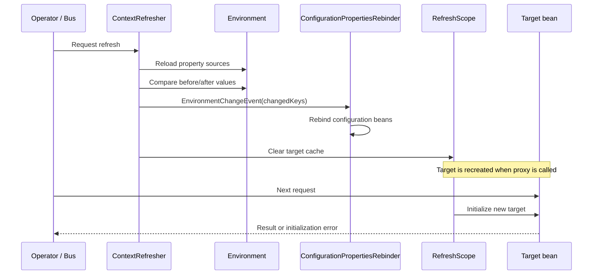
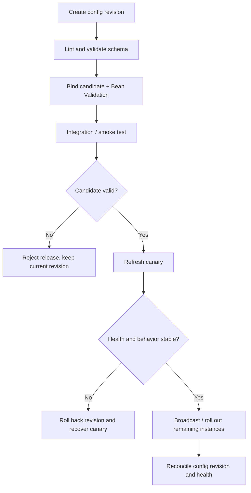

# Handling Repeated Refreshes, Mid-Flight Failures, and Invalid Configuration

> **Chapter:** Configuration Refresh  
> **Module:** `SPRING_CLOUD_CORE` — core Spring Cloud foundations in distributed systems, specifically Spring Cloud Commons, Context, externalized configuration, and version compatibility with Spring Boot. Learners explore refresh scope, discovery, service registry, inter-service communication, and how to test and operate shared abstractions.  
> **Focus:** Configuration refresh affects the Environment, configuration beans, refresh scope targets, and resources currently serving requests. This lesson focuses on repeated refreshes, mid-flight failures, invalid configuration, and safely restoring state.

## 1. Why Does Refresh Need an Error-Handling Strategy?

A Spring Cloud application can change configuration when updating Config Server, adjusting timeouts, switching downstream endpoints, toggling feature flags, or changing log levels. Spring Cloud Context provides mechanisms to update the Environment, rebind configuration beans, and refresh refresh-scoped beans.

This mechanism is convenient, yet it is not a transaction with an application-wide rollback. A single refresh can:

- read the new configuration source, yet fail to bind one property;
- successfully rebind some beans and then fail on another bean;
- clear the refresh scope cache, while the new target is only created on the next request;
- recreate beans successfully on one instance while failing on another instance;
- receive the same configuration multiple times due to manual actions, retries, or Spring Cloud Bus events;
- leave inconsistent states among the Environment, configuration beans, and external resources.

Therefore, distinguish three questions:

1. **Has the configuration source changed?** Does the Environment contain the new property source and values yet?
2. **Has the application applied the configuration?** Have configuration beans and refresh scope targets updated successfully?
3. **Is business behavior stable?** Are database connections, HTTP clients, consumers, schedulers, and downstreams actually operating with the new configuration?

A successful HTTP response from the refresh endpoint does not replace verifying the health of each component and each instance.

### Learning Outcomes

After this lesson, learners will be able to:

1. describe the main steps when Spring Cloud refreshes the Environment;
2. explain the effects of repeated refreshes and refreshes with no changed keys;
3. distinguish ConfigurationProperties rebinding from RefreshScope refreshing;
4. recognize risks when bean binding or new target initialization fails;
5. design validation to block bad configuration before release;
6. build rollback and recovery strategies after a failed refresh;
7. control concurrent refreshes, repeated refreshes, and multi-instance refreshes;
8. test valid configuration, invalid configuration, missing keys, and mid-flight failures.

## 2. Conceptual Refresh Workflow

### 2.1. Main Steps

With Spring Cloud Context's refresh mechanism, a refresh can be pictured through these steps:

1. **Fetch new configuration:** ContextRefresher updates configuration sources according to how the application is set up, such as bootstrap property sources or Config Data.
2. **Compare Environment:** the framework compares before and after values to identify changed keys.
3. **Publish EnvironmentChangeEvent:** an event carrying the changed key list is sent in the context.
4. **Rebind configuration:** Spring Cloud listeners update ConfigurationProperties beans and process log levels under logging.level.*.
5. **Refresh refresh scope:** the RefreshScope target cache is cleared. When the proxy is next called, a new target is created and receives dependencies from the current Environment.
6. **Observe results:** the application records changed keys, binding/initialization errors, and health status.



This model clarifies responsibilities; it is not a guarantee that all listeners and callbacks always run synchronously in the exact same order across every setup. If the application uses an asynchronous event multicaster or custom listeners, verify execution order and how exceptions propagate to callers.

### 2.2. Endpoints and Events

With Spring Boot Actuator, the commonly used endpoint is POST /actuator/refresh. The endpoint must be explicitly exposed:

```yaml
management:
  endpoints:
    web:
      exposure:
        include:
          - health
          - info
          - refresh
```

The endpoint only works when the application has the appropriate Actuator and refresh auto-configuration dependencies. Do not expose this endpoint to public networks. Restrict it using Spring Security, network policies, authentication/authorization, and audit logging.

EnvironmentChangeEvent can also be published when the application actively modifies the Environment. Spring Cloud reacts to this event to rebind ConfigurationProperties beans and update log levels. However, publishing the event alone does not reload configuration from Config Server; the configuration source must be updated first.

### 2.3. Refresh Does Not Mean Restart

Refresh does not recreate the entire ApplicationContext. It does not automatically:

- reload classes or JAR dependencies;
- update Spring Boot/Spring Cloud versions;
- rerun the full startup lifecycle;
- replace every singleton bean;
- re-initialize beans outside the refresh mechanism;
- reverse in-flight requests or committed transactions.

If a configuration only takes effect at startup, or a library does not support reconfiguration, restart/redeploy following an appropriate workflow.

## 3. Repeated Refreshes and Idempotency

### 3.1. What Happens When the Same Refresh Is Sent Multiple Times?

Suppose Config Server returns the same value catalog.client.read-timeout=3s across three consecutive refreshes.

- On the first refresh, Environment may detect the changed key and publish an event with that key.
- On subsequent refreshes, if effective values did not change, the changed key set may be empty.
- Even with no changed keys, the refresh operation can still clear the RefreshScope cache, causing targets to be recreated on the next proxy call.

Therefore, **do not use the refresh endpoint as a health check command or an arbitrary polling operation**. An unnecessary refresh can still cause refresh-scoped bean targets to be destroyed and re-initialized.

### 3.2. Idempotency in Values Does Not Mean Safe Side Effects

An operation is considered idempotent when repeating it with the same input leaves the final state identical to running it once. New configuration may be identical, yet the constructor or lifecycle callbacks of a refreshed bean can produce side effects each time:

- opening additional connections or threads without closing old resources;
- registering duplicate listeners or consumers;
- creating a new scheduler while the old scheduler keeps running;
- calling a downstream API to create remote resources;
- writing an audit record or triggering an unintended workflow.

With RefreshScope, Spring invokes the old target's destruction callbacks when the cache is cleared; a new target is created when the proxy is used next. Register cleanup via PreDestroy, DisposableBean, or an appropriate lifecycle mechanism, and make initialization safe to repeat.

Illustrative example:

```java
@Component
@RefreshScope
public class RemoteCatalogClient {

    private final HttpClient client;

    public RemoteCatalogClient(RemoteCatalogProperties properties) {
        this.client = HttpClient.newBuilder()
                .connectTimeout(properties.getConnectTimeout())
                .build();
    }

    public CatalogResponse fetch(String id) {
        // Use the client created from the current configuration.
        return callRemoteCatalog(id);
    }
}
```

The example shows the target being built from current properties. If a bean holds thread pools, connection pools, or resources with their own lifecycle, manage closing those resources when the old target is destroyed. Do not place non-repeatable actions like creating external subscriptions or writing business data inside a constructor simply because the bean is in refresh scope.

### 3.3. Repeated Refreshes Can Create a Service Gap

When the target cache is cleared, the proxy remains while the old target has been disposed. The next call must initialize a new target. If the constructor or initialization callback fails, requests hitting the proxy can fail.

For beans holding critical resources, you should:

- rate-limit refreshes within a time window;
- avoid concurrent refreshes triggered by multiple sources;
- validate configuration before refreshing;
- use reasonable timeouts and retries when initializing resources;
- monitor target initialization errors and refresh health;
- consider canary or rolling restarts when safe hot-swapping is not possible.

### 3.4. Controlling Concurrent Refreshes

Spring Cloud synchronizes certain internal refresh/rebind operations. Rebinding the same ConfigurationProperties bean is serialized with respect to other concurrent rebinds. RefreshScope also coordinates reading a target with refresh operations for beans in scope.

However, that does not turn the entire ApplicationContext into an atomic transaction. Non-refresh-scoped beans, custom listeners, in-flight requests, and side effects outside the JVM still require dedicated design.

Operationally, coalesce nearby triggers into a single configuration update batch, associate each batch with a clear revision/version, and avoid sending the same command from multiple independent pipelines.

## 4. Rebinding and RefreshScope: Two Distinct Mechanisms

### 4.1. Rebinding ConfigurationProperties

Upon receiving EnvironmentChangeEvent, Spring Cloud can rebind ConfigurationProperties beans.

Example:

```java
import java.time.Duration;

import org.springframework.boot.context.properties.ConfigurationProperties;
import org.springframework.validation.annotation.Validated;

import jakarta.validation.constraints.Max;
import jakarta.validation.constraints.Min;
import jakarta.validation.constraints.NotBlank;
import jakarta.validation.constraints.NotNull;

@ConfigurationProperties(prefix = "catalog.client")
@Validated
public class CatalogClientProperties {

    @NotBlank
    private String baseUrl;

    @Min(1)
    @Max(10)
    private int maxAttempts = 3;

    @NotNull
    private Duration readTimeout = Duration.ofSeconds(2);

    public String getBaseUrl() {
        return baseUrl;
    }

    public void setBaseUrl(String baseUrl) {
        this.baseUrl = baseUrl;
    }

    public int getMaxAttempts() {
        return maxAttempts;
    }

    public void setMaxAttempts(int maxAttempts) {
        this.maxAttempts = maxAttempts;
    }

    public Duration getReadTimeout() {
        return readTimeout;
    }

    public void setReadTimeout(Duration readTimeout) {
        this.readTimeout = readTimeout;
    }
}
```

Corresponding YAML configuration:

```yaml
catalog:
  client:
    base-url: https://catalog.internal
    max-attempts: 3
    read-timeout: 2s
```

Rebinding mutates fields on the same bean instance. For classes with only a no-argument constructor, Spring Cloud resets properties to class-level defaults before rebinding, so properties removed from the Environment do not unintentionally retain old values. The reset mechanism also handles nested configuration objects according to the Spring Cloud version's rules.

This means another thread can read the bean while fields are being updated and observe an intermediate state. The framework serializes rebinds of the same bean, yet that does not automatically guarantee ordinary reader threads see a consistent snapshot.

Objects using constructor binding, including Java Records annotated with ConfigurationProperties, do not support refresh via this rebind mechanism. Check how properties are declared when designing a bean that needs runtime updates.

### 4.2. RefreshScope

RefreshScope places a bean in a proxied scope. The target is created when the proxy is used and then cached. On refresh, the target cache is cleared; the old target is disposed per lifecycle, and a new target is initialized on the next call.

Example:

```java
@Component
@RefreshScope
public class CatalogGateway {

    private final CatalogClient client;

    public CatalogGateway(CatalogClientProperties properties) {
        this.client = CatalogClient.create(
                properties.getBaseUrl(),
                properties.getReadTimeout()
        );
    }

    public CatalogResponse get(String id) {
        return client.get(id);
    }
}
```

The proxy lets other components hold a stable reference to the bean while the target can be replaced after refresh. If another component directly depends on state computed in its constructor, that component also needs an appropriate update strategy.

### 4.3. Which Mechanism to Choose?

| Need | Suitable mechanism | Points to note |
| --- | --- | --- |
| Changing simple configuration fields | Rebind ConfigurationProperties | Bean is mutated in place; concurrent readers may see intermediate state |
| Needing a consistent snapshot for a bean | RefreshScope | New target is created lazily; first request after refresh may hit initialization errors |
| Changing multiple dependencies created together | Place stateful facade/bean in refresh scope | Must clearly identify which dependencies also need recreation |
| Bean using constructor binding or Java Record | Redesign update mechanism or restart | Constructor-bound properties do not refresh via rebind |
| Changing classes/dependencies or ApplicationContext structure | Restart/redeploy | Refresh does not replace startup lifecycle |

### 4.4. Special Cases

- HikariDataSource is in the default spring.cloud.refresh.never-refreshable list. Do not expect this datasource to be recreated merely by adding RefreshScope; choose a datasource/pool strategy suited to your needs or restart the application when required.
- spring.cloud.refresh.extra-refreshable lets you declare additional classes/beans to include in refresh scope in appropriate cases.
- spring.cloud.refresh.never-refreshable declares beans that must not be refreshed/rebound by that mechanism. Do not remove a class from the protection list without understanding its lifecycle and disposal behavior.
- Putting RefreshScope on a Configuration class does not automatically put every Bean declared inside that class into refresh scope. Beans depending on those beans can also retain old dependencies unless they themselves are refreshed.

## 5. Invalid Configuration: Catching It Before Applying

### 5.1. Common Error Categories

New configuration can be wrong in many ways:

| Error category | Example | Where best detected |
| --- | --- | --- |
| Syntax/format error | Broken YAML indentation, unparseable value | CI, Config Server, Config Data loading |
| Type error | read-timeout: tomorrow | Binder/type conversion |
| Missing required value | empty base-url | Bean Validation |
| Out of valid range | max-attempts: 0 | @Min, @Max, or validator |
| Cross-field incompatibility | connect-timeout exceeds request deadline | Class-level/custom validation |
| Environment incompatibility | Syntactically valid URI, but wrong DNS/TLS/credentials | Integration/smoke tests |
| Version compatibility | Property no longer supported in current release train | Compatibility tests and version docs |

Not every error can be caught by metadata or YAML parsing. A URI can be syntactically valid yet point to a non-existent endpoint; a timeout can be positive yet exceed the system's deadline.

### 5.2. Using Bean Validation for Basic Constraints

For example, Validated, NotBlank, Min, Max, and NotNull in CatalogClientProperties reject invalid values during binding. For nested objects, use Valid to trigger validation on nested objects:

```java
import java.time.Duration;

import org.springframework.boot.context.properties.ConfigurationProperties;
import org.springframework.validation.annotation.Validated;

import jakarta.validation.Valid;
import jakarta.validation.constraints.Max;
import jakarta.validation.constraints.Min;
import jakarta.validation.constraints.NotBlank;
import jakarta.validation.constraints.NotNull;

@ConfigurationProperties(prefix = "catalog.client")
@Validated
public class CatalogClientProperties {

    @NotBlank
    private String baseUrl;

    @Valid
    @NotNull
    private Retry retry = new Retry();

    public Retry getRetry() {
        return retry;
    }

    public void setRetry(Retry retry) {
        this.retry = retry;
    }

    public static class Retry {

        @Min(1)
        @Max(10)
        private int maxAttempts = 3;

        @NotNull
        private Duration backoff = Duration.ofMillis(200);

        public int getMaxAttempts() {
            return maxAttempts;
        }

        public void setMaxAttempts(int maxAttempts) {
            this.maxAttempts = maxAttempts;
        }

        public Duration getBackoff() {
            return backoff;
        }

        public void setBackoff(Duration backoff) {
            this.backoff = backoff;
        }
    }
}
```

The application needs a suitable Bean Validation provider, such as Spring Boot's validation starter. Custom constraints should be used when rules span multiple fields or require business-semantic checks.

### 5.3. Checking Cross-Field Constraints

Suppose a request has a 2-second deadline. The sum of connect timeout and read timeout must not exceed this deadline:

```java
import java.time.Duration;

import jakarta.validation.constraints.AssertTrue;
import jakarta.validation.constraints.NotNull;

public class CatalogClientSettings {

    @NotNull
    private Duration connectTimeout;

    @NotNull
    private Duration readTimeout;

    @NotNull
    private Duration requestDeadline = Duration.ofSeconds(2);

    @AssertTrue(message = "Total timeout must not exceed request deadline")
    public boolean isTimeoutBudgetValid() {
        return connectTimeout != null
                && readTimeout != null
                && requestDeadline != null
                && connectTimeout.plus(readTimeout)
                        .compareTo(requestDeadline) <= 0;
    }

    public Duration getConnectTimeout() {
        return connectTimeout;
    }

    public void setConnectTimeout(Duration connectTimeout) {
        this.connectTimeout = connectTimeout;
    }

    public Duration getReadTimeout() {
        return readTimeout;
    }

    public void setReadTimeout(Duration readTimeout) {
        this.readTimeout = readTimeout;
    }

    public Duration getRequestDeadline() {
        return requestDeadline;
    }

    public void setRequestDeadline(Duration requestDeadline) {
        this.requestDeadline = requestDeadline;
    }
}
```

The snippet illustrates a simple check; in real systems, a custom class-level constraint can report clearer errors and avoid validation logic relying on JavaBeans getter conventions. Define default values, units, and upstream deadlines clearly so the comparison is meaningful.

### 5.4. Validating Configuration Before Triggering Refresh

Do not wait for the first production request to discover bad configuration. You can validate new configuration in the pipeline or a dedicated preflight step:

1. fetch candidate configuration for the exact application/profile/label;
2. bind it into an isolated candidate object;
3. run Bean Validation and business checks;
4. test endpoint/credentials using a bounded smoke test;
5. only release revisions that pass checks;
6. refresh a canary before broadcasting to all instances.

Example binding a candidate from Environment:

```java
import java.util.Set;

import org.springframework.boot.context.properties.bind.Bindable;
import org.springframework.boot.context.properties.bind.Binder;

import jakarta.validation.ConstraintViolation;
import jakarta.validation.ConstraintViolationException;
import jakarta.validation.Validator;

Binder binder = Binder.get(environment);

CatalogClientSettings candidate = binder
        .bind("catalog.client", Bindable.of(CatalogClientSettings.class))
        .orElseThrow(() ->
                new IllegalStateException("Missing catalog.client"));

Set<ConstraintViolation<CatalogClientSettings>> violations =
        validator.validate(candidate);

if (!violations.isEmpty()) {
    throw new ConstraintViolationException(violations);
}
```

This is an illustrative preflight step. CatalogClientSettings should be a separate candidate object, not the singleton bean actively used by request threads. The validator must be configured with the corresponding constraints. If real connectivity verification is required, add a smoke test with timeouts and restricted permissions.

## 6. Mid-Flight Failures: What Might Have Changed Already?

### 6.1. Refresh Has No Context-Wide Rollback

Suppose Environment already received the new property source. Spring Cloud publishes EnvironmentChangeEvent, some beans have already rebound, and then another bean throws an exception due to an invalid value.

Do not assume the application automatically reverts to its old state. Environment may already hold the new values; previously processed beans may have updated; the failing bean may hold part of its old state or an intermediate state depending on where it failed; other listeners may already have performed side effects.

Refresh does not provide a transactional rollback covering:

- property sources;
- all ConfigurationProperties beans;
- RefreshScope targets;
- connection resources;
- in-flight requests;
- side effects in external systems.

Therefore, when a refresh fails, determine the actual state before sending another refresh.

### 6.2. Post-Failure State Depends on the Failure Point

| Failure point | Possible state encountered | Action |
| --- | --- | --- |
| Failed to fetch new configuration | Environment may keep old source, depending on Config Client/Config Data and server source | Check fetch logs and property sources |
| Loaded new source, yet binding failed | Environment may have changed; some beans may have rebound | Check changed keys, exceptions, and configprops |
| RefreshScope target failed initialization | Cache already cleared; proxy exists, yet calls to new target fail | Check initialization exception, refresh health, and dependencies |
| Custom listener failed | Other listeners may have run earlier; order depends on event multicaster | Check listener order and side effects |
| Only one instance in cluster failed | Instances may be running different revisions | Check each instance, bus events, and config revisions |

This table describes possibilities, not a guarantee that every version produces the exact same outcome at every failure point. Read the actual stack trace and Environment state before drawing conclusions.

### 6.3. Refresh Scope Health Indicator

Spring Cloud provides RefreshScopeHealthIndicator. If a bean cannot be re-initialized or rebound after a context refresh, the health indicator can transition to DOWN and expose the associated exception.

You can check it via Actuator health if the component is exposed:

```yaml
management:
  endpoint:
    health:
      show-details: when_authorized
  endpoints:
    web:
      exposure:
        include:
          - health
          - refresh
```

Do not disable the refresh health indicator just so the pipeline always sees the application UP. If the health check turns DOWN, address the root cause or decide on restart/rollback per the service's policy.

## 7. Recovery and Rollback Strategies

### 7.1. Stop Issuing More Refreshes While State Is Unclear

When a refresh fails:

1. pause further automated triggers or manual retries;
2. record the config revision, instance ID, timestamp, and changed keys;
3. inspect Environment and /actuator/configprops on the failing instance;
4. inspect refresh health and logs from bean rebind/target initialization;
5. identify which instances have already applied the new configuration;
6. decide whether to fix configuration, roll back the revision, or restart.

If you keep sending refreshes repeatedly, each one can clear target caches and trigger more resource initialization attempts, making investigation harder.

### 7.2. Rolling Back to a Known-Good Configuration Revision

With a Config Server using a Git backend, manage configuration by traceable commit/tag/label. When a new revision is invalid:

- restore the configuration file to a known-good commit or release a new rollback revision;
- verify Config Server serves the right application/profile/label again;
- check the candidate config via preflight;
- refresh a canary and observe;
- only after the canary stabilizes, broadcast to the remaining instances.

Rolling back configuration and refreshing again can restore Environment to old values, yet it does not automatically undo side effects that already occurred. For example, if a consumer already sent messages to a new endpoint or a scheduler already dispatched external commands, reverting the property does not reverse those actions.

### 7.3. When Should You Restart?

Consider restarting/redeploying when:

- beans do not support refresh or use constructor-bound properties;
- resources cannot be safely replaced in-process;
- bean state was partially mutated and consistency cannot be verified;
- dependencies or classpath need changes;
- a refresh scope target repeatedly fails even after fixing configuration;
- the application lacks a way to verify and recover runtime state.

Restarts also require readiness gates, graceful shutdown, and a rollout strategy to avoid stopping all replicas at once.

### 7.4. Separating Prepare and Apply Steps

A safe configuration workflow can be split into:



This workflow does not turn refresh into a transaction, yet it reduces the likelihood of bad configuration spreading simultaneously.

## 8. Refreshing Across Multiple Instances with Spring Cloud Bus

### 8.1. Why Is Broadcasting Needed?

Config Client does not poll Config Server for changes by default. In multi-replica systems, if each instance refreshes on its own schedule, they can update at different times and generate unnecessary load.

Spring Cloud Bus allows broadcasting refresh events through a broker configured by the applications. The commonly used endpoint is POST /actuator/busrefresh; the corresponding instance-level endpoint is POST /actuator/refresh.

Exposure configuration:

```yaml
management:
  endpoints:
    web:
      exposure:
        include:
          - health
          - busrefresh
```

Bus refresh clears the RefreshScope cache and rebinds ConfigurationProperties on instances receiving the event. A broker and appropriate Spring Cloud Bus configuration are required.

### 8.2. Bus Is Not a Cluster-Wide Transaction

When broadcasting:

- messages may arrive at instances at different times;
- one instance may bind successfully while another fails;
- the broker or network may experience delays/disconnects;
- newly starting instances may pick up a different revision if the configuration source changed between fetches.

Do not assume the entire cluster switches revisions at the same instant or within one transaction. Include the config revision in logs/metrics, monitor each instance, and have a policy to handle instances that do not confirm success.

### 8.3. Choosing Canary or Broadcast?

| Situation | Strategy |
| --- | --- |
| Small, thoroughly tested change | Can broadcast using standard workflow |
| Changing endpoint/credentials/database | Refresh canary, smoke test, then roll out |
| Change affecting traffic routing | Batch rollout, monitor downstream errors and latency |
| Beans initializing heavy resources | Limit number of instances refreshing concurrently |
| Recently rolled-back revision | Verify one instance before broadcasting again |
| One instance failing health | Isolate/investigate that instance; do not blindly send repeated refreshes |

## 9. Limitations to Know

### 9.1. Deleting a Property from the Configuration Source

Spring Cloud has limitations when handling complete property deletion from a configuration source followed by a refresh: the "whether a property exists or not" state does not always update as expected for all use cases.

If business logic depends on a key's presence, design an explicit default value or explicit state flag instead of relying on deleting keys remotely. For example, instead of deleting feature.new-flow, set feature.new-flow.enabled=false to express the disabled state clearly.

### 9.2. Not Every Bean Is Refreshable

- Ordinary singleton beans are not automatically recreated just because the Environment changed.
- ConfigurationProperties using constructor binding, including Java Records, are not rebound by the standard refresh mechanism.
- Some beans belong to the never-refreshable list.
- Beans depending on a scoped bean can still hold previously computed state unless they themselves are refreshed.
- RefreshScope on a Configuration class does not mean every bean declared by that class is in scope.

Inspect the object graph and dependency lifecycle rather than only adding annotations to a root class.

### 9.3. AOT and Native Image

Context refresh is currently unsupported for Spring AOT transformations and native images per current Spring Cloud documentation. For AOT/native images, set spring.cloud.refresh.enabled=false and use a configuration strategy appropriate to that deployment model, typically restart/rollout or a dedicated supported runtime mechanism.

### 9.4. Refresh Does Not Replace Secret Management

If refresh changes credentials or secrets:

- fetch secrets from a dedicated secret management source;
- avoid logging secrets or exposing them via the env endpoint;
- verify the overlap window between old and new credentials;
- confirm clients/pools switched to the new credentials;
- have a rollback or rotation plan if new connections fail.

## 10. Observing and Recording a Refresh

A refresh cycle needs enough telemetry to answer: who triggered it, which revision, which instances received it, which keys changed, and which beans failed.

### 10.1. Data to Record

| Data | Purpose |
| --- | --- |
| config.revision or commit ID | Pinpoint exact configuration version |
| application.name and instance ID | Distinguish services/replicas |
| Refresh trigger | Distinguish manual action, Bus, pipeline, or event |
| Start/end timestamps | Measure duration and detect overlapping refreshes |
| Changed keys | Understand scope of change; do not log secret values |
| Rebind/target initialization result | Identify which beans applied successfully |
| Refresh health | Detect errors after refreshing |
| Downstream smoke-test result | Verify actual post-refresh behavior |

Do not log the entire Environment or configuration values that may contain credentials. Record only key names and necessary metadata.

### 10.2. Checking with Actuator

- /actuator/health: overall status and refresh health if exposed.
- /actuator/configprops: inspect bound ConfigurationProperties beans.
- /actuator/env: inspect property sources and effective values when the endpoint is secured and properly masked.
- /actuator/refresh: trigger refresh on one instance.
- /actuator/busrefresh: broadcast refresh to instances via Bus.

Endpoints must be enabled/exposed in Actuator configuration and protected with proper authorization. Do not broadly enable management endpoints in production just for debugging convenience.

### 10.3. Measure Behavior Instead of Just Measuring the Endpoint

After refresh, run appropriate functional checks:

- open connections to downstreams using the new configuration;
- check dependency health/readiness probes;
- verify consumers use the new endpoint/topic;
- verify schedulers still have only one active schedule;
- inspect connection pool metrics and timeout errors;
- confirm feature flags are active on the intended instances.

If the refresh endpoint returns success yet subsequent business requests fail, the problem lies in initializing or using the new target, not solely in loading property sources.

## 11. Testing Repeated Refreshes, Errors, and Invalid Configuration

### 11.1. Test Matrix

| Scenario | How to test | Expected result |
| --- | --- | --- |
| First refresh with valid config | Change a property and trigger refresh | Key changes and beans apply new value |
| Repeated refresh of same revision | Trigger refresh again without changing source | No value drift; scoped targets may be recreated |
| Refresh with no changed keys | Keep property sources unchanged | Changed-key set is empty; check side effects of target recreation |
| Two closely spaced refreshes | Send concurrent triggers in test | No uncontrolled interleaving; revision logs remain identifiable |
| Invalid data type | Set unparseable duration/string | Binding fails clearly; refresh is not treated as successful |
| Bean Validation violation | Set max-attempts out of range | Validation error occurs and health reflects error |
| Missing required key | Remove or leave base URL blank | Preflight/validation catches it before rollout |
| Scoped bean target fails creation | Constructor connects to bad endpoint | Proxy call fails and refresh health reports error |
| Custom listener throws exception | Force test listener to fail intentionally | Observe failure point and state of already-processed beans |
| Config Server unreachable | Shut down backend in test environment | Verify optional/required policy and retained values |
| One Bus node misses event | Isolate one instance | Revision skew detected and catch-up procedure exists |
| Revision rollback | Restore known-good config and refresh | Old values applied and downstream recovers |

### 11.2. Testing Runtime Binding and Validation

You can use ApplicationContextRunner or integration tests to verify valid/invalid configuration. Example with Spring Boot test:

```java
import java.time.Duration;

import org.junit.jupiter.api.Test;
import org.springframework.beans.factory.annotation.Autowired;
import org.springframework.boot.test.context.SpringBootTest;

import static org.assertj.core.api.Assertions.assertThat;

@SpringBootTest(properties = {
    "catalog.client.base-url=https://catalog.internal",
    "catalog.client.max-attempts=3",
    "catalog.client.read-timeout=2s"
})
class CatalogClientPropertiesTest {

    @Autowired
    CatalogClientProperties properties;

    @Test
    void bindsValidConfiguration() {
        assertThat(properties.getMaxAttempts()).isEqualTo(3);
        assertThat(properties.getReadTimeout())
                .isEqualTo(Duration.ofSeconds(2));
    }
}
```

A separate test should start a context with max-attempts=0 and assert startup/binding fails due to validation. This tests binding; it does not yet prove runtime refresh can recover from errors.

### 11.3. Testing Refresh Scope

With a scoped bean having a counter or target ID, you can verify:

1. call proxy the first time and record target ID;
2. trigger refresh;
3. call proxy again;
4. verify new target ID;
5. verify destruction callback of old target ran;
6. supply bad configuration so the new target fails and verify health/error;
7. fix configuration and test recovery per the designed strategy.

Tests must explicitly control how Environment is updated and which events are published. Do not use long sleeps or rely on random timing to conclude refresh completed.

### 11.4. Testing Mid-Flight Failures

You can create a test listener or test bean that intentionally throws an exception upon receiving an invalid value. After refresh fails, the test should inspect:

- which values Environment currently holds;
- which ConfigurationProperties beans already rebound;
- whether refresh scope targets were invalidated;
- what the health indicator reports;
- whether the next refresh after fixing configuration succeeds.

The goal is to confirm the application can detect inconsistent state and recover per the runbook. Do not write tests assuming every bean rolls back automatically to the pre-refresh snapshot if the application has no such rollback mechanism.

## 12. Runbook for Handling Failed Refreshes

When alerted that a refresh failed, follow this sequence:

1. **Record revision:** identify commit/config version, service, instance, and trigger.
2. **Prevent overlapping refreshes:** pause automated pipelines or triggers while investigating.
3. **Check source:** confirm Config Server returns the right application/profile/label and property sources.
4. **Read binding errors:** look for BindException, BindValidationException, conversion errors, or listener exceptions.
5. **Inspect targets:** if failures occur when calling a proxied bean, inspect constructors, dependencies, resources, and destruction callbacks.
6. **Check health:** inspect refresh health, readiness, and downstream status.
7. **Choose recovery:** fix the candidate config, roll back the revision, or restart/redeploy if beans cannot recover via refresh.
8. **Test canary:** verify one instance works with the fixed revision.
9. **Roll out remainder:** broadcast/refresh in batches and reconcile revisions.
10. **Close incident:** document the offending key, root cause, impact window, and preventive tests.

Do not repeatedly resend the same refresh request hoping the error disappears before identifying the failure point.

## 13. Common Mistakes

**"Calling refresh multiple times has no side effects if values did not change."**  
Incorrect. The changed-key set may be empty, yet the RefreshScope cache can still be cleared and targets recreated on the next call.

**"If refresh fails, Spring rolls back all beans automatically."**  
No. The Environment and some beans may have already changed before the error occurred. You must check actual state.

**"ConfigurationProperties is always replaced with a new instance."**  
No. Rebinding usually mutates the same instance; concurrent readers can see intermediate states. Use refresh scope if bean-level consistency is needed.

**"Marking RefreshScope on a configuration class refreshes every child bean."**  
No. Beans declared inside the class do not automatically enter refresh scope; dependencies needing updates must also have an appropriate lifecycle.

**"Every DataSource is refreshable."**  
No. HikariDataSource belongs to Spring Cloud's default never-refreshable list.

**"Config Client polls Config Server automatically."**  
Not by default. Use an explicit trigger mechanism or Spring Cloud Bus for multiple instances.

**"Bus refresh is atomic across the cluster."**  
No. Each instance processes the event independently and can succeed or fail separately.

**"Deleting a key from Config Server is how you reset any property."**  
Do not rely on key deletion to control configuration presence. Use defaults or explicit state flags.

**"Refresh scope fits every bean."**  
No. Beans that cannot be safely recreated, beans with uncontrolled side effects, or resources with complex lifecycles need dedicated strategies.

## 14. Applied Exercises

### Exercise 1 — Repeated Refresh

A pipeline sends three refresh requests within a few seconds. All three times Config Server returns the same revision. A client in RefreshScope is recreated three times, causing a spike in short-lived connections.

Explain why an empty changed-key set does not guarantee targets will not be recreated. Propose trigger debouncing/coalescing, revision management, and old target cleanup.

### Exercise 2 — One Bean Fails Binding

Config Server changes catalog.client.max-attempts from 3 to 0. Some beans already rebound before validation failed.

Describe the Environment and bean states that can exist, explain why rollback cannot be assumed, and propose checks before sending another refresh.

### Exercise 3 — New Target Fails to Initialize

A RefreshScope client reads a new URL whose DNS cannot be resolved. The refresh endpoint already cleared the cache; the next request fails when the proxy creates a new target.

Distinguish config fetch errors from target initialization errors, identify which health indicator to inspect, and design rollback/restart.

### Exercise 4 — Syntactically Valid Configuration That Breaks Business Rules

YAML parses cleanly, read-timeout is 5s, yet the request deadline is only 2s. Write cross-field validation and describe how to run preflight checks before releasing the revision.

### Exercise 5 — Uneven Bus Refresh

Out of 10 replicas, 9 replicas receive the new revision; one replica lost broker connectivity and remains on the old revision.

Propose how to record revisions per instance, detect configuration skew, handle the failing node, and perform a catch-up rollout.

### Exercise 6 — Rollback After Side Effects

A refresh changes a consumer's endpoint, and the consumer sends messages to the new system. Later the endpoint is discovered to be wrong, and Config Server is rolled back to the previous revision.

Explain why rolling back properties does not undo sent messages. Propose idempotency keys, outbox/audit trails, and message remediation if needed.

### Quick Self-Check

1. Does refresh recreate the entire ApplicationContext? **No.**
2. Does ConfigurationProperties rebinding mutate the current bean or replace the instance? **Usually mutates the same instance.**
3. What does RefreshScope do on refresh? **Clears the target cache; a new target is created when the proxy is next called.**
4. Can refreshing the same revision recreate targets? **Yes.**
5. Is refresh a transaction with context-wide rollback? **No.**
6. Where should bad configuration be caught? **Preflight/CI, Binder, and Bean Validation before rollout.**
7. Are beans using constructor binding refreshed by standard rebinding? **No.**
8. Does HikariDataSource refresh by default? **No, it is in never-refreshable by default.**
9. Does Bus refresh guarantee all instances update simultaneously? **No.**
10. What should you do after a failed refresh? **Stop overlapping triggers, check revision/Environment/beans/health, and then fix, roll back, or restart based on actual state.**

## 15. Safe Refresh Design Checklist

Before allowing configuration refresh in production, confirm:

1. Runtime properties have explicit types and validation.
2. Candidate configs are linted, bound, and business-validated before release.
3. Config revisions or commit IDs exist for traceability.
4. Refresh-scoped beans have constructors/init side effects safe to re-run.
5. Destruction callbacks release old connections, threads, schedulers, and listeners.
6. Beans requiring consistent snapshots choose appropriately between rebinding and refresh scope.
7. Non-refreshable beans are clearly identified.
8. Refresh triggers are debounced/coalesced and do not run needlessly in loops.
9. Refresh endpoints are secured and audited.
10. Refresh health, readiness, and downstream smoke tests exist.
11. Canary/rolling strategies are used for high-impact changes.
12. A last-known-good revision and rehearsed rollback/restart procedure exist.
13. Each instance can report its active revision.
14. Tests cover valid refresh, repeated refresh, invalid config, partial failure, and recovery.
15. Refresh is never assumed to replace restart when classpath, constructor-bound config, or resource lifecycles require a fresh startup.

**Core message:** Refresh updates multiple state layers inside a running application. The same revision can be sent multiple times and still recreate refresh-scoped targets; a binding error can occur after Environment has already changed; one node can succeed while another fails. Validate candidates before applying, control triggers, monitor revisions per instance, and prepare recovery paths via configuration fixes, rollback, or restart.

**References:** [Spring Cloud Commons — Application Context Services, Environment Changes and Refresh Scope](https://docs.spring.io/spring-cloud-commons/reference/spring-cloud-commons/application-context-services.html), [Spring Cloud Bus — Bus Refresh Endpoint](https://docs.spring.io/spring-cloud-bus/reference/spring-cloud-bus/bus-endpoints.html), [Spring Cloud Config — Git Backend and Refresh Behavior](https://docs.spring.io/spring-cloud-config/reference/server/environment-repository/git-backend.html), and [Spring Cloud Commons — Configuration Properties](https://docs.spring.io/spring-cloud-commons/reference/configprops.html). Lifecycle details and limits may vary across release trains; cross-check documentation matching your application's Spring Boot/Spring Cloud versions.
