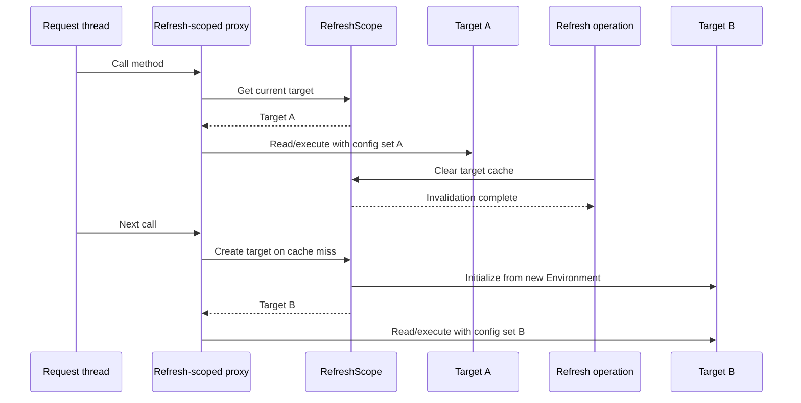
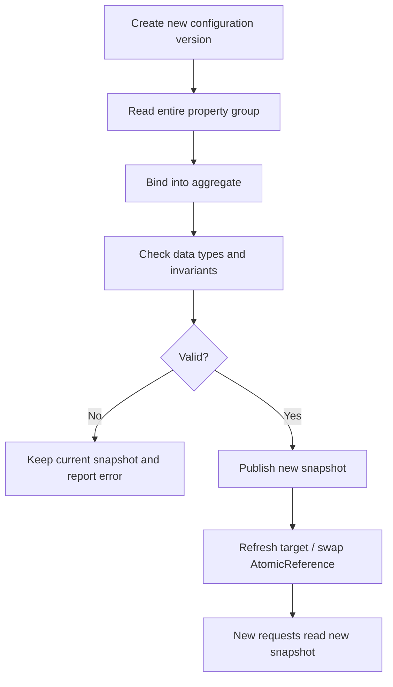

# Preserving a Consistent View When Changing Multiple Related Properties

## 1. The Problem

In a distributed application, multiple configuration properties form a single rule set that must be used together. For example, an HTTP client has a primary URL, fallback URL, connect timeout, read timeout, and retry count. A routing flow may depend simultaneously on an algorithm, weights, and an instance list. A connection pool may need to update its limits, wait timeout, and eviction policy in a single change.

Suppose configuration currently uses value set A:

```text
primary-uri      = https://api-a.internal
fallback-uri     = https://api-b.internal
connect-timeout  = 300ms
read-timeout     = 2s
max-attempts     = 3
```

An operator switches this entire group to value set B. If a request reads individual fields while the application is rebinding the bean, that request might observe the new URL with the old timeout, or the new list while the retry limit has not yet changed. Untested combinations like these can cause hard-to-reproduce failures.

The problem is **configuration view consistency**: a business operation needs to use a set of values belonging to the same version, rather than reading independent properties at different moments.

This lesson belongs to the **Configuration Refresh** chapter of the **SPRING_CLOUD_CORE** module. This module helps learners understand Spring Cloud Commons, Spring Cloud Context, externalized configuration, refresh scope, Spring Boot compatibility, testing, and operating shared abstractions.

After this lesson, learners will be able to:

- Explain why `@ConfigurationProperties` rebinding does not guarantee a consistent view when multiple fields change together.
- Identify risks with `List` and `Set` during rebinding.
- Use `@RefreshScope` to synchronize reads with refreshes of beans in scope.
- Group related properties into an immutable snapshot and read the snapshot once per operation.
- Validate consistency before publishing new configuration.
- Distinguish consistency within a single instance from multiple instances in a cluster switching configuration versions together.

## 2. Multiple Levels of Consistency

| Scope | Question | Approach |
| --- | --- | --- |
| Single property | Does a field get updated to the right value? | Proper type binding and conversion. |
| Single configuration bean | Can readers observe mixed old and new fields? | `@RefreshScope` or immutable snapshot. |
| Single business operation | Do related properties within one request share the same version? | Read one aggregate snapshot and retain it throughout the operation. |
| Single application instance | Do components in the process switch policy together? | One shared snapshot source; avoid multiple independent beans updating out of sync. |
| Entire cluster | Do all instances switch configuration at the same time? | Event distribution, versioning, and coordinated cutover; a single refresh does not create a cluster-wide transaction. |

A mechanism protecting readers within one bean does not automatically solve consistency across multiple beans or multiple instances. You must select the scope explicitly and structure configuration around that scope.

## 3. Why Can @ConfigurationProperties Rebinding Create a Mixed View?

Spring Cloud listens for `EnvironmentChangeEvent`. When the event is published after `Environment` changes, `@ConfigurationProperties` beans are rebound. This mechanism fits many ordinary configuration changes, yet has an important characteristic: **rebinding mutates fields on the same bean instance**.

Spring Cloud serializes concurrent rebinds of the same bean. When resetting to class-level defaults is needed, the framework constructs and binds a new instance first and then copies values onto the bean in use. This avoids exposing a field temporarily reset to `null`, `0`, or a default value to readers before it is rebound.

Even so, copying multiple fields is still not an atomic replacement of the entire object. Another thread reading mid-update can observe some fields with new values and other fields still holding old values.

Example:

```java
@ConfigurationProperties(prefix = "routing")
public class RoutingProperties {
    private URI primaryUri;
    private URI fallbackUri;
    private Duration connectTimeout;
    private Duration readTimeout;
    private int maxAttempts;

    // getters and setters
}
```

Suppose rebinding is transitioning from configuration set A to B. A request might read:

| Property | Value observed by the request |
| --- | --- |
| `primaryUri` | New value from B |
| `fallbackUri` | New value from B |
| `connectTimeout` | Old value from A |
| `readTimeout` | New value from B |
| `maxAttempts` | Old value from A |

This combination can be invalid even though both A and B are valid when checked individually.

### 3.1. Specific Risk for Collections

Current Spring Cloud Commons documentation highlights a specific limitation: a `Collection` such as `List` or `Set` can temporarily become empty during rebinding. After new values are copied onto the bean, Spring Boot's Binder updates mutable collections by clearing existing elements first and then adding new elements. Concurrent readers can observe an empty collection during that brief window.

`Map` does not exhibit the exact same behavior because the Binder puts entries into the existing map without clearing the entire map first. Even so, this does not make the whole bean containing the map an atomic snapshot.

If a request requires a list of routes, rules, or permissions that must never be observed as empty mid-refresh, do not rely on direct collection rebinding on a mutable singleton.

### 3.2. When Is Rebinding Still Suitable?

Rebinding is generally suitable when properties are independent, readers use one property at a time, intermediate states do not affect correctness, and the bean tolerates in-place field updates. If multiple fields share invariant relationships, you need a way to publish the entire value set as a single unit.

## 4. Using @RefreshScope to Protect a Bean's View

`@RefreshScope` creates a scoped proxy for a bean. The actual target is initialized when the proxy is used and held in the scope's cache. On refresh, the target cache is cleared; the next method call creates a new target from the current configuration.

Spring Cloud Commons explicitly notes: if an application requires a consistent view of a bean's properties during refresh, use `@RefreshScope`. The scope serializes reads with respect to refreshes of beans in that scope.

General flow:



An in-flight request using target A can complete with A. After refresh, the next call through the proxy uses target B. As a result, a single method invocation on a refresh-scoped bean does not observe fields on the same target being partially rebound.

### 4.1. Example of a Bean with State Depending on Multiple Properties

```java
import java.net.URI;
import java.time.Duration;

import org.springframework.cloud.context.config.annotation.RefreshScope;
import org.springframework.core.env.Environment;
import org.springframework.stereotype.Component;

@Component
@RefreshScope
public class RoutingClientPolicy {

    private final URI primaryUri;
    private final URI fallbackUri;
    private final Duration connectTimeout;
    private final Duration readTimeout;
    private final int maxAttempts;

    public RoutingClientPolicy(Environment environment) {
        this.primaryUri = URI.create(
                environment.getRequiredProperty("routing.primary-uri"));
        this.fallbackUri = URI.create(
                environment.getRequiredProperty("routing.fallback-uri"));
        this.connectTimeout = environment.getRequiredProperty(
                "routing.connect-timeout", Duration.class);
        this.readTimeout = environment.getRequiredProperty(
                "routing.read-timeout", Duration.class);
        this.maxAttempts = environment.getRequiredProperty(
                "routing.max-attempts", Integer.class);
        validate();
    }

    private void validate() {
        if (connectTimeout.isZero() || connectTimeout.isNegative()) {
            throw new IllegalArgumentException("connect-timeout must be positive");
        }
        if (readTimeout.isZero() || readTimeout.isNegative()) {
            throw new IllegalArgumentException("read-timeout must be positive");
        }
        if (maxAttempts < 1) {
            throw new IllegalArgumentException("max-attempts must be at least 1");
        }
        if (primaryUri.equals(fallbackUri)) {
            throw new IllegalArgumentException("primary and fallback URI must differ");
        }
    }

    public Snapshot snapshot() {
        return new Snapshot(
                primaryUri, fallbackUri, connectTimeout, readTimeout, maxAttempts);
    }

    public record Snapshot(
            URI primaryUri,
            URI fallbackUri,
            Duration connectTimeout,
            Duration readTimeout,
            int maxAttempts) {
    }
}
```

The class above is an illustrative example. In real projects, use Binder or a bound configuration object to reduce manual property reads, while keeping all target creation and validation steps within a single initialization.

The fields are final, assigned in the constructor, and never mutated. Consumers call `snapshot()` exactly once and receive an immutable record; if a refresh occurs afterward, the in-flight request keeps the snapshot it received. Do not invoke multiple separate getters through the proxy, because separate proxy calls can fall on opposite sides of a refresh boundary. Do not place `@RefreshScope` on a client interface or a `@Configuration` class assuming every bean declared inside automatically belongs to the scope; each bean needing refresh must be registered properly.

### 4.2. Limitations of @RefreshScope

- New targets are created **lazily** on the next call; refresh does not necessarily rebuild every target immediately.
- Only beans in refresh scope are protected by the scope mechanism. Singletons outside the scope can still hold old dependencies or old state.
- If a business operation calls multiple independent proxies at different times, those calls can straddle a refresh boundary.
- Deleting a property outright and refreshing does not guarantee updating property presence semantics. For feature flags, send an explicit value such as `false` or `DISABLED`.
- Certain specific beans cannot be refreshed. For instance, `HikariDataSource` is in the default `spring.cloud.refresh.never-refreshable` list.
- Context refresh is not supported for Spring AOT transformations and native images; in those scenarios set `spring.cloud.refresh.enabled=false`.

Therefore, `@RefreshScope` is one part of a consistent design—not a substitute for grouping related properties and validating the new value set.

## 5. Grouping Related Properties into an Immutable Snapshot

A clear design is to group all properties forming a policy into one immutable object. Each request retrieves the snapshot exactly once and passes that snapshot down to subsequent processing steps.

Example configuration:

```yaml
routing:
  revision: 42
  primary-uri: https://api-a.internal
  fallback-uri: https://api-b.internal
  connect-timeout: 300ms
  read-timeout: 2s
  max-attempts: 3
```

Data type declaration:

```java
import java.net.URI;
import java.time.Duration;

public record RoutingSettings(
        long revision,
        URI primaryUri,
        URI fallbackUri,
        Duration connectTimeout,
        Duration readTimeout,
        int maxAttempts) {
}
```

Create a refresh-scoped provider. This example uses Binder to bind the record from Environment whenever a new target is created:

```java
import org.springframework.boot.context.properties.bind.Bindable;
import org.springframework.boot.context.properties.bind.Binder;
import org.springframework.cloud.context.config.annotation.RefreshScope;
import org.springframework.core.env.Environment;
import org.springframework.stereotype.Component;

@Component
@RefreshScope
public class RoutingSettingsProvider {

    private final RoutingSettings snapshot;

    public RoutingSettingsProvider(Environment environment) {
        RoutingSettings loaded = Binder.get(environment)
                .bind("routing", Bindable.of(RoutingSettings.class))
                .orElseThrow(() ->
                        new IllegalStateException("Missing routing configuration"));
        validate(loaded);
        this.snapshot = loaded;
    }

    public RoutingSettings snapshot() {
        return snapshot;
    }

    private void validate(RoutingSettings settings) {
        if (settings.primaryUri() == null || settings.fallbackUri() == null) {
            throw new IllegalArgumentException("Both routing URIs are required");
        }
        if (settings.connectTimeout() == null
                || settings.connectTimeout().isZero()
                || settings.connectTimeout().isNegative()) {
            throw new IllegalArgumentException("connect-timeout must be positive");
        }
        if (settings.readTimeout() == null
                || settings.readTimeout().isZero()
                || settings.readTimeout().isNegative()) {
            throw new IllegalArgumentException("read-timeout must be positive");
        }
        if (settings.maxAttempts() < 1) {
            throw new IllegalArgumentException("max-attempts must be at least 1");
        }
        if (settings.primaryUri().equals(settings.fallbackUri())) {
            throw new IllegalArgumentException("Routing URIs must differ");
        }
    }
}
```

In this example, `RoutingSettings` is an immutable record created by Binder inside the target. The record is not registered as a `@ConfigurationProperties` bean needing rebinding; it is a snapshot recreated when the provider refreshes. The provider class must be proxyable and should not be declared final.

Consumer reads the snapshot once:

```java
@Service
public class OrderForwarder {

    private final RoutingSettingsProvider settingsProvider;
    private final RoutingGateway gateway;

    public OrderForwarder(
            RoutingSettingsProvider settingsProvider,
            RoutingGateway gateway) {
        this.settingsProvider = settingsProvider;
        this.gateway = gateway;
    }

    public Response forward(OrderRequest request) {
        RoutingSettings settings = settingsProvider.snapshot();
        return gateway.send(
                request,
                settings.primaryUri(),
                settings.fallbackUri(),
                settings.connectTimeout(),
                settings.readTimeout(),
                settings.maxAttempts());
    }
}
```

The crucial point is that `snapshot()` is called **only once** per operation. The request retains the reference to that immutable record throughout processing. If a refresh happens after the request obtains the snapshot, the in-flight request continues using the old version; the next request receives the new version.

If the snapshot contains collections or maps, ensure deep immutability: copy collections on creation via `List.copyOf` or `Map.copyOf` and never expose mutable references. A record holding a mutable `List` is not yet a fully immutable snapshot.

## 6. Atomic Snapshot Publication Using AtomicReference

For systems requiring tighter control or preferring not to use `@RefreshScope`, you can manage a snapshot yourself using `AtomicReference`.

Principles:

1. Read all properties from the Environment or updated configuration source.
2. Bind into a new object.
3. Validate all cross-property constraints thoroughly.
4. Only when every step succeeds, replace the current reference with the new snapshot in a single set operation.
5. Each request calls get once and retains that snapshot.

```java
import java.util.concurrent.atomic.AtomicReference;
import org.springframework.core.env.Environment;
import org.springframework.stereotype.Component;

@Component
public class RoutingSettingsRegistry {

    private final AtomicReference<RoutingSettings> current;
    private final Environment environment;

    public RoutingSettingsRegistry(Environment environment) {
        this.environment = environment;
        this.current = new AtomicReference<>(loadAndValidate(environment));
    }

    public RoutingSettings snapshot() {
        return current.get();
    }

    public void reload() {
        RoutingSettings next = loadAndValidate(environment);
        current.set(next);
    }
}
```

This is an illustrative skeleton; `loadAndValidate` must use Binder and full validation as in the earlier example. You can invoke `reload()` from a listener receiving an event after the Environment has been updated.

Advantages:

- `AtomicReference.set` replaces the entire snapshot at a single publication point.
- Requests holding the old reference continue using the complete old value set.
- New requests receive the new reference after the swap.
- If binding or validation fails before set, the old snapshot remains intact.

Do not mutate fields one by one on a shared object and hope readers observe a consistent set. Build a complete new object, validate it, and swap the reference exactly once.

### 6.1. Choosing @RefreshScope or AtomicReference?

| Criterion | `@RefreshScope` with aggregate snapshot | `AtomicReference` |
| --- | --- | --- |
| Update mechanism | Invalidate target; proxy creates new target when called | Bind/validate manually and swap reference |
| Read/refresh synchronization | Scope serializes reads with refreshes for beans in scope | Readers fetch snapshot via a single get |
| Implementation effort | Leverages Spring Cloud lifecycle | Must manage listeners, errors, and reload state manually |
| When validation fails | New target may fail during initialization; must monitor refresh health | Does not swap; retains old snapshot and records error |
| Control over publication timing | Follows RefreshScope lifecycle | Actively decides when to call set |
| Best suited for | Stateful beans needing recreation on Spring Cloud refresh | Needing versioned snapshots and custom publish workflow |

You do not need to apply both approaches simultaneously to the same snapshot. Pick one component responsible for publishing configuration to avoid two competing refresh mechanisms.

## 7. Validating the Entire Configuration Set Before Publishing

Consistency is not just memory synchronization. A new snapshot must be business-valid before requests are allowed to use it.

Example constraints:

- Connect timeout and read timeout must be greater than 0.
- Retry count must stay within allowed bounds.
- Primary URI and fallback URI must differ.
- If using a pool, minimum-idle must not exceed maximum-size.
- If min-weight and max-weight exist, min must not exceed max.
- If validity windows exist, not-before must precede expires-at.
- If rotating certificate and private key, both must belong to the same pair.

Change workflow:



Do not update related properties one by one across separate administrative operations if the application can receive traffic between operations. Update one configuration document or identifiable revision, validate the whole set, and emit a single refresh.

### 7.1. Attaching a Revision to the Snapshot

A revision or version field helps observe which configuration set requests are using:

```yaml
routing:
  revision: 43
  primary-uri: https://api-c.internal
  fallback-uri: https://api-d.internal
  connect-timeout: 250ms
  read-timeout: 1500ms
  max-attempts: 2
```

In logs or metrics, you can record the revision and policy name. Do not log the entire configuration if it contains endpoints, tokens, or sensitive data. Revisions also help identify which instances have not received an update.

### 7.2. Retaining the Old Snapshot When New Configuration Fails

If a URI is malformed or an invariant is violated, do not publish the new snapshot. With `AtomicReference`, call set only after validation. With `@RefreshScope`, new target creation must validate in the constructor or factory; failures must be detected through logs and `RefreshScopeHealthIndicator`.

In both cases, operational alerts are needed when new configuration fails to apply. Retaining the old snapshot can keep the service running, yet operators must know the instance has not transitioned to the new revision.

## 8. One Refresh-Scoped Bean or Multiple?

Suppose `RoutingSettings`, `RetrySettings`, and `EndpointSettings` are registered as three separate refresh-scoped beans. If a request calls the first proxy, then a refresh occurs, and then it calls the second proxy, the request may use two targets from two different points in time.

When values form a single policy, group them into one aggregate:

```text
RoutingPolicySnapshot
  ├── primary and fallback endpoints
  ├── timeout
  ├── retry
  ├── load-balancing mode
  └── revision
```

A request fetches the aggregate once. Downstream services receive that aggregate as a parameter rather than calling separate configuration proxies themselves.

If configuration truly spans multiple independent domains, you can split snapshots by domain. Still, clearly identify any operations that must combine multiple domains and how to obtain a consistent version for those operations.

`@RefreshScope` on a `@Configuration` class does not automatically put all beans declared inside that class into refresh scope. Beans depending on those beans are not automatically updated either. If an object must be rebuilt alongside a policy, place the scope on the bean that actually needs refreshing and inspect the dependency graph.

## 9. Consistency Across Multiple Instances in a Cluster

A snapshot can be published atomically within one process, yet a cluster comprises multiple instances. Each instance can receive the event and refresh at different times.

Spring Cloud Config Client does not poll by default to detect Environment changes. For scaled-out applications, Spring Cloud recommends broadcasting `EnvironmentChangeEvent` to instances, for example via Spring Cloud Bus.

However, broadcasting events **is not a simultaneous commit transaction across the cluster**. During a transition window:

- Instance A may already be using revision 43.
- Instance B is still using revision 42.
- Instance C may be initializing a new target and not yet ready.

If business requirements tolerate gradual cutover, revisions help track convergence progress. If coordinated cutover is required, add rollout/acknowledgement steps, readiness gates, or blue-green deployments. Do not assume a single POST `/actuator/refresh` on one instance changes the configuration of the entire cluster.

### 9.1. Versioned Rollout Workflow

1. Push the new revision into Config Server or the central configuration source.
2. Validate the configuration document and invariants before sending refresh.
3. Publish the refresh event via your chosen distribution mechanism.
4. Each instance binds, validates, and publishes the new snapshot.
5. Collect the current revision from health/metrics or telemetry of each instance.
6. Advance to the next deployment stage only when the required number of instances reach the target revision per rollout policy.

For backward-incompatible changes, you may need to support two revisions concurrently for a transition period or deploy compatible consumers before switching the configuration source.

## 10. Testing Consistency

A test checking only that each property receives its new value is insufficient. Test the exact combinations requests actually use.

| Test case | Setup | What to verify |
| --- | --- | --- |
| Rebind multiple fields | Reader runs concurrently with EnvironmentChangeEvent | Mixed field state can be observed; test proves why it shouldn't be used for snapshots needing consistency. |
| Collection during rebind | List replaced with a new list | Rebind may leave collection temporarily empty; consumers must not rely on atomicity of mutable collections. |
| RefreshScope | Multiple requests call a bean during refresh | Each target call is synchronized with refresh; requests holding old snapshot keep using old snapshot. |
| Aggregate snapshot | A request fetches snapshot once | All parameters passed to gateway share the same revision. |
| Validation failure | New URI or timeout is invalid | New snapshot is not published; error state is observable. |
| AtomicReference | Multiple readers call get concurrently during swap | Each reader receives either the complete old snapshot or complete new snapshot. |
| Repeated refresh | Two closely spaced refreshes | Neither target nor snapshot is overwritten by stale data; final revision is accurate. |
| Multiple instances | Nodes receive events at different times | Per-node revisions and convergence time are observable. |

### 10.1. Testing That a Request Uses Only One Revision

In a test for `OrderForwarder`, create a provider returning a revision 42 snapshot. Verify the gateway receives all URIs, timeouts, and retries from that revision. Then switch the provider to revision 43 while an older request is in flight; the older request must continue using revision 42 while new requests use revision 43.

Do not write tests that merely call individual getters separately and claim consistency. Test the real request path where the snapshot is obtained and passed down to components.

### 10.2. Testing Readers During Refresh

With `@RefreshScope`, you can use a latch or barrier in tests to hold an in-flight method call, trigger refresh on another thread, and verify synchronization behavior. Tests must use the real Spring-created proxy bean from the application context; creating the object with `new` bypasses the scope and fails to test the target mechanism.

With `AtomicReference`, run multiple readers calling `snapshot()` in a loop while another thread publishes two snapshots with matching revisions and URI pairs. Every read must match one complete set, with zero mixed URI pairs across revisions.

## 11. Observability and Operations

A refresh workflow can fail while fetching configuration, binding, validating, or initializing targets. Distinguish those stages in logs and metrics.

Observe:

- Current snapshot revision on each instance.
- Start and end timestamps of refresh.
- Count of failed binds/refreshes.
- Time taken to create new targets.
- Validation errors by property name, without logging secret values.
- Count of instances on the new revision versus instances still on the old revision.

Spring Cloud provides `RefreshScopeHealthIndicator`. If a bean fails to re-initialize or rebind after a context refresh, the health indicator can transition to DOWN and expose relevant exception details.

Common management endpoints:

| Endpoint | Role |
| --- | --- |
| `POST /actuator/refresh` | Reloads bootstrap context and refreshes `@RefreshScope` beans per active integration. |
| `POST /actuator/env` | Updates Environment and rebinds `@ConfigurationProperties` when the endpoint is enabled. |
| `/actuator/configprops` | Inspects bound values on typed configuration beans. |
| `/actuator/health` | Checks health indicators, including refresh scope if enabled. |

Do not expose management endpoints to public networks. Protect them with authentication, authorization, and network restrictions; for `POST /actuator/env`, restrict updatable keys with appropriate configuration. Avoid logging the entire Environment or snapshots containing secrets.

## 12. Common Design Mistakes

| Practice | Risk | Fix |
| --- | --- | --- |
| Rebind a mutable bean with multiple related fields and read directly | Readers may see mixed old and new fields | Use a refresh-scoped aggregate or immutable snapshot. |
| Use mutable collections in a rebound bean | Readers may see a temporarily empty collection | Use an immutable snapshot or RefreshScope. |
| Each service reads an individual property from different proxies | One request can cross a refresh boundary between reads | Obtain one aggregate snapshot and pass it down to services. |
| Refresh multiple scattered beans and assume the whole context switches together | Dependencies may keep old state or targets are created at different times | Group related properties and dependent resources into the same aggregate. |
| Publish configuration before validating | Application may use invalid value sets | Bind, validate, and only then publish. |
| Update individual keys across multiple administrative calls | Requests may see intermediate states between updates | Update a complete revision and emit one refresh event. |
| Assume Bus switches the cluster at the exact same instant | Instances can converge at staggered times | Track revisions and use rollout/acknowledgement when strict cutover is needed. |
| Log full configuration when refresh fails | May leak secrets or connection details | Log revision, key names, and sanitized error types. |

## 13. Selection Guide

- If properties are independent and readers do not need a snapshot, `@ConfigurationProperties` rebinding may suffice.
- If one bean has multiple related properties and readers must avoid intermediate states, use `@RefreshScope`.
- If multiple properties must always stay together during an operation, group them into an immutable aggregate and read it once.
- If you need exact control over the publication point within a process, use `AtomicReference` or an equivalent snapshot mechanism after full binding and validation.
- If multiple instances must move to the same revision, add event distribution, revision tracking, and rollout coordination.

No single annotation automatically creates an atomic transaction for an entire cluster. Consistency must be engineered through property grouping, snapshot reading, and change distribution workflows.

## 14. Self-Check Questions

1. Why can `ConfigurationPropertiesRebinder` cause readers to see some old fields and some new fields?
2. Why can a `List` temporarily become empty during rebinding even when neither old nor new values are empty?
3. How does `RefreshScope` synchronize reads with refreshes of beans in scope?
4. Why should a request fetch an aggregate snapshot once rather than calling multiple individual configuration proxies?
5. What conditions must an immutable snapshot satisfy to be truly deeply immutable when containing collections or maps?
6. What is the difference between replacing a target via `RefreshScope` and swapping an `AtomicReference`?
7. Why must the entire property group be bound and validated before publishing a new revision?
8. How does Spring Cloud Bus help distribute refresh events across a cluster, and why does it not guarantee simultaneous cluster-wide cutover?
9. What telemetry should you observe to know an instance has moved to the new configuration revision?
10. Design a test proving an in-flight request keeps the old revision while a new request uses the new revision.

## 15. Official References

- [Spring Cloud Commons — Environment Changes and Refresh Scope](https://docs.spring.io/spring-cloud-commons/reference/spring-cloud-commons/application-context-services.html)
- [Spring Cloud Bus — Broadcasting Configuration Changes](https://docs.spring.io/spring-cloud-bus/reference/)
- [Spring Boot — Externalized Configuration](https://docs.spring.io/spring-boot/reference/features/external-config.html)

Rebind, refresh scope, and endpoint behaviors can vary across release trains. Cross-check documentation for your exact Spring Boot/Spring Cloud versions before relying on lifecycle details in production.
