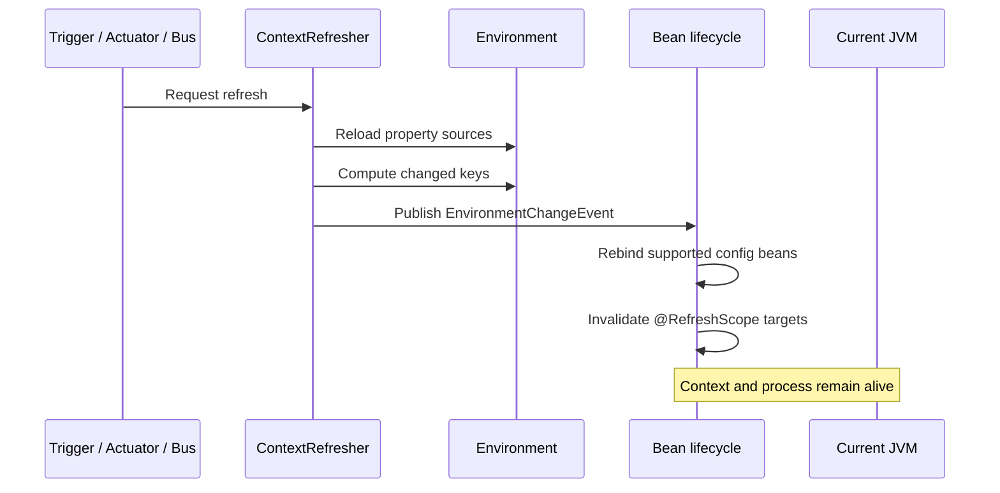
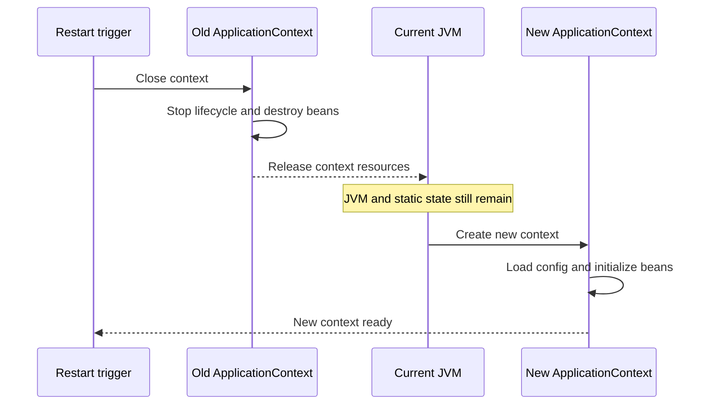
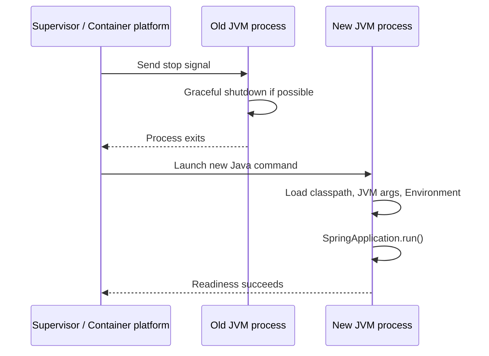

# Distinguishing Context Refresh, Process Restart, and ApplicationContext Restart

## 1. Why Is It Necessary to Distinguish the Three Operations?

In a Spring Boot application, a configuration change does not always require restarting the entire service. In some cases, you only need to update the `Environment` and refresh certain beans; in others, you need to close and recreate the `ApplicationContext`; and in still others, you must terminate the JVM and launch a new process.

The three operations differ in their scope of impact and cost:

- **Spring Cloud Context configuration refresh:** updates property sources in the `Environment`, publishes change events, rebinds supported configuration beans, and refreshes `@RefreshScope` beans.
- **ApplicationContext restart:** closes the current context, destroys beans and resources managed by the context, and then creates a new context within the same JVM process.
- **Process restart:** terminates the current Java process and launches a new JVM; all contexts, threads, static state, and resources in the old process terminate.

One confusingly named API needs clarification: `ConfigurableApplicationContext.refresh()` is a lifecycle operation used to initialize the context. It is not synonymous with Spring Cloud's `ContextRefresher.refresh()`, nor is it an application restart command that can be called arbitrarily after startup.

This lesson belongs to the **Application Lifecycle** chapter of the **SPRING_CLOUD_CORE** module. The module focuses on Spring Cloud Commons, Spring Cloud Context, externalized configuration, Spring Boot compatibility, refresh scope, discovery, service registry, service communication, and testing/operating shared abstractions.

After this lesson, learners can:

- Distinguish between Spring Cloud refresh, `ApplicationContext.refresh()`, context restart, and JVM restart.
- Explain which data is updated, which beans are recreated, and which state remains after each operation.
- Choose the appropriate action when changing configuration, replacing beans/resources, updating classes, or modifying JVM options.
- Understand the roles of Actuator `/refresh`, `/restart`, Spring Cloud Bus, and container orchestrators.
- Design graceful shutdown, readiness, and rollouts to minimize disruption.
- Test using Environment, bean identity, context lifecycle, and process identity.

## 2. Four Concepts Commonly Referred to as "Refresh"

### 2.1. Configuration Refresh with Spring Cloud Context

Spring Cloud Context provides a mechanism for refreshing configuration at runtime. When `ContextRefresher.refresh()` is invoked according to the active integration, the application can:

1. Reload property sources according to the current configuration mechanism.
2. Compare keys before and after the refresh.
3. Update the `Environment` and publish an `EnvironmentChangeEvent`.
4. Rebind supported `@ConfigurationProperties` beans and update logger levels for `logging.level.*`.
5. Invalidate the cache of `@RefreshScope` beans so they are recreated on the next access.

This is a **configuration update workflow within the running context**. It does not replace the application context, does not reinitialize the JVM, and does not load new classes from a JAR that was just replaced on disk.

Spring Cloud Config Client does not continuously poll the Config Server by default to detect changes. The system must have an appropriate trigger, such as Actuator `/refresh`, a controlled internal invocation, or Spring Cloud Bus to notify multiple instances.

### 2.2. ConfigurableApplicationContext.refresh()

Spring Framework's `refresh()` is the lifecycle step used to bring a context into a ready state:

- Prepare the context and Environment.
- Create or prepare the `BeanFactory`.
- Run `BeanFactoryPostProcessor` and `BeanPostProcessor`.
- Register listeners and infrastructure beans.
- Instantiate non-lazy singletons.
- Start lifecycle components and publish corresponding events.

Spring Boot invokes this refresh workflow during `SpringApplication.run(...)`. This is the initial step that builds the application context.

You should not use `ConfigurableApplicationContext.refresh()` as a runtime configuration reload API. Whether refreshing again is supported also depends on the context implementation. For example, `GenericApplicationContext` only allows `refresh()` to be called once; many Boot contexts are based on this type. Some other implementations may rebuild the `BeanFactory`, but that is not a general guarantee for every `ApplicationContext`.

### 2.3. ApplicationContext Restart

Context restart is a higher-level workflow:

1. Stop accepting new work or drain the instance from traffic if required by the architecture.
2. Close the current context.
3. Run destruction callbacks, stop lifecycle beans, and release resources managed by the context.
4. Create a new context from the startup configuration.
5. Reload bean definitions, create singletons, and start necessary components.
6. Verify readiness and bring the instance back into service.

During this process, **the JVM remains the same process**. Static fields, threads not managed by the context, already loaded classes, system properties, and certain process-level resources may still persist. Therefore, restarting the context is not equivalent to restarting the JVM.

Spring Cloud Context provides the Actuator `/restart` endpoint to close and restart the `ApplicationContext`; this endpoint is disabled by default. Its availability and usage must be verified against the Spring Cloud version and the application's Actuator configuration.

### 2.4. Java Process Restart

Process restart has the broadest scope:

1. Send a termination signal to the process or instruct the orchestrator to terminate the container.
2. The application can perform a graceful shutdown if it receives the appropriate signal and has sufficient time.
3. The JVM terminates; all contexts in that process close or are terminated along with the process.
4. Supervisor, systemd, Docker, Kubernetes, or the deployment platform starts a new process/container.
5. The new JVM loads the classpath, system properties, environment variables, and command-line arguments, and initializes the application context from scratch.

Static state, threads, and classloaders from the old JVM are not carried over to the new JVM. This is the necessary choice when changing JARs/classpath, JVM options, environment variables read only at startup, Java agents, or process-level state.

## 3. Comparing Scope of Impact

| Criterion | Spring Cloud refresh | ApplicationContext restart | JVM/process restart |
| --- | --- | --- | --- |
| Primary target | `Environment`, `@ConfigurationProperties`, `@RefreshScope`, and related listeners | All beans/resources managed by the context | Entire Java process and all contexts inside it |
| JVM PID | Preserved | Preserved | A new process is started; PID may be reused by the OS later |
| ApplicationContext | Keeps current context | Closes old context, creates new context | Creates new context in new JVM |
| Standard singleton | Usually keeps instance; supported configuration beans can rebind | Destroyed and recreated | Recreated in new process |
| `@RefreshScope` | Target cache is invalidated and recreated on access | Bean is recreated with new context | Bean is recreated with new JVM |
| Static fields | Preserved | Preserved | Reinitialized per class in new JVM |
| Loaded classes/JARs | Does not reload classes | Does not automatically load new classes if using the same classloader | Reloaded from the new process's classpath/artifact |
| JVM options / system properties | Unchanged | Unchanged | Picked up from the new launch command |
| Duration and impact | Usually smallest, depending on bean count and config sources | Larger, must rebuild context | Largest, depends on startup and orchestration |
| Typical use case | Changing timeouts, feature flags, or policies designed for refresh | Recreating all beans/resources when needed | Deploying a new code version, changing JVM args, or clearing process-level state |

The table above describes general behavior. Specific beans may have their own limitations: for example, constructor-bound `@ConfigurationProperties` and Java records are not refreshed via the rebind mechanism; certain resource types are excluded from the default refresh scope.

## 4. Diagrams of the Three Workflows

### 4.1. Spring Cloud refresh: same process, same context



### 4.2. ApplicationContext restart: same process, new context



### 4.3. Process restart: new JVM



The three diagrams illustrate that the primary difference is the boundary being replaced: only the target/configuration, the entire context, or the whole process.

## 5. What Does Spring Cloud Refresh Update?

### 5.1. EnvironmentChangeEvent and rebind

When an `EnvironmentChangeEvent` is published with a list of changed keys, Spring Cloud can perform standard actions:

- Rebind supported `@ConfigurationProperties` beans.
- Update logger levels corresponding to `logging.level.*`.
- Allow custom listeners to react to the changed keys.

Rebinding a configuration bean can update the existing instance in place, meaning the object is not necessarily replaced. During rebinding, other threads might observe an incomplete state if the bean is read concurrently. If you need a consistent snapshot when reading configuration, consider `@RefreshScope` to swap the target via a proxy.

Objects using constructor binding, including Java records annotated with `@ConfigurationProperties`, cannot be refreshed via the standard rebind mechanism. Be sure to identify the binding style clearly before promising that a property will update at runtime.

### 5.2. RefreshScope

A `@RefreshScope` bean is wrapped by a scoped proxy. The scope stores the initialized target in a cache. Upon refresh, the current target is invalidated; the next invocation creates a new target and resolves properties against the current Environment at that time.

Example:

```java
@Configuration(proxyBeanMethods = false)
class ClientConfiguration {

    @Bean
    @RefreshScope
    PartnerClient partnerClient(Environment environment) {
        String baseUrl = environment.getRequiredProperty("partner.base-url");
        return new PartnerClient(baseUrl);
    }
}
```

Changing `partner.base-url` in the Environment does not automatically alter the field on the existing `PartnerClient` object. The refresh workflow causes the target to be replaced; the next call through the proxy creates a client with the new URL.

Not every bean belongs to refresh scope automatically. Placing `@RefreshScope` on a `@Configuration` class also does not automatically place all beans declared with `@Bean` inside it into this scope. Furthermore, `HikariDataSource` is a DataSource type that is non-refreshable by default in current Spring Cloud configurations; check the documentation and resource limitations before changing this policy.

### 5.3. Refresh Does Not Automatically Detect Remote Changes

If a file in Config Server or a Git repository changes, the client does not continuously poll by default to fetch new values. A trigger mechanism must bring the new configuration into the `Environment`.

For a single instance, you can use Actuator `/actuator/refresh` if the endpoint is exposed and secured. Across multiple instances, Spring Cloud Bus can broadcast the refresh event so instances update more synchronously. If you only invoke refresh on one pod, other pods will not automatically receive the same change unless there is a notification broadcast mechanism.

## 6. How Does ConfigurableApplicationContext.refresh() Differ from ContextRefresher?

Both APIs share the word "refresh", yet their purposes are completely different:

| API | Belongs to | Meaning |
| --- | --- | --- |
| `ConfigurableApplicationContext.refresh()` | Spring Framework | Initializes or refreshes the context lifecycle according to implementation capabilities |
| `ContextRefresher.refresh()` | Spring Cloud Context | Reloads configuration according to integration, updates Environment, and publishes change events |
| `RefreshScope.refresh(name)` | Spring Cloud Context | Invalidates the target cache of a single refresh-scoped bean |
| `RefreshScope.refreshAll()` | Spring Cloud Context | Invalidates the target cache of the entire refresh scope |
| `ApplicationContext.close()` | Spring Framework | Closes the context, stops lifecycle, and destroys singletons/resources managed by the context |

Example of manual context initialization:

```java
try (AnnotationConfigApplicationContext context =
             new AnnotationConfigApplicationContext()) {
    context.register(ApplicationConfiguration.class);
    context.refresh();

    MyService service = context.getBean(MyService.class);
    service.execute();
}
```

In this example, `refresh()` is called to complete context initialization after registering configuration. When the `try` block ends, the context is closed. This is not how you reload a running Boot application.

`GenericApplicationContext` only allows `refresh()` to be called once. For typical Boot applications, let `SpringApplication.run()` manage the initialization lifecycle; if you need to replace the context, execute a supported context restart workflow or create a new context.

## 7. Restarting ApplicationContext Within the Same JVM

### 7.1. What Does Closing the Context Mean?

`ConfigurableApplicationContext.close()` closes the current context. Spring stops beans implementing `Lifecycle`/`SmartLifecycle`, invokes destruction callbacks such as `@PreDestroy` or `DisposableBean.destroy()`, closes resources managed by beans, and publishes a context closed event.

After the context closes:

- Context beans can no longer be used as before.
- Scoped proxies and singletons belonging to the old context do not automatically transfer to the new context.
- Custom-created threads/resources whose lifecycle is not properly managed by beans may still persist.
- The JVM, static fields, and loaded classes persist if the process has not terminated.

You should not close the main context from a normal business request if the application lacks a coordinated restart workflow. Closing the context can cause the server to stop serving traffic and leave dependencies unavailable.

### 7.2. Creating a New Context

Conceptually, one way to restart is to keep the startup configuration and create a new context:

```java
ConfigurableApplicationContext first =
        new SpringApplication(Application.class).run(args);

// When an appropriate management mechanism triggers:
first.close();

ConfigurableApplicationContext second =
        new SpringApplication(Application.class).run(args);
```

This is a lifecycle illustration, not code you should put directly inside a production controller. Real applications need concurrency control, shutdown timeouts, listeners, parent contexts, external resources, and readiness tracking. Depending on how `SpringApplication` is configured, each run may create a different Environment/context; do not assume all external state is automatically shared or updated.

Spring Cloud Commons provides Actuator `/restart` to close and restart the `ApplicationContext`; this endpoint is disabled by default. When using it, verify version compatibility, endpoint configuration, access permissions, and how restart is implemented in the application.

### 7.3. When Is Context Restart Useful?

Context restart can be suitable when you need to recreate the entire bean graph while keeping the JVM:

- A group of singleton beans was not designed to be refreshed individually.
- Certain context-level resources need to be closed and reopened.
- Startup configuration needs to be reloaded and the full bean lifecycle re-run.
- The application is deployed with a monitored and tested context restart mechanism.

However, if you change code/JARs, Java agents, JVM options, static state, or classloaders, context restart is usually insufficient. The old classes remain in the JVM and are not automatically replaced by new bytecode.

## 8. Process Restart and Graceful Shutdown

### 8.1. Process Boundary

Process restart is typically determined by the runtime environment, such as:

- Kubernetes replacing a Pod during a rollout or restarting a container.
- Docker restarting a container according to a policy.
- systemd or a process supervisor restarting the service.
- A deployment script stopping the old Java process and running the new artifact.

When the new process starts, it receives the classpath, environment variables, JVM arguments, and command-line arguments from the deployment configuration. Therefore, this is the right way to apply changes belonging to the JVM or artifact.

### 8.2. Graceful Shutdown

Upon receiving an appropriate stop signal, Spring Boot closes the application context. With a supported embedded web server, graceful shutdown stops accepting new requests and allows a grace period for in-flight requests to complete. You can configure the timeout per shutdown phase:

```yaml
server:
  shutdown: graceful

spring:
  lifecycle:
    timeout-per-shutdown-phase: 20s
```

The 20-second value is only an example; it must be chosen based on request processing time, upstream timeouts, and the platform's termination grace period. If the process is force-killed or the grace period expires, shutdown hooks and destruction callbacks may not complete.

### 8.3. Coordinating with Readiness and Service Discovery

In multi-instance systems, process restart should be coordinated with traffic routing:

1. Transition the instance into a state that stops receiving new traffic or deregister it from the active endpoint set.
2. Wait for propagation to the load balancer, service registry, or proxy according to the deployment mechanism.
3. Let in-flight requests complete within the shutdown grace period.
4. Close the context and terminate the JVM.
5. Start the new instance, verify readiness, and route traffic only when ready.

Do not assume `ApplicationContext.close()` automatically deregisters immediately from every service registry. Check the discovery integration and the behavior of the deployment platform.

## 9. Choosing the Operation by Change Type

| Change | Typically appropriate action | Reason |
| --- | --- | --- |
| Timeout or feature flag designed for runtime updates | Spring Cloud refresh | Updates Environment/rebinds or refreshes related beans |
| Value used by a `@RefreshScope` bean changes | Refresh after Environment has the new value | New target reads current configuration |
| Standard singleton bean holds a resource needing recreation | Evaluate refresh scope or context restart | Rebinding alone does not replace the object |
| Changing multiple beans not designed for individual refresh | Restart ApplicationContext if safely supported by the app | Re-runs the entire bean lifecycle in the current JVM |
| Replacing JAR files or classes | Process restart | Current JVM has already loaded the old classes |
| Changing Java system properties or JVM options | Process restart | These values are set at JVM launch time |
| Changing container environment variables | Create new process/container | Current process does not automatically receive new environment from orchestrator |
| Need to clear static state or non-context threads | Process restart | Context restart does not reset JVM-level state |
| Changing bean definition structure or classpath dependencies | Process restart is usually the clearest choice | Requires rebuilding from the new artifact/classpath |

## 10. Practical Example: Changing a Partner Endpoint

Suppose `order-service` calls `partner-api` through a `PartnerClient` bean. The initial endpoint is `https://partner-v1.example`.

If `PartnerClient` is annotated with `@RefreshScope`, you can:

1. Put the new endpoint into the configuration source.
2. Trigger the refresh mechanism so the Environment receives the new `partner.base-url`.
3. Refresh scope invalidates the `PartnerClient` target.
4. The next request goes through the proxy and creates a new target with the new endpoint.

The JVM, application context, and unrelated singleton beans continue operating normally.

If `PartnerClient` does not belong to refresh scope and stores the URL in a `final` field injected via constructor, changing only the Environment will not alter the existing object. You can redesign the bean to support refresh, or restart the context if the entire dependency graph needs to be recreated.

If a new HTTP client library version is packaged in the JAR and needs to be applied, context restart still will not load the new classes. You must deploy the new artifact and restart the process.

## 11. Testing and Observing the Three Lifecycle Levels

You should not merely check that an HTTP endpoint still returns 200. You need to verify that the exact expected boundary changed.

### 11.1. Signals to Record

| Signal | How to observe | Meaning |
| --- | --- | --- |
| Process identity | PID, process start time, or JVM uptime | Determines whether the JVM is new |
| Context lifecycle | `ContextRefreshedEvent`, `ContextClosedEvent`, startup date | Tracks context creation/closure |
| Bean identity | `System.identityHashCode(bean)` in tests or bean-generated ID | Confirms whether target/bean instance changed |
| Environment | `Environment.getProperty(...)` | Confirms current configuration value |
| Refresh scope | Logs/metrics and target initialization errors after refresh | Confirms target was invalidated and recreated |
| Traffic/readiness | Health/readiness, endpoints, and request errors | Confirms the instance is ready to serve |
| Shutdown | `SmartLifecycle` logs, destruction callbacks, and process exit | Confirms whether cleanup completed |

PIDs can be reused later by the operating system; when testing process restart, combine PID with process start time or JVM uptime. Do not rely solely on context ID because the application may assign the same ID again on a new initialization.

### 11.2. Test Matrix

| Scenario | Expected outcome to verify |
| --- | --- |
| Call Spring Cloud refresh | Same PID, same ApplicationContext; Environment changes; supported config beans rebind; refresh-scoped targets are recreated on access |
| Call only `RefreshScope.refreshAll()` | Same PID/context and Environment; only refresh scope targets are invalidated |
| Call `ApplicationContext.close()` then create a new context | Same PID; old context emits close and new context runs startup; singletons in the new context have different identities |
| Call `ConfigurableApplicationContext.refresh()` again on `GenericApplicationContext` | Throws an error because the implementation only allows a single refresh |
| Restart process via supervisor | New process start time/PID; context and singletons are recreated; static state from old JVM is gone |
| Shutdown times out or is force-killed | Destruction callbacks may be missed; check external resources and platform recovery |

### 11.3. Testing Spring Cloud Refresh

An integration test can:

1. Create a `MapPropertySource` before the context finishes startup.
2. Read the configuration value and record the identity of the refresh-scoped bean.
3. Change the value in the map.
4. Call `ContextRefresher.refresh()` or test the active endpoint/trigger.
5. Verify the Environment returns the new value.
6. Invoke through the scoped proxy and verify the new target receives the new value.
7. Verify that the PID and context were not replaced.

This test should distinguish between `@ConfigurationProperties` beans that rebind in place and `@RefreshScope` beans that receive a newly created target.

### 11.4. Testing Context Restart and Process Restart

- For context restart, use a lifecycle coordinator or an integration endpoint enabled in the test environment. Track close/start events and verify process identity remains unchanged.
- For process restart, let the supervisor or test harness launch a new process. Record process start time, check startup logs, readiness, and static state.
- Do not simulate a process restart merely by calling `context.close()`; that operation does not terminate the JVM.

## 12. Common Pitfalls and Misconceptions

| Symptom / misconception | Cause | Resolution |
| --- | --- | --- |
| Called `/actuator/refresh` but new Java classes were not loaded | Refresh only handles configuration and beans via supported mechanisms | Deploy the artifact and restart the process |
| Called `ApplicationContext.refresh()` to reload properties | Confusing lifecycle initialization with Spring Cloud configuration refresh | Use ContextRefresher or an appropriate refresh mechanism |
| Refresh succeeds but bean still uses old value | Singleton bean retained the value from initialization time | Rebind appropriately or annotate the bean needing recreation with `@RefreshScope` |
| `@ConfigurationProperties` record does not change after refresh | Constructor binding does not support rebinding via this mechanism | Design an appropriate configuration style or restart context/process |
| Context restarted but static fields still hold old values | Static state belongs to the JVM/classloader, not the context | Restart the process if a reset is needed |
| Context closed but process is still running | Threads, executors, or resources not managed by the context remain alive | Manage lifecycle thoroughly or terminate the JVM via supervisor |
| `/actuator/restart` is missing | Endpoint is disabled by default or not exposed | Check endpoint enablement/exposure and version |
| One pod refreshes but other pods do not change | Refresh is a local operation unless a broadcast mechanism exists | Use Spring Cloud Bus or trigger all instances |
| Rollout drops requests | Traffic not drained or grace period too short | Coordinate readiness, discovery, and graceful shutdown |
| Creating new refresh target fails even though invalidation succeeded | Target is only created on the next proxy call | Monitor lazy initialization errors and the refresh health indicator |

## 13. Lifecycle Selection and Operations Checklist

Before applying a change, answer the following:

1. Is the change solely a runtime property or does it involve classes/JARs/JVM options?
2. Has the Environment received the new configuration yet?
3. Is the bean consuming the configuration `@ConfigurationProperties`, a standard singleton, or `@RefreshScope`?
4. Do you need to recreate a single target, the entire bean graph, or the whole JVM?
5. Do beans have clear destruction callbacks and resource lifecycles?
6. Are there threads or static state outside the ApplicationContext?
7. Do multiple instances need to receive the same refresh event?
8. Are readiness and discovery updated before stopping an instance?
9. Is the graceful shutdown timeout sufficient for in-flight requests?
10. Are Actuator refresh/restart properly exposed and secured?
11. Are there tests verifying PID, context identity, bean identity, and Environment values?
12. Is there a rollback plan if the new context or new process fails readiness?

## 14. Official References

- [Spring Cloud Context — Application Context Services](https://docs.spring.io/spring-cloud-commons/reference/spring-cloud-commons/application-context-services.html): EnvironmentChangeEvent, rebind, refresh scope, Actuator refresh, and restart.
- [Spring Framework — GenericApplicationContext Javadoc](https://docs.spring.io/spring-framework/docs/current/javadoc-api/org/springframework/context/support/GenericApplicationContext.html): limitation that refresh can only be called once on GenericApplicationContext.
- [Spring Framework — ApplicationContext lifecycle](https://docs.spring.io/spring-framework/reference/core/beans/factory-nature.html): bean lifecycle, initialization, and destruction.
- [Spring Boot — Graceful Shutdown](https://docs.spring.io/spring-boot/reference/web/graceful-shutdown.html): stopping new requests, waiting for in-flight requests, and shutdown phase configuration.
- [Spring Boot — Application Events and Listeners](https://docs.spring.io/spring-boot/reference/features/spring-application.html): events during application startup.

**Key takeaway:** Spring Cloud refresh updates configuration and refreshes supported beans in the current context; ApplicationContext restart destroys and recreates the bean graph within the same JVM; process restart terminates the old JVM and launches a new JVM. `ConfigurableApplicationContext.refresh()` is a lifecycle operation at context initialization time, not a substitute for any of the three workflows above.
