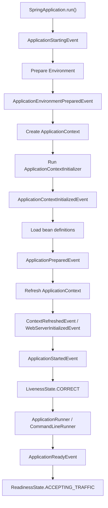

# Startup Events and Custom Listener Registration Points

When a Spring Boot application starts, several components must complete in sequence: preparing the `Environment`, creating the `ApplicationContext`, loading bean definitions, refreshing the container, starting the web server, running startup tasks, and finally transitioning the application into a state ready to accept traffic. Spring publishes **application events** at key milestones so other components can observe or react.

For **SPRING_CLOUD_CORE**, these events are especially useful when integrating externalized configuration, discovery, service registries, HTTP clients, refresh scope, and shared abstractions. However, where a listener is registered determines whether it can receive an event: an event published before the context is created cannot be caught by an `@EventListener` bean that only appears afterward.

This lesson belongs to the **Application Lifecycle** chapter, focusing on the event order of `SpringApplication`, the milestones of `ApplicationContext`, how to register early and late listeners, and how to choose the appropriate extension point for each task.

## 1. Learning Objectives

After this lesson, you will be able to:

- Describe the major event milestones in the `SpringApplication` lifecycle.
- Distinguish between events before context creation, before refresh, and after refresh.
- Choose among `ApplicationListener`, `@EventListener`, `SpringApplication.addListeners`, and `SpringApplicationRunListener`.
- Register early listeners using `META-INF/spring.factories`.
- Understand the roles of `ApplicationContextInitializer`, `ApplicationRunner`, `CommandLineRunner`, and `SmartLifecycle`.
- Explain event propagation in a context hierarchy and how to avoid duplicate processing.
- Understand how synchronous listeners can impact startup time.
- Relate startup events to bootstrap/configuration loading in Spring Cloud.
- Test event ordering and listener behavior in an application.

## 2. Overview of the SpringApplication Lifecycle

`SpringApplication.run(...)` orchestrates application startup. During this process, Spring Boot publishes `SpringApplicationEvent` instances as well as several Spring Framework events.



The diagram depicts a successful startup flow. `ApplicationFailedEvent` is a branch emitted when an error occurs during startup, not a subsequent step in the success flow. `ContextClosedEvent` occurs when the context is closed, typically during shutdown.

### 2.1. Table of Major Event Order

| Order | Event | Timing | Can context beans be used? |
| ---: | --- | --- | --- |
| 1 | `ApplicationStartingEvent` | Beginning of `run`, after listeners and initializers are registered, before other startup processing | Context does not exist yet |
| 2 | `ApplicationEnvironmentPreparedEvent` | Environment is ready, context has not been created yet | Context does not exist yet |
| 3 | `ApplicationContextInitializedEvent` | Context has been created and initializers have run, before bean definitions are loaded | Context exists, but bean definitions have not been loaded yet |
| 4 | `ApplicationPreparedEvent` | Bean definitions have been loaded, immediately before refresh | Context is not refreshed yet |
| 5 | `ContextRefreshedEvent` | Context has been refreshed | Yes |
| 6 | `WebServerInitializedEvent` | Web server is ready; may be the servlet or reactive variant | Yes |
| 7 | `ApplicationStartedEvent` | Context has been refreshed, before runners | Yes |
| 8 | `AvailabilityChangeEvent` with `LivenessState.CORRECT` | Immediately after `ApplicationStartedEvent` | Yes |
| 9 | `ApplicationReadyEvent` | After all application/command-line runners complete | Yes |
| 10 | `AvailabilityChangeEvent` with `ReadinessState.ACCEPTING_TRAFFIC` | Immediately after `ApplicationReadyEvent` | Yes |

Both `ContextRefreshedEvent` and `WebServerInitializedEvent` occur after `ApplicationPreparedEvent` and before `ApplicationStartedEvent`; do not rely on a fixed relative order between these two events for every type of application.

`ApplicationFailedEvent` is published when startup fails. If the failure occurs very early, the context passed to the event may not exist yet (`null`).

## 3. Understanding Each Key Milestone

### 3.1. ApplicationStartingEvent

This event is published as soon as `SpringApplication` begins running, after listeners and initializers have been registered, but before the Environment or ApplicationContext is ready.

It can be used for:

- Recording a very early startup milestone.
- Initializing observers independent of Spring beans.
- Collecting process metadata that does not depend on the Environment.

It should not be used to retrieve the `Environment`, call `getBean()`, or access configuration loaded into the context, because those components are not ready yet.

### 3.2. ApplicationEnvironmentPreparedEvent

This event is published after the Environment used for the application has been prepared, but before the ApplicationContext is created.

Listeners can:

- Read existing profiles and properties.
- Add or adjust a `PropertySource` if within their responsibility.
- Log non-sensitive runtime configuration.
- Coordinate with early configuration-loading mechanisms.

In Spring Cloud legacy bootstrap, `BootstrapApplicationListener` participates at the Environment prepared phase to create the bootstrap context and prepare bootstrap configuration when that mechanism is enabled. With modern Config Data, Spring Boot processes `spring.config.import` within the Config Data pipeline; you should not assume every Spring Cloud application needs a bootstrap context.

### 3.3. ApplicationContextInitializedEvent

This event is published when the ApplicationContext has been created and `ApplicationContextInitializer` instances have been invoked, but bean definitions have not yet been loaded.

This is a useful milestone for observing the results of initializers. However, do not assume business beans exist yet. If you need to add property sources or customize the context, that is typically done inside an initializer prior to this event.

### 3.4. ApplicationPreparedEvent

This event is published after bean definitions have been loaded, immediately before context refresh begins.

It can be used to inspect configuration state and bean definition sources. This is still before eager singletons are fully instantiated. Avoid invoking business beans just for inspection because doing so can trigger unexpected early initialization.

### 3.5. ContextRefreshedEvent

`ContextRefreshedEvent` belongs to Spring Framework and is published when an `ApplicationContext` completes refreshing. In a typical Boot application, this marks that the container has finished the refresh process.

It can be used to:

- Record that the context has refreshed.
- Start a task that depends on already-created beans.
- Observe context state in applications with a context hierarchy.

If you need to run a startup task during which the application is not yet ready to accept traffic, `ApplicationRunner` or `CommandLineRunner` usually expresses intent more clearly and has a well-defined position before `ApplicationReadyEvent`.

### 3.6. WebServerInitializedEvent

For web applications, Spring Boot publishes an event when the web server is ready. Concrete subtypes include:

- `ServletWebServerInitializedEvent`.
- `ReactiveWebServerInitializedEvent`.

The event can provide information about the web server and the actual port. This is useful when using a random port in tests or when metadata must be registered after the server has started listening.

Do not use this event as sole proof that all external dependencies such as databases, registries, or Config Server are ready.

### 3.7. ApplicationStartedEvent and ApplicationReadyEvent

These two events differ by the placement of runners:

| Event | Meaning |
| --- | --- |
| `ApplicationStartedEvent` | Context has refreshed, application has started; runners have not run yet |
| `ApplicationReadyEvent` | All `ApplicationRunner` and `CommandLineRunner` instances have completed; the application is considered ready |

If you need to initialize caches, validate initial data, or run a one-time task before readiness transitions to accepting traffic, consider using a runner instead of placing long work inside `ApplicationReadyEvent`.

### 3.8. AvailabilityChangeEvent

Spring Boot publishes availability events to represent operational state:

- `LivenessState.CORRECT`: the application has passed the startup milestone and is considered alive.
- `ReadinessState.ACCEPTING_TRAFFIC`: the application is ready to accept traffic.

Liveness and readiness are two distinct signals. An application can be alive yet not ready to serve requests. Orchestrators such as Kubernetes can use the corresponding health indicators to decide whether to restart or route traffic.

### 3.9. ApplicationFailedEvent and ContextClosedEvent

`ApplicationFailedEvent` is published when startup fails. Listeners should tolerate the case where the context has not been created yet and should not assume all beans are present.

`ContextClosedEvent` is published when the ApplicationContext closes. It can be used to observe shutdown or release resources tied to the context. For Spring-managed resources, prefer lifecycle callbacks such as `@PreDestroy`, `DisposableBean`, or `SmartLifecycle` when appropriate.

## 4. Registering Early Listeners and ApplicationContext Listeners

This is the most important decision when writing a custom listener.

### 4.1. Early Events Cannot Be Caught by @Bean

`ApplicationStartingEvent` and `ApplicationEnvironmentPreparedEvent` are published before the ApplicationContext is created. Therefore, a bean declared with `@Component` or `@Bean` cannot receive these events: the bean does not exist yet.

For early events, register the listener directly before calling `run()`:

```java
public static void main(String[] args) {
    SpringApplication application =
            new SpringApplication(CheckoutApplication.class);

    application.addListeners(new EarlyStartupListener());
    application.run(args);
}
```

Or register the listener automatically via `META-INF/spring.factories`:

```properties
org.springframework.context.ApplicationListener=\
com.example.checkout.lifecycle.EarlyStartupListener
```

This key is for `ApplicationListener`, not the `BootstrapConfiguration` key. The two mechanisms serve different purposes.

### 4.2. Listeners Implementing ApplicationListener

Example capturing the prepared Environment:

```java
package com.example.checkout.lifecycle;

import org.springframework.boot.context.event.ApplicationEnvironmentPreparedEvent;
import org.springframework.context.ApplicationListener;

public class EarlyStartupListener
        implements ApplicationListener<ApplicationEnvironmentPreparedEvent> {

    @Override
    public void onApplicationEvent(ApplicationEnvironmentPreparedEvent event) {
        String[] profiles = event.getEnvironment().getActiveProfiles();
        // Record safe startup metadata or inspect required properties.
    }
}
```

The listener receives the exact typed event directly, so there is no need to cast from `ApplicationEvent`. Avoid logging the entire Environment as it may contain tokens, passwords, or sensitive endpoints.

### 4.3. Bean Listeners for Events After the Context Exists

For events occurring after beans are registered, you can use `ApplicationListener` as a bean:

```java
@Component
public class ReadyListener
        implements ApplicationListener<ApplicationReadyEvent> {

    @Override
    public void onApplicationEvent(ApplicationReadyEvent event) {
        // Record readiness or publish a lightweight metric.
    }
}
```

Or use `@EventListener`:

```java
@Component
public class ApplicationLifecycleEvents {

    @EventListener
    public void onStarted(ApplicationStartedEvent event) {
        // Context refreshed; runners have not executed yet.
    }

    @EventListener
    public void onReady(ApplicationReadyEvent event) {
        // Runners have completed.
    }
}
```

`@EventListener` is often more concise when a single bean needs to handle multiple events. Spring registers these methods when processing listener beans during context refresh.

### 4.4. When to Use SpringApplicationRunListener?

`SpringApplicationRunListener` is a low-level extension point covering the entire `SpringApplication.run()` process. It is loaded via `SpringFactoriesLoader` and requires a public constructor accepting `SpringApplication` and `String[] args`.

An implementation can receive the callbacks:

- `starting(...)`.
- `environmentPrepared(...)`.
- `contextPrepared(...)`.
- `contextLoaded(...)`.
- `started(...)`.
- `ready(...)`.
- `failed(...)`.

Register in `META-INF/spring.factories` using the key:

```properties
org.springframework.boot.SpringApplicationRunListener=\
com.example.checkout.lifecycle.CheckoutRunListener
```

This extension point is suitable for libraries or integrations that need to observe multiple milestones of the run lifecycle. For ordinary application logic, `ApplicationListener` and `@EventListener` are easier to understand and test.

## 5. Distinguishing Event Order and Listener Order

There are two separate kinds of ordering:

1. **Event order:** Spring Boot determines which milestone is published earlier/later during startup.
2. **Listener order:** when an event is published, multiple listeners can receive that same event; `Ordered` or `@Order` can control the invocation order among listeners.

`@Order` does not change when `ApplicationReadyEvent` is published, nor does it allow a listener to receive an event that was already published before the listener was registered.

Example:

```java
@Component
public class StartupListeners {

    @EventListener
    @Order(10)
    public void first(ApplicationReadyEvent event) {
        // Runs before other listeners with a larger order value.
    }

    @EventListener
    @Order(20)
    public void second(ApplicationReadyEvent event) {
        // Runs after the listener above.
    }
}
```

Lower order values have higher priority. If multiple listeners share the same order, do not rely on incidental component scan or classpath ordering.

## 6. Listeners Run Synchronously by Default

Spring application events are normally dispatched synchronously by the default event multicaster. A listener runs on the same thread that published the event; if the listener takes several seconds, startup or the event-publishing operation will be delayed accordingly.

Example of what not to do inside a startup listener:

```java
@EventListener
public void onReady(ApplicationReadyEvent event) {
    // Avoid blocking here for a long-running remote migration.
}
```

If work must finish before the application is considered ready, use `ApplicationRunner` or `CommandLineRunner`. Spring Boot runs runners after `ApplicationStartedEvent` and before `ApplicationReadyEvent`.

If the work is not on the critical path, you can offload it to a lifecycle-managed executor/background worker, while handling errors, shutdown, and readiness state explicitly. Simply adding `@Async` does not solve those concerns on its own; it also alters completion ordering and error observability.

### 6.1. ApplicationRunner and CommandLineRunner

```java
@Component
public class StartupChecks implements ApplicationRunner {

    @Override
    public void run(ApplicationArguments args) {
        // Validate initial data or warm up required application state.
    }
}
```

Runners are appropriate for tasks that need access to instantiated beans and must finish before the application transitions to accepting traffic.

### 6.2. SmartLifecycle for Components with Start/Stop

If a component needs to be started and stopped along with the context lifecycle, `SmartLifecycle` can be a better fit than an event listener. It supports phase ordering, start/stop control, and shutdown callbacks.

Example use cases:

- A message consumer that must start after dependencies are ready.
- A background scheduler that must stop before connections are closed.
- A resource-managing component that needs to participate in graceful shutdown.

Do not use `ContextRefreshedEvent` as a substitute for a lifecycle contract if the component truly requires start/stop management.

## 7. Context Hierarchy and Event Propagation

An application may have parent/child `ApplicationContext` instances, for example when using hierarchical contexts or certain service-name-based integrations.

Spring events published in a child context can propagate up to listeners in ancestor contexts. Consequently, a listener in a parent context may receive multiple events of the same type if there are multiple child contexts.

If a listener should only process events from its own context, compare the event's context with the injected context:

```java
@Component
public class ContextReadyListener implements ApplicationListener<ContextRefreshedEvent>,
        ApplicationContextAware {

    private ApplicationContext ownContext;

    @Override
    public void setApplicationContext(ApplicationContext applicationContext) {
        this.ownContext = applicationContext;
    }

    @Override
    public void onApplicationEvent(ContextRefreshedEvent event) {
        if (event.getApplicationContext() != ownContext) {
            return;
        }
        // Handle refresh for this exact context only.
    }
}
```

Checking the context prevents running the same logic multiple times in applications with a hierarchy. In particular, a listener registered in a parent context should not assume every event it receives originates from the parent itself.

## 8. Relationship to Spring Cloud

Spring Cloud uses several startup milestones to prepare configuration and platform integrations.

| Spring Cloud component | Related milestone/lifecycle | Role |
| --- | --- | --- |
| Legacy `BootstrapApplicationListener` | `ApplicationEnvironmentPreparedEvent` | Creates the bootstrap context when legacy bootstrap is enabled |
| Spring Boot Config Data | Before ApplicationContext is created/refreshed | Loads `spring.config.import` and Config Data sources |
| `ApplicationContextInitializer` | After context is created, before bean definitions are loaded/refreshed | Customizes the Environment or context early |
| Discovery client auto-configuration | During context creation/refresh | Registers discovery beans when conditions match |
| Spring Cloud LoadBalancer | During bean creation | Provides instance selection components and client integration |
| Spring Cloud Context refresh | When refresh is triggered after startup | Updates Environment, publishes events, and refreshes scopes accordingly |

### 8.1. Legacy Bootstrap and Config Data

In applications using legacy bootstrap, `BootstrapApplicationListener` reacts during the Environment prepared stage to create a bootstrap context. This mechanism is tied to `spring-cloud-starter-bootstrap` or an early-enabled bootstrap flag.

In modern applications using:

```yaml
spring:
  config:
    import: optional:configserver:http://config-server:8888
```

Spring Boot processes the Config Server source through the Config Data API. Do not assume `bootstrap.yml` or a bootstrap context is required for every Config Client.

### 8.2. Startup Events Do Not Replace Health Checks

`ApplicationReadyEvent` signals that startup and runners have finished according to Spring Boot's lifecycle. It does not guarantee that every downstream service, registry, or message broker will always remain available afterward.

For distributed systems, combine:

- Startup validation for required configuration.
- Appropriate readiness/liveness health indicators.
- Retries and timeouts for service communication.
- Discovery and service registry per provider.
- Metrics/logs to monitor errors after the application is already ready.

## 9. Publishing Custom Events

Beyond built-in events, an application can publish its own domain events so decoupled components can react.

Example event definition:

```java
public record TenantCatalogLoadedEvent(
        String tenantId,
        int loadedEntries) {
}
```

Publishing the event:

```java
@Service
public class TenantCatalogLoader {

    private final ApplicationEventPublisher publisher;

    public TenantCatalogLoader(ApplicationEventPublisher publisher) {
        this.publisher = publisher;
    }

    public void publishLoaded(String tenantId, int count) {
        publisher.publishEvent(
                new TenantCatalogLoadedEvent(tenantId, count));
    }
}
```

Listening:

```java
@Component
public class TenantCatalogMetrics {

    @EventListener
    public void onCatalogLoaded(TenantCatalogLoadedEvent event) {
        // Update metrics for the tenant catalog load.
    }
}
```

Spring supports publishing arbitrary object events via `ApplicationEventPublisher`; custom events do not have to extend `ApplicationEvent`. Name events after something that has happened, pass a minimal payload, and avoid including unnecessary sensitive data.

### 9.1. Events Are Not Commands

An event represents something that has already occurred, such as `TenantCatalogLoadedEvent`. If you want to instruct a component to perform an action, use a service method, command handler, or explicit command message.

Do not use events as an indirect function call for every synchronous operation that requires a return value. The default publisher does not collect business results from all listeners.

## 10. Testing Event Order and Listeners

Tests should verify separately:

- Was the listener registered?
- Does the listener receive the right event type?
- Does the event arrive at the expected lifecycle milestone?
- Does the listener run too early or too late?
- Are duplicate events received due to a context hierarchy?

### 10.1. Testing Listeners After Context Refresh

You can create a test listener that collects events:

```java
class RecordingListener implements ApplicationListener<ApplicationEvent> {

    private final List<Class<?>> events = new CopyOnWriteArrayList<>();

    @Override
    public void onApplicationEvent(ApplicationEvent event) {
        events.add(event.getClass());
    }

    List<Class<?>> events() {
        return List.copyOf(events);
    }
}
```

Register the listener before running:

```java
SpringApplication application =
        new SpringApplication(CheckoutApplication.class);
application.setWebApplicationType(WebApplicationType.NONE);

RecordingListener listener = new RecordingListener();
application.addListeners(listener);

ConfigurableApplicationContext context = application.run();
try {
    assertThat(listener.events())
            .contains(ApplicationStartedEvent.class)
            .contains(ApplicationReadyEvent.class);
}
finally {
    context.close();
}
```

This example checks that events appear during startup. In real tests, filter by event type and verify the order of the required milestones rather than depending on the entire list of internal framework events.

### 10.2. Testing Bean Listeners

For `@EventListener` beans, you can start a test context, publish a custom event via `ApplicationEventPublisher`, and verify the listener was invoked. This isolates handler logic without running the entire startup lifecycle.

### 10.3. Testing Early Events

To test `ApplicationStartingEvent` or `ApplicationEnvironmentPreparedEvent`, the listener must be registered before `SpringApplication.run()`, for example via `addListeners`. A `@Component` bean is not sufficient for testing pre-context milestones.

### 10.4. Testing Context Hierarchy

Create parent and child contexts, publish an event from the child, and verify the parent listener receives the event. If the listener filters by context, verify it only acts for the context it owns.

## 11. Common Pitfalls

| Symptom | Cause | Resolution |
| --- | --- | --- |
| `@EventListener` does not receive `ApplicationStartingEvent` | Bean does not exist yet when event is published | Register listener before run via `addListeners` or `spring.factories` |
| Listener cannot read Environment | Registered at a milestone before Environment prepared | Choose `ApplicationEnvironmentPreparedEvent` or a later milestone |
| Listener calls `getBean()` too early | Context not refreshed yet or bean definitions not loaded | Move work to a runner or a post-refresh event |
| Startup task delays application readiness | Synchronous listener performing long-running work | Use a runner if readiness must wait; background lifecycle otherwise |
| Same listener runs multiple times | Event from child context propagated to parent | Compare `event.getApplicationContext()` with the owning context |
| Confusing ApplicationStarted with ApplicationReady | Runners have not run yet at ApplicationStarted | Use ApplicationReady or a runner as needed |
| Web server is open but readiness is not accepting traffic | Runners have not finished or readiness state has not transitioned | Check `ApplicationReadyEvent` and AvailabilityChangeEvent |
| ApplicationFailedEvent has null context | Failure occurred before context was created | Handle nullable context and log only safe details |
| `@Order` does not make listener receive an event earlier | Confusing listener order with event order | Register early listeners properly; order only sorts listeners for the same event |
| Event listener does not run on other instances | Spring events stay within the current JVM/context | Use a message broker/Spring Cloud Bus for cross-instance communication |

## 12. Choosing the Right Extension Point

| Goal | Appropriate mechanism |
| --- | --- |
| Observe immediately when `SpringApplication` starts | Early-registered `ApplicationStartingEvent` listener or `SpringApplicationRunListener` |
| Add property sources after Environment is prepared | `EnvironmentPostProcessor` or listener at Environment prepared, depending on needs |
| Customize context before refresh | `ApplicationContextInitializer` |
| Handle events after beans exist | `@EventListener` or `ApplicationListener` bean |
| Run tasks that must complete before readiness | `ApplicationRunner` or `CommandLineRunner` |
| Manage start/stop of a background component | `SmartLifecycle` |
| React when context closes | `ContextClosedEvent`, `@PreDestroy`, `DisposableBean`, or `SmartLifecycle` |
| Broadcast notifications across multiple JVMs | Spring Cloud Bus or an appropriate messaging system |

Do not choose an event just because its name sounds close to the task at hand. Determine clearly whether beans exist yet, whether the Environment is prepared, whether the context has refreshed, and whether the task must finish before readiness.

## 13. Listener Design Principles

- Register listeners at a point appropriate for the event to be received.
- Use `ApplicationListener` or `@EventListener` as needed; do not use bean listeners for events fired before the context exists.
- Distinguish event order from listener order.
- Keep listeners short, avoiding network I/O or long tasks on the default startup thread.
- Use runners for tasks that must complete before readiness.
- Use `SmartLifecycle` for components requiring managed start/stop.
- Check context identity when the application uses parent/child contexts.
- Handle `ApplicationFailedEvent` with a nullable context.
- Do not log the entire Environment, command line, or payloads containing secrets.
- Do not assume internal events propagate automatically to other JVMs; use a bus/message broker when needed.
- Write tests for genuinely important lifecycle milestones rather than relying on the entire internal order.

## 14. Summary

Spring Boot publishes application events along the lifecycle of `SpringApplication`: from `ApplicationStartingEvent`, `ApplicationEnvironmentPreparedEvent`, `ApplicationContextInitializedEvent`, `ApplicationPreparedEvent`, through context refresh, then `ApplicationStartedEvent`, runners, and `ApplicationReadyEvent`. Availability events distinguish liveness from readiness; `ApplicationFailedEvent` represents the failed startup branch.

Where a listener is registered determines which events it can receive. Events prior to context creation require early listener registration via `SpringApplication.addListeners` or `META-INF/spring.factories`. Events after beans exist can be handled by an `ApplicationListener` bean or `@EventListener`. `SpringApplicationRunListener` is intended for integrations that need to observe the entire run lifecycle.

In Spring Cloud, early listeners can participate in legacy bootstrap, while modern Config Data handles remote configuration before the context is created. Choose the extension point based on when you need to intervene, keep listeners brief, and test context hierarchies so the application lifecycle remains predictable and safe to operate.

## 15. References

- [Spring Boot Reference — Application Events and Listeners](https://docs.spring.io/spring-boot/reference/features/spring-application.html#features.spring-application.application-events-and-listeners)
- [Spring Boot API — Application Events](https://docs.spring.io/spring-boot/api/java/org/springframework/boot/context/event/package-summary.html)
- [Spring Boot API — SpringApplicationRunListener](https://docs.spring.io/spring-boot/api/java/org/springframework/boot/SpringApplicationRunListener.html)
- [Spring Boot How-to — Customize the Environment or ApplicationContext](https://docs.spring.io/spring-boot/how-to/application.html#howto.application.customize-the-environment-or-application-context-before-it-starts)
- [Spring Framework — Application Events and Listeners](https://docs.spring.io/spring-framework/reference/core/beans/context-introduction.html#context-functionality-events)
- [Spring Cloud Commons — Application Context Services](https://docs.spring.io/spring-cloud-commons/reference/spring-cloud-commons/application-context-services.html)
- [Spring Cloud Config — Config Data Import](https://docs.spring.io/spring-cloud-config/reference/client.html)
