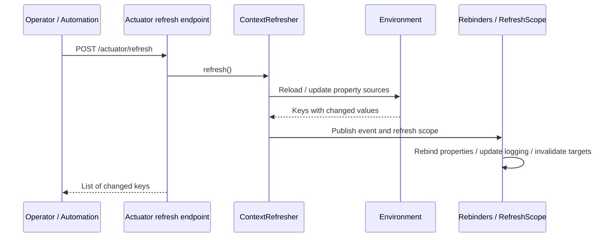
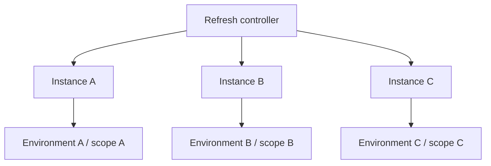

# The Refresh Endpoint and Operating Prerequisites

A Spring Cloud application can receive configuration from a Config Server or another external source. When configuration changes, operators need a way to instruct a running instance to reload values and update components that support refresh. Spring Cloud Context provides the **`POST /actuator/refresh`** Actuator endpoint for this purpose.

The endpoint only functions when the application includes the required components, has exposure configured, and is properly secured. Calling the endpoint also has a clear scope: it orchestrates refresh within **the instance receiving the request**, does not restart the JVM on its own, does not continuously poll the Config Server, and does not automatically synchronize all replicas.

This lesson belongs to the **Application Lifecycle** chapter of the `SPRING_CLOUD_CORE` module. The content focuses on the conditions for the refresh endpoint to appear, how requests are processed, effects on `Environment`, `@ConfigurationProperties`, `@RefreshScope`, operational limitations, security, and testing.

## 1. What Problem Does the Refresh Endpoint Solve?

Suppose a service is running with this configuration:

```yaml
catalog:
  remote:
    base-url: https://catalog-v1.internal
  retry:
    max-attempts: 3
```

The operations team updates the configuration source to:

```yaml
catalog:
  remote:
    base-url: https://catalog-v2.internal
  retry:
    max-attempts: 5
```

Changing the configuration repository or Config Server does not automatically cause a running instance to pick up the new values. The instance needs a trigger to reload configuration sources and apply refreshable changes. In an application with Spring Cloud Context and Actuator, the refresh endpoint provides that trigger over HTTP.



The endpoint is a **refresh command for a single application context**. It is not an API for editing the Config Server. For a change to take effect, the configuration source must be updated beforehand or another mechanism must supply the new values to `Environment`.

## 2. Conditions for the Endpoint to Operate

To call `POST /actuator/refresh`, several conditions must be checked. Simply adding a `management.endpoints.web.exposure.include` line is insufficient if the application lacks the endpoint implementation or a refresh mechanism.

### 2.1. Spring Boot Actuator Is Present

Actuator provides the management endpoint infrastructure and HTTP/JMX exposure. With Maven, an application typically needs:

```xml
<dependency>
    <groupId>org.springframework.boot</groupId>
    <artifactId>spring-boot-starter-actuator</artifactId>
</dependency>
```

Gradle:

```groovy
dependencies {
    implementation "org.springframework.boot:spring-boot-starter-actuator"
}
```

Actuator supplies the management infrastructure, while the `refresh` endpoint itself comes from Spring Cloud Context. Having Actuator without the appropriate Spring Cloud dependency does not mean this endpoint will exist by default.

### 2.2. Compatible Spring Cloud Context Is Present

Spring Cloud Context provides components such as `ContextRefresher`, refresh scope, and the refresh endpoint. In many applications, this dependency is pulled in transitively by the Spring Cloud starter in use, such as Config Client or a corresponding platform starter. Inspect the dependency tree to confirm `org.springframework.cloud:spring-cloud-context` is actually on the runtime classpath.

If declared directly, its version should be managed through the Spring Cloud BOM compatible with the Spring Boot version in use. Do not pick an arbitrary standalone Spring Cloud Context version just to make the endpoint appear; an incompatible Boot/Cloud combination can cause startup failures or incorrect runtime behavior.

### 2.3. An Environment Refresh Mechanism Exists

The endpoint requires an appropriate `ContextRefresher` to coordinate updating the Environment. For applications fetching configuration from Spring Cloud Config, you need a properly configured Config Client, a reachable configuration source, and matching application/profile/label settings.

If an application uses only static local configuration and has no mechanism to reload sources, calling the endpoint cannot discover new configuration that has not been supplied to the process. The endpoint does not automatically watch a Git repository or filesystem.

### 2.4. The Endpoint Is Exposed Over HTTP

Actuator does not expose every endpoint over HTTP by default. In standard configurations, only certain endpoints, typically including `health`, are exposed by default. You must include `refresh` in the exposed endpoints list if you want to invoke it over the web.

Example:

```yaml
management:
  endpoints:
    web:
      exposure:
        include: health,info,refresh
```

This is an exposure setting, not an authentication setting. The endpoint must still be protected with Spring Security, network policies, or environment access controls.

### 2.5. The Endpoint Is Not Disabled by Application Configuration

Verify the endpoint and refresh configuration for your exact Spring Boot/Spring Cloud versions. Newer Spring Boot releases introduce an endpoint access model; older releases may use `management.endpoint.<id>.enabled`. Spring Cloud also has properties controlling refresh support. Do not copy configuration from another version without checking the documentation for the active release train.

## 3. Minimal Configuration and Actual Endpoint Path

Basic configuration example:

```yaml
management:
  endpoints:
    web:
      exposure:
        include: health,info,refresh
```

With default web management settings, the endpoint path is:

```text
POST http://localhost:8080/actuator/refresh
```

The actual path may vary depending on management settings:

| Configuration | Effect |
| --- | --- |
| `management.endpoints.web.base-path=/manage` | Endpoint may be located at `/manage/refresh` |
| `management.server.port=9090` | Management server uses a separate port; requests must target the management port |
| `management.server.address=127.0.0.1` | Management server binds only to the configured address |
| `management.endpoints.web.path-mapping.refresh=config-refresh` | Web path is mapped to a custom path per configuration |
| `management.endpoints.web.exposure.include` omits `refresh` | Endpoint may exist internally but is not exposed over HTTP |

When the endpoint is unreachable, check the base path, management port, bind address, and path mapping first instead of assuming every application uses `/actuator` on the main server port.

## 4. Calling the Endpoint via HTTP POST

The refresh endpoint is a write/runtime-state-mutating operation, so it is invoked via **HTTP POST**. Local example:

```bash
curl -X POST http://localhost:8080/actuator/refresh
```

If the endpoint is protected by a bearer token:

```bash
curl -X POST \
  -H "Authorization: Bearer <access-token>" \
  http://localhost:8080/actuator/refresh
```

The endpoint does not require a JSON request body in standard usage. The response is typically a list of property key names detected as having changed values, for example:

```json
[
  "catalog.remote.base-url",
  "catalog.retry.max-attempts"
]
```

### 4.1. Interpreting the Response

- Non-empty list of keys: properties detected as changed during that instance's refresh.
- Empty list: no keys were detected as changed according to the refresh mechanism's comparison.
- HTTP error: the endpoint is unreachable, blocked by security, or the refresh failed; check the status code and instance logs.

The response is not a list of recreated beans, nor a cluster-wide report across all instances, nor proof that every resource switched over successfully. Some `@RefreshScope` targets are recreated lazily on the next invocation, after the endpoint has already returned its response.

An empty list does not necessarily mean the request failed to execute. If refresh scope is processed within the active version's refresh workflow, target caches may still be invalidated for lazy recreation when needed. Verify behavior for your specific Spring Cloud Context version, and do not rely solely on the key list as proof of every bean's state.

### 4.2. Calling Multiple Times

Calling refresh a second time when the source has not changed generally detects no new keys. Even so, refresh remains an operation that can affect target beans and resources. Do not call it repeatedly as a polling mechanism; use event-driven triggers or controlled deployment workflows.

## 5. What Steps Does the Endpoint Execute?

In the standard Spring Cloud Context model, the endpoint invokes `ContextRefresher` to perform the refresh. The high-level steps are:

1. Update/reload configuration sources according to Config Data or the active refresh mechanism.
2. Compare property values before and after refresh to identify changed keys.
3. Update the instance's `Environment`.
4. Publish `EnvironmentChangeEvent` so listeners can process changes.
5. Rebind eligible `@ConfigurationProperties` beans.
6. Update the logging system for `logging.*` keys via the logging rebinder.
7. Invalidate targets in refresh scope so new targets are created on the next appropriate invocation.

Internal ordering details, Config Data loading, and registered listeners depend on the version. Treat this as a responsibility model rather than a guarantee that every bean or resource is updated.

### 5.1. Environment and Property Sources

If Config Client fetches new configuration, the corresponding property sources are updated in the Environment. Effective values are still governed by property precedence: environment variables, system properties, JSON configuration, command-line arguments, and other sources can override remote property sources.

For example, Config Server changes:

```yaml
catalog:
  retry:
    max-attempts: 5
```

However, if the container has `CATALOG_RETRY_MAXATTEMPTS=3`, the effective value may remain `3` depending on precedence. Therefore, a successful refresh does not guarantee that the remote value always wins.

### 5.2. Rebinding `@ConfigurationProperties`

Spring Cloud Context includes `ConfigurationPropertiesRebinder` to update properties beans when the Environment changes. A service that reads a getter from the properties bean at call time can observe the new value after rebind.

```java
@ConfigurationProperties(prefix = "catalog.retry")
public class CatalogRetryProperties {
    private int maxAttempts = 3;

    public int getMaxAttempts() {
        return maxAttempts;
    }

    public void setMaxAttempts(int maxAttempts) {
        this.maxAttempts = maxAttempts;
    }
}
```

Rebinding does not modify private fields that a consumer already copied from the properties bean in its constructor. For immutable beans or resources built from configuration, another strategy such as refresh scope, a reconfiguration API, or a restart is required.

### 5.3. Refresh Scope

A `@RefreshScope` bean is accessed through a scoped proxy. When the target cache is invalidated, the next call through the proxy can create a new target based on the current Environment.

```java
@Component
@RefreshScope
public class CatalogEndpoint {
    private final String baseUrl;

    public CatalogEndpoint(
            @Value("${catalog.remote.base-url}") String baseUrl) {
        this.baseUrl = baseUrl;
    }

    public String current() {
        return baseUrl;
    }
}
```

Refresh scope does not automatically poll Config Server and does not refresh all singletons. Callers must go through the proxy; new targets are usually created lazily, so initialization errors may only surface on the first call after refresh.

## 6. Which Configuration Sources Does the Refresh Endpoint Require?

The endpoint can be used across many architectures, though outcomes depend on the configuration source and reload mechanism.

| Source | Condition to receive new values |
| --- | --- |
| Spring Cloud Config Server | Config Client is configured, the server is reachable, and the refresh implementation can reload the remote source |
| Local configuration file | The application must have a mechanism to re-read that location; editing a file alone does not guarantee all property sources reload |
| Process environment variables | Environment variables are typically fixed for the process lifetime; deployment/host changes usually require a new process/container |
| Java system properties | Values are usually supplied when the JVM starts; external changes do not automatically update JVM system properties |
| Custom source | Must have a corresponding extension/refresh strategy to reload data into the Environment |

The critical condition is that **new values must enter the instance's Environment**. The endpoint cannot change OS environment variables or modify external configuration files on its own.

### 6.1. Illustrative Config Client Configuration

```yaml
spring:
  application:
    name: catalog-service
  config:
    import: "configserver:https://config.internal.example"
  cloud:
    config:
      label: main
```

With the Config Data API, `spring.config.import` declares the Config Server location. `application`, profile, and label must match the server-side configuration. If Config Server is an optional source, you can use `optional:configserver:`; if required, omit `optional:` so missing essential configuration fails startup.

The fact that `spring.config.import` works at startup is not enough to assume every version/configuration reloads the source identically during refresh. Use a compatible Config Client and Spring Cloud release train, then test the endpoint against the application's actual runtime.

## 7. Requirements on Refreshable Beans and Properties

Not every property or bean can change at runtime. Before adding the endpoint to a runbook, classify your configuration:

| Category | Example | Handling approach |
| --- | --- | --- |
| Mutable properties values | Retry counts, adjustable business thresholds | Rebind and read current getters |
| Beans holding snapshots | `String baseUrl` copied in constructor | Read dynamically, rebind consumer, or use refresh scope |
| Beans constructed from configuration | HTTP clients, client wrappers | Recreate or use a safe reconfiguration API |
| Stateful/connection resources | Connection pools, executors, listeners | Verify refreshability; often require separate lifecycle/drain or restart |
| Startup-only configuration | Server port, context structure, certain bootstrap settings | Rolling restart/redeploy |
| Logging configuration | `logging.level.*` | Logging rebinder or Actuator `loggers` |

The refresh endpoint does not replace proper bean design. If a service copied a property into its own field, the rebinder updating the properties bean still will not alter that field. If a new target depends on a singleton dependency that already captured old configuration, refreshing the upper-layer target also will not update that singleton dependency.

## 8. Enabling the Endpoint and Protecting Access

The refresh endpoint can alter a service's runtime behavior. An unauthorized caller able to reach the endpoint could change configuration, invalidate target beans, or cause load spikes by forcing clients/resources to recreate. Therefore, never expose this endpoint on public networks.

### 8.1. Expose Only Needed Endpoints

Example:

```yaml
management:
  endpoints:
    web:
      exposure:
        include: health,info,refresh
```

Include `refresh` in exposure only when genuinely needed. Avoid `include: "*"` in production unless a security policy protects all endpoints.

### 8.2. Use a Dedicated Management Port When Appropriate

```yaml
management:
  server:
    port: 9090
    address: 127.0.0.1
```

This example restricts the management server to the host/container loopback interface. In container environments, remember that loopback is scoped to the container's network namespace; a sidecar or another process in the same namespace can still reach it. If remote automation is needed, use an internal network, a controlled private ingress, or a management gateway.

### 8.3. Authentication and Authorization

If using Spring Security, grant POST access on the refresh endpoint only to required operational roles. The example below illustrates the authorization idea; adjust matchers and security chains to match your application structure:

```java
@Bean
SecurityFilterChain managementSecurity(HttpSecurity http) throws Exception {
    return http
        .authorizeHttpRequests(authorize -> authorize
            .requestMatchers("/actuator/refresh").hasRole("OPS")
            .anyRequest().authenticated())
        .httpBasic(Customizer.withDefaults())
        .build();
}
```

This illustrative snippet does not replace a complete security configuration. Real applications may use an OAuth2 resource server, mTLS, a separate management port, or a dedicated Actuator security chain. Do not leave an endpoint open simply because it lives under `/actuator`.

### 8.4. CSRF and HTTP POST

Because refresh uses POST, a Spring Security configuration with CSRF protection may reject requests missing a CSRF token, depending on authentication style and security chain setup. Do not disable CSRF globally across the entire application just to make this endpoint work. If the endpoint is invoked by server-to-server automation, design a dedicated security chain and exempt CSRF only for the specific endpoint and chosen authentication mechanism.

### 8.5. Auditing and Rate Limiting

You should record:

- Who requested the refresh, from which system/address, and at what timestamp.
- Which instance received the request.
- The refresh outcome, changed keys, and processing duration.
- The configuration version or revision applied, if available.

Do not log secrets or full configuration values. Consider rate limiting, approval workflows, and concurrency control if multiple automation pipelines can trigger refresh simultaneously.

## 9. Single-Instance Refresh vs. Multi-Instance Refresh

A request to `/actuator/refresh` affects only the application context of the instance that receives the request. If a service runs multiple replicas behind a load balancer, calling the endpoint through the shared service address may reach only a single replica depending on routing; it cannot be treated as a cluster-wide refresh.

Example with three instances:



Coordination options:

1. **Per-instance calls:** automation discovers the instance list and sends individual administrative requests to each management endpoint. Must handle instance membership changes mid-rollout, timeouts, retries, and partial results.
2. **Spring Cloud Bus:** broadcasts refresh events via a message broker so subscribed instances receive and process them. The bus must be configured, secured, and monitored; event delivery does not form an atomic cluster-wide transaction.
3. **Rolling restart/redeploy:** spins up new instances with the current configuration and gradually replaces old ones. Suitable for changes requiring startup or resources that cannot be refreshed safely.

During coordination, instances may temporarily run with different configurations. For changes affecting business decisions or protocol compatibility, plan transitions and versioning carefully so incompatible versions do not serve traffic simultaneously.

## 10. What Does the Refresh Endpoint Not Do?

To prevent false expectations, keep these limitations in mind:

- **Does not modify Config Server:** the endpoint tells the instance to reload configuration; it does not commit changes into the configuration repository.
- **Does not auto-poll:** changes in Git or files do not trigger refresh automatically without separate polling, events, or automation.
- **Does not restart the JVM:** the endpoint does not replace a rolling restart when a setting only takes effect at startup.
- **Does not update all fields:** fields already copied into singleton objects retain old snapshots unless an update mechanism exists.
- **Does not guarantee safe swapping of every resource:** connection pools, executors, native clients, and in-flight requests require their own lifecycles.
- **Does not automatically refresh the whole cluster:** each replica has its own Environment and scope; you must call each instance or use an event distribution mechanism.
- **Does not guarantee atomic updates:** some beans may update immediately while other resources recreate lazily on a later call.
- **Does not prove the new configuration is valid:** the endpoint may succeed during loading while errors surface only when a new target is instantiated or code reads the value.

## 11. Testing the Refresh Endpoint

Tests should verify that the endpoint is exposed, authorized requests are processed, the configuration source updates, and beans actually use the new values. Do not check only for HTTP 200.

| Scenario | How to test | What to verify |
| --- | --- | --- |
| Endpoint presence | Start context with Actuator and Spring Cloud Context | Refresh mapping is created and exposed at the expected path |
| Missing dependency | Run test configuration without Spring Cloud Context | Endpoint is not assumed to be available |
| Not exposed | Omit `refresh` from exposure | HTTP route is not publicly exposed over web |
| Valid POST | Call with an authorized principal | Endpoint returns refresh output per contract |
| Invalid GET | Call GET instead of POST | Method is not accepted for refresh operation |
| Remote source changes | Update Config Server then call refresh | Environment receives the new property |
| No keys changed | Call again when source is unchanged | Changed keys list is empty or matches version semantics |
| Rebind properties | Change property and call refresh | Properties bean getter reflects the new value |
| RefreshScope | Invoke via proxy before/after refresh | Post-refresh target is created with new configuration |
| Security | Call without/with wrong credentials or roles | Request is rejected |
| Multi-instance | Refresh A then observe B | B is not automatically assumed refreshed |
| Config Server failure | Stop server or simulate timeout | Fail/optional behavior matches policy |

### 11.1. HTTP Integration Testing

For applications serving management endpoints on the same port, you can use `MockMvc` or `WebTestClient` depending on the test stack. If the management server uses a separate port, test against the configured management port accordingly. Skeleton example with `TestRestTemplate`:

```java
@SpringBootTest(webEnvironment = SpringBootTest.WebEnvironment.RANDOM_PORT)
class RefreshEndpointIntegrationTest {
    @LocalServerPort
    int port;

    @Autowired
    TestRestTemplate rest;

    @Test
    void refreshEndpointAcceptsPost() {
        ResponseEntity<String> response = rest.postForEntity(
                "http://localhost:" + port + "/actuator/refresh",
                null,
                String.class);

        // Assert status and body according to test configuration.
    }
}
```

This is an illustrative skeleton; tests must expose the endpoint in the test profile and configure security appropriately. When security is enabled, provide valid principal/credentials or test the unauthorized case separately. Do not depend on a production endpoint in integration tests.

### 11.2. Testing Actual Values After Refresh

A test can:

1. Start with `catalog.retry.max-attempts=3`.
2. Call the service and verify the policy uses `3`.
3. Change the test property source to `5` via a supported refresh mechanism.
4. Call POST refresh.
5. Call the service again and verify the policy uses `5`.
6. If the bean uses `@RefreshScope`, keep the same proxy reference before/after refresh and verify a new target is created.

Tests should distinguish between consumers reading current getters and consumers that copied values into fields. Returning a key list from the endpoint does not prove all callers stopped using old snapshots.

## 12. Common Troubleshooting

| Symptom | Possible cause | Where to check |
| --- | --- | --- |
| `404 Not Found` | Missing Spring Cloud Context, endpoint not exposed, wrong base path/port | Check runtime dependencies, exposure, management port, and path mapping |
| `405 Method Not Allowed` | Sent GET instead of POST or proxy blocked the method | Use POST and inspect gateway/security rules |
| `401 Unauthorized` | Missing or invalid credentials | Check management endpoint authentication |
| `403 Forbidden` | Missing role or CSRF token rejected | Check authorization and dedicated Actuator security chain |
| Refresh returns empty list | No effective key changed or source not updated yet | Check Config Server response, property sources, and precedence |
| Config Server timeout | DNS, TLS, credentials, network, or server not ready | Test from the actual instance/container and inspect Config Client logs |
| Properties bean stays stale | Bean not handled by rebinder or consumer holds snapshot | Check properties registration, events, and how consumer reads values |
| `@RefreshScope` bean stays stale | Caller holds target/delegate instead of proxy or scope was not invalidated | Check references and refresh support |
| Error occurs on first request after refresh | New target created lazily and constructor/resource fails | Inspect target initialization logs, validation, and resource connectivity |
| One replica updates, others do not | Request reached only one instance | Check per-instance endpoints or Bus delivery |
| Port/logging unchanged | Startup-only property or overridden by another source | Use restart/rollout if needed; inspect property precedence |

Investigation order:

1. Confirm the exact URL, HTTP method, management port, and base path.
2. Verify runtime dependencies include compatible Actuator and Spring Cloud Context.
3. Confirm the endpoint is exposed and not disabled by access policy.
4. Check authentication, authorization, CSRF, and network policies.
5. Verify the configuration source actually contains the expected new value.
6. Confirm Config Client fetches the right application/profile/label and Environment has the new value.
7. Check changed keys, rebinder, LoggingRebinder, and refresh scope.
8. Invoke the bean through the proper proxy/caller to confirm actual behavior.
9. Repeat verification across each replica.

## 13. Controlled Refresh Operations Runbook

An operational workflow can follow these steps:

1. **Prepare the change:** review configuration, check data types, validation, compatibility, and rollback feasibility.
2. **Update the source:** commit/publish configuration to the right application/profile/label or update the custom source.
3. **Select scope:** determine whether targeting one instance, all replicas, or a canary group first.
4. **Trigger refresh:** send POST to the instance management endpoint or publish a Bus event following the configured workflow.
5. **Verify results:** inspect response, logs, config version, and affected beans/endpoints.
6. **Monitor post-refresh errors:** especially the first call creating new targets, downstream connections, and in-flight requests.
7. **Expand rollout:** proceed to remaining instances only after canary meets criteria.
8. **Rollback when needed:** restore the previous configuration revision and refresh/rollout via the same workflow.

Enforce rate limits and clear ownership. Never treat the refresh endpoint as a "retry button" when you do not know which configuration source changed or which beans are affected.

## 14. Practice: Refreshing Retry Policy on an Instance

Suppose `catalog-service` has Config Client, Actuator, and Spring Cloud Context. The service uses a mutable `CatalogRetryProperties` and reads its getter on every execution.

**Step 1 — Configure the endpoint:**

```yaml
management:
  endpoints:
    web:
      exposure:
        include: health,info,refresh
```

**Step 2 — Start with initial configuration:**

```yaml
catalog:
  retry:
    max-attempts: 3
```

**Step 3 — Verify initial behavior:** call the business API or run a test check to confirm the policy uses `3`.

**Step 4 — Update Config Server:** set `max-attempts` to `5` in the matching application/profile/label file.

**Step 5 — Trigger refresh:**

```bash
curl -X POST \
  -H "Authorization: Bearer <access-token>" \
  http://localhost:8080/actuator/refresh
```

**Step 6 — Verify:** confirm `catalog.retry.max-attempts` appears in the response if the effective value changed, and confirm the service reads `5` after rebinding.

**Step 7 — Test a snapshot consumer:** create another bean that copies `maxAttempts` into a constructor field. Confirm this bean still retains `3`; this signals that the consumer needs redesign if runtime updates are required.

**Step 8 — Scale to multiple instances:** execute on a canary first, then refresh each replica or use Bus; track config versions so no instance is missed.

### Self-Check Questions

1. Which dependencies/infrastructure must be present for the refresh endpoint to work?
2. Why does having Actuator not automatically imply having `/actuator/refresh`?
3. Which HTTP method does the refresh endpoint use?
4. What does the list of keys in the response represent?
5. Does an empty response necessarily prove refresh did not run?
6. What roles do `ContextRefresher` and `EnvironmentChangeEvent` play in the refresh flow?
7. Why might a `@ConfigurationProperties` bean be rebound yet a service still use the old value?
8. Why might a `@RefreshScope` target only be recreated on the first request after refresh?
9. Does calling the endpoint through a load balancer guarantee all replicas are refreshed?
10. When should rolling restart be used instead of the refresh endpoint?

**Answer hints:** (1) Actuator, compatible Spring Cloud Context, an Environment refresh mechanism, and exposure; (2) The refresh endpoint is provided by Spring Cloud Context; (3) POST; (4) Property keys detected as changed on the instance that handled the request; (5) No, there may simply be no changed keys while the refresh workflow still ran per version semantics; (6) ContextRefresher coordinates updating the Environment, while the event notifies listeners of changed keys; (7) The service may have copied the value into a field; (8) Refresh scope uses target caching/lazy recreation; (9) No; (10) When changes only take effect at startup or resources cannot be refreshed safely.

## 15. Principles to Remember

- `POST /actuator/refresh` requires Spring Boot Actuator, compatible Spring Cloud Context, and an appropriate Environment refresh mechanism.
- The endpoint must be exposed via management web/JMX as needed; exposure does not replace authentication, authorization, or network isolation.
- A POST request coordinates refresh within the receiving instance; the response typically lists property keys detected as changed.
- `ContextRefresher` updates the Environment; `EnvironmentChangeEvent` notifies of changes; rebinders, logging rebinders, and refresh scope handle their respective responsibilities.
- Rebinding properties beans does not automatically update snapshot fields or resources already built from old configuration.
- `@RefreshScope` targets may be created lazily; verify the first invocation after refresh and resource lifecycles.
- The endpoint does not poll configuration sources, does not modify Config Server, does not restart the JVM, and does not automatically refresh the whole cluster.
- Secure the endpoint, audit invocations, enforce rate limits, and verify config versions on each instance.
- Test dependencies/exposure, POST/security, changed keys, post-refresh bean values, source failures, and multi-replica updates.

Understanding the refresh endpoint and its operating conditions enables teams to apply configuration changes under control. With clarity on dependencies, exposure, security, Environment flow, and per-instance scope, teams can decide when a refresh suffices and when a rollout/restart is needed to keep Spring Cloud applications operating reliably.
