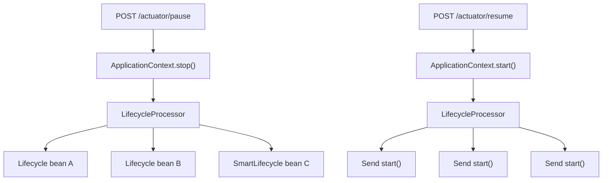
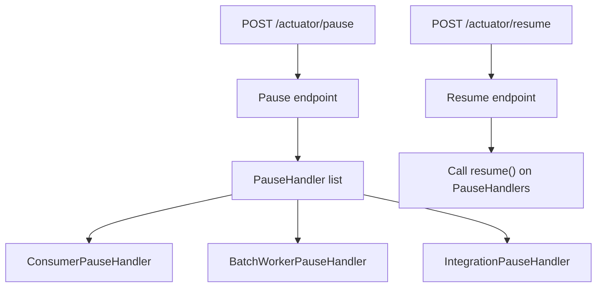
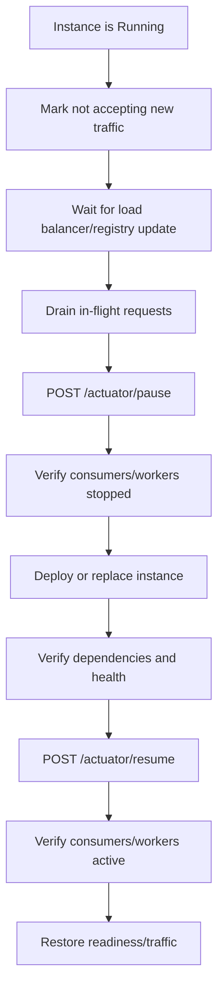

# The Pause and Resume Endpoints and Version-Dependent Behavior

Spring Cloud provides two management endpoints, `/actuator/pause` and `/actuator/resume`, to pause and later resume certain components in an application. The exact semantics of these two endpoints depend on the running Spring Cloud version. In the Spring Cloud Commons 4.3.x branch, the documentation describes them as invoking `stop()` and `start()` on the `ApplicationContext`. In the 5.0.x branch, the documentation describes them as invoking `pause()` and `resume()` on `PauseHandler` beans; Spring Cloud provides a handler for Spring Integration components implementing `Pausable`.

This difference directly affects operations. A pause command may affect all lifecycle-managed beans in the context in one version, yet affect only registered handlers in another. Consequently, during a rolling update or when running multiple application versions simultaneously, do not assume every instance exhibits identical behavior merely because the endpoint URLs look the same.

## 1. What Are Pause and Resume Used For?

Pause is an operation asking part of the application's activity to temporarily stop. Resume asks that activity to continue. Common scenarios include:

- Pausing a consumer so it stops receiving new messages while preparing for maintenance.
- Stopping a poller or background worker while changing dependencies.
- Suspending an integration flow to troubleshoot an issue on a target system.
- Coordinating traffic draining and instance replacement during a deployment.
- Pausing stateful components before switching configuration or resources.

Pause/resume is a lifecycle operation for Spring components integrated with the corresponding mechanism. It is not a command to pause the entire JVM, does not stop the container on its own, and does not replace platform scale or rollout operations.

Keep these distinctions clear:

| Operation | Purpose | Typical impact |
| --- | --- | --- |
| Pause | Temporarily halt activity of managed components | Lifecycle beans or PauseHandlers are invoked |
| Resume | Continue paused activity | Lifecycle beans or PauseHandlers are invoked again |
| Refresh | Update Environment, rebind, or refresh targets per configuration | PropertySources, configuration beans, and RefreshScope |
| Context restart | Close and restart ApplicationContext via endpoint mechanism | Context lifecycle runs again |
| Shutdown process | Terminate the JVM/container process | Entire process stops |
| Scale to zero | Deployment platform reduces replica count to 0 | No serving instances remain |

Do not treat pause as another spelling for restart or shutdown. Pause does not inherently destroy singletons, close the ApplicationContext, or terminate the process.

## 2. The Two Endpoints and How to Invoke Them

In a Spring Boot application with Actuator and compatible Spring Cloud Context, both operations are typically invoked via HTTP POST:

```text
POST /actuator/pause
POST /actuator/resume
```

Local invocation example:

```bash
curl -X POST http://localhost:8080/actuator/pause
curl -X POST http://localhost:8080/actuator/resume
```

These are Actuator write operations, so they use POST. Actual paths may change if the application configures a custom management base path or separate management port, for example:

```yaml
management:
  server:
    port: 9001
  endpoints:
    web:
      base-path: /manage
```

In that case, the endpoints may be located at `http://localhost:9001/manage/pause` and `http://localhost:9001/manage/resume`.

Paths and methods must be confirmed from runtime configuration or the Actuator links page of the exact deployed version. Do not assume every Spring Cloud application exposes these endpoints right after adding a dependency.

## 3. Conditions for the Endpoints to Appear

Pause and resume belong to Spring Cloud Context's management endpoints. The application requires the appropriate components:

- Spring Boot Actuator to provide endpoint infrastructure.
- Spring Cloud Context/Commons compatible with the Spring Boot release train.
- Endpoint configuration enabled and exposed on the management channel.
- The `RestartEndpoint` mechanism required to create the nested pause/resume endpoints in documented versions.

Spring Cloud explicitly states that `/actuator/restart` is disabled by default. If `RestartEndpoint` is disabled, `/actuator/pause` and `/actuator/resume` are also disabled because they are provided as special cases of the restart endpoint.

Explicit configuration example:

```yaml
management:
  endpoint:
    restart:
      enabled: true
    pause:
      enabled: true
    resume:
      enabled: true
  endpoints:
    web:
      exposure:
        include: health,info,pause,resume
```

In this example, `restart` is enabled so Spring Cloud can create the pause/resume endpoints, yet `restart` is omitted from the web exposure list. Therefore, it is not exposed over HTTP by this list. Also check JMX or other management channels if enabled; do not check web exposure alone.

Avoid using `include: "*"` in production just to make these two endpoints appear. Exposing only the required endpoints minimizes the administrative surface area.

### 3.1. Enabling an Endpoint and Exposing It Are Different Things

| Configuration | Meaning |
| --- | --- |
| `management.endpoint.pause.enabled` | Permits the pause endpoint to operate |
| `management.endpoint.resume.enabled` | Permits the resume endpoint to operate |
| `management.endpoint.restart.enabled` | Permits creating RestartEndpoint on which pause/resume depend |
| `management.endpoints.web.exposure.include` | Selects endpoints exposed over HTTP |
| `management.endpoints.jmx.exposure.include/exclude` | Controls endpoints exposed over JMX |

An endpoint may be enabled yet not exposed over HTTP. Conversely, adding an endpoint name to the exposure list cannot create the endpoint bean if auto-configuration or enablement conditions are not met.

## 4. Behavior in Spring Cloud Commons 4.3.x: ApplicationContext Lifecycle

Spring Cloud Commons 4.3.3 documentation describes `/actuator/pause` and `/actuator/resume` as endpoints that invoke `stop()` and `start()` on the `ApplicationContext`.

In the Spring API, `ConfigurableApplicationContext` extends the `Lifecycle` contract. When the context receives a stop/start signal, `LifecycleProcessor` coordinates lifecycle-participating beans in the context. Thus, the blast radius is broader than a single consumer or custom handler.

This can be visualized as:



Components implementing `Lifecycle` or `SmartLifecycle` can receive the corresponding signals. Components not participating in lifecycle do not stop automatically just because the pause endpoint was called.

### 4.1. Context Stop Is Not Context Close

Three states must be distinguished:

- **Running:** the context is operating normally.
- **Stopped:** the context received a stop signal; Lifecycle beans are coordinated to stop per contract.
- **Closed:** the context's lifecycle has ended, singletons are destroyed, and the context cannot be restarted as an open context.

In Spring Framework, `stop()` issues a stop signal and can be followed by `start()`. `close()` is the operation that closes the context and destroys context-managed singletons. Therefore, Lifecycle-based pause/resume is not equivalent to closing and restarting the context.

### 4.2. Impact Scope Depends on Lifecycle Beans

In the 4.3.x branch, inventory beans implementing lifecycle and understand the impact of `stop()` on each bean:

| Component | What to verify |
| --- | --- |
| Background worker | Does it stop accepting new work and finish in-flight work properly? |
| Message listener/container | Does it stop consuming messages while preserving offsets/acknowledgements properly? |
| Scheduler/poller | Does it stop schedules or polling loops? |
| Connection/resource manager | Does stop close resources or merely pause activity? |
| Embedded server | Is the web server affected by lifecycle stop in the active stack? |
| Management endpoint | Does it remain reachable so resume can be called? |

In particular, if the web server or management component is stopped by lifecycle, an HTTP request calling resume may no longer have a reachable path. Do not assume the management port always stays active after pause. Test with the exact web stack, management port, and packaging of your application.

### 4.3. Example Bean Implementing SmartLifecycle

A background worker can implement `SmartLifecycle` to receive start/stop signals:

```java
import org.springframework.context.SmartLifecycle;
import org.springframework.stereotype.Component;

@Component
public class ReportPoller implements SmartLifecycle {

    private volatile boolean running;

    @Override
    public void start() {
        if (!running) {
            running = true;
            // Start poll loop or scheduler.
        }
    }

    @Override
    public void stop() {
        if (running) {
            running = false;
            // Stop accepting new work and close the poll loop safely.
        }
    }

    @Override
    public void stop(Runnable callback) {
        stop();
        callback.run();
    }

    @Override
    public boolean isRunning() {
        return running;
    }

    @Override
    public boolean isAutoStartup() {
        return true;
    }

    @Override
    public int getPhase() {
        return 0;
    }
}
```

This condensed example illustrates only the lifecycle contract. A real worker must coordinate with threads, schedulers, queues, and in-flight work handling. Do not merely flip a `running=false` flag if the active loop continues picking up tasks or lacks a safe termination mechanism.

## 5. Behavior in Spring Cloud Commons 5.0.x: PauseHandler

Spring Cloud Commons 5.0.4 documentation describes the two endpoints differently: `/actuator/pause` calls `pause()` on every `PauseHandler` bean, and `/actuator/resume` calls `resume()` on every `PauseHandler` bean.

`PauseHandler` resides in package `org.springframework.cloud.context.restart`. An application can register custom handlers to control the exact components that need pausing.



This approach lets the application decide explicitly which components should pause. The endpoint does not implicitly tell every bean in the ApplicationContext to stop its lifecycle.

### 5.1. Default Handler for Spring Integration

Spring Cloud 5.0.x provides a handler for Spring Integration components implementing the `Pausable` interface when the corresponding integration support is present. This handler collects Pausable components and invokes `pause()`/`resume()` on them.

A paused Spring Integration endpoint may still keep its connection to an external system open while neither sending nor receiving messages during the pause window, depending on endpoint type and implementation. That differs from closing connections or stopping the entire ApplicationContext.

If the application has no Pausable components and registers no custom PauseHandlers, do not expect the endpoint to automatically stop controllers, services, or all HTTP requests.

### 5.2. Registering a Custom PauseHandler

Suppose an application has a consumer processing order events. We want to stop receiving new messages while keeping the administrative web API active:

```java
import org.springframework.cloud.context.restart.PauseHandler;
import org.springframework.stereotype.Component;

@Component
public class OrderConsumerPauseHandler implements PauseHandler {

    private final OrderConsumer consumer;

    public OrderConsumerPauseHandler(OrderConsumer consumer) {
        this.consumer = consumer;
    }

    @Override
    public void pause() {
        consumer.pauseConsumption();
    }

    @Override
    public void resume() {
        consumer.resumeConsumption();
    }
}
```

`OrderConsumer` is an application component that must provide safe pause/resume methods. The example does not depend on a specific broker; if using Kafka, RabbitMQ, or Spring Cloud Stream, prefer the lifecycle/binding APIs supported by your binder and version.

### 5.3. Designing Handlers Safe for Repeated Invocations

Orchestration may send pause multiple times due to retries or timeouts, and may call resume after state has already returned to normal. Handlers should therefore be idempotent:

- Pausing when already paused does not corrupt state.
- Resuming when already running does not spawn duplicate consumers or schedulers.
- If pausing partially fails, the state is recorded and recoverable.
- Do not drop messages or skip offsets merely to finish a pause operation.
- In-flight resources must have a clear drain/timeout policy.

If multiple handlers have ordering dependencies—such as stopping producers before consumers or vice versa—create a single coordinating handler to control ordering rather than relying on unguaranteed ordering across independent beans.

## 6. Comparing the Two Version Branches

The main differences are reflected in the official documentation of the two Spring Cloud Commons versions:

| Criterion | Spring Cloud Commons 4.3.3 | Spring Cloud Commons 5.0.4 |
| --- | --- | --- |
| Pause endpoint description | Calls `Lifecycle.stop()` on ApplicationContext | Calls `pause()` on all PauseHandler beans |
| Resume endpoint description | Calls `Lifecycle.start()` on ApplicationContext | Calls `resume()` on all PauseHandler beans |
| Control scope | Lifecycle beans in the context per LifecycleProcessor | Components registered via PauseHandler |
| Spring Integration | Depends on version's lifecycle integration | Includes handler for Pausable components |
| What to test | Impact of context stop/start on Lifecycle beans and management server | List of PauseHandlers, components actually paused and resumed |
| Risk of misunderstanding | Assuming only consumers are stopped | Assuming the entire ApplicationContext stops automatically |

Do not extrapolate behavior in Commons 5.0.x from test results on Commons 4.3.x. Nor should you assume identical semantics just by looking at endpoint URL names.

### 6.1. Relationship to Spring Boot and Release Trains

Spring Cloud must pair with a compatible Spring Boot generation. Per the current release train compatibility matrix at the time of writing:

| Spring Cloud release train | Spring Boot generation | Reference Commons line |
| --- | --- | --- |
| 2025.1.x | 4.0.x; 4.1.x supported from 2025.1.2 | 5.0.x |
| 2025.0.x | 3.5.x | 4.3.x |
| 2024.0.x | 3.4.x | 4.2.x |

The 4.3.3 endpoint docs describe Lifecycle stop/start; the 5.0.4 endpoint docs describe PauseHandler. When upgrading Spring Boot, do not change the Boot version in isolation—select a compatible Spring Cloud BOM.

For example, a Spring Boot 4.0 project should use a matching Spring Cloud 2025.1.x release train. A Boot 3.5 project uses the 2025.0.x release train. Check the official compatibility table and latest service releases before upgrading; do not mix Spring Cloud modules from different release trains in the same application.

### 6.2. Checking Dependencies and BOM

Maven should manage Spring Cloud modules via a BOM:

```xml
<properties>
    <spring-cloud.version>2025.1.4</spring-cloud.version>
</properties>

<dependencyManagement>
    <dependencies>
        <dependency>
            <groupId>org.springframework.cloud</groupId>
            <artifactId>spring-cloud-dependencies</artifactId>
            <version>${spring-cloud.version}</version>
            <type>pom</type>
            <scope>import</scope>
        </dependency>
    </dependencies>
</dependencyManagement>
```

Required dependencies depend on the application, typically including Actuator and Spring Cloud Context via the appropriate starter/module. Do not manually pin a `spring-cloud-context` version different from the release train BOM without a tested reason.

## 7. Enabling Endpoints in a Sample Application

A minimal illustrative configuration:

```yaml
management:
  endpoint:
    restart:
      enabled: true
    pause:
      enabled: true
    resume:
      enabled: true
  endpoints:
    web:
      exposure:
        include: health,info,pause,resume
```

Here:
- RestartEndpoint is enabled so nested pause/resume endpoints can be created per Spring Cloud's mechanism.
- Only `health`, `info`, `pause`, and `resume` are exposed over HTTP.
- `restart` is not included in the web exposure list.

If the application enables JMX exposure, configure it separately so the restart endpoint is not inadvertently exposed over that channel. Nor does this configuration replace authentication, authorization, and network policies.

### 7.1. Calling Endpoints with Authentication

Local unauthenticated example:

```bash
curl -X POST http://localhost:8080/actuator/pause
curl -X POST http://localhost:8080/actuator/resume
```

In production, use credentials provisioned via a secret manager or secure administrative tooling. Never put passwords/tokens directly into committed scripts or shared terminal histories. If Spring Security enables CSRF for POST requests, administrative clients must supply CSRF tokens per security configuration; do not disable CSRF application-wide just to make endpoints work.

### 7.2. Separating the Management Port

You can separate the management server from the API serving port:

```yaml
server:
  port: 8080

management:
  server:
    port: 9001
  endpoints:
    web:
      base-path: /actuator
      exposure:
        include: health,info,pause,resume
```

A dedicated management port simplifies orchestration, especially in the 4.3.x branch where lifecycle stop may affect beans managing the main server. Still, test in practice whether the management server falls within the stopped lifecycle scope; do not treat port separation as a guarantee that resume will always remain reachable.

## 8. Pause/Resume Do Not Automatically Manage Readiness or Service Registry

The pause endpoint does not automatically ensure an instance is removed from the load balancer or service registry. A consumer stopping message intake is different from an HTTP instance stopping incoming requests.

In architectures with discovery or Kubernetes, coordinate:
- Readiness probes to stop routing new traffic to the instance.
- Service registry/load balancer to deregister or deprioritize the instance if needed.
- Draining in-flight requests.
- Pausing consumers/pollers/background workers.
- Resuming components once dependencies are ready.
- Restoring readiness and traffic registration after verification passes.

If you only call pause while readiness stays UP, new requests can still arrive at the instance. In the 5.0.x branch, this is even more likely if custom PauseHandlers stop only message consumers without touching the HTTP server.

## 9. Using Pause/Resume in a Rolling Deployment Workflow

Suppose you need to replace an `order-service` version handling both HTTP requests and messages. A safe workflow can look like:



Specific steps depend on version semantics:

- In 4.3.x, pause may stop Lifecycle beans across the ApplicationContext; evaluate both the management server and web server.
- In 5.0.x, pause invokes only PauseHandlers; verify handlers are registered for every consumer/worker that must stop.
- If no handler exists for a component needing suspension, a successful endpoint response cannot be treated as proof that component stopped.
- If a newly deployed version changes PauseHandler or lifecycle behavior, do not share assumptions with the old version.

### 9.1. Wait for Draining Before Pausing

Do not pause immediately at the start of a rollout if the instance still has requests or messages in flight. First:
1. Stop accepting new work at the ingress or broker layer.
2. Wait for in-flight request counts to drop to the desired threshold.
3. Wait for active transactions or message handlers to complete.
4. Check queue lag, retries, and dead-letter queues.
5. Only then pause remaining consumers/background workers.

Pause does not automatically guarantee in-flight work finishes or rolls back. Handlers and integration components need their own graceful drain mechanisms.

## 10. Running Multiple Versions Simultaneously

During a rolling deployment, mixed instances may coexist:
- Version A using Spring Cloud Commons 4.3.x.
- Version B using Spring Cloud Commons 5.0.x.
- Some instances already upgraded while others still serve traffic.

If `POST /actuator/pause` is sent to both groups, the two groups can exhibit different stopping scopes. One group may stop context Lifecycle beans, while the other stops only registered PauseHandlers.

Example table:

| Instance | Framework | Pause behavior per docs | What to verify |
| --- | --- | --- | --- |
| `order-a` | Commons 4.3.x | Lifecycle stop on ApplicationContext | Web server, workers, and management lifecycle |
| `order-b` | Commons 5.0.x | Invokes all PauseHandlers | Which handlers exist and which components get paused |
| `order-c` | Commons 5.0.x | Invokes all PauseHandlers | Are Spring Integration Pausable/custom handlers created? |

Plan upgrades grouped by version:
- Read each instance's version via build info or deployment metadata.
- Group instances by pause/resume behavioral semantics.
- Test endpoints on each group before rolling out.
- Do not broadcast pause commands uniformly if semantics differ across versions.
- Complete the rollout only once new instances pass health/readiness and process work properly.

### 10.1. Identical API Endpoints Do Not Mean Identical Contracts

An administrative client knowing only `/actuator/pause` may not know whether an instance runs Commons 4.3.x or 5.0.x. Orchestration systems should therefore know the instance's version/build and apply the appropriate policy.

You can use:
- Configured build info/Actuator info.
- Labels/versions in the orchestrator.
- Instance metadata in the registry.
- An application-published capability field.

Never infer behavior solely from an HTTP status code. A request accepted by the endpoint does not prove all consumers stopped.

## 11. Designing Safe PauseHandlers in the 5.0.x Branch

Custom handlers should explicitly define:
- Which component is paused/resumed.
- Whether it waits for in-flight work to finish.
- Whether there is a wait timeout.
- Where paused state is tracked.
- What diagnostic info operators receive if the handler fails.
- Whether resume can run after a process restart.
- Whether multiple handlers have ordering dependencies.

Example of a handler with explicit state:

```java
import java.util.concurrent.atomic.AtomicBoolean;

import org.springframework.cloud.context.restart.PauseHandler;
import org.springframework.stereotype.Component;

@Component
public class BillingConsumerPauseHandler implements PauseHandler {

    private final BillingConsumer consumer;
    private final AtomicBoolean paused = new AtomicBoolean(false);

    public BillingConsumerPauseHandler(BillingConsumer consumer) {
        this.consumer = consumer;
    }

    @Override
    public void pause() {
        if (paused.compareAndSet(false, true)) {
            consumer.stopAcceptingMessages();
            consumer.awaitInFlightCompletion();
        }
    }

    @Override
    public void resume() {
        if (paused.compareAndSet(true, false)) {
            consumer.startAcceptingMessages();
        }
    }
}
```

`BillingConsumer` is an illustrative application abstraction. In real code, enforce a timeout on `awaitInFlightCompletion()`, handle errors, and recover state if stopping fails midway. If pause stopped the consumer but draining timed out, the handler must reflect the actual state rather than blindly keeping a boolean flag.

### 11.1. Do Not Accidentally Pause the Control Plane

A custom handler must not stop the component required to receive the resume command. For example, if a handler stops the management server or the scheduler hosting the resume mechanism, operators may lose control access.

Separate:
- **Data plane:** business HTTP requests, message consumers, pollers, background jobs.
- **Control plane:** Actuator, health/readiness, telemetry, and administrative controls.

Depending on version, pause may affect these two planes differently. Keep the control path alive or provide an out-of-process resume path.

## 12. Testing Endpoints and Actual Behavior

Testing should not stop at verifying the endpoint returns success. Verify that components actually pause and resume operation.

### 12.1. Testing on Commons 4.3.x

Create an observable Lifecycle/SmartLifecycle bean:
- Start the context and verify the bean is running.
- Call `POST /actuator/pause`.
- Verify the bean receives `stop()` and enters stopped state.
- Call `POST /actuator/resume`.
- Verify the bean receives `start()`.
- Check whether management endpoints remain accessible during the pause window.

Specifically verify server behavior for the exact Spring Boot version, web stack, and management port in use.

### 12.2. Testing on Commons 5.0.x

Register a test `PauseHandler` bean with counters or state tracking:
- Call the pause endpoint and verify the handler is invoked.
- Call the resume endpoint and verify the handler is invoked.
- Call pause repeatedly to verify handler idempotency.
- Test the handler for Spring Integration Pausable if the application uses integration.
- Verify the consumer actually stops receiving messages and resumes receiving after resume.

If the application has multiple handlers, verify all expected handlers are created and invoked.

### 12.3. HTTP Testing via MockMvc or WebTestClient

For web applications, use integration tests to call the real endpoint through security filters and Actuator mappings. Tests should verify:
- Whether the endpoint is enabled.
- Whether the endpoint is exposed.
- Whether HTTP POST is accepted.
- Unauthorized users are rejected.
- Authorized users can call pause/resume.
- Worker/consumer state changes properly after the calls.

Do not merely mock PauseEndpoint if your goal is verifying auto-configuration, exposure, and security. Run at least one test against the real context/Actuator of the deployed version.

## 13. Observing State After Pause and Resume

An Actuator response is only proof that the endpoint processed the request per its implementation. To confirm the application reached the intended state, add component-level metrics.

| Indicator | When pause succeeds | When resume succeeds |
| --- | --- | --- |
| Consumer state | Paused or not accepting new messages | Accepting messages |
| In-flight count | Drops to 0 or configured drain threshold | Increases when work arrives |
| Queue lag | May grow if upstream keeps publishing | Decreases according to processing capacity |
| Background worker | Not accepting new jobs | Resumes accepting jobs |
| HTTP readiness | According to chosen ingress policy | UP only when ready for traffic |
| Management endpoint | Remains reachable via control plane | Continues to be reachable |
| Error rate | No unexpected stop errors | No spike in consumer restart errors |

Provide a dedicated metric or health indicator for the pause state of business components. Default health UP does not necessarily mean consumers are running; health DOWN does not necessarily mean the pause endpoint failed.

### 13.1. Recording Version and State

In multi-replica systems, logs/metrics should include:
- Instance ID.
- Application version/build.
- Spring Boot version.
- Spring Cloud release train or Commons version.
- Timestamp when pause/resume was received.
- Affected handlers or Lifecycle components.
- Drain result and final state.
- Correlation ID of the administrative command.

Do not log credentials or tokens. Version metadata identifies which semantics each instance is applying during a rollout.

## 14. Common Pitfalls and Troubleshooting

| Symptom | Possible cause | Where to check |
| --- | --- | --- |
| `404 Not Found` | Endpoint not created or not exposed | Check dependencies, enablement, RestartEndpoint, and exposure list |
| `405 Method Not Allowed` | Invoked with GET instead of POST | Use POST per write operation |
| `401/403` | Missing auth/role or CSRF token | Check SecurityFilterChain, roles, and CSRF policy |
| Pause returns success but consumer keeps running | No matching PauseHandler in 5.0.x or component not in Lifecycle in 4.3.x | Check handlers/beans and consumer state |
| Resume unreachable | Web server or management lifecycle stopped in Lifecycle branch | Use external control plane/management port or orchestrator workflow |
| Resume returns success but consumer stays idle | Handler resume failed, dependency unready, or inconsistent internal state | Inspect logs, connections, listener containers, and handler state |
| Only some instances paused | Command did not reach all replicas or mixed version semantics | Compare instance IDs, versions, and per-node results |
| Queue lag spikes rapidly | Consumer paused while upstream keeps publishing | Monitor capacity, throttle producers, or manage backlog |
| HTTP requests still hit instance | Pause does not change readiness/registry or handler stops only consumers | Drain ingress and update readiness/service registry separately |
| App fails to start with pause endpoint | Spring Boot and Spring Cloud mismatch | Check release train BOM and compatibility verifier |

### 14.1. Pinpointing the Failing Layer

When pause does not work as expected, inspect in order:

1. Does the endpoint appear in Actuator links?
2. Is the endpoint enabled and exposed?
3. Did the request pass security checks?
4. Is the instance running Commons 4.3.x or 5.0.x?
5. For 4.3.x, does the bean to stop participate in Lifecycle?
6. For 5.0.x, is the corresponding PauseHandler registered?
7. Did the component actually stop accepting work?
8. Were readiness, registry, and load balancer coordinated separately?

Do not adjust security or exposure before knowing whether the endpoint is missing because the bean wasn't created, the endpoint was disabled, or it merely wasn't exposed.

## 15. Operational Principles

- Choose a Spring Cloud release train compatible with Spring Boot and manage it with a BOM.
- Identify pause/resume semantics clearly for the running Commons version.
- Never assume endpoints are present or exposed by default.
- Expose endpoints only on the management network and protect with authentication/authorization.
- Do not expose the restart endpoint just to use pause/resume over HTTP.
- Keep the control plane active so resume remains possible, or prepare an orchestrator-driven resume path.
- Drain requests and messages before stopping workers.
- Do not treat pause as service deregistration or a readiness change.
- Design handlers to be idempotent and timeout-bounded.
- Test both old and new versions during upgrades.
- Record instance/version and actual state after every command.
- Prepare a rollback procedure if consumers cannot resume or backlog exceeds limits.

## Summary

`/actuator/pause` and `/actuator/resume` keep the same names, yet their impact scope changes across Spring Cloud versions. Commons 4.3.x describes calling `Lifecycle.stop()`/`start()` on the ApplicationContext; Commons 5.0.x describes calling `pause()`/`resume()` on PauseHandlers, including the handler for Spring Integration Pausable. Endpoints must be properly enabled, exposed, and secured; pause operations must also be coordinated with readiness, registries, draining, and rollouts. When running multiple versions concurrently, identify each instance's semantics and verify actual consumer/worker state before considering a pause or resume complete.

## References

- [Spring Cloud Commons 4.3.3 – Spring Cloud Context: Application Context Services](https://docs.spring.io/spring-cloud-commons/reference/4.3/spring-cloud-commons/application-context-services.html)
- [Spring Cloud Commons 5.0.4 – Spring Cloud Context: Application Context Services](https://docs.spring.io/spring-cloud-commons/reference/spring-cloud-commons/application-context-services.html)
- [Spring Framework – ApplicationContext lifecycle events](https://docs.spring.io/spring-framework/reference/core/beans/context-introduction.html)
- [Spring Cloud – Release train and Spring Boot compatibility](https://spring.io/projects/spring-cloud/)
