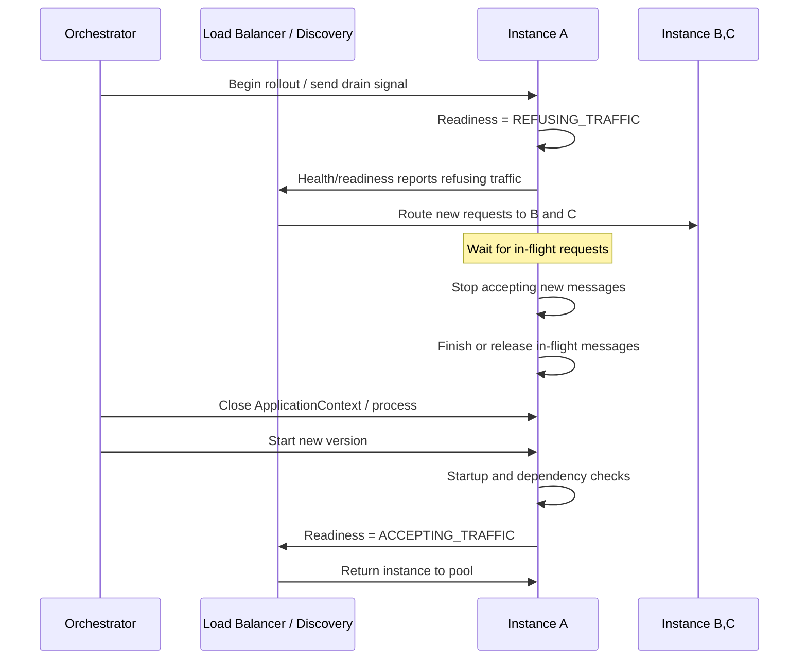

# Impact of Restart or Pause on In-Flight Requests

A Spring Cloud service may need to restart to deploy a new version, reload configuration, or recover state. A service may also be paused temporarily to halt certain processing pipelines before resuming. These operations affect in-flight HTTP requests, messages being processed, connections to other services, and background tasks.

To prevent dropped requests or duplicate transactions, distinguish three mechanisms. **Graceful shutdown** closes the application over a wait period so in-flight requests have an opportunity to finish. **ApplicationContext restart** closes the Spring context and reinitializes it. **Pause/resume** in Spring Cloud Context invokes handlers supporting pause/resume; the scope of impact depends on components with registered handlers. These mechanisms do not share the same semantics and do not guarantee the same outcome for in-flight requests.

This lesson belongs to the **Application Lifecycle** chapter of **SPRING_CLOUD_CORE**. The focus is the impact of restart or pause on in-flight requests, how Spring Boot stops accepting traffic and waits for requests to finish, how Spring Cloud provides administrative endpoints, and how to coordinate readiness, service discovery, timeouts, retries, and idempotency in distributed deployments.

## 1. Learning Objectives

After this lesson, learners will be able to:

1. Distinguish between process restart, ApplicationContext restart, graceful shutdown, and pause/resume.
2. Describe the state of an in-flight HTTP request when the application begins shutting down.
3. Explain the grace period, lifecycle phase timeouts, and limitations of graceful shutdown.
4. Distinguish readiness from liveness and understand the role of traffic draining.
5. Explain the `/actuator/restart`, `/actuator/pause`, and `/actuator/resume` endpoints in Spring Cloud Context.
6. Identify the impact of pause on HTTP requests, message consumers, and background components.
7. Design retries, idempotency, durable queues, and rolling restart procedures to minimize lost or duplicated work.
8. Test shutdown/pause/resume behavior rather than merely testing whether the application starts up successfully.

## 2. Distinguishing Lifecycle Operations

The word "restart" is often used for several different operations. Before predicting what happens to requests, identify which operation is occurring.

| Operation | Scope | What happens to the application |
| --- | --- | --- |
| Process restart | JVM/container/pod | Old process exits; a new process is created |
| ApplicationContext restart | Spring container within the process | Context is closed and reinitialized via the restart mechanism |
| Graceful shutdown | Closing the web server/context | Stops accepting new requests; waits for running requests within the allowed time |
| Immediate shutdown | Closing the web server/context | Stops serving rapidly; running requests may be interrupted |
| Pause | Components supporting pause | Components receive a pause command; stop scope depends on handlers |
| Resume | Paused components | Components receive a command to resume operation |

A pod restart usually includes both the application closing its context and the container runtime terminating the process. A Spring Cloud restart command may only restart the ApplicationContext within the same JVM. Pause does not necessarily close the context, release all connection pools, or stop the entire HTTP server.

## 3. What Is an In-Flight Request?

A request may be at one of several different stages:

1. The client sent the request, but it has not reached the application yet.
2. The request was accepted by the web server and is waiting for a worker thread.
3. A controller/service is executing business logic.
4. The application is calling a database or another service.
5. The transaction has committed, but the response has not finished sending.
6. The response was sent, but the client has not received it completely.
7. The request returned HTTP 202 and handed work off to background processing.

These stages produce different outcomes during shutdown. Graceful shutdown primarily governs the web server stopping new requests and giving active requests time to complete. It does not automatically guarantee an external business operation is rolled back, nor does it guarantee the client receives the response if the network connection drops after the server committed.

### 3.1. Request Already Accepted and Running

When the web server accepts a request prior to shutdown, that request can continue executing during the grace period. If business logic completes within the allowed window and the response is sent successfully, the client can receive a normal result.

For example, an order-creation request is performing:

- Data and authorization validation.
- Writing the order to the database.
- Writing an event to the outbox.
- Committing the transaction.
- Returning the response.

If the request completes before the grace period expires, graceful shutdown gives it a chance to finish. If the wait period expires, the server or process may close while the request is still unfinished.

### 3.2. Request Waiting for a Worker Thread

A request that has reached the socket or server queue but has not started processing yet may be rejected when the server transitions to refusing traffic. Exact behavior depends on the web server and framework version.

The client may observe a connection error, HTTP 503, or another response depending on the server/proxy. Do not assume every request with an open TCP connection is guaranteed to be processed.

### 3.3. Transaction Committed but Response Lost

This is the most dangerous scenario when clients retry without safeguards:

1. Server receives a payment creation request.
2. Server records the transaction and commits.
3. Application begins shutting down before the response reaches the client.
4. Client times out and does not know whether the transaction committed.
5. Client resends the request.
6. If the server lacks idempotency, the transaction may be created twice.

An HTTP timeout or connection reset does not prove the server did not execute the business logic. For operations creating orders, payments, transfers, or grants, implement idempotency keys, unique constraints, or status lookup mechanisms by request ID.

## 4. Graceful Shutdown in Spring Boot

Graceful shutdown is a mechanism for closing the application with a wait period. During this window, the embedded web server stops accepting new requests and gives active requests a chance to complete. After the grace period, shutdown proceeds along the lifecycle.

Spring Boot integrates graceful shutdown with supported embedded web servers for both Servlet and reactive applications. How the server rejects new requests can differ: some servers stop accepting at the network layer; some versions/servers may return rejection responses. Persistent connections and HTTP keep-alive also influence how clients observe closure.

### 4.1. Explicitly Enabling Graceful Shutdown

You can configure:

```yaml
server:
  shutdown: graceful

spring:
  lifecycle:
    timeout-per-shutdown-phase: 30s
```

`server.shutdown` selects how the server closes. `spring.lifecycle.timeout-per-shutdown-phase` sets the wait duration for each Spring lifecycle phase. Tune these according to actual request processing durations and the drain time the system needs.

Some newer Spring Boot versions enable graceful shutdown by default for supported embedded servers; earlier versions require configuring `server.shutdown=graceful`. Declaring it explicitly makes deployment intent clear, though you should still check documentation for your exact Boot and web server versions.

### 4.2. Grace Period Is Not a Guarantee That Requests Always Succeed

Graceful shutdown gives requests an opportunity to finish within a time window. It cannot guarantee success if:

- A request hangs because a database or dependent service is unresponsive.
- A request takes longer than the grace period.
- A worker thread is stuck or deadlocked.
- The process is forcibly terminated by the OS/container runtime.
- The host loses power, crashes, or is force-killed.
- The client or proxy closes the connection before the server finishes sending the response.

Therefore, the application still needs timeouts at the HTTP client, database, transaction, and overall request layers. The grace period should exceed the maximum valid processing duration of requests that must drain, without extending indefinitely.

### 4.3. Shutdown Ordering of Lifecycle Beans

Spring Boot performs graceful shutdown as part of closing the ApplicationContext and coordinates with `SmartLifecycle` beans. Components with lifecycles must stop in the right phase so they do not accept more work after dependencies have closed.

For example, if a message consumer keeps accepting messages while the database connection pool has already shut down, the consumer may fail while writing data. Lifecycle design must enforce the sequence:

1. Stop accepting new work.
2. Wait for in-flight work to finish within a time limit.
3. Commit or acknowledge results according to system semantics.
4. Stop workers/executors and consumers.
5. Close clients, connection pools, and dependent resources.

Not every bean drains automatically in the same way. For custom executors, schedulers, message listeners, or self-managed resources, consult component docs and configure shutdown explicitly.

## 5. Readiness and Traffic Draining

Before stopping an instance, the system must reduce or halt new traffic routed to that instance. This is the job of readiness and load balancing/service discovery mechanisms.

Spring Boot provides `ApplicationAvailability` with liveness and readiness states. Readiness indicates whether the instance is ready to accept traffic. When the application enters graceful shutdown, Spring Boot transitions readiness to `REFUSING_TRAFFIC`; during normal operation, the readiness state is `ACCEPTING_TRAFFIC`.

### 5.1. Readiness Differs from Liveness

| State | Meaning | What should the orchestrator do? |
| --- | --- | --- |
| Liveness `CORRECT` | Process is alive and does not need a restart to recover | Do not restart solely because an external dependency temporarily failed |
| Readiness `ACCEPTING_TRAFFIC` | Instance is ready to accept requests | May include the instance in the serving pool |
| Readiness `REFUSING_TRAFFIC` | Instance does not want new requests | Stop sending new traffic to the instance |

Do not use liveness to represent a "draining" state. If liveness fails, Kubernetes may restart the container, cutting off the grace period needed for graceful shutdown. Readiness is the appropriate signal for removing an instance from traffic.

### 5.2. Health Probes in Kubernetes

Spring Boot Actuator provides health groups for readiness and liveness. For applications running on Kubernetes, probes can point to:

```yaml
livenessProbe:
  httpGet:
    path: /actuator/health/liveness
    port: 8080

readinessProbe:
  httpGet:
    path: /actuator/health/readiness
    port: 8080
```

When readiness fails, Kubernetes stops selecting that pod for Service traffic via its endpoint mechanism. Updating EndpointSlices, load balancers, or ingress carries its own propagation delay; requests may still arrive during the transition window. Thus, readiness and graceful shutdown should be coordinated to provide a sufficient drain period.

If Actuator runs on a separate management port, probes may succeed even while the main web server cannot accept connections. For environments needing to verify actual serving capability, consider exposing probe paths on the main server port per Spring Boot guidance.

### 5.3. Marking Readiness Manually

In an application-driven drain workflow, you can publish an availability event:

```java
AvailabilityChangeEvent.publish(
    applicationContext,
    ReadinessState.REFUSING_TRAFFIC
);
```

Once the instance is ready to serve again, the state can transition back to `ACCEPTING_TRAFFIC` via the appropriate lifecycle workflow.

This updates the readiness state inside the application. It does not guarantee every load balancer updates instantaneously, nor does it stop the web server on its own. Allow the orchestrator to observe the probe, stop routing new requests, and only then proceed to close the context/process.

### 5.4. Drain Window and Termination Grace Period

In Kubernetes, pod termination time must accommodate `preStop` steps (if any), traffic propagation/draining, and the application's graceful shutdown. `terminationGracePeriodSeconds` is the overall budget before the container is forcibly killed; the `preStop` hook also consumes this budget.

For example, if the application needs 30 seconds for shutdown and infrastructure needs extra time to update endpoints, do not set `terminationGracePeriodSeconds` to exactly 30 seconds. Measure real propagation latency, add drain time and a safety buffer, then test under real load.

## 6. Impact of Restart on In-Flight Requests

### 6.1. Process/JVM Restart

When a process terminates, all threads, heap objects, and connections belonging to that process are lost. Upon receiving a normal termination signal such as `SIGTERM`, Spring Boot can close the ApplicationContext and perform graceful shutdown if configured and supported by the server.

If the process receives `SIGKILL`, crashes, or the host halts abruptly, shutdown hooks have no chance to run. In-flight requests may be cut off immediately. Clients typically observe connection reset, EOF, timeouts, or gateway errors.

### 6.2. ApplicationContext Restart via Spring Cloud

Spring Cloud Commons provides the `/actuator/restart` administrative endpoint to close the ApplicationContext and restart it. This endpoint is disabled by default per Spring Cloud documentation. Restarting the context can trigger lifecycle closure of the web server and beans, yet it is not an orchestration-level rolling restart.

A request calling the restart endpoint itself may be disrupted by the server/context closing before the response finishes sending. Do not design clients to rely on receiving a complete HTTP response from a request that triggers restart.

Context restart is also not equivalent to creating a new JVM. Static state, threads, or unmanaged resources may remain in the process if code created them outside Spring's lifecycle. Therefore, for changes needing completely clean process state or binary upgrades, a container/process-level rolling restart is clearer.

### 6.3. Immediate Restart

If the server closes immediately or the process is force-terminated before a request finishes, in-flight requests have no completion guarantee. Uncommitted database transactions may roll back when connections close, but side effects already sent to external systems are not automatically undone.

An email command, payment gateway call, or published message may already have been accepted by the target system even if the caller never received a response. This is why retries must combine idempotency with status lookup capabilities.

### 6.4. Rolling Restart in a Multi-Instance Cluster

In a multi-replica cluster, a rolling restart replaces instances in batches. With proper readiness and capacity configuration, remaining instances continue serving traffic while one instance drains and restarts.

Check the following:

- Minimum remaining replicas serving while an instance leaves the cluster.
- Whether `PodDisruptionBudget` or rollout policies keep enough instances running.
- Whether readiness probes accurately reflect serving ability.
- Whether the load balancer/service discovery removes the stopping instance from the pool.
- Whether client retries are bounded and idempotent.
- Whether message consumers stop and acknowledge according to exact semantics.

Rolling restarts reduce disruption scope, yet do not automatically prevent request loss if traffic routing, timeouts, or retries are misconfigured.

## 7. Pause and Resume in Spring Cloud Context

Spring Cloud Commons provides pause/resume administrative endpoints for Spring Boot Actuator applications. According to current Spring Cloud Commons documentation, `/actuator/pause` and `/actuator/resume` invoke `pause()` and `resume()` on beans implementing `PauseHandler`. Spring Cloud supplies a handler for Spring Integration components supporting `Pausable`.

Crucially, pause/resume affects **components that have handlers**, rather than providing a blanket guarantee that the entire HTTP server stops accepting requests and drains all running requests.

### 7.1. Pause Is Not Graceful Shutdown

Pause can be helpful when temporarily halting a polling endpoint, consumer, or pause-capable integration flow. However, it does not automatically:

- Close the ApplicationContext.
- Terminate the JVM.
- Remove the pod from service discovery.
- Transition readiness to `REFUSING_TRAFFIC`.
- Stop all HTTP controllers.
- Cancel all running requests.
- Wait for all in-progress transactions or messages to complete.
- Close all connection pools.

An in-flight HTTP request may continue running, be affected by a paused downstream component, or be rejected at a later step. Outcomes depend on the specific component and handler.

### 7.2. Component-Dependent Behavior

For example, suppose a service uses Spring Integration to poll data from an external system. When a `Pausable` component is paused, fetching new messages may stop. However, messages already received and moving through the flow may continue according to endpoint, executor, and transaction semantics.

A custom handler may choose to stop intake, wait for an in-flight counter to reach 0, and only then report pause complete. Another handler may simply set a flag and prevent the next poll. You cannot assume every handler shares the same semantics.

### 7.3. Spring Cloud Version Differences

Current Spring Cloud Commons documentation describes pause/resume in terms of `PauseHandler`; documentation for some earlier generations described calling `stop()` and `start()` lifecycle methods on ApplicationContext. Check the documentation for your exact release train and the actual component APIs.

Do not copy assumptions from old examples and apply them to newer versions. In particular, stopping/starting a context does not mean the web server performed a graceful drain identical to closing the ApplicationContext.

### 7.4. Resume Does Not Recover Lost Requests

Resume allows paused components to continue operating. It does not restore HTTP requests already canceled by clients, replay rolled-back transactions, or automatically recover messages lost due to premature acknowledgments.

If work must survive a pause/restart, persist work state durably and design resume/retry mechanisms at the business layer.

## 8. Restart, Pause, and Resume Endpoints

These management endpoints from Spring Cloud Context are provided when an application uses Spring Boot Actuator and the appropriate Spring Cloud dependencies.

| Endpoint | Effect | Impact on requests |
| --- | --- | --- |
| `POST /actuator/restart` | Closes ApplicationContext then restarts | May interrupt the current request and others while context/server close |
| `POST /actuator/pause` | Calls pause on `PauseHandler` beans | Handler-dependent; does not guarantee draining all HTTP requests |
| `POST /actuator/resume` | Calls resume on `PauseHandler` beans | Resumes paused components per their semantics |

The restart endpoint is disabled by default in Spring Cloud documentation. Pause/resume may also be disabled alongside the restart endpoint depending on version/configuration. Endpoints must be exposed and authorized per Actuator configuration.

Exposure configuration example to evaluate against your version:

```yaml
management:
  endpoints:
    web:
      exposure:
        include: health,info,restart,pause,resume
```

This example only shows exposing endpoints over HTTP. It does not automatically enable disabled endpoints and does not replace access control configuration. Never expose restart/pause/resume on public networks. Restrict network access, require authentication and authorization, write audit logs, and consider a separate management port.

## 9. Handling Messages and Background Work During Pause/Restart

A Spring Cloud application often does more than serve HTTP. It may consume messages, run scheduled jobs, poll a service registry, or process batches. These workloads require dedicated shutdown strategies.

### 9.1. Message Consumers

When stopping a consumer, distinguish:

- Message in the broker not yet delivered.
- Message delivered but processing not yet started.
- Message currently being processed.
- Processing completed but not yet acknowledged.
- Message already acknowledged.

If the application stops before acknowledging, the broker may redeliver the message later depending on the broker and acknowledgment mode. If acknowledged before durable work finishes, a restart can lose work.

The safe rule is to acknowledge only once processing reaches the completion point defined by the application contract. If work can be redelivered, handlers must be idempotent so they do not produce duplicate side effects.

### 9.2. Scheduled Tasks

A scheduled job may be running when the context starts shutting down. Verify whether the executor/scheduler waits for the active task to finish, whether it interrupts threads on shutdown, and whether tasks can resume from a checkpoint.

For long batches, persist progress by chunk or checkpoint. Do not rely on JVM threads surviving across a restart.

### 9.3. Async HTTP Requests

If a controller returns HTTP 202 and hands work off to `@Async` or a local executor, a successful response only means the application accepted the request in memory. It does not guarantee the job survives a process restart.

If the job must survive restarts, persist it to a database or durable broker before returning 202. Workers can pick up the job after the application starts back up.

### 9.4. Streaming and Long-Lived Connections

SSE, WebSockets, long polling, and gRPC streams can outlast the grace period. When the server closes, connections may be terminated even while normal business logic is still operating.

Clients should support reconnection, cursors/offsets, or resume tokens where protocols and business rules permit. For streams that cannot resume seamlessly, communicate status and design clients to fetch missed data from the last confirmed checkpoint.

## 10. Retries, Timeouts, and Idempotency

Restart/pause increases the likelihood that clients encounter transient failures. Retries help recovery, while blind retries can duplicate side effects.

### 10.1. Do Not Retry All Errors Identically

| Situation observed by client | Likely cause | Action to consider |
| --- | --- | --- |
| Connection refused | Instance stopped accepting connections | Retry with backoff and cap |
| Connection reset/EOF | Connection closed mid-request/response | Uncertain whether server committed; requires idempotency |
| HTTP 503 | Server/proxy rejecting traffic | Retry per `Retry-After` or bounded policy |
| Read timeout | Server may still be processing | Look up outcome by request ID before resending write operations |
| Business HTTP 4xx | Invalid data or permissions | Usually do not retry automatically |
| HTTP 2xx but response body lost | Operation may have succeeded | Use idempotency key or status lookup |

### 10.2. Idempotency Keys

For transaction-creating operations, clients send a stable idempotency key for the same business intent. The server stores the key together with the processed result inside the transaction. If the client resends the same key, the server returns the prior result instead of creating a new transaction.

Example request:

```http
POST /api/payments
Idempotency-Key: 4f0f4c5e-2d9d-4e8d-9b77-6c8d9e7a2b10
Content-Type: application/json
```

The server must enforce a unique constraint or atomic insert for the key. Keeping keys only in a local JVM cache is insufficient if retries hit another instance or the application restarted.

### 10.3. Timeouts Must Have Clear Relationships

Timeouts should be ordered consistently:

- Dependency timeouts (database/HTTP client) must be smaller than the overall request budget.
- Overall request time must stay within acceptable system latency bounds.
- Grace period must be long enough for valid in-flight requests to have a chance to finish.
- Orchestrator termination grace must cover drain and shutdown timeouts, plus a safety margin.

If a dependency timeout exceeds shutdown grace, a request may still be waiting on the dependency when the application runs out of shutdown time. If client timeout is shorter than server completion time, the client may retry while the original request is still running.

## 11. Service Discovery and Load Balancers When an Instance Leaves the Cluster

Spring Cloud Commons provides discovery and load balancing abstractions; actual implementations may be Eureka, Consul, Kubernetes, or another system. When an instance prepares to restart, marking it unavailable and removing it from traffic must coordinate with the discovery/health check mechanism.

Some systems update instance lists periodically via heartbeats, leases, or health checks. Hence, deregistering does not necessarily make all clients stop sending requests instantaneously. Load balancers may hold stale caches or existing persistent connections may remain open.

A drain procedure should include:

1. Mark readiness as `REFUSING_TRAFFIC`.
2. Wait for load balancer/service discovery to update and stop routing new requests.
3. Stop accepting new background work or pause consumers per component semantics.
4. Let in-flight requests/messages finish within the allowed window.
5. Close the context/process.
6. Start the new instance and mark it ready only after startup tasks complete.

Do not deregister an instance and immediately kill the process. Measure propagation delay and verify how clients handle stale instances in your specific discovery implementation.

## 12. Example Rolling Restart Workflow

Suppose `inventory-service` runs three replicas behind a load balancer. Each replica serves HTTP requests and consumes messages from a broker.

A deployment workflow can look like this:



In practice, readiness propagation and broker consumer pausing may run concurrently or sequentially depending on architecture. What matters is never stopping a dependency that in-flight requests still rely on. For example, closing the connection pool before requests finish defeats the purpose of graceful shutdown.

### 12.1. Avoiding Capacity Exhaustion During Rollout

If all replicas drain simultaneously, the service may have zero instances left to handle traffic. Use a rolling strategy aligned with capacity, readiness, and `PodDisruptionBudget`. For sensitive workloads, test rollouts under high load and measure latency/error rates rather than testing only in idle environments.

## 13. Designing Components That Can Stop Safely

### 13.1. Stop Accepting New Work First

A worker can track two separate states:

- `accepting`: whether it accepts new work.
- `inFlight`: count of active items being processed.

During drain, the worker sets `accepting=false`, then waits for `inFlight` to reach 0 within a time bound. If time expires, the worker must apply its defined policy: let the broker redeliver, write a checkpoint, return the job to pending, or mark the outcome indeterminate.

### 13.2. SmartLifecycle

`SmartLifecycle` lets a component participate in Spring's start/stop sequence. For components that stop asynchronously, `stop(Runnable callback)` allows invoking the callback once the component has stopped.

General pattern:

```java
@Component
class InventoryConsumerLifecycle implements SmartLifecycle {

    private volatile boolean running;

    @Override
    public void start() {
        running = true;
        // Start accepting new work.
    }

    @Override
    public void stop(Runnable callback) {
        stopAcceptingNewMessages();
        drainInFlightWork().whenComplete((ignored, failure) -> {
            running = false;
            callback.run();
        });
    }

    @Override
    public void stop() {
        running = false;
    }

    @Override
    public boolean isRunning() {
        return running;
    }

    @Override
    public boolean isAutoStartup() {
        return true;
    }
}
```

This is an illustrative skeleton, not a complete consumer. `stopAcceptingNewMessages` and `drainInFlightWork` are application-implemented methods; the drain method should return a `CompletableFuture` or equivalent async handle. Invoke the callback only after stopping finishes; handle timeouts, drain errors, state synchronization, and idempotency if `stop` is called multiple times.

### 13.3. Closing Resources in the Right Order

When components stop, close according to dependency order:

- Stop accepting new requests/messages.
- Wait for handlers using clients/databases to complete.
- Stop executors after tasks finish or are handed off.
- Close HTTP clients, connection pools, and broker connections.
- Release listeners, schedulers, and background threads.

Do not spawn background threads unmanaged by Spring without an explicit shutdown mechanism. Non-daemon threads can keep the process alive; daemon threads can be cut off immediately when the JVM exits.

## 14. Testing Restart, Pause, and In-Flight Requests

Tests verifying only that `/actuator/restart` returns HTTP 200 are insufficient. Verify the behavior of running requests, new requests, message consumers, and readiness state.

### 14.1. Testing Graceful Shutdown with Slow Requests

Create a test endpoint that holds a request open for several seconds:

```java
@RestController
class SlowRequestController {

    @GetMapping("/test/slow")
    String slow() throws InterruptedException {
        Thread.sleep(5_000);
        return "completed";
    }
}
```

In an integration test:

1. Send a `/test/slow` request and keep the connection open.
2. Initiate closing the ApplicationContext or send a valid shutdown signal.
3. Verify the server stops accepting new requests.
4. Verify the older request completes if within the grace period.
5. Repeat with a request exceeding the timeout and observe what happens when the shutdown deadline expires.

Do not use `Thread.sleep` as a production processing strategy; this is solely a test endpoint to create a request of deterministic duration. Tests must control shutdown and timeouts reproducibly.

### 14.2. Testing Readiness

You can check `ApplicationAvailability` or the health endpoint:

```java
ReadinessState state =
    applicationAvailability.getReadinessState();

assertThat(state).isEqualTo(ReadinessState.ACCEPTING_TRAFFIC);
```

When shutdown starts, readiness should transition to `REFUSING_TRAFFIC` per supported lifecycle behavior. In orchestration tests, verify the load balancer or service test double stops selecting the instance after observing the readiness change.

### 14.3. Testing Pause Handlers

For Spring Cloud `/actuator/pause` and `/actuator/resume`, write tests for the actual `PauseHandler`/component in use:

- Verify pause prevents accepting new work per handler semantics.
- Verify already-received work finishes or is released per policy.
- Verify resume allows accepting new work again.
- Verify pause state does not drop messages.
- Verify independent HTTP requests are not mistakenly assumed drained just because the handler paused.

Do not use a unit test of `PauseHandler` to conclude the entire web server supports graceful shutdown.

### 14.4. Testing Idempotency When Responses Are Lost

A valuable business test simulates:

1. Server commits the transaction.
2. Test client deliberately disconnects before reading the response.
3. Client resends the same idempotency key.
4. Server returns the previous result and does not create a duplicate transaction.

This test directly targets the restart/network failure case most prone to duplicate side effects.

## 15. Observability and Operations

During a rollout or restart, monitor these indicators:

- Number of active requests.
- Number of new requests rejected during the drain phase.
- Actual graceful shutdown duration.
- Number of requests ending in timeout, reset, or 5xx.
- Number of in-flight messages and redelivery counts.
- Number of unfinished background tasks.
- Time for readiness to switch to refusing traffic and time for endpoint/discovery propagation.
- Retry counts and requests deduplicated by idempotency keys.

Logs should include correlation IDs/request IDs and lifecycle state, while omitting sensitive payloads or credentials. When an instance restarts, logs from the old and new instances should carry an instance ID to distinguish them.

A prolonged shutdown usually signals hanging requests, executors, or unresponsive dependencies. Do not simply raise the timeout without identifying what is waiting. Use thread dumps, request metrics, and broker consumer metrics to find the cause.

## 16. Common Misconceptions

**"Restart always waits for current requests to finish."** Only graceful shutdown has a grace period, and requests must finish within that limit. Crashes or forced kills do not wait.

**"`/actuator/restart` is the same as a Kubernetes rolling restart."** The Spring Cloud endpoint closes and restarts the ApplicationContext; orchestration restarts the process/container and can replace binaries/images.

**"Pause means the server stops accepting HTTP requests."** Spring Cloud pause/resume invokes PauseHandlers. Only components with handlers are affected per their semantics.

**"Resume restores interrupted requests."** Resume only continues paused components; it does not recover lost requests or transactions.

**"Readiness false immediately blocks all requests."** Load balancers and discovery take time to update; existing connections or in-flight traffic may still arrive.

**"An HTTP timeout means the server did not commit."** The server may have committed while the response was lost. Idempotency and status lookups are required.

**"Stopping a message consumer automatically redelivers in-flight messages."** That depends on acknowledgments, transactions, and the broker. Acknowledging too early can lose work.

**"Increasing the shutdown timeout solves everything."** Requests may hang indefinitely or dependencies may remain unresponsive. Layered timeouts and root-cause observability are required.

**"A single SmartLifecycle bean is enough to drain the whole app."** Each server, executor, consumer, and resource has its own lifecycle; they must coordinate according to dependencies.

## 17. Pre-Restart or Pre-Pause Checklist

Before operating on a production instance, verify:

1. **Operation type:** process restart, context restart, graceful shutdown, or handler pause?
2. **Readiness:** has the instance transitioned to `REFUSING_TRAFFIC`?
3. **Traffic drain:** have load balancers/discovery stopped sending new requests?
4. **In-flight requests:** are long requests, streams, or transactions currently running?
5. **Grace period:** is the timeout sufficient for valid requests and lifecycle phases?
6. **Orchestrator:** does termination grace cover `preStop`, drain, and shutdown?
7. **Message consumers:** have they stopped accepting new messages and properly processed/released in-flight messages?
8. **Background tasks:** do jobs have checkpoints or durable queues for recovery?
9. **Idempotency:** can client retries cause duplicate side effects?
10. **Dependencies:** do databases/clients/pools close only after requests finish?
11. **Endpoint security:** are management endpoints protected from public exposure?
12. **Resume/readiness:** does the instance receive traffic again only after startup and health checks pass?

## 18. Practice Exercises

### Exercise 1. Order Creation Request Interrupted

An order-creation request takes 8 seconds. The application has a 5-second graceful shutdown timeout. The server commits to the database at second 6, but the process terminates before the response reaches the client.

Explain:

- What errors might the client observe?
- Why could a retry create a duplicate order?
- How should an idempotency key or status lookup work?
- Which timeouts should be adjusted and what must be coordinated with the orchestrator?

### Exercise 2. Pausing a Message Consumer

An application uses Spring Integration to poll a broker and process messages. When `/actuator/pause` is called, one message has been received but its transaction has not committed yet.

Identify the possible message states, what depends on the `PauseHandler` and acknowledgment mode, and how to design so messages are not lost during pause/restart.

### Exercise 3. Rolling Restart of Three Replicas

A service has three replicas, each taking at most 10 seconds to process a request. The load balancer needs roughly 4 seconds to update instance status. Propose:

- The sequence of readiness, drain, and shutdown.
- The minimum grace period value to test.
- How to set the termination grace period with a safety margin.
- How to ensure sufficient capacity remains during rollout.

### Exercise 4. Distinguishing Restart and Pause

An operations team wants to stop polling for 2 minutes while keeping the HTTP API active. Explain why a pause handler on the polling component is better suited than restarting the ApplicationContext, what to test before/after pausing, and how to ensure HTTP requests do not depend on the paused component.

### Self-Check Questions

1. How does graceful shutdown differ from immediate shutdown?
2. What do `server.shutdown` and `spring.lifecycle.timeout-per-shutdown-phase` control?
3. Why must readiness and liveness be distinguished?
4. What problem can a committed request with a lost response cause during retries?
5. How does `/actuator/restart` differ from a JVM/container restart?
6. Which bean types do `/actuator/pause` and `/actuator/resume` affect in current Spring Cloud Commons?
7. Why does pause not automatically guarantee in-flight HTTP requests are drained?
8. When should a message consumer acknowledge to minimize message loss?
9. How does `SmartLifecycle` assist in stopping components?
10. Why should idempotency and rolling restarts be tested under load?

## 19. References

- [Spring Boot Reference — Graceful Shutdown](https://docs.spring.io/spring-boot/reference/web/graceful-shutdown.html): how embedded web servers stop accepting new requests and wait for current requests during the shutdown grace period.
- [Spring Boot Reference — Actuator Endpoints and Kubernetes Probes](https://docs.spring.io/spring-boot/reference/actuator/endpoints.html): readiness, liveness, health probes, and lifecycle-based application states.
- [Spring Cloud Commons — Application Context Services](https://docs.spring.io/spring-cloud-commons/reference/spring-cloud-commons/application-context-services.html): restart, pause/resume, refresh scope, and context management endpoints.
- [Spring Framework Reference — Lifecycle Callbacks](https://docs.spring.io/spring-framework/reference/core/beans/factory-nature.html): lifecycle callbacks and bean lifecycle management.
- [Spring Integration Reference](https://docs.spring.io/spring-integration/reference/): how integration endpoint lifecycles are managed; check semantics of specific components.

## Summary

Restart can close the context or terminate the entire process; pause affects only components with a corresponding pause mechanism. Graceful shutdown gives in-flight requests a window to complete, yet cannot guarantee success if requests exceed timeouts or the process is killed. To reduce deployment errors, transition readiness to refuse traffic, drain the load balancer, stop accepting new work, finish or durably persist in-flight work, and only then close resources. Clients must still enforce timeouts, bounded retries, and idempotency because responses can be lost after the server commits.
