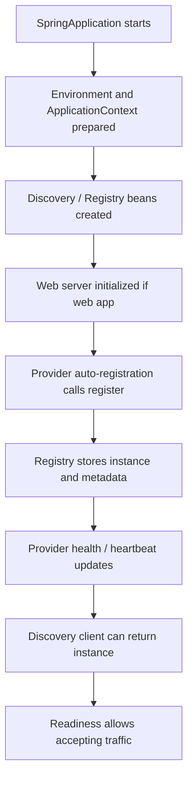
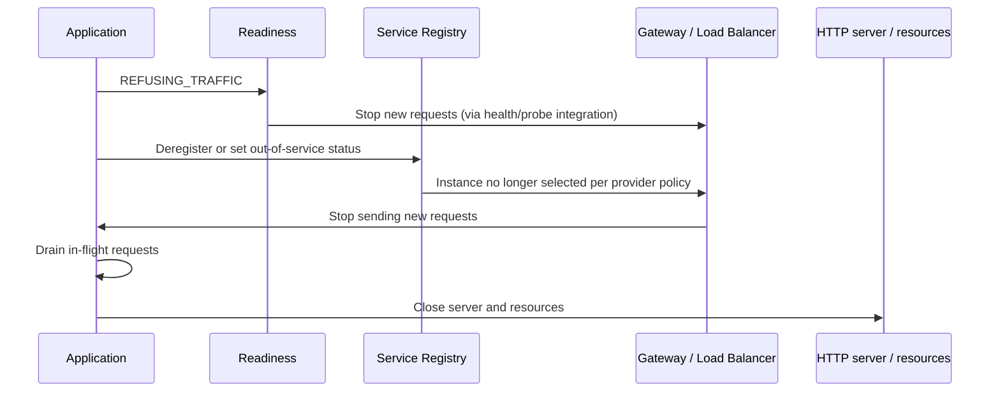

# Distinguishing Application State from Service Registration State

In distributed systems, an instance may have finished starting up yet not be ready to receive requests; another instance may already be written into the service registry while failing its database connection; or an application may be ready while the registry still holds a stale record. These situations arise because **application state** and **service registration state** are two related yet independent concepts.

Spring Boot provides `ApplicationAvailability` along with liveness/readiness states to represent whether the application is alive and able to accept traffic. Spring Cloud Commons provides abstractions such as `ServiceRegistry`, `Registration`, and `DiscoveryClient` to register, deregister, and locate service instances. The registry may store its own instance status; discovery clients and load balancers apply their own instance selection rules.

For **SPRING_CLOUD_CORE**, understanding these boundaries clearly enables safe operation of discovery, service registries, service communication, and health checks. This lesson belongs to the **Application Lifecycle** chapter, focusing on coordinating application availability with registration and routability in distributed systems.

## 1. Learning Objectives

After this lesson, you will be able to:

- Distinguish between liveness, readiness, registration, discovery, and request routability.
- Read application state via `ApplicationAvailability`.
- Explain the roles of `LivenessState` and `ReadinessState`.
- Describe the contracts of `ServiceRegistry`, `Registration`, and `DiscoveryClient`.
- Recognize when auto-registration typically occurs and why it depends on the provider.
- Explain why an instance can be registered yet not ready.
- Distinguish application health checks from the health/status used by the registry.
- Design startup, shutdown, graceful draining, and deregistration.
- Configure health probes for container/Kubernetes environments.
- Test state combinations and diagnose stale registrations.

## 2. Two Different State Dimensions

A system must answer at least two questions:

1. **Is the application running and ready to process work?** This is Spring Boot availability.
2. **Is the instance advertised in the discovery/registry system and selectable for calls?** This is service registration/discovery.

These two questions are related, not identical.

| Concept | Primary owner | Meaning |
| --- | --- | --- |
| Liveness | Spring Boot / application health | Is the process alive and able to keep running? |
| Readiness | Spring Boot / application health | Is the instance ready to accept traffic? |
| Registration | Service registry adapter / provider | Has the instance been advertised to the registry? |
| Discovery | `DiscoveryClient` and registry | Can clients find the instance by service ID? |
| Routability | Load balancer, gateway, network, and provider | Is the instance actually selected and able to receive requests? |

An instance should receive traffic only when the required conditions are satisfied together. Having a registry entry does not prove the process is healthy; having `LivenessState.CORRECT` also does not prove the instance registered successfully.

### 2.1. Matrix of Common State Combinations

| Application state | Registry state | Operational meaning |
| --- | --- | --- |
| Not ready | Not registered | Normal during part of startup |
| Not ready | Registered | Can happen when auto-registration finishes before startup checks or when the registry ignores application readiness |
| Ready | Registered and returned by discovery | Desired state for serving traffic |
| Ready | Not registered | Application can serve internally, but discovery clients cannot find the instance |
| Not ready | Still returned by discovery | Instance must be excluded from traffic via readiness/registry/provider policy |
| Stopped | Registry still holds entry | Stale registration; requires deregistration, lease expiry, or health check removal |

Key point: **readiness does not automatically synchronize with registry status across every provider**. The degree of coupling depends on the discovery implementation and how the platform consumes health information.

## 3. Application State in Spring Boot

Spring Boot represents availability through these types:

- `ApplicationAvailability`: interface to query the current state.
- `AvailabilityState`: marker/common contract for an availability state.
- `LivenessState`: whether the application is alive or in a broken state.
- `ReadinessState`: whether the application is accepting traffic.
- `AvailabilityChangeEvent`: event notifying of state changes.

You can inject `ApplicationAvailability`:

```java
@Component
public class AvailabilityReporter {

    private final ApplicationAvailability availability;

    public AvailabilityReporter(ApplicationAvailability availability) {
        this.availability = availability;
    }

    public void report() {
        LivenessState liveness = availability.getLivenessState();
        ReadinessState readiness = availability.getReadinessState();

        // Report the states through a safe metric or diagnostic.
    }
}
```

### 3.1. LivenessState

`LivenessState` has two main values:

| Value | Meaning |
| --- | --- |
| `CORRECT` | Application is considered alive |
| `BROKEN` | Application is in a state where normal operation cannot continue |

Liveness answers the question: **should this process be kept running?**

If the liveness probe fails in Kubernetes, kubelet may restart the container per its restart policy. Therefore, do not put every transient dependency failure into liveness. For example, a brief database connection drop does not necessarily mean the JVM is broken and needs an immediate restart.

### 3.2. ReadinessState

`ReadinessState` has two main values:

| Value | Meaning |
| --- | --- |
| `ACCEPTING_TRAFFIC` | Application is ready to receive requests |
| `REFUSING_TRAFFIC` | Application is not ready or is stopping traffic intake |

Readiness answers the question: **should new requests be routed to this instance?**

Readiness can transition from `REFUSING_TRAFFIC` to `ACCEPTING_TRAFFIC` after mandatory initialization steps finish. During shutdown or when the application needs to withdraw from traffic, the state can transition back.

### 3.3. ApplicationReadyEvent Is Not a Registration Event

`ApplicationReadyEvent` indicates that Spring Boot startup has completed, including `ApplicationRunner` and `CommandLineRunner`. It does not mean:

- The service registry definitely received the registration.
- The registry updated health status.
- All discovery clients already see the instance.
- Load balancers already select the instance.
- Downstream services are ready.

Similarly, a registration event from a provider does not prove application readiness has transitioned to `ACCEPTING_TRAFFIC`.

## 4. Changing Availability via AvailabilityChangeEvent

An application can publish `AvailabilityChangeEvent` to change availability state:

```java
AvailabilityChangeEvent.publish(
        applicationContext,
        ReadinessState.REFUSING_TRAFFIC);
```

When serving conditions are restored:

```java
AvailabilityChangeEvent.publish(
        applicationContext,
        ReadinessState.ACCEPTING_TRAFFIC);
```

For liveness state, transition to `BROKEN` only when the application genuinely cannot continue operating per defined policy. Do not use `BROKEN` as a way to temporarily remove an instance from traffic; that purpose belongs to readiness.

### 4.1. Who Should Publish Availability Events?

A startup coordinator component may publish readiness state after finishing mandatory checks. A shutdown management component may transition to `REFUSING_TRAFFIC` before stopping request intake.

Example:

```java
@Component
public class StartupChecks implements ApplicationRunner {

    @Override
    public void run(ApplicationArguments args) {
        // Complete checks that must succeed before the application is ready.
        // Throw an exception if a mandatory check fails.
    }
}
```

Spring Boot automatically switches readiness to `ACCEPTING_TRAFFIC` after startup and all runners complete. A runner should perform mandatory checks and throw an exception if they fail; do not manually mark accepting inside the first runner because other runners may not have run yet. Publish state proactively only when the application has custom readiness conditions coordinated explicitly with the default lifecycle.

## 5. Health Probes and Actuator

Spring Boot Actuator can expose health groups for liveness and readiness:

- `/actuator/health/liveness`
- `/actuator/health/readiness`

When running on Kubernetes, Spring Boot can auto-configure availability health groups upon detecting a Kubernetes environment; you can also enable them explicitly:

```yaml
management:
  endpoint:
    health:
      probes:
        enabled: true
  endpoints:
    web:
      exposure:
        include: health
```

These two endpoints reflect availability states through health status. Actual paths depend on the management base path and Actuator configuration.

### 5.1. Liveness Probe

Liveness should reflect the application's own ability to continue running. Avoid including databases, Config Server, or service registries in liveness if dependency failures can be transient. If liveness fails because of an external dependency, the orchestrator may restart instances en masse while the real issue lies in that dependency.

### 5.2. Readiness Probe

Readiness should reflect an instance's ability to serve new requests. It can include essential prerequisites needed for safe request handling, though be cautious when adding shared dependencies to readiness:

- If a shared dependency fails, every instance may become not ready simultaneously.
- When all instances drop out of traffic together, the system has nowhere to route requests.
- If a dependency still permits degraded operation, readiness does not necessarily have to fail.

Add a health indicator to the readiness group only when that dependency's unavailability truly means the instance cannot serve requests.

Example health group configuration:

```yaml
management:
  endpoint:
    health:
      group:
        readiness:
          include: readinessState,db
```

This is only an example; `db` requires a corresponding health indicator and including it in readiness must match business policy.

### 5.3. Startup Probe

Kubernetes startup probes are helpful when applications need long startup times. While the startup probe has not yet succeeded, kubelet can delay applying liveness/readiness probes as configured. Startup probes are a container platform mechanism; they do not replace `LivenessState` or `ReadinessState` inside Spring.

## 6. ServiceRegistry and Registration in Spring Cloud

Spring Cloud Commons defines abstractions so applications work with a service registry without coupling directly to a single provider.

### 6.1. Registration

`Registration` represents information about a registered service instance. Typical fields include:

- Service ID or service name.
- Host.
- Port.
- Secure connection flag.
- Additional metadata.

Exact details and how metadata is interpreted depend on the implementation. For example, Eureka, Consul, and Kubernetes have different registration and health models.

### 6.2. ServiceRegistry

`ServiceRegistry<R extends Registration>` defines common operations:

```java
public interface ServiceRegistry<R extends Registration> {
    void register(R registration);
    void deregister(R registration);
    void close();
    void setStatus(R registration, Object status);
    Object getStatus(R registration);
}
```

Operation meanings:

| API | Meaning |
| --- | --- |
| `register(registration)` | Registers the instance with the provider |
| `deregister(registration)` | Deregisters the instance |
| `setStatus(registration, status)` | Updates status as supported by the provider |
| `getStatus(registration)` | Reads the registration status |
| `close()` | Closes resources/registration per implementation |

`status` is `Object` because providers have different status sets and representations. Do not assume strings `"UP"` or `"OUT_OF_SERVICE"` carry identical meaning across all registries.

### 6.3. DiscoveryClient

`DiscoveryClient` provides instance lookup by service ID:

```java
List<ServiceInstance> instances =
        discoveryClient.getInstances("inventory-service");
```

The result contains the instances returned by the discovery implementation at query time. It is not necessarily a list of every process running on the network; the provider may filter by health, status, lease, namespace, or custom policies.

### 6.4. AutoServiceRegistration

Spring Cloud Commons provides the `AutoServiceRegistration` abstraction and an auto-registration mechanism so providers automatically register the instance during the application lifecycle when enabled.

In typical configurations, the provider's starter handles service registration automatically. Avoid writing an extra manual `ServiceRegistry.register(...)` call unless specifically required, as it can create duplicate registrations, mismatched metadata, or inconsistent lifecycles.

To disable auto-registration, Spring Cloud Commons provides the property:

```yaml
spring:
  cloud:
    service-registry:
      auto-registration:
        enabled: false
```

Verify exact property names and behavior against your active release train and provider.

## 7. When Does Registration Happen?

There is no single timing applicable to every registry. Several common Spring Cloud auto-registration implementations tie registration to the web server initialization event, such as `WebServerInitializedEvent`. Other providers may use a different lifecycle hook or callback.

Common general flow:



The diagram illustrates a common flow, not a mandatory ordering contract. A provider may register earlier, later, or rely on health checks to advertise an instance only after other conditions are met.

### 7.1. Why Can Registration Occur Before Readiness?

Auto-registration can run once the web server has a host/port, while the application is still executing startup checks or runners. Hence, the registry may already contain the instance before Spring Boot publishes `ApplicationReadyEvent`.

This is not necessarily a bug. What matters is that routing has a mechanism to filter out unready instances:

- The registry/provider maintains its own health status.
- Discovery clients filter instances by status.
- Kubernetes Services select only endpoints passing readiness.
- Gateways or load balancers run their own health checks.

Without any linking mechanism, a registered instance could receive requests prematurely.

### 7.2. Do Not Treat ApplicationReadyEvent as a Registration Contract

Do not assume every provider registers strictly at `ApplicationReadyEvent`. If the application needs tight control over "ready first, then register", design provider lifecycle integration deliberately and test against the real provider. With default auto-registration, understand the timing and health behavior of the active adapter.

## 8. Registry Status Is Not ReadinessState

A registry may store statuses such as `UP`, `DOWN`, `OUT_OF_SERVICE`, health check status, or leases. These statuses belong to the provider's model.

| Status | Source | Meaning |
| --- | --- | --- |
| `ReadinessState.ACCEPTING_TRAFFIC` | Spring Boot | Application is ready for traffic per internal evaluation |
| `ReadinessState.REFUSING_TRAFFIC` | Spring Boot | Application refuses new traffic |
| `LivenessState.CORRECT` | Spring Boot | Application is alive |
| `UP` | Example Eureka/provider status | Registry considers the instance active |
| `OUT_OF_SERVICE` | Example Eureka/provider status | Instance is taken out of service per provider semantics |
| Health check passing | Example Consul | Consul-managed health check is passing |
| Endpoint ready | Kubernetes | Pod/endpoint qualifies for Service routing per readiness |

Do not convert these values mechanically. For example, `ReadinessState.REFUSING_TRAFFIC` does not automatically invoke `ServiceRegistry.setStatus(..., OUT_OF_SERVICE)` unless the application or provider adapter explicitly integrates them.

## 9. Coordinating Readiness and Registry on Startup

A safe startup typically includes these steps:

1. Load configuration and validate required properties.
2. Instantiate beans and connect essential resources.
3. Start the web server and background components.
4. Register the instance according to the provider's lifecycle.
5. Wait for required startup checks to complete.
6. Transition readiness to `ACCEPTING_TRAFFIC`.
7. Ensure gateways/load balancers/providers route traffic only to eligible instances.

The exact order between step 4 and step 5 depends on the provider and application design. Two common strategies exist:

### 9.1. Register Early, Provider Filters Health

The instance registers as soon as the web server is ready. Provider health checks or status updates determine when the instance is deemed healthy/discoverable.

Suitable when the registry has reliable health checks and clear status updates. Ensure health checks do not mark the instance healthy before the application is genuinely ready.

### 9.2. Advertise Instance Only After Startup Checks

The application defers registration or keeps the instance in an out-of-service state until mandatory checks pass.

Suitable when the provider supports explicit lifecycle/status control. Handle the case where registration fails after the application is otherwise ready: readiness must reflect whether the instance is discoverable/routable as required.

### 9.3. Rules for Distributed Applications

If a service can only serve traffic once registered successfully, registration status must be part of the readiness condition. If the application can still serve via another path—such as direct ingress or static routing—do not blindly treat registration failure as making the entire application unready.

Readiness is a decision based on actual serving capability, not a mirror of registry state.

## 10. Coordinating Shutdown and Graceful Draining

Safe shutdown must prevent new requests before closing resources still used by active requests.

A conceptual sequence:



This is the operationally desired sequence. Actual mechanics depend on registry update propagation, health probes, load balancers, and server graceful shutdown.

### 10.1. Readiness Must Drop Before the Process Disappears

If the process exits immediately without draining time, the registry or load balancer may retain the instance for some period. Requests still arriving may hit connection resets or timeouts.

Therefore, the shutdown procedure should:

- Transition readiness to `REFUSING_TRAFFIC`.
- Stop accepting new requests.
- Deregister or update status per provider.
- Wait an appropriate propagation and drain interval.
- Close the web server, connection pools, and resources.

No single wait duration fits every system. Measure real propagation delays and configure a sufficiently large termination grace period.

### 10.2. Spring Boot Graceful Shutdown

Spring Boot supports graceful shutdown for embedded web servers. Configure:

```yaml
server:
  shutdown: graceful

spring:
  lifecycle:
    timeout-per-shutdown-phase: 30s
```

Graceful shutdown lets the server stop accepting new requests and gives in-flight requests time to complete per server capabilities. It does not guarantee every service registry removes the registration immediately; verify the adapter and orchestration.

### 10.3. Kubernetes Termination

In Kubernetes, when a Pod terminates, EndpointSlice/Service routing needs time to update. `terminationGracePeriodSeconds`, `preStop` hooks, readiness probes, and graceful server shutdown must be designed cohesively.

Do not assume a readiness change instantly removes the Pod from all active connections. Already-sent requests or keep-alive connections may remain active; the application must support proper draining.

## 11. Common Mismatch Scenarios

### 11.1. Registered but Not Ready

Scenario:

- Web server opened its port.
- Provider auto-registration sent the instance to the registry.
- `ApplicationRunner` is still warming up caches.
- Registry returns the instance to clients.

Consequence: requests may reach the instance before caches or essential dependencies are ready.

Remediation: use readiness health checks, provider health status, or delay advertising the instance according to provider capabilities. Never rely on "registration exists" to conclude the application is ready.

### 11.2. Ready but Not Registered

Scenario:

- Spring Boot finishes startup.
- Readiness is `ACCEPTING_TRAFFIC`.
- Consul/Eureka registration fails due to network or credentials.

Consequence: local health endpoint returns healthy, yet discovery clients cannot locate the instance.

Remediation: if discovery is a mandatory serving path, include registration status in the readiness policy or fail startup as required. If registration is secondary, report the failure via metrics/alerts without necessarily marking the entire app unready.

### 11.3. Not Ready Yet Registry Still Returns Instance

Scenario:

- Application transitions to `ReadinessState.REFUSING_TRAFFIC`.
- Registry does not receive a status update or does not use the readiness probe.
- `DiscoveryClient` still returns the instance.

Consequence: load balancers may keep selecting the instance.

Remediation: link readiness to provider health/status or gateway filtering. Test actual provider behavior; never assume `ApplicationAvailability` automatically synchronizes with the registry.

### 11.4. Process Died but Registration Remains

Scenario:

- JVM received `kill -9` or node lost network connectivity.
- No deregistration callback ran.
- Registry retains the old registration until heartbeat/lease/health check expiration.

Remediation: configure appropriate heartbeat/lease/health check intervals, dead-instance detection timeouts, and stale registration alerts. Graceful shutdown handles only controlled stops; it cannot handle sudden crashes.

## 12. Differences by Provider

Spring Cloud Commons offers shared abstractions, while providers have distinct semantics.

| Provider/platform | Common registration/health mechanism | What to verify |
| --- | --- | --- |
| Eureka | Instance registration, heartbeats, and statuses like `UP`/`OUT_OF_SERVICE` | Lease expiration, health check integration, metadata, and status overrides |
| Consul | Service registration with health checks or TTL checks | Passing/critical status, deregistration behavior, check interval, and TTL |
| Kubernetes | Service/Pod/EndpointSlice, readiness probe controls eligible endpoints | Pod readiness, selectors, endpoint propagation, termination behavior |
| Custom registry | Per adapter API and policy | Register/deregister flow, heartbeats, health, and instance filtering |

Avoid coupling application logic directly to a provider's status strings when shared abstractions suffice. When provider-specific actions are needed, isolate them inside an adapter and test those exact semantics.

## 13. Testing Availability and Registration

A strong test suite must verify both state dimensions.

### 13.1. Testing ApplicationAvailability

Query the states:

```java
LivenessState liveness =
        applicationAvailability.getLivenessState();

ReadinessState readiness =
        applicationAvailability.getReadinessState();
```

Test transitions:

- After successful startup, liveness is `CORRECT`.
- Before becoming ready, readiness is `REFUSING_TRAFFIC` if the application explicitly holds this state.
- After startup checks, readiness transitions to `ACCEPTING_TRAFFIC`.
- When draining starts, readiness transitions back to `REFUSING_TRAFFIC`.

Initial state and event timing can depend on Spring Boot lifecycle; tests should assert milestones the application guarantees rather than hard-coding assumptions prior to context startup.

### 13.2. Testing ServiceRegistry

For a registry adapter, verify:

- `register` supplies the expected service ID, host, port, and metadata.
- `getStatus` reflects the expected provider status.
- `setStatus` updates status per provider semantics.
- `deregister` removes the instance from the registry.
- Registration failures follow startup/readiness policy.
- Ungraceful crashes are detected via heartbeats/leases/health checks.

Unit tests may mock `ServiceRegistry`; integration tests should run against the real provider or appropriate test containers to verify propagation and discovery.

### 13.3. Testing DiscoveryClient

Verify:

```java
List<ServiceInstance> instances =
        discoveryClient.getInstances("inventory-service");
```

Cases to include:

- Registered and healthy instances appear in results.
- `OUT_OF_SERVICE` or health-check-failing instances are filtered out if the provider has those semantics.
- Deregistered instances disappear after the expected propagation window.
- When the registry is unavailable, the application handles discovery errors using designed timeouts/fallbacks.

Do not assume every provider filters status identically; tie tests to the actual provider.

### 13.4. Combined Test Matrix

| Application readiness | Registration | Expectation |
| --- | --- | --- |
| Refusing traffic | Not registered | Must not receive traffic |
| Refusing traffic | Registered | Provider/gateway must filter out or keep out-of-service status |
| Accepting traffic | Registered | Can serve if health/discovery/network all pass |
| Accepting traffic | Registration failed | Alert; readiness depends on whether registration is mandatory |
| Refusing traffic on shutdown | Deregistering | Stops new requests; drains active requests |
| Process crash | Stale registration | Heartbeat/lease/health check must evict instance after timeout |

## 14. Observability and Operations

To diagnose why an instance is not receiving traffic, inspect layer by layer:

1. **Process:** is the JVM/container still running?
2. **Liveness:** is `/actuator/health/liveness` passing?
3. **Readiness:** is `/actuator/health/readiness` `UP`?
4. **Registration:** did the provider receive the instance with the expected service ID/host/port?
5. **Registry health/status:** is the instance in a serving status?
6. **Discovery:** does `DiscoveryClient` return the instance for the service ID?
7. **Load balancer:** is the instance being selected?
8. **Network:** is connectivity to host/port open?
9. **Application logs:** are there startup check, registration, heartbeat, or deregistration errors?

### 14.1. Metrics to Monitor

- Current availability states.
- Readiness state transition count.
- Time from process start to readiness accepting traffic.
- Time from startup to successful registration.
- Registration and deregistration failure counts.
- Instance count returned by discovery per service ID.
- Propagation time when status changes.
- Requests sent to unready or draining instances.

Do not log secrets, credentials, or sensitive registration metadata. Log only essential identifiers such as service ID, instance ID, permitted host/port, and status.

## 15. Example Startup/Shutdown Workflow for checkout-service

Suppose `checkout-service` depends on Config Server, a registry, and `inventory-service`.

### 15.1. Startup

```text
1. Load application configuration and Config Server.
2. Validate endpoints, timeouts, and credential references.
3. Instantiate beans and initialize essential resources.
4. Start web server.
5. Provider executes auto-registration per its lifecycle.
6. Check registry/discovery if mandatory.
7. Warm up required data/caches.
8. Transition ReadinessState to ACCEPTING_TRAFFIC.
9. Gateway/load balancer routes requests only to eligible instances.
```

The actual order between registration and startup checks may vary. If the provider registers early, health filtering is required; if the application requires registration before readiness, verify registration succeeded before transitioning readiness.

### 15.2. Shutdown

```text
1. Transition readiness to REFUSING_TRAFFIC.
2. Provider/gateway stops selecting the instance for new requests.
3. Deregister or set out-of-service status per provider.
4. Wait for propagation and drain in-flight requests.
5. Gracefully stop web server.
6. Close clients, pools, executors, and resources.
```

On an abrupt crash, steps 1–6 may not run; heartbeats, leases, or health checks must detect stale registrations.

## 16. Design Principles

- Use liveness to reflect ability to continue running; use readiness to govern traffic intake.
- Do not treat `ApplicationReadyEvent` as proof of successful registration.
- Do not treat an existing registration as proof the instance is healthy.
- Understand provider status semantics before calling `ServiceRegistry.setStatus`.
- Avoid manual registration if auto-registration already manages the lifecycle.
- If registration is mandatory for serving, include it explicitly in readiness policy.
- Ensure providers/gateways actually filter out unready instances.
- Switch readiness to refusing before shutdown and drain requests.
- Rely on heartbeats/leases/health checks to handle ungraceful crashes.
- Test registration, discovery, and deregistration milestones against the real provider.
- Monitor application state, registry state, and load balancer state as three distinct layers.

## 17. Summary

Application state and service registration state describe two different aspects. Spring Boot uses `LivenessState` and `ReadinessState` to represent whether the application is alive and ready to accept traffic. Spring Cloud Commons uses `ServiceRegistry`, `Registration`, and `DiscoveryClient` to register, deregister, and locate service instances.

An instance can be registered yet unready, ready yet unregistered, or stopped while its registration remains until heartbeats/leases expire. Therefore, readiness must connect to the appropriate routing mechanism; registry status and health checks must be understood according to provider semantics.

During startup, ensure required configuration and dependencies are ready before permitting traffic. During shutdown, switch readiness to refusing, stop new requests, deregister or update status, drain requests, and only then close resources. Testing availability, registration, discovery, and load balancing separately helps catch state mismatches early in distributed systems.

## 18. References

- [Spring Boot Reference — Application Availability](https://docs.spring.io/spring-boot/reference/features/spring-application.html#features.spring-application.application-availability)
- [Spring Boot Reference — Kubernetes Probes](https://docs.spring.io/spring-boot/reference/actuator/endpoints.html#actuator.endpoints.kubernetes-probes)
- [Spring Boot Reference — Graceful Shutdown](https://docs.spring.io/spring-boot/reference/web/graceful-shutdown.html)
- [Spring Boot Actuator — Health Groups](https://docs.spring.io/spring-boot/reference/actuator/endpoints.html#actuator.endpoints.health)
- [Spring Cloud Commons — ServiceRegistry and DiscoveryClient](https://docs.spring.io/spring-cloud-commons/reference/spring-cloud-commons/common-abstractions.html)
- [Spring Cloud Commons — Service Registration and Discovery](https://docs.spring.io/spring-cloud-commons/reference/spring-cloud-commons/service-registry.html)
- [Spring Cloud Commons API — ServiceRegistry](https://docs.spring.io/spring-cloud-commons/docs/current/javadoc-api/org/springframework/cloud/client/serviceregistry/ServiceRegistry.html)
- [Spring Cloud Commons API — Registration](https://docs.spring.io/spring-cloud-commons/docs/current/javadoc-api/org/springframework/cloud/client/serviceregistry/Registration.html)
