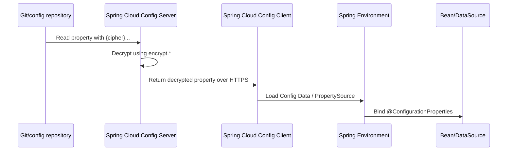
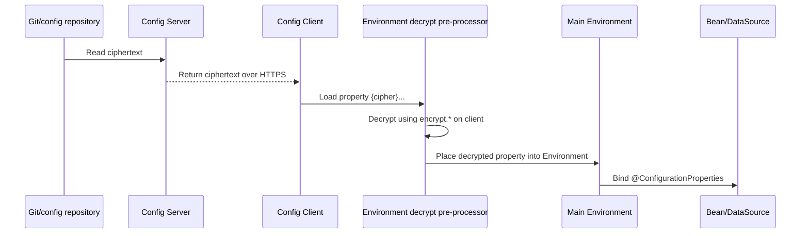
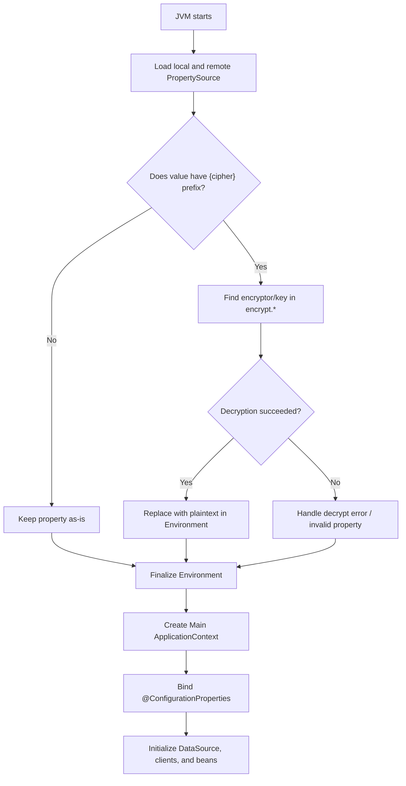

# {cipher}-Prefixed Values and Decryption Before Bean Creation

## 1. The Problem: Storing Secret Configurations as Ciphertext

Spring Boot/Spring Cloud applications often require sensitive values such as database passwords, API tokens, client secrets, or credentials to connect to a message broker. If these values are stored directly in configuration files managed by Git, anyone with read access to the repository can also read the secrets.

Spring Cloud Config supports encrypting configuration values. Encrypted values are stored as ciphertext and marked with the **{cipher}** prefix. When configuration is loaded, Spring Cloud can decrypt the values before the main application creates beans and binds properties.

Example of a configuration file in the repository:

```yaml
spring:
  datasource:
    username: order_app
    password: '{cipher}BASE64_CIPHERTEXT_PLACEHOLDER'

app:
  partner:
    api-token: '{cipher}ANOTHER_CIPHERTEXT_PLACEHOLDER'
```

The strings after {cipher} in the example are only placeholders, not usable ciphertext. When the application receives the decrypted configuration, code can read properties normally via Environment or bind them using @ConfigurationProperties. Beans do not need to call a decrypt function themselves if decryption is properly configured at the Spring Cloud layer.

This lesson belongs to the **Configuration Encryption** chapter of **SPRING_CLOUD_CORE**. The focus is on understanding the meaning of the {cipher} marker, distinguishing between Config Server decryption and client-side decryption, and tracing the sequence from loading properties to Spring creating beans.

## 2. {cipher} Is a Marker, Not an Encryption Algorithm

{cipher} is a prefix indicating that the following property value is encrypted data. It does not contain the key itself, does not fully specify the algorithm, and does not replace TLS or authentication.

A property can be stored as follows:

```yaml
spring:
  datasource:
    password: '{cipher}ENCRYPTED_VALUE'
```

Where:

- {cipher} is the marker for the decryption mechanism to recognize values that need processing.
- ENCRYPTED_VALUE is the ciphertext generated from the plaintext and the corresponding key.
- The key or keystore is configured separately using encrypt.* properties.
- After successful decryption, the plaintext value is placed into the property source/Environment according to the chosen flow.

**Do not place plaintext alongside ciphertext in the same repository just as a fallback.** If decryption fails, the application may pick up a value with the same key from a lower-precedence property source or start up with an unintended configuration. Required secrets should be explicitly validated, and the application should fail fast when they are missing or invalid.

### 2.1. Writing Syntax in YAML and Properties Files

In YAML, values containing curly braces should be enclosed in single quotes:

```yaml
spring:
  datasource:
    password: '{cipher}ENCRYPTED_VALUE'
```

Single quotes make the YAML parser treat the entire value as a scalar. If quotes are omitted, the string may be interpreted as flow collection syntax depending on position and content.

In a Java Properties file, an encrypted value **must not be wrapped in quotes**:

```properties
spring.datasource.username=order_app
spring.datasource.password={cipher}ENCRYPTED_VALUE
```

According to the Spring Cloud Config documentation, if an encrypted value in a Properties file is wrapped in quotes, the value will not be decrypted as intended. Follow the exact syntax rules of each file format.

## 3. Two Possible Decryption Locations

Spring Cloud Config supports two models. You must choose a model explicitly because it determines where the private key or symmetric key is held.

### 3.1. Decryption at the Config Server — Default

In the typical flow, the configuration repository stores only ciphertext. Config Server reads the property sources, detects values starting with {cipher}, and decrypts them **before sending the HTTP response to the Config Client**.



Characteristics:

- Secrets at rest in the repository are ciphertext.
- Config Server holds the decryption key or private key.
- Clients receive plaintext over an HTTP channel protected by TLS and an appropriate authentication mechanism.
- Clients do not need to hold the decryption key merely to read properties already decrypted by the server.
- Access control to Config Server becomes a critical security boundary because responses can contain plaintext.

This model is suitable when you want centralized key management without distributing private keys to every application. However, you must secure Config Server, configuration endpoints, logs, traces, caches, and network transport.

### 3.2. Decryption at the Client — Optional

Some architectures require Config Server to distribute only ciphertext. In that case, Config Server does not decrypt outgoing properties; each client receives the ciphertext and decrypts it locally while preparing the Environment.

Configuration on Config Server:

```yaml
spring:
  cloud:
    config:
      server:
        encrypt:
          enabled: false
```

In legacy bootstrap mode, the Spring Cloud Config documentation requires placing this property in bootstrap.yml or bootstrap.properties of **Config Server**, so that it takes effect during the bootstrap phase. Verify that the property resides on the server serving the clients and do not confuse it with the Config Client's own bootstrap configuration.

When choosing this model, the client application needs the required encryption library and the decryption key configured via encrypt.*. Spring Cloud provides an Environment pre-processor to decrypt {cipher}* properties **before the main application context receives the Environment**.



In this model, the private key or symmetric key is provisioned to each client that needs to decrypt. It avoids having Config Server hold decryption keys, but increases the scope of key distribution and operations. Provision private keys only to the appropriate clients, manage file/secret permissions, and establish a rotation process for each application group.

**Do not confuse the two flows:** by default, server-side decryption returns plaintext to the client; client-side decryption requires disabling outgoing decryption on the server and configuring decryption on the client.

## 4. The Decryption Process Before Bean Creation

When using the local Environment pre-processor, the high-level processing order is as follows:

1. The JVM starts and Spring Boot begins loading configuration sources.
2. Spring Cloud bootstrap/Environment processing loads external property sources.
3. The decrypt pre-processor looks for property values with the {cipher} marker.
4. The encryption mechanism obtains the appropriate encryptor from the encrypt.* configuration.
5. The ciphertext is decrypted into plaintext.
6. The Environment holds the decrypted value.
7. The Main ApplicationContext continues refreshing and creates beans.
8. @ConfigurationProperties and auto-configuration read values from the Environment.

Simplified diagram:



Example of typed configuration:

```java
@ConfigurationProperties(prefix = "spring.datasource")
public record DatabaseCredentials(
        String username,
        String password
) {
}
```

Another component can read the same property using @Value:

```java
import org.springframework.beans.factory.annotation.Value;
import org.springframework.stereotype.Component;

@Component
public class DatabaseSecretConsumer {

    private final String password;

    public DatabaseSecretConsumer(
            @Value("${spring.datasource.password}") String password) {
        this.password = password;
    }
}
```

In both examples, the injected value is the Environment value resolved after the corresponding decrypt step. Do not log or expose the password field.

If decryption is set up properly, the password field receives the plaintext value. You do not need to call decrypt again manually; decrypting a second time can corrupt the data and introduce extra secret-handling points in code.

The key takeaway is that **decryption occurs during the Environment processing phase, before the main context creates beans**. If the decryption configuration is wrong, an error may appear immediately at startup or cause the property to lack a valid value when the binder creates beans.

## 5. Preparing Dependencies for Client-Side Decryption

According to the Spring Cloud Context documentation, an application needs the **Spring Security RSA** library on the classpath to use local decryption:

```xml
<dependency>
    <groupId>org.springframework.security</groupId>
    <artifactId>spring-security-rsa</artifactId>
</dependency>
```

Manage the version through Spring Cloud/Boot dependency management compatible with the release train in use; do not pick an arbitrary version for the cryptography library.

If you only use Config Server to decrypt on the server, the cryptography dependency on the client may not be necessary solely to receive plaintext properties. The server must have the dependency and encryptor configuration matching the chosen key type.

With modern Java runtimes, check the algorithm and key-length capabilities supported by your JDK. Illegal key size errors usually relate to cryptographic policies or providers not supporting the requested key length; do not copy legacy JCE installation instructions across all JDKs. Verify the actual provider, Java version, and algorithm before modifying the runtime.

## 6. Symmetric Key Management

A symmetric key uses the same secret to encrypt and decrypt. Spring Cloud Config allows configuring the key via the encrypt.key property.

Example on Config Server:

```yaml
encrypt:
  key: ${ENCRYPT_KEY}
```

You can supply the value via the ENCRYPT_KEY environment variable to avoid writing the key directly into the configuration file. The example above only illustrates the variable name; do not put real keys in source code, shell scripts committed to Git, Dockerfiles, or public configuration files. In production, supply variables/secrets from a secret manager or the platform's secret management mechanism, restrict read permissions, and avoid printing the value to logs.

When legacy bootstrap mode is enabled on Config Server via spring-cloud-starter-bootstrap or spring.cloud.bootstrap.enabled=true, the documentation requires placing encrypt.key in Config Server's bootstrap.properties so the key is available during the bootstrap phase.

The advantage of a symmetric key is simple configuration. The disadvantage is that any component that needs to decrypt must possess the same secret. If the same key is given to multiple clients, a single compromised client can expose the ability to decrypt all data sharing that key.

## 7. Asymmetric Key Management with an RSA Keystore

With asymmetric encryption, the public key is used to encrypt and the private key is used to decrypt. This separates encryption privileges from decryption privileges:

- Config Server only needs the public key if it only encrypts values.
- The component performing decryption must have the corresponding private key.
- If Config Server decrypts before returning to clients, the server must have the private key.
- If clients decrypt locally, clients need the private key and Config Server may hold only the public key.

Spring Cloud Config supports configuring a keystore via the encrypt.keyStore.* properties:

| Property | Meaning |
| --- | --- |
| encrypt.keyStore.location | Location of the resource containing the keystore |
| encrypt.keyStore.password | Password to open the keystore |
| encrypt.keyStore.alias | Alias of the key to use |
| encrypt.keyStore.type | Keystore type; default is jks |
| encrypt.keyStore.secret | Key entry secret when it needs to be separated from the store password |

Illustrative configuration example with PKCS12:

```yaml
encrypt:
  key-store:
    location: file:/run/secrets/config-encryption.p12
    password: ${CONFIG_KEYSTORE_PASSWORD}
    alias: config-encryption
    secret: ${CONFIG_KEY_PASSWORD}
    type: PKCS12
```

A keystore should not be baked into an image if it contains a private key. Mount the file with minimal read permissions or retrieve it from a secret manager; protect both the keystore password and key password. Using asymmetric encryption does not eliminate the need to protect the private key.

### 7.1. Creating a Keystore for Testing Only

You can generate a test key pair using the JDK's keytool:

```bash
keytool -genkeypair \
  -alias config-encryption \
  -keyalg RSA \
  -keysize 3072 \
  -storetype PKCS12 \
  -keystore config-encryption.p12 \
  -storepass TEST_STORE_PASSWORD \
  -keypass TEST_KEY_PASSWORD \
  -dname "CN=Config Encryption Test"
```

This is an example for a learning environment. Use test passwords that are never reused in production; keep the keystore file outside the repository and do not send private keys over chat, tickets, or logs. With PKCS12 on newer JDKs, note that some providers require the store password and key password to be identical.

## 8. Encrypting Properties via the /encrypt Endpoint

Config Server provides an HTTP /encrypt endpoint to encrypt plaintext into ciphertext. This endpoint must be protected and restricted to authorized actors only.

Illustrative example with a dummy value:

```bash
curl -s \
  -H "Content-Type: text/plain" \
  --data-binary "sample-value-for-local-test" \
  http://localhost:8888/encrypt
```

The response is ciphertext. When writing it into a YAML file, add the {cipher} marker:

```yaml
spring:
  datasource:
    password: '{cipher}<ciphertext-returned-by-encrypt-endpoint>'
```

The /decrypt endpoint is the reverse test if the server is configured with a symmetric key or a full key pair:

```bash
curl -s \
  -H "Content-Type: text/plain" \
  --data-binary "<ciphertext-without-cipher-prefix>" \
  http://localhost:8888/decrypt
```

Certain characters such as the plus sign (+) may be treated as form encoding if the body is not sent properly. When using curl to test data containing special characters, the Spring Cloud documentation recommends using --data-urlencode with a value prefixed by = or setting Content-Type: text/plain to ensure the body is encoded accurately.

Do not pass real passwords/tokens directly on the command line if shell history, process lists, or terminal logs can retain them. Use a secret file/secret manager and an appropriately secured client for operational workflows.

## 9. Decryption Errors and Invalid Properties

If Config Server cannot decrypt a value, the server should not return the ciphertext under the exact secret key as if it were plaintext. Instead, the response creates a property with an invalid-prefixed name, typically with the value <n/a>.

Illustrative response example:

```json
{
  "propertySources": [
    {
      "name": "application-prod.yml",
      "source": {
        "invalid.spring.datasource.password": "<n/a>"
      }
    },
    {
      "name": "application.yml",
      "source": {
        "spring.datasource.password": "fallback-value"
      }
    }
  ]
}
```

In the example, the profile-specific source has an encrypted property, but decryption failed. Another source still contains the spring.datasource.password property. When Config Client resolves the key, the value from the lower-precedence source may be selected instead of the ciphertext. Therefore, without careful checks, the application may start with an unintended fallback.

The spring.cloud.config.server.encrypt.prefix-invalid-properties property controls the invalid prefix behavior; by default, the server generates an invalid key to prevent ciphertext from being used as a password. If this prefix mechanism is disabled, the response may contain the ciphertext under the original key. That does not turn ciphertext into plaintext and should not be treated as a fix.

When a secret is required:

- Do not provide a weak fallback credential or a shared credential in another file.
- Validate required properties at startup and fail fast if missing.
- Check server logs for decrypt errors, alias mismatches, or key mismatches; do not log plaintext.
- Verify that the client is receiving responses for the right application/profile/label.
- Check whether the configuration source is being overridden by another property source.

## 10. Key Aliases and Key Rotation

With a keystore containing multiple keys, Spring Cloud Config supports metadata prefixes before the ciphertext. For example:

```yaml
app:
  partner:
    api-token: '{cipher}{key:config-key-v2}ENCRYPTED_VALUE'
```

The default key locator can use the alias after key: to find the corresponding key in the keystore. The secret: prefix can also be used for an additional secret according to the locator mechanism; if a separate secret is used, an appropriate SecretLocator must be configured to protect and resolve it.

A rotation process should include a transition phase:

1. Generate a new key and add the new alias to the keystore of the component performing decryption.
2. Confirm that the new key alias is ready on all instances that need to decrypt.
3. Re-encrypt each property using the new key and add the corresponding alias prefix.
4. Deploy the new configuration; verify that Config Server/clients decrypt properly.
5. Monitor until no ciphertext using the old key remains.
6. Remove the old key only after confirming that no configurations, rollback paths, or old instances depend on it.

Do not delete the old key immediately after adding the new key. An instance running an older configuration version or a rollback might still need the old alias. If each application/profile needs a separate encryptor, you can provide a TextEncryptorLocator bean; the default locator uses the same key across encryptions unless customized.

## 11. Security Boundaries to Understand Correctly

Property encryption protects values **at rest** in a configuration repository or backend. It does not replace other layers of protection:

| Mechanism | What Does It Protect? | What Does It Not Solve? |
| --- | --- | --- |
| {cipher} and encryptor | Ciphertext in the configuration store before decryption | Config Server authorization, protecting plaintext after decryption |
| HTTPS/TLS | Data in transit | Protecting repositories or configuration files at rest |
| Authentication/authorization | Who can read or call configuration endpoints | Encrypting data if the repository is read directly |
| Secret manager / KMS | Provisioning, storing, and managing key lifecycle | Automatically replacing application validation and authorization |
| Audit and rotation | Tracking changes and rotating keys | Preventing leaks caused by logging plaintext or memory dumps |

Operational principles:

- Protect Config Server with authentication/authorization and expose only necessary endpoints.
- Enforce TLS when clients connect to Config Server over the network.
- Protect /encrypt and /decrypt; do not expose them publicly or allow regular application users to call them.
- Do not log ciphertext alongside plaintext, do not log configuration objects containing passwords, and do not include secrets in exception messages.
- Restrict who can read the keystore/private key and who can update the configuration repository.
- Review heap dumps, crash dumps, tracing, actuator env/configprops, and telemetry because plaintext can appear after decryption.
- Use a secret manager/KMS or platform key protection mechanisms when high security is required; do not store keys and ciphertext in the same place with the same access permissions.

## 12. Complete Example: Database Password Decrypted Before DataSource

Suppose Config Server uses an RSA keystore and the configuration repository contains:

```yaml
spring:
  datasource:
    url: jdbc:postgresql://postgres:5432/orders
    username: order_app
    password: '{cipher}{key:config-key-v2}ENCRYPTED_VALUE'
```

In the server-side decryption flow:

1. Config Server reads the file matching the application, profile, and label.
2. The server selects the encryptor by key alias.
3. The server decrypts the password.
4. Config Server returns the decrypted property to the client over HTTPS.
5. The client places the property into the Environment.
6. Spring Boot DataSource auto-configuration binds the URL, username, and password.
7. The DataSource is initialized and opens connections.

In the client-side decryption flow, step 3 happens in the client's Environment pre-processor. The client needs the matching private key and Config Server must have outgoing decryption disabled. DataSource binding continues once the Environment holds the plaintext value.

You can inject the configuration into a status-checking bean without printing the password:

```java
import org.springframework.core.env.Environment;
import org.springframework.stereotype.Component;

@Component
public class DatabaseConfigurationCheck {

    private final Environment environment;

    public DatabaseConfigurationCheck(Environment environment) {
        this.environment = environment;
    }

    public boolean hasDatabaseCredentials() {
        String username =
                environment.getProperty("spring.datasource.username");
        String password =
                environment.getProperty("spring.datasource.password");

        return username != null && !username.isBlank()
                && password != null && !password.isBlank();
    }
}
```

This snippet only checks for the presence of values. In a real application, use a health check or controlled connection test to confirm the DataSource works. Do not return passwords in API responses or write them to logs.

## 13. Troubleshooting Common Errors

| Symptom | Possible Cause | Investigation Direction |
| --- | --- | --- |
| Bean receives literal {cipher}... string | Decryption not enabled, missing dependency, or wrong server/client model | Identify where decryption runs; check spring-security-rsa, encrypt.*, and spring.cloud.config.server.encrypt.enabled |
| Config Server returns invalid.<property> | Wrong key, alias, corrupted ciphertext, or mismatched algorithm | Check server logs, keystore alias, key version, and ciphertext source |
| Client receives ciphertext instead of plaintext | Server disabled outgoing decryption, but client has not configured local decryption | Check dependencies and private/symmetric key on the client |
| YAML fails to load value properly | {cipher}... scalar not quoted or YAML parsed incorrectly | Use single quotes for the entire value |
| Properties file does not decrypt | Encrypted value wrapped in quotes | Remove quotes around the {cipher}... value |
| Illegal key size or provider error | Incompatible JDK/provider/algorithm | Verify Java runtime, provider, and key length |
| /encrypt returns error or wrong ciphertext | Endpoint not properly secured, wrong request body encoding, or key not configured | Check HTTP status, Content-Type, body submission method, and server encryptor |
| Application starts but uses old credentials | A lower-precedence property source provides the same key when decryption fails | Check invalid.*, property source order, and fail-fast validation |
| One profile decrypts while another fails | Key alias or key configuration missing in that environment | Check application/profile/label and the corresponding keystore |

When investigating, prioritize checking property source status and names. Do not enable debug logs that expose plaintext or paste responses containing secrets into tickets/chat.

## 14. Testing Decryption Before Bean Creation

A testing workflow can use dummy values in a local environment:

1. Create a test key/keystore; do not use production keys.
2. Start Config Server with an encryptor and a local configuration repository.
3. Send a test value to /encrypt and receive the ciphertext.
4. Write the ciphertext with the {cipher} marker into YAML or a Properties file using the proper syntax.
5. Check Config Server's response according to the chosen server-side or client-side model.
6. Start the Config Client and bind the property into a @ConfigurationProperties bean or a test DataSource.
7. Verify that the bean receives the expected value via assertions in tests; do not print the secret value.
8. Test with a wrong alias/key to confirm the system reports an error and does not silently fall back to another credential.
9. Test rotation with two aliases, ensuring both the new configuration and rollback path can be decrypted.

You can use integration tests with test keys and ciphertext generated during test setup. Avoid committing real production ciphertext into test resources because ciphertext remains tied to specific keys and operational procedures.

## 15. Self-Check Questions

1. What role does the {cipher} prefix play? Is it the name of an encryption algorithm?
2. Why should YAML quote {cipher}... values, whereas Properties files must not quote them?
3. In the default flow, when does Config Server decrypt relative to sending the HTTP response?
4. If the client decrypts locally, which property disables outgoing decryption on Config Server?
5. Why can @Value and @ConfigurationProperties receive plaintext without calling decrypt inside the bean?
6. How does a symmetric key differ from an RSA key pair in how encrypt/decrypt permissions are distributed?
7. When Config Server fails to decrypt a property, what risk does invalid.<key> help prevent?
8. Why must the /encrypt and /decrypt endpoints be protected?
9. How long must the old key be kept during a safe key rotation process?
10. Does configuration encryption replace TLS, authorization, and secret managers?

## 16. Official References

- [Spring Cloud Config — Encryption and Decryption](https://docs.spring.io/spring-cloud-config/reference/server/encryption-and-decryption.html) — {cipher} marker, /encrypt and /decrypt endpoints, decryption errors, and invalid.*
- [Spring Cloud Config — Key Management](https://docs.spring.io/spring-cloud-config/reference/server/key-management.html) — symmetric keys, RSA keystores, and key locations.
- [Spring Cloud Config — Using Multiple Keys and Key Rotation](https://docs.spring.io/spring-cloud-config/reference/server/using-multiple-keys-and-key-rotation.html) — key aliases, TextEncryptorLocator, and rotation.
- [Spring Cloud Config — Serving Encrypted Properties](https://docs.spring.io/spring-cloud-config/reference/server/serving-encrypted-properties.html) — letting clients decrypt locally instead of the server.
- [Spring Cloud Context — Application Context Services](https://docs.spring.io/spring-cloud-commons/reference/spring-cloud-commons/application-context-services.html) — Environment pre-processor and local decryption before the main application context.

*This document distinguishes decryption at Config Server from decryption at the client. Choose one clear flow, manage keys outside the repository, and verify behavior on your system's exact Spring Boot/Spring Cloud release train.*
