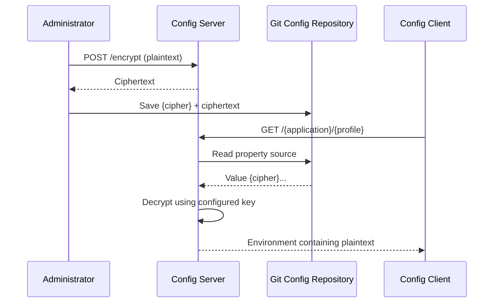

# Configuring Symmetric and Asymmetric Keys in Spring Cloud Config

## 1. Why Does Config Server Need an Encryption Key?

Spring Cloud Config centralizes the configuration of multiple applications in one place, usually a Git repository. Configuration can contain database passwords, API tokens, or service connection credentials. If these values are stored directly as plaintext, anyone with read access to the repository can also read the secrets.

Spring Cloud Config Server supports encrypting individual configuration values. Encrypted values are stored in the repository with the **{cipher}** prefix. When Config Server reads a property source, it can decrypt the value before returning the configuration to the Config Client over HTTP.

To encrypt and decrypt, Config Server needs a key. Spring Cloud Config supports two models:

- **Symmetric key:** the same secret is used for both encryption and decryption.
- **Asymmetric key:** uses a public and private key pair; the public key encrypts, and the private key decrypts.

The most important difference lies in key distribution. With a symmetric key, every component that needs to encrypt or decrypt must have the same secret. With an asymmetric key, the party creating ciphertext only needs the public key, while the private key can be kept centrally on Config Server.

## 2. Configuration Encryption Flow

A typical flow consists of the following steps:

1. An administrator or pipeline sends a sensitive value to Config Server's **/encrypt** endpoint.
2. Config Server encrypts the value with the configured key and returns ciphertext.
3. The administrator prepends the **{cipher}** prefix to the ciphertext and stores it in the configuration file in the repository.
4. Config Client requests configuration by application, profile, and label.
5. Config Server reads the property source, detects values with the **{cipher}** prefix, and decrypts them before returning the result to the client.
6. The client receives the decrypted value and binds it into the **Environment** like a normal property.



The default model ensures secrets do not sit as plaintext in Git. However, when Config Server decrypts and returns configuration, the client receives the cleartext value. Encrypting values in the repository does not replace TLS, authentication, Config Server access control, or protecting application memory and logs.

## 3. Comparing Symmetric and Asymmetric Keys

| Criterion | Symmetric Key | Asymmetric Key |
| --- | --- | --- |
| Key components | A single secret used for encryption and decryption | A public key and private key pair |
| Encryption | Uses the shared secret | Uses the public key |
| Decryption | Uses the same shared secret | Uses the matching private key |
| Key distribution | Must protect and distribute the same secret everywhere it is needed | Public key can be distributed more widely; private key stays where decryption occurs |
| Config Server configuration | **encrypt.key** or **ENCRYPT_KEY** | Keystore via **encrypt.keyStore.*** |
| Operational complexity | Simpler | Must manage keystore, aliases, passwords, and key pair lifecycle |
| Best suited for | Small environments, simple secret management workflows | Separating encryption and decryption privileges, or when multiple parties generate ciphertext |

Choose the model based on trust boundaries and key distribution. If everyone authorized to encrypt also has access to the shared secret, they can also decrypt ciphertext. With the asymmetric model, pipelines can hold only the public key to encrypt, while the private key is protected separately on Config Server.

## 4. Configuring a Symmetric Key

### 4.1. Using encrypt.key

With a symmetric key, Config Server accepts a secret string via the **encrypt.key** property:

```yaml
encrypt:
  key: ${ENCRYPT_KEY}
```

Or configure it directly via the **ENCRYPT_KEY** environment variable. Spring Cloud Config recognizes this environment variable to supply the key to the encryptor. Secrets should be injected into the process environment from a secret manager or the deployment platform's secret management system.

Do not commit the real value of **encrypt.key** into Git, Docker images, or shared configuration files. The YAML snippet above only references an environment variable; the actual value is provided at runtime.

### 4.2. Choosing Where to Place the Key When Using Bootstrap

If Config Server uses **spring-cloud-starter-bootstrap** or enables **spring.cloud.bootstrap.enabled=true** via a system property, the Spring Cloud Config documentation requires placing **encrypt.key** in **bootstrap.properties** or **bootstrap.yml** so the key is available during the bootstrap phase.

If the application does not use legacy bootstrap, the property can be loaded via the active Spring Boot configuration mechanism. Wherever it is placed, the key must be supplied to **Config Server**, not merely placed in the clients' configuration repository.

Example with legacy bootstrap:

```yaml
# Config Server bootstrap.yml
encrypt:
  key: ${ENCRYPT_KEY}
```

Do not use **encrypt.key** to declare an RSA key pair. This property is for symmetric keys.

### 4.3. When to Choose a Symmetric Key?

A symmetric key is convenient when:

- Only a small group of operators is authorized to encrypt configurations.
- Config Server is the only place that needs to decrypt.
- A secret manager is available to securely distribute the shared secret to Config Server and authorized encryption tools.
- Key rotation processes can be coordinated with re-encrypting stored values.

The key point to manage is that everyone who knows the shared secret has the same ability to decrypt. Do not place the shared secret in the repository merely because the ciphertext is encrypted.

## 5. Configuring an Asymmetric Key with an RSA Keystore

### 5.1. Public Key and Private Key

With the RSA model:

- The public key is used to encrypt values.
- The corresponding private key is used to decrypt them.
- A keystore can hold the key pair and associated certificate. Config Server identifies the key to use via an alias.

Users or pipelines needing only the public key can produce ciphertext without knowing the private key. Config Server holds the private key to decrypt when serving configuration. This provides a privilege-separation advantage when multiple teams need to submit secrets to the repository.

### 5.2. Creating a Keystore with keytool

**keytool** ships with the JDK. Example creating an RSA key pair in a PKCS12 keystore:

```bash
keytool -genkeypair -alias config-server-prod -keyalg RSA -keysize 3072 -storetype PKCS12 -keystore config-server-prod.p12 -validity 3650
```

The command prompts for a keystore password and certificate details. With PKCS12 on modern JDKs, the private key password typically must match the keystore password; you can press Enter at the key password prompt to reuse the keystore password. Do not pass production passwords directly on the command line or commit them into scripts.

Inspect the alias and keystore type:

```bash
keytool -list -v -keystore config-server-prod.p12 -storetype PKCS12
```

Using PKCS12 and explicitly declaring **type** helps prevent confusion between file extensions and the actual format. If creating a JKS keystore, use the **-storetype JKS** option and configure **encrypt.keyStore.type: JKS** accordingly.

Password values in examples are entered by the operator when keytool prompts. Never use sample documentation passwords in real environments.

### 5.3. Configuring the Keystore for Config Server

Place the keystore in a protected location, such as mounted from a deployment platform secret volume:

```yaml
encrypt:
  keyStore:
    location: file:/run/secrets/config-server-prod.p12
    password: ${CONFIG_KEYSTORE_PASSWORD}
    alias: config-server-prod
    type: PKCS12
```

Property meanings:

| Property | Meaning |
| --- | --- |
| **encrypt.keyStore.location** | Resource location containing the keystore; can be **classpath:** or **file:** |
| **encrypt.keyStore.password** | Password to open the keystore |
| **encrypt.keyStore.alias** | Alias identifying the key pair to use |
| **encrypt.keyStore.type** | Keystore format, e.g., **PKCS12** or **JKS**; documentation default is **jks** |
| **encrypt.keyStore.secret** | Separate private key password if different from the keystore password; if omitted, Spring Cloud Config defaults to the keystore password |

If the private key has a separate password, add **secret** from a secret store:

```yaml
encrypt:
  keyStore:
    location: file:/run/secrets/config-server-prod.p12
    password: ${CONFIG_KEYSTORE_PASSWORD}
    alias: config-server-prod
    type: PKCS12
    secret: ${CONFIG_PRIVATE_KEY_PASSWORD}
```

Do not place a keystore file containing a private key in a client configuration repository or a public image. Restrict file read permissions, limit the OS user running Config Server, and back it up according to key management procedures.

### 5.4. Can Only the Public Key Be Placed on Config Server?

In principle, Config Server can hold only the public key to perform encryption; in that case, the private key must reside elsewhere to decrypt, such as on each client. This increases private key distribution scope and complicates operations. It is only appropriate when there is a clear reason for Config Server not to hold the private key and the number of clients can be tightly managed.

In the standard model, Config Server holds the keystore with the private key to decrypt **{cipher}** before sending configuration to clients.

## 6. Using the encrypt and decrypt Endpoints

Once the key is configured and Config Server is running, the server exposes two endpoints:

- **POST /encrypt:** accepts plaintext in the request body and returns ciphertext.
- **POST /decrypt:** accepts ciphertext and returns plaintext if the server has the matching decryption key.

Example calling the endpoint in a development environment:

```bash
curl -sS -X POST http://localhost:8888/encrypt -H "Content-Type: text/plain" --data-binary @secret.txt
```

Suppose **secret.txt** contains a test value. The returned result is text ciphertext that can be saved to the repository after adding the **{cipher}** prefix. Do not leave test plaintext files in Git or shared directories.

You can verify the reverse direction by sending ciphertext to **/decrypt**:

```bash
curl -sS -X POST http://localhost:8888/decrypt -H "Content-Type: text/plain" --data-binary @ciphertext.txt
```

These endpoints can expose plaintext if called without authorization. Spring Cloud Config documentation requires that they be accessible only to authorized actors. Protect them with Spring Security, restrict administrative network access, and do not expose them publicly.

### 6.1. Storing Ciphertext in YAML and Properties

In YAML, wrap the **{cipher}** value in single quotes so the YAML parser treats the entire content as a string:

```yaml
spring:
  datasource:
    username: app_user
    password: '{cipher}AQB64_ENCRYPTED_VALUE'
```

In a **.properties** file, the encrypted value must not be wrapped in quotes:

```properties
spring.datasource.username=app_user
spring.datasource.password={cipher}AQB64_ENCRYPTED_VALUE
```

If you wrap the **{cipher}** value in quotes in a **.properties** file, Config Server may fail to recognize it for decryption. The ciphertext strings in the examples are placeholders only; replace them with actual output from the **/encrypt** endpoint.

## 7. Does Config Server Decrypt First or Does the Client Decrypt?

By default, if a remote property source contains a value starting with **{cipher}**, Config Server decrypts it before returning data over HTTP. This means the client receives the cleartext value and does not need encryption key configuration just to consume configuration.

If you want clients to decrypt on their own, Config Server can be configured to preserve ciphertext when returning property sources:

```yaml
spring:
  cloud:
    config:
      server:
        encrypt:
          enabled: false
```

The full property is `spring.cloud.config.server.encrypt.enabled=false`. For Config Server using legacy bootstrap, set this property in `bootstrap.yml` or `bootstrap.properties` so it takes effect during the bootstrap phase.

In this model, the client needs the appropriate mechanism and key to decrypt locally. With RSA, this may require distributing the private key to clients, significantly changing the security boundary. Choose this approach only after clearly evaluating where the private key is kept and how many clients are allowed to decrypt.

If client-side decryption is unnecessary, keeping the server-side decryption default is usually simpler: the private key stays centralized at Config Server, and clients only need authentication to fetch configuration.

### 7.1. What Happens When Decryption Fails?

If Config Server cannot decrypt a value, the encrypted value is removed from the property source and an extra property is created with the same name prefixed by **invalid**, typically with the value **<n/a>**. This behavior prevents ciphertext from accidentally being used by the application as a real password or token.

When you see an **invalid.*** property, check:

- Whether the running key matches the key that encrypted the ciphertext.
- Whether the alias exists in the keystore.
- Whether Config Server can read the keystore and unlock the private key.
- Whether the ciphertext was truncated, had spaces added, or was altered during commit.
- Whether the **{cipher}** prefix is formatted properly in YAML/properties.

Never silently replace a secret that failed decryption with a default value in production.

## 8. Managing Multiple Keys and Key Rotation

In real environments, keys have a lifecycle: creation, provisioning, usage, backup, replacement, and revocation. Rotation may be needed if a key is compromised, personnel access changes, or security policy mandates periodic key replacement.

### 8.1. Multiple Aliases in a Keystore

Spring Cloud Config supports the **{key:alias}** prefix after **{cipher}** to select an alias in the keystore:

```yaml
spring:
  datasource:
    password: '{cipher}{key:config-2026}AQB64_ENCRYPTED_VALUE'
```

When using an alias, the default **TextEncryptorLocator** can locate the key by that alias. Without a **{key:...}** prefix, Config Server uses the configured default key.

An RSA rotation workflow can be carried out as follows:

1. Create a new alias in the keystore, keeping the old alias during the transition period.
2. Deploy the keystore containing both the old and new keys to Config Server.
3. Encrypt new values using the new alias.
4. Update the repository with **{cipher}{key:new-alias}...**.
5. Confirm Config Server decrypts both old and new values, and clients receive valid configuration.
6. Re-encrypt remaining values that still use the old alias.
7. Delete the old alias only after no ciphertext references it and older configuration versions no longer need rollback support.

Spring Cloud Config documentation notes that clients and repositories must use aliases available in Config Server's keystore. Do not delete the old private key before every ciphertext requiring it has been migrated.

### 8.2. Rotating a Symmetric Key

With a single symmetric key, ciphertext created with the old key cannot automatically be decrypted with the new key. The key replacement workflow must be coordinated:

1. Prepare the new key and roll it out under a controlled plan.
2. Decrypt active values using the old key in a secured environment.
3. Re-encrypt them using the new key.
4. Update ciphertext in the repository.
5. Switch Config Server to the new key once the data is prepared and tested.
6. Confirm no ciphertext still requires the old key; then revoke the old key per policy.

If multiple symmetric keys must be supported concurrently, implement a custom **TextEncryptorLocator** to select the appropriate encryptor; do not assume the default **encrypt.key** configuration automatically recognizes multiple shared secrets.

## 9. Key Protection Principles

Configuration encryption is only useful when keys are well protected. Practical principles:

1. Never commit **encrypt.key**, keystore passwords, private keys, or production keystore files to Git.
2. Provision secrets through Vault, a cloud secret manager, or platform-managed secret volumes.
3. Restrict read permissions on keystores and permissions to call **/encrypt** and **/decrypt** endpoints.
4. Use TLS for connections to Config Server; repository encryption does not protect plaintext in transit.
5. Do not write plaintext, sensitive ciphertext, or secret contents into logs, exception messages, or traces.
6. Separate ciphertext creation permissions from plaintext retrieval permissions if your organizational model requires it.
7. Back up private keys and recovery plans in a controlled location; losing a private key can render old ciphertext undecryptable.
8. Record key aliases, creation timestamps, purposes, and status in the key management system.
9. Test restoring from backup and test decrypting representative ciphertext before deploying key changes.
10. Use HTTPS and authentication for client APIs; **{cipher}** does not replace Config Server access control.

In particular, if Config Server decrypts before sending to clients, anyone authorized to read the configuration API can still receive plaintext. Protect both the configuration retrieval API and the encryption/decryption APIs.

## 10. Testing Key Configuration

Test each layer individually rather than merely confirming Config Server starts successfully.

| Test Case | How to Execute | Expected Result |
| --- | --- | --- |
| Symmetric encryption | Send plaintext to **/encrypt** with **encrypt.key** configured | Receives ciphertext |
| Symmetric decryption | Send the generated ciphertext to **/decrypt** | Recovers exact plaintext |
| RSA encryption | Use a keystore with a valid public key and alias | Receives ciphertext |
| RSA decryption | Use a keystore with the matching private key | Recovers exact plaintext |
| **{cipher}** property | Put ciphertext in the Config Repository and call the environment endpoint | Client receives plaintext under default server-side decryption mode |
| Wrong key | Change key or mismatched alias | Decryption fails; property is marked invalid per Config Server behavior |
| Non-existent alias | Use **{key:unknown}** | Key location error is detected |
| Tampered ciphertext | Truncate or alter ciphertext characters | Decryption fails |
| Unauthorized endpoint call | Call **/encrypt** or **/decrypt** with an unauthorized identity | Request is rejected |

A simple round-trip check is:

1. Choose a test string containing no real data.
2. Call **/encrypt** and save the ciphertext.
3. Call **/decrypt** with that ciphertext.
4. Compare the decrypted result with the original string.
5. Put the ciphertext into a test property with the **{cipher}** prefix and confirm Config Client receives the cleartext value in its loaded configuration.

Do not test with production passwords or active tokens. Use dummy secrets and delete temporary files containing plaintext/ciphertext per test environment procedures.

## 11. Common Errors and Diagnostics

| Symptom | Possible Cause | Resolution |
| --- | --- | --- |
| Config Server fails to start with encryption enabled | Missing **encrypt.key** or unreadable keystore | Check environment variables, Resource location, password, and alias |
| **/encrypt** returns an error | Encryptor not configured or endpoint is secured | Check **encrypt.***, server logs, and endpoint permissions |
| **/decrypt** does not return plaintext | Wrong shared secret or mismatched private key | Verify the exact key/keystore that generated the ciphertext |
| Config Client receives **invalid.*** | Config Server cannot decrypt **{cipher}** | Check prefix, ciphertext, key, alias, and keystore |
| Value in **.properties** is not decrypted | **{cipher}** is wrapped in quotes | Remove quotes in the properties file |
| YAML fails to parse cipher value | String starting with curly brace is unquoted | Wrap the entire value in single quotes |
| Keystore opens, but private key cannot be used | Wrong alias or separate private key password | Check alias and **encrypt.keyStore.secret** |
| Password error using PKCS12 on JDK 11+ | Key password and store password differ, which the store type disallows | Use the same password or choose a compatible format |
| Client receives ciphertext instead of plaintext | Server-side decrypt disabled or Config Server lacks decryption key | Check **spring.cloud.config.server.encrypt.enabled** and server keys |
| Key rotation breaks old configurations | Old alias/secret revoked before re-encrypting data | Restore old key, re-encrypt, and revoke only after verification |

## 12. Choosing a Key Model for Your System

Use the following questions to decide:

- If a small operations team is authorized to encrypt and Config Server is the only place decrypting, a symmetric key may be the simplest option.
- If multiple teams or pipelines need to encrypt without being allowed to decrypt secrets, use an RSA public key to encrypt and keep the private key on Config Server.
- If there are multiple environments or application groups with separate key lifecycles, consider multiple aliases and **TextEncryptorLocator** instead of sharing one key across everything.
- If clients must decrypt locally, account for distributing private keys to clients and bounding the blast radius if a client is compromised.

No option automatically replaces secret management. Keys must have clear ownership, storage, access control, backup procedures, and revocation procedures.

## 13. References

- [Spring Cloud Config — Encryption and Decryption](https://docs.spring.io/spring-cloud-config/reference/server/encryption-and-decryption.html): **/encrypt**, **/decrypt** endpoints, **{cipher}** prefix, and property source decryption behavior.
- [Spring Cloud Config — Key Management](https://docs.spring.io/spring-cloud-config/reference/server/key-management.html): symmetric key **encrypt.key** configuration and asymmetric keystores.
- [Spring Cloud Config — Creating a Key Store for Testing](https://docs.spring.io/spring-cloud-config/reference/server/creating-a-key-store-for-testing.html): creating keystores with **keytool**.
- [Spring Cloud Config — Using Multiple Keys and Key Rotation](https://docs.spring.io/spring-cloud-config/reference/server/using-multiple-keys-and-key-rotation.html): aliases, multiple keys, and rotation workflows.
- [Spring Cloud Config — Serving Encrypted Properties](https://docs.spring.io/spring-cloud-config/reference/server/serving-encrypted-properties.html): configuring clients to decrypt instead of Config Server.

A symmetric key enables fast setup because it only requires a shared secret; an asymmetric key separates encryption and decryption privileges via public/private keys. In Spring Cloud Config, these two options have distinct configurations: **encrypt.key** is for symmetric keys, while RSA uses a keystore via **encrypt.keyStore.***. Once a model is chosen, protect keys, run round-trip tests, restrict endpoints, and plan rotation before storing ciphertext in shared repositories.
