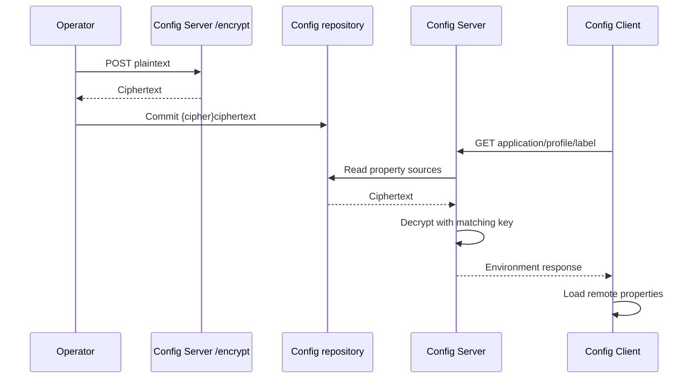

# Identifying Wrong-Key, Missing-Key, and Incompatible-Algorithm Errors

Spring Cloud Config can encrypt configuration values so sensitive data does not sit in plaintext in Git or a storage backend. When Config Server reads a property source, it can decrypt values prefixed with **{cipher}** before sending them to the Config Client. Spring Cloud Context also supports local decryption in the Environment if the application is configured with a key and has the required library.

Common errors occur when ciphertext was created with a different key than the one used for decryption, a key or keystore is not loaded, an alias does not exist, encrypted data was altered, or the JVM/provider does not support the required algorithm and key length. These errors can cause properties to disappear from the response, return ciphertext values, cause the application to use fallbacks, or fail startup.

This lesson belongs to the **Configuration Encryption** chapter of the **SPRING_CLOUD_CORE** module. The focus is on distinguishing root causes, reading symptoms accurately on Config Server and Config Client, inspecting keys/keystores/algorithms, handling errors safely, and designing tests to prevent misconfigurations from reaching production.

## 1. Learning Objectives

After this lesson, you will be able to:

- Describe Spring Cloud Config's encryption and decryption flow.
- Distinguish wrong-key, missing-key, wrong-keystore-password, wrong-alias, and corrupted-ciphertext errors.
- Identify errors caused by algorithms, padding, providers, or JVM key-length limits.
- Explain responses containing **invalid.<property>** when Config Server fails to decrypt a value.
- Check the **{cipher}** prefix and value syntax in YAML/Properties files.
- Diagnose the exact decryption location: Config Server or Config Client.
- Handle key rotation while still decrypting ciphertext from older revisions during the transition window.
- Write tests for both successful and failing decryption cases without leaking secrets.

## 2. Encryption and Decryption Flow in Spring Cloud

Spring Cloud Config commonly uses the server-side decryption model:

1. An operator sends plaintext to the secured /encrypt endpoint.
2. Config Server encrypts the plaintext and returns ciphertext.
3. The operator prepends the {cipher} prefix to the ciphertext and stores it in the configuration repository.
4. When Config Client requests configuration, Config Server reads the property sources and decrypts {cipher} values.
5. Config Server sends the decrypted property sources over HTTP; Config Client loads them into the Environment.



In this model, the decryption key must reside on Config Server. The client receives plaintext over Config Server's HTTP connection; therefore, production still requires TLS/HTTPS to protect data in transit.

Another architecture is **client-side decryption**: Config Server keeps ciphertext in the response, and the client application decrypts locally before creating the application context. This requires explicit configuration and key distribution to clients. Do not mix the two models when investigating errors; first determine which component is responsible for decryption.

## 3. Key Components to Inspect

Spring Cloud Config supports two main key management approaches:

| Type | Configuration | Component Used for Decryption |
| --- | --- | --- |
| Symmetric key | encrypt.key | The same secret key is used for encryption and decryption |
| Asymmetric key | encrypt.keyStore.* | Public key encrypts; matching private key decrypts |

### 3.1. Symmetric Key

Config Server configuration example:

```yaml
encrypt:
  key: ${ENCRYPT_KEY}
```

The ENCRYPT_KEY value must be injected into the right Config Server process. Do not commit real keys into application.yml, Docker images, or Git repositories. If the application enables legacy bootstrap via spring-cloud-starter-bootstrap or spring.cloud.bootstrap.enabled=true, Spring Cloud documentation requires placing encrypt.key in bootstrap.properties/bootstrap.yml according to the active bootstrap mechanism.

A common mistake is having the key in the developer's environment but missing it in the production container. Config Server may still run, yet lack the same decryption capability as the environment that generated the ciphertext.

### 3.2. Asymmetric Key and Keystore

With RSA, ciphertext is created with the public key and only the corresponding private key can decrypt it. Config Server typically reads the private key from a keystore:

```yaml
encrypt:
  key-store:
    location: file:/run/secrets/config-server.p12
    password: ${CONFIG_KEYSTORE_PASSWORD}
    alias: config-server
    secret: ${CONFIG_PRIVATE_KEY_PASSWORD}
    type: PKCS12
```

Property meanings:

- location: resource location of the keystore; must exist in the runtime environment.
- password: password to open the keystore.
- alias: name of the entry containing the key to use.
- secret: password protecting the private key entry, if applicable.
- type: keystore format, such as PKCS12 or JKS.

Distinguish the **keystore password** from the **private key password**. Some PKCS12 setups on newer JDKs require the store password and key password to be identical; if keytool warns that the format does not support two different passwords, inspect the generated keystore and update configuration accordingly.

### 3.3. Key Scope

Keys must be scoped to the right environment and usage boundary:

- Production Config Server must hold the key or private key matching the stored ciphertext.
- If each application/profile uses a different key, an appropriate TextEncryptorLocator is needed to select the encryptor by application/profile.
- Configuring multiple aliases in one keystore requires specifying the alias via {key:...} metadata in the ciphertext.
- Do not assume a key present in staging is also present in production.

Matching environment variable names does not prove the actual byte sequences are identical. Secret managers, deployment manifests, trailing newlines, or encoding differences can alter the runtime value.

## 4. Identifying Wrong-Key Errors

A **wrong key** error occurs when ciphertext was encrypted with key A, but the system attempts to decrypt with key B. With symmetric encryption, both sides must use the exact same key. With RSA, the private key must belong to the same key pair whose public key performed the encryption.

Common symptoms:

- /decrypt fails even though the endpoint responds and the key/keystore is loaded.
- Java crypto reports padding or block errors during decryption.
- Config Server returns a property named invalid.<property> instead of the original value.
- The application picks up a fallback from another property source and still starts, but uses wrong credentials or endpoints.
- Staging decrypts successfully while production fails on the exact same ciphertext.

Commonly seen exceptions include BadPaddingException, IllegalBlockSizeException, or InvalidKeyException. They do not uniquely identify the cause on their own: wrong key, truncated ciphertext, wrong encoding, or mismatched transformation/padding can produce similar errors.

### 4.1. Testing the Same Ciphertext on the Exact Config Server

Using a non-sensitive test ciphertext, call /decrypt on the exact Config Server serving the failing environment:

```bash
curl -sS \
  -H "Content-Type: text/plain" \
  --data-binary "BASE64_CIPHERTEXT" \
  https://config.example.internal/decrypt
```

The /decrypt endpoint accepts ciphertext; in configuration files, the value must include the {cipher} prefix. Never send plaintext or secret ciphertext to an unauthenticated endpoint, over unencrypted HTTP, or paste plaintext results into tickets/logs.

If the command above fails:

1. Confirm Config Server is using the expected encrypt.key or keystore.
2. Verify the selected alias and that the private key belongs to the key pair that encrypted the ciphertext.
3. Confirm the ciphertext was not truncated, wrapped in extra quotes, or given an unintended newline.
4. Compare the runtime configuration of the failing instance with an instance that decrypts successfully.
5. Try encrypting and decrypting a fresh test value in an isolated environment to confirm the key works.

Do not resolve this by immediately replacing the production key. Changing the key without re-encrypting existing values can render all older configurations undecryptable.

## 5. Identifying Missing-Key Errors

A **missing key** is usually a deployment or secret configuration mistake, not corrupted ciphertext data.

Common cases:

- The ENCRYPT_KEY environment variable was not injected into Config Server.
- Wrong environment variable name or the secret mount is missing in the container.
- encrypt.key was placed in a configuration file not loaded in the current bootstrap mode.
- The keystore is absent at the declared path.
- The keystore secret or private key entry secret was not injected.
- Config Server has only the public key when the current task requires decryption.
- Client-side decryption is enabled, but the client lacks the key or the Spring Security RSA library.

### 5.1. Checking Symmetric Key Configuration

For a symmetric key, verify the variable name and its presence in the Config Server process. Never print the key value to the terminal or logs.

Example presence-only check in PowerShell:

```powershell
if ([string]::IsNullOrWhiteSpace($env:ENCRYPT_KEY)) {
    Write-Output "ENCRYPT_KEY is missing"
} else {
    Write-Output "ENCRYPT_KEY is present"
}
```

Never use `echo $env:ENCRYPT_KEY` or `printenv ENCRYPT_KEY` in CI/CD logs because they can expose secrets.

### 5.2. Checking the Keystore

You can use `keytool -list` to verify the file is readable, the keystore type, and that the alias exists. Provide passwords only through keytool's secure prompt or secret store; never put real passwords in command history.

Example structure check:

```bash
keytool -list -keystore /run/secrets/config-server.p12 -storetype PKCS12
```

Verify:

- The file exists inside the container and the Java process user has read permission.
- The keystore type matches encrypt.keyStore.type.
- The declared alias exists with exact spelling, including case sensitivity.
- The entry containing the private key can be unlocked with the corresponding password.
- The keystore was not overwritten by another file during mounting/deployment.

If the keystore opens but the alias lacks the matching private key, Config Server still cannot decrypt RSA ciphertext.

## 6. Identifying Keystore Password, Alias, and Key Pair Errors

These errors are often mistaken for "wrong algorithm," but require separate checks:

| Symptom | Possible Cause | Investigation Direction |
| --- | --- | --- |
| Cannot open keystore | Wrong store password, wrong type, or corrupted file | Check password, PKCS12/JKS, and file mount |
| Cannot retrieve private key entry | Wrong key password or entry contains no private key | Check secret and entry type |
| Alias not found | Wrong encrypt.keyStore.alias or ciphertext requests another alias | List aliases and cross-check {key:...} metadata |
| RSA decryption fails | Private key does not match the public key that encrypted it | Verify matching key pair and rotation history |
| Staging works, production fails | The two environments use different keystores/key versions | Compare alias, fingerprint, and deployment version; do not print private key |

With a keystore containing multiple keys, Spring Cloud Config supports the {key:alias} prefix right after {cipher}. Example:

```yaml
spring:
  datasource:
    password: '{cipher}{key:db-key-2026}BASE64_CIPHERTEXT'
```

Config Server uses the db-key-2026 alias to select the matching key. The alias must exist in the keystore used by Config Server. If the system uses a custom TextEncryptorLocator, key selection logic must remain consistent with the rules used during encryption.

## 7. Identifying Algorithm, Padding, or Provider Errors

Ciphertext can only be decrypted properly when the system uses the exact same cryptographic specification: compatible key type, algorithm, mode, padding, encoding, and provider. Two systems may both use RSA or AES and still be incompatible if transformation settings or data formats differ.

Exceptions that may appear:

| Exception/Symptom | Meaning to Investigate |
| --- | --- |
| NoSuchAlgorithmException | JCA cannot find the requested algorithm |
| NoSuchPaddingException | Provider does not support the requested padding |
| InvalidKeyException | Wrong key type, wrong key size, invalid key, or rejected by policy/provider |
| InvalidAlgorithmParameterException | Parameters such as IV or parameter spec are incompatible |
| BadPaddingException | Key, ciphertext, mode, or padding mismatch; data may have been altered |
| IllegalBlockSizeException | Data size is incompatible with block processing mode |
| Illegal key size | Cryptographic policy limit or key size rejected by runtime/provider |
| IllegalArgumentException on decode | Ciphertext may not be valid Base64 or has extra characters |

Do not change algorithms based solely on exception names. Inspect the full stack trace in a secured environment, the JDK version, active providers, and the encryption configuration used to produce the ciphertext.

### 7.1. Checking JCE Policy and JDK

Spring Cloud documentation mentions full-strength JCE requirements and Illegal key size errors. However, remediation depends on the JDK version:

- On JDK 8 prior to updates enabling unlimited-strength policy by default (for example, before 8u161), key-length restrictions can trigger Illegal key size.
- From JDK 9 onward, unlimited-strength policy is bundled and enabled by default in Oracle JDK. Do not download legacy policy files merely because you see this exception.
- If the environment sets crypto.policy=limited, uses a custom policy, FIPS provider, or third-party provider, check permitted policies and algorithms.
- When changing JDK/container images, verify providers and security properties inside the exact runtime image running the application.

You can check key-length limits using Java:

```java
import javax.crypto.Cipher;

public class CryptoPolicyCheck {
    public static void main(String[] args) throws Exception {
        System.out.println(
            "Max AES key length = " +
            Cipher.getMaxAllowedKeyLength("AES")
        );
    }
}
```

The output only reports the active policy limit for the queried transformation/algorithm. It does not prove that your key, ciphertext, or Spring Cloud Config provider is correct.

### 7.2. Checking Providers and Dependencies

When errors appear after upgrading the JDK or Spring Cloud:

- Confirm the `org.springframework.security:spring-security-rsa` dependency is on the classpath if the application requires local decryption.
- Check registered providers and whether a provider supports the active transformation.
- Check whether FIPS mode or security policy disables any algorithms/key lengths.
- Ensure Config Server and clients use compatible Spring Cloud/Spring Boot versions via the BOM.
- Never add a crypto provider or change padding in production without testing compatibility with existing ciphertext.

NoSuchAlgorithmException/NoSuchPaddingException usually points to the provider or transformation; BadPaddingException usually warrants checking the key and data first. This is an initial triage guide, not a guaranteed conclusion.

## 8. Checking the {cipher} Prefix and File Formatting

Config Server only recognizes values marked as encrypted according to its rules. Verify file syntax before concluding the key is wrong.

### 8.1. YAML

In YAML, values containing curly braces should be enclosed in quotes:

```yaml
spring:
  datasource:
    username: app_user
    password: '{cipher}BASE64_CIPHERTEXT'
```

### 8.2. application.properties

In `.properties` files, encrypted values **must not be enclosed in quotes**:

```properties
spring.datasource.username=app_user
spring.datasource.password={cipher}BASE64_CIPHERTEXT
```

If wrapped in quotes in `.properties`, the quotes may become part of the value and prevent Config Server from recognizing/decrypting it as expected.

### 8.3. Common Formatting Mistakes

- Missing {cipher} at the start of the value.
- Typo or leading whitespace before the prefix.
- Copying quotes or newline characters into the ciphertext.
- Copying curl progress statistics together with the ciphertext.
- Encrypting a value containing `+`, `&`, or `%` while sending the request with wrong content type/URL encoding.
- Using ciphertext from another environment or from a superseded key alias.

When encrypting with curl, Spring Cloud documentation recommends using `--data-urlencode` with a value starting with `=` or setting `Content-Type: text/plain` to prevent special characters from being misinterpreted. Use `-sS` so progress meters do not mix into the ciphertext output.

## 9. Understanding invalid.<property> Responses on Decryption Failure

When Config Server cannot decrypt a value, the default behavior is to **remove the original property from the property source and add a property whose name is prefixed with invalid**. Example:

```json
{
  "propertySources": [
    {
      "name": "application-prod.yml",
      "source": {
        "invalid.datasource.password": "<n/a>"
      }
    },
    {
      "name": "application.yml",
      "source": {
        "datasource.password": "fallback-value"
      }
    }
  ]
}
```

In this example, Config Server failed to decrypt datasource.password in application-prod.yml. The original property is removed from that source; the response contains invalid.datasource.password. A lower-precedence property source still has datasource.password, so Config Client can pick up fallback-value.

This has two consequences:

1. The application may start successfully even though the production secret failed to decrypt.
2. The application may use a fallback from a shared or local file that operators did not intend to use.

Therefore, a successful HTTP response or a running process is not enough to conclude decryption succeeded. Inspect invalid.* in the response and confirm the effective value comes from the intended property source.

The prefix-invalid behavior can be disabled via:

```yaml
spring:
  cloud:
    config:
      server:
        encrypt:
          prefix-invalid-properties: false
```

When this option is disabled, undecryptable ciphertext may reappear under the original property name. If the client does not decrypt locally, the application may receive the ciphertext string instead of plaintext. Change this option only when you clearly understand the server-side/client-side decryption model and have tests in place.

## 10. Distinguishing Server-Side and Client-Side Decryption

### 10.1. Server-Side Decryption

This is the common behavior: Config Server holds the key and decrypts properties before returning the response. Clients do not need to hold decryption keys.

Advantages:

- Centralizes key management on Config Server.
- No need to distribute private keys or symmetric keys to clients.
- Config Client receives decrypted properties in the Environment.

What must be protected:

- Config Server must safeguard keys securely.
- Responses must be transmitted over TLS.
- /encrypt and /decrypt endpoints must enforce authentication/authorization and access restrictions.
- Never log responses containing plaintext or write plaintext to unprotected caches.

### 10.2. Client-Side Decryption

If you want Config Server to return ciphertext so clients decrypt locally, configure:

```yaml
spring:
  cloud:
    config:
      server:
        encrypt:
          enabled: false
```

Place this setting according to Config Server's bootstrap/configuration mode. Clients need `encrypt.*` configuration and the Spring Security RSA dependency per Spring Cloud Context guidance. In this mode, missing-key, wrong-key, or provider errors may occur on the client instead of the server.

With Maven, the dependency for local decryption has coordinates:

```xml
<dependency>
    <groupId>org.springframework.security</groupId>
    <artifactId>spring-security-rsa</artifactId>
</dependency>
```

Select a version compatible with your Spring Cloud release train and project dependency management. If using a symmetric key, clients need the exact secret via `encrypt.key`; if using RSA, clients need the appropriate keystore/private key configuration. Do not distribute private keys to all clients if the architecture does not require client-side decryption.

Never configure the server to disable decryption before clients have the key. In that situation, ciphertext can go straight into the Environment and be used by the application as plaintext.

## 11. Ordered Diagnostic Procedure

When an encrypted property does not work, proceed in order to avoid changing multiple variables at once:

1. **Identify the decryption location.** Is Config Server or Config Client responsible for decrypting?
2. **Identify the property source.** Which application, profile, label, and file contains the ciphertext?
3. **Check syntax.** Does the value have the proper {cipher} prefix and match YAML/Properties formatting?
4. **Check key material.** Is the symmetric key present; is the keystore readable; are the alias/private key correct?
5. **Check ciphertext.** Was it truncated, modified, given extra quotes, newlines, or Base64 corruption?
6. **Test /decrypt with a test ciphertext.** Use the exact Config Server and key of the failing environment.
7. **Inspect the Environment response.** Look for invalid.<property> and check fallback property sources.
8. **Check runtime crypto.** JDK version, crypto.policy, providers, dependencies, and FIPS mode.
9. **Compare versions.** Confirm Spring Cloud BOM compatibility with Spring Boot and that environments share the same crypto configuration.
10. **Re-test after fixing.** Encrypt a test value, decrypt it back, load it via the environment endpoint, and confirm the client receives the expected value.

Never put keys, passwords, private keys, or plaintext into logs for "comparison." You may compare public certificate/keystore entry fingerprints or secret version IDs if your key management workflow supports it.

## 12. Key Rotation and Old Ciphertext Compatibility

Key rotation is often required when a key is compromised, policy changes, or periodic rotation schedules apply. However, swapping keys immediately can render old ciphertext undecryptable.

A safe transition workflow:

1. Generate a new key and load the new key/alias into Config Server's keystore.
2. Confirm Config Server can access the new alias.
3. Re-encrypt each property using the new key.
4. Attach {key:new-alias} metadata to ciphertext if using multiple aliases.
5. Commit the new revision and test with the matching application/profile.
6. Roll out a Config Server capable of reading both old and new ciphertext during the transition window.
7. Confirm all repositories, branches, and instances have migrated to the new key.
8. Revoke the old key after no ciphertext still depends on it for decryption.

Example:

```yaml
database:
  password: '{cipher}{key:db-key-2026}BASE64_CIPHERTEXT'
```

If multiple keys are needed per application/profile, implement a TextEncryptorLocator to choose the right encryptor. The default locator does not automatically create separate keys per application/profile; if granular behavior is desired, configure a custom locator.

Do not delete an old alias from the keystore before finding and re-encrypting every ciphertext referencing that alias. In a key-compromise incident, coordinate rotation with credential revocation on target systems; merely re-encrypting config files does not invalidate old passwords inside databases or downstream services.

## 13. Testing Encryption and Decryption

A test suite should verify the full path rather than testing standalone encrypt/decrypt calls in isolation.

| Test Case | Setup | Expected Result |
| --- | --- | --- |
| Symmetric round trip | Encrypt then decrypt with the same key | Plaintext matches original |
| Wrong symmetric key | Encrypt with key A, decrypt with key B | Decryption fails or Config Server marks invalid |
| Missing symmetric key | Omit ENCRYPT_KEY injection | Startup/operation reports clear error; no unintended plaintext fallback |
| Valid RSA pair | Encrypt with public key, decrypt with matching private key | Plaintext matches original |
| Wrong RSA alias | Ciphertext requests alias absent from keystore | Fails to decrypt; response/health records error |
| Wrong keystore password | Password cannot open store | Keystore loading fails |
| Corrupt ciphertext | Alter/truncate part of ciphertext | Decode/decrypt fails |
| Missing {cipher} | Ciphertext value without marker | Confirm server treats it under normal property rules, not auto-decrypted |
| Invalid property response | Use undecryptable ciphertext | Contains invalid.<property> by default |
| Fallback source | Same key exists in lower source | Verify effective value and alert on fallback |
| Client-side decryption | Server skips decryption, client has key | Client receives plaintext after local preprocessing |
| Provider/JDK mismatch | Use runtime missing algorithm or restricted policy | Reproducible algorithm/provider error verified |

### 13.1. Contract Testing via Endpoints

In a test environment:

1. Send a test value to /encrypt.
2. Store the returned ciphertext in a test configuration file with the {cipher} prefix.
3. Call Config Server's environment endpoint with the right application/profile/label.
4. Confirm the property source contains plaintext after server-side decryption.
5. Repeat with a wrong key and confirm the response contains invalid.<property>.
6. Test a same-named property in a lower-precedence source to demonstrate how fallback can mask decryption failures.

Use dummy test data. Never use production passwords to test /encrypt or /decrypt in CI pipelines.

### 13.2. Fail-Closed Testing

For required credentials, application configuration should detect missing or invalid values. Do not rely solely on invalid.<property> appearing in JSON; add integration test checks or startup validation so the application never silently uses an insecure default.

For example, validate required endpoint/password values after the Environment is loaded and confirm they originate from the intended property source. If the system permits a fallback, that fallback must be explicitly specified and covered by metrics/alerts.

## 14. Quick Troubleshooting Reference Table

| Symptom | Root Cause Category | First Check Step |
| --- | --- | --- |
| invalid.db.password in response | Failed to decrypt | Check key, alias, ciphertext, and server-side decrypt |
| /decrypt reports padding error | Wrong key, corrupted ciphertext, or mismatched transformation | Compare key/alias and generate a fresh test ciphertext |
| ENCRYPT_KEY empty in production | Missing secret injection | Check deployment secrets and Config Server process |
| Cannot open keystore | Wrong password, type, path, or file mount | Use keytool to inspect the store inside the exact container |
| Alias not found | Wrong alias or missing key version | Check aliases in keystore and {key:...} prefix |
| Illegal key size | Crypto policy or key size/provider | Check JDK, crypto.policy, and provider |
| NoSuchAlgorithmException | Algorithm not supported by provider | Check transformation and provider |
| NoSuchPaddingException | Padding not supported by provider | Check encryption config and provider |
| Client receives {cipher}... string | Server did not decrypt or client-side decrypt misconfigured | Determine decryption mode and verify key on the right side |
| App runs with fallback password | invalid.* and lower source supplies value | Check property source precedence and startup validation |
| Only production fails | Key/alias/runtime image differs from test environment | Compare secret version, keystore fingerprint, JDK, and provider |

## 15. Security and Operations

- Never commit encrypt.key, keystore passwords, private keys, or plaintext secrets to Git.
- Retrieve keys from a secret manager or the platform's secret injection mechanism.
- Restrict keystore read permissions and access to the Config Server process.
- Protect /encrypt, /decrypt, and config endpoints with authentication/authorization.
- Use HTTPS/TLS for Config Server in production.
- Never log plaintext, sensitive ciphertext, keys, passwords, or full Environment responses.
- Monitor invalid.* property counts, decrypt errors, keystore load failures, and configuration revisions.
- Separate keys across environments; do not share one key across dev, staging, and production without explicit justification.
- Maintain rotation and rollback procedures, and confirm old aliases have no remaining references before revocation.
- Upgrade JDK/providers via compatibility testing; never swap algorithms in production merely to silence an exception.

Configuration encryption protects data at rest. Once Config Server decrypts, plaintext still requires protection through TLS, access controls, log hygiene, and memory/runtime controls.

## 16. Practice Exercise

A payment-service reads properties from Config Server:

```yaml
payment:
  gateway:
    url: https://gateway.internal
    username: payment_app
    password: '{cipher}OLD_CIPHERTEXT'
```

After deploying a new version, production exhibits invalid.payment.gateway.password, yet the application still starts and picks up a password from the shared application.yml.

Perform the following:

1. Determine whether Config Server or Config Client is performing decryption.
2. Inspect the key/keystore, alias, and revision that created OLD_CIPHERTEXT.
3. Use a test ciphertext to verify /decrypt on the exact production Config Server without putting real secrets into logs.
4. Explain why invalid.payment.gateway.password can cause a value from a lower-precedence source to be used.
5. Propose startup validation so payment-service does not silently use a fallback when a production password is required.
6. Create a new key, re-encrypt the property, and design a transition phase supporting both old and new aliases.
7. Test wrong key, missing key, wrong keystore password, non-existent alias, and truncated ciphertext.
8. Inspect JDK/providers to distinguish Illegal key size from BadPaddingException.

**Completion criteria:** pinpoint where the error occurs; distinguish key errors from provider errors; explain invalid.* responses and fallbacks; establish a fix/rotation procedure that preserves the ability to decrypt old ciphertext during the transition window.

## 17. Key Takeaways

- {cipher} marks a property needing decryption; YAML should quote values, whereas .properties must not wrap values in quotes.
- Symmetric keys use the same secret to encrypt and decrypt; RSA uses a public key to encrypt and the matching private key to decrypt.
- encrypt.key is for symmetric keys; RSA requires a keystore with location, password, alias, type, and private key.
- Wrong keys, missing keys, wrong aliases, wrong keystore passwords, and corrupted ciphertext can produce distinct decryption failures.
- NoSuchAlgorithmException/NoSuchPaddingException points toward provider/transformation; BadPaddingException calls for checking keys and ciphertext; Illegal key size calls for checking key size and crypto policy.
- JDK 9+ enables unlimited-strength policy by default; do not blindly apply legacy JCE policy file installation guides.
- When Config Server fails to decrypt, the response defaults to invalid.<property>; lower-precedence sources can still provide fallbacks.
- Always establish whether server-side or client-side decryption is active before diagnosing.
- Key rotation must preserve the ability to read old ciphertext during the transition phase and revoke old aliases only after all references are migrated.
- Encryption at rest does not replace TLS, authorization, secret management, and log hygiene.

## 18. References

- [Spring Cloud Config — Encryption and Decryption](https://docs.spring.io/spring-cloud-config/reference/server/encryption-and-decryption.html): {cipher} prefix, encrypt/decrypt endpoints, and invalid.<property> responses.
- [Spring Cloud Config — Key Management](https://docs.spring.io/spring-cloud-config/reference/server/key-management.html): symmetric keys, RSA key pairs, and keystore configuration.
- [Spring Cloud Config — Using Multiple Keys and Key Rotation](https://docs.spring.io/spring-cloud-config/reference/server/using-multiple-keys-and-key-rotation.html): aliases, TextEncryptorLocator, and rotation.
- [Spring Cloud Config — Serving Encrypted Properties](https://docs.spring.io/spring-cloud-config/reference/server/serving-encrypted-properties.html): server-side and client-side decryption.
- [Spring Cloud Commons — Application Context Services](https://docs.spring.io/spring-cloud-commons/reference/spring-cloud-commons/application-context-services.html): local decryption in Environment and the Spring Security RSA dependency.
- [Oracle JDK Security Updates](https://docs.oracle.com/en/java/javase/17/migrate/security-updates.html): default unlimited JCE policy change starting in JDK 9.
