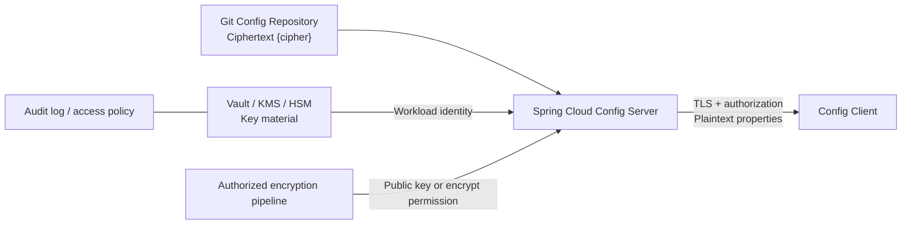
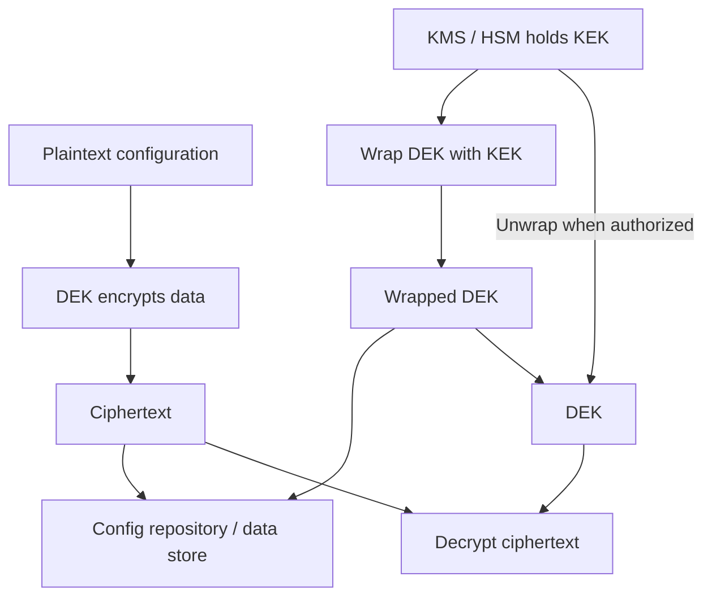

# Key Storage Locations and Avoiding Storing Keys with Ciphertext

## 1. Why Does Key Storage Location Matter?

Configuration encryption allows storing sensitive information as ciphertext in repositories, artifacts, or configuration stores. However, if the decryption key sits right next to the ciphertext and is protected by the same access permissions, an attacker who compromises one can immediately take the other. In that scenario, encryption establishes no meaningful security boundary.

This lesson belongs to the **Configuration Encryption** chapter of the **SPRING_CLOUD_CORE** module. The module focuses on Spring Cloud Commons, Spring Cloud Context, external configuration, Spring Boot compatibility, refresh scope, discovery, service registry, and testing/operating shared abstractions. Within the Spring Cloud Config context, this lesson explains how to keep ciphertext in the configuration store while managing keys in a separate trust boundary.

After this lesson, you will be able to:

- Distinguish encryption keys, ciphertext, plaintext, and credentials used to open keystores.
- Explain why keys and ciphertext must reside in separate locations or access boundaries.
- Choose an appropriate key storage location: secret manager, KMS, Vault, HSM, or a securely mounted keystore file.
- Configure symmetric keys and asymmetric keystores for Spring Cloud Config Server.
- Understand the roles of the `{cipher}` prefix, `/encrypt`, and `/decrypt` endpoints.
- Design access control, rotation, backup, and key recovery.
- Analyze risks when keys are compromised, lost, or packaged with the application.

## 2. Distinguishing Protected Data from Key Material

A configuration encryption workflow typically involves the following components:

| Component | Meaning | Example |
| --- | --- | --- |
| Plaintext | Original value to protect | Database password, API token |
| Ciphertext | Encrypted output | String starting with `{cipher}` in a config file |
| Encryption key | Key performing the encryption operation | Symmetric key or public key |
| Decryption key | Key used to decrypt | Same symmetric key or private key |
| Keystore | Container holding keys/certificates and metadata | PKCS12/JKS file |
| Keystore password | Secret unlocking the keystore | Secret provisioned exclusively to Config Server |
| Key identifier/version | Label indicating which key ciphertext uses | Alias or system-managed metadata |

Do not equate the keystore password with the encryption key. The password unlocks the keystore file; the private key inside is the actual cryptographic material used for decryption. If you store the keystore and its password in the same place, an attacker who obtains both can unlock the key.

Similarly, ciphertext is not a key. You can put ciphertext into Git for version control, but the decryption key must live in a different system or access zone.

### 2.1. Risk Model When Storing Keys with Ciphertext

Suppose a repository contains:

```text
config-repo/
  application-prod.yml
  encryption-key.txt
```

The YAML file contains ciphertext, while the second file holds the decryption key. Anyone with repository read access can download both. If the repository is cloned to personal machines, mirrors, backups, or pipelines, the key propagates along with every copy.

The same problem occurs when:

- Putting keys into source code or resources inside a JAR.
- Placing the keystore and password in the same Docker image.
- Putting keys into Helm values or Terraform state alongside ciphertext.
- Storing keys in CI artifacts, build logs, or caches.
- Mounting the key into every container simply because they all read configuration.
- Using the same service account to read the ciphertext repository and read the key secret without restriction.

The core issue is that **the same access privilege can retrieve both the encrypted data and the means to decrypt it**. Splitting them into separate files while granting read access to both for the same identity provides no meaningful separation.

### 2.2. Separation Model

A better architecture places ciphertext and key material across two distinct boundaries:



- The repository stores ciphertext and non-sensitive metadata.
- A secret manager/KMS/Vault/HSM holds the key or private key.
- Only Config Server has the workload identity permitted to retrieve the decryption key.
- The encryption pipeline may only need permission to use the public key or invoke the encrypt operation.
- Clients receive configuration after Config Server decrypts it; transit must still be protected with TLS and authentication.

This is separation by access control and workload identity. In high-assurance systems, also separate repository administration privileges, key administration privileges, and Config Server deployment privileges.

## 3. How Does Spring Cloud Config Encrypt Configuration?

### 3.1. The {cipher} Prefix and Data Stored in the Repository

Spring Cloud Config Server identifies encrypted values via the `{cipher}` prefix. When a remote property source contains such a value, Config Server decrypts it before sending configuration to the Config Client over HTTP.

Example YAML file in the repository:

```yaml
spring:
  datasource:
    username: order_app
    password: '{cipher}ENCRYPTED_VALUE_FROM_CONFIG_SERVER'
```

For `application.properties`, encrypted values must not be enclosed in quotes:

```properties
spring.datasource.username=order_app
spring.datasource.password={cipher}ENCRYPTED_VALUE_FROM_CONFIG_SERVER
```

In YAML, wrap values containing curly braces in quotes so the parser handles the scalar properly. In properties files, do not wrap values in quotes because Config Server needs to see the exact prefix.

High-level processing flow:

1. An authorized operator or pipeline sends plaintext to the encryption endpoint.
2. Config Server encrypts the value and returns ciphertext.
3. The pipeline writes the ciphertext with the `{cipher}` prefix into the configuration file.
4. The ciphertext is committed to the repository.
5. When Config Client requests configuration, Config Server reads the property source and decrypts it.
6. Config Server sends the plaintext value to the client over a protected connection.

This protects values at rest in Git. It does not mean Config Client receives ciphertext or end-to-end encrypted secrets: in the default model, plaintext exists on Config Server and is sent to the client after decryption.

### 3.2. The /encrypt and /decrypt Endpoints

Config Server provides two endpoints:

- `POST /encrypt`: accepts plaintext and returns ciphertext.
- `POST /decrypt`: accepts ciphertext and returns plaintext.

Usage flow example:

```text
POST /encrypt
Body: <plaintext-secret>

Response: <ciphertext>
```

Then prepend `{cipher}` before the ciphertext when saving into YAML or properties.

Both endpoints must be protected with authentication, authorization, and TLS. In particular, `/decrypt` can return plaintext directly, so grant access only to operational identities that genuinely require that capability. If a pipeline only needs to encrypt, do not grant it decryption permission.

Never put plaintext on the command line, shell history, build logs, or CI outputs. Use controlled input/secret injection and avoid printing sensitive responses to logs. Ciphertext may be stored in Git; plaintext and key material must not.

### 3.3. When Decryption Fails

If Config Server cannot decrypt a value, under current documentation's default behavior, the property may be replaced with an `invalid.`-prefixed name and a value such as `<n/a>`. This prevents ciphertext from accidentally being used as a password.

Example response that may contain:

```json
{
  "source": {
    "invalid.spring.datasource.password": "<n/a>"
  }
}
```

The application must not treat this as a valid value. You should:

- Monitor decryption errors on Config Server.
- Alert when responses contain `invalid.`-prefixed properties.
- Validate required keys before readiness succeeds.
- Prevent the application from silently falling back to a weak default password.
- Check key version, alias, profile, label, and whether the ciphertext was truncated or altered.

If changing `spring.cloud.config.server.encrypt.prefix-invalid-properties`, evaluate its impact on clients and validation. Disabling the invalid prefix does not make decryption succeed; clients may receive ciphertext as an ordinary value.

## 4. Choosing a Key Storage Location

### 4.1. Secret Manager or Vault

For systems with many services or multiple environments, use a secret manager such as HashiCorp Vault or the platform's secret management service. Config Server authenticates using a workload identity, service account, or appropriate mechanism and retrieves key material as needed.

Advantages:

- Access control per service identity.
- Audit logs for secret reads and modifications.
- Versioning, rotation, and revocation support.
- Ability to issue short-lived secrets or dynamic credentials.
- Keys do not need to live in source code, JARs, or Git repositories.

Scope Config Server's permissions strictly to the required key/secret. Do not grant full Vault administrative privileges simply because the server needs to read one encryption key.

### 4.2. KMS and HSM

A KMS (Key Management Service) manages keys and provides encryption/decryption or key-wrapping operations. An HSM (Hardware Security Module) protects key material inside dedicated hardware and can perform cryptographic operations within the device's hardware boundary.

KMS/HSM is suitable when:

- Policy requires centralized key lifecycle control.
- Auditing and fine-grained authorization of cryptographic operations are required.
- Multiple services use keys bound to workload identities.
- Organizational key control or compliance standards apply.

Not all default Spring Cloud Config configurations connect to KMS/HSM automatically. The `encrypt.key` and `encrypt.keyStore.*` examples are Config Server's built-in key configuration mechanisms. To use dedicated KMS or Vault cryptographic operations, appropriate integration or a custom encryptor/locator implementation is needed; do not assume renaming a property makes Config Server use KMS automatically.

### 4.3. Externally Mounted Keystore File

If no secret manager is available yet, you can place the keystore in a separate location outside the JAR and repository, then mount it into Config Server with restricted read permissions.

Example:

```text
/run/secrets/config-server-keystore.p12
```

Deployment principles:

- Mount read-only.
- Restrict owner/group and file permissions to the exact user running Config Server.
- Never package the keystore inside a JAR or Docker image.
- Supply the keystore opening password through a separate secret channel.
- Do not mount the keystore into Config Clients if clients do not need the private key.
- Protect keystore backups at the same sensitivity level.

A keystore file does not automatically become secure just because it ends in `.p12` or `.jks`. Protection also depends on passwords, filesystem permissions, backups, process identity, and host access control.

### 4.4. Environment Variables: A Limited Injection Method

Spring Cloud Config supports configuring a symmetric key via the `encrypt.key` property or the `ENCRYPT_KEY` environment variable. This avoids writing plaintext keys into ordinary configuration files.

However, environment variables are not a dedicated key store. Depending on the OS and deployment, values can be exposed via process inspection, crash dumps, debug tooling, or runtime access. OWASP recommends evaluating these risks and preferring secure storage whenever possible.

If using environment variables:

- Inject them from a secret manager at runtime, not from a committed `.env` file.
- Never write values into logs or pipeline outputs.
- Restrict permissions to inspect process configurations and container environments.
- Never pass secrets in Dockerfile `ENV` or build arguments.
- Maintain a replacement/rotation procedure and verify processes after updates.

### 4.5. Comparing Options

| Location | Control Level | Best Suited For | Notes |
| --- | --- | --- | --- |
| KMS/HSM | Centralized, with IAM/audit and lifecycle management | Production systems, high security/compliance requirements | Requires integration, workload permissions, and availability planning |
| Vault/secret manager | Per-secret authorization, audit, versioning, and rotation | Multiple applications/environments | Protect Vault access identity and fallback paths |
| Read-only mounted keystore | Protected by file permissions and password | Small systems or self-managed deployments | Separate password, back up, and never package keystore |
| Environment variable from secret injection | Easy to deploy, directly supported via `ENCRYPT_KEY` | Environments with controlled process inspection | Can leak via runtime metadata; not a long-term key vault |
| Source code, Git, or JAR | Very low | Unsuitable | Anyone obtaining the artifact/repository also gets the key |

## 5. Symmetric and Asymmetric Keys in Spring Cloud Config

### 5.1. Symmetric Key with encrypt.key

Symmetric encryption uses the same secret for both encryption and decryption. Config Server can accept the key via the `encrypt.key` property or `ENCRYPT_KEY` environment variable.

Example Config Server config file referencing only a runtime-injected secret:

```yaml
encrypt:
  key: ${ENCRYPT_KEY}
```

The actual value of `ENCRYPT_KEY` is supplied via a secret manager or runtime secret injection. Never write literal keys into files in Git.

If Config Server uses legacy bootstrap (e.g., includes `spring-cloud-starter-bootstrap` or sets `spring.cloud.bootstrap.enabled=true`), Spring Cloud Config documentation requires placing `encrypt.key` in `bootstrap.properties` so the key is available at the right bootstrap time. With other models, place the property according to your version's configuration lifecycle.

The advantage of a symmetric key is simple configuration. The disadvantage is that any component holding the key can both encrypt and decrypt. If the key is compromised, ciphertext protected by that key can be decrypted; thus, the number of places holding the key must be minimized.

### 5.2. Asymmetric Keys and Keystores

Asymmetric encryption uses a key pair:

- **Public key:** used to encrypt; can be distributed to pipelines or ciphertext generators.
- **Private key:** used to decrypt; must be kept secret.

Spring Cloud Config supports keystores with these properties:

| Property | Meaning |
| --- | --- |
| `encrypt.keyStore.location` | Resource/file containing the keystore |
| `encrypt.keyStore.password` | Password to open the keystore |
| `encrypt.keyStore.alias` | Alias of the key to use |
| `encrypt.keyStore.type` | Keystore type; default is JKS |

Example Config Server using an externally mounted keystore:

```yaml
encrypt:
  key-store:
    location: file:/run/secrets/config-server-keystore.p12
    password: ${CONFIG_KEYSTORE_PASSWORD}
    alias: config-server
    type: PKCS12
```

In the model where Config Server decrypts before returning configuration, the private key resides within Config Server's trust boundary. Pipelines can use the public key to encrypt without knowing the private key.

Spring Cloud Config documentation also permits placing only the public key on the server for encryption while the private key is used at the decryption site. This can be useful in certain architectures, though it distributes key management to clients; choose it only when your threat model and operations genuinely require it.

### 5.3. Choosing a Model by Usage Flow

| Need | Potentially Suitable Choice |
| --- | --- |
| One Config Server encrypts and decrypts, few components involved | Symmetric key provisioned from a secret manager |
| Pipeline only needs to encrypt, private key must stay centralized | Asymmetric key; pipeline receives only the public key |
| Need auditing and control over key operations | KMS/HSM or secret manager with policies |
| Each application/profile has its own key | Design `TextEncryptorLocator` per application/profile and separate key lifecycle management |

Spring Cloud Config's default `TextEncryptorLocator` uses the same encryptor/key across encryptions. If separate keys per application or profile are needed, supply a custom `TextEncryptorLocator` per the documentation; do not assume application/profile endpoint URLs automatically create separate keys.

## 6. Separating Ciphertext Read Access from Key Usage Privileges

Separating storage locations is only effective when access permissions are also separated.

One way to divide roles:

| Identity | Permissions Needed | Permissions Not Needed by Default |
| --- | --- | --- |
| Developer | Read non-sensitive config, commit ciphertext via workflow | Read private key or production decryption secret |
| CI encryption job | Invoke encryption operation or use public key | Call `/decrypt`, read private key |
| Config Server workload | Read only the required decryption key/keystore and config repo | Administer the entire secret store |
| Config Client workload | Fetch config via authenticated/TLS endpoint | Read Config Server's decryption key |
| Security/key administrator | Manage versions, rotation, policies, and audit | Use production secrets for routine development tasks |
| Auditor | Read metadata and audit logs | Read plaintext or key material |

In a symmetric key model, a pipeline needing to encrypt must either call an encryption service or receive the key; if given the key directly, the pipeline can also decrypt. This is one reason asymmetric encryption or a cleanly authorized encryption service may be preferable.

For Config Server, minimum protections:

- TLS for client-server connections and connections to the secret manager.
- Authentication/authorization for Config Server and encryption endpoints.
- Expose only necessary endpoints; restrict `/encrypt` and especially `/decrypt`.
- Do not grant untrusted users direct access to the production configuration store.
- Audit key reads, creation, changes, rotation, and revocation.
- Never write plaintext, private keys, keystore passwords, or tokens to logs.

Note: Config Server decrypts before returning property sources to clients, so clients can observe plaintext in `Environment`, heap memory, or diagnostic endpoints. Protect Actuator `env`, `configprops`, heap dumps, debug endpoints, and logs at the same sensitivity level.

## 7. Envelope Encryption: Protecting Data Keys Too

In some architectures, data is encrypted with a **Data Encryption Key (DEK)**. The DEK is itself encrypted with a **Key Encryption Key (KEK)** held by a KMS or key management system.



- The DEK encrypts the data.
- The KEK protects the DEK; the KEK never needs to sit in the repository.
- Ciphertext and the wrapped DEK can be stored together with the data.
- KMS/HSM governs DEK unwrap operations via policies and workload identities.

This model allows rotating the KEK by re-wrapping the DEK without necessarily re-encrypting all ciphertext. If the DEK changes, the corresponding data must be re-encrypted.

Envelope encryption is a general key management pattern. Spring Cloud Config does not automatically implement a full DEK/KEK flow via `encrypt.key` alone; a KMS service or suitable integration/encryptor is required.

## 8. Key Rotation and Re-Encrypting Configurations

Keys must not be kept indefinitely. Rotate them on a risk-based cycle, upon suspected compromise, when personnel with access depart, or when algorithms/implementations must be replaced.

### 8.1. Why Can't You Just Change the encrypt.key Value?

Ciphertext created with an old key generally cannot be decrypted with a new key. If you swap the symmetric key immediately without a plan, Config Server may fail to read previously encrypted properties.

For asymmetric private keys, replacing or deleting the old private key can also make old ciphertext undecryptable. Therefore, rotation must account for live data, Git history, and backups.

### 8.2. Controlled Rotation Procedure

A general procedure:

1. **Create a new key:** generate using secure cryptographic tools or KMS/HSM; attach metadata for purpose, owner, version, and creation date.
2. **Store the new key:** place key material into the secret manager/new keystore with least-privilege access.
3. **Prepare a transition period:** ensure the system can decrypt both old and new ciphertext during migration. If the default mechanism only supports a single key, execute a tested cutover plan or a custom `TextEncryptorLocator`/key ring.
4. **Encrypt new values:** use the new key for all ciphertext created from the transition point onward.
5. **Re-encrypt existing configuration:** update ciphertext in the repository while keeping property names and profiles intact.
6. **Verify decryption:** test each application/profile, confirming Config Server returns valid values and clients bind successfully.
7. **Monitor rollout:** verify every Config Server instance uses the right key version with zero `invalid.*` errors.
8. **Revoke the old key:** only after active data and necessary backups have been handled per policy; if the old key was compromised, prioritize containment and revocation rather than keeping it for convenience.
9. **Record audit:** log who performed it, timestamp, key version, config scope, and verification outcome; never log keys or plaintext.

Do not assume Spring Cloud Config automatically maintains a key ring for all ciphertext versions. Confirm whether your deployment supports concurrent old/new keys before starting rotation.

### 8.3. Per-Application or Per-Profile Keys

If each application or profile uses a distinct key, incident blast radius can be contained. For example, the key for `order-service/prod` need not decrypt `payment-service/prod`.

Spring Cloud Config supports application/profile-scoped encrypt/decrypt endpoints, though selecting the matching encryptor requires providing a custom `TextEncryptorLocator`. Separating keys increases the number of keys to inventory, rotate, and back up; automate this to avoid misconfigurations or lost keys.

## 9. Key Backup and Recovery

Losing a decryption key can make ciphertext unrecoverable. Thus, backing up key material is part of encryption design.

- Back up keystores or key versions in a separate, controlled store.
- Protect backups with encryption and permissions independent of the ciphertext repository.
- Keep backups in a recovery zone separate from the primary production system.
- Record metadata: key owner, alias, version, purpose, creation time, expiration, and recovery steps.
- Test restoration periodically in an isolated environment.
- Maintain controlled break-glass access with audit logging and periodic review.
- Never place key backups alongside Git repository backups or database backups containing ciphertext.

The recovery procedure must verify that the restored key version can decrypt the required configuration copies. Simply possessing a backup file without testing opening/decryption does not prove recoverability.

If a key has been compromised, do not keep it active merely because old backups need to be read. Separate incident response from routine recovery; backup data may need to be re-encrypted under a new key before destroying the compromised key.

## 10. When a Key Is Compromised or Ciphertext Is Stolen

If a key is compromised, assume all ciphertext protected by that key can be decrypted. Response steps should include:

1. Scope affected keys, applications, profiles, repositories, backups, and exposure timeframe.
2. Revoke or disable permissions to use the old key per incident response procedures.
3. Generate a new key and update Config Server.
4. Re-encrypt active configuration values.
5. Also rotate the underlying plaintext credentials protected by that key, such as database passwords or API tokens.
6. Inspect access logs for Config Server, secret manager, CI/CD, and Git.
7. Handle exposed ciphertext/keystore copies per retention and incident response policies.
8. Notify service owners and document scope, decisions, and remediation timestamps.

Deleting the file containing the key in a new commit does not revoke a compromised key. Git history, forks, mirrors, build caches, and backups may still retain old copies. You must rotate/revoke the key and related secrets; rewriting Git history is only a copy-cleanup step, not a substitute for rotation.

If only ciphertext is exposed while the key remains independently protected, the data may still remain protected per cryptographic design. Even so, verify the algorithm, key length, access boundaries, and whether the ciphertext was paired with sensitive metadata.

## 11. Common Mistakes

| Mistake / Misconception | Consequence | Remediation |
| --- | --- | --- |
| Storing key in the same Git repo as `{cipher}` | Repo readers get both ciphertext and key | Move key to a secret manager or separate keystore |
| Bundling private keystore in JAR/Docker image | Anyone with the artifact can extract key material | Mount key at runtime with restricted permissions |
| Placing keystore password next to keystore | Obtaining the file unlocks the private key | Provision password via a separate secret channel |
| Granting pipeline `/decrypt` when only encrypt is needed | Expands places able to view plaintext | Grant only encrypt operation or public key |
| Using `ENCRYPT_KEY` via a committed `.env` file | Key remains in version control | Runtime secret injection and process inspection controls |
| Enabling TLS without separating keys | Protects transit but leaves repository keys exposed | Separate key storage and access controls |
| Thinking `{cipher}` gives end-to-end protection | Config Server still decrypts and sends plaintext to clients | Protect Config Server, TLS, client identity, and runtime |
| Changing keys without re-encrypting data | Old ciphertext fails to decrypt | Plan migration/key overlap with testing |
| Deleting key from Git and assuming revocation | Key may remain in history, clones, and backups | Revoke key, rotate secrets, and remediate copies |
| No private key backup | Losing the keystore can break configuration decryption | Back up separately and test restoration |
| Logging `/decrypt` requests or Environment | Plaintext/secrets appear in logs | Mask data and restrict diagnostic access |
| Sharing one key across all apps/profiles | Single key compromise has wide blast radius | Consider per-app/profile key separation and lifecycle ops |

## 12. Key Storage Location Design Checklist

Before deploying, confirm:

1. Which repository, database, or artifact stores the ciphertext?
2. Which system stores the key material, and is it separated from ciphertext?
3. Is the keystore password delivered via a separate secret channel?
4. Does Config Server have a dedicated workload identity to read the key?
5. Does the pipeline have only the permissions required to encrypt, without unnecessary decryption access?
6. Do clients receive plaintext over TLS and authentication?
7. Are `/encrypt` and `/decrypt` endpoints secured and restricted?
8. Could Actuator/logs/heap dumps expose keys or plaintext?
9. Are key owner, version, alias, purpose, and rotation schedule clearly defined?
10. Can old ciphertext still be decrypted during the key transition window?
11. Are key backups separated from ciphertext backups and tested for restoration?
12. Is there a revoke/rotate procedure when a key is compromised?
13. Are CI/CD, Docker images, Helm values, and Terraform state free of keys?
14. Are alerts configured when Config Server fails to decrypt a property or returns `invalid.*`?

## 13. Official References

- [Spring Cloud Config — Key Management](https://docs.spring.io/spring-cloud-config/reference/server/key-management.html): symmetric key `encrypt.key`, `ENCRYPT_KEY` environment variable, and asymmetric keystores.
- [Spring Cloud Config — Encryption and Decryption](https://docs.spring.io/spring-cloud-config/reference/server/encryption-and-decryption.html): `{cipher}` prefix, `/encrypt`, `/decrypt` endpoints, and behavior on decryption failure.
- [OWASP — Cryptographic Storage Cheat Sheet](https://cheatsheetseries.owasp.org/cheatsheets/Cryptographic_Storage_Cheat_Sheet.html): separating keys from encrypted data, key generation, key rotation, DEK/KEK, and key storage locations.
- [OWASP — Secrets Management Cheat Sheet](https://cheatsheetseries.owasp.org/cheatsheets/Secrets_Management_Cheat_Sheet.html): secret lifecycle management, least privilege, auditing, backups, and rotation.
- [Spring Cloud Config — Server Security](https://docs.spring.io/spring-cloud-config/reference/server/security.html): protecting Config Server and administrative endpoints.

**Remember:** Ciphertext can be stored in Git for version control, but decryption keys must reside in a separate trust boundary with independent access controls. With Spring Cloud Config, Config Server typically decrypts `{cipher}` before sending properties to clients, so protect where private keys are stored, decryption endpoints, TLS connections, and anywhere plaintext appears at runtime.
