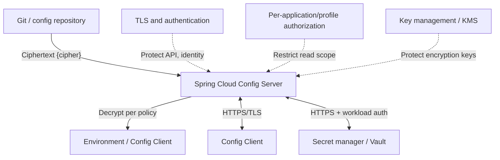
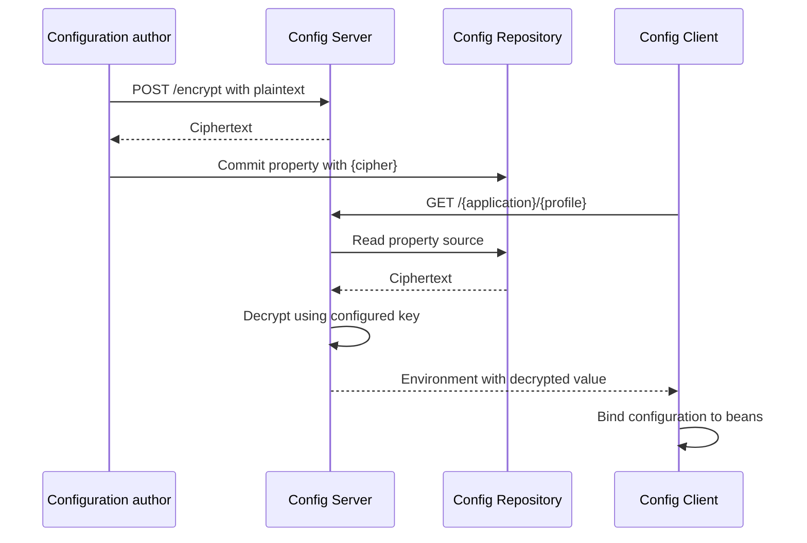

# Distinguishing Configuration Encryption from TLS and Secret Management Systems

> **Chapter:** Configuration Encryption  
> **Module:** `SPRING_CLOUD_CORE` — core Spring Cloud foundations in distributed systems, especially Spring Cloud Commons, Context, external configuration, and Spring Boot version compatibility. Learners explore refresh scope, discovery, service registry, service communication, and testing/operating shared abstractions.  
> **Focus:** Encrypting configuration values, securing data transport connections, and managing secret lifecycles are three distinct security responsibilities. This lesson uses Spring Cloud Config to show where each mechanism protects data, what its limits are, and how to combine them in production.

## 1. Why Must We Distinguish the Three Mechanisms?

A microservice may need database passwords, API tokens, private keys, Config Server credentials, and internal endpoint addresses. If everything is stored in `application.yml` and committed to Git, secrets can be exposed through the repository, commit history, backups, or build logs.

Spring Cloud provides several ways to work with sensitive configuration. However, three concepts are often treated as one:

- **Configuration encryption:** converts sensitive values into ciphertext before saving them in a configuration source, such as values prefixed with `{cipher}` in Git.
- **TLS/HTTPS:** protects data in transit over the network, authenticates the server, and depending on configuration can authenticate the client as well.
- **Secret management system (secret manager):** stores, authorizes, distributes, audits, revokes, and in many cases automatically rotates secrets.

The three mechanisms protect different boundaries. A password encrypted in Git can still leak when Config Server returns plaintext over HTTP. An HTTPS connection can still transmit a password stored in plaintext in the repository. A secret manager can issue tokens securely while the application still writes that token to logs.

### Learning Outcomes

After this lesson, you will be able to:

1. distinguish data encryption at rest, TLS in transit, and secret lifecycle management;
2. explain how Spring Cloud Config processes `{cipher}`-prefixed properties;
3. configure a symmetric key or RSA keystore for Config Server;
4. use `/encrypt` and `/decrypt` endpoints for their intended purposes;
5. distinguish decryption at Config Server from decryption at Config Client;
6. protect Config Server with TLS, authentication, and per-application authorization;
7. choose among Config Server encryption, a Vault backend, or a secret manager based on requirements;
8. plan key management, rotation, rollback, and decryption failure testing.

## 2. Three Protection Layers and Where They Apply

### 2.1. Configuration Encryption Protects Data at Rest

When a property is encrypted before committing, the repository stores only ciphertext. With Spring Cloud Config, encrypted values are marked with the `{cipher}` prefix.

Example:

```yaml
spring:
  datasource:
    username: app_user
    password: '{cipher}ENCRYPTED_VALUE'
```

If Config Server has the matching key, it recognizes the prefix and decrypts the value according to active policy. The main goal is avoiding storing secrets as plaintext in Git or a broadly accessible configuration store.

Configuration encryption does not on its own protect:

- data after Config Server decrypts it;
- requests/responses traversing the network;
- logs, heap dumps, crash dumps, or administrative endpoints;
- users authorized to read plaintext;
- decryption keys that are stored or distributed insecurely.

Ciphertext also does not conceal the entire repository structure. Property names, application names, profiles, labels, filenames, and unencrypted values can still reveal architectural details.

Encrypting values does not replace repository write permissions and review workflows. Anyone permitted to edit configuration can still replace endpoints, profiles, feature flags, or ciphertext with another value. Apply branch protection, code review, auditing, and least-privilege write permissions to the configuration repository.

### 2.2. TLS Protects Data in Transit

TLS establishes an encrypted channel between two endpoints and authenticates server identity via certificates. When using HTTPS for Config Server, credentials and property values are protected while traveling over the network.

TLS does not encrypt configuration files sitting in Git. Nor does it decide who is allowed to read which application's configuration. An authenticated client with overly broad permissions can still fetch another service's secrets if authorization policies do not restrict it.

### 2.3. Secret Managers Govern Access and Lifecycle

A secret manager such as HashiCorp Vault or a cloud secret management service typically provides:

- policies controlling which users or workloads may read a secret;
- authentication based on workload identity, Kubernetes, AppRole, or equivalent mechanisms;
- audit logs for access operations;
- versioning, revocation, and rotation;
- dynamic secrets or time-bound credentials in supported backends;
- a centralized place to manage secrets instead of distributing a shared decryption key across many applications.

A secret manager does not protect data in transit on its own. Applications still need TLS to connect to Vault or a secret service. Nor does it replace authorization on Config Server if Config Server continues serving multiple applications.

### 2.4. Comparison Table

| Mechanism | Primary Protection | Where Applied | What It Does Not Solve Alone |
| --- | --- | --- | --- |
| Configuration encryption `{cipher}` | Ciphertext instead of plaintext in the config store | Git, files, or config backend | TLS, read authorization, automatic rotation, log hygiene |
| TLS/HTTPS | Channel confidentiality and integrity; peer authentication via certificates | Client–Config Server, Config Server–Vault, service-to-service | Encrypting files in Git, property read authorization, secret lifecycle |
| Secret manager | Storage, authorization, auditing, revocation, and secret rotation | Vault/KMS/secret service and workload identity | Securing every network hop, TLS setup, application log controls |
| Authentication/authorization | Determines who may call APIs and read which application/profile | Config Server, Vault, API gateway | Encrypting data at storage or transport layers |

### 2.5. Diagram of Protection Layers



The diagram illustrates how layers work together. A concrete deployment may pull ciphertext from Git, pull secrets from Vault, or combine both for different groups of properties.

## 3. Threat Model: Protecting Against Whom and Where?

Before choosing mechanisms, identify assets, trust boundaries, and potential actors.

| Scenario | Risk | Required Mechanism |
| --- | --- | --- |
| Repository copied without authorization | Exposure of plaintext passwords/API tokens | At-rest encryption or keeping secrets out of Git |
| Network eavesdropper | Exposure of credentials and properties during config fetch | HTTPS/TLS, certificate verification |
| Client service A reads service B's config | Cross-application secret leakage | Authentication and per-application authorization |
| Unauthorized user calls `/decrypt` | Can decrypt ciphertext into plaintext | Endpoint protection, network restriction, operational permissions |
| Encryption key is stolen | Old ciphertext can be decrypted | KMS/secret manager, rotation, restricting key access |
| Config Server is compromised | Plaintext readable in memory or via API | Hardening, least privilege, TLS, network isolation, audit |
| Application is compromised | Secrets provisioned to the process readable from memory/env | Workload isolation, short-lived secrets, privilege reduction, access detection |
| Plaintext written to logs | Secrets leaked despite encrypted repository | Redaction, log access control, log testing |

No single property addresses every scenario. Encrypting ciphertext in Git reduces impact if the repository is read, yet if an attacker obtains the decryption key or permission to query Config Server, secrets can still be exposed.

## 4. How Does Spring Cloud Config Encrypt Properties?

### 4.1. The `{cipher}` Prefix

Spring Cloud Config identifies encrypted properties via the `{cipher}` prefix. When Config Server runs in default server-side decryption mode, it decrypts these properties before returning the Environment to Config Client over HTTP.

The repository may contain:

```yaml
spring:
  datasource:
    username: app_user
    password: '{cipher}BASE64_OR_CIPHER_TEXT'
```

The value after `{cipher}` is ciphertext generated using the key and encryption mechanism configured on Config Server. The string in the example is only a placeholder, not usable ciphertext.

With YAML, enclose the value in single or double quotes so the parser preserves the string beginning with `{cipher}`. With `application.properties`, encrypted values must not be wrapped in quotes; quotes can prevent Config Server from recognizing and decrypting them properly.

### 4.2. Flow from Encryption to Client Configuration Retrieval



In this model:

1. An authorized configuration author sends plaintext to the encryption endpoint.
2. Config Server returns ciphertext.
3. The author prepends `{cipher}` and saves the ciphertext in the repository.
4. Config Client requests configuration by application/profile/label.
5. Config Server reads the property source, decrypts the property, and returns the result.
6. The client receives the decrypted value and binds it into the application.

TLS remains necessary for `/encrypt` requests, configuration retrieval requests, and all connections between components.

### 4.3. Decryption Errors and `invalid` Properties

If Config Server fails to decrypt a value, it can remove the failing property from the property source and add a property with the same name prefixed by `invalid`, typically with value `<n/a>`. This prevents ciphertext from mistakenly being used as a password.

Abbreviated example:

```json
{
  "propertySources": [
    {
      "name": "application-prod.yml",
      "source": {
        "invalid.spring.datasource.password": "<n/a>"
      }
    }
  ]
}
```

If another property source supplies `spring.datasource.password`, the application may receive a fallback value from that source. That does not mean the secret decrypted successfully. Check for `invalid.*` and fail deployment if a required property lacks a valid value.

You can set `spring.cloud.config.server.encrypt.prefix-invalid-properties=false` to avoid renaming the key to `invalid.*`. In that case, the client may receive ciphertext instead of plaintext when the server fails to decrypt. Do not disable this mechanism unless the application has another reliable way to detect decryption failures.

## 5. Encrypting and Decrypting with Endpoints

### 5.1. The `/encrypt` Endpoint

Config Server provides `POST /encrypt` to encrypt plaintext with the configured key.

Example with a dummy string:

```bash
curl -sS -X POST \
  -H "Content-Type: text/plain" \
  --data-binary "REPLACE_WITH_SECRET" \
  https://config.example.internal/encrypt
```

The endpoint returns ciphertext. Save the ciphertext in the property with the `{cipher}` prefix.

When using `curl` with data containing special characters such as `+`, pay attention to form-data URL encoding. You can use `--data-urlencode` with proper syntax or explicitly set `Content-Type: text/plain` to prevent curl from misinterpreting content. Do not let curl progress meters or messages get concatenated onto the ciphertext.

Example YAML file after obtaining the result:

```yaml
spring:
  datasource:
    password: '{cipher}PASTE_CIPHERTEXT_HERE'
```

Never write plaintext into the same file, comments, commit messages, shell history, or CI logs.

### 5.2. The `/decrypt` Endpoint

`POST /decrypt` decrypts ciphertext when Config Server holds the matching key:

```bash
curl -sS -X POST \
  -H "Content-Type: text/plain" \
  --data-binary "PASTE_CIPHERTEXT_HERE" \
  https://config.example.internal/decrypt
```

This endpoint can return plaintext. Therefore, permission to call `/decrypt` must be narrower than regular configuration read permissions. Only authorized operators or pipelines should use it. Avoid calling the endpoint from browsers, tickets, chat, or logs where responses might be retained.

### 5.3. Protecting Encryption Endpoints

The `/encrypt` and `/decrypt` endpoints are sensitive administrative APIs. You must:

- require authentication;
- scope authorization specifically for encrypt/decrypt;
- allow access only over management networks or trusted pipelines;
- use HTTPS;
- audit callers, timestamps, and actions without logging plaintext;
- never expose them publicly through a load balancer;
- consider disabling or blocking endpoints when no longer needed operationally.

Protecting endpoints means more than turning on HTTP Basic. Distinguish users permitted to fetch configuration from users permitted to decrypt arbitrary plaintext.

### 5.4. Per-Application/Profile Encryption

Spring Cloud Config can support application- and profile-scoped encryption/decryption endpoint paths. However, to select different encryptors based on application name or profile, you must provide a custom `TextEncryptorLocator`. The default encryptor uses the same key for all operations, so do not assume adding `{application}` to the URL automatically isolates keys.

## 6. Symmetric and RSA Key Management

### 6.1. Symmetric Key

A symmetric key is a single secret used for both encryption and decryption. In Spring Cloud Config, `encrypt.key` can be configured with a secret string or the `ENCRYPT_KEY` environment variable.

Example using an environment variable in a deployment environment:

```bash
ENCRYPT_KEY=<INJECTED_SECRET_FROM_SECURE_STORE>
```

Or configure it at runtime through the platform's secret injection. Never commit real values into `application.yml`, Dockerfiles, public Helm values, pipeline YAML, or deployment scripts.

If the application uses legacy bootstrap (e.g., includes `spring-cloud-starter-bootstrap` or enables `spring.cloud.bootstrap.enabled=true` via a system property), Spring Cloud documentation requires placing `encrypt.key` in `bootstrap.properties`. With modern configuration, place the key in an initialization source aligned with Config Server's lifecycle.

The advantage of a symmetric key is simple configuration. The limitation is that any component holding the key can decrypt, and if multiple systems share one key, the blast radius of key compromise is large.

### 6.2. Asymmetric RSA Keys

With RSA, the public key encrypts and the private key decrypts. Spring Cloud Config supports keystores with these properties:

| Property | Meaning |
| --- | --- |
| `encrypt.keyStore.location` | Resource containing the keystore |
| `encrypt.keyStore.password` | Password to open the keystore |
| `encrypt.keyStore.alias` | Alias of the selected key |
| `encrypt.keyStore.type` | Keystore type, typically defaults to `jks` |

Illustrative example:

```yaml
encrypt:
  key-store:
    location: file:/run/secrets/config-encryption.jks
    password: ${CONFIG_KEYSTORE_PASSWORD}
    alias: config-encryption
    type: jks
```

The keystore file and password must be supplied from a secure source at runtime. Never place them in the same repository holding ciphertext.

In a design that decrypts at the server, the private key can stay on Config Server. The public key can be used where ciphertext is generated. If choosing client-side decryption, the private key must be distributed to clients that need to decrypt; this expands where sensitive keys reside and increases key management overhead.

### 6.3. Choosing Symmetric vs. Asymmetric?

| Criterion | Symmetric Key | RSA Key Pair |
| --- | --- | --- |
| Secret component | One shared key | Private key |
| Encryption | Uses shared key | Uses public key |
| Decryption | Uses shared key | Uses private key |
| Key distribution | Every acting party must protect the same secret | Public key can be distributed more widely; private key must be restricted |
| Operations | Simpler | Requires keystore, alias, and key pair management procedures |
| Suitable when | Small environment, clear trust boundary | Separating encryption and decryption privileges or centralizing key pair management |

Neither option automatically guarantees security if keys are stored in repositories, logs, or images. How keys are distributed and access-controlled matters more than the algorithm name.

## 7. Decryption at Config Server or at Config Client?

### 7.1. Server-Side Decryption Is the Common Default

In default mode, Config Server reads ciphertext, decrypts it using the server's key, and sends decrypted values to clients.

Advantages:

- clients do not need to hold decryption keys;
- key management is centralized in one place;
- clients are simpler;
- reduces the number of workloads capable of decrypting ciphertext.

Risks:

- Config Server sees plaintext in memory;
- Config Server becomes a component with access to many secrets;
- TLS and authorization must be strictly configured;
- if the server is compromised, secret exposure can be wide.

### 7.2. Client-Side Decryption

Some systems require Config Server to distribute only ciphertext. In that case, configure matching keys on clients and disable outgoing property decryption via:

```yaml
spring:
  cloud:
    config:
      server:
        encrypt:
          enabled: false
```

In legacy bootstrap, documentation requires placing this property in Config Server's `bootstrap.yml` or `bootstrap.properties`. Verify your active release train and lifecycle before deploying.

With RSA, Config Server can hold only the public key to encrypt, while the private key resides on clients authorized to decrypt. This can help when Config Server is considered a lower-trust zone than clients, yet it distributes private keys across many workloads and widens exposure if any client is compromised.

### 7.3. Comparing the Two Models

| Criterion | Server-Side Decryption | Client-Side Decryption |
| --- | --- | --- |
| Where decryption key lives | Config Server | Authorized clients |
| Data on Config Server–client link | Plaintext after decryption | Ciphertext |
| Client complexity | Lower | Higher; requires decryptor/key |
| Key compromise blast radius | Config Server and key management systems | Every client provisioned with the private/shared key |
| Suitable when | Config Server is a well-protected trust boundary | Only specific clients may hold private keys and the server must not see plaintext |

Whichever model you choose, TLS is still required. Ciphertext over the wire does not make TLS redundant, because requests also carry metadata, authentication tokens, and many unencrypted properties.

## 8. TLS/HTTPS for Config Server

### 8.1. TLS Protects the Transport Channel

In production, Config Server should be served over HTTPS. You can configure TLS with standard Spring Boot SSL properties (`server.ssl.*`) or place Config Server behind a TLS-terminating reverse proxy/gateway.

Illustrative example when the server terminates TLS itself:

```yaml
server:
  port: 8888
  ssl:
    enabled: true
    key-store: file:/run/secrets/config-server.p12
    key-store-type: PKCS12
    key-store-password: ${CONFIG_SERVER_KEYSTORE_PASSWORD}
```

The keystore holds the server's certificate and private key. The password must be supplied from a secret store/runtime environment. If TLS terminates at a reverse proxy, protect the proxy–Config Server link with network policies and internal TLS matching your threat model.

### 8.2. Trust Stores and Client Certificates

Config Client must verify Config Server's certificate. If the certificate is issued by an internal CA, clients must have the matching trust chain. Some deployments also require mutual TLS (mTLS), where clients also present certificates for server identity verification.

Config Client TLS properties vary across Spring Cloud Config versions. Modern versions feature `spring.cloud.config.tls.*` with trust store, key store, and passwords. Cross-check the reference for your exact release train; do not copy properties from older versions without verifying.

### 8.3. TLS Does Not Replace Authorization

HTTPS only establishes the channel and identity at the transport layer. After the TLS handshake completes, Config Server must still determine which principal is allowed to fetch which application/profile.

A client presenting a valid certificate must not automatically be able to read every secret. Combine TLS with least-privilege authentication and authorization.

## 9. Authentication and Authorization on Config Server

### 9.1. Authentication

Config Server can be protected with Spring Security using an appropriate model, such as HTTP Basic, OAuth2/JWT bearer tokens, or the platform's authentication mechanism. Clients must send credentials/tokens to the server as configured.

Never commit usernames/passwords, bearer tokens, or private keys to Git. Credentials can be provisioned via environment-specific overrides, workload identities, or Spring Cloud Vault.

### 9.2. Per-Application Access Control

By default, an authenticated user can request configuration for any application if they know that application's name. If you only check login without restricting applications, a client can try changing `{application}` in the URL to read another service's configuration.

Example:

```text
GET /orders/prod
GET /payments/prod
GET /identity/prod
```

If the `orders` client can change the URL and fetch `payments`, secrets isolated in Git can still leak through Config Server.

You need authorization policies binding principals/claims to application paths. Use a custom `SecurityFilterChain` or `RequestMatcher` to ensure each client reads only its own service's configuration plus explicitly permitted shared sources.

### 9.3. Authorizing Administrative Endpoints

Permission to read configuration, call `/encrypt`, call `/decrypt`, and administer Actuator should be treated as separate capabilities. Do not grant all of them to every client.

- Runtime clients: read only the required application/profile.
- Encryption pipelines: permitted to call `/encrypt` only if genuinely needed.
- Key administration team: access keystores/KMS and execute rotation.
- Operators: observe health and audit within job scope.
- `/decrypt`: granted only to an extremely restricted group, as the endpoint returns plaintext.

## 10. Secret Managers and Spring Cloud Vault

### 10.1. When Should You Use a Secret Manager?

`{cipher}` encryption works well when ciphertext needs to live in a configuration repository with a stable key management workflow. A secret manager is more suitable when secret lifecycle management is required:

- granting per-workload access;
- auditing who reads secrets;
- revoking credentials when workloads are removed;
- periodic or incident-driven rotation;
- issuing dynamic, time-bound credentials for databases/cloud services;
- avoiding sharing one decryption key across multiple services.

With dynamic secrets, applications may receive credentials with a TTL and must handle renewal/expiration. Do not assume every secret manager or backend supports dynamic credentials for every system; capabilities depend on engines and integrations.

### 10.2. Config Server Using Vault as a Backend

Spring Cloud Config Server supports Vault as an environment repository. You can enable the `vault` profile and configure the matching address/backend/authentication:

```yaml
spring:
  profiles:
    active: vault
  cloud:
    config:
      server:
        vault:
          host: vault.internal.example
          port: 8200
          scheme: https
          backend: secret
          kv-version: 2
```

This is a basic connection example. Credentials or workload authentication must be configured via a secure source; never put real tokens into repository files. Vault supports tokens and other authentication methods such as AppRole or Kubernetes authentication, depending on version and integration dependencies.

Config Server can query Vault and serve property sources per application/profile. For example, paths can separate shared and service-specific configuration:

```text
secret/application
secret/orders
secret/application,prod
secret/orders,prod
```

Actual path structure depends on the backend, `defaultKey`, `profileSeparator`, KV version, and Vault configuration. Test path resolution before going to production.

### 10.3. Config Server Vault Backend vs. Spring Cloud Vault Client

The two models have different access flows:

| Model | Who Calls Vault? | Access Control Point |
| --- | --- | --- |
| Config Server Vault backend | Config Server | Config Server uses its identity/token to read permitted paths |
| Spring Cloud Vault client | Each application | Each workload has its own identity and policy |
| Config Server with Git `{cipher}` | Config Server decrypts ciphertext with a key | Config Server manages encryption/decryption keys |

If every application fetches secrets through a single Config Server identity, evaluate whether the server's policy is overly broad. If applications call Vault directly, manage workload identities and network access for each service.

### 10.4. A KMS Is Not Identical to a Secret Manager

A KMS primarily manages encryption keys, key usage permissions, and encrypt/decrypt/wrap/unwrap operations. A secret manager manages secret values, access policies, and secret lifecycles. A platform may integrate a KMS to protect Vault or secret store encryption keys, yet the two roles remain distinct.

Never call an environment variable a secret manager. An environment variable is only a way to inject values into a process; it does not provide policies, auditing, rotation, or revocation on its own.

## 11. Key Management and Rotation

### 11.1. Why Plan Rotation?

Encryption keys may need to change when:

- key compromise is suspected or confirmed;
- personnel with key access leave the team;
- boundaries between environments change;
- internal policy mandates periodic rotation;
- dev, staging, and production keys must be separated;
- migrating from a shared key to a key pair or KMS-backed key management.

If you only swap the key on Config Server without re-encrypting existing properties, old ciphertext may become undecryptable. Key changes must be coordinated with the repository and deployment workflow.

### 11.2. Multiple Keys and Aliases

With a keystore, Spring Cloud Config supports prefixes like `{key:alias}` before the ciphertext to select the corresponding key alias. Example:

```yaml
database:
  password: '{cipher}{key:config-key-2026}CIPHERTEXT_VALUE'
```

Config Server must have alias `config-key-2026` in its keystore and `TextEncryptorLocator` must resolve the matching encryptor. `{secret:...}` can be used in certain locator configurations, though secrets inside prefixes must also be protected; documentation recommends using a custom `SecretLocator` if managing such secrets.

### 11.3. Controlled Rotation Procedure

An illustrative workflow:

1. Create a new key in KMS/keystore with a clear alias.
2. Grant Config Server permission to use the new key.
3. Verify encrypt/decrypt with non-sensitive test data.
4. Re-encrypt properties migrating to the new key.
5. Add the `{key:new-alias}` prefix and update ciphertext in the repository.
6. Verify Config Server decrypts all properties and produces no `invalid.*`.
7. Deploy via canary or test environment first.
8. Monitor Config Clients, downstream connections, and authentication errors.
9. Retain the old key during the defined rollback window if there is no sign of compromise.
10. Revoke/delete the old key once no ciphertext depends on it.

If a key was compromised, prioritize containment: narrow or revoke permissions, issue a new key, re-encrypt secrets, rotate the underlying secrets if needed, and assess whether old ciphertext may have been exfiltrated. Rotating the encryption key does not automatically change exposed database passwords or API tokens; those credentials may need separate rotation.

### 11.4. Separating Keys by Environment

Do not share a single key across development, staging, and production without an approved reason. Separating keys helps:

- limit blast radius if the dev environment is compromised;
- allow revoking keys for one environment independently;
- control operator groups and access permissions;
- reduce the risk of ciphertext from one environment being decrypted in another.

Never put production keys onto developer laptops or CI jobs that do not need that permission.

## 12. Common Errors and Diagnostics

| Symptom | Possible Cause | How to Check |
| --- | --- | --- |
| Client receives `invalid.*` | Wrong key/alias, unreadable keystore, or incompatible ciphertext | Config Server logs, alias, key version, and decrypt result |
| Client receives ciphertext instead of plaintext | Server disabled decryption or key config was not loaded | `spring.cloud.config.server.encrypt.enabled`, key location |
| YAML property is not decrypted | Missing `{cipher}`, value altered by parser, or wrong file format | Ciphertext string and YAML quoting |
| `application.properties` does not decrypt | Ciphertext value wrapped in quotes | Remove quotes per Config Server guide |
| `/encrypt` returns error | Endpoint blocked, missing key, or wrong payload encoding | Security policy, Content-Type, and body submission |
| `/decrypt` does not return plaintext | Key mismatch or endpoint unauthorized | Keystore, alias, and authorization |
| Config Client receives plaintext over HTTP | TLS not enabled or TLS-terminating proxy leaves internal hop unprotected | Scheme, certificate, and network path |
| Service A reads Service B's config | Missing per-application authorization | `SecurityFilterChain`/`RequestMatcher` and principal mapping |
| Rotation breaks multiple service startups | New ciphertext uses unprovisioned alias or old key deleted too early | Aliases on all server instances and config revisions |
| Secrets appear in logs | Debug logging, exceptions, or unmasked Actuator endpoints | Log patterns, redaction, and Actuator permissions |
| Vault returns 403 or missing key | Wrong token/policy/path/KV version | Vault audit, policy, and path resolution |

### 12.1. Testing Decryption Failures Intentionally

In a test environment, you can encrypt ciphertext with key A and configure Config Server with only key B. Check:

- Config Server logs the decryption error;
- the response includes `invalid.*` per policy;
- Config Client does not accidentally use an unsafe fallback;
- health/readiness or deployment gates detect missing required secrets;
- the pipeline blocks releasing broken revisions.

Never test by intentionally breaking production keys or putting real secrets into test logs.

### 12.2. Testing Cross-Access Controls

Create two test principals for `orders` and `payments`. Confirm:

- `orders` can read configuration granted to `orders`;
- `orders` cannot read `/payments/prod`;
- administrative principals have only the required permissions;
- `/decrypt` and Actuator do not grant unintended access.

This tests authorization, not merely successful authentication.

## 13. Scenario-Based Design Practice

### 13.1. Scenario A — Git Repository Containing Database Passwords

Requirement: developers need configuration versioned alongside source code, without plaintext passwords appearing in Git.

Approach:

1. use Spring Cloud Config encryption to generate ciphertext;
2. commit `{cipher}` values in configuration files;
3. keep keys on Config Server or in a KMS/secret store;
4. enforce HTTPS between clients and Config Server;
5. restrict per-application access;
6. test decryption failures and rotation.

If passwords must rotate frequently or can be issued as dynamic credentials, consider moving them to Vault/database secret engine instead of maintaining static ciphertext in Git.

### 13.2. Scenario B — Config Server Behind Untrusted Networks

Requirement: the server is accessed across multiple network segments.

Approach:

- configure TLS on Config Server or a reverse proxy;
- use client certificates/mTLS when transport-layer workload authentication is needed;
- verify trust chains, hostnames, and certificate expiration;
- protect Config Server with authentication and per-app authorization;
- distribute ciphertext only if there is a clear rationale and client-side key distribution is controlled;
- never treat `{cipher}` as an excuse to skip HTTPS.

### 13.3. Scenario C — Multiple Microservices with Separate Secrets

Requirement: `orders`, `payments`, and `identity` have distinct credentials; each team may read only its own service's secrets.

Approach:

- create dedicated identities per workload;
- assign dedicated policies per application/path;
- if using Config Server, map principals to application paths;
- if using Vault directly, grant separate workload identities and policies to each service;
- never use one shared token with read permission across all secrets;
- audit accesses and test cross-access rejection in CI/security tests.

### 13.4. Scenario D — Short-Lived Secrets

Requirement: database credentials are lease-based and expire automatically.

Approach:

- use a secret manager/database engine capable of issuing dynamic credentials;
- the application must handle TTL, renewal, and credential rotation;
- connection pools must have a strategy to swap credentials and open new connections;
- monitor lease renewals and authentication errors;
- do not expect static ciphertext in Git to produce dynamic credentials.

## 14. Production Configuration Security Checklist

Before deploying, confirm:

1. Every sensitive property is classified and has an owner.
2. Secrets never appear in plaintext in Git, images, logs, tickets, or artifacts.
3. `{cipher}` is used only for properties that genuinely must be stored as ciphertext in the repository.
4. Symmetric/RSA keys are provisioned through a secret store or protected keystore.
5. Dev, staging, and production have separate keys/identities.
6. `/encrypt` and `/decrypt` are protected with narrow authorization.
7. Config Server and hops carrying credentials use TLS.
8. Certificates are monitored, renewed, and planned for rotation.
9. Clients read only authorized applications/profiles.
10. Vault or secret manager policies follow least privilege.
11. Audit logs exist without recording plaintext secrets.
12. Separate key rotation and credential rotation procedures exist.
13. Tests cover `invalid.*`, wrong aliases, expired keys, and Vault authorization failures.
14. Canary/rollback plans exist when key or secret changes affect multiple services.
15. An incident procedure exists if plaintext was ever committed: revoke/rotate credentials, audit repository history, and purge sensitive data from history under controlled procedures.

## 15. Practice Exercises

### Exercise 1 — Distinguishing Three Protection Layers

An application stores its password as `{cipher}` in Git, Config Server serves over HTTP, and clients can access the `/decrypt` endpoint.

Identify three independent risks and propose remediation for each. Explain why Git encryption does not protect passwords transmitted over HTTP.

### Exercise 2 — Server-Side or Client-Side Decryption?

An organization shares one Config Server across 40 services. The security team does not want clients holding decryption keys, but requires the server to be strictly hardened.

Compare the two models, identifying trust boundaries, key distribution, and blast radius. Select the model matching the requirements and explain the conditions that make that decision safe.

### Exercise 3 — `invalid.*` Errors

Config Server returns `invalid.spring.datasource.password=<n/a>`, yet the application still starts because a local file provides a default password.

Explain how property source ordering allows the fallback value to win. Propose a deployment gate to detect invalid properties and prevent the application from running with insecure default credentials.

### Exercise 4 — Per-Application Authorization

Principal `orders-client` can read `/payments/prod` even after logging in successfully.

Identify why authentication alone is insufficient, propose a policy comparing principal/claims against application paths, and write tests for allowed/denied access.

### Exercise 5 — Rotating RSA Keys

A keystore has alias `config-key-old`. Operations needs to migrate to `config-key-new` without causing services to lose configuration access.

Outline the sequence for creating the alias, verifying keys, re-encrypting ciphertext, updating `{key:...}`, running a canary rollout, keeping the old key for rollback, and revoking it after migration completes.

### Exercise 6 — Choosing Vault vs. Ciphertext in Git

A service needs database credentials with a 30-minute TTL, auditing of every issuance, and automatic revocation when the workload is deleted.

Explain why static ciphertext in Git does not fully meet these lifecycle requirements. Propose an appropriate Vault/backend setup, workload authentication, and how to handle connection pools when credentials change.

### Quick Self-Check

1. Where does `{cipher}` protect data? **Primarily while values sit in the repository or configuration store.**
2. Where does TLS protect data? **In transit between components.**
3. What capabilities does a secret manager add? **Policies, auditing, revocation, rotation, and in some backends dynamic secrets.**
4. Where does Config Server decrypt `{cipher}` by default? **On the server before sending property sources to clients.**
5. Which model does `encrypt.key` apply to? **Shared symmetric key.**
6. Which keys does RSA use to encrypt and decrypt? **Public key encrypts, private key decrypts.**
7. Why does `/decrypt` need narrow permissions? **Because responses can contain plaintext secrets.**
8. Why is HTTPS still needed when properties are encrypted in Git? **Because the server may decrypt before returning them; credentials and other properties also cross the network.**
9. Is authentication enough to isolate configurations across services? **No; authorization per application/profile/path is required.**
10. Does rotating the encryption key automatically rotate database passwords? **No; underlying credentials may need separate rotation.**

**Core message:** Configuration encryption protects ciphertext at rest; TLS protects the transport channel; secret managers govern access and secret lifecycles. Spring Cloud Config `{cipher}` is useful when storing ciphertext in Git, yet Config Server, decryption keys, administrative endpoints, and clients must still be secured. Choose the right layers for your threat model and combine them with least privilege, TLS, auditing, key rotation, and cross-access testing.

**References:** [Spring Cloud Config — Encryption and Decryption](https://docs.spring.io/spring-cloud-config/reference/server/encryption-and-decryption.html), [Spring Cloud Config — Key Management](https://docs.spring.io/spring-cloud-config/reference/server/key-management.html), [Spring Cloud Config — Serving Encrypted Properties](https://docs.spring.io/spring-cloud-config/reference/server/serving-encrypted-properties.html), [Spring Cloud Config — Security](https://docs.spring.io/spring-cloud-config/reference/server/security.html), [Spring Cloud Config — Vault Backend](https://docs.spring.io/spring-cloud-config/reference/server/environment-repository/vault-backend.html), and [Spring Cloud Config — Using Multiple Keys and Key Rotation](https://docs.spring.io/spring-cloud-config/reference/server/using-multiple-keys-and-key-rotation.html). Properties and lifecycle details may vary across release trains; cross-check documentation for your exact deployed version.
