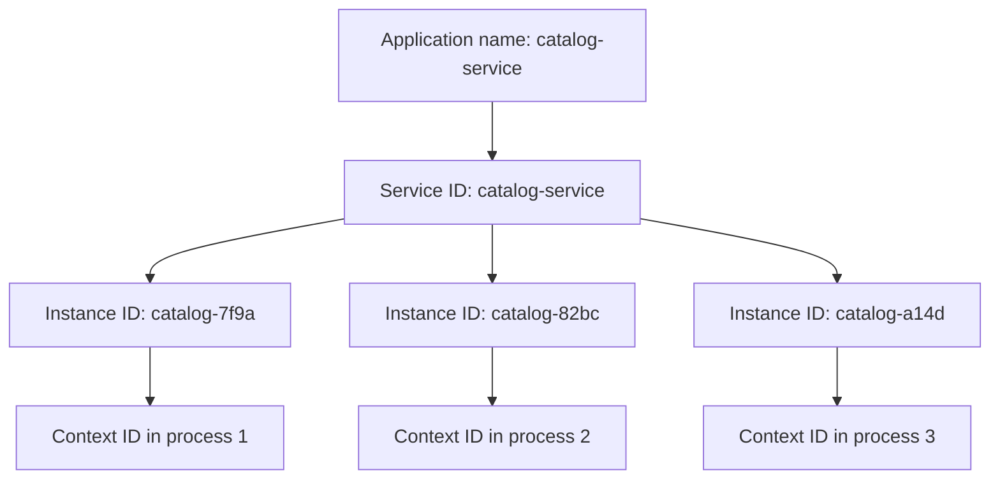
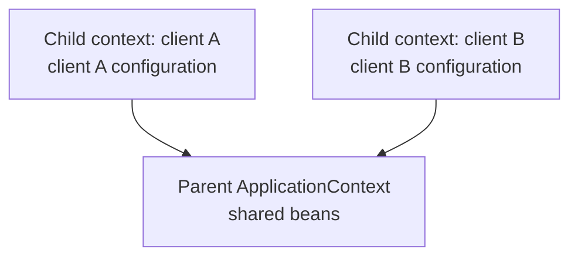
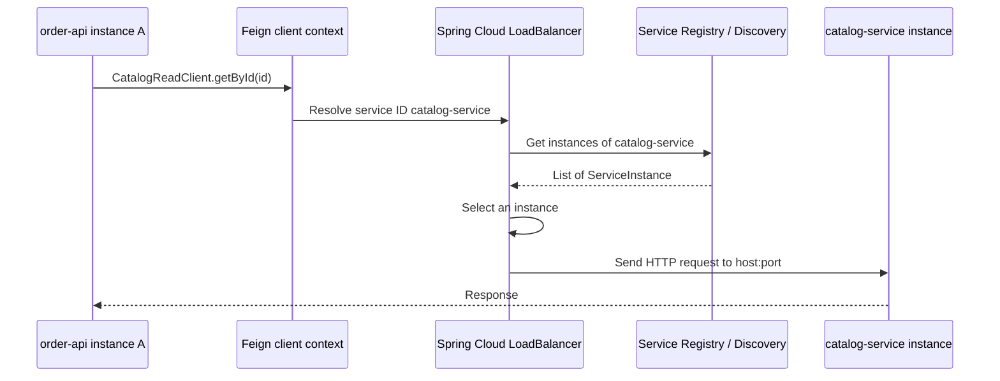

# Distinguishing application name, service ID, instance ID, and context ID

In a Spring Cloud system, an application can be deployed as multiple replicas, registered in a service registry, and create multiple child `ApplicationContext` instances to isolate configurations for clients. Each of these components has a name or ID, but they answer different questions. If `spring.application.name`, service ID, instance ID, and context ID are confused with one another, the system can look up the wrong service, register duplicate instances, or produce logs that prevent operators from identifying which process is experiencing an error.

This lesson belongs to the **Identity and Networking** chapter of the SPRING_CLOUD_CORE module. The goal is to distinguish the four concepts, understand how they relate in Spring Cloud Commons, service discovery, and the context hierarchy, and know how to choose appropriate values when deploying multiple instances or multiple clients in the same JVM.

## 1. Four questions, four types of identifiers

| Identifier | Question answered | Typical scope |
| --- | --- | --- |
| Application name | What is this logical application named? | One application/service type across environments and replicas |
| Service ID | Which logical service group do we want to find or call in the registry/load balancer? | One logical service that may have multiple instances |
| Instance ID | Which specific registration is providing the service? | One specific process/container/replica in the registry |
| Context ID | Which specific ApplicationContext or child context is managing beans/configurations? | One Spring context inside a JVM |

For example, a system has three replicas of catalog-service:



This is an illustrative model, not a mandatory rule that the service ID always equals the application name or that the context ID always has the same structure. Actual values depend on application configuration, discovery implementation, and how the context is created.

## 2. Application name: the name of the logical application

### 2.1. spring.application.name

In Spring Boot, the common property for naming an application is spring.application.name:

```yaml
spring:
  application:
    name: catalog-service
```

Or via an environment variable:

```text
SPRING_APPLICATION_NAME=catalog-service
```

This name describes the running logical application. Spring Cloud components typically use it as the default value for several functions, such as the application name when fetching configuration from Config Server or the service name when registering with discovery, unless overridden by a specialized property.

The application name should remain stable across replicas of the same service. Three Pods running the same catalog-service artifact usually share the same spring.application.name, even though their hostname, IP, port, and instance ID differ.

### 2.2. Application name participates in configuration retrieval

Spring Cloud Config Client uses the application name, profile, and label to request the appropriate configuration set. For example:

```yaml
spring:
  application:
    name: catalog-service
  config:
    import: "optional:configserver:"
  cloud:
    config:
      label: main
```

Config Server can use the name catalog-service along with the prod profile and main label to select the corresponding property sources. Therefore, the application name needs to align with the configuration repository's conventions.

In some Config Client configurations, spring.cloud.config.name can specify a dedicated name used solely for requesting configuration. If this specialized property is set, do not assume the name sent to Config Server always matches spring.application.name; inspect the client's requests and logs.

### 2.3. Application name is not instance identity

Do not use a hostname or Pod name as spring.application.name just to distinguish replicas. Doing so turns every replica into a separate logical application, making service discovery, load balancing, and organizing shared configuration difficult.

Example of what NOT to use for three replicas of the same service:

```text
SPRING_APPLICATION_NAME=catalog-pod-7f9a
SPRING_APPLICATION_NAME=catalog-pod-82bc
SPRING_APPLICATION_NAME=catalog-pod-a14d
```

In the standard model, all three should use:

```text
SPRING_APPLICATION_NAME=catalog-service
```

The hostname or Pod UID can be used in the instance ID, metadata, or logs to identify each running copy.

## 3. Service ID: logical identifier used to look up a service

### 3.1. Service ID in service discovery

The Service ID is the logical name that a client uses to look up the group of instances providing a service. In Spring Cloud Commons, the DiscoveryClient abstraction provides operations such as listing service IDs and retrieving ServiceInstance objects by service ID.

Example of using the abstraction:

```java
import java.util.List;

import org.springframework.cloud.client.ServiceInstance;
import org.springframework.cloud.client.discovery.DiscoveryClient;
import org.springframework.stereotype.Component;

@Component
public class CatalogDiscovery {
    private final DiscoveryClient discoveryClient;

    public CatalogDiscovery(DiscoveryClient discoveryClient) {
        this.discoveryClient = discoveryClient;
    }

    public List<ServiceInstance> catalogInstances() {
        return discoveryClient.getInstances("catalog-service");
    }
}
```

Here, catalog-service is the service ID being looked up. The registry returns the corresponding list of instances if valid registrations exist and are visible to the discovery client.

### 3.2. Service ID often matches application name, but is not required to

In simple configurations, spring.application.name is commonly used as the default service ID during registration. However, service ID is a concept at the discovery/load balancing layer; application name is the name of the application. Each discovery implementation has its own properties to change the registered name or how names are normalized.

Example:

| Component | Illustrative value |
| --- | --- |
| spring.application.name | catalog-api |
| Registered Service ID in the registry | catalog-service |
| Instance ID | catalog-service:pod-7f9a |

This pattern can appear when a logical application has an internal name that differs from the published service name. However, it must be clearly configured and tested because Config Server, metrics, logs, and the registry may use different names.

### 3.3. Service ID used in LoadBalancer and clients

Client-side load balancing typically takes a service ID as input, retrieves the list of instances, and selects an appropriate instance. Conceptual example:

```text
Client
  -> LoadBalancer("catalog-service")
      -> DiscoveryClient.getInstances("catalog-service")
          -> instance A
          -> instance B
          -> instance C
```

With Spring Cloud OpenFeign, the name attribute of @FeignClient typically identifies the service name that the client calls through the LoadBalancer:

```java
import org.springframework.cloud.openfeign.FeignClient;
import org.springframework.web.bind.annotation.GetMapping;
import org.springframework.web.bind.annotation.PathVariable;

@FeignClient(name = "catalog-service")
public interface CatalogClient {
    @GetMapping("/catalog/{id}")
    CatalogItem getById(@PathVariable("id") String id);
}
```

In this example, catalog-service is the service name/service ID used for routing. The client does not need to know the IP of each Pod in advance; discovery and load balancing handle selecting an instance according to the configuration.

## 4. Instance ID: identifier of a specific registration

### 4.1. Why is an instance ID needed?

One service ID can have multiple instances providing the service simultaneously. The registry needs to distinguish each registration to update status, handle heartbeats/leases, manage metadata, and perform deregistration.

Example:

| Service ID | Instance ID | Host | Port |
| --- | --- | --- | ---: |
| catalog-service | catalog-pod-7f9a | 10.0.1.21 | 8080 |
| catalog-service | catalog-pod-82bc | 10.0.1.22 | 8080 |
| catalog-service | catalog-pod-a14d | 10.0.1.23 | 8080 |

The three registrations belong to the same service ID, yet each has its own instance ID. When one Pod stops, the registry needs to identify the exact registration to remove or mark unhealthy; it must not delete the entire service.

### 4.2. Instance ID must be unique within the registry scope

The instance ID should be unique within the scope required by the registry, usually within a service ID or its corresponding namespace/tenant. If two replicas register under the same service ID with the same instance ID, the registry may overwrite the registration, update the wrong address, or render the health status inaccurate.

Common sources used to generate an instance ID:

- Pod UID or container/task ID.
- Hostname combined with port.
- Machine ID plus process/port.
- An ID assigned when the process starts up.

Do not simply use a fixed value like catalog-1 for every replica. If stability across restarts is needed, understand the registry's semantics and how the platform reuses identity. A fresh instance ID per Pod generally fits orchestrated environments; a stable ID may suit statically managed processes.

### 4.3. Instance ID depends on the discovery implementation

Spring Cloud Commons provides the common abstraction, but the rules for generating an instance ID are typically determined by the specific discovery client/registry. Eureka, Consul, Kubernetes discovery, or other implementations have different registration models and configuration properties.

For example, with Eureka, eureka.instance.instance-id is a commonly used property to customize the instance ID. Illustrative configuration:

```yaml
spring:
  application:
    name: catalog-service

eureka:
  instance:
    instance-id: "catalog-service:catalog-pod-7f9a:8080"
```

This is an example for Eureka, not a universal property that applies to every registry. The actual value should be provisioned uniquely for each Pod or process. Do not assume default instance IDs are identical across discovery providers. When migrating from Eureka to Consul or another registry, inspect how registration identity is generated, updated, and deregistered.

### 4.4. Metadata is not an instance ID

Metadata consists of key/value pairs attached to a registration, for example:

```yaml
eureka:
  instance:
    metadata-map:
      zone: ap-southeast-1a
      version: v2
      team: catalog
```

Metadata can help a load balancer or operations system select instances by zone/version/team. It does not replace the instance ID. Multiple instances can share the same metadata zone=ap-southeast-1a, yet still require distinct identities.

## 5. Context ID: identifier of a Spring ApplicationContext

### 5.1. An ApplicationContext has its own ID

An ApplicationContext is the container that manages beans, events, resources, and parent-child relationships. Each context has an ID observable via ApplicationContext.getId().

```java
import org.springframework.context.ApplicationContext;
import org.springframework.stereotype.Component;

@Component
public class ContextIdentityReporter {
    private final ApplicationContext applicationContext;

    public ContextIdentityReporter(ApplicationContext applicationContext) {
        this.applicationContext = applicationContext;
    }

    public String currentContextId() {
        return applicationContext.getId();
    }
}
```

The Context ID helps identify which context is managing a bean. It is not a network address, not a service ID in the registry, and not the ID of a replica.

The default value of the context ID can depend on Spring Boot, Spring Cloud initializers, how the context is created, and application configuration. When a stable identity is needed, observe getId() at runtime and configure/initialize the context explicitly via the appropriate API, rather than inferring that it always equals spring.application.name.

### 5.2. Parent-child context

A single JVM can host multiple contexts:



A child context can look up beans from the parent; the parent cannot see beans that exist only in the child. Each context has its own lifecycle and management scope. The Context ID helps distinguish these contexts in logs and bean/configuration diagnostics.

An application can have a single application name and a single service ID registered in the registry, yet have multiple context IDs inside the same process. This commonly occurs when Spring Cloud creates named contexts to isolate configuration for clients or sub-components.

### 5.3. Context ID of a child client

Some Spring Cloud integrations have a contextId attribute to identify a configuration context dedicated to a client. For example, Spring Cloud OpenFeign:

```java
import org.springframework.cloud.openfeign.FeignClient;

@FeignClient(
    name = "catalog-service",
    contextId = "catalogReadClient"
)
public interface CatalogReadClient {
    // Catalog read API.
}

@FeignClient(
    name = "catalog-service",
    contextId = "catalogAdminClient"
)
public interface CatalogAdminClient {
    // Catalog admin API.
}
```

Two clients can call the same service ID catalog-service, while using different contextId values to distinguish separate client configurations/ensembles. For example, one client can have a long read timeout while the other has a short admin timeout.

Here, contextId is an attribute of the OpenFeign client configuration, not the service ID registered in the registry, and not necessarily the direct value of ApplicationContext.getId() in every version. It identifies the client context/ensemble according to the integration's conventions.

Do not change `name` just to avoid client configuration conflicts if the intent is to call the same service. Use `contextId` for the purpose of distinguishing client contexts when the integration supports it.

## 6. Relationship among the four identifiers

Suppose an order-api application calls catalog-service and runs three replicas. Each replica has one main Spring context and one named context for the Feign client.

| Component | Replica A | Replica B | Replica C |
| --- | --- | --- | --- |
| Application name | order-api | order-api | order-api |
| Registered Service ID of the caller application | order-api | order-api | order-api |
| Registered Instance ID | order-api-a1 | order-api-b2 | order-api-c3 |
| Main Context ID | order-api-main-a | order-api-main-b | order-api-main-c |
| Target Feign service ID | catalog-service | catalog-service | catalog-service |
| Feign contextId | catalogReadClient | catalogReadClient | catalogReadClient |

The values in the table illustrate different identity scopes. The main Context IDs are named explicitly for readability; this is not Spring's default rule. catalogReadClient can be identical across JVMs because it identifies the type of client context within each process, not a cluster-wide instance ID.

Call flow:



The caller's application name, the callee's service ID, the instance ID returned by the registry, and the client's context ID all participate at different layers within the same request.

## 7. Related Spring Cloud Commons abstractions

Spring Cloud Commons provides abstractions so applications depend less on a specific registry.

### 7.1. DiscoveryClient

DiscoveryClient allows querying known services and retrieving a list of instances by service ID:

```java
List<String> serviceIds = discoveryClient.getServices();
List<ServiceInstance> instances =
        discoveryClient.getInstances("catalog-service");
```

The resulting ServiceInstance typically provides information such as service ID, host, port, URI, secure flag, and metadata. Specific fields may depend on the implementation; the instance ID may be absent or represented in a provider-specific way.

### 7.2. ServiceRegistry and Registration

ServiceRegistry is the abstraction for registering, deregistering, and updating registration status. Registration represents the instance information that the discovery provider needs to publish the service.

Conceptually:

```text
ServiceRegistry
  register(Registration)
  deregister(Registration)
  setStatus(Registration, status)

Registration / ServiceInstance
  serviceId
  host
  port
  secure
  metadata
  instance identity (implementation-dependent)
```

Applications typically let auto-configuration and lifecycle integration manage registration. Only call ServiceRegistry.register() manually when there is an explicit requirement; duplicate registration or deregistering at the wrong time can cause the registry to lose accurate state.

### 7.3. LoadBalancer

Spring Cloud LoadBalancer takes a service ID and selects a ServiceInstance from the list of available instances. It operates at the client-side routing layer; the service ID is the logical input, and the instance host/port is the physical target after selection.

LoadBalancer can apply policies such as round-robin or a custom supplier. Metadata can be used to filter instances by zone, version, or other attributes if configured accordingly.

## 8. Naming rules and identity design

### 8.1. Application name

- Use a stable, recognizable name consistent with the domain/service.
- Replicas of the same application share the same application name.
- Avoid putting Pod UIDs, hostnames, or random suffixes into the application name.
- Keep the name synchronized with the Config Server repository and metrics/logging conventions.

### 8.2. Service ID

- Use the logical name that callers will look up.
- Avoid using IP addresses/ports as the service ID.
- If the service ID differs from the application name, document the mapping and the registry/load balancer configuration clearly.
- Use the same service ID for instances that expose a compatible service contract.

### 8.3. Instance ID

- Ensure uniqueness within the scope required by the registry.
- Tie it to a specific registration/process/container.
- Do not use the same ID for multiple concurrent replicas.
- Decide whether the ID remains stable across restarts or changes with the Pod lifecycle.
- Ensure deregistration/lease cleanup when an instance stops or loses connectivity.

### 8.4. Context ID

- Use it to distinguish contexts within the same process or named client contexts.
- Keep the ID stable and readable if needed for logs/diagnostics.
- Do not use the context ID as the service ID in the registry.
- With Feign or named client integrations, use contextId to separate client configurations when multiple clients need to call the same service.
- Manage the closing of child contexts and the resources those contexts own.

## 9. Configuration example for multiple replicas

Suppose catalog-service runs three replicas on Kubernetes. Shared configuration in the image:

```yaml
spring:
  application:
    name: catalog-service

server:
  port: 8080
```

Each Pod has a distinct hostname assigned by the platform. For registries that support customizing the instance ID, the Pod name/UID can be combined with the service name and port. Example of values injected into each container:

```text
SPRING_APPLICATION_NAME=catalog-service
INSTANCE_ID=catalog-service:catalog-7f9a:8080
```

Mapping INSTANCE_ID to a discovery provider's specific property depends on the implementation; Spring Cloud Commons does not mandate a universal environment variable named INSTANCE_ID across all registries.

If using Eureka, you can configure:

```yaml
eureka:
  instance:
    instance-id: "catalog-service:catalog-pod-7f9a:8080"
```

The example needs to be adjusted based on how values are injected into each Pod and must ensure results differ across replicas. With Consul or other providers, use the corresponding registration property instead of copying eureka.instance.instance-id.

When a caller wants to invoke catalog:

```java
@FeignClient(name = "catalog-service", contextId = "catalogReadClient")
public interface CatalogReadClient {
    @GetMapping("/catalog/{id}")
    CatalogItem get(@PathVariable("id") String id);
}
```

The caller only needs the catalog-service service ID. Discovery returns the available instances and LoadBalancer selects an appropriate target. The instance ID helps the registry distinguish registrations; the context ID helps Spring isolate client configuration inside the caller process.

## 10. Troubleshooting identity issues

| Symptom | Possible cause | What to check |
| --- | --- | --- |
| Config Server returns wrong configuration | Incorrect spring.application.name, config name, profile, or label | Inspect Config Client requests and file names/revisions on the server |
| Registry shows many unexpected services | Each replica uses a different application name | Check SPRING_APPLICATION_NAME on each Pod |
| Only one replica appears in registry | Duplicate instance ID or registration overwritten | Check instance ID, host, port, and provider config |
| Registry still holds stopped instances | Deregistration/lease/health check not working | Check shutdown lifecycle, heartbeat, and TTL |
| LoadBalancer cannot find service | Service ID used by caller differs from registered service ID | Compare @FeignClient(name=...), DiscoveryClient service list, and registry |
| Calls routed to wrong service | Confused application name with service ID or alias | Verify mapping between logical name and registry name |
| Two Feign clients collide on config | Shared contextId when separate client configs are needed | Set distinct contextId values per integration |
| Bean not found in child context | Confused parent-child visibility or context ID | Check context hierarchy and where the bean is registered |
| Logs hard to pinpoint failing context | Context ID unclear or not included in logs | Log application name, instance ID, and context ID appropriately |

Investigation sequence:

1. Verify spring.application.name inside the exact process.
2. Verify the service ID stored by the registry.
3. List instances by service ID and inspect instance ID/host/port/health.
4. Verify the caller uses the right service ID when invoking LoadBalancer/Feign.
5. Inspect the context ID of the named client or child context if the error involves configuration/beans.
6. Compare across replicas to find mismatched application names, instance IDs, or profiles.

Do not rely solely on display names in a dashboard. Some registries normalize letter casing, namespaces, or service names according to their own rules; verify the actual registered values via the provider's API or logs.

## 11. Testing identity and discovery

| Goal | How to test | What to verify |
| --- | --- | --- |
| Application name | Start context with test property | Environment has the expected spring.application.name |
| Service ID | Use DiscoveryClient to fetch service list | Caller looks up the right service ID |
| Instance ID uniqueness | Start two test registrations with the same service ID | Two instances have distinct identities per provider requirements |
| Registration lifecycle | Register, update status, deregister in test registry | Correct registration is added/updated/removed |
| LoadBalancer | Supply multiple test ServiceInstance entries | Instance selected per expected policy |
| Context ID | Create parent and multiple child contexts | getId() distinguishes the contexts under observation |
| Feign contextId | Declare two clients with same name but different contextId | Client configurations do not collide per integration |
| Multi-replica | Run multiple processes/containers | Same application/service identity, distinct instance identities |
| Stale registration | Stop instance abnormally or simulate lease expiration | Registry evicts instance per health/lease policy |

Example checking application name and context ID in a test:

```java
import static org.assertj.core.api.Assertions.assertThat;

import org.junit.jupiter.api.Test;
import org.springframework.beans.factory.annotation.Autowired;
import org.springframework.boot.test.context.SpringBootTest;
import org.springframework.context.ApplicationContext;
import org.springframework.core.env.Environment;

@SpringBootTest(properties = "spring.application.name=catalog-service")
class ApplicationIdentityTest {
    @Autowired
    Environment environment;

    @Autowired
    ApplicationContext context;

    @Test
    void exposesApplicationAndContextIdentity() {
        assertThat(environment.getProperty("spring.application.name"))
                .isEqualTo("catalog-service");
        assertThat(context.getId()).isNotBlank();
    }
}
```

This test verifies the application name and that a context ID exists; it does not prove that the service is registered with a registry or that its instance ID is unique. To test registration, use a test registry/provider or a dedicated integration test.

## 12. Practice: designing identities for order-api and catalog-service

Suppose:

- order-api has two replicas.
- catalog-service has three replicas.
- Each order-api has one Feign client for reading catalog and one Feign client for administering catalog.

A possible design could be:

| Object | Application name | Service ID | Instance ID | Context/client ID |
| --- | --- | --- | --- | --- |
| order-api replica A | order-api | order-api | order-api-a | main context A |
| order-api replica B | order-api | order-api | order-api-b | main context B |
| catalog replica 1 | catalog-service | catalog-service | catalog-1 | main context 1 |
| catalog replica 2 | catalog-service | catalog-service | catalog-2 | main context 2 |
| catalog replica 3 | catalog-service | catalog-service | catalog-3 | main context 3 |
| Feign read client | — | catalog-service | — | catalogReadClient |
| Feign admin client | — | catalog-service | — | catalogAdminClient |

Implementation steps:

1. Set a stable spring.application.name for each logical application.
2. Ensure the registry registers the right service ID; if it differs from the application name, document the mapping clearly.
3. Assign a unique instance ID to each replica following the discovery provider's rules.
4. Configure the two Feign clients to use the same service ID catalog-service but different contextId values to separate their configurations.
5. Include application name and instance ID in logs/metrics; log context ID when diagnosing named contexts.
6. Test scale up/down, Pod restarts, registration cleanup, and LoadBalancer lookup.

### Self-check questions

1. Which question does spring.application.name answer in the system?
2. Why do replicas of the same service usually share the same application name?
3. Where is the Service ID used in discovery/load balancing?
4. Why can a single service ID map to multiple instance IDs?
5. What can happen if two replicas register with the same instance ID?
6. Do instance IDs have the same default rules across all discovery providers?
7. What does ApplicationContext.getId() tell us?
8. Can a single JVM have multiple context IDs even when it has only one application name?
9. In @FeignClient, how do the roles of name and contextId differ?
10. Why don't zone or version metadata replace the instance ID?

**Answer hints:** (1) Name of the logical application; (2) So Config Server, the registry, and operations recognize the same application across replicas; (3) As the logical key for discovery to find instances and LoadBalancer to pick a target; (4) A single service can have multiple running copies; (5) Registrations may overwrite one another or be updated incorrectly; (6) No, it depends on the provider; (7) The ID of the Spring ApplicationContext; (8) Yes, for example parent-child or named client contexts; (9) name is the target service name/service ID, while contextId distinguishes the client configuration context/ensemble; (10) Metadata describes instance attributes and does not uniquely identify a registration.

## 13. Key principles to remember

- spring.application.name identifies the logical application and is typically the default input for several Spring Cloud integrations.
- Service ID is the logical name used by discovery/load balancers to find a group of instances; it often matches the application name but can be configured differently.
- Instance ID distinguishes a specific registration within a service group; it must be unique within the scope required by the registry.
- Context ID identifies a Spring ApplicationContext or named client context within a process; a single JVM can have multiple context IDs.
- With OpenFeign, name selects the target service, whereas contextId separates client contexts/ensembles when needed.
- Spring Cloud Commons provides DiscoveryClient, ServiceRegistry, Registration, and ServiceInstance to decouple applications from specific discovery providers.
- Rules for generating instance IDs and registrations depend on the provider; do not mechanically apply Eureka configurations to Consul/Kubernetes.
- Test application name, service lookup, instance uniqueness, context hierarchy, and client contexts separately to pinpoint the exact identity layer causing an issue.

Properly distinguishing application name, service ID, instance ID, and context ID helps a Spring Cloud system route services accurately, manage multiple replicas reliably, and isolate configurations across contexts. When each identifier is used within its proper scope, observability, scaling, and troubleshooting in distributed systems become much clearer.
