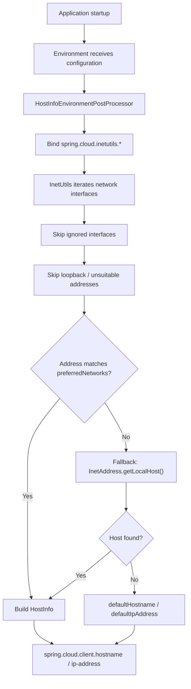

# Prioritizing address ranges with preferredNetworks

A machine running a Spring Cloud service may hold multiple network addresses simultaneously: loopback, LAN cards, Docker bridge cards, Kubernetes interfaces, VPNs, and management networks. If the application automatically picks the wrong address, the service registry may advertise an IP unreachable by other services. In that case, the application still starts up cleanly, yet calls routed via service discovery time out or hit the wrong network.

Spring Cloud Commons provides `InetUtils` and the `spring.cloud.inetutils.preferred-networks` property to prioritize suitable addresses when determining the application's host information. This property is useful in multi-interface environments, especially when running containers or VMs with multiple networks.

This lesson belongs to the **Identity and Networking** chapter of **SPRING_CLOUD_CORE**. The focus is on understanding how `preferredNetworks` filters addresses, how it coordinates with `ignored-interfaces` and `use-only-site-local-interfaces`, how to configure regular expressions, and how to inspect the IP Spring Cloud places in the Environment for service registration to use.

## 1. Learning objectives

After this lesson, learners will be able to:

1. Explain why a machine can have multiple IP addresses and why choosing the wrong one impacts service discovery.
2. Describe the roles of `InetUtils` and `HostInfoEnvironmentPostProcessor`.
3. Configure `spring.cloud.inetutils.preferred-networks` using prefixes or Java regular expressions.
4. Distinguish preferred networks from CIDR, routing tables, and the web server's bind address.
5. Combine `preferred-networks` with `ignored-interfaces`.
6. Explain the interaction between `preferred-networks` and `use-only-site-local-interfaces`.
7. Diagnose fallback behavior when no address matches.
8. Test address selection outcomes and verify the IP advertised during service registration.

## 2. Why prioritize network addresses?

A Linux machine or container can see multiple network interfaces. Examples:

| Interface | Address | Role |
| --- | --- | --- |
| `lo` | `127.0.0.1` | Internal loopback |
| `docker0` | `172.17.0.1` | Docker bridge |
| `eth0` | `10.24.8.15` | Application network in private subnet |
| `wlan0` | `192.168.1.25` | Management Wi-Fi network |
| `tun0` | `100.64.2.10` | VPN interface |

If the application advertises `192.168.1.25` while other services can only reach network `10.24.0.0`, the service registry may store an endpoint unreachable from the application cluster.

This commonly occurs in environments such as:

- Developer machines with Ethernet, Wi-Fi, and VPN active at the same time.
- Docker hosts with bridge and virtual Ethernet interfaces.
- Kubernetes nodes with multiple NICs or multiple network attachments.
- Cloud VMs with separate management and application interfaces.
- Servers with both public and private networks.
- Test environments with loopback, bridges, and virtual adapters.

`preferredNetworks` helps Spring Cloud prioritize addresses in the desired group when determining host information. It does not configure OS routes and does not change IP addresses on network cards.

## 3. InetUtils and Spring Cloud host information

### 3.1. What does InetUtils do?

`InetUtils` belongs to Spring Cloud Commons, helping locate a non-loopback address and convert it into host information consisting of hostname and IP.

During startup, `HostInfoEnvironmentPostProcessor` reads `InetUtilsProperties` from the `Environment`, creates `InetUtils`, and resolves host information. The result is placed back into the Environment under two shared keys:

- `spring.cloud.client.hostname`
- `spring.cloud.client.ip-address`

Discovery clients or service registration implementations can use these values as defaults when registering an instance. Specific registries may still provide their own properties to override hostname or IP.

### 3.2. General processing flow



The diagram depicts the main processing path of the current implementation. Exact interface and address discovery also depends on interface state, OS interface ordering, and configured filtering properties.

### 3.3. Host IP is not the web server bind address

Distinguish two groups of configuration:

| Purpose | Configuration/value |
| --- | --- |
| Choose host IP for Spring Cloud to advertise | `spring.cloud.inetutils.preferred-networks` |
| Shared host info in the Environment | `spring.cloud.client.ip-address` |
| Choose address the embedded web server binds to for listening | `server.address` |
| Choose interface/route for outbound traffic | OS/container routing and network configuration |

For example, `preferred-networks` can help the application advertise `10.24.8.15` in the registry, yet it does not force Tomcat or Netty to listen solely on that IP. To restrict the bind address, configure `server.address` and verify the corresponding network policies.

## 4. Configuring preferred-networks

### 4.1. Configuring via YAML

Example where the application needs to prioritize the application network with prefix `10.24.`:

```yaml
spring:
  cloud:
    inetutils:
      preferred-networks:
        - "10.24."
```

Or allowing two address groups:

```yaml
spring:
  cloud:
    inetutils:
      preferred-networks:
        - "10.24."
        - "192.168.50."
```

The examples above use a simple prefix form. When an IPv4 address starts with one of the declared strings, that address is considered a match.

The canonical property name should be written in kebab-case `preferred-networks`. Spring Boot relaxed binding also supports the camelCase form `preferredNetworks` seen in some older Spring Cloud docs.

### 4.2. Configuring via properties

The same list can be expressed in `application.properties`:

```properties
spring.cloud.inetutils.preferred-networks[0]=10.24.
spring.cloud.inetutils.preferred-networks[1]=192.168.50.
```

List indices start at `0`. Using YAML is usually more readable when there are multiple patterns.

### 4.3. The pattern list is not a ranked priority list

Entries in `preferred-networks` are accepted patterns. The current implementation checks each pattern and accepts an address when **any** pattern matches.

Example:

```yaml
spring:
  cloud:
    inetutils:
      preferred-networks:
        - "10.24."
        - "192.168.50."
```

Both `10.24.8.15` and `192.168.50.20` can be accepted. Placing `10.24.` first does not mean Spring always picks the `10.24.` network ahead of `192.168.50.`. The list is not a priority ranking ordered by element position.

If multiple interfaces hold valid addresses, candidate selection also depends on interface and address traversal order in the implementation and runtime environment. Never rely on YAML element order to control NIC selection priority.

## 5. preferredNetworks uses prefixes and Java regular expressions

The property name includes the word "Networks", yet its values are not parsed as CIDR subnets. Spring Cloud documents this as a list of **Java regular expressions** for network addresses. The current implementation tests addresses using two checks:

1. `address.matches(pattern)` — the entire address string matches the Java regular expression.
2. `address.startsWith(pattern)` — the address string starts with the exact pattern string.

If either check returns true, the address is accepted.

### 5.1. Simple prefixes

Example:

```yaml
spring:
  cloud:
    inetutils:
      preferred-networks:
        - "192.168."
```

`192.168.10.25` starts with the string `192.168.`, so it is accepted. This style works well when selecting a group of addresses with a stable prefix.

### 5.2. Full regular expressions

If you need to constrain octets or specify a detailed pattern, use a regex:

```yaml
spring:
  cloud:
    inetutils:
      preferred-networks:
        - '^10\.24\.[0-9]{1,3}\.[0-9]{1,3}$'
```

This pattern is evaluated as a Java regex and must match the entire string when `matches` is called. Dots are escaped as `\.` to represent the literal dots of an IPv4 address.

In YAML, wrapping patterns in single quotes preserves backslashes. Validate patterns with a unit test because a malformed regex can reject every address.

### 5.3. Do not write CIDR assuming the Binder understands subnet masks

The following example is not CIDR syntax parsed by `preferred-networks`:

```yaml
spring:
  cloud:
    inetutils:
      preferred-networks:
        - "10.24.0.0/16"
```

`InetUtils` does not convert that string into a subnet mask and test whether an address falls inside the `/16` network. It treats the value as a pattern/prefix string. A normal IPv4 address does not start with the full string `10.24.0.0/16`, so this configuration typically matches nothing.

To match all addresses starting with `10.24.`, use the prefix `10.24.`. If stricter conditions are needed, write a Java regex. If business logic genuinely requires subnet calculations, use a dedicated IP/CIDR library in custom code rather than assuming this property supports CIDR.

### 5.4. Example table

| Pattern | Test address | Expected result | Reason |
| --- | --- | --- | --- |
| `10.24.` | `10.24.8.15` | Match | Starts with prefix |
| `10.24.` | `10.25.8.15` | No match | Different prefix |
| `^10\.24\..*` | `10.24.8.15` | Match | Regex matches entire string |
| `^10\.24\..*` | `10.25.8.15` | No match | Does not match regex |
| `10.24.0.0/16` | `10.24.8.15` | No match in CIDR sense | Property does not parse CIDR |

## 6. How InetUtils selects an address

Understanding the pipeline helps diagnose why configuration looks right yet the application still advertises a different IP.

### 6.1. Only evaluates active interfaces

`InetUtils` iterates network interfaces visible to Java and checks whether each interface is up. Inactive interfaces are not used as candidates.

### 6.2. Skips interfaces per ignored-interfaces

If an interface's display name matches a pattern in `ignored-interfaces`, that interface is skipped. This is covered in detail in the following section.

### 6.3. Excludes loopback and filters addresses

In the current address-selection path, `InetUtils` evaluates non-loopback IPv4 addresses. It then applies `use-only-site-local-interfaces` or the `preferred-networks` list to decide whether an address is valid.

This means `preferred-networks` is not a general IPv6 selector. If an environment is IPv6-only, inspect fallback behavior and how the discovery implementation supports IPv6 addresses instead of assuming a regex will make InetUtils select IPv6.

### 6.4. Candidate selection and fallback

If a suitable address is found, InetUtils builds `HostInfo` from it. If no candidate is found, the implementation tries `InetAddress.getLocalHost()`. When host info cannot be obtained, it falls back to defaults:

| Property | Default value |
| --- | --- |
| `spring.cloud.inetutils.default-hostname` | `localhost` |
| `spring.cloud.inetutils.default-ip-address` | `127.0.0.1` |
| `spring.cloud.inetutils.timeout-seconds` | `1` |

`timeout-seconds` controls the wait timeout when resolving the hostname from the selected address; it is not a service discovery connection timeout. If reverse DNS does not respond in time, the hostname may fall back to `localhost` while the selected IP is retained.

## 7. Combining with ignored-interfaces

`preferred-networks` filters IP addresses; `ignored-interfaces` excludes entire interfaces by display name. The two properties solve different problems.

### 7.1. Example excluding Docker bridge and virtual Ethernet

```yaml
spring:
  cloud:
    inetutils:
      ignored-interfaces:
        - "docker0"
        - "veth.*"
      preferred-networks:
        - "10.24."
```

In the example:

- Interfaces whose display name matches `docker0` are skipped.
- Interfaces whose display name starts with `veth` are skipped.
- Remaining interfaces provide valid candidates only if their addresses match `10.24.`.

`ignored-interfaces` also accepts Java regular expressions. The pattern `veth.*` can match names such as `veth1234` or `vethabcd`.

### 7.2. When to use each property?

| Scenario | Suitable property |
| --- | --- |
| Know the exact virtual interface to exclude | `ignored-interfaces` |
| Have many interfaces and only want one IP group | `preferred-networks` |
| Want to use only Java site-local addresses | `use-only-site-local-interfaces` |
| Want to avoid loopback | InetUtils already excludes loopback during candidate search |

Avoid using `ignored-interfaces` as a complete replacement for `preferred-networks` if interface names vary across machines. Conversely, if a specific interface must never be advertised even if its current IP happens to match, ignoring the interface directly is clearer.

## 8. Interaction with use-only-site-local-interfaces

`use-only-site-local-interfaces` instructs InetUtils to accept only addresses for which `InetAddress.isSiteLocalAddress()` returns true.

Example:

```yaml
spring:
  cloud:
    inetutils:
      use-only-site-local-interfaces: true
```

This is a filter based on Java's site-local definition. Do not equate it with an arbitrary CIDR or with the entire concept of "private IP" across every cloud environment.

### 8.1. When enabled, preferredNetworks is not applied simultaneously

In the current implementation, when `use-only-site-local-interfaces=true`, InetUtils returns based on `isSiteLocalAddress()` before checking `preferred-networks`. Thus, the two properties do not act as two intersected filters within a single check.

For example, configuring:

```yaml
spring:
  cloud:
    inetutils:
      use-only-site-local-interfaces: true
      preferred-networks:
        - "192.168.50."
```

does not mean "select only site-local addresses matching prefix 192.168.50". When the site-local flag is enabled, site-local addresses are accepted under that check without additionally enforcing the `192.168.50.` prefix.

If you need to restrict to a specific range, leave `use-only-site-local-interfaces=false` and declare the appropriate `preferred-networks`. If you only need to exclude non-site-local addresses, use the site-local flag and do not expect the preferred list to narrow the result further.

## 9. Deployment example in Docker or Kubernetes

Suppose a service runs inside a container with the following interfaces:

| Interface | IP | Role |
| --- | --- | --- |
| `lo` | `127.0.0.1` | Loopback |
| `eth0` | `10.24.8.15` | Pod/container network |
| `eth1` | `172.18.0.2` | Secondary network |
| `vethabc123` | `172.17.0.1` | Host-side virtual Ethernet |

The application needs to advertise an IP on the `10.24.` pod network and avoid virtual Ethernet interfaces.

Configuration:

```yaml
spring:
  cloud:
    inetutils:
      ignored-interfaces:
        - "veth.*"
      preferred-networks:
        - "10.24."
```

Then:

1. Loopback is excluded by InetUtils's rules.
2. Interfaces matching `veth.*` are skipped.
3. Address `172.18.0.2` does not match the preferred prefix.
4. Address `10.24.8.15` is a suitable candidate.
5. Host information is published into the Environment for Spring Cloud components to consume.

Configuration must be verified inside the actual running container/pod. Addresses visible on the host machine are not necessarily the addresses visible inside the container's network namespace.

## 10. Configuration sources and when InetUtils reads properties

`HostInfoEnvironmentPostProcessor` determines host information during application startup. It binds `spring.cloud.inetutils.*` from the Environment at the moment the post processor runs, then adds `spring.cloud.client.hostname` and `spring.cloud.client.ip-address`.

This leads to three important points:

1. Properties must exist in a configuration source loaded before host information is computed.
2. Modifying a configuration file after startup does not automatically re-run the post processor to pick a new IP.
3. If the network or preferred pattern changes while the application is running, determine whether an instance restart is needed to recompute host information and re-register the service.

Across different generations of Spring Cloud Commons docs, examples show `preferredNetworks` configured in `bootstrap.yml`. For applications using Spring Boot Config Data, place properties in a configuration source loaded at the appropriate phase, typically `application.yml` or a Config Data import available before host information is resolved. Check your application's release train and bootstrap mode; do not assume all remote config sources are available at the exact same moment.

Example with application configuration:

```yaml
spring:
  cloud:
    inetutils:
      preferred-networks:
        - "10.24."
```

If using Spring Cloud Config, verify the property is loaded into the Environment during the startup stage used by HostInfoEnvironmentPostProcessor. A property that appears only later cannot alter the IP already computed for the current startup.

## 11. Relationship with service registration and discovery

### 11.1. Selected IP can become the advertised address

Spring Cloud Commons provides shared keys such as `spring.cloud.client.ip-address` and `spring.cloud.client.hostname`. Service registry integrations can use these keys to construct instance information.

For example, when a service registers with a registry, the record may contain:

- Service ID.
- Hostname or IP.
- Port.
- Metadata.
- Instance status.

If the advertised IP is wrong, the registry can still record the instance as present while clients fail to connect to that endpoint.

### 11.2. Registry implementations can have dedicated override properties

`preferred-networks` controls Spring Cloud's shared host information resolution. Registries such as Eureka or Consul also have dedicated settings for hostname, IP, port, secure port, and registration behavior.

Therefore, if preferred configuration looks right yet the registry still shows a different IP, check:

1. The value of `spring.cloud.client.ip-address` in the Environment.
2. Registry-specific properties.
3. The actual registration object before it is sent to the registry.
4. The instance record stored by the registry.
5. The address actually used by client load balancers.

Do not conclude InetUtils is broken from a single registry dashboard view; a provider-specific property may be overriding the shared value.

### 11.3. Do not use preferred-networks as a security measure

`preferred-networks` does not block connections from other networks, configure firewalls, replace security groups, or create routes. It only affects host address selection inside Spring Cloud.

To restrict access, use network policies, firewalls, security groups, authentication, and authorization accordingly.

## 12. Diagnosing when an application advertises the wrong IP

When the registry displays an unexpected address, inspect in order.

### 12.1. Inspect interfaces inside the runtime

On a Linux host or container with suitable tools:

```bash
ip -brief address
ip route
```

In Java, you can list interfaces and addresses with:

```java
Enumeration<NetworkInterface> interfaces =
    NetworkInterface.getNetworkInterfaces();

while (interfaces.hasMoreElements()) {
    NetworkInterface networkInterface = interfaces.nextElement();

    System.out.println(
        networkInterface.getDisplayName()
        + " up=" + networkInterface.isUp()
    );

    Enumeration<InetAddress> addresses =
        networkInterface.getInetAddresses();

    while (addresses.hasMoreElements()) {
        System.out.println(addresses.nextElement().getHostAddress());
    }
}
```

This listing confirms the display names and IPs the JVM actually sees. Do not check only output on the host if the application runs inside a container network namespace.

### 12.2. Inspect Spring Cloud host information

You can read the keys in the Environment:

```java
@Component
class HostInfoLogger implements ApplicationRunner {

    private final Environment environment;

    HostInfoLogger(Environment environment) {
        this.environment = environment;
    }

    @Override
    public void run(ApplicationArguments args) {
        String ip = environment.getProperty(
            "spring.cloud.client.ip-address", "unknown"
        );
        String hostname = environment.getProperty(
            "spring.cloud.client.hostname", "unknown"
        );

        log.info("Spring Cloud host info: ip={}, hostname={}",
            ip, hostname);
    }
}
```

This is an illustrative example; declare an appropriate logger. Log only necessary host information and avoid printing sensitive Environment data to logs.

### 12.3. Use Actuator when appropriate

The `/actuator/env` endpoint can help inspect property sources and effective values if the endpoint is exposed and secured. Do not expose configuration management endpoints publicly. Restrict access, enable masking, and enforce authentication per operations policy.

Then cross-check against the registration record in Eureka/Consul or the active discovery provider. Environment values and registry values can differ if the provider has override properties.

### 12.4. Enable diagnostic logging

You can increase logging for the InetUtils class while investigating:

```yaml
logging:
  level:
    org.springframework.cloud.commons.util.InetUtils: TRACE
```

Trace logs reveal which interfaces and addresses are skipped or chosen in versions that log those steps. Do not leave trace enabled long in production if interface counts or log volume are high.

## 13. Testing preferredNetworks

Test patterns separately from integration tests that boot an entire service registry. In a test module under the same package as `InetUtils`, you can call the implementation's address-checking method to verify regexes.

### 13.1. Testing a prefix

```java
class PreferredNetworksTests {

    @Test
    void acceptsAddressWithPreferredPrefix() throws Exception {
        InetUtilsProperties properties = new InetUtilsProperties();
        properties.setPreferredNetworks(List.of("10.24."));

        try (InetUtils inetUtils = new InetUtils(properties)) {
            InetAddress preferred =
                InetAddress.getByName("10.24.8.15");
            InetAddress other =
                InetAddress.getByName("10.25.8.15");

            assertThat(inetUtils.isPreferredAddress(preferred)).isTrue();
            assertThat(inetUtils.isPreferredAddress(other)).isFalse();
        }
    }
}
```

This example uses a package-private method to test the predicate in a same-package test. If your implementation version alters visibility or algorithm details, adjust the test to match the exact version's API.

### 13.2. Testing multiple patterns

```java
@Test
void acceptsAddressMatchingAnyPreferredPattern() throws Exception {
    InetUtilsProperties properties = new InetUtilsProperties();
    properties.setPreferredNetworks(
        List.of("10.24.", "192.168.50.")
    );

    try (InetUtils inetUtils = new InetUtils(properties)) {
        assertThat(inetUtils.isPreferredAddress(
            InetAddress.getByName("10.24.1.10")
        )).isTrue();

        assertThat(inetUtils.isPreferredAddress(
            InetAddress.getByName("192.168.50.20")
        )).isTrue();

        assertThat(inetUtils.isPreferredAddress(
            InetAddress.getByName("172.18.0.2")
        )).isFalse();
    }
}
```

The test confirms patterns act as OR choices. Order in the list does not denote ranking priority.

### 13.3. Testing the site-local filter

When `useOnlySiteLocalInterfaces` is enabled, the current implementation checks site-local before the preferred networks list:

```java
@Test
void siteLocalFilterTakesPrecedenceOverPreferredNetworks() throws Exception {
    InetUtilsProperties properties = new InetUtilsProperties();
    properties.setUseOnlySiteLocalInterfaces(true);
    properties.setPreferredNetworks(List.of("192.168.50."));

    try (InetUtils inetUtils = new InetUtils(properties)) {
        assertThat(inetUtils.isPreferredAddress(
            InetAddress.getByName("10.24.8.15")
        )).isTrue();
    }
}
```

`10.24.8.15` is a site-local address under Java's classification. This test demonstrates that when the site-local filter is enabled, the `192.168.50.` pattern is not applied as a second filter in the current implementation.

### 13.4. Testing registration integration

Unit tests for patterns do not prove the registry receives the right IP. An integration test should:

1. Start the application context with the defined preferred pattern.
2. Verify `spring.cloud.client.ip-address`.
3. Instantiate the discovery provider's registration object.
4. Inspect host/IP inside the registration.
5. Verify provider-specific properties do not override unexpectedly.

Do not depend on a specific CI machine IP because interfaces and addresses on runners can change. Use test doubles or run inside a controlled network namespace when verifying interface selection end-to-end.

## 14. Common errors

| Symptom | Possible cause | How to resolve |
| --- | --- | --- |
| Registry shows Docker bridge IP | Bridge interface not excluded or prefix not filtered | Use `ignored-interfaces` and `preferred-networks` |
| Registry shows Wi-Fi/VPN IP | Pattern allows multiple networks or config not loaded | Check interfaces, regexes, and Environment |
| No IP matches yet app still has hostname/IP | Fell back to `InetAddress.getLocalHost()` or defaults | Check fallback and network configuration |
| CIDR pattern does not work | Property does not parse CIDR | Use a prefix or Java regex |
| Two prefixes in list yet another network is selected | Interface enumeration or fallback; property may not be bound | Check actual values and trace logs |
| Enabled site-local yet IP differs from preferred prefix | Site-local filter replaces preferred pattern | Choose one appropriate filtering strategy |
| Registry does not match Environment | Provider has dedicated override property | Inspect registration object and provider config |
| Changed YAML yet IP unchanged | Host info was computed during startup phase | Restart instance after verifying config source |

## 15. Safe deployment workflow

Before rolling out preferred network configuration to production:

1. List interfaces and addresses from inside the container/VM running the application.
2. Identify the IP reachable by service consumers.
3. Choose a prefix or Java regex narrow enough to avoid unintended matches.
4. Exclude virtual interfaces by name if needed.
5. Check interaction with `use-only-site-local-interfaces`.
6. Ensure properties exist in the Environment at the exact time host information is computed.
7. Verify `spring.cloud.client.ip-address` and `spring.cloud.client.hostname`.
8. Verify the registry stores the right host/port.
9. Test calling the service from a consumer on the real network.
10. Re-verify after restarts, pod reschedules, or NIC changes.
11. Keep network policies/firewalls independent of preferred network selection.

If the environment has multiple network attachments or IPs vary by node, verify on each node/pod type. Never ship an overly broad pattern merely because it worked on a developer machine.

## 16. Applied exercises

### Exercise 1. Selecting the application network

A VM has the following addresses:

- `127.0.0.1` on `lo`.
- `172.17.0.1` on `docker0`.
- `10.32.4.18` on `eth0`.
- `192.168.10.20` on `wlan0`.

The service must only advertise an IP in the `10.32.` network. Write the `preferred-networks` configuration, explain why loopback is excluded, and explain why `192.168.10.20` is unsuitable.

### Exercise 2. Regex or CIDR?

An operations team declares `10.32.0.0/16` and notices the application fails to pick the desired address. Explain why the property does not process CIDR, then write an equivalent prefix or regex matching the requirement to select `10.32.` addresses.

### Exercise 3. Multiple patterns

An application has two valid networks, `10.32.` and `192.168.40.`. Configure both and explain why YAML element order does not act as a priority ranking when selecting interfaces.

### Exercise 4. Site-local and preferred networks

An application configures both `use-only-site-local-interfaces=true` and `preferred-networks=192.168.40.`. Predict whether `10.32.4.18` will be accepted based on how the current implementation evaluates both properties.

### Exercise 5. Investigating wrong IP in the registry

The registry shows `172.17.0.1` while the Environment shows `10.32.4.18`. Create a plan to inspect discovery-provider-specific properties, the registration object, interfaces inside the container, and the registry record.

### Self-check questions

1. Which responsibilities do `InetUtils` and `HostInfoEnvironmentPostProcessor` handle?
2. Does `preferred-networks` accept Java regexes or CIDR?
3. Are elements in the preferred list combined with AND or OR?
4. Why is pattern order not an interface priority ranking?
5. Does `ignored-interfaces` filter interfaces or IP addresses?
6. How does `use-only-site-local-interfaces` interact with `preferred-networks`?
7. When no address matches, in what order does InetUtils fall back?
8. How does `spring.cloud.client.ip-address` differ from `server.address`?
9. Why doesn't changing properties after startup automatically re-select the host IP?
10. How do you verify that the registry advertises an address reachable by consumers?

## 17. References

- [Spring Cloud Commons Reference — Ignore Network Interfaces](https://docs.spring.io/spring-cloud-commons/reference/spring-cloud-commons/common-abstractions.html#ignore-network-interfaces): examples of `ignoredInterfaces`, `preferredNetworks`, and `useOnlySiteLocalInterfaces`.
- [Spring Cloud Commons — Configuration Properties](https://docs.spring.io/spring-cloud-commons/reference/configprops.html): property list, types, and descriptions for `spring.cloud.inetutils`.
- [InetUtils.java — Spring Cloud Commons source](https://github.com/spring-cloud/spring-cloud-commons/blob/main/spring-cloud-commons/src/main/java/org/springframework/cloud/commons/util/InetUtils.java): current interface traversal, address filtering, and fallback behavior.
- [InetUtilsProperties.java — Spring Cloud Commons source](https://github.com/spring-cloud/spring-cloud-commons/blob/main/spring-cloud-commons/src/main/java/org/springframework/cloud/commons/util/InetUtilsProperties.java): prefix and InetUtils configuration properties.
- [HostInfoEnvironmentPostProcessor.java — Spring Cloud Commons source](https://github.com/spring-cloud/spring-cloud-commons/blob/main/spring-cloud-commons/src/main/java/org/springframework/cloud/client/HostInfoEnvironmentPostProcessor.java): how selected hostname and IP are placed into the Environment.
- [Java InetAddress API](https://docs.oracle.com/en/java/javase/21/docs/api/java.base/java/net/InetAddress.html): address checks such as loopback and site-local.

## Summary

`preferred-networks` helps Spring Cloud Commons choose a suitable IP address when determining an application's host information. Its value is a list of Java regexes/prefixes, not CIDR; patterns are accepted with OR logic and list order does not rank interfaces. Combine it with `ignored-interfaces` when specific NICs must be excluded, remember that `use-only-site-local-interfaces` supersedes preferred pattern checks in the current implementation, and always verify `spring.cloud.client.ip-address` along with the registration record from inside the real deployment environment.
