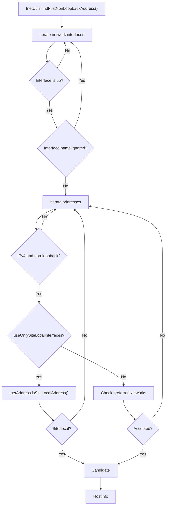

# Restricting to internal addresses with useOnlySiteLocalInterfaces

A server can simultaneously hold multiple IP addresses: application network, management network, Docker bridge, VPN, Wi-Fi network, and virtual interfaces. When Spring Cloud determines a host address to advertise for service discovery, the application may accidentally pick an address unreachable by service consumers.

Spring Cloud Commons provides the **spring.cloud.inetutils.use-only-site-local-interfaces** property to accept only addresses that Java classifies as **site-local** during the network address search step. For IPv4, this classification corresponds to the private ranges defined in RFC 1918. This property can help avoid advertising public addresses when applications need to communicate inside an internal network.

However, site-local is an address classification rule, not a route or connectivity check. Multiple interfaces that all carry RFC 1918 addresses can still be accepted; Docker bridge addresses fall into this group too. Furthermore, InetUtils's fallback path may return a local host address when no matching candidate is found. This lesson clarifies those boundaries so the configuration does not create a false sense of security.

This lesson belongs to the **Identity and Networking** chapter of **SPRING_CLOUD_CORE**. The focus is on how Java identifies site-local addresses, how Spring Cloud applies this check, configuring useOnlySiteLocalInterfaces, combining it with ignoredInterfaces, and verifying the actual address placed into the Environment for service registration.

## 1. Learning objectives

After this lesson, learners will be able to:

1. Explain the site-local concept and its relationship to private IPv4 addresses.
2. List the three RFC 1918 IPv4 ranges Java classifies as site-local.
3. Distinguish site-local from loopback, link-local, CGNAT shared address space, and public addresses.
4. Configure spring.cloud.inetutils.use-only-site-local-interfaces.
5. Describe how InetUtils applies InetAddress.isSiteLocalAddress().
6. Combine the site-local filter with ignored-interfaces.
7. Explain why a Docker bridge can still be selected.
8. Analyze fallback behavior when no site-local candidate is found.
9. Distinguish advertised host IP from web server bind address and network routes.
10. Test the predicate and verify host information in the deployment environment.

## 2. What is a site-local address?

Java defines a site-local address as a unicast address used within the scope of a site, without requiring a global prefix. The InetAddress.isSiteLocalAddress() method returns true if the address is classified as site-local; it does not check whether that address is reachable by other machines.

For IPv4, Java references RFC 1918. This RFC reserves three ranges for private internets:

| Range | Prefix | Example | isSiteLocalAddress() |
| --- | --- | --- | --- |
| 10.0.0.0 – 10.255.255.255 | 10.0.0.0/8 | 10.24.8.15 | true |
| 172.16.0.0 – 172.31.255.255 | 172.16.0.0/12 | 172.20.4.10 | true |
| 192.168.0.0 – 192.168.255.255 | 192.168.0.0/16 | 192.168.1.20 | true |

These are the three private IPv4 ranges defined by RFC 1918. Addresses in these ranges are not globally unique on the public Internet; organizations may reuse the same ranges across different private networks. Therefore, a site-local address is only useful if consumers have a route and access permissions to the network containing that address.

## 3. Distinguishing site-local from other address types

The name "site-local" is easily misunderstood as "any internal address." In reality, Java classifies multiple address scopes using separate methods.

| Address type | Example/range | Site-local IPv4? | Meaning |
| --- | --- | --- | --- |
| Private IPv4 RFC 1918 | 10/8, 172.16/12, 192.168/16 | Yes | Used in private internets |
| Loopback | 127.0.0.1 | No | Loops back to the host itself |
| IPv4 link-local | 169.254.0.0/16 | No | Used on a single link when no suitable address configuration exists |
| CGNAT shared space | 100.64.0.0/10 | No | Shared address space for service provider networks |
| Public IPv4 | 8.8.8.8 | No | Globally routable address per network policy |
| IPv6 unique-local | fc00::/7 | Should not be equated with RFC 1918/Java site-local | IPv6 unique local address space |

### 3.1. Link-local is not site-local

IPv4 addresses in 169.254.0.0/16 are link-local. They serve communication on a single link and are not normally routed across routers. Java has a separate method isLinkLocalAddress() to check this address type.

useOnlySiteLocalInterfaces=true does not mean "accept every non-public IP." Link-local addresses fall outside the three RFC 1918 ranges and therefore do not pass the site-local filter.

### 3.2. CGNAT shared address space is not RFC 1918

The 100.64.0.0/10 range is reserved by RFC 6598 for shared address space in service provider networks. It may appear on cloud infrastructure, ISP, or overlay network interfaces, yet it is not one of the three RFC 1918 ranges.

Consequently, address 100.64.10.20 is not classified by Java as site-local IPv4. If your infrastructure uses this range for the application network, enabling useOnlySiteLocalInterfaces may exclude that address from candidate selection.

### 3.3. IPv6 site-local is a historical concept

The Java API provides isSiteLocalAddress() for Inet6Address. The historical IPv6 site-local range was FEC0::/10, but RFC 3879 formally deprecated this prefix. IPv6 Unique Local Addresses fc00::/7 are a separate address type; do not equate ULA with RFC 1918 IPv4 site-local.

In the current InetUtils implementation, the interface address-selection loop checks address instanceof Inet4Address. Thus, even though Java has an API for classifying IPv6 site-local, do not assume setting useOnlySiteLocalInterfaces will make InetUtils's interface-selection path automatically pick IPv6 ULA or IPv6 site-local addresses. Check the exact release train and discovery provider if the system deploys IPv6.

## 4. The useOnlySiteLocalInterfaces property

Spring Cloud Commons provides the property:

```yaml
spring:
  cloud:
    inetutils:
      use-only-site-local-interfaces: true
```

The canonical property name uses kebab-case. Some older examples write camelCase useOnlySiteLocalInterfaces; Spring Boot relaxed binding can map that form, yet canonical names should be used consistently in new configuration.

The property defaults to false. When enabled, InetUtils checks each candidate IPv4 address via InetAddress.isSiteLocalAddress(). An address is accepted only if that check returns true.

This configuration is useful when:

- The application runs on a machine with both public and private addresses.
- Service registration must advertise a private address reachable within the cluster.
- A VM has a public interface for administration while service-to-service traffic flows over a private subnet.
- The deployment environment has standardized on RFC 1918 for the application network.

It does not modify addresses on network interfaces and does not configure firewalls, routes, or security groups.

## 5. How does InetUtils apply the site-local filter?

### 5.1. Address selection flow

In the current Spring Cloud Commons implementation, InetUtils.findFirstNonLoopbackAddress() iterates network interfaces visible to the JVM. The main execution path can be summarized as:

1. Obtain the list of network interfaces from NetworkInterface.getNetworkInterfaces().
2. Skip interfaces that are not up.
3. Skip interfaces whose display name matches ignored-interfaces.
4. Iterate addresses on the interface.
5. Evaluate only Inet4Address in the current candidate-selection path.
6. Skip loopback addresses.
7. Invoke isPreferredAddress(address).
8. If useOnlySiteLocalInterfaces=true, isPreferredAddress returns the result of address.isSiteLocalAddress() directly.
9. If a candidate is found, build HostInfo from that address.

Diagram:



Candidate selection also depends on interface state and interface ordering/index in the implementation. Do not assume the site-local property picks a specific interface merely based on network name or order in a config file.

### 5.2. useOnlySiteLocalInterfaces replaces the preferredNetworks check

This is a key detail when combining the two properties. Inside InetUtils.isPreferredAddress(), if useOnlySiteLocalInterfaces is enabled, the implementation returns address.isSiteLocalAddress() immediately. The preferredNetworks list is not applied afterward as a second filter.

Example:

```yaml
spring:
  cloud:
    inetutils:
      use-only-site-local-interfaces: true
      preferred-networks:
        - "10.24."
```

The configuration above does not mean "accept only site-local addresses matching prefix 10.24.". When the site-local flag is enabled, any qualifying site-local address can be accepted, such as 10.24.8.15, 172.17.0.1, or 192.168.1.20.

If you need to restrict to a specific subnet or prefix, turn off use-only-site-local-interfaces and configure preferred-networks for your target. See the preferredNetworks documentation for how to write Java regular expressions and prefixes.

## 6. Why can a Docker bridge still be selected?

Docker bridges typically use addresses in 172.16.0.0/12, such as 172.17.0.1. That address falls inside RFC 1918, so Java classifies it as site-local.

Suppose a machine/container has these interfaces:

| Interface | Address | Site-local? |
| --- | --- | --- |
| lo | 127.0.0.1 | No |
| docker0 | 172.17.0.1 | Yes |
| eth0 | 10.24.8.15 | Yes |
| wlan0 | 192.168.1.25 | Yes |

If only use-only-site-local-interfaces is enabled, all three private addresses are candidates. This property does not know that eth0 is the application network and docker0 is an unwanted bridge.

Virtual interfaces can be excluded by name:

```yaml
spring:
  cloud:
    inetutils:
      use-only-site-local-interfaces: true
      ignored-interfaces:
        - "docker0"
        - "veth.*"
```

ignored-interfaces checks each interface's display name using Java regular expressions. This configuration excludes docker0 and interfaces matching veth.*, and the site-local filter then evaluates addresses on the remaining interfaces.

If a host has multiple valid RFC 1918 interfaces and interface names vary across nodes, enabling site-local alone is insufficient to select the right network. Inspect the real interface layout or use explicit preferred-network settings tailored to deployment addresses.

## 7. Important limitation: fallback is not re-checked by the site-local filter

The property name can lead operators to think the final address returned by InetUtils is always site-local. However, in the current source code, useOnlySiteLocalInterfaces is applied when checking addresses inside the interface loop.

If no candidate is found, findFirstNonLoopbackAddress() proceeds to call InetAddress.getLocalHost(). This fallback address is returned directly; it is not passed through isPreferredAddress() again.

If InetAddress.getLocalHost() also fails, findFirstNonLoopbackHostInfo() uses default values:

| Property | Default |
| --- | --- |
| spring.cloud.inetutils.default-hostname | localhost |
| spring.cloud.inetutils.default-ip-address | 127.0.0.1 |

Therefore, the following scenarios can happen:

- No matching site-local IPv4 interface exists, yet local host resolution returns another address.
- The local hostname resolves to loopback.
- Local host cannot be resolved, so InetUtils uses 127.0.0.1.
- The registry receives a fallback address unreachable by other services.

If an operational requirement states "never register an address outside the application subnet", verify the final outcome before registration completes or use discovery-provider-specific host/IP configuration. Never rely solely on useOnlySiteLocalInterfaces to guarantee that invariant.

## 8. Configuration by environment

### 8.1. Virtual machines or servers with private subnets

If service-to-service traffic uses only private RFC 1918 IPv4, you can configure:

```yaml
spring:
  cloud:
    inetutils:
      use-only-site-local-interfaces: true
      ignored-interfaces:
        - "lo"
        - "docker0"
        - "veth.*"
```

Loopback is already excluded in InetUtils's candidate loop; listing lo in the ignore list can clarify configuration intent but is not strictly required.

### 8.2. Kubernetes using an RFC 1918 Pod CIDR

If Pod IPs belong to 10.0.0.0/8 or 172.16.0.0/12, the site-local filter can be suitable:

```yaml
spring:
  cloud:
    inetutils:
      use-only-site-local-interfaces: true
```

Verify the actual address inside the pod and the ServiceInstance record in the registry. CNI networks may have secondary interfaces or different overlay addresses; never assume all nodes share identical topology.

### 8.3. Infrastructure using CGNAT or non-RFC 1918 ranges

If the CNI or application network uses 100.64.0.0/10, the site-local filter will exclude that address. Enabling the property without checking CIDRs can push InetUtils into fallback.

In this situation, pick an address selection policy suited to the infrastructure: configure explicit preferred networks, use provider-specific host/IP properties, or customize registration. Verify the release train and discovery implementation before applying.

## 9. Site-local does not mean reachable

An address like 10.24.8.15 may be site-local, yet that does not prove:

- Consumers have a route to subnet 10.24.8.0/24.
- Network policies allow connections to the service port.
- Security groups or firewalls permit traffic.
- The address belongs to a network namespace visible to consumers.
- The service is bound to the right interface.
- The registry advertises the right port and scheme.

Distinguish clearly:

| Component | Role |
| --- | --- |
| use-only-site-local-interfaces | Filters candidate host addresses per Java classification |
| ignored-interfaces | Excludes interfaces by display name |
| preferred-networks | Selects addresses by Java regex/prefix |
| server.address | Selects bind address of the embedded web server |
| Routing table / CNI | Determines packet paths |
| Firewall / NetworkPolicy | Controls permitted traffic |
| Service Registry | Stores instance addresses looked up by consumers |

useOnlySiteLocalInterfaces is not a security feature and does not replace network policies.

## 10. How is host information placed into the Environment?

Spring Cloud Commons includes HostInfoEnvironmentPostProcessor. During startup, the processor binds spring.cloud.inetutils.* from the Environment, instantiates InetUtils, resolves HostInfo, and adds two keys to the Environment:

- spring.cloud.client.hostname
- spring.cloud.client.ip-address

Discovery clients or service registration implementations can use these shared keys as default host info. Individual providers may still have dedicated properties to override hostname or IP.

In the current source, HostInfoEnvironmentPostProcessor runs after ConfigDataEnvironmentPostProcessor. That lets properties loaded via Config Data participate in host information resolution. For bootstrap mode or different release trains, verify processor ordering for your application version.

If the registry displays an address different from spring.cloud.client.ip-address, inspect the registration object and provider-specific properties before concluding the site-local filter is broken.

## 11. Diagnosing the selected address

### 11.1. Listing interfaces in the real runtime environment

On a Linux host/container with networking tools:

```bash
ip -brief address
ip route
```

Run the commands inside the exact container or pod. A container's network namespace may see different interfaces and IPs from the host machine.

### 11.2. Checking site-local in Java

You can inspect a specific address:

```java
InetAddress address = InetAddress.getByName("10.24.8.15");

System.out.println(address.isSiteLocalAddress());
System.out.println(address.isLoopbackAddress());
System.out.println(address.isLinkLocalAddress());
```

These methods answer different questions. Do not replace isSiteLocalAddress() with !isLoopbackAddress() because link-local, public, and CGNAT addresses are also non-loopback.

### 11.3. Logging host information from the Environment

Example simple runner:

```java
@Component
class HostInfoLogger implements ApplicationRunner {

    private final Environment environment;

    HostInfoLogger(Environment environment) {
        this.environment = environment;
    }

    @Override
    public void run(ApplicationArguments args) {
        String ip = environment.getProperty(
            "spring.cloud.client.ip-address", "unknown"
        );
        String hostname = environment.getProperty(
            "spring.cloud.client.hostname", "unknown"
        );

        log.info("Spring Cloud host info: ip={}, hostname={}",
            ip, hostname);
    }
}
```

Declare the appropriate logger and imports. Log only necessary hostname/IP; never dump the entire Environment because it may contain secrets.

### 11.4. Checking the registration record

After reading the Environment values, verify what the provider actually registered:

1. Check spring.cloud.client.ip-address.
2. Check Eureka, Consul, or provider-specific hostname/IP properties.
3. Inspect the Registration object before sending.
4. Inspect the instance record in the registry.
5. Attempt a connection from a consumer on the actual network to the advertised address and port.

If the Environment is right yet the registry is wrong, the cause may lie in provider-specific overrides or registration customization.

## 12. Testing the site-local filter

You can test the predicate via a unit test in the same package as InetUtils, since isPreferredAddress is package-private in the current implementation.

### 12.1. Testing IPv4 ranges

```java
class SiteLocalAddressTests {

    @Test
    void acceptsRfc1918Addresses() throws Exception {
        InetUtilsProperties properties = new InetUtilsProperties();
        properties.setUseOnlySiteLocalInterfaces(true);

        try (InetUtils inetUtils = new InetUtils(properties)) {
            assertThat(inetUtils.isPreferredAddress(
                InetAddress.getByName("10.24.8.15")
            )).isTrue();

            assertThat(inetUtils.isPreferredAddress(
                InetAddress.getByName("172.16.4.10")
            )).isTrue();

            assertThat(inetUtils.isPreferredAddress(
                InetAddress.getByName("192.168.1.20")
            )).isTrue();
        }
    }
}
```

### 12.2. Testing addresses outside RFC 1918

```java
@Test
void rejectsLoopbackLinkLocalCgnatAndPublicAddresses() throws Exception {
    InetUtilsProperties properties = new InetUtilsProperties();
    properties.setUseOnlySiteLocalInterfaces(true);

    try (InetUtils inetUtils = new InetUtils(properties)) {
        assertThat(inetUtils.isPreferredAddress(
            InetAddress.getByName("127.0.0.1")
        )).isFalse();

        assertThat(inetUtils.isPreferredAddress(
            InetAddress.getByName("169.254.10.20")
        )).isFalse();

        assertThat(inetUtils.isPreferredAddress(
            InetAddress.getByName("100.64.10.20")
        )).isFalse();

        assertThat(inetUtils.isPreferredAddress(
            InetAddress.getByName("8.8.8.8")
        )).isFalse();
    }
}
```

This test exercises the predicate. During interface selection, loopback is also excluded prior to invoking the predicate; keeping the assertion here clearly confirms Java's classification behavior.

### 12.3. Testing 172.16/12 range boundaries

The second RFC 1918 range covers only 172.16.0.0 through 172.31.255.255. Not all of 172.0.0.0/8 is site-local.

```java
@Test
void checks172RangeBoundaries() throws Exception {
    InetUtilsProperties properties = new InetUtilsProperties();
    properties.setUseOnlySiteLocalInterfaces(true);

    try (InetUtils inetUtils = new InetUtils(properties)) {
        assertThat(inetUtils.isPreferredAddress(
            InetAddress.getByName("172.16.0.1")
        )).isTrue();

        assertThat(inetUtils.isPreferredAddress(
            InetAddress.getByName("172.31.255.254")
        )).isTrue();

        assertThat(inetUtils.isPreferredAddress(
            InetAddress.getByName("172.32.0.1")
        )).isFalse();
    }
}
```

### 12.4. Unit tests do not verify fallback

The tests above only check isPreferredAddress(). They do not prove that the final address returned by findFirstNonLoopbackAddress() is always site-local.

To test end-to-end, use a controlled network environment:

- Create an interface with a site-local address.
- Create a secondary interface with a non-site-local address.
- Verify ignored-interfaces and interface status.
- Test the scenario with no site-local candidates.
- Observe the address returned by InetAddress.getLocalHost().
- Verify the final HostInfo and registration record.

Containers or network namespaces can be used in integration tests. Avoid relying on CI runner interfaces since they vary across runners.

## 13. Common errors

| Symptom | Possible cause | How to resolve |
| --- | --- | --- |
| Registry advertises 172.17.0.1 | Docker bridge is in RFC 1918 so site-local filter accepts it | Add docker0 to ignored-interfaces |
| Cannot select Pod IP 100.64.x.x | CGNAT range is outside RFC 1918 | Use preferred patterns or suitable provider config |
| Still seeing non-site-local IP | No candidate found and InetUtils fell back to InetAddress.getLocalHost() | Inspect fallback and verify final HostInfo |
| Registry shows 127.0.0.1 | Fallback/default IP was used | Check interfaces, DNS/local host, and network config |
| Wanted site-local in one specific subnet yet another subnet was chosen | useOnlySiteLocalInterfaces does not AND with preferredNetworks | Disable site-local filter and configure explicit preferred patterns |
| IP in Environment differs from registry IP | Provider-specific host/IP override | Inspect Registration object and provider config |
| Service cannot reach advertised IP | Site-local address has no route from consumer or port is blocked | Check CNI, routing, firewall, NetworkPolicy, and port |
| IPv6-only yet desired address not chosen | Current InetUtils candidate path checks Inet4Address | Verify IPv6 support in release train/provider and configure host explicitly |

## 14. Configuration selection checklist

Before enabling use-only-site-local-interfaces, answer:

1. Can service consumers reach the instance's RFC 1918 network?
2. Does the environment use CGNAT shared space or a non-RFC 1918 CIDR?
3. Do multiple private interfaces coexist?
4. Could a Docker bridge or virtual interface be picked?
5. Can ignored-interfaces exclude unwanted interfaces?
6. Do you need to restrict to one specific subnet instead of all RFC 1918 ranges?
7. Can fallback to InetAddress.getLocalHost() occur?
8. Does the discovery provider have dedicated hostname/IP settings?
9. Is there an integration test verifying the final IP in the registry?
10. Do consumers have routes and permission to connect to the advertised address?

Enable the property only when the infrastructure's address ranges match Java's site-local classification and secondary interfaces have been accounted for.

## 15. Applied exercises

### Exercise 1. Address classification

Given the addresses:

- 10.24.8.15
- 172.17.0.1
- 172.32.0.1
- 192.168.1.20
- 169.254.10.20
- 100.64.10.20
- 8.8.8.8

Identify which addresses are accepted by InetAddress.isSiteLocalAddress() and explain according to RFC 1918/RFC 6598.

### Exercise 2. Docker bridge selected

A host has docker0=172.17.0.1 and eth0=10.24.8.15. After enabling useOnlySiteLocalInterfaces, the registry still shows 172.17.0.1.

Explain the cause and write a configuration excluding the Docker bridge. State why the site-local filter cannot tell on its own which interface is the application network.

### Exercise 3. Application network using 100.64/10

A platform uses 100.64.12.10 as the internal service address. After enabling the site-local filter, InetUtils does not pick this address.

Explain the relationship between RFC 6598 and RFC 1918, then propose a suitable address-selection policy.

### Exercise 4. No site-local candidates

A container has only a public IPv4 address. useOnlySiteLocalInterfaces=true is enabled, yet the registry still displays an address.

Describe the fallback path in InetUtils and explain why InetAddress.getLocalHost() and the final HostInfo must be checked.

### Exercise 5. Integration testing

Design an integration test inside a container with two interfaces: one RFC 1918 and one public/non-site-local. Verify the selected interface, the ignored-interface case, and the case with no matching candidates.

## 16. Self-check questions

1. Which Java method does useOnlySiteLocalInterfaces use?
2. What are the three RFC 1918 IPv4 ranges?
3. Why is 169.254.0.0/16 not considered site-local?
4. Why does 100.64.0.0/10 not pass the site-local filter?
5. Why can a Docker bridge 172.17.0.1 still be accepted?
6. What does ignored-interfaces add to the site-local filter?
7. How does useOnlySiteLocalInterfaces interact with preferredNetworks?
8. Why can the InetAddress.getLocalHost() fallback return a non-site-local address?
9. Which component places spring.cloud.client.ip-address into the Environment?
10. Why might a site-local address still be unreachable by consumers?
11. What role does IPv6 site-local FEC0::/10 play in modern IPv6 design?
12. How do you verify the final address recorded in the service registry?

## 17. References

- [Spring Cloud Commons Reference — Ignore Network Interfaces](https://docs.spring.io/spring-cloud-commons/reference/spring-cloud-commons/common-abstractions.html#ignore-network-interfaces): how to configure ignoredInterfaces, preferredNetworks, and useOnlySiteLocalInterfaces.
- [Spring Cloud Commons — Configuration Properties](https://docs.spring.io/spring-cloud-commons/reference/configprops.html): data type, default value, and description of spring.cloud.inetutils.use-only-site-local-interfaces.
- [InetUtils.java — Spring Cloud Commons source](https://github.com/spring-cloud/spring-cloud-commons/blob/main/spring-cloud-commons/src/main/java/org/springframework/cloud/commons/util/InetUtils.java): interface traversal, site-local predicate application, and InetAddress.getLocalHost() fallback.
- [HostInfoEnvironmentPostProcessor.java — Spring Cloud Commons source](https://github.com/spring-cloud/spring-cloud-commons/blob/main/spring-cloud-commons/src/main/java/org/springframework/cloud/client/HostInfoEnvironmentPostProcessor.java): how selected hostname/IP are placed into the Environment.
- [Java SE — InetAddress](https://docs.oracle.com/en/java/javase/21/docs/api/java.base/java/net/InetAddress.html): API definitions for isSiteLocalAddress(), isLinkLocalAddress(), and isLoopbackAddress().
- [RFC 1918 — Address Allocation for Private Internets](https://www.rfc-editor.org/rfc/rfc1918.html): the three private IPv4 ranges.
- [RFC 6598 — IANA-Reserved IPv4 Prefix for Shared Address Space](https://www.rfc-editor.org/rfc/rfc6598.html): the 100.64.0.0/10 shared address space.
- [RFC 3879 — Deprecating Site Local Addresses](https://www.rfc-editor.org/rfc/rfc3879.html): reasons for deprecating IPv6 site-local FEC0::/10.

## Summary

useOnlySiteLocalInterfaces instructs InetUtils to accept only IPv4 candidates classified by Java as site-local during interface traversal. For IPv4, those are the three RFC 1918 ranges. Docker bridge addresses such as 172.17.0.1 remain valid under this rule, whereas link-local 169.254/16 and CGNAT 100.64/10 do not. Combine with ignored-interfaces when specific NICs must be excluded, keep in mind that this flag replaces the preferredNetworks check, and pay special attention to the InetAddress.getLocalHost() fallback path since it is not re-evaluated by the site-local filter. Finally, verify the address advertised in the registry and actual reachability from consumers.
