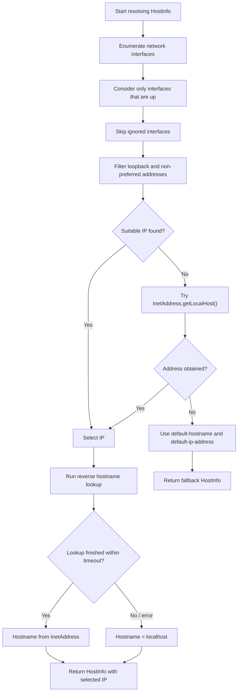

# Hostname resolution timeout and fallback addresses

## 1. Why does Spring Cloud need an instance's hostname and IP?

A service running in a distributed network normally has to advertise its address so other components can locate it. On startup, Spring Cloud Commons can determine the host info of the machine running the application and place those values into the Spring `Environment`. Discovery clients or service registries can use them when registering the instance.

Host info consists of two parts:

- **Hostname**: the machine name that a name resolution system can return for an IP address.
- **IP address**: the network address selected from the machine's network interfaces.

The two values are related but not identical. A machine can have a valid IP while reverse DNS fails to answer; in that case, Spring Cloud can still retain the selected IP and use a fallback hostname. Conversely, a machine with a hostname yet no suitable address to advertise over the network may still send an unhelpful address to the service registry.

Spring Cloud Commons provides `InetUtils` and `InetUtilsProperties` to accomplish this. Key properties live under the `spring.cloud.inetutils` prefix, where `timeout-seconds` caps how long to wait for hostname resolution, while `default-hostname` and `default-ip-address` provide fallback values when host info cannot be obtained.

This lesson belongs to the **Identity and Networking** chapter of **SPRING_CLOUD_CORE**. The focus is on understanding the exact scope of the timeout, how Spring Cloud selects network addresses, the difference between the two fallback branches, and the impact of the result on service registration.

## 2. Distinguishing three tasks commonly lumped together as "DNS timeout"

When debugging startup or service registration, identify which operation is actually slow:

| Task | Purpose | Bounded by `spring.cloud.inetutils.timeout-seconds`? |
| --- | --- | --- |
| Scanning network interfaces | Find active interfaces and a suitable IP address | No |
| Reverse hostname lookup | Find the hostname corresponding to the selected IP via `InetAddress.getHostName()` | Yes, caps how long `InetUtils` waits for the result |
| Resolving a target service's hostname | Translate a name like `payment.internal` into an IP to call HTTP, JDBC, or a broker | No. Configure the timeout on the corresponding client/resolver |

`timeout-seconds` is not a global timeout for all DNS operations in the JVM, nor is it an HTTP client's connect timeout or read timeout. It specifically serves `InetUtils`'s hostname-resolution step.

For example, if an application takes 8 seconds calling an API via hostname `catalog.internal`, changing `spring.cloud.inetutils.timeout-seconds` will not speed up that request. Configure DNS resolvers, HTTP client connect timeouts, and retry policies on the component executing the request.

## 3. How does `InetUtils` locate an address?

The general flow of `InetUtils.findFirstNonLoopbackHostInfo()` comprises these steps:

1. Enumerate the machine's network interfaces.
2. Consider only interfaces that are up.
3. Skip interfaces whose names match `ignored-interfaces`.
4. Iterate addresses on the interface and filter out loopback addresses.
5. Apply `preferred-networks` or `use-only-site-local-interfaces` to pick a suitable address.
6. If an IP is found, call `convertAddress()` to compute the hostname for that IP.
7. If no address is chosen, try obtaining the JVM's local host address; if this step also fails to provide an address, `InetUtils` uses the default pair of values.

In the current implementation, the interface-scanning step directly selects `Inet4Address` addresses. Therefore, if an environment is IPv6-only or has complex multi-interface setups, verify the outcome on the exact version and runtime configuration in use.

Diagram:



Interface and IP filters play distinct roles. `ignored-interfaces` excludes entire interfaces by name; `preferred-networks` filters by IP address string; `use-only-site-local-interfaces` accepts only addresses marked site-local by `InetAddress.isSiteLocalAddress()`.

## 4. How does the hostname resolution timeout work?

After selecting an `InetAddress`, `InetUtils.convertAddress()` invokes `address.getHostName()` inside a task running on a dedicated executor. The result is awaited via `Future.get(timeoutSeconds, TimeUnit.SECONDS)`.

The default value of `spring.cloud.inetutils.timeout-seconds` is **1 second**. If the task returns within that window, `HostInfo.hostname` receives the returned hostname. If the wait times out or the task throws an exception, `InetUtils` logs it and sets the hostname to the string `localhost`.

Example configuration increasing the timeout to 2 seconds:

```yaml
spring:
  cloud:
    inetutils:
      timeout-seconds: 2
```

### 4.1. `getHostName()` may perform a reverse lookup

Per the Java API, if an `InetAddress` is constructed from an IP address without an attached hostname, `getHostName()` may call the system name service to perform a reverse name lookup. The OS resolver may use DNS or another configured name resolution source on the machine.

Consequently, the hostname may depend on reverse DNS/PTR records, hosts files, and the runtime environment's name service settings. `getHostName()` also does not guarantee returning a fully qualified domain name. If reverse lookup has no matching record, the result may be the string representation of the IP per JDK behavior.

### 4.2. Timeout bounds the wait, not necessarily stopping the underlying resolver

In the current implementation, `InetUtils` submits `getHostName()` to an executor and waits on the Future with a timeout. Upon timeout, the code switches the hostname to `localhost`; it does not call `Future.cancel(true)` in the error-handling branch. Thus, the resolution operation on the worker may continue until the OS resolver returns.

In addition, `NetworkInterface.getNetworkInterfaces()` and the `InetAddress.getLocalHost()` fallback branch sit outside this hostname-waiting Future. They are not bounded by `timeout-seconds`.

Therefore, understand this property accurately as **a limit on how long `InetUtils` waits for the hostname**, not a hard deadline guaranteeing that the entire host-discovery process finishes within N seconds.

Do not raise the timeout to tens of seconds just to avoid a `localhost` hostname. Inspect reverse DNS/PTR, DNS configuration, and the interface list first; increase the timeout slightly only when the environment genuinely needs extra time and that startup delay is acceptable.

## 5. Two fallback branches yield different results

This is the easiest point to confuse when reading logs or inspecting instance information.

### 5.1. Reverse lookup timeout: fallback hostname, real IP is preserved

Suppose the machine has a valid IP `10.24.8.15`, yet reverse DNS fails to answer within the timeout. `InetUtils.convertAddress()` creates `HostInfo` with:

| Field | Result |
| --- | --- |
| `hostname` | `localhost` |
| `ipAddress` | `10.24.8.15` |

In this branch, a hostname timeout is handled using the literal string `localhost` in `convertAddress()`. The IP remains the selected address. The `default-hostname` and `default-ip-address` pair is not used to replace a selected IP merely because reverse lookup timed out.

This means setting `default-hostname: node-backup` will not necessarily set the hostname to `node-backup` when reverse lookup of a selected IP times out. In the current code, the timeout branch uses `localhost` directly.

### 5.2. Failing to obtain HostInfo: using the default value pair

If address lookup fails to return an `InetAddress` — for example, no suitable address was found and `InetAddress.getLocalHost()` also throws `UnknownHostException` — `findFirstNonLoopbackHostInfo()` constructs HostInfo using two properties:

| Property | Default value |
| --- | --- |
| `spring.cloud.inetutils.default-hostname` | `localhost` |
| `spring.cloud.inetutils.default-ip-address` | `127.0.0.1` |

Both values can be customized:

```yaml
spring:
  cloud:
    inetutils:
      default-hostname: fallback-node
      default-ip-address: 127.0.0.1
```

The default pair is the last resort when no host information can be collected. It is **not a list of fallback addresses**, does not try multiple IPs sequentially, and does not perform failover to another network interface.

Also note: if no suitable interface is found yet `InetAddress.getLocalHost()` still returns an address (even loopback), `InetUtils` may convert that address into HostInfo instead of using the default pair. Inspect the actual output rather than inferring solely from which interfaces are up on the machine.

### 5.3. Why can `127.0.0.1` cause service registration errors?

`127.0.0.1` is the machine's own loopback. If the service registry advertises this address for a service running on another node, clients from other nodes will connect to their own loopback instead of the host running the service.

Thus, the default IP is useful to indicate a fallback or support certain local environments, yet is rarely a valid advertised address in multi-host production setups. When a service must be called from other nodes, fix interface/network selection or configure a registration address appropriate for the platform.

## 6. `spring.cloud.inetutils` properties

| Property | Default | Meaning |
| --- | --- | --- |
| `spring.cloud.inetutils.timeout-seconds` | `1` | Maximum seconds `InetUtils` waits for hostname resolution |
| `spring.cloud.inetutils.default-hostname` | `localhost` | Fallback hostname when HostInfo cannot be obtained |
| `spring.cloud.inetutils.default-ip-address` | `127.0.0.1` | Fallback IP when HostInfo cannot be obtained |
| `spring.cloud.inetutils.ignored-interfaces` | Empty list | Regexes of interface names to ignore |
| `spring.cloud.inetutils.preferred-networks` | Empty list | Regexes or prefixes of IP addresses to accept/prioritize |
| `spring.cloud.inetutils.use-only-site-local-interfaces` | `false` | Accept only site-local addresses |

Property names in `application.yml` use kebab-case. The Java class `InetUtilsProperties` has corresponding fields such as `timeoutSeconds`, `defaultHostname`, `defaultIpAddress`, `ignoredInterfaces`, and `preferredNetworks`.

## 7. Selecting the right network interface

A machine may have many interfaces: Ethernet, Wi-Fi, VPN, Docker bridge, Kubernetes veth, Hyper-V virtual switch, or an interface dedicated to management. If Spring Cloud picks the wrong address, the service may register successfully while other services cannot reach it.

### 7.1. Ignoring interfaces not used to serve traffic

Example ignoring Docker bridge and interfaces starting with `veth`:

```yaml
spring:
  cloud:
    inetutils:
      ignored-interfaces:
        - docker0
        - veth.*
```

Each element is a Java regular expression applied to the interface name. `veth.*` can match `veth1234`; `docker0` matches that exact name. Check actual interface names on the OS/container before defining patterns.

### 7.2. Selecting desired subnets

If a machine has multiple addresses, you can accept only matching networks:

```yaml
spring:
  cloud:
    inetutils:
      preferred-networks:
        - '10\.24\..*'
        - '192\.168\.10\..*'
```

The expressions above illustrate matching IPv4 addresses within two desired ranges. `InetUtils` checks addresses by regex and also supports checking whether the address starts with the configured string, so short prefixes such as `192.168` are also commonly seen in documentation.

`preferred-networks` is a filter on local interface IP addresses. It is not a list of target service hostnames and does not configure DNS servers.

### 7.3. Using only site-local addresses

You can enable:

```yaml
spring:
  cloud:
    inetutils:
      use-only-site-local-interfaces: true
```

This property relies on the JDK's `InetAddress.isSiteLocalAddress()` definition. It can help in internal networks, yet does not replace firewalls, network policies, or security controls. Verify that the address to be advertised is indeed classified by the JDK as site-local.

### 7.4. Combined example

A configuration for a host running a service inside an internal network could be:

```yaml
spring:
  cloud:
    inetutils:
      timeout-seconds: 2
      default-hostname: localhost
      default-ip-address: 127.0.0.1
      ignored-interfaces:
        - docker0
        - veth.*
      preferred-networks:
        - '10\.24\..*'
        - '192\.168\.10\..*'
      use-only-site-local-interfaces: false
```

This is only an illustrative configuration. Replace subnets and interfaces with actual values from your deployment environment. Do not simultaneously enable overly strict filters that eliminate every valid address; doing so can push the application into the local-host or default-pair fallback branch.

## 8. How is HostInfo placed into the Spring Environment?

Spring Cloud Commons includes `HostInfoEnvironmentPostProcessor`. While preparing the Environment, the post-processor calls `InetUtils` to obtain HostInfo and then adds two properties:

- `spring.cloud.client.hostname`
- `spring.cloud.client.ip-address`

These values can be used by Spring Cloud components when building instance details or registering the service. By default, DiscoveryClient implementations may auto-register the running application with a discovery server; exact behavior and registered address details depend on the implementation such as Eureka, Consul, or Zookeeper.

You can inspect both properties once the Environment is prepared:

```java
import org.springframework.boot.ApplicationArguments;
import org.springframework.boot.ApplicationRunner;
import org.springframework.core.env.Environment;
import org.springframework.stereotype.Component;

import org.slf4j.Logger;
import org.slf4j.LoggerFactory;

@Component
public class HostIdentityReporter implements ApplicationRunner {

    private static final Logger log =
            LoggerFactory.getLogger(HostIdentityReporter.class);

    private final Environment environment;

    public HostIdentityReporter(Environment environment) {
        this.environment = environment;
    }

    @Override
    public void run(ApplicationArguments args) {
        String hostname =
                environment.getProperty("spring.cloud.client.hostname");
        String ipAddress =
                environment.getProperty("spring.cloud.client.ip-address");

        log.info("Resolved service host: hostname={}, ip={}",
                hostname, ipAddress);
    }
}
```

The example logs only hostname and IP, without sensitive information. In production, restrict log read permissions and compare these two values against the address actually stored by the discovery server.

If a fixed platform-assigned hostname/IP must be advertised, you can provide `spring.cloud.client.hostname` or `spring.cloud.client.ip-address` from a higher-precedence configuration source, or use the discovery implementation's own override properties. Exact override mechanics depend on version and registry; confirm both the final Environment values and the instance record in the registry.

## 9. Diagnosing by symptom

| Symptom | Possible cause | What to check |
| --- | --- | --- |
| Hostname is `localhost`, IP is real IP | Slow reverse lookup, timeout, or error | Check PTR/reverse DNS; look for `Cannot determine local hostname` in logs; consider a slightly higher timeout |
| Both hostname and IP are `localhost` / `127.0.0.1` | Could not obtain final host address or fallback was used | Check interfaces, up state, `ignored-interfaces`, `preferred-networks`, and `InetAddress.getLocalHost()` result |
| IP registered in wrong subnet | VPN, Docker, Hyper-V, or management interface was chosen | Inspect network interfaces; add `ignored-interfaces` or `preferred-networks` |
| Startup still slow despite small timeout | Slowness in a step outside the hostname lookup Future | Inspect interface enumeration, `InetAddress.getLocalHost()`, dependency DNS, and other post-processors |
| Registry has loopback IP | Fallback values or local host address selected | Check default pair, detected interfaces, and registry override config |
| Returned hostname is not expected FQDN | `getHostName()` does not guarantee canonical FQDN | Configure DNS/PTR or explicit advertised hostname per platform |

### 9.1. Diagnostic commands on Linux

```bash
ip address
ip route
hostname
hostname -f
getent hosts "$(hostname)"
getent hosts 10.24.8.15
```

These commands inspect interfaces, routes, local hostname, and name service results. `getent hosts <IP>` can help test reverse lookup if the system uses compatible NSS configuration.

### 9.2. Diagnostic commands on Windows

```powershell
ipconfig /all
Get-NetIPConfiguration
hostname
Resolve-DnsName app-node.internal
Resolve-DnsName 10.24.8.15
```

`Resolve-DnsName` can test name or PTR queries depending on DNS data and environment. If running inside a container or VM, inspect both host interfaces and interfaces visible from the application's network namespace.

## 10. Testing and validating configuration

Do not test only whether the application starts successfully. Verify that the selected host identity aligns with a network path reachable by other services.

An integration test suite should include:

1. Running the application on a machine with one valid IPv4 interface and confirming `spring.cloud.client.ip-address` matches the expected address.
2. Running on a machine with multiple interfaces and confirming `ignored-interfaces`/`preferred-networks` filter interfaces properly.
3. Using a test environment with slow reverse DNS or no PTR record to observe hostname fallback; never alter production DNS just to test.
4. Confirming that when reverse lookup times out, the selected IP is preserved.
5. Testing the branch where HostInfo cannot be obtained to confirm `default-hostname` and `default-ip-address` are used properly.
6. Reading the instance record in Eureka/Consul/Zookeeper or your registry to compare against the two Environment properties.
7. Verifying that a client from another machine can connect to the advertised address.

You can write unit tests for interface/address selection logic by testing `InetUtils` methods in an appropriate test module, or by testing `InetUtilsProperties` and configuration binding. Real timeout testing should be separated from ordinary unit tests because it depends on resolvers, OS behavior, and DNS caches.

## 11. Common misconceptions

| Misconception | Correct understanding |
| --- | --- |
| `timeout-seconds` is the timeout for all DNS queries | It caps how long `InetUtils.convertAddress()` waits for the hostname |
| Hostname timeout replaces both hostname and IP with defaults | In the timeout branch, hostname becomes `localhost` while the selected IP is preserved |
| `default-ip-address` is a secondary IP for failover | It is a single fallback value used when HostInfo cannot be obtained |
| `default-hostname` is always used when reverse DNS times out | The timeout branch in `convertAddress()` uses `localhost`; default hostname belongs to the branch where no address is found |
| `preferred-networks` selects a DNS server | It filters IP addresses on local interfaces |
| `ignored-interfaces` filters IP addresses | It skips interfaces by name |
| IP `127.0.0.1` can be reached remotely by other services | Loopback always points to the calling machine itself |
| Raising the timeout fixes every startup delay | Interface scanning, local-host resolution, and dependency DNS may fall outside this timeout |

## 12. Operational principles

- Ensure forward and reverse DNS are configured consistently for nodes that must register services by hostname.
- Choose an advertised subnet based on network paths consumers can actually reach, not merely because an interface is up.
- Keep `timeout-seconds` short enough to avoid prolonging startup; increase it only with evidence that reverse lookup needs extra time.
- Never use `default-ip-address` as a workaround to hide network interface errors in production.
- Monitor generated hostname/IP values and compare them with actual data in the service registry.
- When running in Docker/Kubernetes/multi-interface VMs, inspect the network namespace and interface setup at the exact place where the JVM runs.
- Verify behavior against the Spring Cloud Commons version in your dependency tree; `InetUtils` details and config loading timing can vary by release.

## 13. Self-check questions

1. Through what steps does `InetUtils` resolve HostInfo from network interfaces?
2. Which operation does `timeout-seconds` bound, and what is its default?
3. Why might `InetAddress.getHostName()` perform a reverse DNS lookup?
4. If reverse lookup times out, what values do hostname and IP have in HostInfo?
5. When are `default-hostname` and `default-ip-address` used?
6. Why is the default value pair not an IP failover mechanism?
7. How does `ignored-interfaces` differ from `preferred-networks`?
8. When should `use-only-site-local-interfaces` be enabled?
9. Why might a service registered with IP `127.0.0.1` be unreachable by other nodes?
10. What should you inspect if startup remains slow even after lowering `timeout-seconds`?

## 14. Official references

- [Spring Cloud Commons — Configuration Properties](https://docs.spring.io/spring-cloud-commons/reference/configprops.html) — default values and descriptions of `spring.cloud.inetutils.*`.
- [Spring Cloud Commons — Common Abstractions](https://docs.spring.io/spring-cloud-commons/reference/spring-cloud-commons/common-abstractions.html) — discovery client, service registration, and network interface filters.
- [InetUtils.java — Spring Cloud Commons](https://github.com/spring-cloud/spring-cloud-commons/blob/main/spring-cloud-commons/src/main/java/org/springframework/cloud/commons/util/InetUtils.java) — address search, hostname resolution, timeout, and fallback branches.
- [InetUtilsProperties.java — Spring Cloud Commons](https://github.com/spring-cloud/spring-cloud-commons/blob/main/spring-cloud-commons/src/main/java/org/springframework/cloud/commons/util/InetUtilsProperties.java) — prefix and configuration properties.
- [HostInfoEnvironmentPostProcessor.java — Spring Cloud Commons](https://github.com/spring-cloud/spring-cloud-commons/blob/main/spring-cloud-commons/src/main/java/org/springframework/cloud/client/HostInfoEnvironmentPostProcessor.java) — placing hostname/IP into the Environment.
- [Java `InetAddress` API](https://docs.oracle.com/en/java/javase/27/docs/api/java.base/java/net/InetAddress.html) — behavior of `getHostName()`, reverse lookup, and `getLocalHost()`.

*This document distinguishes the hostname wait timeout from HostInfo fallback and network interface selection. Verify both Environment results and service registry records on your exact Spring Cloud Commons version and deployment OS.*
