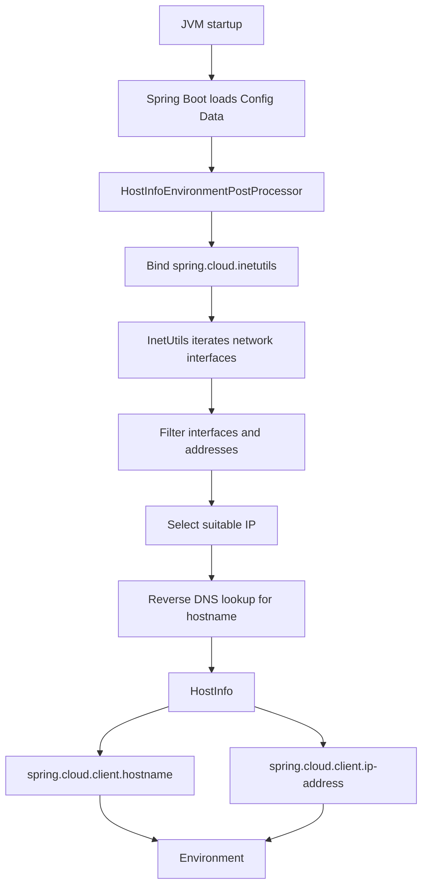

# Empirically verifying the selected IP and hostname

In a multi-network system, a JVM can see many addresses: loopback, Ethernet, Wi-Fi, VPN, Docker bridges, Kubernetes interfaces, hypervisor virtual interfaces, and IPv6. Spring Cloud must pick a representative address for the application when providing host info to shared components and service discovery registration.

Do not guess the selected address solely from a development machine's IP or from the `hostname` command output. Spring Cloud Commons provides `InetUtils` to locate a suitable address, then publishes host info into the `Environment`. The reliable approach is to **cross-check three independent results**: the interfaces seen by the OS, the values published by Spring Cloud, and the address actually used by the registry/consumers.

This lesson belongs to the **Identity and Networking** chapter of the **SPRING_CLOUD_CORE** module. The content guides you through observing each interface, understanding `InetUtils`'s filters, configuring IP/hostname selection, inspecting inside the JVM/container, and verifying that the registered address is reachable by other instances.

## 1. Learning objectives

After this lesson, learners will be able to:

- List the network interfaces and IP addresses visible to a Java process.
- Explain the roles of `InetUtils` and `HostInfoEnvironmentPostProcessor`.
- Read the `spring.cloud.client.hostname` and `spring.cloud.client.ip-address` properties.
- Configure `ignored-interfaces`, `preferred-networks`, `use-only-site-local-interfaces`, and fallback values.
- Distinguish the discovered host address from the address stored by the service registry.
- Inspect differences across host, container, pod, service DNS, and the address clients actually connect to.
- Identify cases where reverse DNS returns `localhost` for hostname or the selected IP is unreachable from another network.
- Write repeatable checks to verify IP selection after configuration or network environment changes.

## 2. Why can a machine have multiple IPs?

A server or container does not necessarily have only one address. For example, a developer machine might have:

| Interface | Example address | Role |
| --- | --- | --- |
| `lo` | `127.0.0.1` | Internal communication inside the network namespace |
| `eth0` | `192.168.1.25` | LAN network |
| `wlan0` | `192.168.1.80` | Wi-Fi |
| `tun0` | `10.8.0.12` | VPN |
| `docker0` | `172.17.0.1` | Docker bridge on the host |
| `veth...` | `172.18.0.1` | Virtual Ethernet pair connecting container |
| `vEthernet...` | `172.22.64.1` | Hyper-V/WSL virtual switch |

The selected address depends on the interfaces and network namespace in which the JVM runs. Java inside a container usually sees only the container's network stack; addresses on a Windows/Linux host can be completely different.

Distinguish four concepts:

1. **Host identity:** the IP and hostname Spring Cloud discovers for the application.
2. **Bind address:** the address the HTTP server listens on, typically tied to `server.address`.
3. **Registered address:** the host/port stored by Eureka, Consul, Zookeeper, or another registry.
4. **Reachable address:** the address a specific consumer can connect to through routes, firewalls, NAT, DNS, or a service mesh.

These four values can coincide, though they do not have to. `server.address=0.0.0.0` merely instructs the server to listen on suitable interfaces; it does not mean the application should register `0.0.0.0`.

## 3. How does Spring Cloud resolve hostname and IP?

Spring Cloud Commons provides `InetUtils` in the `org.springframework.cloud.commons.util` package. While preparing the `Environment`, `HostInfoEnvironmentPostProcessor` calls `InetUtils` to obtain `HostInfo`, then adds two properties to the `Environment`:

- `spring.cloud.client.hostname`
- `spring.cloud.client.ip-address`

In the current implementation, the post processor runs after `ConfigDataEnvironmentPostProcessor`, reads `spring.cloud.inetutils` configuration, and appends a property source named `springCloudClientHostInfo` at the end of the property sources list.

General flow:



`spring.cloud.client.hostname` is the hostname obtained from the selected address via `InetAddress.getHostName()`. This can be a reverse DNS result, not necessarily the machine name shown by the `hostname` command.

### 3.1. Filtering steps in InetUtils

Conceptually, the main pipeline works as follows:

1. Obtain the list of `NetworkInterface` entries from the JVM.
2. Consider only active interfaces (`isUp()`).
3. Skip interfaces whose display name matches an expression in `ignored-interfaces`.
4. Iterate addresses on the interface and exclude loopback addresses.
5. Check whether the address matches `preferred-networks` or the site-local policy.
6. Convert the selected address into `HostInfo`.
7. Perform hostname lookup within the timeout limit; if lookup fails, hostname may become `localhost`.

The current implementation of `InetUtils.findFirstNonLoopbackAddress()` checks `Inet4Address` when searching for addresses. Therefore, do not assume every Spring Cloud version automatically selects IPv6 through this path. If the system must register IPv6, inspect the source/API of your exact release train and test explicitly with real IPv6 addresses.

`InetUtils` can also try `InetAddress.getLocalHost()` when no suitable address is found. If a host still cannot be obtained, `findFirstNonLoopbackHostInfo()` uses default values `localhost` and `127.0.0.1`. This is a fallback so the application has host info; it does not prove that address is reachable by other consumers.

### 3.2. Which interface is selected when multiple interfaces exist?

Do not treat the `preferred-networks` list as an ordered priority ranking. It is used to check whether an address is acceptable. Interface traversal and indices supplied by the OS/JVM also affect the outcome.

In the current source, `InetUtils` tracks interface indices during traversal to bound which interfaces are considered once a candidate is found. If multiple interfaces contain matching addresses, the outcome also depends on the index/order and address order returned by the JVM.

Example configuration:

```yaml
spring:
  cloud:
    inetutils:
      preferred-networks:
        - "10."
        - "192.168."
```

does not mean `10.*` always beats `192.168.*`. Both are accepted networks; inspect actual interfaces and addresses to verify the final IP.

## 4. The spring.cloud.inetutils properties

Commonly used properties in Spring Cloud Commons:

| Property | Default in current metadata | Effect |
| --- | --- | --- |
| `spring.cloud.inetutils.ignored-interfaces` | Empty list | Skip interfaces whose display name matches a Java regular expression |
| `spring.cloud.inetutils.preferred-networks` | Empty list | Accept only addresses matching the network patterns |
| `spring.cloud.inetutils.use-only-site-local-interfaces` | `false` | Accept only addresses classified by the JDK as site-local |
| `spring.cloud.inetutils.default-hostname` | `localhost` | Fallback hostname when no host is found |
| `spring.cloud.inetutils.default-ip-address` | `127.0.0.1` | Fallback IP when no host is found |
| `spring.cloud.inetutils.timeout-seconds` | `1` | Time limit for hostname resolution |

Check the configuration metadata of your release train if the project runs an older version. Never copy a configuration verbatim from another release train's docs.

### 4.1. ignored-interfaces

This property accepts a list of Java regular expressions matched against the interface's display name. Example ignoring Docker bridge and veth interfaces:

```yaml
spring:
  cloud:
    inetutils:
      ignored-interfaces:
        - "docker0"
        - "veth.*"
        - "br-.*"
        - "tun.*"
```

Do not add `eth.*` or `ens.*` if that is the only interface reachable by other services. If patterns match every valid interface, `InetUtils` will be left with no candidates and may fall back to default addresses.

Do not assume all virtual interfaces are excluded automatically. The current implementation checks active interfaces and applies the ignore list; if `veth`, bridges, or virtual interfaces should not be picked, inspect display names and add corresponding patterns.

### 4.2. preferred-networks

This property accepts a list of Java regular expressions for network addresses. Example accepting only addresses in two common private ranges:

```yaml
spring:
  cloud:
    inetutils:
      preferred-networks:
        - '10\..*'
        - '192\.168\..*'
```

In the current implementation, an address is accepted if it matches the regex or starts with the pattern string. Hence short examples like `10.` can also work as prefixes. Writing full regexes makes the intent clearer during config reviews.

This is not CIDR syntax. Do not write `10.0.0.0/8` expecting InetUtils to interpret subnet masks. If CIDR filtering is needed, implement custom logic or use platform/provider networking mechanisms.

### 4.3. use-only-site-local-interfaces

```yaml
spring:
  cloud:
    inetutils:
      use-only-site-local-interfaces: true
```

When enabled, InetUtils uses `InetAddress.isSiteLocalAddress()` to filter addresses. The site-local concept is a JDK rule; do not mistake it for a reachability check across all networks.

In the current implementation, the site-local branch returns its filter result directly; if this option is enabled, do not expect `preferred-networks` to narrow the address set further independently. Check your release train's source if combining the two properties.

Do not enable this option if the service must advertise a public address or an address not classified by the JDK as site-local.

### 4.4. default-hostname and default-ip-address

```yaml
spring:
  cloud:
    inetutils:
      default-hostname: "catalog-node"
      default-ip-address: "127.0.0.1"
```

These two properties are fallback values when no suitable address is found. They are not priority overrides to force InetUtils onto a specific interface. Setting the default IP to loopback in a service that must be called from another pod can cause the registry to store an unreachable address.

### 4.5. timeout-seconds

Hostname is computed by looking up the name for the selected address. Reverse DNS lookups can be slow or lack PTR records. Timeout caps how long to wait for hostname determination; it does not make an IP reachable and does not modify OS routes.

If the selected IP is right yet the hostname is `localhost`, inspect DNS/PTR and the timeout before changing IP filters.

## 5. Experiment 1: listing interfaces on the OS

Before editing Spring Cloud configuration, record the interfaces visible in the runtime environment.

### 5.1. Windows PowerShell

```powershell
Get-NetAdapter |
  Format-Table Name, Status, InterfaceDescription

Get-NetIPAddress -AddressFamily IPv4 |
  Sort-Object InterfaceIndex |
  Format-Table InterfaceAlias, InterfaceIndex, IPAddress, PrefixLength, AddressState

Get-NetRoute -AddressFamily IPv4 |
  Sort-Object RouteMetric |
  Format-Table InterfaceAlias, DestinationPrefix, NextHop, RouteMetric
```

The output reveals interface names, statuses, indices, addresses, and routes. If the JVM runs inside Docker Desktop, WSL2, or Kubernetes, output on the Windows host cannot substitute for inspecting inside the container/pod.

### 5.2. Linux

```bash
ip -br link
ip -br addr
ip route
ip route get 10.20.0.15
```

Replace `10.20.0.15` with the address of a consumer or endpoint the service must reach. `ip route get` shows the route and source address the kernel expects to use for that destination. That result can differ from the IP InetUtils chooses to register the service.

### 5.3. Docker

Run commands inside the exact container hosting the JVM:

```bash
docker exec <container-name> ip -br addr
docker exec <container-name> ip route
```

Do not infer a container's IP from `docker0` on the host. Each container has its own network namespace; the IP seen by the JVM usually belongs to the bridge or network the container is attached to.

### 5.4. Kubernetes

```bash
kubectl get pod -n <namespace> -o wide
kubectl exec -n <namespace> <pod-name> -- ip -br addr
kubectl exec -n <namespace> <pod-name> -- ip route
```

`kubectl get pod -o wide` displays the Pod IP reported by Kubernetes. Running `ip` inside the pod shows the interfaces visible to processes in the pod's network namespace. If the pod uses `hostNetwork: true`, the output will closely resemble the node's network namespace.

## 6. Experiment 2: reading values published by Spring Cloud

After the application starts, read these two properties directly from the `Environment`:

```text
spring.cloud.client.hostname
spring.cloud.client.ip-address
```

You can observe them via Actuator `env` in a test environment. Example enabling the needed endpoints:

```yaml
management:
  endpoints:
    web:
      exposure:
        include: health,env
```

Then query:

```bash
curl -sS http://localhost:8080/actuator/env/spring.cloud.client.ip-address
curl -sS http://localhost:8080/actuator/env/spring.cloud.client.hostname
```

The `env` endpoint may contain internal configuration details. Enable it only temporarily in a protected environment, restrict access, and turn it off after verification. Never expose the full Environment publicly.

### 6.1. Printing results from code

A small `ApplicationRunner` can log the effective values once the context is created:

```java
import org.slf4j.Logger;
import org.slf4j.LoggerFactory;
import org.springframework.boot.ApplicationArguments;
import org.springframework.boot.ApplicationRunner;
import org.springframework.core.env.Environment;
import org.springframework.stereotype.Component;

@Component
public class NetworkIdentityProbe implements ApplicationRunner {

    private static final Logger log =
        LoggerFactory.getLogger(NetworkIdentityProbe.class);

    private final Environment environment;

    public NetworkIdentityProbe(Environment environment) {
        this.environment = environment;
    }

    @Override
    public void run(ApplicationArguments args) {
        log.info("Spring Cloud hostname: {}",
            environment.getProperty("spring.cloud.client.hostname"));

        log.info("Spring Cloud IP address: {}",
            environment.getProperty("spring.cloud.client.ip-address"));
    }
}
```

These are the values retrieved by application code. They can be overridden by a property source with higher precedence than `springCloudClientHostInfo`, so inspect the origin/property source as well when results differ from expectations.

### 6.2. Listing interfaces from inside the JVM

To compare against OS commands, use the Java NetworkInterface API:

```java
import java.net.InetAddress;
import java.net.NetworkInterface;
import java.util.Collections;

public class NetworkInterfaceProbe {

    public static void printInterfaces() throws Exception {
        for (NetworkInterface networkInterface :
                Collections.list(NetworkInterface.getNetworkInterfaces())) {

            System.out.printf(
                "name=%s display=%s index=%d up=%s loopback=%s virtual=%s%n",
                networkInterface.getName(),
                networkInterface.getDisplayName(),
                networkInterface.getIndex(),
                networkInterface.isUp(),
                networkInterface.isLoopback(),
                networkInterface.isVirtual()
            );

            for (InetAddress address :
                    Collections.list(networkInterface.getInetAddresses())) {
                System.out.printf(
                    "  address=%s loopback=%s siteLocal=%s%n",
                    address.getHostAddress(),
                    address.isLoopbackAddress(),
                    address.isSiteLocalAddress()
                );
            }
        }
    }
}
```

Place this probe in a runner or separate test. Compare `displayName`, index, and addresses against `ignored-interfaces`/`preferred-networks` configuration. Do not look only at the name `eth0`: InetUtils matches interface display names in the current implementation.

## 7. Experiment 3: observing HostInfo returned by InetUtils

If the project has an `InetUtils` bean provided by Spring Cloud Commons auto-configuration, you can call it directly:

```java
import org.springframework.cloud.commons.util.InetUtils;
import org.springframework.cloud.commons.util.InetUtils.HostInfo;
import org.springframework.stereotype.Component;

@Component
public class InetUtilsProbe {

    private final InetUtils inetUtils;

    public InetUtilsProbe(InetUtils inetUtils) {
        this.inetUtils = inetUtils;
    }

    public void printHostInfo() {
        HostInfo hostInfo = inetUtils.findFirstNonLoopbackHostInfo();

        System.out.println("InetUtils IP: " + hostInfo.getIpAddress());
        System.out.println("InetUtils hostname: " + hostInfo.getHostname());
    }
}
```

This result shows `InetUtils`'s selection using the configuration bound to the bean. Cross-check it against `spring.cloud.client.ip-address` in the `Environment`.

If the two results differ, check:

- Is any property source overriding `spring.cloud.client.ip-address` or `spring.cloud.client.hostname`?
- Does the `InetUtils` bean receive the same `InetUtilsProperties` used by the post processor?
- Does the application define a custom `InetUtils`, `InetUtilsProperties`, or `EnvironmentPostProcessor`?
- Did the Spring Cloud version alter post processor timing or the address-selection algorithm?

Do not conclude that the registry will always use the exact result of the second probe call. The discovery provider may use its own instance configuration or an already-constructed `Registration`.

## 8. Configuration example when a host has VPN and Docker

Suppose the JVM runs on a Linux host with the following interfaces:

| Interface | IP | Intent |
| --- | --- | --- |
| `eth0` | `192.168.10.25` | LAN network to use |
| `tun0` | `10.8.0.12` | VPN not to advertise |
| `docker0` | `172.17.0.1` | Bridge not to advertise |
| `lo` | `127.0.0.1` | Loopback |

To exclude VPN and Docker bridge while accepting only the LAN address:

```yaml
spring:
  cloud:
    inetutils:
      ignored-interfaces:
        - "tun.*"
        - "docker0"
      preferred-networks:
        - "192\\.168\\..*"
```

After restarting the application, verify:

1. Interfaces `tun0` and `docker0` are not used as candidates.
2. Address `192.168.10.25` is visible to the JVM.
3. `spring.cloud.client.ip-address` equals `192.168.10.25`.
4. The returned hostname resolves from consumers.
5. Consumers on other networks have routes to that address.

If no matching interface remains, do not be surprised if the application falls back to `InetAddress.getLocalHost()` or default values. Fix patterns and re-test inside the same network namespace.

## 9. Experiment 4: verifying the address stored by the service registry

Values in the `Environment` are Spring Cloud's shared host info. The actual registered address also depends on the discovery implementation such as Eureka, Consul, or Zookeeper and the provider's instance configuration.

Spring Cloud Commons provides auto-registration when a discovery implementation is on the classpath. `@EnableDiscoveryClient` is no longer required in current configurations. Auto-registration can be disabled via:

```yaml
spring:
  cloud:
    service-registry:
      auto-registration:
        enabled: false
```

Use this option during practice if you want to start the application and inspect the `Environment` before allowing registration.

When registration is enabled, inspect the record in the registry's UI/API:

- What host/IP is stored?
- Does the registered port match the actual server port?
- Does the registry store a hostname or an IP?
- Does the Instance ID distinguish replicas?
- Does metadata contain zone, version, or provider-specific details?

Some providers have dedicated properties for choosing hostname, IP, or preferring IP. Those properties can override InetUtils's shared selection. Consult the exact provider's docs and compare against the real record in the registry.

### 9.1. Inspecting from DiscoveryClient

From a service consumer, you can read the instances returned by the registry:

```java
import org.springframework.cloud.client.ServiceInstance;
import org.springframework.cloud.client.discovery.DiscoveryClient;
import org.springframework.stereotype.Component;

@Component
public class RegisteredInstanceProbe {

    private final DiscoveryClient discoveryClient;

    public RegisteredInstanceProbe(DiscoveryClient discoveryClient) {
        this.discoveryClient = discoveryClient;
    }

    public void printInstances(String serviceId) {
        for (ServiceInstance instance :
                discoveryClient.getInstances(serviceId)) {

            System.out.printf(
                "service=%s host=%s port=%d secure=%s uri=%s metadata=%s%n",
                serviceId,
                instance.getHost(),
                instance.getPort(),
                instance.isSecure(),
                instance.getUri(),
                instance.getMetadata()
            );
        }
    }
}
```

`DiscoveryClient.getInstances()` shows the data returned by the discovery client. It does not check whether the endpoint is actually reachable from the consumer's location.

### 9.2. Verifying reachability from the consumer

Test from the calling service's exact network namespace:

```bash
curl -v --connect-timeout 3 http://192.168.10.25:8080/actuator/health
```

Replace host/port with the real record from the registry. If a DNS hostname is registered, test that exact hostname rather than manually substituting an IP.

If it fails, inspect routes, firewalls, security groups, NetworkPolicies, port mappings, service mesh, and the server's bind address. Do not tweak `preferred-networks` merely because a consumer cannot connect: the root cause may lie in routing or NAT.

## 10. Distinguishing host address from routed address

`InetUtils` picks a representative address based on interfaces visible to the JVM. It does not ask "which source IP will the kernel use when connecting to consumer A?" and it does not test remote firewalls.

Examples:

- The JVM selects `172.18.0.4` on a Docker bridge.
- A consumer on the same Docker network can reach `172.18.0.4`.
- A consumer on another network without a route to the bridge subnet may fail to reach it.
- Host port publishing `8080:8080` can let consumers connect via the host IP, even though the container registered `172.18.0.4`.

In Kubernetes:

- Pod IPs typically work across pods in the cluster if CNI/network policies permit it.
- Pod IPs follow the pod lifecycle and can change on reschedule.
- Kubernetes Service DNS is usually more stable for clients accessing a service.
- With a service mesh, the address seen by the application and the actual path through sidecars can differ.

In cloud environments:

- Private IP, public IP, NAT gateway, and load balancer are distinct layers.
- `InetUtils` does not auto-detect a public IP behind NAT.
- If a service needs to advertise an endpoint through a load balancer, configure the provider/registry or gateway with the appropriate public/virtual address.

## 11. Verifying hostname and DNS

The hostname may come from reverse DNS of the selected IP. Therefore, verify in both directions:

```bash
getent hosts 192.168.10.25
getent ahosts catalog-node.internal
```

On Windows:

```powershell
Resolve-DnsName 192.168.10.25
Resolve-DnsName catalog-node.internal
```

Check:

- Does the IP have a PTR record?
- Does the PTR return the expected hostname?
- Does the hostname have matching A/AAAA records?
- Do DNS search domains in the container/pod produce different results from the host?
- Does the hostname still point to an old IP after recreating the container/pod?

A `localhost` hostname does not necessarily prove the selected IP is loopback. Inside `InetUtils`, hostname lookup can time out or fail and switch the hostname to `localhost` while the IP address retains the selected value. Inspect both properties separately.

## 12. Diagnosing incorrect results

| Symptom | Possible cause | How to check |
| --- | --- | --- |
| IP is `127.0.0.1` | No suitable interface found or fallback is active | List interfaces in the same container; inspect `preferred-networks` and `ignored-interfaces` |
| IP is Docker bridge | Bridge interface not ignored or was accepted | Check display name, regex, and network namespace |
| IP is VPN | VPN interface is active and matches filters | Add pattern excluding VPN or restrict preferred networks |
| IP right on host yet wrong in pod | JVM runs in a different network namespace | Run `ip addr` inside the pod/container |
| Hostname is `localhost`, IP is right | Reverse DNS timeout or missing PTR | Inspect DNS/PTR and timeout |
| IP right in Environment yet wrong in registry | Provider uses dedicated instance config or stale record | Check provider config and fresh registration record |
| Registry has right IP yet consumers cannot call it | Route/firewall/NAT/NetworkPolicy/port mapping | Test connecting from the consumer's exact namespace |
| `preferred-networks` config has no effect | Wrong regex, property not loaded before post processor ran, or version difference | Inspect `/actuator/env`, configuration metadata, and release train |
| Fails only on Windows/WSL | Hyper-V, WSL, VPN, or Docker created extra interfaces | Compare host interfaces with interfaces in the JVM runtime |
| IPv6 not registered | Current implementation's address selection path checks IPv4 only | Inspect version/source and provider IPv6 configuration |

### 12.1. Ordered investigation procedure

1. Determine whether the JVM runs directly on a host, in Docker, or in Kubernetes.
2. List interfaces and IPs inside that exact environment.
3. Record `spring.cloud.client.ip-address` and `spring.cloud.client.hostname`.
4. Inspect `springCloudClientHostInfo` and any property sources that could override both values.
5. Verify whether `spring.cloud.inetutils` settings were bound properly.
6. Call `InetUtils.findFirstNonLoopbackHostInfo()` and compare results.
7. Inspect the actual record inside the service registry.
8. From a consumer, test DNS resolution, routing, and HTTP/TCP to the registered host/port.
9. Change only one filter at a time, restart, and repeat measurements.
10. Record Spring Cloud version, JDK, container image, and network topology alongside results.

## 13. Notes on configuration loading timing and versions

`HostInfoEnvironmentPostProcessor` is an `EnvironmentPostProcessor`. In the current implementation, it is ordered to run after `ConfigDataEnvironmentPostProcessor` so it can bind `spring.cloud.inetutils` properties already loaded from Config Data.

Older releases had differences in post-processor ordering and when configuration became visible. If `ignored-interfaces` or `preferred-networks` exist in a file yet have no effect, check:

- Actual Spring Cloud BOM and Spring Boot version.
- Whether `spring.cloud.inetutils.*` appears in `/actuator/env`.
- Whether the property source was available at the moment host info was constructed.
- Whether a custom `EnvironmentPostProcessor` or bootstrap configuration altered ordering.
- Whether the `InetUtils` implementation in the exact dependency JAR matches the source/docs you are referencing.

Do not rely on `current` docs to assume every older release train uses the exact same algorithm. Inspect the JAR source or tag for your exact version if empirical results differ from descriptions.

## 14. Automated testing for IP selection

Do not write unit tests that depend on a CI machine's real interfaces, as NIC lists vary across developers, runners, and containers. Decouple address-filtering logic from the host environment or test `InetUtils` inside a controlled network namespace/container.

Test cases to cover:

| Case | Network data | Expected verification |
| --- | --- | --- |
| Loopback only | `lo` with `127.0.0.1` | Fallback per implementation |
| Single valid interface | `eth0` with non-loopback IP | IP selected |
| Ignored interface | `docker0` has IP, `eth0` has IP | Address from `docker0` is not selected |
| Preferred network match | One `10.*` IP, one `192.168.*` IP, only `10.*` pattern | Only the `10.*` address is accepted |
| No pattern match | All IPs outside preferred networks | No matching candidate; verify fallback |
| Site-local only | Both site-local and non-site-local present | Only site-local accepted |
| Reverse DNS failure | Usable IP with no PTR | Hostname fallback; IP still verified separately |
| Multi-interface | Multiple NICs with valid IPs | Result per implementation/version and interface index |
| Registry override | Environment IP differs from provider registration IP | Verify record matches provider configuration |
| Consumer reachability | Registry returns host/port yet network policy blocks | Connectivity check must fail even though discovery succeeded |

For integration tests, log interface list, selected IP, property source, and registry record. Never hardcode a specific CI machine IP in unit tests.

## 15. Applied exercise

A `catalog-service` runs in Docker on a host with these interfaces:

| Interface | IP |
| --- | --- |
| `eth0` | `172.20.0.5` |
| `tun0` | `10.8.0.6` |
| `docker0` on host | `172.17.0.1` |
| `lo` | `127.0.0.1` |

The service registers in Eureka with hostname `localhost`. Another consumer on the Docker network fails when calling the service.

Perform the following:

1. List interfaces inside the container and on the host to identify which addresses the JVM sees.
2. Read `spring.cloud.client.ip-address` and `spring.cloud.client.hostname` from the Environment.
3. Call `InetUtils.findFirstNonLoopbackHostInfo()` and compare results.
4. Check reverse DNS for the selected IP to find why the hostname is `localhost`.
5. Configure `ignored-interfaces` and `preferred-networks` to select the reachable Docker network.
6. Inspect provider-specific Eureka instance settings and the actual record in the registry.
7. From the consumer container, test connecting to the host/port in the record.
8. Explain why the `docker0` address on the host is not necessarily the `eth0` address inside the container.
9. Propose a more stable addressing strategy if the service runs in Kubernetes or behind a load balancer.

**Completion criteria:** evidence collected from OS, JVM, Environment, registry, and consumer; ability to explain the difference between discovered IP and reachable IP; filter configuration verified after restart.

## 16. Key takeaways

- Spring Cloud Commons uses `InetUtils` to resolve `HostInfo` and publishes `spring.cloud.client.hostname` alongside `spring.cloud.client.ip-address`.
- `ignored-interfaces` filters interfaces by Java regular expression; `preferred-networks` filters addresses by pattern.
- `preferred-networks` is not a CIDR priority list, and list order does not guarantee the first interface is selected.
- `use-only-site-local-interfaces` relies on the JDK's site-local definition.
- `default-hostname` and `default-ip-address` are fallbacks, not an interface-selection mechanism.
- Hostname may depend on reverse DNS; a valid IP does not guarantee a valid hostname.
- `spring.cloud.client.ip-address`, the address registered in the registry, and the address reachable by consumers can all differ.
- Docker, WSL, VPN, Kubernetes, and service meshes alter the network namespace/routes visible to the JVM.
- Always check your exact Spring Cloud release train; the current implementation may differ from older versions, especially for IPv6 and initialization order.
- Conclude only after cross-checking OS interfaces, Environment values, registry records, and connectivity tests from the consumer.

## 17. References

- [Spring Cloud Commons — Common Abstractions, Ignore Network Interfaces](https://docs.spring.io/spring-cloud-commons/reference/spring-cloud-commons/common-abstractions.html): configuring ignoredInterfaces, preferredNetworks, and useOnlySiteLocalInterfaces.
- [Spring Cloud Commons — Configuration Properties](https://docs.spring.io/spring-cloud-commons/reference/configprops.html): `spring.cloud.inetutils.*` property names and default values.
- [HostInfoEnvironmentPostProcessor.java](https://github.com/spring-cloud/spring-cloud-commons/blob/main/spring-cloud-commons/src/main/java/org/springframework/cloud/client/HostInfoEnvironmentPostProcessor.java): when `spring.cloud.client.hostname` and `spring.cloud.client.ip-address` are created.
- [InetUtils.java](https://github.com/spring-cloud/spring-cloud-commons/blob/main/spring-cloud-commons/src/main/java/org/springframework/cloud/commons/util/InetUtils.java): algorithm for iterating interfaces, filtering addresses, picking IP, and resolving hostname.
- [InetUtilsProperties.java](https://github.com/spring-cloud/spring-cloud-commons/blob/main/spring-cloud-commons/src/main/java/org/springframework/cloud/commons/util/InetUtilsProperties.java): configuration properties of InetUtils.
- [Spring Cloud Commons — ServiceRegistry and DiscoveryClient](https://docs.spring.io/spring-cloud-commons/reference/spring-cloud-commons/common-abstractions.html): auto-registration, ServiceRegistry, and DiscoveryClient.
