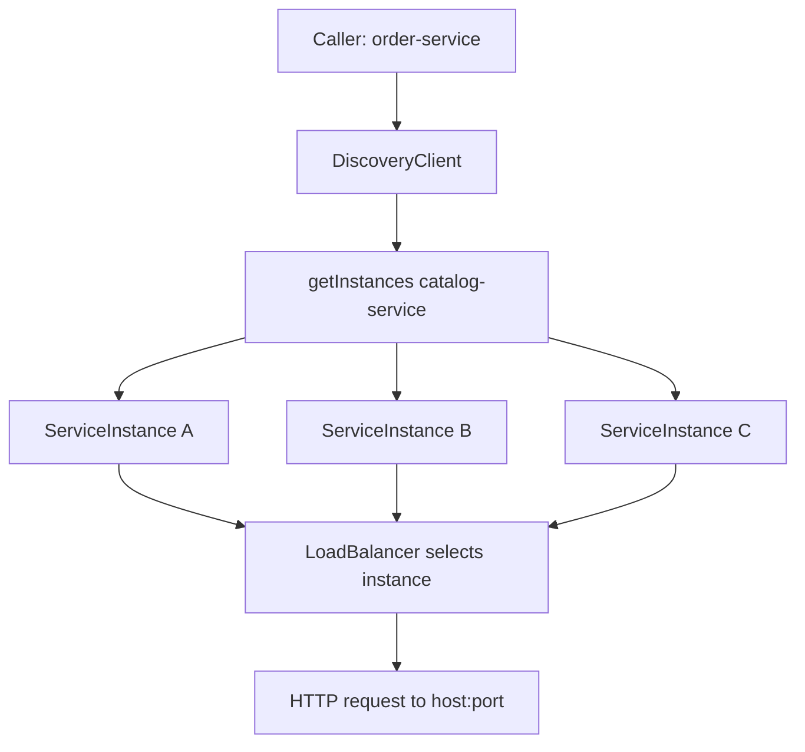

# Role of ServiceInstance and DefaultServiceInstance

In Spring Cloud, service discovery helps an application find running instances of another service without hardcoding the IP and port of each machine. The discovery provider returns a list of callable endpoints; Spring Cloud Commons represents each endpoint with the **ServiceInstance** abstraction. The **DefaultServiceInstance** class is a common implementation of this abstraction, useful when you need to create a simple instance descriptor, configure static discovery, or write tests.

These two types often appear together, yet they play different roles. ServiceInstance is a contract that DiscoveryClient and LoadBalancer can use independently of Eureka, Consul, or other providers. DefaultServiceInstance is a concrete object holding the service ID, instance ID, host, port, secure status, and metadata. That object itself does not connect to a registry, does not check health on its own, and does not register the application.

This lesson belongs to the **DiscoveryClient** chapter of the SPRING_CLOUD_CORE module. The goal is to understand the fields of ServiceInstance, how to read and use URI/metadata, how to construct DefaultServiceInstance, the limits of discovery data, and how to test endpoint selection flows in distributed systems.

## 1. What Problem Does ServiceInstance Solve?

Suppose order-service needs to call catalog-service. In development, catalog might run at localhost:8081; in staging, it might run across multiple containers; in production, instances may change IPs after every scaling or rollout event.

If the code calls a fixed host directly:

```java
URI catalogUri = URI.create("http://10.0.1.21:8080");
```

then that address becomes a hard dependency. When an instance is replaced, the caller must be updated and redeployed.

With discovery, the caller requests instances by logical service ID:

```java
List<ServiceInstance> instances =
        discoveryClient.getInstances("catalog-service");
```

Each element describes a callable address. For example:

| Service ID | Instance ID | Host | Port | Secure |
| --- | --- | --- | ---: | --- |
| catalog-service | catalog-a1 | catalog-1.internal | 8080 | false |
| catalog-service | catalog-b2 | catalog-2.internal | 8080 | false |
| catalog-service | catalog-c3 | catalog-3.internal | 8443 | true |

The Service ID identifies the logical service group. The Instance ID distinguishes a specific registration if provided by the provider. Host, port, and secure describe the network address. DiscoveryClient returns a list of these descriptors for the service-calling layer or load balancer to choose from.



ServiceInstance is data describing an instance at the moment discovery returns the result. It does not guarantee the endpoint will remain alive until the request is sent. An instance can stop immediately after being returned; callers still need timeouts, retries, circuit breakers, and proper network error handling.

## 2. The ServiceInstance Contract

The `org.springframework.cloud.client.ServiceInstance` interface belongs to Spring Cloud Commons. It provides a shared abstraction so discovery and load-balancing libraries can exchange instance information without forcing applications to depend directly on a specific registry's data types.

Key accessors:

| Method | Meaning | Notes |
| --- | --- | --- |
| `getServiceId()` | Service ID under which the instance is registered | Logical name used to look up the instance group |
| `getInstanceId()` | Unique ID of the instance if provided by the implementation | Some implementations return `null` |
| `getHost()` | Hostname or host address of the instance | Must be reachable from the caller |
| `getPort()` | Port of the service | Must match the actual callable port |
| `isSecure()` | Indicates whether the endpoint uses HTTPS | Does not replace TLS trust configuration |
| `getUri()` | Service address URI | Prefer over manually concatenating host/port strings |
| `getMetadata()` | Key/value metadata attached to the instance | May be empty or `null`, depending on implementation |
| `getScheme()` | Scheme of the instance if provided by the implementation | Default method may return `null` |

### 2.1. Service ID

`getServiceId()` returns the logical service name published by the registry or discovery client. Multiple instances can share the same service ID:

```text
catalog-service
  ├── catalog-a1
  ├── catalog-b2
  └── catalog-c3
```

When calling `getInstances("catalog-service")`, DiscoveryClient returns the instances belonging to that service ID. A Service ID is not a host, port, or instance ID.

### 2.2. Instance ID

`getInstanceId()` provides the registration identity if the implementation has that data. In the current contract, this is a default method that may return `null`; therefore, generic code using ServiceInstance should not assume every provider supplies an instance ID.

Safe handling example:

```java
String instanceId = instance.getInstanceId();

if (instanceId == null || instanceId.isBlank()) {
    // Record that the provider did not supply an instance identity.
}
```

Do not use `getHost() + ":" + getPort()` as a universal instance ID without an explicit convention. Two registrations may share an address behind a proxy, or a single instance may have multiple network addresses.

### 2.3. Host and Port

`getHost()` returns the hostname or host address the caller will connect to. `getPort()` returns the service port. Both values must be accurate from the caller's network perspective.

For example, if catalog runs in a container and the caller is in the same Kubernetes cluster, the internal hostname may be a Service DNS name or Pod address published by the provider. `localhost` inside a container points only to that container itself; do not use `localhost` to describe a service in another container.

### 2.4. Secure and URI

`isSecure()` indicates that connecting to the instance uses HTTPS. `getUri()` returns the service address URI according to the implementation. With `DefaultServiceInstance`, the URI is built from host, port, and the secure flag; the scheme is typically `https` when secure is `true`, and `http` otherwise.

Prefer:

```java
URI serviceUri = instance.getUri();
```

instead of manually concatenating:

```java
String url = "http://" + instance.getHost() + ":" + instance.getPort();
```

Manual string concatenation can miss HTTPS, default ports, or URI differences managed by the implementation. If an endpoint needs a base path, query, or additional info, construct the URI per the application's contract from the resolved base URI.

`isSecure()` only describes the endpoint's security scheme. It does not automatically configure truststores, hostname verification, certificate rotation, or mTLS. Those belong to the HTTP client and TLS infrastructure.

### 2.5. Metadata

`getMetadata()` returns a key/value map attached to the instance by the discovery provider. For example:

```text
zone = ap-southeast-1a
version = v2
canary = true
team = catalog
```

Metadata can support filtering instances by zone, version, tenant, or capabilities. However, Spring Cloud Commons does not enforce a common business key set across all providers. The meaning of metadata must be agreed upon between the registering and consuming sides.

Treat metadata as input data from the discovery system:

- Check that a key exists before using it.
- Convert string values to target types explicitly.
- Provide fallback values when a key is absent.
- Never place passwords, tokens, or secrets in metadata.
- Do not assume metadata is always immutable or always present.

Example:

```java
Map<String, String> metadata = instance.getMetadata();

String zone = metadata == null ? null : metadata.get("zone");
String version = metadata == null ? null : metadata.get("version");
```

## 3. What Is DefaultServiceInstance?

`org.springframework.cloud.client.DefaultServiceInstance` is the default implementation of `ServiceInstance`. It stores the basic fields describing an instance:

- `instanceId`
- `serviceId`
- `host`
- `port`
- `secure`
- `metadata`

Common constructors:

```java
new DefaultServiceInstance(
        instanceId,
        serviceId,
        host,
        port,
        secure
);
```

Or passing metadata as well:

```java
new DefaultServiceInstance(
        instanceId,
        serviceId,
        host,
        port,
        secure,
        metadata
);
```

Example of creating an instance:

```java
import java.util.LinkedHashMap;
import java.util.Map;

import org.springframework.cloud.client.DefaultServiceInstance;
import org.springframework.cloud.client.ServiceInstance;

Map<String, String> metadata = new LinkedHashMap<>();
metadata.put("zone", "ap-southeast-1a");
metadata.put("version", "v2");

ServiceInstance instance = new DefaultServiceInstance(
        "catalog-pod-7f9a",
        "catalog-service",
        "catalog-1.internal",
        8080,
        false,
        metadata
);
```

Using the interface on the caller side:

```java
URI uri = instance.getUri();
String serviceId = instance.getServiceId();
String instanceId = instance.getInstanceId();
```

Typing variables as `ServiceInstance` keeps code dependent on the abstraction rather than the concrete implementation. Only use `DefaultServiceInstance` directly when creating an object or when tests require the default implementation.

### 3.1. Constructor Does Not Perform Discovery

When calling `new DefaultServiceInstance(...)`, the application only creates a Java object holding endpoint info. The constructor does not:

- Call Eureka, Consul, or the Kubernetes API.
- Check whether the host resolves via DNS.
- Check whether the port is open.
- Register the instance into a service registry.
- Send heartbeats or health status.
- Select an instance for a request.

Those responsibilities belong to the discovery provider, ServiceRegistry, health checks, and load balancer. Do not confuse creating a DefaultServiceInstance with registering a service.

### 3.2. DefaultServiceInstance Is Not a Registration

`Registration` is a separate abstraction used with `ServiceRegistry`; in Spring Cloud Commons, it extends the `ServiceInstance` contract and acts as a marker for registration data. `DefaultServiceInstance` only implements `ServiceInstance`, and does not automatically become a `Registration`.

Therefore, you cannot pass a DefaultServiceInstance into every `ServiceRegistry.register(...)` by default. Each provider has its own registration implementation, such as EurekaRegistration or ConsulRegistration. When manual registration is needed, create the exact Registration type used by that ServiceRegistry.

### 3.3. Mutable Object

DefaultServiceInstance provides setters for several fields such as instance ID, service ID, host, port, and secure. Metadata is also a map stored on the object. This makes the implementation convenient for constructing data, but code should not mutate an instance after sharing it across threads or placing it into a cached list.

A practical rule is to construct the complete instance before publishing it, then treat it as read-only data. If an endpoint needs to change, create a new descriptor and update the list using the application's synchronization mechanism.

## 4. Building and Reading URIs Properly

A URI is the address that an HTTP client or network component can use to call an instance.

HTTP endpoint example:

```java
ServiceInstance httpInstance = new DefaultServiceInstance(
        "catalog-http-1",
        "catalog-service",
        "catalog-1.internal",
        8080,
        false
);

URI httpUri = httpInstance.getUri();
// http://catalog-1.internal:8080
```

HTTPS endpoint example:

```java
ServiceInstance httpsInstance = new DefaultServiceInstance(
        "catalog-https-1",
        "catalog-service",
        "catalog-1.internal",
        8443,
        true
);

URI httpsUri = httpsInstance.getUri();
// https://catalog-1.internal:8443
```

The secure flag must match how the server actually serves traffic. If `secure=true` is set while the server only accepts HTTP, the client will fail with a handshake or connection error. If `secure=false` is set for an HTTPS-only endpoint, the client will send requests with the wrong scheme.

### 4.1. Ports and Default Values

`DefaultServiceInstance` constructs the URI from host and port. ServiceInstance's URI helper may fall back to default port 80 or 443 when the port is non-positive, depending on the secure flag. However, real registrations should publish an explicit port; do not rely on fallbacks to mask a misconfigured port of 0 or an uninitialized value.

### 4.2. Host Must Be Reachable from the Caller

A syntactically valid address is not necessarily valid on the network. For example:

- `localhost:8080` is only appropriate when the server runs in the same network namespace as the caller.
- Private IPs only work if the caller has a route to that network.
- Pod IPs can change when a Pod is recreated.
- Service DNS may be more stable than Pod IPs in certain architectures.
- Host/port advertised through the registry must match the exposed port behind NAT, proxy, or ingress.

When discovery returns an unreachable URI, test connectivity from the caller's own network namespace, not just by pinging or curling from a developer workstation.

## 5. Using ServiceInstance via DiscoveryClient

Spring Cloud Commons defines `DiscoveryClient` to look up instances by service ID and list known service IDs.

```java
import java.util.List;

import org.springframework.cloud.client.ServiceInstance;
import org.springframework.cloud.client.discovery.DiscoveryClient;
import org.springframework.stereotype.Component;

@Component
public class CatalogInstanceFinder {
    private final DiscoveryClient discoveryClient;

    public CatalogInstanceFinder(DiscoveryClient discoveryClient) {
        this.discoveryClient = discoveryClient;
    }

    public List<ServiceInstance> findCatalogInstances() {
        return discoveryClient.getInstances("catalog-service");
    }

    public List<String> knownServices() {
        return discoveryClient.getServices();
    }
}
```

`getInstances(serviceId)` returns a list of ServiceInstance objects. An empty list may mean the service is not registered yet, the registry has not synced yet, the service ID is wrong, or no matching instance exists. It is not necessarily an HTTP connection error; callers must distinguish discovery errors from endpoint invocation errors.

List-handling example:

```java
List<ServiceInstance> instances =
        discoveryClient.getInstances("catalog-service");

if (instances == null || instances.isEmpty()) {
    throw new IllegalStateException(
            "No instances found for catalog-service"
    );
}

for (ServiceInstance instance : instances) {
    System.out.println(instance.getServiceId());
    System.out.println(instance.getInstanceId());
    System.out.println(instance.getUri());
}
```

Some implementations return an empty list when no service exists; code should still avoid assuming the list always has at least one element. If the application should continue when discovery temporarily fails, define explicit fallbacks and timeouts.

## 6. DefaultServiceInstance in SimpleDiscoveryClient

Spring Cloud Commons includes `SimpleDiscoveryClient`, a discovery implementation that uses properties configuration to supply instance lists. It is useful for small environments, local development, tests, or cases where a dedicated service registry is unnecessary.

When no registry-backed discovery client is on the classpath, SimpleDiscoveryClient can be used as a static instance source.

YAML example:

```yaml
spring:
  cloud:
    discovery:
      client:
        simple:
          instances:
            catalog-service:
              - uri: http://catalog-1.internal:8080
              - uri: http://catalog-2.internal:8080
```

Or in properties format:

```properties
spring.cloud.discovery.client.simple.instances.catalog-service[0].uri=http://catalog-1.internal:8080
spring.cloud.discovery.client.simple.instances.catalog-service[1].uri=http://catalog-2.internal:8080
```

The service ID is `catalog-service`; indices `[0]`, `[1]` distinguish elements in the list. SimpleDiscoveryClient converts these instance configurations into ServiceInstance objects so callers can use them through the same DiscoveryClient abstraction.

### 6.1. SimpleDiscoveryClient Is Not a Dynamic Registry

The instance list is declared in configuration. It does not automatically detect new Pods, send heartbeats, register instances on startup, or remove instances when a process stops. When topology changes, configuration must be updated and reloaded according to the deployment mechanism.

If the system needs autoscaling, health registration, leases, deregistration, or multi-node synchronization, use an appropriate discovery provider/registry.

### 6.2. Do Not Hardcode Production Endpoints in Source Code

SimpleDiscoveryClient can still receive URIs from profiles or external configuration sources. Avoid committing production IPs/ports into source code or shared profiles. Endpoint configuration should be managed per environment and verified during deployment.

## 7. Metadata and How to Use It

Metadata allows a discovery provider or load balancer to carry extra attributes per instance. For example, catalog has instances in two zones:

| Instance | URI | Metadata |
| --- | --- | --- |
| catalog-a | http://catalog-a:8080 | zone=zone-a, version=v1 |
| catalog-b | http://catalog-b:8080 | zone=zone-b, version=v2 |

Callers or a custom ServiceInstanceListSupplier can use metadata to filter by zone or version if the application has configured the corresponding policy.

Metadata reading example:

```java
String version = null;
Map<String, String> metadata = instance.getMetadata();

if (metadata != null) {
    version = metadata.get("version");
}

if ("v2".equals(version)) {
    // Instance is labeled with version v2.
}
```

Merely reading metadata does not make the load balancer filter instances automatically. You must configure the corresponding supplier, hint, or policy so metadata influences selection. Do not use metadata as an authorization mechanism; callers must still authenticate and authorize on the server.

### 7.1. Metadata Is Not a Universal Contract Across All Providers

Providers may normalize metadata, restrict keys, or add provider-specific fields. A key like `zone` may exist in one provider and not in another. If an application relies on metadata for routing, define an internal schema and test against the real provider.

### 7.2. Never Store Secrets in Metadata

Metadata may appear in registry dashboards, logs, management endpoints, or discovery responses. Never place tokens, passwords, private keys, or sensitive personal data here. Use a secret manager and dedicated authentication mechanisms.

## 8. ServiceInstance and LoadBalancer

DiscoveryClient supplies instances; Spring Cloud LoadBalancer selects an instance to handle a request. The two abstractions have different responsibilities:

| Component | Responsibility |
| --- | --- |
| DiscoveryClient | Looks up ServiceInstance objects by service ID |
| ServiceInstance | Describes a specific endpoint |
| ServiceInstanceListSupplier | Supplies instance lists to LoadBalancer |
| ReactorLoadBalancer / BlockingLoadBalancerClient | Selects an instance according to policy |
| LoadBalancer-integrated HTTP client | Sends the request to the selected instance |

Example of an HTTP client using a logical service ID:

```java
@LoadBalanced
@Bean
RestClient.Builder loadBalancedRestClientBuilder() {
    return RestClient.builder();
}
```

Caller uses the service ID as a virtual hostname:

```java
String response = restClientBuilder.build()
        .get()
        .uri("http://catalog-service/catalog/42")
        .retrieve()
        .body(String.class);
```

LoadBalancer fetches the instance list for `catalog-service`, picks a ServiceInstance, and routes the request to the corresponding physical URI. The application does not need to manually fetch DefaultServiceInstance objects and pick randomly in business code when using LoadBalancer.

Exact bean configuration and starters depend on the HTTP client stack and Spring Cloud release train. Ensure Spring Cloud LoadBalancer is on the classpath if you want client-side load balancing.

## 9. Distinguishing ServiceInstance, Registration, and DefaultServiceInstance

These types are related but cannot be substituted arbitrarily:

| Type | Role | When to Use |
| --- | --- | --- |
| `ServiceInstance` | Contract describing an instance | Reading data from DiscoveryClient or LoadBalancer |
| `DefaultServiceInstance` | Default implementation of ServiceInstance | Creating instance descriptors, test data, or static sources |
| `Registration` | Marker abstraction extending ServiceInstance for registration operations | Passing a registration to ServiceRegistry |
| `ServiceRegistry` | Register, deregister, update registration status | Integrating with a registry provider |

Logic with ServiceRegistry requires a provider-specific Registration type:

```java
Registration registration = createProviderSpecificRegistration();
serviceRegistry.register(registration);
```

`createProviderSpecificRegistration()` is a placeholder because each provider has its own registration implementation. You cannot substitute `new DefaultServiceInstance(...)` if `register` requires a `Registration`.

Auto-registration is usually integrated into the discovery provider's lifecycle. Do not manually register the same instance a second time if auto-registration is already enabled; doing so can create duplicate registrations or inconsistent states.

## 10. Testing with DefaultServiceInstance

DefaultServiceInstance is convenient for unit tests because you can construct fake endpoints without starting Eureka or Consul.

Example:

```java
import static org.assertj.core.api.Assertions.assertThat;

import java.util.Map;

import org.junit.jupiter.api.Test;
import org.springframework.cloud.client.DefaultServiceInstance;
import org.springframework.cloud.client.ServiceInstance;

class ServiceInstanceTest {

    @Test
    void exposesInstanceAddressAndMetadata() {
        ServiceInstance instance = new DefaultServiceInstance(
                "catalog-test-1",
                "catalog-service",
                "localhost",
                8081,
                false,
                Map.of("zone", "test-zone", "version", "v2")
        );

        assertThat(instance.getServiceId()).isEqualTo("catalog-service");
        assertThat(instance.getInstanceId()).isEqualTo("catalog-test-1");
        assertThat(instance.getHost()).isEqualTo("localhost");
        assertThat(instance.getPort()).isEqualTo(8081);
        assertThat(instance.isSecure()).isFalse();
        assertThat(instance.getUri().toString())
                .isEqualTo("http://localhost:8081");
        assertThat(instance.getMetadata()).containsEntry("version", "v2");
    }
}
```

This test verifies how DefaultServiceInstance stores and exposes information. It does not prove a real registry registered the instance or that an HTTP endpoint is reachable.

### 10.1. Testing HTTPS

Create an instance with `secure=true` and a test HTTPS port; verify the URI uses the `https` scheme. There is no need to spin up a TLS server if only testing how the object represents the address. To verify TLS handshakes, write an integration test with a real server and test certificates.

### 10.2. Testing DiscoveryClient

You can mock DiscoveryClient to return a list of DefaultServiceInstance objects:

```java
when(discoveryClient.getInstances("catalog-service"))
        .thenReturn(List.of(
                new DefaultServiceInstance(
                        "catalog-a",
                        "catalog-service",
                        "localhost",
                        8081,
                        false
                ),
                new DefaultServiceInstance(
                        "catalog-b",
                        "catalog-service",
                        "localhost",
                        8082,
                        false
                )
        ));
```

Then test that the discovery-calling service handles non-empty results, empty lists, and provider errors. This is a unit test for caller logic and does not replace integration tests against the discovery provider.

### 10.3. Testing SimpleDiscoveryClient

When using SimpleDiscoveryClient, you can boot the context with static properties and call `getInstances("catalog-service")`. Verify the count, URIs, and metadata match the configuration. This test validates property binding but does not test distributed registry behavior.

## 11. Common Issues

| Symptom | Possible Cause | Investigation Direction |
| --- | --- | --- |
| `getInstances` returns an empty list | Wrong service ID, not registered yet, or provider not synced | Check service ID and registry |
| URI has a host but cannot connect | Host is not reachable from caller | Check DNS, routing, network policy, and container namespace |
| Request uses HTTP while server requires HTTPS | `secure` or URI scheme published incorrectly | Check `isSecure()` and `getUri()` |
| Instance ID returns `null` | Provider does not expose an ID via ServiceInstance | Do not assume all implementations provide an instance ID |
| Metadata is empty or missing keys | Provider does not publish metadata or keys differ from schema | Check registration metadata and normalization |
| Multiple requests hit a single instance | LoadBalancer policy, cache, or supplier behaves unexpectedly | Check input list and selection policy |
| `DefaultServiceInstance` is created but registry rejects it | Passing ServiceInstance instead of Registration | Use the provider's registration implementation |
| SimpleDiscoveryClient does not see new instance | Static config not updated or app not reloaded | Check property binding and deployment lifecycle |
| Returned host is localhost | Provider or local config advertises loopback address | Advertise a host/DNS reachable from callers |
| Port mismatch | Registry records container/management port instead of service port | Check port mapping and registration |

Diagnostic sequence:

1. Check the service ID the caller is looking up.
2. Call DiscoveryClient and inspect the number of returned ServiceInstance objects.
3. Record host, port, secure flag, URI, and instance ID if present.
4. Verify metadata matches the expected schema and values.
5. Attempt a connection from the caller instance itself to the URI returned by discovery.
6. Inspect provider health, registration, lease, and cache.
7. Verify LoadBalancer receives the right list and selects instances per policy.
8. Distinguish discovery errors, DNS/network errors, TLS errors, and target application errors.

## 12. Hands-On: Creating a Mock Instance List for catalog-service

Suppose you need to test an endpoint selection policy for catalog without starting a registry.

### Step 1 — Create ServiceInstance Objects

```java
List<ServiceInstance> instances = List.of(
        new DefaultServiceInstance(
                "catalog-a",
                "catalog-service",
                "catalog-a.internal",
                8080,
                false,
                Map.of("zone", "zone-a", "version", "v1")
        ),
        new DefaultServiceInstance(
                "catalog-b",
                "catalog-service",
                "catalog-b.internal",
                8443,
                true,
                Map.of("zone", "zone-b", "version", "v2")
        )
);
```

### Step 2 — Inspect URIs and Metadata

```java
for (ServiceInstance instance : instances) {
    System.out.println("service=" + instance.getServiceId());
    System.out.println("instance=" + instance.getInstanceId());
    System.out.println("uri=" + instance.getUri());
    System.out.println("metadata=" + instance.getMetadata());
}
```

Never log sensitive metadata. This example uses dummy data only.

### Step 3 — Verify HTTPS Conditions

Confirm instance `catalog-b` has `isSecure() == true` and an HTTPS URI scheme. Check that client policies allow TLS connections to that host.

### Step 4 — Test Missing-Data Cases

Create a test implementation of ServiceInstance whose `getInstanceId()` or `getMetadata()` returns `null`. Confirm caller code does not throw a NullPointerException when reading metadata or logging instance IDs.

### Step 5 — Switch to Real Discovery

Once the logic works, replace the test list with `DiscoveryClient.getInstances("catalog-service")` or `ServiceInstanceListSupplier` used by LoadBalancer. No business logic changes are needed if it already depends on the ServiceInstance interface.

## 13. Self-Check Questions

1. What does `ServiceInstance` describe in Spring Cloud?
2. How does `getServiceId()` differ from `getInstanceId()`?
3. Why must generic code handle the case where `getInstanceId()` returns `null`?
4. How do `getHost()`, `getPort()`, and `isSecure()` contribute to forming a callable address?
5. Why should you use `getUri()` instead of manually concatenating host and port?
6. Does `getMetadata()` follow the same standard schema across all discovery providers?
7. Does `DefaultServiceInstance` register itself with Eureka or Consul?
8. Why can't `DefaultServiceInstance` be passed to `ServiceRegistry.register()` by default?
9. Where does SimpleDiscoveryClient get its list of instances?
10. How do the responsibilities of ServiceInstance and LoadBalancer differ?
11. If `getInstances()` returns an empty list, what should be checked?
12. Why can a syntactically valid URI still be unreachable?

**Answer hints:** (1) An endpoint descriptor of an instance in the discovery system; (2) Service ID identifies the service group, while instance ID identifies a specific registration; (3) Because the interface allows implementations not to provide an ID; (4) Host and port form the address, and secure determines HTTP/HTTPS; (5) To respect how the implementation constructs the URI and scheme; (6) No, metadata depends on the provider and application contract; (7) No, it is only a Java object; (8) It implements ServiceInstance, whereas the registry requires Registration; (9) From static properties; (10) ServiceInstance describes an endpoint, while LoadBalancer picks an endpoint for a request; (11) Service ID, registration, provider health, cache, and network; (12) The host/port might not be reachable from the caller's network.

## 14. Key Principles to Remember

- `ServiceInstance` is an abstraction describing a service endpoint, independent of the discovery provider.
- Service ID identifies the service group; instance ID identifies a specific registration if provided by the implementation.
- `getInstanceId()` can return `null`; metadata must also be checked before use.
- `getHost()`, `getPort()`, `isSecure()`, and `getUri()` must reflect an address reachable from the caller.
- `DefaultServiceInstance` is a default implementation useful for descriptor objects, tests, and static discovery data.
- Creating a DefaultServiceInstance does not call a registry, perform health checks, or run network discovery.
- `DefaultServiceInstance` implements `ServiceInstance`; `Registration` is a separate abstraction for `ServiceRegistry` operations.
- SimpleDiscoveryClient reads instances from properties and fits static topologies; it does not replace a dynamic registry.
- Metadata needs a clear schema, must not contain secrets, and affects routing only when a policy/supplier uses it.
- Test instance objects, DiscoveryClient, LoadBalancer, and network connectivity separately to pinpoint the exact failing layer.

Understanding ServiceInstance and DefaultServiceInstance helps Spring Cloud applications work with service addresses through a unified contract. Separating instance descriptor objects from registration and endpoint selection makes code independently testable, eases switching discovery providers, and ensures proper handling of host, port, TLS, and metadata.

## References

- [Spring Cloud Commons — Common Abstractions](https://docs.spring.io/spring-cloud-commons/reference/spring-cloud-commons/common-abstractions.html)
- [Spring Cloud Commons — ServiceInstance API](https://github.com/spring-cloud/spring-cloud-commons/blob/main/spring-cloud-commons/src/main/java/org/springframework/cloud/client/ServiceInstance.java)
- [Spring Cloud Commons — DefaultServiceInstance API](https://github.com/spring-cloud/spring-cloud-commons/blob/main/spring-cloud-commons/src/main/java/org/springframework/cloud/client/DefaultServiceInstance.java)
- [Spring Cloud LoadBalancer](https://docs.spring.io/spring-cloud-commons/reference/spring-cloud-commons/loadbalancer.html)
