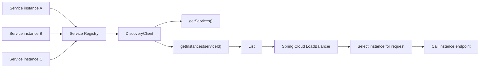
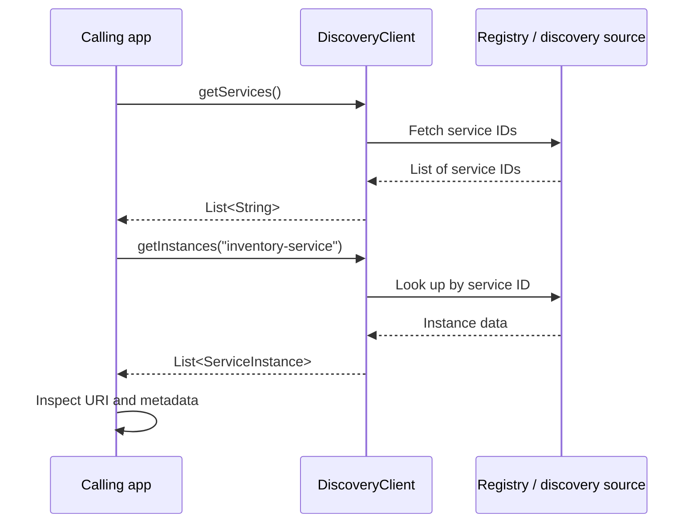

# Listing Services and Retrieving Instance Lists

## 1. From Service Name to Instance Addresses

In a distributed system, a service can run across multiple instances. Each instance has its own network address, port, security state, and metadata. When an application needs to find another service, it should not need to know the hostname or IP of every instance in advance.

Spring Cloud Commons provides the `DiscoveryClient` abstraction so an application can query discovery information with minimal coupling to a specific registry. Behind this abstraction may be Eureka, Consul, Zookeeper, or another implementation. The two most important read operations are:

- `getServices()`: retrieves the service IDs currently known to the discovery client.
- `getInstances(serviceId)`: retrieves the list of instances associated with a service ID.

This lesson belongs to the **DiscoveryClient** chapter of the **SPRING_CLOUD_CORE** module. The module focuses on Spring Cloud Commons, Spring Cloud Context, external configuration, Spring Boot compatibility, refresh scope, discovery, service registries, service communication, and testing/operating common abstractions.

After this lesson, learners can:

- Distinguish between a service ID and a service instance.
- List service IDs with `DiscoveryClient.getServices()`.
- Query instances with `DiscoveryClient.getInstances(serviceId)`.
- Read URI, host, port, secure flag, instance ID, and metadata from `ServiceInstance`.
- Configure `SimpleDiscoveryClient` when an external registry is not needed.
- Distinguish blocking discovery from reactive discovery.
- Understand the boundary between discovery, service registration, and client-side load balancing.
- Handle empty lists, stale data, multiple discovery clients, and query cost.

## 2. Where Does DiscoveryClient Fit in the Architecture?

Discovery typically involves three distinct roles:

1. **Service registry:** stores registration info of service instances and updates when instances register, deregister, or change status.
2. **Discovery client:** reads information from a registry or discovery source, returning service IDs and instance lists.
3. **Load balancer:** picks an appropriate instance for a specific request from the available instance list.



For example, the registry might know that `inventory-service` is running on two instances:

| Service ID | Instance ID | Address |
| --- | --- | --- |
| `inventory-service` | `inventory-1` | `http://10.0.0.11:8080` |
| `inventory-service` | `inventory-2` | `https://10.0.0.12:8443` |
| `payment-service` | `payment-1` | `http://10.0.1.21:8080` |

In this case:

- `getServices()` may return `inventory-service` and `payment-service`.
- `getInstances("inventory-service")` returns the two instances of the inventory service.
- `getInstances("payment-service")` returns the payment instance.

`DiscoveryClient` is an abstraction for reading discovery data. It is not an instance registration API, nor is it a per-request instance selection algorithm. Spring Cloud Commons has `ServiceRegistry` for register/deregister operations; Spring Cloud LoadBalancer uses the instance list to pick a call target.

## 3. Two Core Read Methods

### 3.1. getServices(): Listing Service IDs

Method signature:

```java
List<String> getServices();
```

Returns the service IDs known to the current implementation. A service ID is the key used for subsequent instance queries. It is usually derived from the registered application or service name, though naming and normalization rules may vary across registries.

Example:

```java
List<String> serviceIds = discoveryClient.getServices();

serviceIds.forEach(System.out::println);
```

Sample output:

```text
inventory-service
payment-service
notification-service
```

This list is intended for lookup and observability. Do not treat it as a list of endpoints ready to be called immediately: a service ID might have no available instances by the time the next query happens. The interface also does not guarantee a stable ordering of the list; do not treat the first element as a default choice.

### 3.2. getInstances(serviceId): Retrieving Instances of a Service

Method signature:

```java
List<ServiceInstance> getInstances(String serviceId);
```

The `serviceId` parameter must match the service ID used by the registry or discovery provider. The result is a list of `ServiceInstance` objects, each describing an address that can be used to contact an instance.

Example:

```java
List<ServiceInstance> instances =
        discoveryClient.getInstances("inventory-service");

for (ServiceInstance instance : instances) {
    System.out.println(instance.getUri());
}
```

Sample output:

```text
http://10.0.0.11:8080
https://10.0.0.12:8443
```

If the service ID does not exist or has no matching instances at query time, implementations typically return an empty list. Distinguish that case from a registry connection failure: some providers throw an exception when the discovery backend is unreachable. Do not catch all exceptions and convert them into an empty list, because that hides registry outages.

### 3.3. Query Flow



The two queries can be called independently. If you already know the service ID from configuration or a business requirement, the application can call `getInstances(serviceId)` directly without listing all services first.

## 4. Reading Information from ServiceInstance

Spring Cloud Commons defines `ServiceInstance` to represent an instance in the discovery system. Common fields:

| Method | Meaning |
| --- | --- |
| `getInstanceId()` | Unique instance ID per the registry; may not be provided |
| `getServiceId()` | Service ID to which the instance belongs |
| `getHost()` | Hostname or IP address |
| `getPort()` | Service port |
| `isSecure()` | Indicates whether the instance uses HTTPS |
| `getUri()` | URI of the instance, including scheme, host, and port |
| `getMetadata()` | Key/value metadata map attached by the provider or application |
| `getScheme()` | Scheme if explicitly supplied by the implementation |

Do not assume every implementation provides an instance ID or metadata. Both values can be `null`. Metadata also depends on the provider; keys like `zone`, `version`, and `weight` only have meaning when both the registering and consuming systems follow the same convention.

Example of reading an instance:

```java
ServiceInstance instance = instances.get(0);

String serviceId = instance.getServiceId();
String instanceId = instance.getInstanceId();
String host = instance.getHost();
int port = instance.getPort();
boolean secure = instance.isSecure();
URI uri = instance.getUri();
Map<String, String> metadata = instance.getMetadata();
```

To call the instance address, prefer `getUri()` over manually concatenating host and port strings. The URI already reflects the security scheme and how the provider represents the address. When logging or displaying data, handle nullable fields and do not assume metadata is always present.

### 4.1. What Can Metadata Be Used For?

Metadata attaches additional information beyond the network address:

```yaml
metadata:
  zone: ap-southeast-1a
  version: v2
  weight: "3"
```

Applications can use metadata for:

- Preferring instances within the same availability zone.
- Selecting an appropriate API version.
- Labeling deployment groups or tenants.
- Providing weights for load-balancing algorithms.
- Supporting dashboards and diagnostics.

Metadata does not produce behavior by itself. For example, adding `zone: ap-southeast-1a` does not automatically route requests by zone. LoadBalancer or custom logic must read the metadata and apply the corresponding policy.

### 4.2. Example Mapping to a DTO

If you need to expose instance lists in an internal API or admin page, selectively map the necessary fields rather than returning raw provider objects directly:

```java
import java.net.URI;
import java.util.Collections;
import java.util.LinkedHashMap;
import java.util.Map;

public record InstanceView(
        String instanceId,
        String serviceId,
        String host,
        int port,
        boolean secure,
        URI uri,
        Map<String, String> metadata) {
}
```

Mapping method:

```java
private InstanceView toView(ServiceInstance instance) {
    Map<String, String> metadata = instance.getMetadata();

    return new InstanceView(
            instance.getInstanceId(),
            instance.getServiceId(),
            instance.getHost(),
            instance.getPort(),
            instance.isSecure(),
            instance.getUri(),
            metadata == null ? Map.of() : Collections.unmodifiableMap(new LinkedHashMap<>(metadata))
    );
}
```

Do not expose an endpoint listing the entire registry to public users. Lists of hosts, ports, metadata, internal names, and topology can leak infrastructure details. If an admin API is needed, enforce authentication, authorization, and field filtering.

## 5. Using DiscoveryClient in a Spring Application

A service can inject `DiscoveryClient` to provide centralized lookup operations:

```java
import java.util.List;

import org.springframework.cloud.client.ServiceInstance;
import org.springframework.cloud.client.discovery.DiscoveryClient;
import org.springframework.stereotype.Service;
import org.springframework.util.StringUtils;

@Service
public class ServiceCatalog {

    private final DiscoveryClient discoveryClient;

    public ServiceCatalog(DiscoveryClient discoveryClient) {
        this.discoveryClient = discoveryClient;
    }

    public List<String> listServiceIds() {
        return List.copyOf(discoveryClient.getServices());
    }

    public List<ServiceInstance> listInstances(String serviceId) {
        if (!StringUtils.hasText(serviceId)) {
            throw new IllegalArgumentException("serviceId must not be blank");
        }

        return List.copyOf(discoveryClient.getInstances(serviceId));
    }
}
```

Here, `ServiceCatalog` is merely an application layer wrapping two read operations. It does not register services or select instances. Separating this layer allows controllers, jobs, or admin components to share input validation and error-handling rules.

In current Spring Cloud versions, `@EnableDiscoveryClient` is no longer mandatory if a suitable discovery implementation is already on the classpath. Spring Cloud auto-configuration can detect the implementation. Even so, verify the specific provider's starter and configuration; having the interface on the classpath does not automatically guarantee the registry is connected and populated.

## 6. SimpleDiscoveryClient: Static Instance Configuration

Not every environment needs a dedicated service registry. If no registry-backed discovery implementation is on the classpath, Spring Cloud Commons can use `SimpleDiscoveryClient`. This implementation reads the list of services and instances from application configuration.

Example:

```yaml
spring:
  cloud:
    discovery:
      client:
        simple:
          instances:
            inventory-service:
              - uri: http://inventory-1.internal:8080
                metadata:
                  zone: az-a
              - uri: https://inventory-2.internal:8443
                metadata:
                  zone: az-b
            payment-service:
              - uri: http://payment-1.internal:8080
```

Once the configuration is bound:

```java
List<String> services = discoveryClient.getServices();

List<ServiceInstance> inventory =
        discoveryClient.getInstances("inventory-service");
```

The result contains two service IDs and two instances for `inventory-service`. In properties format, the equivalent configuration can be written as:

```properties
spring.cloud.discovery.client.simple.instances.inventory-service[0].uri=http://inventory-1.internal:8080
spring.cloud.discovery.client.simple.instances.inventory-service[1].uri=https://inventory-2.internal:8443
spring.cloud.discovery.client.simple.instances.payment-service[0].uri=http://payment-1.internal:8080
```

Indices `[0]`, `[1]` specify each instance's position in the list starting from 0.

`SimpleDiscoveryClient` is suitable for local environments, integration tests, demos, or rarely changing endpoint lists. It does not replace a dynamic registry when the system must automatically update instances based on container lifecycles, autoscaling, or health registration.

## 7. Blocking and Reactive Discovery

Spring Cloud Commons has two abstractions to fit the application's processing model:

| Interface | Return Type | Suitable For |
| --- | --- | --- |
| `DiscoveryClient` | `List<String>`, `List<ServiceInstance>` | Blocking or imperative applications |
| `ReactiveDiscoveryClient` | `Flux<String>`, `Flux<ServiceInstance>` | Reactive/WebFlux applications |

In a reactive application, use `ReactiveDiscoveryClient` to avoid calling a blocking API on the event-loop:

```java
import org.springframework.cloud.client.ServiceInstance;
import org.springframework.cloud.client.discovery.ReactiveDiscoveryClient;
import org.springframework.stereotype.Service;
import reactor.core.publisher.Flux;
import reactor.core.publisher.Mono;

@Service
public class ReactiveServiceCatalog {

    private final ReactiveDiscoveryClient discoveryClient;

    public ReactiveServiceCatalog(ReactiveDiscoveryClient discoveryClient) {
        this.discoveryClient = discoveryClient;
    }

    public Flux<String> listServiceIds() {
        return discoveryClient.getServices();
    }

    public Flux<ServiceInstance> listInstances(String serviceId) {
        return discoveryClient.getInstances(serviceId);
    }

    public Mono<Void> probe() {
        return discoveryClient.reactiveProbe();
    }
}
```

Publishers only execute work when subscribed to according to Reactor rules. Compose `Flux`/`Mono` into the WebFlux pipeline rather than calling `block()` on the event-loop.

With reactive discovery, use `reactiveProbe()` to check discovery reachability. The old `probe()` method is deprecated; current implementations warn against using it because it calls `getServices()` without subscribing to the returned publisher.

Each discovery mode can be disabled via configuration:

```yaml
spring:
  cloud:
    discovery:
      blocking:
        enabled: true
      reactive:
        enabled: true
```

Set either property to `false` if the application does not use the corresponding mode. You can disable all discovery using `spring.cloud.discovery.enabled=false`; be mindful of the impact on other components that depend on discovery.

## 8. Multiple DiscoveryClients and Selection Order

`DiscoveryClient` extends Spring `Ordered`. Implementations can provide `getOrder()`; the interface default is `0`. When multiple discovery clients exist, order is part of how Spring Cloud organizes and uses the implementations.

With a custom client, you can override it:

```java
@Override
public int getOrder() {
    return 10;
}
```

Spring Cloud-provided implementations can also accept order configuration via corresponding properties, such as `spring.cloud.{clientIdentifier}.discovery.order` or `eureka.client.order` for Eureka.

When multiple providers are present, do not assume `getInstances(serviceId)` merges every instance from every registry. Inspect the composite discovery client and delegation policy of the version in use. Client order can affect lookup results, so test the case where a service ID appears in multiple sources.

## 9. How DiscoveryClient, ServiceRegistry, and LoadBalancer Differ

| Component | Responsibility | API / Concepts |
| --- | --- | --- |
| `DiscoveryClient` | Reads service IDs and instance lists | `getServices()`, `getInstances(serviceId)` |
| `ServiceRegistry` | Registers, deregisters, or updates registration status | `register(Registration)`, `deregister(Registration)` |
| `LoadBalancer` | Selects an instance to send a request | `ServiceInstanceListSupplier`, `ReactorLoadBalancer` |

For example, if you only want to display the list of instances on an admin page, calling `DiscoveryClient` is appropriate. If you want to call `inventory-service` in a business request, do not take the first element from the list and call its URI manually. The list can change, and the first element is not always healthy or suitable.

Instead, use Spring Cloud LoadBalancer with a client annotated with `@LoadBalanced`. When calling a logical URL like `http://inventory-service/api/items`, LoadBalancer selects a physical address from the instances supplied by discovery.

This separates two decisions:

- Discovery answers: "Which instances does this service currently have?"
- LoadBalancer answers: "Which instance should this request be sent to?"

## 10. Health, Stale Data, and Query Performance

### 10.1. An Instance List Is Not an Instant Connectivity Check

`getInstances(serviceId)` returns data from the discovery provider's perspective at query time. It does not prove every instance can accept requests immediately afterward.

Several situations can occur:

- An instance just stopped, and the registry has not updated yet.
- An instance just started, and has not registered or become ready yet.
- The registry is still synchronizing data across nodes.
- The client or LoadBalancer holds a stale cache.
- The provider filters instances by health, namespace, zone, or custom metadata.

Do not infer an instance is healthy merely because it appears in the list. With real registries, providers usually return eligible instances according to registry rules; details depend on the integration. With `SimpleDiscoveryClient`, the configured list does not automatically reflect endpoint liveness.

### 10.2. The Health Indicator Can Call getServices

Spring Cloud Commons provides `DiscoveryClientHealthIndicator`. By default, the health indicator calls `getServices()` to verify the discovery client can query and includes the service list in health details.

In systems with a very large number of services, querying the full list on every health check can be expensive. You can set:

```yaml
spring:
  cloud:
    discovery:
      client:
        health-indicator:
          use-services-query: false
```

The health indicator then calls `probe()`. The `DiscoveryClient` interface has a default `probe()` implementation that simply calls `getServices()`; providers may override it with a lighter check. Therefore, to genuinely reduce cost, verify whether the implementation in use overrides `probe()`.

You can disable the health indicator with `spring.cloud.discovery.client.health-indicator.enabled=false`, or disable the composite indicator with `spring.cloud.discovery.client.composite-indicator.enabled=false`. Disable them only when another mechanism monitors registry reachability.

### 10.3. DiscoveryClient and LoadBalancer Caching

Caching can exist at multiple layers:

- The registry client may cache data from the backend itself.
- Spring Cloud LoadBalancer may cache `ServiceInstance` lists via `ServiceInstanceListSupplier`.
- The application may cache `getServices()` or `getInstances()` results itself.

In Spring Cloud LoadBalancer 5.0.4, the default cache has a 35-second TTL and capacity of 256 when caching is enabled. If the discovery implementation already caches data (such as some registry clients), also enabling LoadBalancer caching can cause double caching and prolong stale data lifetime. Documentation recommends disabling LoadBalancer caching when the registry client already caches on its own.

When caching at the application layer is needed, explicitly define TTL, invalidation strategy, and stale-data tolerance. Never cache instance lists indefinitely.

## 11. Testing Service and Instance Listing

A discovery test suite should verify both query levels:

| Case | What to Verify |
| --- | --- |
| Multiple services exist | `getServices()` returns the expected service IDs from fixtures |
| Service has multiple instances | `getInstances(serviceId)` returns all instances |
| Service does not exist | Empty result matching the behavior of the tested provider |
| Instance uses HTTPS | `isSecure()` is true and `getUri()` has the appropriate scheme |
| Instance has metadata | Metadata contains the registered key/value pairs |
| Instance lacks metadata or ID | Handling code tolerates nullable values |
| Registry is unreachable | Error is clearly surfaced, not disguised as a nonexistent service |
| Multiple DiscoveryClients | Order and composite behavior match real configuration |
| Reactive discovery | Publisher is subscribed to and errors are handled in the pipeline |
| Cache TTL expires or registry changes | List updates within an acceptable time |

### 11.1. Unit Testing the Application Layer

You can mock `DiscoveryClient` to test the service layer:

- Stub `getServices()` with two service IDs.
- Stub `getInstances("inventory-service")` with two `ServiceInstance` objects.
- Verify the service layer returns the expected list or DTOs.
- Verify a blank service ID is rejected before calling discovery.
- Verify exceptions from the provider are propagated or mapped per the error policy.

### 11.2. Integration Testing with SimpleDiscoveryClient

Configure a few instances via `spring.cloud.discovery.client.simple.instances`, boot the application context, and inject `DiscoveryClient`. Ensure the test does not pull in another registry-backed discovery provider if the goal is specifically testing `SimpleDiscoveryClient`. Then verify:

1. `getServices()` contains the declared service keys.
2. `getInstances("inventory-service")` has the expected element count.
3. URI, host, port, secure flag, and metadata are bound properly.
4. A nonexistent service ID returns an empty list with SimpleDiscoveryClient.

### 11.3. Testing Against a Real Registry

With Eureka, Consul, or Zookeeper, have dedicated integration tests for:

- Registering an instance.
- Waiting for the registry to accept the registration.
- Querying service IDs and instances.
- Deregistering the instance and verifying propagation.
- Registry disconnection, recovery, and stale data.
- Readiness/health affecting the instance list per provider configuration.

Do not use mocked unit tests to conclude that synchronization, health filtering, or consistency of a real registry works.

## 12. Common Errors and Remedies

| Symptom | Possible Cause | Resolution |
| --- | --- | --- |
| `getServices()` returns an empty list | No registrations yet, wrong provider, registry not synced, or SimpleDiscoveryClient has no declared instances | Check service registration, provider, and instance configuration |
| `getInstances(serviceId)` is empty | Wrong service ID, no eligible instances, or instance not yet visible in registry | Compare against actual service IDs from `getServices()` and inspect registry |
| Instances exist but calls fail | Stale discovery data, network policy, DNS, or instance no longer ready | Check health, network, and cache; do not treat discovery as a direct health probe |
| Only instances from one registry appear | Multiple DiscoveryClients exist and composite/order selects per a policy | Inspect implementations, `getOrder()`, and composite behavior |
| Service listing slows health checks | `getServices()` returns a large list on every check | Consider `use-services-query=false` and a lighter probe |
| Instance list updates slowly | Registry propagation or caching in provider/LoadBalancer/app | Identify the cache layer and TTL |
| Calling the first element always fails | Manually picking an instance instead of using LoadBalancer | Use a client-side LoadBalancer |
| Metadata lacks expected keys | Provider did not register the key or key naming differs | Inspect registration metadata and key names |
| Reactive request is blocked | Using blocking `DiscoveryClient` or calling `block()` on the event-loop | Use `ReactiveDiscoveryClient` and compose publishers |

## 13. Operational Checklist

Before using discovery results in business logic, confirm:

1. Where does the service ID come from, and does it match registry conventions?
2. Which discovery implementation is being loaded?
3. Is the application using the blocking or reactive API?
4. Is `getServices()` necessary for the current flow, or is the service ID already known?
5. Could the instance list be empty or stale?
6. Could instance ID and metadata be null?
7. Does the registry provider filter instances by health/namespace/zone?
8. Are multiple DiscoveryClients and composite ordering involved?
9. Is caching enabled in the registry client, LoadBalancer, or application?
10. Should LoadBalancer be used instead of manually picking an instance?
11. Is the health indicator querying the entire service list too frequently?
12. Are metrics/logs recorded for query errors, instance counts, and registry refresh times?
13. Are admin APIs exposing internal hosts, ports, or metadata?

## 14. Official References

- [Spring Cloud Commons — Common Abstractions](https://docs.spring.io/spring-cloud-commons/reference/spring-cloud-commons/common-abstractions.html): DiscoveryClient, ReactiveDiscoveryClient, SimpleDiscoveryClient, health indicators, and ordering.
- [DiscoveryClient.java — Spring Cloud Commons](https://github.com/spring-cloud/spring-cloud-commons/blob/main/spring-cloud-commons/src/main/java/org/springframework/cloud/client/discovery/DiscoveryClient.java): signatures and semantics of `getServices()`, `getInstances()`, `probe()`, and `getOrder()`.
- [ServiceInstance.java — Spring Cloud Commons](https://github.com/spring-cloud/spring-cloud-commons/blob/main/spring-cloud-commons/src/main/java/org/springframework/cloud/client/ServiceInstance.java): instance ID, service ID, host, port, URI, secure flag, and metadata.
- [ReactiveDiscoveryClient.java — Spring Cloud Commons](https://github.com/spring-cloud/spring-cloud-commons/blob/main/spring-cloud-commons/src/main/java/org/springframework/cloud/client/discovery/ReactiveDiscoveryClient.java): Flux API and `reactiveProbe()`.
- [Spring Cloud LoadBalancer](https://docs.spring.io/spring-cloud-commons/reference/spring-cloud-commons/loadbalancer.html): retrieving instances from discovery, caching, health checks, and instance selection.

**Key takeaway:** `getServices()` shows which service IDs the discovery client currently knows; `getInstances(serviceId)` returns the corresponding instance addresses. Read URIs and metadata defensively, treat the list as mutable data, and use Spring Cloud LoadBalancer when selecting a destination for real requests.
