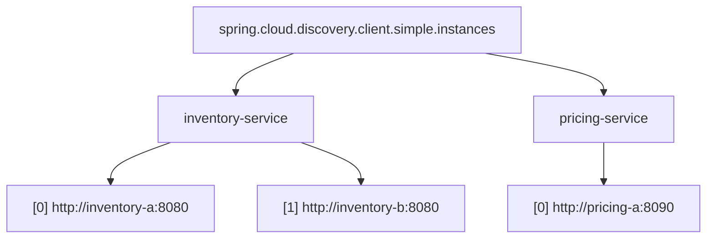

# Declaring spring.cloud.discovery.client.simple.instances

## 1. When to Use SimpleDiscoveryClient?

Spring Cloud Commons defines the DiscoveryClient abstraction so applications can look up service instances by service name. Typically, this data comes from a service registry such as Eureka, Consul, or ZooKeeper. For small applications, development environments, demos, or integration tests, standing up an extra registry may be unnecessary.

SimpleDiscoveryClient is an implementation that reads the service instance list from application configuration. You declare the addresses in application.yml, application.properties, or an equivalent configuration source. Spring Cloud converts those declarations into ServiceInstance objects so the rest of the application can consume them through the DiscoveryClient abstraction.

The central property of this lesson is:

```text
spring.cloud.discovery.client.simple.instances
```

This is a map: each key is a serviceId, and each value is the list of instances for that service. Each instance needs at least a uri address reachable from the calling application's network.

The value passed to `getInstances(serviceId)` must exactly match the declared key. For example, `inventory-service` and `Inventory-Service` are two distinct strings when looking up the map.

According to Spring Cloud Commons documentation, SimpleDiscoveryClient is used when no service-registry-backed DiscoveryClient implementation is on the classpath. If the project already includes Eureka, Consul, or another registry client on the classpath, do not assume the simple instances list will replace that registry client.

In current Spring Cloud versions, you do not need to add `@EnableDiscoveryClient` just to enable discovery. When a suitable implementation is on the classpath, Spring Boot auto-configuration provides DiscoveryClient.

## 2. Data Structure of simple.instances

You can read the property structure across three levels:

| Level | Meaning | Example |
| --- | --- | --- |
| instances | Map containing instance lists | spring.cloud.discovery.client.simple.instances |
| serviceId | Logical name of the service to look up | inventory-service |
| Index | Position of an instance in the list, starting from 0 | [0], [1] |
| Instance property | Information for a specific address | uri, instance-id, metadata |

Property path example:

```properties
spring.cloud.discovery.client.simple.instances.inventory-service[0].uri=http://inventory-a.internal:8080
spring.cloud.discovery.client.simple.instances.inventory-service[1].uri=http://inventory-b.internal:8080
```

These two lines create two instances belonging to the service with ID inventory-service. The numbers 0 and 1 are list indices, not ports or service IDs.

### 2.1. Relationship Between serviceId and Instance

A service can have one or more instances. Instances share the same serviceId, while each instance has its own URI and metadata.



When calling getInstances("inventory-service"), DiscoveryClient returns two addresses belonging to inventory-service. When calling getServices(), it returns the service IDs declared in the map.

## 3. Declaring with application.yml

YAML is usually easier to read when a service has multiple instances and each instance has its own metadata.

```yaml
spring:
  application:
    name: order-service
  cloud:
    discovery:
      client:
        simple:
          instances:
            inventory-service:
              - uri: http://inventory-a.internal:8080
                instance-id: inventory-a
                metadata:
                  zone: zone-a
                  version: v1
              - uri: https://inventory-b.internal:8443
                instance-id: inventory-b
                metadata:
                  zone: zone-b
                  version: v1
            pricing-service:
              - uri: http://pricing-a.internal:8090
                instance-id: pricing-a
```

In this example:

- inventory-service has two instances.
- The first instance uses HTTP on port 8080.
- The second instance uses HTTPS on port 8443.
- pricing-service has one instance.
- instance-id is the identifier of each individual instance; it differs from serviceId.
- metadata contains string key/value pairs that the application or load-balancing component can read.

spring.application.name here names the current application itself. It is not the key of a remote service under instances. To declare addresses of another service, use that service's name as the key under instances.

## 4. Meaning of Instance Properties

### 4.1. uri

uri is the address of the instance. Spring Cloud parses the URI to extract the scheme, host, and port of ServiceInstance.

```yaml
instances:
  inventory-service:
    - uri: http://inventory-a.internal:8080
    - uri: https://inventory-b.internal:8443
```

| URI | Host | Port | isSecure() |
| --- | --- | ---: | --- |
| http://inventory-a.internal:8080 | inventory-a.internal | 8080 | false |
| https://inventory-b.internal:8443 | inventory-b.internal | 8443 | true |
| https://inventory-c.internal | inventory-c.internal | Default for HTTPS scheme | true |

Declare an absolute URI with a scheme and a host resolvable from the client's runtime environment. With SimpleDiscoveryClient, use a base URI in the form scheme://host:port; API paths such as /api/items should be added when building the HTTP request. ServiceInstance represents an instance address, not a specific business endpoint.

### 4.2. instance-id

instance-id is an optional identifier for an instance. It is helpful when logs, tracing, or load-balancing algorithms need to distinguish replicas of the same service.

```yaml
instances:
  inventory-service:
    - uri: http://inventory-a.internal:8080
      instance-id: inventory-a
    - uri: http://inventory-b.internal:8080
      instance-id: inventory-b
```

If instance-id is omitted, the instance can still be returned by DiscoveryClient; the application simply will not have a config-supplied per-instance ID value.

### 4.3. metadata

metadata is a string key/value map attached to the instance. It does not change the URI and does not automatically send headers in requests.

```yaml
instances:
  inventory-service:
    - uri: http://inventory-a.internal:8080
      metadata:
        zone: zone-a
        version: v1
        weight: "80"
```

Applications can read metadata for logging, version checks, or custom routing policies. For instance, Spring Cloud LoadBalancer can use zone metadata when configured with the appropriate supplier for zone-based selection. Declaring metadata.zone alone is not enough to enable all zone-filtering policies.

## 5. Declaring with application.properties

If the project uses .properties, use square-bracket indices to represent each element of the list:

```properties
spring.cloud.discovery.client.simple.instances.inventory-service[0].uri=http://inventory-a.internal:8080
spring.cloud.discovery.client.simple.instances.inventory-service[0].instance-id=inventory-a
spring.cloud.discovery.client.simple.instances.inventory-service[0].metadata.zone=zone-a
spring.cloud.discovery.client.simple.instances.inventory-service[0].metadata.version=v1

spring.cloud.discovery.client.simple.instances.inventory-service[1].uri=https://inventory-b.internal:8443
spring.cloud.discovery.client.simple.instances.inventory-service[1].instance-id=inventory-b
spring.cloud.discovery.client.simple.instances.inventory-service[1].metadata.zone=zone-b
spring.cloud.discovery.client.simple.instances.inventory-service[1].metadata.version=v1

spring.cloud.discovery.client.simple.instances.pricing-service[0].uri=http://pricing-a.internal:8090
```

Indices start at 0. When using .properties, keep numbering contiguous so the list structure stays readable and easy to inspect. Do not confuse [1] with an instance name or port.

Both YAML and .properties represent the exact same structure. Choose one style consistently per configuration file to avoid ambiguity about which value overrides which.

## 6. How DiscoveryClient Reads the Declared List

SimpleDiscoveryClient implements the DiscoveryClient interface. Application code should depend on this interface rather than coupling tightly to a specific implementation:

```java
import java.util.List;

import org.springframework.cloud.client.ServiceInstance;
import org.springframework.cloud.client.discovery.DiscoveryClient;
import org.springframework.stereotype.Service;

@Service
public class ServiceDirectory {

    private final DiscoveryClient discoveryClient;

    public ServiceDirectory(DiscoveryClient discoveryClient) {
        this.discoveryClient = discoveryClient;
    }

    public List<ServiceInstance> inventoryInstances() {
        return discoveryClient.getInstances("inventory-service");
    }

    public List<String> knownServices() {
        return discoveryClient.getServices();
    }
}
```

Two important methods:

- getInstances(serviceId) returns the list of ServiceInstance objects for the requested service.
- getServices() returns the list of serviceIds present in configuration.

If the serviceId does not exist, SimpleDiscoveryClient returns an empty list. Therefore, calling code must handle the no-instance case rather than assuming at least one address is always present.

### 6.1. Reading Information from Each Instance

ServiceInstance provides commonly used fields:

In ServiceDirectory above, after retrieving the list via inventoryInstances(), you can iterate through each instance as follows:

```java
List<ServiceInstance> instances = inventoryInstances();

for (ServiceInstance instance : instances) {
    System.out.println("serviceId = " + instance.getServiceId());
    System.out.println("instanceId = " + instance.getInstanceId());
    System.out.println("uri = " + instance.getUri());
    System.out.println("secure = " + instance.isSecure());
    System.out.println("metadata = " + instance.getMetadata());
}
```

getServiceId() is the service name, getInstanceId() is the replica's own ID, getUri() is the address, isSecure() indicates HTTPS usage, and getMetadata() returns the metadata map.

Do not assume list order represents priority order or that the first instance is always healthy. SimpleDiscoveryClient provides the declared addresses; it does not check endpoint health to sort the list.

## 7. Integrating with Spring Cloud LoadBalancer

DiscoveryClient only provides the instance list. If you want to call a service by logical name and let Spring Cloud pick a physical address, Spring Cloud LoadBalancer must be on the classpath.

Add the LoadBalancer starter, letting the Spring Cloud BOM manage the version:

```xml
<dependency>
    <groupId>org.springframework.cloud</groupId>
    <artifactId>spring-cloud-starter-loadbalancer</artifactId>
</dependency>
```

Example using RestTemplate with @LoadBalanced:

```java
import org.springframework.cloud.client.loadbalancer.LoadBalanced;
import org.springframework.context.annotation.Bean;
import org.springframework.context.annotation.Configuration;
import org.springframework.web.client.RestTemplate;

@Configuration
public class HttpClientConfiguration {

    @Bean
    @LoadBalanced
    RestTemplate loadBalancedRestTemplate() {
        return new RestTemplate();
    }
}
```

Then call using the service ID:

```java
import org.springframework.cloud.client.loadbalancer.LoadBalanced;
import org.springframework.stereotype.Service;
import org.springframework.web.client.RestTemplate;

@Service
public class InventoryGateway {

    private final RestTemplate restTemplate;

    public InventoryGateway(@LoadBalanced RestTemplate restTemplate) {
        this.restTemplate = restTemplate;
    }

    public String health() {
        return restTemplate.getForObject(
                "http://inventory-service/actuator/health",
                String.class
        );
    }
}
```

inventory-service in the URL is the service ID declared under instances. LoadBalancer fetches the list from DiscoveryClient, picks an instance, and routes the request to the corresponding physical URI. If you inject DiscoveryClient without LoadBalancer, the application must pick an element and send the request to that URI manually.

## 8. Combining Profiles and Environment-Specific Configuration

Instance lists typically differ across local, test, staging, and production. You can place environment-specific configs in profile files:

```yaml
# application-local.yml
spring:
  cloud:
    discovery:
      client:
        simple:
          instances:
            inventory-service:
              - uri: http://localhost:8081
            pricing-service:
              - uri: http://localhost:8091
```

```yaml
# application-staging.yml
spring:
  cloud:
    discovery:
      client:
        simple:
          instances:
            inventory-service:
              - uri: http://inventory-a.staging.internal:8080
              - uri: http://inventory-b.staging.internal:8080
            pricing-service:
              - uri: http://pricing-a.staging.internal:8090
```

Activate profiles via spring.profiles.active or the corresponding deployment mechanism. For instance lists, verify the bound configuration after the profile is active, especially when one profile overrides another's list.

Do not use localhost as a remote service address in containerized environments if client and server run in separate containers. localhost always points to the client's own container or host. Use a DNS/service name or hostname that the client can actually resolve and reach.

## 9. Testing simple.instances Binding

You can test without starting Eureka or Consul. Spring Boot allows passing properties directly into @SpringBootTest:

```java
import static org.assertj.core.api.Assertions.assertThat;

import java.net.URI;
import java.util.List;

import org.junit.jupiter.api.Test;
import org.springframework.beans.factory.annotation.Autowired;
import org.springframework.boot.test.context.SpringBootTest;
import org.springframework.cloud.client.ServiceInstance;
import org.springframework.cloud.client.discovery.DiscoveryClient;

@SpringBootTest(properties = {
        "spring.cloud.discovery.client.simple.instances.catalog[0].uri=http://catalog-a:8080",
        "spring.cloud.discovery.client.simple.instances.catalog[1].uri=https://catalog-b:8443",
        "spring.cloud.discovery.client.simple.instances.catalog[1].metadata.zone=zone-b"
})
class SimpleDiscoveryClientPropertiesTests {

    @Autowired
    private DiscoveryClient discoveryClient;

    @Test
    void bindsConfiguredInstances() {
        List<ServiceInstance> instances =
                discoveryClient.getInstances("catalog");

        assertThat(instances).hasSize(2);
        assertThat(instances.get(0).getUri())
                .isEqualTo(URI.create("http://catalog-a:8080"));
        assertThat(instances.get(1).isSecure()).isTrue();
        assertThat(instances.get(1).getMetadata())
                .containsEntry("zone", "zone-b");
    }

    @Test
    void exposesConfiguredServiceIds() {
        assertThat(discoveryClient.getServices()).contains("catalog");
    }

    @Test
    void returnsEmptyListForUnknownService() {
        assertThat(discoveryClient.getInstances("unknown-service")).isEmpty();
    }
}
```

This test confirms three things: the list is bound properly, the HTTPS scheme is reflected via isSecure(), and metadata stays attached to the right instance. It tests in-memory discovery metadata; it does not verify that the hosts are reachable over the network.

### 9.1. Recommended Test Cases

| Case | Configuration / Action | Expected Result |
| --- | --- | --- |
| Single instance | Declare index [0] | getInstances(serviceId) has one element |
| Multiple instances | Declare [0], [1] | Returns all instances for the same service |
| Multiple services | Declare multiple keys under instances | getServices() contains the service IDs |
| Nonexistent service | Call getInstances with an undeclared key | Empty list |
| HTTPS URI | Declare URI starting with https | isSecure() returns true |
| Metadata | Declare metadata.zone | getMetadata() contains the key/value pair |
| Profiles | Run with different profiles | List matches the selected environment configuration |

## 10. Distinguishing instances from local instance

spring.cloud.discovery.client.simple.instances describes the service instances that the application needs to look up. It is not configuration for registering the current application itself into a remote registry.

Spring Cloud Commons also has the spring.cloud.discovery.client.simple.local.* property group to describe the local service instance, such as service-id, host, port, secure, instance-id, and metadata. This is separate configuration from the instances map.

Example:

```yaml
spring:
  application:
    name: order-service
  cloud:
    discovery:
      client:
        simple:
          local:
            service-id: order-service
            host: order-a.internal
            port: 8080
```

The local section describes the current instance. The instances section describes service instances looked up by clients. Do not add the current application's own address to instances just to describe the local service.

## 11. Limitations and Common Errors

SimpleDiscoveryClient is suitable when the endpoint list is small and relatively stable. Because the list is declared in configuration, it does not automatically change with autoscaling, dynamic registration/deregistration, or heartbeats like a real registry.

| Symptom | Possible Cause | Resolution |
| --- | --- | --- |
| getInstances() returns an empty list | Wrong serviceId, wrong key, or list not bound yet | Match the key under instances with the string passed to getInstances() |
| SimpleDiscoveryClient is not selected | Another registry-backed DiscoveryClient is on the classpath | Check dependencies and the configured DiscoveryClient implementation |
| URI is unreachable | Hostname does not resolve or port is not open from client network | Check DNS, routes, firewalls, and container addresses |
| Calls the wrong instance | Service ID or index declared incorrectly | Review the service ID map and URI list |
| HTTPS does not work | URI uses http or endpoint TLS is misconfigured | Check scheme, certificates, and HTTP client truststore |
| Metadata has no routing effect | Metadata declared without configuring a supplier/policy that uses it | Check Spring Cloud LoadBalancer configuration |
| Config changed but old instance still used | Static list does not sync automatically with deployment state | Update the config source and restart/reload per app procedure |
| Using localhost across containers | localhost points to the caller's container | Use a DNS/service name reachable from the caller |

When you need dynamic membership, health-aware discovery, heartbeats, self-registration, and deregistration, consider a registry such as Eureka or Consul. Do not turn a static config file into a makeshift registry by continually updating addresses manually.

## 12. Declaration and Operational Guidelines

1. Use consistent service names across the key under instances, getInstances() calls, and LoadBalancer virtual URLs.
2. Number lists starting from [0] and keep indices contiguous.
3. Declare absolute URIs with scheme, host, and port appropriate for the client's network.
4. Use instance-id to identify individual replicas when observability or routing requires it.
5. Use metadata only for supplementary data; explicitly configure which component reads that metadata.
6. Separate endpoints by profile and environment; avoid using localhost for cross-container calls.
7. Test both DiscoveryClient results and actual network connectivity to the URIs.
8. Add Spring Cloud LoadBalancer if you want to call by service ID and automatically select instances.
9. Choose a service registry when instance lists must update dynamically or require health-aware registration.

## 13. References

- [Spring Cloud Commons — Common Abstractions](https://docs.spring.io/spring-cloud-commons/reference/spring-cloud-commons/common-abstractions.html): SimpleDiscoveryClient, DiscoveryClient, and LoadBalancer integration.
- [Spring Cloud Commons — Configuration Properties](https://docs.spring.io/spring-cloud-commons/reference/configprops.html): list of discovery client configuration properties.
- [Spring Cloud LoadBalancer](https://docs.spring.io/spring-cloud-commons/reference/spring-cloud-commons/loadbalancer.html): how ServiceInstance is selected and metadata is used in load balancing.
- [SimpleDiscoveryClient source](https://github.com/spring-cloud/spring-cloud-commons/blob/main/spring-cloud-commons/src/main/java/org/springframework/cloud/client/discovery/simple/SimpleDiscoveryClient.java): implementation of getInstances() and getServices().
- [SimpleDiscoveryClient property mapping tests](https://github.com/spring-cloud/spring-cloud-commons/blob/main/spring-cloud-commons/src/test/java/org/springframework/cloud/client/discovery/simple/SimpleDiscoveryClientPropertiesMappingTests.java): examples testing URIs, HTTPS, instance lists, and service IDs.

spring.cloud.discovery.client.simple.instances is a static way to declare a map from service IDs to address lists. By understanding the three levels instances → serviceId → instance, you can configure multiple replicas, add metadata, query via DiscoveryClient, and combine with LoadBalancer without standing up a separate service registry for simple environments.
