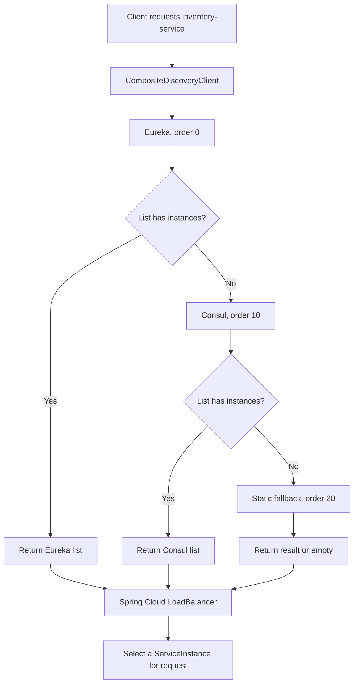

# Ordering Multiple DiscoveryClients and Composite Aggregation

In a distributed system, an application may see multiple service discovery sources at the same time. For instance, one group of services is registered in Eureka, another is discovered through Consul, and some fixed endpoints are declared via static configuration. When multiple `DiscoveryClient` implementations coexist in the Spring context, the application needs rules determining which source is queried first and how results are combined.

Spring Cloud Commons provides the `DiscoveryClient` abstraction and aggregation via `CompositeDiscoveryClient`. A key point is that the two main operations aggregate differently: `getInstances(serviceId)` returns the first non-empty instance list in discovery-client order; `getServices()` aggregates service names from all clients and deduplicates them. Therefore, the composite does not simply merge every instance from every registry into a single list.

For **SPRING_CLOUD_CORE**, understanding ordering and aggregation semantics prevents choosing the wrong registry, avoids duplicate instances, and makes fallback behavior predictable when one source lacks data. This lesson belongs to the **DiscoveryClient** chapter, focusing on `Ordered`, `CompositeDiscoveryClient`, the difference between `@Primary` and delegate ordering, and testing aggregation behavior.

## 1. Learning Objectives

After this lesson, you can:

- Explain why an application can have multiple `DiscoveryClient` beans.
- Describe the `DiscoveryClient` contract and the role of `getOrder()`.
- Configure precedence using `Ordered`, `getOrder()`, or `@Order`.
- Explain how `CompositeDiscoveryClient` handles `getInstances()` and `getServices()`.
- Distinguish first-non-empty selection from merging all instances.
- Understand why `@Primary` does not replace delegate ordering in the composite.
- Distinguish discovery provider selection from Spring Cloud LoadBalancer instance selection.
- Design fallbacks when a registry has no data or is unreachable.
- Test ordering, aggregated results, and duplicate service name cases.
- Diagnose why a service appears in the service list while instances are returned from another registry.

## 2. Why Have Multiple DiscoveryClients?

`DiscoveryClient` is an abstraction allowing applications to query instances by service ID without directly depending on a specific registry. An application can integrate multiple sources for several reasons:

- **Platform migration:** one group of services remains in Eureka while a newer group has migrated to Consul.
- **Segmented networks:** services in one zone are managed by an internal registry, while another zone uses a different source.
- **Static services:** rarely changing endpoints are declared via `SimpleDiscoveryClient`.
- **Multi-system integration:** an application needs to query both an internal registry and a partner platform's registry.
- **Fallback:** a secondary discovery source provides an instance list when the preferred source has no results.

For example, the classpath may include starters creating discovery beans for multiple providers. The application then needs to know how Spring Cloud orders and combines those beans.

### 2.1. Architecture Example

```text
Checkout Service
      |
      v
CompositeDiscoveryClient
      |
      +---- DiscoveryClient (Eureka, order 0)
      |
      +---- DiscoveryClient (Consul, order 10)
      |
      +---- DiscoveryClient (Static, order 20)
```

Lower order values take precedence first. If Eureka returns instances for the requested service, the composite uses that result. If Eureka returns an empty list, the composite proceeds to query Consul; only if Consul also has no results does it check the static source.

## 3. The DiscoveryClient Contract

`org.springframework.cloud.client.discovery.DiscoveryClient` defines common synchronous discovery operations:

```java
public interface DiscoveryClient extends Ordered {

    String description();

    List<ServiceInstance> getInstances(String serviceId);

    List<String> getServices();

    @Override
    default int getOrder() {
        return DEFAULT_ORDER;
    }
}
```

Meaning of each method:

| Method | Responsibility |
| --- | --- |
| `description()` | Returns a description of the discovery implementation |
| `getInstances(serviceId)` | Finds instances for a service ID |
| `getServices()` | Lists service IDs known to the discovery source |
| `getOrder()` | Provides priority order when multiple DiscoveryClients exist |

`DiscoveryClient` extends `Ordered`. The default order value is `DEFAULT_ORDER` (0) if an implementation does not override it. When multiple implementations exist, set explicit orders rather than relying on classpath bean discovery order.

### 3.1. ServiceInstance Is the Discovery Result

Each `ServiceInstance` represents a concrete endpoint, typically containing:

- Service ID.
- Instance ID.
- Host and port.
- A secure flag indicating whether the endpoint uses a secure connection.
- Metadata supplied by the provider.
- A URI that clients can use to build requests.

Example:

```java
List<ServiceInstance> instances =
        discoveryClient.getInstances("inventory-service");

for (ServiceInstance instance : instances) {
    URI uri = instance.getUri();
    Map<String, String> metadata = instance.getMetadata();
    // Use the selected instance metadata when appropriate.
}
```

Discovery returns instance lists according to the provider's semantics. It does not guarantee all instances are serving healthily at the moment of the next request; health, leases, caches, and provider state affect the outcome.

## 4. Ordering Multiple DiscoveryClients

`DiscoveryClient` implements `Ordered`, so each implementation can declare its priority via `getOrder()`. Spring also has `@Order` for many bean collections, but since `DiscoveryClient` already implements `Ordered`, use `getOrder()` as the source of truth for delegate order; do not rely on the annotation to override the interface's default value.

Basic rule:

| Order Value | Priority Level |
| --- | --- |
| `Ordered.HIGHEST_PRECEDENCE` | Highest, evaluated first |
| `-10` | Higher than `0` |
| `0` | Default value of `DiscoveryClient` |
| `10` | Lower than `0` |
| `Ordered.LOWEST_PRECEDENCE` | Lowest, evaluated last |

**A smaller order number means higher precedence (evaluated earlier).**

### 4.1. Setting Order with getOrder()

A custom implementation can declare:

```java
@Component
public class CorporateDiscoveryClient implements DiscoveryClient {

    @Override
    public int getOrder() {
        return 0;
    }

    @Override
    public String description() {
        return "Corporate registry";
    }

    @Override
    public List<ServiceInstance> getInstances(String serviceId) {
        // Query the corporate registry.
        return List.of();
    }

    @Override
    public List<String> getServices() {
        // Return service IDs known by this registry.
        return List.of();
    }
}
```

When you need to ensure this implementation takes precedence over others, give it a smaller order than the other implementations.

### 4.2. Role and Limits of @Order

Spring supports `@Order` for sorting beans in collections. However, `DiscoveryClient` already implements `Ordered` and provides a default `getOrder()`. When the comparator encounters an object implementing `Ordered`, `getOrder()` takes precedence; the annotation should not be relied upon as a safe override for that value.

Therefore, for `DiscoveryClient` implementations, override `getOrder()`:

```java
@Component
public class StaticFallbackDiscoveryClient implements DiscoveryClient {

    @Override
    public int getOrder() {
        return 20;
    }

    // Other DiscoveryClient methods...
}
```

`@Order` remains useful for other beans that do not implement `Ordered` themselves, or for extension points whose contracts rely on the annotation. For `DiscoveryClient`, `getOrder()` is the clearest and easiest approach to verify.

### 4.3. Do Not Rely on Dependency Declaration Order

Do not assume a starter declared earlier in Maven/Gradle will always produce an earlier discovery client. Dependency order, classpath order, or component scan order is not a stable priority policy.

Use `DiscoveryClient#getOrder()` and inspect the bean list as sorted by Spring.

## 5. How Does CompositeDiscoveryClient Aggregate?

`CompositeDiscoveryClient` is an implementation backed by multiple `DiscoveryClient` delegates. It provides a single facade so callers only interact with one discovery client.

Crucially, its two methods have different semantics.

### 5.1. getInstances(): Selecting the First Non-Empty List

When calling:

```java
List<ServiceInstance> instances =
        compositeDiscoveryClient.getInstances("inventory-service");
```

The composite iterates through delegates in priority order. It queries each client until it finds a non-empty instance list, and returns that list.

Example:

| Order | DiscoveryClient | Result of `getInstances("inventory-service")` |
| ---: | --- | --- |
| 1 | Eureka, order 0 | Empty list |
| 2 | Consul, order 10 | 2 instances |
| 3 | Static, order 20 | 1 instance |

The composite returns the 2 instances from Consul. It does not continue to fetch the instance from Static to append to the list.

If Eureka returns 2 instances, Consul and Static are not queried for that lookup.

### 5.2. getServices(): Merging Service Names

`getServices()` has a different goal: listing the service IDs known across all delegates. The composite aggregates lists from all discovery clients and removes duplicate names.

Example:

| DiscoveryClient | `getServices()` |
| --- | --- |
| Eureka | `checkout-service`, `inventory-service` |
| Consul | `inventory-service`, `payment-service` |
| Static | `legacy-catalog` |

Aggregated service list:

```text
checkout-service
inventory-service
payment-service
legacy-catalog
```

`inventory-service` appears only once even though it exists in both Eureka and Consul.

### 5.3. Comparison Table for the Two Methods

| Method | Aggregation Strategy | Combines All Results? |
| --- | --- | --- |
| `getInstances(serviceId)` | Returns the first non-empty list in delegate order | No |
| `getServices()` | Collects service IDs across delegates and deduplicates | Yes, at the service-name level |

This is the core rule of `CompositeDiscoveryClient`: the service list is a union, while a service's instance list is an ordered selection.

## 6. Example: Multiple Registries Containing the Same Service

Suppose `inventory-service` is registered in two registries:

```text
Eureka (order 0)
  inventory-service
    - 10.10.1.11:8080
    - 10.10.1.12:8080

Consul (order 10)
  inventory-service
    - 10.20.1.21:8080
```

When calling `getInstances("inventory-service")`, the composite returns the list from Eureka because it is the highest-priority delegate with a non-empty result.

Instances from Consul are not appended. Thus, the composite is not an active-active instance-merging mechanism across registries.

### 6.1. When the Higher-Priority Registry Lacks the Service

If Eureka returns an empty list:

```text
Eureka -> []
Consul -> [10.20.1.21:8080]
```

The composite returns the instance from Consul. This is fallback based on an empty result.

### 6.2. When the Higher-Priority Registry Returns Stale or Unhealthy Instances

If Eureka returns a non-empty list containing unreachable instances, the composite still considers that source to have produced a result and returns that list. It does not fall back to Consul merely because the Eureka instances are unreachable.

This means discovery client ordering is not health-based failover. Health filtering must be handled by the provider, registry, health checks, or an instance-selection layer with its own policy.

## 7. Exceptions from a Delegate and Fallback

A different case from an empty result is when a delegate throws an exception.

Example:

```text
Eureka.getInstances() -> throws IllegalStateException
Consul.getInstances() -> [instance]
```

Do not assume every exception from a delegate is treated as an empty list by the composite to automatically move on to the next delegate. Exception handling depends on implementation and version. The standard composite primarily describes selection over result lists; query errors may propagate to the caller.

If an operational requirement says "use the backup registry when the primary registry fails," define an explicit error policy:

- Are connection errors allowed to trigger fallback?
- Must authentication errors fail immediately?
- Are timeouts treated as temporary unavailability?
- Are metrics/alerts required when fallback occurs?
- When the primary source recovers, does traffic automatically return to it?

Do not catch every `RuntimeException` and return results from the secondary source. Doing so can mask configuration errors, bugs, or security failures. If resilience is needed, implement a wrapper that classifies exceptions and test each case explicitly.

## 8. @Primary Does Not Replace DiscoveryClient Order

`@Primary` and `Ordered` solve two different problems:

| Mechanism | Purpose |
| --- | --- |
| `@Primary` | Selects one bean when multiple candidates of the same type exist for a single injection point |
| `Ordered` / `@Order` | Orders multiple beans in a collection or extension chain; specifically for `DiscoveryClient`, use the implementation's `getOrder()` |
| `CompositeDiscoveryClient` | Invokes multiple delegates in order and aggregates results per composite semantics |

Example:

```java
@Bean
@Primary
DiscoveryClient preferredDiscoveryClient() {
    return new CorporateDiscoveryClient();
}
```

Declaring `@Primary` can decide which bean is injected when a constructor asks for a single `DiscoveryClient`. It does not exclude other `DiscoveryClient` beans from `List<DiscoveryClient>`, nor does it set composite precedence on its own.

If you want to control delegate ordering, override `DiscoveryClient#getOrder()`. Only use `@Primary` or a qualifier when you want one specific bean injected at a single injection site.

## 9. Distinguishing Composite Discovery from LoadBalancer

In Spring Cloud, there are two distinct selection layers:

1. **Composite DiscoveryClient selects the discovery source:** which registry/delegate supplies the instance list for a service ID.
2. **LoadBalancer selects the instance:** from the received instance list, the load balancer selects one instance for a specific request.



The composite decides **where the list comes from**. LoadBalancer decides **which instance in that list receives the request**.

If Eureka returns 5 instances, LoadBalancer can select one of those 5 according to its algorithm and state. It does not go back to Consul to append extra instances unless the architecture explicitly configures another discovery source.

### 9.1. Do Not Confuse Load Balancing with Registry Failover

LoadBalancer can apply retries, health-check filtering, or algorithmic instance selection. However, these mechanisms operate on the instance list provided by the discovery layer. They do not reorder `DiscoveryClient` delegates inside the composite.

## 10. SimpleDiscoveryClient in a Multi-Source Setup

`SimpleDiscoveryClient` is an implementation backed by static configuration, useful when no dynamic registry is present or when fixed instances must be declared.

Illustrative configuration example:

```yaml
spring:
  cloud:
    discovery:
      client:
        simple:
          instances:
            inventory-service:
              - uri: http://inventory-a.internal:8080
                metadata:
                  zone: zone-a
              - uri: http://inventory-b.internal:8080
                metadata:
                  zone: zone-b
```

If `SimpleDiscoveryClient` coexists with another discovery client, it may participate in delegate ordering depending on configuration and release-train auto-configuration. Set an explicit order if you intend it to act as a backup source.

Do not assume Simple always comes last in every configuration. Inspect `getOrder()` and the actual delegate list.

## 11. Writing an Ordered Custom DiscoveryClient

A custom discovery implementation should declare an explicit order, return `ServiceInstance` objects with accurate metadata, and avoid performing registration itself if registration responsibility belongs to another component.

Skeleton example:

```java
@Component
public class PartnerRegistryDiscoveryClient implements DiscoveryClient {

    @Override
    public int getOrder() {
        return 20;
    }

    @Override
    public String description() {
        return "Partner registry";
    }

    @Override
    public List<ServiceInstance> getInstances(String serviceId) {
        // Query partner registry and map its results to ServiceInstance.
        return List.of();
    }

    @Override
    public List<String> getServices() {
        // Return service IDs visible to this registry.
        return List.of();
    }
}
```

If this implementation is a fallback, order `20` is only meaningful when primary sources have smaller orders. Do not rely on class names or package ordering to guarantee fallback behavior.

### 11.1. Return an Empty List When a Service Is Absent

If the registry does not contain the service ID, the implementation should return an empty list per the discovery contract. Never return `null`, as callers/composites expect a valid collection.

### 11.2. Do Not Return Dummy Data to Force Composite Selection

Never return a placeholder `ServiceInstance` just to avoid an empty list. The composite will treat it as a valid result and stop querying subsequent delegates. A fake endpoint can cause consumers to call the wrong host/port.

### 11.3. Keep Metadata Consistent

When mapping results from an external registry:

- The service ID must match the name clients use for lookup.
- Host/port must be addresses reachable by consumers.
- Metadata must not contain secrets.
- `secure` must reflect the actual scheme.
- Instance IDs should remain stable within the instance's lifecycle.

## 12. Inspecting the DiscoveryClient List in the Spring Context

When an application includes multiple discovery starters, inspect the actual beans rather than guessing from dependencies.

You can inject the list:

```java
@Component
public class DiscoveryClientInventory {

    private final List<DiscoveryClient> discoveryClients;

    public DiscoveryClientInventory(List<DiscoveryClient> discoveryClients) {
        this.discoveryClients = discoveryClients;
    }

    public void reportOrder() {
        for (DiscoveryClient client : discoveryClients) {
            // Report implementation class, description and getOrder().
        }
    }
}
```

The Spring-injected list may be sorted according to order metadata. When verifying runtime policy, log:

- Implementation class name.
- `description()`.
- `getOrder()`.
- Bean name if retrieved via BeanFactory.

Do not log endpoints or sensitive metadata if the registry holds internal details.

### 12.1. Verifying the Active Composite

If the application expects `CompositeDiscoveryClient`, verify the actual bean type and the delegates it receives. Custom configurations, auto-configuration exclusions, qualifiers, or replacement beans can cause the application to use a different implementation.

In particular, if a single `DiscoveryClient` is injected directly with `@Primary`, the caller may receive an individual provider instead of the composite. Verify the exact bean injected at each call site.

## 13. Testing Ordering and Aggregation Mechanics

Write unit tests for first-non-empty and service-name union semantics, plus integration tests verifying bean ordering in the Spring context.

### 13.1. Testing That getInstances Picks the First Source with Results

You can create two `DiscoveryClient` stubs:

```java
class StubDiscoveryClient implements DiscoveryClient {

    private final int order;
    private final List<ServiceInstance> instances;
    private final List<String> services;

    StubDiscoveryClient(
            int order,
            List<ServiceInstance> instances,
            List<String> services) {
        this.order = order;
        this.instances = instances;
        this.services = services;
    }

    @Override
    public int getOrder() {
        return order;
    }

    @Override
    public String description() {
        return "Stub order " + order;
    }

    @Override
    public List<ServiceInstance> getInstances(String serviceId) {
        return instances;
    }

    @Override
    public List<String> getServices() {
        return services;
    }
}
```

Tests must sort delegates by order before passing them to the composite if instantiating the composite directly in a unit test:

```java
List<DiscoveryClient> delegates = new ArrayList<>(
        List.of(consulClient, eurekaClient));

AnnotationAwareOrderComparator.sort(delegates);

CompositeDiscoveryClient composite =
        new CompositeDiscoveryClient(delegates);
```

Then verify:

- When Eureka returns empty, the result comes from Consul.
- When Eureka returns non-empty, the result comes from Eureka.
- The result contains no instances from Consul when Eureka already has data.

Constructor signatures and stub details should be adjusted to match the Spring Cloud Commons release used by the project.

### 13.2. Testing That getServices Deduplicates Names

Suppose:

```text
Eureka: [checkout-service, inventory-service]
Consul: [inventory-service, payment-service]
Static: [legacy-catalog]
```

Verify the result contains all four service IDs and `inventory-service` appears only once. If the test depends on display order, verify the exact ordering guaranteed by the implementation in use; otherwise compare as a set.

### 13.3. Testing Order Through the Spring Context

Create two discovery beans with different orders and inject `List<DiscoveryClient>`. Verify the client with the smaller order appears first. This test verifies Spring's bean sorting mechanism; it is separate from testing which delegate `CompositeDiscoveryClient` actually picks.

### 13.4. Testing Exception Cases

Create a delegate that throws an exception and a backup delegate returning instances. Verify composite behavior matches the version in use. If the application must continue when the primary source fails, test the wrapper/resilience policy separately to prove exceptions are classified and fallback is intentional.

### 13.5. Testing Against Real Providers

Unit tests do not prove real-world registries return accurate data. With integration tests, verify:

1. Register services in each test registry.
2. Verify each `DiscoveryClient` sees the expected services/instances.
3. Verify the composite returns the list from the higher-priority source.
4. Remove instances from the higher-priority source and verify fallback.
5. Register a service with the same name in multiple sources and check `getServices()`.
6. Verify provider health/status filtering.

## 14. Common Mistakes

| Symptom | Common Cause | Resolution |
| --- | --- | --- |
| Always receiving instances from an unintended registry | That client's order is higher (smaller number) | Check `getOrder()` and set explicit ordering |
| Does not fall back to the second registry | The first registry returned a non-empty list | Check health/status and source selection policy |
| Instances from two registries are not merged | `getInstances()` uses first-non-empty | Use a custom merging architecture if merging is truly required |
| Service ID appears once despite existing in multiple registries | `getServices()` deduplicates names | This is normal service-name aggregation behavior |
| `@Primary` does not change composite order | `@Primary` picks a single bean, not delegate ordering | Use `Ordered`/`@Order` |
| Primary registry error fails the request | Delegate throws an exception instead of returning an empty list | Classify exceptions and design explicit fallback |
| Static client is always selected | Its order is currently higher than other clients | Set a larger order number for the fallback |
| LoadBalancer misses instances from secondary registry | Composite already returned a non-empty list from primary registry | Review discovery source selection before LoadBalancer |
| Service list shows all names but no instances are returned | `getServices()` is a union, while `getInstances()` selects one source | Inspect each delegate per service ID |
| Order changes across environments | Other beans present, duplicate default orders, or differing auto-config | Inspect bean list and set explicit orders |

## 15. Design Principles

- Integrate multiple `DiscoveryClient` implementations only when there is a clear architectural reason.
- Set explicit `getOrder()` values for implementations acting as primary/fallback.
- Remember that smaller order numbers are evaluated first.
- Understand `getInstances()` picks the first non-empty list rather than merging instances across all sources.
- Understand `getServices()` aggregates service names from multiple sources and deduplicates them.
- Never confuse an empty result with an exception; design fallback handling for each failure mode.
- Never use `@Primary` as a substitute for delegate ordering.
- Distinguish discovery source selection from LoadBalancer instance selection.
- Never return placeholder instances to force the composite to skip fallback.
- Verify ordering and bean types in a real Spring context.
- Write integration tests against registry providers to verify health, status, and propagation.
- Monitor which discovery source is selected and fallback frequency using safe metrics/logs.

## 16. Summary

When multiple `DiscoveryClient` instances coexist, Spring Cloud uses priority order to decide which source is queried first. `DiscoveryClient` supports `Ordered`; smaller order numbers take precedence first, with a default of `0` if an implementation does not override it.

`CompositeDiscoveryClient` provides a single facade across multiple delegates without applying the same aggregation strategy to every API. `getInstances(serviceId)` returns the first non-empty list in client order; it does not merge instances from all registries. `getServices()` aggregates service names from multiple clients and removes duplicates.

`@Primary` only resolves single-bean injection selection, whereas `Ordered`/`@Order` controls delegate ordering. Once the composite selects an instance list, Spring Cloud LoadBalancer selects the instance for a request. Separating these layers, testing empty/exception cases, and observing real registries keeps discovery behavior predictable.

## 17. References

- [Spring Cloud Commons — DiscoveryClient and Service Discovery](https://docs.spring.io/spring-cloud-commons/reference/spring-cloud-commons/common-abstractions.html)
- [Spring Cloud Commons — Multiple DiscoveryClient Implementations](https://docs.spring.io/spring-cloud-commons/reference/spring-cloud-commons/common-abstractions.html#multiple-discoveryclient)
- [Spring Cloud Commons API — DiscoveryClient](https://docs.spring.io/spring-cloud-commons/docs/current/javadoc-api/org/springframework/cloud/client/discovery/DiscoveryClient.html)
- [Spring Cloud Commons API — CompositeDiscoveryClient](https://docs.spring.io/spring-cloud-commons/docs/current/javadoc-api/org/springframework/cloud/client/discovery/composite/CompositeDiscoveryClient.html)
- [Spring Cloud Commons source — CompositeDiscoveryClient](https://github.com/spring-cloud/spring-cloud-commons/blob/main/spring-cloud-commons/src/main/java/org/springframework/cloud/client/discovery/composite/CompositeDiscoveryClient.java)
- [Spring Cloud LoadBalancer — Reference Documentation](https://docs.spring.io/spring-cloud-commons/reference/spring-cloud-commons/loadbalancer.html)
