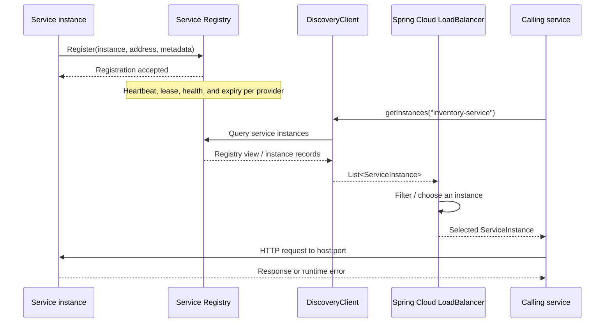
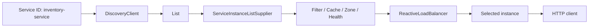

# Discovery Data Limits and Relationship with Actual Registries

> **Chapter:** DiscoveryClient
> **Module:** `SPRING_CLOUD_CORE` — core Spring Cloud foundations in distributed systems, especially Spring Cloud Commons, Context, external configuration, and Spring Boot version compatibility. Learners explore refresh scope, discovery, service registries, service communication, and testing and operating common abstractions.
> **Focus:** `DiscoveryClient` provides a unified service and instance lookup contract for Spring applications. This contract reduces coupling to Eureka, Consul, ZooKeeper, or other platforms, yet the returned data is only the discovery view supplied by the provider. You must understand the limits of `ServiceInstance`, the registration lifecycle, and the relationship between discovery data and actual service health.

## 1. What Problem Does DiscoveryClient Solve?

In a distributed system, a service typically runs multiple instances. Each instance's address can change when containers are recreated, hosts are replaced, autoscaling adjusts replica counts, or workloads move to different nodes. If clients call services using fixed IPs and ports, every deployment or scaling event can force configuration changes across dependent services.

Service discovery solves finding instance addresses by logical name. For example, an application makes a request to `inventory-service`; the discovery system returns the list of instances currently published by the provider for that service. A client-side load balancer then selects one instance to send the request to.

Spring Cloud Commons defines `DiscoveryClient` so Spring Cloud components share a common API, independent of specific implementations such as Eureka, Consul, or ZooKeeper. `DiscoveryClient` is not the entire registry system. It is the layer for querying discovery data exposed by the provider.

This distinction is critical. A returned instance list is not a guarantee that every instance is currently handling requests successfully. Data may be stale, health states may lag, metadata may vary by provider, and addresses may not be reachable from the caller's network.

### Learning Outcomes

After this lesson, learners can:

1. explain the role of `DiscoveryClient` in Spring Cloud Commons;
2. distinguish discovery read contracts from service registration APIs;
3. describe the standard data fields of `ServiceInstance`;
4. recognize information not guaranteed by the abstraction;
5. distinguish `SimpleDiscoveryClient` from discovery clients backed by a real registry;
6. explain the roles of `ServiceRegistry`, auto-registration, and the registration lifecycle;
7. understand the impact of multiple `DiscoveryClient` beans, priority ordering, and caching;
8. distinguish discovery health from the actual health of individual instances;
9. design testing and operations suited to the limits of discovery data.

## 2. Flow from a Running Service to a Client Request

A service registry and `DiscoveryClient` participate at different stages:

1. A service instance starts and creates registration info containing service ID, instance ID, address, port, and metadata.
2. The discovery integration registers the instance with the registry, typically via Spring Cloud auto-registration.
3. The registry stores the record and applies its own rules for heartbeats, leases, health checks, TTL, or deregistration.
4. `DiscoveryClient` queries the provider and maps results into `ServiceInstance` objects.
5. Spring Cloud LoadBalancer receives the instance list, applies an instance-selection strategy, and returns the target to the HTTP client.
6. The HTTP client connects to the chosen address. Requests can still fail due to network issues, timeouts, TLS, authorization, or application errors.



The diagram shows that discovery ends at supplying instance addresses. The actual request still must traverse the network and reach the target application.

## 3. The DiscoveryClient Contract

### 3.1. Core Operations

`org.springframework.cloud.client.discovery.DiscoveryClient` is a read-oriented abstraction. Its core methods include:

| Method | Meaning |
| --- | --- |
| `description()` | Describes the implementation; may be used in health indicators |
| `getInstances(serviceId)` | Retrieves the known `ServiceInstance` list for a service ID |
| `getServices()` | Retrieves the service IDs known to the client |
| `probe()` | Checks whether the discovery client can execute a discovery operation |
| `getOrder()` | Returns the order when multiple discovery clients exist |

`DiscoveryClient` extends `Ordered`, so implementations can participate in sorting when an application has multiple discovery sources.

`getInstances(serviceId)` returns the instance list for a service. If the service does not exist or the provider finds no matching instances, the list is typically empty. Do not treat an empty list as sole proof that the service is undeployed; it could be due to namespaces, credentials, filters, caches, or provider sync state.

`getServices()` returns the service IDs known to the current implementation. This API does not guarantee listing every service across every cluster or namespace. Results depend on access permissions, configuration scope, and provider rules.

### 3.2. DiscoveryClient Is Not a Registry Management API

Registration and deregistration operations belong to a different abstraction: `ServiceRegistry`. Spring Cloud Commons provides `register(Registration)`, `deregister(Registration)`, and corresponding status operations on implementations. `DiscoveryClient` focuses on reading the service catalog and instances.

Do not use `DiscoveryClient` as though it could create, edit, or delete registrations. Nor should you assume every provider shares the same semantics for registration, health status, heartbeats, or metadata.

### 3.3. Blocking and Reactive Discovery

Spring Cloud Commons supports both blocking `DiscoveryClient` and reactive `ReactiveDiscoveryClient`. The two APIs serve different programming models:

- The blocking client returns results synchronously, fitting imperative call stacks.
- The reactive client emits data via reactive types, fitting WebFlux applications or reactive pipelines.

Having two APIs does not mean the system has two independent registries. They can be two adapters over the same provider. Pick the client style matching your application stack and confirm the corresponding implementation is on the classpath.

Discovery clients can be toggled as needed:

```yaml
spring:
  cloud:
    discovery:
      enabled: true
      blocking:
        enabled: true
      reactive:
        enabled: true
```

`false` values can disable all discovery or blocking/reactive clients individually. Only disable a branch when you are certain components in the application do not require that API.

### 3.4. Is @EnableDiscoveryClient Still Required?

In current Spring Cloud versions, `@EnableDiscoveryClient` is no longer mandatory in many standard setups. When a suitable discovery implementation is on the classpath and auto-configuration is active, Spring Boot can auto-configure both the client and registration.

The annotation remains useful when you want to declare intent explicitly or customize `autoRegister`. Do not add the annotation out of habit without checking the starter, auto-configuration, and version in use.

## 4. Standard Data of ServiceInstance

`DiscoveryClient` returns `List<ServiceInstance>`. The `ServiceInstance` interface standardizes basic instance information.

| Field | Meaning | Limits to Remember |
| --- | --- | --- |
| `getInstanceId()` | Unique ID of the instance per registration | May be `null`; ID generation depends on the provider |
| `getServiceId()` | Registered service ID | Naming rules, case sensitivity, and namespaces depend on the provider |
| `getHost()` | Hostname of the instance | May be an IP, DNS name, or proxy address |
| `getPort()` | Port of the instance | Does not prove the port is open or reachable from the caller |
| `isSecure()` | Indicates whether the instance uses HTTPS | Does not replace certificate verification or TLS policies |
| `getUri()` | URI of the service instance | URI may be syntactically valid while the endpoint remains unreachable |
| `getMetadata()` | Key/value metadata map of the instance | May be null or empty; schema and semantics are defined by provider/app |
| `getScheme()` | Scheme if supplied by the implementation | May be `null`; understand provider fallback rules |

### 4.1. Instance ID Is Not Always Present

`ServiceInstance.getInstanceId()` is nullable and default implementations may return `null`. Therefore, do not write code assuming an instance ID always exists:

```java
String instanceId = instance.getInstanceId();

if (instanceId == null || instanceId.isBlank()) {
    // Use other details for logging or diagnostics.
}
```

If you need a stable ID for logging, tracing, or sticky routing, verify the provider's rules. Do not generate a random ID on every discovery read and treat it as the instance's identity.

### 4.2. Host and Port Are Not a Health Check

A `ServiceInstance` may hold a valid host and port even while:

- the pod has stopped, but the registry has not removed the record yet;
- a firewall or network policy blocks the connection;
- the port is not open because the app has not bound its server yet;
- the endpoint is only reachable from a different subnet;
- the TLS certificate is invalid;
- the app accepts the request, yet a downstream dependency is failing.

Consequently, having an instance in the list only proves the discovery provider supplied a record. It does not prove a business request will succeed.

### 4.3. Metadata Is Open Data, Not a Shared Schema

Metadata is typically `Map<String, String>`. Keys such as `zone`, `weight`, `version`, `region`, `canary`, or `hint` may be defined by the provider or application.

There is no universal rule forcing every provider to return these keys or assign the same meaning. For example:

- `zone` may describe an availability zone, rack, or region depending on the integration;
- `weight` may be used by LoadBalancer if a supporting supplier is configured;
- `version` may mean application version, API contract, or release channel;
- `hint` may support per-request instance filtering.

If metadata is part of your system's contract, define keys, types, valid values, owners, and versioning. Handle missing or malformed keys. Never place secrets, tokens, or sensitive information in metadata because registries can expose this data to many clients.

## 5. DiscoveryClient and Real Service Registries

### 5.1. The Registry Stores Registrations; DiscoveryClient Provides a Lookup View

A service registry such as Eureka, Consul, or ZooKeeper stores registration data and provides mechanisms to update instance status. Each system has its own model for:

- registration and deregistration;
- heartbeats or leases;
- TTLs and expiration timing for stale records;
- health checks and instance statuses;
- replication, caching, and consistency across nodes;
- namespaces, datacenters, tags, or metadata;
- authentication and read/write permissions.

Spring Cloud Commons standardizes the API layer used by Spring applications. It does not eliminate internal differences among providers.

An application can call `DiscoveryClient.getInstances("inventory-service")` without knowing the concrete provider. However, when designing operations, read the provider documentation to understand when records are created, when they are purged, and how health status updates work.

### 5.2. ServiceRegistry and Registration

`ServiceRegistry` is the abstraction for registration operations. `Registration` describes the instance to register and extends `ServiceInstance` information. Concrete implementations use provider-specific registration types, such as Eureka, Consul, or ZooKeeper.

In many configurations, a service is registered automatically when the web server initializes. Auto-registration can be disabled via configuration:

```yaml
spring:
  cloud:
    service-registry:
      auto-registration:
        enabled: false
```

Or use `@EnableDiscoveryClient(autoRegister = false)` if the application chooses to control registration via the annotation. Do not disable auto-registration just to work around a lookup error; clarify whether the service should self-register or be managed by an external controller.

### 5.3. Registration Lifecycle Events

Spring Cloud Commons provides events related to auto-registration:

- `InstancePreRegisteredEvent` is published before the instance is registered;
- `InstanceRegisteredEvent` is published after registration completes.

Applications can listen to these events to write audit logs, update internal state, or perform post-registration actions. If `spring.cloud.service-registry.auto-registration.enabled=false`, these auto-registration events are not published along the default flow.

A successful registration event does not mean all service dependencies are ready. If readiness depends on a database, message broker, or downstream service, use appropriate readiness checks before admitting traffic to the instance.

### 5.4. Actuator's Service Registry Endpoint

Spring Cloud Commons provides the `/actuator/serviceregistry` endpoint when Actuator and a suitable Registration bean are present. GET returns registration status; POST can request a status change via a payload containing a `status` field.

Accepted status values depend on the provider. For example, Eureka supports `UP`, `DOWN`, `OUT_OF_SERVICE`, and `UNKNOWN`. Do not apply this list as a universal contract for Consul or ZooKeeper.

The status-changing endpoint is an administrative endpoint. Expose it only when needed, protect it with authentication/authorization, and audit invocations. Never allow ordinary business clients to alter registration status.

## 6. What DiscoveryClient Does Not Guarantee

This is the most important part when designing systems that rely on discovery.

### 6.1. Does Not Guarantee the List Is Always Up to Date

An instance list can lag behind real-world state because:

- the registry only receives heartbeats periodically;
- TTL has not expired yet, so old records remain;
- registry nodes are still syncing or replication lags;
- the client caches results;
- LoadBalancer adds another cache layer;
- the provider only updates health at intervals;
- a network partition prevents the client from reading updated state.

There is no single synchronization delay shared across all providers. Determine heartbeat intervals, lease durations, eviction timeouts, and cache TTLs from the documentation of the implementation in use.

### 6.2. Does Not Guarantee Identical Consistency Across Providers

One provider may return lists from a local cache, while another queries the server or uses a watch/stream mechanism. Some registries prioritize availability during network partitions; others may reject queries or return stale data.

Therefore, never design business algorithms assuming every instance sees the exact same list at the exact same moment.

### 6.3. Does Not Guarantee Instance Ordering

The `getInstances()` list must not be treated as a priority order or a meaningful round-robin order. Providers may alter ordering depending on caching, responses, or internal storage.

When selecting an instance, use Spring Cloud LoadBalancer or an explicitly designed policy. Do not take element `[0]` and treat it as a primary instance unless the provider explicitly defines such a contract.

### 6.4. Does Not Guarantee the Instance Is Ready to Handle Requests

A record may appear in discovery before all application dependencies are ready. An instance marked `UP` in the registry may also fail after its latest health check.

Discovery health, process liveness, application readiness, and request success are distinct signals. Combine health checks, readiness probes, bounded retries, timeouts, and circuit breakers according to your service architecture.

### 6.5. Does Not Guarantee Metadata Shares the Same Semantics

Metadata is an open map. If a client relies on `zone=zone-a`, the provider and registering service must agree on that key. If another implementation uses `availability-zone`, the client will not automatically recognize them as the same information.

Establish a platform-wide metadata contract, test both registration and consumption sides, and support missing data or legacy formats during migrations.

### 6.6. Does Not Guarantee Endpoints Are Reachable from Every Network

A registry may contain addresses valid only within one network segment or namespace. A client in another cluster may see the record yet lack a route to that address.

In multi-cluster or multi-region environments, define discovery scope, network topology, DNS, service mesh, or gateways. Do not advertise internal addresses to clients outside the permitted boundary.

### 6.7. Does Not Guarantee Identical Service ID Rules Across Systems

One provider may normalize service names to lowercase, while another is case-sensitive or incorporates namespaces. Standardize service IDs across `spring.application.name`, registries, clients, and LoadBalancer.

For example, `Inventory-Service`, `inventory-service`, and `inventory` may be three separate IDs depending on the provider. Never use display names in place of logical service IDs.

## 7. SimpleDiscoveryClient: Discovery from Static Configuration

### 7.1. When Is It Used?

If no `DiscoveryClient` connected to a real service registry is on the classpath, Spring Cloud can use `SimpleDiscoveryClient`. This implementation pulls instance info from properties rather than querying a dynamic registry.

Example:

```yaml
spring:
  cloud:
    discovery:
      client:
        simple:
          instances:
            inventory-service:
              - uri: http://inventory-1.internal:8080
              - uri: http://inventory-2.internal:8080
            pricing-service:
              - uri: https://pricing.internal:8443
```

The equivalent properties format can be written as:

```properties
spring.cloud.discovery.client.simple.instances.inventory-service[0].uri=http://inventory-1.internal:8080
spring.cloud.discovery.client.simple.instances.inventory-service[1].uri=http://inventory-2.internal:8080
spring.cloud.discovery.client.simple.instances.pricing-service[0].uri=https://pricing.internal:8443
```

These values are configured alongside the application or property sources loaded by Spring Boot. If instance addresses change, the configuration must be updated and the application reloaded via the appropriate mechanism.

### 7.2. Limitations of SimpleDiscoveryClient

`SimpleDiscoveryClient` is useful for local development, integration tests, or environments with fixed topologies. It does not automatically provide:

- dynamic instance registration;
- heartbeats;
- leases or TTLs;
- automatic eviction of dead instances;
- multi-node catalog synchronization;
- automatic health state updates from a registry;
- autoscaling discovery.

Because the list comes from properties, a URI can remain in configuration after the target server has stopped. If used in environments needing high availability, pair it with appropriate configuration updates and health checking.

### 7.3. Do Not Confuse SimpleDiscoveryClient with a Real Registry

The interface name is the same, but the data source is different. `SimpleDiscoveryClient` is an implementation reading instance lists from properties. A discovery client backed by Eureka/Consul/ZooKeeper queries a provider with its own registration and health lifecycle.

Do not use `SimpleDiscoveryClient` to validate features such as lease expiration, auto-registration, or deregistration of a real registry.

## 8. Multiple DiscoveryClients and Priority Ordering

An application may have multiple discovery implementations on the classpath, such as Eureka and Consul simultaneously. `DiscoveryClient` extends `Ordered`, allowing implementation ordering.

The default order is `0`. Custom implementations can override `getOrder()`. Spring Cloud-provided implementations may have dedicated properties to adjust ordering, such as `spring.cloud.{clientIdentifier}.discovery.order` or Eureka's corresponding property.

When multiple discovery clients coexist:

- check which implementations are actually auto-configured;
- verify the order and composite discovery client semantics in the release in use;
- do not assume instance lists are always merged across all registries;
- check what happens when the same service ID appears in two providers;
- test when the higher-priority provider lacks the service or errors;
- avoid having two registration sources register the same service under conflicting rules.

If the architecture needs to merge multiple registries, design an explicit adapter/federation layer and specify how to handle duplicate instances, metadata conflicts, service IDs, and per-source errors. Do not rely on simply adding two starters to produce a unified service catalog matching business needs.

## 9. Relationship Between DiscoveryClient and Spring Cloud LoadBalancer

### 9.1. DiscoveryClient Supplies the List; LoadBalancer Picks the Instance

Spring Cloud LoadBalancer uses the discovery client to retrieve `ServiceInstance` lists, then applies an instance-selection algorithm. Default implementations include round-robin and random; suppliers or load balancers can be customized per service.

Conceptual flow:



DiscoveryClient does not execute requests to instances itself. Nor does it replace retries, timeouts, circuit breakers, or HTTP clients.

### 9.2. Caching Can Make Data Staler

Spring Cloud LoadBalancer caches instance lists. Current documentation describes a default TTL of `35s` and initial cache capacity of `256`. Caching can be adjusted or disabled via the corresponding properties.

Example:

```yaml
spring:
  cloud:
    loadbalancer:
      cache:
        enabled: true
        ttl: 20s
        capacity: 256
```

If the discovery provider already maintains its own cache, adding LoadBalancer caching can cause double caching. An instance removed from the registry may continue appearing in both the provider cache and LoadBalancer cache longer than expected.

Spring Cloud documentation recommends disabling LoadBalancer caching when the DiscoveryClient implementation already caches data, such as Eureka DiscoveryClient, to avoid double caching. Measure real update latency before selecting a TTL.

### 9.3. HealthCheckServiceInstanceListSupplier

Spring Cloud LoadBalancer provides `HealthCheckServiceInstanceListSupplier` to periodically check instances returned by a delegate supplier. This mechanism is particularly helpful with `SimpleDiscoveryClient`, since static lists cannot detect dead instances on their own.

With a real registry, the provider typically already tracks instance health state, so a second health check from LoadBalancer is not always needed. If enabled additionally, weigh probe overhead and endpoint semantics.

One important detail: when no instances pass the health check, the supplier may return the full received list. Therefore, do not treat the health-check supplier as an absolute fault-isolation barrier. Timeouts, bounded retries, and circuit breakers are still needed at the service-calling layer.

### 9.4. Metadata-Driven Zone, Weight, and Hint

LoadBalancer can use metadata to filter or prioritize instances:

- zone preference based on the `zone` key;
- weighted supplier reading the `weight` key;
- hint-based supplier reading the `hint` key.

These mechanisms take effect only when metadata is registered accurately and the corresponding supplier is configured. When a key is missing, LoadBalancer may use a default value or return the original list per the supplier's semantics.

Do not use metadata to implement security boundaries. A request hint header or self-declared service metadata never replaces authorization and network policies.

## 10. What Does the Discovery Health Indicator Tell Us?

### 10.1. DiscoveryClientHealthIndicator

Spring Cloud Commons provides `DiscoveryClientHealthIndicator`. By default, the indicator may call `getServices()` to check the discovery client and include the service list in health details.

In deployments with many services, querying the entire service list on every health check can be costly. You can set `spring.cloud.discovery.client.health-indicator.use-services-query=false` so the indicator calls `probe()` instead. Implementations can override `probe()` with a lighter operation than `getServices()`.

Related properties:

```yaml
spring:
  cloud:
    discovery:
      client:
        health-indicator:
          enabled: true
          include-description: false
          use-services-query: false
```

### 10.2. Discovery Health Is Not Downstream Health

If the health indicator reports `UP`, it generally indicates the discovery client succeeded in running its query/probe per the implementation's contract. It does not prove:

- every service ID has instances;
- every instance is healthy;
- every host/port is reachable;
- TLS handshakes succeed;
- business requests succeed;
- the registry holds the latest data.

To verify a specific downstream service, use dedicated health checks or smoke tests with explicit timeouts and scope. Never turn a service's liveness probe into a synchronous chain calling all downstreams, as one slow dependency could mark multiple services unhealthy simultaneously.

### 10.3. Distinguishing Health Signals

| Signal | Question Answered |
| --- | --- |
| Process liveness | Is the process still running and able to continue? |
| Application readiness | Is the instance ready to accept traffic per the application's policy? |
| Discovery health | Can the discovery client query/probe the provider? |
| Registry instance status | What status does the provider currently assign to the registration? |
| LoadBalancer health check | Does the instance respond to the configured probe endpoint? |
| Business smoke test | Does a concrete business request succeed? |

These signals complement one another. Do not use a single `UP` status as a stand-in for all of them.

## 11. Example: Using DiscoveryClient to Inspect Data

You can inject `DiscoveryClient` to inspect service and instance lists:

```java
import java.util.List;

import org.springframework.cloud.client.ServiceInstance;
import org.springframework.cloud.client.discovery.DiscoveryClient;
import org.springframework.stereotype.Component;

@Component
public class DiscoveryInspector {

    private final DiscoveryClient discoveryClient;

    public DiscoveryInspector(DiscoveryClient discoveryClient) {
        this.discoveryClient = discoveryClient;
    }

    public void inspectInventoryInstances() {
        List<ServiceInstance> instances =
                discoveryClient.getInstances("inventory-service");

        for (ServiceInstance instance : instances) {
            String instanceId = instance.getInstanceId();

            // Log non-sensitive metadata only; avoid logging the entire map.
            System.out.printf(
                    "service=%s instance=%s uri=%s secure=%s%n",
                    instance.getServiceId(),
                    instanceId,
                    instance.getUri(),
                    instance.isSecure()
            );
        }
    }
}
```

This is an example for observing discovery data. In business code, avoid manually picking `instances.get(0)` and sending requests directly. Use a client integrated with Spring Cloud LoadBalancer to select instances by policy and preserve retry/metrics flows.

If you only need to list service IDs for diagnostics:

```java
List<String> serviceIds = discoveryClient.getServices();
```

Do not expose this catalog publicly if service names reveal internal structure. Also avoid logging all metadata if it contains unnecessary internal details.

## 12. Common Error Scenarios

| Symptom | Possible Cause | How to Check |
| --- | --- | --- |
| `getInstances()` returns an empty list | Wrong service ID, namespace, credentials, or no registration yet | Compare service ID, provider catalog, and access permissions |
| Instance exists but calls time out | Stale record, network policy, routing, or wrong port | Check host/port from caller's network and TTL |
| Newly started service not found yet | Auto-registration disabled, registration failed, or provider not updated | Check registration events, provider logs, and service ID |
| Stopped instance still appears | Heartbeat/lease not expired, deregistration did not run, or cache not expired | Check TTL, health state, deregistration logs, and caches |
| Two registries return different lists | Multiple DiscoveryClients, differing orders, or differing scopes | Check classpath, order, and specific providers |
| LoadBalancer keeps picking old instance | Double caching or excessively long cache TTL | Check provider cache and `spring.cloud.loadbalancer.cache.*` |
| Discovery health is `UP` yet downstream fails | Health indicator only checks the discovery client | Check instance health and business smoke tests |
| `zone` metadata missing | Registration lacks metadata or provider mapping differs | Inspect registration payload and metadata map |
| Instance ID is `null` | Provider does not supply an ID or mapping lacks an ID | Use an appropriate ID convention; do not assume non-null |
| `SimpleDiscoveryClient` still returns dead instance | URI declared statically in properties | Update config or use a dynamic registry/health check |
| `/serviceregistry` does not work | Missing Actuator, no Registration bean, or endpoint not exposed | Check dependencies, auto-registration, and endpoint exposure |
| Service ID mismatch | Case differences, prefixes, or namespaces | Standardize service naming and contract tests |

## 13. Testing Strategies for Discovery Data

### 13.1. Unit Testing Code That Consumes DiscoveryClient

When writing code using `DiscoveryClient`, test at least:

- valid service ID and nonexistent service;
- empty instance list;
- multiple instances for the same service;
- `instanceId` is `null`;
- metadata missing keys or containing invalid values;
- unexpected host/port/scheme;
- exceptions when querying the provider;
- data containing duplicate instances.

Do not write logic assuming the list always has elements or metadata always contains a specific key.

### 13.2. Integration Testing with a Real Registry or Test Container

Unit tests mocking `DiscoveryClient` do not verify the registration lifecycle. Integration tests are needed for key behaviors:

1. service starts and gets registered;
2. registry returns the expected service ID and instances;
3. instances carry expected metadata;
4. service shutdown and deregistration work;
5. heartbeat/TTL evicts stale records within the provider's configured window;
6. health status changes are reflected in discovery results;
7. callers have permission to query the right namespace/service;
8. registry connection errors are detected.

When tests use test containers or dedicated provider environments, control ports, networks, and lease timings to prevent flaky tests.

### 13.3. Testing Caching and Consistency

Design tests to observe latency from a registration change to `getInstances()` output:

- register instance A;
- query from caller;
- add instance B;
- measure time until B appears;
- deregister A;
- measure time until A disappears;
- test with provider cache and LoadBalancer cache toggled on/off.

Evaluate results against the SLA and limits of the provider in use, rather than expecting a fixed number across all registries.

### 13.4. Testing Metadata Contracts

If LoadBalancer uses `zone`, `weight`, or `hint`, verify:

- registration actually sends the key;
- the discovery adapter returns the key in `ServiceInstance.getMetadata()`;
- data types parse cleanly;
- missing values have sensible fallbacks;
- older metadata versions remain compatible during rollouts;
- metadata contains no credentials or secrets.

## 14. Design and Operational Recommendations

- Use `DiscoveryClient` for service/instance lookups and `ServiceRegistry` for the registration lifecycle.
- Treat `ServiceInstance` as an address and metadata record, not proof of a healthy serving endpoint.
- Standardize service IDs across `spring.application.name`, registries, clients, and LoadBalancer.
- Define owners and schemas for custom metadata.
- Do not rely on element ordering in `getInstances()`.
- Set timeouts for discovery queries and downstream requests.
- Inspect registry and LoadBalancer caches to avoid double caching.
- Use health indicators to monitor discovery query capability while keeping readiness/smoke tests for critical services.
- Choose `SimpleDiscoveryClient` for static topologies, tests, or development; use registry-backed implementations when dynamic registration and lifecycles are needed.
- When multiple `DiscoveryClient` beans exist, configure ordering and thoroughly test composite semantics.
- Protect the `/serviceregistry` endpoint and registry administration APIs.
- Monitor registration success, deregistration, heartbeat expiration, empty instance lists, stale instances, and connection errors.
- Read provider documentation to understand consistency, leases, namespaces, statuses, and metadata mappings.

## 15. Practice Exercises

### Exercise 1 — Instance Appears in List Yet Requests Time Out

`DiscoveryClient.getInstances("inventory-service")` returns three instances. One of the three cannot be reached from the calling service.

Explain why discovery can still return that instance. Propose appropriate network, registry health, cache TTL, and LoadBalancer health checks.

### Exercise 2 — Distinguishing DiscoveryClient and ServiceRegistry

A development team injects `DiscoveryClient` and tries to call `register()` to register a new instance.

Explain why this confuses the abstractions. State the roles of `ServiceRegistry`, `Registration`, and auto-registration in Spring Cloud Commons.

### Exercise 3 — Inconsistent Metadata

Service A registers `zone=zone-a`, while Service B registers `availability-zone=zone-a`. LoadBalancer only reads the `zone` key.

Predict the instance-selection outcome and propose a versioned metadata contract.

### Exercise 4 — Double Caching

Eureka already caches registry data, while LoadBalancer also uses a 35-second cache TTL. After an instance is deregistered, the client still picks the old instance.

Explain the two cache layers and propose configuration and latency measurements to avoid retaining stale records too long.

### Exercise 5 — SimpleDiscoveryClient in Production

A team uses `SimpleDiscoveryClient` with three URIs in YAML. One target server stops, yet still appears in the list.

Explain SimpleDiscoveryClient's static data source and recommend a dynamic registry or suitable health checks.

### Exercise 6 — Health Indicator Reports UP Yet Service Fails Requests

`DiscoveryClientHealthIndicator` reports `UP`, yet requests to `payments-service` return HTTP 503.

Analyze what the health indicator checked and what it did not check. Propose supplementary business smoke tests or health policies.

### Exercise 7 — Two Coexisting Discovery Providers

An application has both Eureka and Consul on the classpath. One service ID exists in both registries with different addresses.

Explain the role of `Ordered`, describe how to verify which implementation takes precedence, and design a test to catch duplicates or conflicting data.

### Quick Self-Check

1. What kind of operations does `DiscoveryClient` primarily provide? **Reading service IDs and `ServiceInstance` lists.**
2. Which abstraction owns service registration APIs? **`ServiceRegistry` with `Registration`.**
3. Does `getInstances()` prove an endpoint is reachable? **No.**
4. Is `instanceId` always non-null? **No, the interface permits null.**
5. Does metadata have a universal schema across all providers? **No, keys and meanings are usually defined by the provider/application.**
6. Where does `SimpleDiscoveryClient` get its data? **From configuration properties.**
7. Which method can `DiscoveryClientHealthIndicator` call by default? **`getServices()`; can be switched to `probe()`.**
8. What is LoadBalancer's role after discovery? **Selecting an instance from the supplied list.**
9. Why is double caching risky? **It can prolong the retention of deregistered instances.**
10. Does registry status `UP` guarantee business requests succeed? **No.**

**Core message:** `DiscoveryClient` is the lookup contract for service and instance data, whereas `ServiceRegistry` manages registration operations. `ServiceInstance` only standardizes a basic set of fields; freshness, health, metadata, consistency, and reachability still depend on providers, caches, and networks. Combine discovery with LoadBalancer, health/readiness probes, timeouts, bounded retries, and integration tests to handle actual service state properly.

**References:** [Spring Cloud Commons — Common Abstractions](https://docs.spring.io/spring-cloud-commons/reference/spring-cloud-commons/common-abstractions.html), [Spring Cloud LoadBalancer](https://docs.spring.io/spring-cloud-commons/reference/spring-cloud-commons/loadbalancer.html), [DiscoveryClient interface](https://github.com/spring-cloud/spring-cloud-commons/blob/main/spring-cloud-commons/src/main/java/org/springframework/cloud/client/discovery/DiscoveryClient.java), [ServiceInstance interface](https://github.com/spring-cloud/spring-cloud-commons/blob/main/spring-cloud-commons/src/main/java/org/springframework/cloud/client/ServiceInstance.java), and [SimpleDiscoveryClient implementation](https://github.com/spring-cloud/spring-cloud-commons/blob/main/spring-cloud-commons/src/main/java/org/springframework/cloud/client/discovery/simple/SimpleDiscoveryClient.java). Details regarding registries, health, metadata, and caching may vary by provider/release train; check documentation for your application's exact Spring Boot/Spring Cloud versions.
