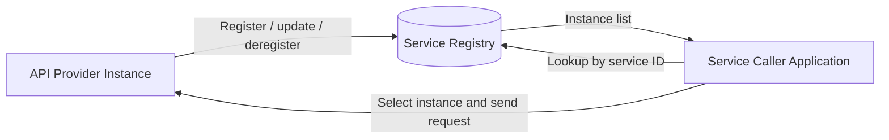

# Distinguishing Service Discovery from Service Registration

In a Spring Cloud system, a service often runs as multiple instances. Each instance has its own network address and may be created, restarted, or replaced during operation. Services that call one another need to know which instances are available and how to connect to them. Service discovery solves this problem through two related operations with different purposes: **service registration** and **service discovery (lookup)**.

Service registration publishes an instance's information to a registry system so that other components can find it. Service discovery reads the published information to obtain a list of callable instances. Spring Cloud Commons provides separate abstractions for these two directions, allowing applications to work with multiple registry mechanisms without depending directly on each provider's API.

## 1. Two Operations Solving Two Different Directions

Suppose the system has a service `inventory-service` with three instances. When an instance starts up, it needs to publish its service ID, host, port, and required metadata. When `order-service` wants to check inventory, it looks up `inventory-service` to receive one or more instance addresses.

| Aspect | Service registration | Service discovery / lookup |
|---|---|---|
| Purpose | Publish an instance so the system knows it exists | Find published instances of a service ID |
| Data flow direction | Service application writes information to the registry | Calling application reads information from the registry or discovery source |
| Typical actor | Service providing the API | Service consuming the API |
| Input data | Service identifier, instance address, port, metadata, and status according to the provider's mechanism | Service ID to look up, e.g., `inventory-service` |
| Result | Registry stores or updates the instance record | List of `ServiceInstance` matching the service ID |
| Timing | When the instance joins the system, updates its status, or leaves the system | When a target needs to be selected for a call; may occur many times throughout the application lifecycle |

An application can take on both roles. `inventory-service` registers itself so other services can find it, and at the same time it can look up `pricing-service` to calculate prices. Having discovery capability does not automatically mean an application has registered itself; likewise, successful registration does not guarantee that the application has configured a client to look up other services.



A registry is the place that stores or distributes information about instances. Depending on the platform, it can be a dedicated server cluster, an orchestration service, or a static configuration source. Details such as heartbeats, leases, health checks, and data synchronization depend on the implementation.

## 2. Service Discovery in Spring Cloud: `DiscoveryClient`

In Spring Cloud Commons, `DiscoveryClient` is the abstraction for reading discovery information. The core API consists of:

- `getInstances(String serviceId)`: returns the known `ServiceInstance` objects for the given service ID.
- `getServices()`: returns the service IDs known to the discovery client.
- `description()`: describes the discovery client implementation.

`ServiceInstance` represents an address that can be used to connect to an instance. It provides information such as service ID, host, port, URI, security protocol, and metadata. Metadata can contain additional data published by the provider or application, such as deployment zone or service version; the exact meaning of each key must be agreed upon between the writer and the reader.

For example, a component in `order-service` can look up the instances of `inventory-service`:

```java
import java.net.URI;
import java.util.List;

import org.springframework.cloud.client.ServiceInstance;
import org.springframework.cloud.client.discovery.DiscoveryClient;
import org.springframework.stereotype.Component;

@Component
public class InventoryEndpointResolver {

    private final DiscoveryClient discoveryClient;

    public InventoryEndpointResolver(DiscoveryClient discoveryClient) {
        this.discoveryClient = discoveryClient;
    }

    public List<ServiceInstance> findInstances() {
        return discoveryClient.getInstances("inventory-service");
    }

    public URI findOneEndpoint() {
        return findInstances().stream()
                .findFirst()
                .map(ServiceInstance::getUri)
                .orElseThrow(() -> new IllegalStateException(
                        "No instance found for inventory-service"));
    }
}
```

The code snippet illustrates reading the instance list and getting the URI of one element. It uses the first element as an example, not as a load-balancing strategy suitable for production. When there are multiple instances, the application needs an appropriate target selection policy, while handling empty lists, failing instances, or stale discovery data.

In a Spring Cloud application, you can combine this with Spring Cloud LoadBalancer to select an instance according to a configured policy. For example, an HTTP client configured with the logical service name `inventory-service` can let LoadBalancer resolve that name to an actual instance. This keeps business code from having to pick the first element manually or build its own request distribution algorithm.

Key point: `DiscoveryClient` answers the question **"Which instances of this service exist?"**. It is not the API used to publish the application's current instance.

### A Discovery Source Does Not Necessarily Support Dynamic Registration

Spring Cloud can provide discovery clients backed by systems such as Eureka, Consul, or ZooKeeper through their respective integrations. In addition, `SimpleDiscoveryClient` can obtain the instance list from static configuration. With a static source, an application can look up declared addresses without dynamically registering with a registry server.

This shows that lookup capability and registration capability are two independent capabilities. Having a working `DiscoveryClient` is not enough to conclude that the application is registering itself with a registry.

## 3. Service Registration in Spring Cloud: `ServiceRegistry`

On the write side, Spring Cloud Commons defines the `ServiceRegistry` abstraction. This interface works with a concrete `Registration` type provided by the integration. `Registration` represents the instance information to register and extends the `ServiceInstance` model.

The main operations of `ServiceRegistry` include:

- `register(registration)`: registers the instance with the registry.
- `deregister(registration)`: deregisters the instance.
- `getStatus(registration)`: reads the status as represented by the provider.
- `setStatus(registration, status)`: updates the status according to the provider's capabilities.
- `close()`: releases or closes related resources depending on the implementation.

This is the write-side abstraction. The concrete registration type, how the registration object is created, the meaning of status, and the heartbeat mechanism are determined by the registry integration library. Therefore, you should not assume that a `Registration` object can be used interchangeably across all providers.

Conceptually, the registration flow can be described as follows:

```java
// Lifecycle illustration code, not a generic initialization snippet for all providers.
Registration registration = createProviderSpecificRegistration();
ServiceRegistry<Registration> registry = obtainProviderSpecificRegistry();

registry.register(registration);

// When the instance leaves the system gracefully:
registry.deregister(registration);
```

`createProviderSpecificRegistration()` and `obtainProviderSpecificRegistry()` are integration-dependent parts. In a real application, the provider's Spring Boot starter usually configures the necessary beans and lifecycle mechanisms. An application typically does not create a `Registration` manually by guessing the structure of another provider.

### Automatic Registration and Proactive Registration

Many Spring Cloud integrations support automatically registering an instance during application startup and deregistering it when the application shuts down. In that case, the integration coordinates with the Spring lifecycle to collect instance information and send the corresponding operations to the registry.

Some systems or special scenarios allow an application to call the registration API proactively. Which approach is used depends on the provider, configuration, and library version. You should check the documentation of the integration in use before calling `register` yourself, because enabling auto-registration while also registering manually can create duplicate operations or hard-to-control states.

Successful registration also does not mean the instance is definitely serving requests. The registry may hold a record while health checks, readiness probes, or heartbeat mechanisms still mark the instance as unavailable. Conversely, when an instance stops abruptly, it may not have time to send a deregister command; the registry usually needs heartbeats, TTLs, or health checks to evict expired records.

## 4. Comparing Abstractions and Roles

| Spring Cloud abstraction | Operation direction | Question answered | Primary object |
|---|---|---|---|
| `DiscoveryClient` | Read/lookup | "Which instances does service X have?" | `ServiceInstance` |
| `ServiceRegistry` | Write/register and update status | "How do I publish or remove this instance?" | `Registration` |
| `ServiceInstance` | Describe instance | "What address and metadata does this instance have?" | Host, port, URI, service ID, metadata |
| `Registration` | Describe instance for registration | "This is the instance to put into the registry" | Integration-specific instance info |

Do not confuse Spring Cloud Commons' `ServiceRegistry` with the registry server itself. `ServiceRegistry` is the Java interface that the application uses to perform registration operations. The registry server or backend is the system that stores, manages, and distributes the records. An integration connects these two sides together.

## 5. Combined Lifecycle of Registration and Discovery

A typical flow in a system consists of the following steps:

1. An instance of the providing service starts up and determines its service ID along with an address reachable by other instances.
2. The provider's registration mechanism publishes the instance to the registry. If auto-registration is used, the integration performs this step following the application lifecycle.
3. The registry validates or stores the record according to its policy. Health checks or heartbeats may continue updating availability.
4. The consuming service calls `DiscoveryClient` with the target service ID or uses an HTTP client integrated with Spring Cloud LoadBalancer.
5. Discovery returns a list of instances. The target selection component applies load-balancing policies, deployment zones, or other constraints.
6. The client sends the request to the selected instance and applies timeouts, retries, circuit breakers, and appropriate resilience measures.
7. When the instance stops gracefully, the registration is removed. If the instance stops abruptly, the provider's expiration or health check mechanism needs to detect and remove the invalid record.

Registration typically occurs less frequently than discovery, though actual frequency depends on caching, refreshes, heartbeats, and how clients fetch data. Discovery does not necessarily send a request to the registry server every time: some implementations use local caches or background refresh mechanisms.

## 6. Common Misconceptions and Pitfalls

### Discovery Works but Registration Does Not

An application may read an instance list from static configuration or a shared registry while having no registration of its own. This is a valid setup if addresses are managed externally. If you expect the instance to appear automatically on startup, verify that the registration integration has been added and auto-registration is enabled properly.

### Registration Succeeds but Discovery Finds Nothing

Registration may have been sent to one registry or namespace while the discovery client reads from a different registry, datacenter, namespace, or configuration. Also check the service ID, access permissions, network, health status, sync delay, and cache. The two abstractions only work together properly when they look at the same compatible data source.

### Registry Has a Record but Requests Cannot Connect

Registration information may contain a host or port that is only meaningful inside a container or internal network. An instance visible to the registry is not necessarily reachable by a client on another network. Verify the advertised address, mapped ports, DNS, HTTP/HTTPS protocol, and security metadata.

### Stale Instances Still Appear After Application Shutdown

If the application shuts down abruptly, the deregister command may not be executed. Understand the provider's TTL, lease, heartbeat, and health check mechanisms, and set failure detection intervals appropriate for operational requirements. Never assume every registry removes instances immediately.

### Selecting an Instance by Taking the First Element

`DiscoveryClient.getInstances()` returns a list without guaranteeing that the first element is the best instance or evenly distributed. Use Spring Cloud LoadBalancer or an appropriate target selection policy, and always handle the empty-list case.

## 7. Testing and Operations

When verifying service discovery in development or production environments, test both directions separately:

- **For registration:** confirm the published service ID, host, port, and metadata; check status after application startup; observe heartbeats or health checks; stop the application gracefully and confirm the record is removed.
- **For discovery:** call `getInstances()` for the correct service ID; confirm the list contains the expected addresses; test behavior when the list is empty; verify that the client selects an instance and successfully calls the endpoint.
- **For consistency:** compare the registry source written by the registering side with the source read by the discovering side; check namespace, datacenter, profile, cache, and access permissions.
- **For reliability:** test timeouts, retries, circuit breakers, and behavior when the registry is temporarily unreachable. Discovery only provides location information; it does not replace network-call fault tolerance.

In automated testing, you can use a mock discovery client or static discovery configuration to verify that consumer code handles service IDs, multi-instance lists, and empty lists properly. For integration testing, test both the registration lifecycle and lookup through the same real provider or equivalent test environment. Testing `getInstances()` alone does not prove that automatic registration works.

## 8. Key Takeaways

Service registration is the operation of **putting instance information into a registry system**. Service discovery is the operation of **reading instances by service ID**. In Spring Cloud Commons, `ServiceRegistry` serves the registration direction, while `DiscoveryClient` serves the discovery direction. `Registration` and `ServiceInstance` describe instance data in these two related contexts.

When designing or troubleshooting, clearly identify whether an application is acting as a service provider or consumer, inspect the write path and read path independently, and then verify that both sides share the same registry source and agree on service IDs, addresses, and instance states. This distinction helps isolate issues more accurately and avoids confusing "the service has been published" with "the service has been discovered and called successfully."
