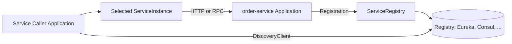
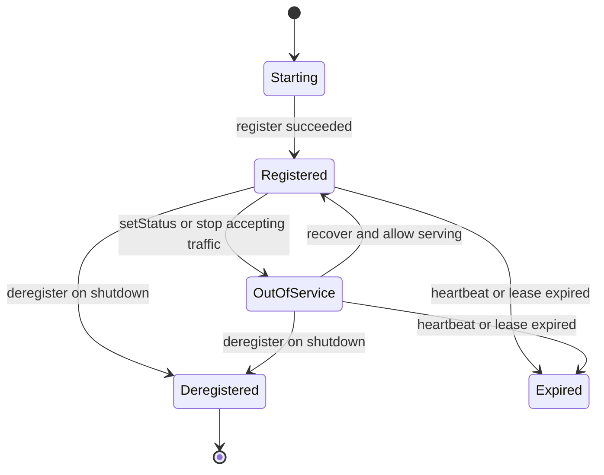

# ServiceRegistry and Registration Contracts

In a multi-service system, each running instance of an application needs to publish its address so that other components can find and call it. When an instance starts up, it registers its information with the service registry system. When it stops, it needs to deregister or update its status so clients do not keep sending requests to an address that is no longer serving.

Spring Cloud Commons defines common abstractions for this workflow. `Registration` describes an instance that can be registered; `ServiceRegistry` defines operations for registering, deregistering, and updating status. An integration library such as Eureka or Consul provides the concrete implementation. As a result, application code can work against Spring Cloud's common contract while registry storage and communication details are delegated to the provider.

## Objectives

After this lesson, you will be able to:

- Explain the roles of `Registration` and `ServiceRegistry` in Spring Cloud Commons.
- Identify the identification data, address, and metadata of a service instance.
- Describe the lifecycle of registration, status updates, and deregistration.
- Distinguish the write responsibility of `ServiceRegistry` from the discovery responsibility of `DiscoveryClient`.
- Design service registration configuration and tests without unnecessarily coupling to a specific registry.

## Position of the Two Abstractions in the Architecture

A service can have multiple instances running concurrently. Each instance has its own network address, yet all of them typically publish the same logical service name, such as `order-service`. The registry maintains instance records for clients to look up.



`Registration` represents an instance's data on the registration side. `ServiceRegistry` provides operations that act on the registry. On the read side, `DiscoveryClient` queries the published instances. A client-side load balancer, such as Spring Cloud LoadBalancer, can use that instance list to choose a target to call.

The two abstractions are related but do not replace each other:

| Component | Primary responsibility | Question it answers |
|---|---|---|
| `Registration` | Carries data of an instance to be registered | What name, address, and metadata does this instance have? |
| `ServiceRegistry` | Registers, deregisters, and updates registration status | How do I publish or modify an instance? |
| `DiscoveryClient` | Reads the instance list from a discovery source | Which instances of this service currently exist? |
| Spring Cloud LoadBalancer | Selects an instance to send a request to | Among the discovered instances, which one should be called? |

Spring Cloud Commons only standardizes the contract. It does not force every registry to store data in the same internal structure or have the same record expiration policy.

## The Registration Contract

In Spring Cloud Commons, `Registration` extends `ServiceInstance`. Therefore, a registration can be viewed as a service instance with the information needed for clients to connect.

The core properties of `ServiceInstance` include:

| Property | Meaning | Example |
|---|---|---|
| `serviceId` | Logical name of the service | `order-service` |
| `host` | Host or network address of the instance | `10.20.1.15` |
| `port` | Port receiving traffic | `8080` |
| `secure` | Whether the instance uses a secure connection | `true` |
| `uri` | URI constructed from connection information | `https://10.20.1.15:8080` |
| `metadata` | Additional attributes published by the instance | `zone=ap-southeast-1a`, `version=v2` |

The method names in the API are `getServiceId()`, `getHost()`, `getPort()`, `isSecure()`, `getUri()`, and `getMetadata()`. A provider may add extra fields such as instance ID, datacenter name, health-check path, or lease configuration. Those extended fields are not part of the minimal contract that every implementation must provide.

### Service ID and Instance Identity

`serviceId` identifies the logical service. Multiple instances can share `serviceId=order-service`; this is how the system scales horizontally. The registry needs to distinguish individual instance records using an identification mechanism supported by the provider. That mechanism may rely on an instance ID, address, lease, or a combination of fields.

`serviceId` should not be treated as the unique identifier of a single process. When there are three instances of `order-service`, clients need to receive three separate addresses to choose from. If two instances accidentally publish the same identifier required by the provider to be unique, one record may overwrite or conflict with the other.

### Metadata

Metadata is a key-value map attached to an instance. It is commonly used to publish routing or classification information. The example below illustrates metadata in Java:

```java
Map<String, String> metadata = Map.of(
        "zone", "ap-southeast-1a",
        "version", "v2",
        "capability", "order-read");
```

This is illustrative data, not a complete way to initialize a registration. The property name or API used to attach metadata to a registration depends on the starter/provider in use. Check the chosen implementation's documentation before putting configuration into your application.

Metadata should be small, stable, and meaningful to clients or operational processes. Do not put passwords, tokens, private keys, or personal data into metadata: the registry may distribute these fields to many clients and retain them longer than the process lifetime. Metadata is also not a replacement for authentication or authorization.

### The Published Address Must Be Reachable

The address in a registration is the address clients will use. In container, virtual machine, or multi-subnet environments, the server's bind address may differ from the address visible to clients. If an instance registers `localhost`, a non-routable internal network IP, or an unexposed port, the registry may still accept the registration successfully while clients fail to connect.

When deploying, verify all of the following together:

1. The application actually listens on the expected host and port.
2. The published address is routable from the clients that need to call the service.
3. `secure` and the scheme match the enabled protocol.
4. Firewalls, network policies, ingress, or service mesh allow the required connection flow.
5. Metadata does not cause clients to pick the wrong instance or wrong protocol version.

## The ServiceRegistry Contract

`ServiceRegistry<R extends Registration>` is the abstraction for interacting with the registry for a specific registration type. The core contract consists of the following methods:

```java
public interface ServiceRegistry<R extends Registration> {

    void register(R registration);

    void deregister(R registration);

    void close();

    void setStatus(R registration, Object status);

    Object getStatus(R registration);
}
```

This is the contract shape for reading and discussing the API; the concrete implementation is provided by the discovery provider on the classpath.

### register

`register(registration)` publishes the instance to the registry. Once the operation succeeds and the data is made available by the provider, clients can discover the instance through the corresponding discovery mechanism.

You should not infer that calling `register` means every client immediately sees the instance. The registry may need time to synchronize, clients may cache the list, or the provider may apply its own refresh interval. Consistency level and latency depend on the implementation.

### deregister

`deregister(registration)` asks the registry to remove the instance from the discoverable list. This is an important step when the application shuts down gracefully or when an instance stops accepting traffic.

If a process is killed abruptly or the host loses network connectivity, the application may not have time to call `deregister`. Therefore, many registries use leases, heartbeats, TTLs, or health checks to detect invalid records. The detection mechanism and record cleanup time are provider-specific traits, not guaranteed to be identical by the common interface.

### setStatus and getStatus

`setStatus(registration, status)` updates the status attached by the provider to the registration. `getStatus(registration)` reads that status back. Both the parameter and return value are typed as `Object` because registries may use different status models.

For example, one provider may represent status using its own enum; another may map it to health status or serving status. You must not assume that the strings `UP`, `DOWN`, or `OUT_OF_SERVICE` have the same meaning and are supported across every provider. Use the status types and state transition rules documented by the implementation.

Registry status also does not replace the application's health endpoint. Health checks reflect operational capability according to application or platform criteria; registry status is information the provider uses to decide whether an instance should be advertised or selected. Both mechanisms need to be configured consistently.

### close

`close()` allows the implementation to close or release resources associated with the service registry. This is a lifecycle operation of the registry component. Applications usually let Spring manage bean lifecycles and auto-configuration components; do not call `close()` arbitrarily per request or from multiple places, as that may close resources still used by other components.

`close()` should also not be treated as a guaranteed replacement for `deregister()`. Cleanup rules when closing an application depend on the implementation and the provider's auto-registration mechanism. If specific shutdown behavior must be guaranteed, check the provider documentation and test the application shutdown scenario.

## Lifecycle of a Registration

A typical lifecycle can be described as follows:



The states in the diagram describe the conceptual lifecycle. `Starting`, `Registered`, `OutOfService`, and `Expired` are not a standard enum applicable to all providers.

An operational workflow should consider the following stages:

1. **Startup:** the application loads configuration, determines the published address, and satisfies required readiness conditions.
2. **Registration:** the auto-registration mechanism or integration code calls `register` to publish the instance.
3. **Serving:** the instance receives traffic; the registry and health checks continue updating availability.
4. **Pausing:** before maintenance or traffic draining, the instance can be transitioned to a non-serving status according to the provider's capabilities.
5. **Shutdown:** the application stops accepting traffic, calls `deregister` if possible, and then releases resources.

The exact order depends on the framework and provider. In particular, do not write a manual registration handler alongside auto-registration without clearly determining which component owns the lifecycle. Registering twice can create duplicate records, overwrite metadata, or cause shutdown to remove the wrong instance.

## Integration in a Spring Boot Application

In a typical Spring Cloud application, the discovery starter provides implementations of these abstractions and can configure auto-registration. When auto-registration is enabled, Spring manages registration timing according to the application lifecycle; business code does not need to call `register` on every request.

If manual registration control is needed, the generic type parameter of `ServiceRegistry` is bound to the concrete `Registration` type provided by the provider. The example below illustrates usage at the contract level; `ProviderRegistration` and `ProviderStatus` are placeholder names and must be replaced with the actual types from the starter in use:

```java
public final class ManualRegistrationLifecycle {

    private final ServiceRegistry<ProviderRegistration> serviceRegistry;
    private final ProviderRegistration registration;

    public ManualRegistrationLifecycle(
            ServiceRegistry<ProviderRegistration> serviceRegistry,
            ProviderRegistration registration) {
        this.serviceRegistry = serviceRegistry;
        this.registration = registration;
    }

    public void start() {
        serviceRegistry.register(registration);
    }

    public void stopAcceptingTraffic() {
        serviceRegistry.setStatus(registration, ProviderStatus.OUT_OF_SERVICE);
    }

    public void shutdown() {
        serviceRegistry.deregister(registration);
    }
}
```

The code snippet illustrates API call order, not a configuration that compiles as-is without a provider. In a real application, ensure `registration` represents the current instance accurately, shutdown is safe if called repeatedly, and registry communication errors are handled according to operational policy.

If you want to disable auto-registration in Spring Cloud Commons configurations that support this property, you can set:

```yaml
spring:
  cloud:
    service-registry:
      auto-registration:
        enabled: false
```

Verify the property and behavior on the version of Spring Cloud you are using. When disabling auto-registration, the application must have another registration process if it still needs to appear in the registry. Do not disable this mechanism solely to avoid startup errors without evaluating the impact on discovery and routing.

## Error Handling and Operational Scenarios

Service registration is a network interaction. The registry may be unreachable, credentials may expire, the published address may be wrong, or the instance may be rejected due to an identity conflict. Applications need a clear policy for each failure mode.

| Scenario | Potential consequence | Resolution approach |
|---|---|---|
| Registry temporarily unreachable | Instance does not appear in discovery yet | Decide whether the application may start or must fail fast; use bounded retries and log the cause clearly |
| Registration succeeds with wrong address | Clients find the instance but cannot connect | Check advertised host, port, scheme, and network policy |
| Instance stops abruptly | Stale record may persist | Use provider heartbeats, leases, TTLs, or health checks |
| Incorrect or stale metadata | Clients route based on outdated criteria | Manage metadata alongside config versions and run contract tests with clients |
| Status update not supported | Instance may still be considered available | Check provider capabilities; use supported draining or health check mechanisms |
| Duplicate registration | May create redundant records or conflicts | Assign a single owner to manage the registration lifecycle |

Infinite retries when the registry is down can increase load and mask configuration errors. Conversely, allowing an application to start without registering may leave a service running yet unreachable via discovery. The right policy depends on the service's role, fault tolerance, and deployment architecture.

For shutdown, allocate sufficient time for draining and deregistration before the platform forcibly terminates the container or process. If the grace period is too short, the deregister call may not complete. If the shutdown routine fails to run, TTLs or health checks serve as an important fallback layer.

## Testing the Registration Contract

You can test across multiple layers, from unit to integration:

**Unit testing orchestration logic.** Use a mock `ServiceRegistry` to verify that the application calls `register` on startup, updates status when draining begins, and calls `deregister` on shutdown. Also test error branches to ensure the application logs or reacts according to the chosen policy.

```java
@Test
void registersInstanceOnStartup() {
    ServiceRegistry<ProviderRegistration> registry = mock(ServiceRegistry.class);
    ProviderRegistration registration = testRegistration();
    ManualRegistrationLifecycle lifecycle =
            new ManualRegistrationLifecycle(registry, registration);

    lifecycle.start();

    verify(registry).register(registration);
}
```

The example uses Mockito to illustrate call verification. `ProviderRegistration` and `testRegistration()` must be replaced with your project's provider types and factory.

**Integration testing with a real registry or test container.** Verify that the instance registers with the correct service ID, host, port, and metadata; query via the discovery client to see the instance; then deregister and confirm the instance disappears within the convergence window defined by the provider.

**Lifecycle and network failure testing.** Test application startup when the registry is unavailable, registry recovery after an outage, shutdown with a drain period, and abrupt instance termination. These tests help validate retry, fail-fast, caching, and TTL settings in real configurations.

Do not check only that `register()` was called. The ultimate verification is that clients can discover and connect to the right instance under expected operating conditions.

## Key Principles to Remember

- `Registration` describes a service instance; `serviceId` is a logical name that can be shared across multiple instances.
- `ServiceRegistry` is the write contract: register, deregister, and update status.
- `DiscoveryClient` is the read abstraction for instance lists; LoadBalancer can use that list to choose a target.
- Published address, port, scheme, and metadata must reflect how clients actually access the service.
- Status values, instance identity, heartbeats, TTLs, and synchronization behavior depend on the provider.
- Auto-registration lets Spring manage the lifecycle; if switching to manual registration, designate a single owner for that process.
- Testing must go from API calls all the way to actual discovery and connectivity.

When selecting or changing a discovery provider, start from the shared contracts of `Registration` and `ServiceRegistry`, then evaluate provider-specific extensions such as metadata, status, health checks, leases, and shutdown policies. This approach keeps application code structurally stable while allowing deployment configuration to adapt to the concrete registry.
